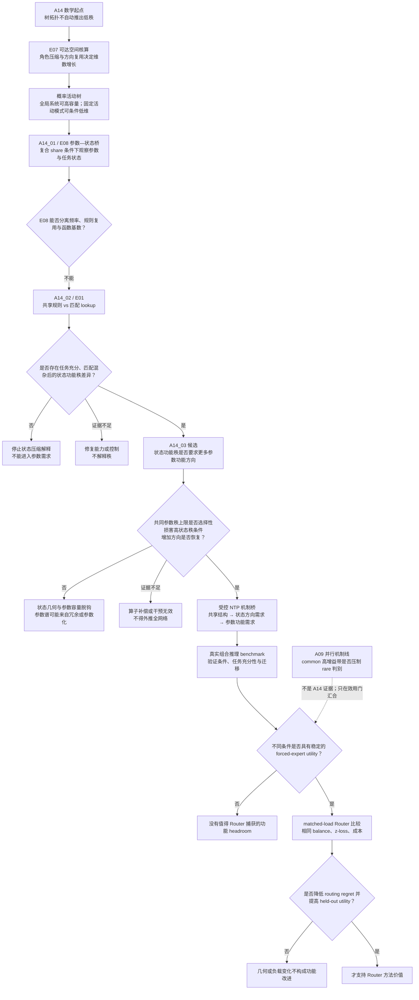

# A14 整体推进线：从条件树定理到状态秩、参数方向与 Router 效用

> 用途：展示 A14 各锚点的逻辑归属和停止条件。  
> 边界：本文是当日导航，不替代 canonical anchor、protocol 或 result。

## 1. 一句话主线

> A14 先证明“条件激活的树计算何时具有受控可达维数”，再检验 NTP 是否把共享规则学成任务充分的低状态功能秩；只有该状态差异成立，才检验它是否因果地要求不同的参数功能容量，最后才允许进入真实任务上的专家效用与 Router。

## 2. 逻辑流程图



## 3. 锚点归属

| 锚点 | 唯一问题 | 当前状态 | 不能替代 |
|---|---|---|---|
| A14 parent | 层次组合何时保持受控低维 | 数学定理成立；真实全局传播主张关闭 | NTP 学习机制 |
| A14_01 | 关系复用的参数压缩能否桥接到任务状态 | E08 有边界、证据不足 | 纯频率因果结论 |
| A14_02 | 共享规则是否比匹配 lookup 降低任务状态功能秩 | 当前主锚点；E01 待审核 | 参数方向需求 |
| A14_03 | 更高状态功能秩是否要求更多参数功能方向 | 候选；被 A14_02 阻塞；无 protocol | Router 专家效用 |
| A09 | common/rare 的高增益谱带是否造成 Router 判别错配 | 并行 Router 机制线 | A14 的状态—参数因果桥 |
| A06_04 | 真实 workload 是否存在稳定专家效用 headroom | 后续真实效用门 | 表示或参数低秩理论 |

## 4. 对“低共现、高秩、更多参数方向”的精确修正

原直觉不能直接写成：

```text
低共现
→ 状态高秩
→ 参数必然需要更多方向
```

当前合法的可证伪链是：

```text
在暴露次数、规则数量、上下文和能力匹配后，
共享结构是否改变任务状态功能秩？
→ 若改变，
共同参数秩上限是否选择性损害高状态秩条件？
→ 若损害且更多方向能够恢复，
才支持状态方向需求转化为参数功能方向需求。
```

因此：

- 低共现是候选条件，不是高秩原因；
- 高状态谱秩不是参数需求证据；
- 参数谱秩高也可能只是冗余；
- 必须通过任务保持干预建立“功能秩”。

## 5. 与去 common Router 的关系

去 common 路线与 A14 不是同一个定理分支。

它提出：

> 如果某个 common 方向显著改变 Router logit 或负载，却不改变专家效用排序，那么它是 Router 的 nuisance，可以考虑从 Router 视图中抑制。

A14 提供的潜在贡献是识别“条件计算可能需要保留哪些任务方向”；A09 提供的潜在贡献是识别“哪些共享方向可能遮蔽条件判别”。两条线只有在 forced-expert utility 门上汇合。

现实比较必须保持：

- 相同负载均衡方法；
- 相同 z-loss；
- 相同激活专家数与容量；
- 相同计算和通信成本。

最终裁定看 held-out utility 与 routing regret，而不是只看负载、NMI、谱或专家子空间分离。

## 6. 今日审核顺序与停止点

1. **先审 A14_02 anchor 与 E01 protocol。**
2. **再审 A14_03 Thinking Card 与候选 anchor。**
3. A14_02 未产生稳定状态秩差异前，A14_03 不创建 protocol。
4. A14_03 未建立参数功能需求前，不把参数谱故事迁移到真实语言。
5. 真实任务未出现稳定专家效用 headroom 前，不设计或宣称新 Router 有必要。

**当前唯一下一决策：**批准、修改或拒绝 A14_02_E01 protocol。

