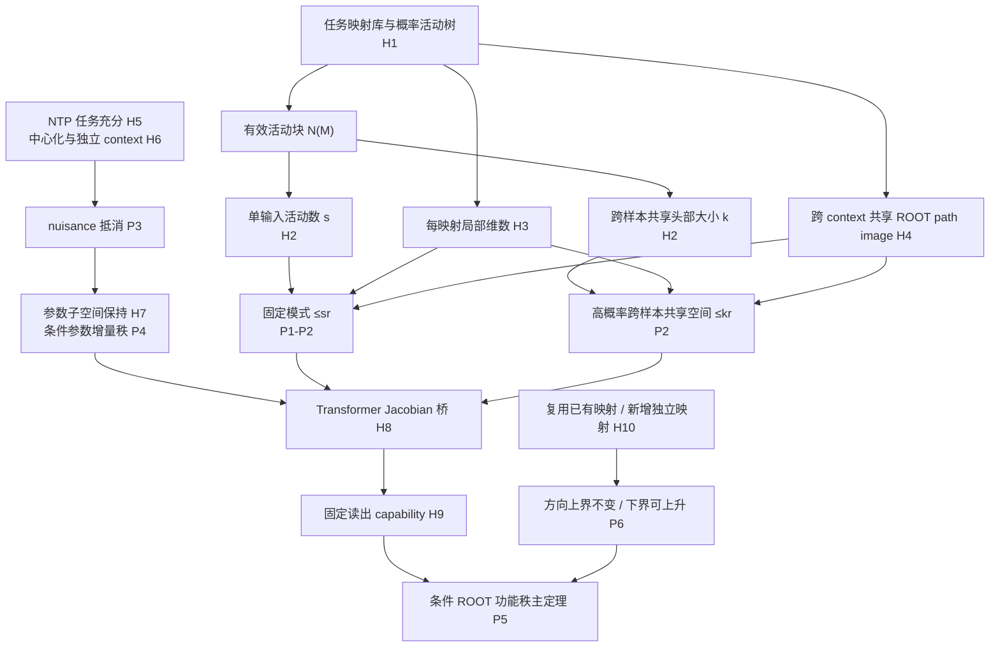
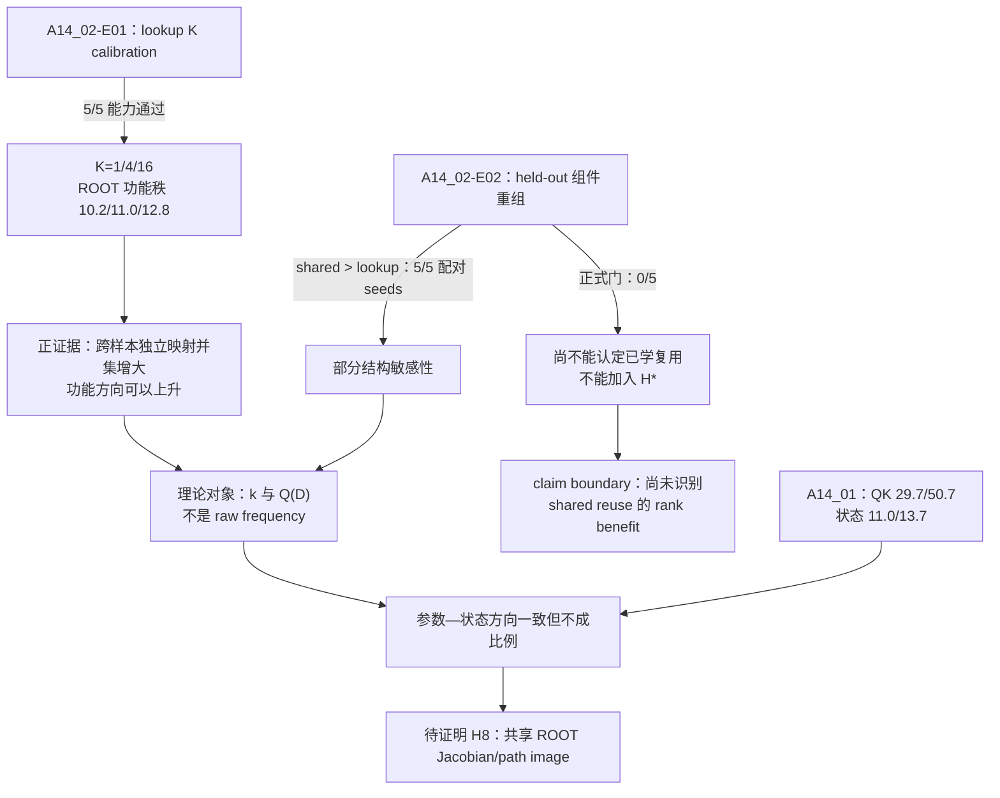

# 任务映射复用与条件概率树下的 NTP 条件秩：完整理论证明

## 从任务映射复用、概率稀疏活动到 ROOT 条件功能秩的完整理论

**理论状态：**受控模型中的正式条件定理；一般 Transformer 的共享
Jacobian/path-image 条件仍待证明或反例否定。

**组会摘要：**[0724 focus](../focus.md)

---

## 摘要

本文回答 0721 组会最后总结中的第二个问题：

> 若任务相关语言计算具有层级结构，NTP（next-token prediction，下一词预测）
> 是否会使参数空间和表征空间低秩？

我们的当前模型不是一棵静态语义树，而是：

> 模型拥有一个全局高容量的任务映射库。给定输入与任务条件，一个随机活动模式
> 选择并组合其中一部分任务映射，形成该次计算的活动树。

令 $N(M)$ 表示一次活动中不同的“任务映射—ROOT 路径像块”数量。只要求
$N(M)\le s$ 仍然不够：不同样本可以各自稀疏地调用不同映射，跨样本方向并集仍可
很大。本文采用的完整核心假设是：存在一个至多含 $k$ 个已学映射块的共享头部
$\mathcal H_\star$，使

$$
\Pr\!\left[
\mathcal J_{\mathrm{eff}}(M)\subseteq\mathcal H_\star,\
N(M)\le s
\right]
\ge1-\delta_M,
\qquad
|\mathcal H_\star|\le k.
$$

它同时表示：大多数输入每次只调用至多 $s$ 个映射，而且这些输入共同复用一个小的
映射集合；小概率尾部可以调用头部外的新映射或稠密映射集合。即便如此，该分布假设
本身也不是低秩的充分条件：一个活动映射仍可产生满维状态。还必须要求每个映射的
任务维数至多为 $r$，并且同一映射跨独立上下文到达 ROOT 时复用同一个低维路径像
空间。

在这些条件下，固定活动模式 $m$ 的任务相关 ROOT 表征属于至多
$rN(m)\le sr$ 维子空间；所有头部事件中的样本还共同属于至多 $kr$ 维的同一
ROOT 空间。前者是单模式活动上界，后者才是跨样本复用上界。若表征空间外仍有高
能量 nuisance（任务无关变化），该结论只适用于任务相关分量；只有再控制 hidden
residual energy，才能推出 raw representation 的近似低秩。

对参数空间，本文证明一个更窄的结论：在显式任务映射参数块、受控初始化、固定或
受控的输出对比空间，以及保持矩阵子空间的 SGD 类优化器下，固定模式的任务参数
增量秩至多为

$$
\min(b,rN(m)),
$$

而一个共同覆盖头部映射的受控任务块增量秩至多为 $\min(b,kr)$，其中 $b$ 是输出
对比方向数。该结论不适用于完整 Transformer 参数矩阵；头部外与跨模式的参数并集
仍可全局高秩。

NTP 的作用也被精确定义。当 next token 只依赖低维任务充分统计量，任务无关
context 在给定任务统计量后均值为零时，population nuisance gradient 在零 nuisance
初始化处精确抵消。真正使经验 nuisance 写入按 $n_{\mathrm{eff}}^{-1/2}$ 衰减的是
独立、多样的上下文，而不是重复同一个样本。

对一般 Transformer，低维参数增量不能自动推出低维 ROOT 表征，因为
context-dependent Jacobian 可以把同一参数方向旋转到许多 ROOT 方向。本文把所需
桥梁写成共享 Jacobian/path image：同一任务映射的参数变化在不同上下文中到达 ROOT
时，主要落入同一个低维像空间。在该桥和有限误差条件下，冻结原输出头后，单模式
所需方向至多为 $sr$；一个共同投影以至多 $kr$ 个方向覆盖概率至少
$1-\delta_M$ 的共享头部。若训练 good event 的失败概率为 $\delta_g$，这两个条件
的联合成功概率至少为 $1-\delta_M-\delta_g$。

任务映射模型还给出 rare/common 的严格解释。rare 是表面样本出现少；
common mapping 是已经在 held-out context 或组合上证明可复用的任务函数。rare
样本若调用已有映射，其加入不扩大活动映射并集，因此理论方向预算不增加；若它要求
新的、非退化且线性独立的任务映射，则固定读出所需方向可以上升。表面出现频次本身
不决定秩。

A14_02_E01 在能力通过的 lookup 控制中观察到：跨样本独立映射数
$K=1,4,16$ 时，ROOT 功能秩为 $10.2,11.0,12.8$。这是当前对“独立功能数增加，
任务方向可以上升”的直接正证据。A14_02_E02 中 shared 在 5/5 配对 seeds 上都优于
lookup，提供部分结构敏感性的方向性线索；但 shared 未见组件重组仍为 0/5 通过，
所以尚不能认定模型学会可靠复用，而且 E02 没有测 rank。A14_01 的独立重建同时观察到强 QK
参数压缩和较小状态压缩，但二者不成比例且复用、规则数量和函数复杂度仍混杂。

因此，当前正式结论是：

> 大概率样本共同复用一个小映射头部、每次只稀疏调用其中少量映射、每映射局部
> 低维、模型实际学会复用、NTP context 消噪、受控参数更新和共享 ROOT path image
> 共同构成条件低参数增量秩与低表征功能秩的充分条件。任何一个条件单独都不够。

---

# 1. 当前研究问题与建模对象

## 1.1 研究问题

本文只裁定一个问题：

> 在“任务映射库 + 输入—任务条件诱导的概率活动树”模型下，哪些显式条件足以推出
> NTP 训练后的条件参数增量低秩、条件 ROOT 表征低秩和固定读出功能秩低？

这不是在证明：

- 自然语言本体是一棵树；
- 所有输入共享一个低维语义空间；
- NTP 自动产生低秩；
- rare 数据必然高秩；
- 完整 Transformer 参数矩阵低秩。

## 1.2 为什么从任务映射开始

树只描述一次计算中“谁依赖谁”。真正决定样本能否共享方向的是：

1. 样本调用的是不是同一个任务函数；
2. 该函数是否已被模型学会并能跨 context 或组合复用；
3. 同一函数在模型内部是否进入共享参数子空间和共享 ROOT 路径像。

因此，当前理论的基本单位不是“树节点”或“样本频率”，而是**可复用任务映射**。

## 1.3 三个容易混淆的问题

1. **生成器共享：**数据由同一个数学公式生成。
2. **模型学会复用：**模型能在未见 context 或未见组件组合上调用同一函数。
3. **表示方向复用：**这些调用在 ROOT 处主要使用同一个低维路径像。

三者是严格递进关系：

$$
\text{生成器共享}
\not\Rightarrow
\text{模型学会复用}
\not\Rightarrow
\text{ROOT 方向复用}.
$$

A14_02-E02 检验第二个箭头之前的能力门；A14_02-E01 的 $K$ calibration 测量
独立映射并集与第三层 ROOT 功能秩的关系；A14_01 检查参数压缩与状态压缩之间的桥。

---

# 2. 术语与概率空间

## 2.1 随机变量

在概率空间 $(\Omega,\mathcal F,\mathbb P)$ 上定义：

- $X$：表面输入，包括实体、token 和上下文；
- $T$：当前任务或查询条件；
- $M$：由 $(X,T)$ 诱导的随机活动模式；
- $Y\in\{1,\ldots,V\}$：NTP 要预测的 next token；
- $C$：不应在任务充分信息给定后改变 $Y$ 的 nuisance context。

活动模式的条件分布写成

$$
M\sim p(M\mid X,T).
$$

如果模型路由确定，随机性来自输入—任务分布；如果模型内部也有随机路由，概率还
包含路由随机性。

后文的 training good event $\mathcal G$ 还包含初始化、训练样本与优化过程的
随机性。涉及 $\mathcal A_\star$ 与 $\mathcal G$ 的概率一律取二者的联合概率；
使用 union bound 时不假设它们独立。

## 2.2 任务映射库

令

$$
\mathcal F_{\mathrm{task}}
=
\{f_1,\ldots,f_K\}
$$

为全局任务映射库。一个任务映射 $f_j$ 是把局部任务充分信息映到下一步任务状态或
next-token 相关状态的函数。它可以是非线性的；本文不要求输入函数本身线性。

“同一个映射”必须具有行为含义：在新的、与训练互斥的 context 或合法组件组合上，
它仍产生正确任务行为。相同 token 标签、相同生成器公式或训练集拟合都不足以认定
模型已经学会该映射。

## 2.3 条件概率活动树

给定模式 $m$，模型从全局映射库中选择一个有限集合

$$
\mathcal J(m)\subseteq\{1,\ldots,K\}
$$

并按一棵有限活动树组合这些映射。树是一次具体计算的展开，而不是完整语义世界。

若同一个映射在树中被多次调用，但所有调用在 ROOT 处仍落入同一个路径像空间，则
这些调用只计作一个**有效任务映射—路径像块**。若同一映射在两个角色下产生互不
重合的 ROOT 像空间，则它们计作两个块。

定义

$$
N(m)=|\mathcal J_{\mathrm{eff}}(m)|
$$

为模式 $m$ 的有效活动块数量。需要区分两个量：

- $s$：一个输入最多同时激活多少块，是**单输入活动稀疏度**；
- $k$：大多数输入共同复用的映射块并集大小，是**跨样本复用头部大小**。

形式化地，假设存在

$$
\mathcal H_\star\subseteq\{1,\ldots,K\},
\qquad
|\mathcal H_\star|\le k,
$$

其中 $\mathcal H_\star$ 只收录已经通过 held-out 行为复用门的有效映射块；只在
teacher／生成器中共享、但 student 未通过该门的公式不能计入。

接着定义头部模式集合与对应事件

$$
\mathfrak M_\star
=
\left\{
m:
\mathcal J_{\mathrm{eff}}(m)\subseteq\mathcal H_\star,\
N(m)\le s
\right\}.
$$

$$
\mathcal A_\star=\{M\in\mathfrak M_\star\}.
$$

核心分布假设为

$$
\Pr[\mathcal A_\star]\ge1-\delta_M.
$$

$\mathcal A_\star^c$ 是尾部：它可以调用头部外的新映射、同时调用多于 $s$ 个块，
或二者同时发生。$s$、$k$ 都不是 token 数、树边数或同一映射的原始调用次数。

## 2.4 映射局部任务维数

对每个有效活动块 $j$，存在任务系数

$$
a_j(X,T,M)\in\mathbb R^{r_j},
\qquad
r_j\le r.
$$

$r_j$ 是该映射在当前任务中需要传递的局部自由度，不是函数源码长度、参数量或样本
数。

## 2.5 ROOT 状态与路径像

ROOT 状态是模型读完注册任务输入、即将预测答案 token 时指定位置的 hidden state：

$$
h_\rho(X,T;\theta)\in\mathbb R^d.
$$

一个映射的 **ROOT 路径像** 是该映射的任务系数经过当前计算路径后，在 ROOT 坐标中
能够产生的方向集合。

跨 context 的路径像复用写成：对每个映射块 $j$，存在固定矩阵

$$
B_j\in\mathbb R^{d\times r_j}
$$

使其 ROOT 任务贡献主要写成

$$
B_ja_j(X,T,M).
$$

“固定”指对要共同解释的 held-out context 与头部模式共享。若同一函数在不同角色
或模式下进入互不重合的 ROOT 像空间，则按第 2.3 节把它们计为不同的有效
“映射—路径像块”，不能仍用同一个 $j$ 合并。

## 2.6 三种秩

### 参数矩阵秩

$$
\operatorname{rank}(W)
$$

是一个参数矩阵的线性秩。本文只在受控任务参数块或参数增量上给出定理，不对完整
Transformer 参数矩阵给出全局秩结论。

### 跨样本 ROOT 表征秩

对共享模式 $m$ 的样本：

$$
H_\rho^{(m)}
=
[h_{\rho,1}^{(m)},\ldots,h_{\rho,n}^{(m)}]
\in\mathbb R^{d\times n}.
$$

其秩衡量这些 ROOT 状态跨样本使用多少线性方向。

### 固定读出条件功能秩

固定训练后的原输出头 $W_o\in\mathbb R^{V\times d}$。令 $D$ 表示一个不使用测试
标签定义的评估切片，例如固定模式 $m$、头部事件 $\mathcal A_\star$ 或预先注册的
样本组。定义

$$
k_{\mathrm{func}}^{\mathrm{fix}}(\epsilon;D)
=
\min_P
\left\{
\operatorname{rank}(P):
\mathbb E\!\left[
\bigl(
\ell(W_oPh_\rho,Y)-\ell(W_oh_\rho,Y)
\bigr)_+
\mid D
\right]\le\epsilon
\right\},
$$

其中 $P=P^\top=P^2$ 是不能依赖测试标签的正交投影，$\ell$ 是 NTP
cross-entropy。

当 $D=\{M=m\}$ 时简写为 $k_{\mathrm{func}}^{\mathrm{fix}}(\epsilon;m)$。该量回答：
不重训输出头时，至少保留多少 ROOT 方向才能近似保持原模型功能。

## 2.7 rare、common 与 independent

- **rare sample：**表面样本或 exact relation 出现次数少；
- **common mapping：**跨多个独立 context 或任务实例复用，并已通过 held-out 行为门
  的映射；
- **independent mapping：**其任务输出编码不能由已有映射编码线性重构；
- **dense mode：**一次输入同时调用很多有效映射块。

rare sample、independent mapping 和 dense mode 不是同一个对象。一个 rare sample
可以调用一个 common mapping；一个高频样本也可以只是在重复同一条 surface。

---

# 3. 假设表

下列假设按“模型定义—训练—参数—表征—功能”排序。不是每条定理都使用全部假设。

| 编号 | 假设 | 数学形式 | 作用 | 删除后会发生什么 |
|---|---|---|---|---|
| H1 | 任务映射分解 | 每次任务由 $\mathcal J_{\mathrm{eff}}(M)$ 中的映射系数决定 | 把样本对应到可复用函数 | 样本之间没有共同理论对象 |
| H2 | 大概率稀疏复用头部 | 存在 $|\mathcal H_\star|\le k$，且 $\Pr[\mathcal J_{\rm eff}(M)\subseteq\mathcal H_\star,\ N(M)\le s]\ge1-\delta_M$ | 同时控制单输入活动数与跨样本方向并集 | 每个样本可各自稀疏地调用不同映射，跨样本仍满秩 |
| H3 | 每映射局部低维 | $r_j\le r$ | 限制一个映射最多贡献多少方向 | 一个映射即可满维 |
| H4 | 跨 context／模式路径像复用 | 同一有效块贡献为 $B_ja_j+e_j$，$B_j$ 在头部评估切片内共享 | 把函数复用变成表示方向复用 | 同一函数可被 Jacobian 旋转成满秩 |
| H5 | NTP 任务充分性 | $Y\perp C\mid\phi_M,M$ | 规定 context 不应改变目标 | context 本身含标签信息 |
| H6 | nuisance 条件中心化与独立多样性 | $\mathbb E[\psi(C)\mid\phi_M,M]=0$；有效独立样本数 $n_{\mathrm{eff}}>1$ | population 抵消与经验消噪 | 重复同一 context 不抵消 |
| H7 | 参数子空间保持 | 任务增量从零初始化；冻结非零基座；输出对比方向受控；优化器保持矩阵子空间 | 推出任务参数增量秩界 | Adam 等可写入空间外方向 |
| H8 | Transformer ROOT 桥 | 局部有 $J_\rho(x)G_m=B_mA_x+E_x$；头部有共同 $B_{\mathcal H}$，且误差小 | 从参数方向得到局部与跨样本 ROOT 方向 | 一维参数更新也可产生满秩 ROOT |
| H9 | capability 与固定读出 | 原模型先通过 held-out 任务门；投影后冻结原输出头 | 排除“任务没学会”和重训读出 | 零状态也可能被误称最低秩 |
| H10 | 独立映射非退化 | contrast-logit code 新增独立奇异方向 | 给出方向需求下界 | lookup 可压成少量答案原型 |

最关键的逻辑关系是：

$$
\boxed{
\text{H2 稀疏复用头部}
+\text{H3 局部低维}
+\text{H4 路径像复用}
\Longrightarrow
\text{单模式维数 }\le sr,\quad
\text{高概率跨样本共享维数 }\le kr
}
$$

H2 单独仍不是充分条件；如果只保留 $N(M)\le s$ 而删除共享头部，甚至 H3–H4
成立时跨样本秩也可以很高。要得到参数增量秩还需 H7；要覆盖一般 Transformer 的
ROOT 表示还需 H8；要把几何方向称为任务功能秩还需 H9。

---

# 4. 要证明的命题

本文证明七个核心命题。

1. **P0：稀疏活动单独不能推出低秩。**
2. **P1：任务映射复用给出固定模式 ROOT 表征秩上界。**
3. **P2：稀疏复用头部同时给出单模式 $sr$ 上界与高概率跨样本 $kr$ 上界。**
4. **P3：受控 NTP 使 nuisance population gradient 抵消，独立 context 产生经验消噪。**
5. **P4：受控任务参数增量低秩，但全局参数不必低秩。**
6. **P5：在共享 Jacobian/path image 与功能守卫下，得到一般局部模型的条件 ROOT
   功能秩主定理。**
7. **P6：复用已有映射不扩大方向上界；新增非退化独立映射可以提高方向下界。**

依赖关系如下：

---

# 5. P0：为什么“每个样本大概率稀疏”仍不够

## 5.1 一个活动映射也可以满维

设每个模式只调用一个映射，所以

$$
N(M)=1
$$

几乎处处成立。但令该映射的任务系数为

$$
a(X)\in\mathbb R^d
$$

并在数据分布上张成整个 $\mathbb R^d$。则跨样本 ROOT 矩阵可以满秩。

所以

$$
N(M)\le1
\not\Rightarrow
\operatorname{rank}(H_\rho)\ll d.
$$

H3 的局部维数界不可删除。

## 5.2 同一映射可以被 context 旋转成满秩

令同一一维任务系数为标量 $a$，但第 $i$ 个 context 的 ROOT 路径像为

$$
B(x_i)a=e_i a.
$$

虽然任务映射和局部维数都相同，跨样本 ROOT 矩阵为单位阵的缩放，秩可达样本数。

H4 的跨 context 路径像复用不可删除。

## 5.3 单输入稀疏不等于跨样本复用

令模式 $m_j$ 只调用一个一维映射块，且

$$
\mathcal S_{m_j}=\operatorname{span}(e_j).
$$

此时 $N(M)=1$、每映射维数也是 1，而且每个映射自身的路径像固定；但若不同样本
依次调用 $d$ 个不同映射，所有样本拼接后的任务 ROOT 秩仍可达 $d$。

所以“每个样本的 support 很小”不推出“很多样本的 support union 很小”：

$$
N(M)\le1\ \text{a.s.}
\not\Rightarrow
\left|
\bigcup_M\mathcal J_{\mathrm{eff}}(M)
\right|\ll K.
$$

这正是 H2 必须同时包含共享头部 $\mathcal H_\star$ 的原因。

## 5.4 高概率跨样本低维不等于全局低维

即使 $\mathcal A_\star$ 内的全部样本共享一个低维空间，小概率尾部仍可分别调用
彼此正交的新映射。头部条件秩可以很低，而把所有头部与尾部样本拼接后的全局秩仍可
达到 $d$。

因此本文证明的是**高概率头部上的跨样本低维**，不是整个模型或全分布全局低秩。

## 5.5 小概率稠密不等于必然高秩

若一个稠密模式调用许多映射，但这些映射的路径像完全重合，则其维数仍可很低。
因此 $\mathcal A_\star^c$ 只表示头部低秩证书失效，不表示该样本必然高秩。

---

# 6. P1–P2：任务映射条件表征秩定理

## 6.1 从活动树到映射贡献和

给定模式 $m$，活动树中的每个局部任务贡献沿其有限路径传播到 ROOT。把重复调用且
共享同一 ROOT 像空间的项合并后，任务相关 ROOT 分量可写成

$$
h_{\rho,\mathrm{task}}(x;m)
=
\sum_{j\in\mathcal J_{\mathrm{eff}}(m)}
B_j a_j(x;m).
$$

该表示不要求 $a_j(x;m)$ 是输入的线性函数；它只要求其 ROOT 贡献位于
$\operatorname{Col}(B_j)$。

定义

$$
\mathcal S_m
=
\sum_{j\in\mathcal J_{\mathrm{eff}}(m)}
\operatorname{Col}(B_j),
\qquad
q(m)=\dim\mathcal S_m.
$$

## 定理 1：固定模式任务表征秩

若 H1、H3、H4 精确成立，则对共享模式 $m$ 的任意样本集合，

$$
\operatorname{rank}
H_{\rho,\mathrm{task}}^{(m)}
\le
q(m)
\le
\sum_{j\in\mathcal J_{\mathrm{eff}}(m)}r_j
\le
rN(m).
$$

### 证明

每个样本的任务 ROOT 分量都是

$$
\sum_jB_ja_j.
$$

其中第 $j$ 项属于 $\operatorname{Col}(B_j)$，所以整列属于
$\mathcal S_m$。将所有样本按列堆叠后，

$$
\operatorname{Col}
H_{\rho,\mathrm{task}}^{(m)}
\subseteq
\mathcal S_m.
$$

因此矩阵秩不超过 $q(m)$。又因为

$$
\dim\operatorname{Col}(B_j)\le r_j\le r,
$$

子空间和的维数不超过各子空间维数之和，得到

$$
q(m)\le rN(m).
$$

证毕。

## 推论 1A：高概率事件上的单模式秩

若再满足 H2，则对任意 $m\in\mathfrak M_\star$：

$$
q(m)\le rN(m)\le sr.
$$

因此

$$
\Pr[q(M)\le sr]\ge1-\delta_M.
$$

这只控制“给定活动模式后需要多少方向”，还不是跨不同模式样本共用一个投影的
结论。

### 证明

$m\in\mathfrak M_\star$ 蕴含 $N(m)\le s$，再应用定理 1。证毕。

## 推论 1B：高概率头部上的跨样本共享秩

定义头部共享 ROOT 空间

$$
\mathcal S_\star
=
\sum_{j\in\mathcal H_\star}\operatorname{Col}(B_j),
\qquad
q_{\mathrm{head}}=\dim\mathcal S_\star.
$$

则

$$
q_{\mathrm{head}}
\le
\sum_{j\in\mathcal H_\star}r_j
\le kr.
$$

对来自任意不同模式、但都满足 $\mathcal A_\star$ 的样本，把任务 ROOT 列拼成
$H_{\rho,\mathrm{task}}^{(\mathcal A_\star)}$，都有

$$
\operatorname{rank}
H_{\rho,\mathrm{task}}^{(\mathcal A_\star)}
\le q_{\mathrm{head}}\le kr.
$$

换言之，一个随机评估样本以至少 $1-\delta_M$ 的概率落入同一个至多 $kr$ 维的
任务空间。对 $n$ 个具有相同边际保证的评估样本，不要求相互独立，union bound 给出

$$
\Pr[
\text{全部 }n\text{ 个样本的任务 ROOT 均落入 }\mathcal S_\star
]
\ge1-n\delta_M.
$$

### 证明

对任意 $m\in\mathfrak M_\star$，
$\mathcal J_{\mathrm{eff}}(m)\subseteq\mathcal H_\star$。由任务分解式，每个任务
ROOT 列都属于 $\mathcal S_\star$；不同模式的列拼接后仍属于同一空间。维数界由
子空间和的维数次可加性得到。单样本概率就是 H2；有限样本结论对任一尾部事件取
union bound。证毕。

## 6.2 近似路径像与 raw representation

真实 ROOT 可写成

$$
H_\rho^{(m)}
=
H_{\rho,\mathrm{task}}^{(m)}
+E_{\mathrm{hid}}^{(m)},
$$

其中 $E_{\mathrm{hid}}$ 包含 nuisance、路径像误差和其他 hidden variation。

由 Eckart–Young 定理：

$$
\sum_{i>rN(m)}
\sigma_i\!\left(H_\rho^{(m)}\right)^2
\le
\left\|E_{\mathrm{hid}}^{(m)}\right\|_F^2.
$$

因此，只有当

$$
\frac{
\|E_{\mathrm{hid}}^{(m)}\|_F^2
}{
\|H_\rho^{(m)}\|_F^2
}
\le\tau
$$

时，才能说 raw ROOT 的 rank-$rN(m)$ 尾部能量比例至多为 $\tau$。

这就是“任务相关条件秩”与“raw representation effective rank”的边界：
前者不要求输出头不可见的 nuisance 能量小；后者必须控制全部 hidden energy。

同理，对头部样本矩阵若

$$
H_\rho^{(\mathcal A_\star)}
=
H_{\rho,\mathrm{task}}^{(\mathcal A_\star)}
+E_{\mathrm{hid}}^{(\mathcal A_\star)},
$$

则

$$
\sum_{i>kr}
\sigma_i\!\left(H_\rho^{(\mathcal A_\star)}\right)^2
\le
\left\|E_{\mathrm{hid}}^{(\mathcal A_\star)}\right\|_F^2.
$$

因此跨样本 raw ROOT 的近似低秩需要控制头部矩阵的整体 residual，而不只是每个
模式各自的 residual。

---

# 7. P6：映射复用与独立映射数量

## 7.1 复用上界

设一组样本 $G$ 调用的已学映射块并集为

$$
\mathcal J_G.
$$

定义共享 ROOT 空间

$$
\mathcal S_G
=
\sum_{j\in\mathcal J_G}\operatorname{Col}(B_j).
$$

下文 $k_{\mathrm{func}}^{\mathrm{fix}}(\epsilon;G)$ 表示把第 2.6 节定义中的条件分布
替换为样本组 $G$ 上的评估分布。

若冻结输出头可见的全部任务分量都位于 $\mathcal S_G$，则

$$
k_{\mathrm{func}}^{\mathrm{fix}}(0;G)
\le
\dim\mathcal S_G
\le
\sum_{j\in\mathcal J_G}r_j.
$$

### 证明

取 $P_G$ 为 $\mathcal S_G$ 的正交投影。由假设，

$$
W_o(I-P_G)h_\rho=0.
$$

所以投影不改变 logits，也不改变 NTP loss。功能秩定义给出第一式；子空间和维数界
给出第二式。证毕。

## 推论 2：rare 样本复用 common mapping

设新 rare 样本 $x_{\mathrm{rare}}$ 满足：

1. 它调用的映射块均已在 $\mathcal J_G$ 中；
2. 这些映射已经通过 held-out 行为门；
3. 它们在该样本上的 ROOT 贡献仍位于既有 $\mathcal S_G$。

则加入该样本后

$$
\mathcal J_{G\cup\{x_{\mathrm{rare}}\}}
=
\mathcal J_G,
$$

所以理论方向上界不变。

该推论不依赖 $x_{\mathrm{rare}}$ 的出现次数。它也不保证模型会自动识别并调用映射；
“已经学会并复用”是前提，不是结论。

## 7.2 独立映射的条件下界

固定一批 ROOT 状态

$$
H=[h_1,\ldots,h_n]
$$

和输出头 $W_o$。softmax 对所有 logits 加同一个常数不变，因此取满行秩 contrast
矩阵

$$
C\in\mathbb R^{(V-1)\times V},
\qquad
C\mathbf1=0.
$$

令必须保持的 contrast-logit code 为

$$
Z^\star=CW_oH,
\qquad
q_{\mathrm{logit}}=\operatorname{rank}(Z^\star).
$$

## 定理 2：独立功能编码的方向下界

对任意 rank-$u$ 投影 $P$，若 $u<q_{\mathrm{logit}}$，则

$$
\|CW_oPH-Z^\star\|_{\mathrm{op}}
\ge
\sigma_{u+1}(Z^\star).
$$

### 证明

由于

$$
\operatorname{rank}(CW_oPH)
\le
\operatorname{rank}(P)
\le u,
$$

Eckart–Young 定理说明任意 rank-$u$ 矩阵到 $Z^\star$ 的谱范数距离至少为其第
$u+1$ 个奇异值。证毕。

该结论说明：当新增映射使 $Z^\star$ 新增非退化独立方向时，保持固定读出 logits
所需的 ROOT 方向可以上升。

它不说明每增加一个规则标签就增加一个方向。若答案原型很少、映射输出冗余、上游
先记忆再压缩，或 $\sigma_{u+1}(Z^\star)$ 很小，lookup 仍可低秩。

要从 logit-code 下界转成 cross-entropy 下界，还需 softmax 概率沿投影路径保持
非退化，或提供等价的局部强凸条件。accuracy 或 rule count 本身不够。

---

# 8. P3：NTP 如何抑制任务无关 context

## 8.1 受控 ROOT–softmax 模型

固定模式 $m$。将活动映射的任务系数拼接为

$$
\phi_M
\in\mathbb R^{p_m},
\qquad
p_m
=
\sum_{j\in\mathcal J_{\mathrm{eff}}(m)}r_j
\le rN(m).
$$

令 context nuisance 特征为

$$
\psi(C)\in\mathbb R^q.
$$

student ROOT 为

$$
h_\rho
=
\Theta\phi_M+U\psi,
$$

输出 logits 为

$$
o=W_o(\Theta\phi_M+U\psi).
$$

其中 $U\in\mathbb R^{d\times q}$ 是把 nuisance 特征写入 ROOT 的参数块；使用
$U$ 是为了与活动块数量 $N(M)$ 区分。

H5–H6 写成

$$
Y\perp C\mid\phi_M,M,
\qquad
\mathbb E[\psi\mid\phi_M,M]=0.
$$

## 定理 3：population nuisance gradient cancellation

在 $U=0$ 时，

$$
\mathbb E[
\nabla_U\ell
\mid\phi_M,M
]
=0.
$$

### 证明

softmax CE 的 logit 梯度为

$$
\nabla_o\ell=p(o)-e_Y.
$$

所以

$$
\nabla_U\ell
=
W_o^\top(p(o)-e_Y)\psi^\top.
$$

当 $U=0$ 时，$o=W_o\Theta\phi_M$ 不依赖 $C$。条件于
$(\phi_M,Y,M)$ 后，左因子固定。由 H5–H6：

$$
\mathbb E[\psi\mid\phi_M,Y,M]
=
\mathbb E[\psi\mid\phi_M,M]
=0.
$$

所以条件梯度期望为零。再对 $Y$ 取期望即得。证毕。

## 推论 3：零 nuisance 是 population gradient flow 不变流形

若 population 风险梯度局部 Lipschitz 且 $U(0)=0$，则联合训练
$\Theta,U,W_o$ 的 gradient flow 在解唯一的区间内满足

$$
U(t)=0.
$$

原因是流形 $U=0$ 上的 $U$ 方向向量场恒为零。

该结论不是一般有限样本 SGD 终点定理。
它也假设任务充分特征 $\phi_M$ 已经被正确表示，不能证明 NTP 会从 raw token 中
自动发现 H1 的任务映射分解、H3 的局部低维编码或 H4 的共享路径像。

## 8.2 独立 context 与有效样本数

以下只界定 $U=0$ 处的经验 nuisance 梯度噪声。固定同一
$(\phi_M,Y,M)$，使 $p$ 与左因子相同；这不是完整有限样本 SGD 轨迹的界。

若 $L$ 个条件独立的 context 块分别以权重 $w_j\ge0$ 出现，且
$\sum_{j=1}^Lw_j=1$，定义

$$
n_{\mathrm{eff}}
=
\frac{1}{\sum_{j=1}^Lw_j^2}.
$$

若 $\psi_j$ 在固定 $(\phi_M,Y,M)$ 下条件独立、零均值且
$\sigma_\psi$-sub-Gaussian，并且

$$
\|W_o\|_{\mathrm{op}}\le B_W,
$$

则以至少 $1-\delta$ 的概率，

$$
\left\|
\sum_{j=1}^Lw_j
W_o^\top(p-e_Y)\psi_j^\top
\right\|_{\mathrm{op}}
\le
4B_W\sigma_\psi
\sqrt{
\frac{
q\log5+\log(1/\delta)
}{
n_{\mathrm{eff}}
}
}.
$$

### 证明

令

$$
v=W_o^\top(p-e_Y).
$$

因为 $\|p-e_Y\|_2\le\sqrt2$，

$$
\|v\|_2\le\sqrt2B_W.
$$

加权梯度等于

$$
v\left(\sum_jw_j\psi_j\right)^\top.
$$

加权 sub-Gaussian 均值的方差代理为

$$
\sigma_\psi^2\sum_jw_j^2
=
\frac{\sigma_\psi^2}{n_{\mathrm{eff}}}.
$$

对单位球使用 $1/2$-net 和 union bound，得到加权均值二范数界；再乘
$\sqrt2B_W$ 即得所列常数。证毕。

若同一个 realized context 重复任意多次，则只有一个独立块，$n_{\mathrm{eff}}=1$；
梯度不随重复次数产生 $n^{-1/2}$ 衰减。

因此 A14_02-E01 的“duplicate exposure 不等于 diverse context”与 H6 所区分的
有效独立样本数方向一致，而不是 H2 的活动稀疏结论；该实验没有直接测量梯度抵消。

---

# 9. P4：受控任务参数增量秩

## 9.1 输出对比空间与任务特征空间

softmax 只使用输出 token 之间的 logit 差。令

$$
\Pi_V
=
I_V-\frac1V\mathbf1\mathbf1^\top.
$$

假设训练期间所有输出对比方向包含于固定空间

$$
\operatorname{Col}
\left(
W_o(t)^\top\Pi_V
\right)
\subseteq
\mathcal T,
\qquad
\dim\mathcal T=b.
$$

固定模式 $m$ 的任务特征空间为

$$
\mathcal F_m
=
\operatorname{span}
\{\phi_M(x):M(x)=m\},
\qquad
a_m=\dim\mathcal F_m\le p_m\le rN(m).
$$

定义矩阵子空间

$$
\mathcal G_m
=
\left\{
A:
\operatorname{Col}(A)\subseteq\mathcal T,\ 
\operatorname{Row}(A)\subseteq\mathcal F_m
\right\}.
$$

## 定理 4：子空间保持型优化器下的参数增量秩

对模式 $m$ 的 gated 任务参数块，若：

1. 任务增量 $\Delta\Theta_0=0$；若存在非零基座参数 $\Theta_{\mathrm{base}}$，
   则基座冻结，优化器只作用于 $\Delta\Theta$；
2. 每步只接收该模式或同一映射集合的任务梯度；
3. 输出对比方向始终包含于 $\mathcal T$；
4. 优化器只对历史梯度、参数增量和状态作标量线性组合；

则所有训练步都有

$$
\Delta\Theta_t\in\mathcal G_m
$$

并且

$$
\operatorname{rank}(\Delta\Theta_t)
\le
\min(a_m,b)
\le
\min(rN(m),b).
$$

### 证明

单样本梯度为

$$
\nabla_\Theta\ell
=
v\phi_M^\top,
\qquad
v=W_o^\top(p-e_Y).
$$

$v\in\mathcal T$，$\phi_M\in\mathcal F_m$，所以每个任务增量梯度都属于
$\mathcal G_m$。从零任务增量开始，SGD、mini-batch SGD、标量 momentum、
Nesterov，以及只作用于任务增量的标量 weight decay，均只作该子空间内矩阵的
标量线性组合，因此归纳得到

$$
\Delta\Theta_t\in\mathcal G_m.
$$

任何 $\mathcal G_m$ 中矩阵的列空间维数至多为 $b$，行空间维数至多为 $a_m$，
故其秩至多为 $\min(a_m,b)$。证毕。

## 推论 4A：共享头部任务参数增量秩

把 $\mathcal H_\star$ 中所有映射系数按固定顺序拼接为头部特征
$\phi_{\mathcal H}\in\mathbb R^{p_{\mathcal H}}$；未被某个样本调用的块置零。则

$$
p_{\mathcal H}
=
\sum_{j\in\mathcal H_\star}r_j
\le kr.
$$

若一个共同的 gated 任务参数块只接收 $\mathcal A_\star$ 中的任务梯度，并满足
定理 4 的初始化、输出对比空间与优化器条件，则

$$
\operatorname{rank}
\Delta\Theta_{\mathcal H}
\le
\min(kr,b).
$$

### 证明

所有头部特征都属于至多 $kr$ 维的固定特征空间。把定理 4 中的
$\mathcal F_m$ 替换为全部头部模式特征的线性包，即得。证毕。

这一区分很重要：$s$ 控制一次活动的局部参数方向上界，$k$ 控制大量头部样本联合
训练时的参数方向并集。

## 9.2 参数结论的边界

该定理控制的是：

- 模式条件下的任务参数块；
- 或完整参数相对受控初始点的任务增量；
- 且优化器保持该矩阵子空间。

它不控制：

- 完整预训练参数矩阵；
- 所有模式联合后的参数并集；
- 一般 Adam 的逐坐标预条件更新；
- 与任务无关但仍存在的参数方向。

若全局有 $K$ 个彼此独立的映射块，联合任务特征空间可达 $Kr$，即使每次只调用
$s\ll K$ 个块，完整参数增量仍可高秩。这与“全局高容量、条件低维”一致。

---

# 10. 参数到 ROOT 表征的桥

## 10.1 线性 ROOT 模型中的精确桥

在受控模型

$$
h_\rho
=
h_{\rho,\mathrm{base}}+\Delta\Theta_m\phi_M
$$

中，冻结的基座可以保持高维。对模式 $m$ 的样本矩阵 $\Phi_m$，任务训练带来的
ROOT 增量为：

$$
\Delta H_{\rho,\mathrm{task}}^{(m)}
=
\Delta\Theta_m\Phi_m.
$$

因此

$$
\operatorname{rank}\Delta H_{\rho,\mathrm{task}}^{(m)}
\le
\operatorname{rank}\Delta\Theta_m
\le
\min(rN(m),b).
$$

这里参数增量到任务状态增量的桥由架构 factorization 直接给出；若要进一步声称
raw $H_\rho^{(m)}$ 低秩，还必须约束基座状态及其他 residual。

## 10.2 一般 Transformer 的反例

设参数只有一个标量 $\alpha$，第 $i$ 个 context 的 ROOT 为

$$
h_\rho(x_i;\alpha)=\alpha e_i.
$$

参数更新空间维数是 1，但

$$
[
\Delta h_\rho(x_1),
\ldots,
\Delta h_\rho(x_n)
]
=
\Delta\alpha I_n
$$

的秩为 $n$。

所以

$$
\text{低参数更新维数}
\not\Rightarrow
\text{低 ROOT 表征维数}.
$$

## 10.3 共享 Jacobian/path-image 假设

令一般 Transformer 参数为 $\theta\in\mathbb R^P$。在初始点 $\theta_0$：

$$
h_\rho(x;\theta_T)
=
h_\rho(x;\theta_0)
+J_\rho(x;\theta_0)\Delta\theta
+R_{\mathrm{lin}}(x).
$$

设模式 $m$ 的任务参数更新空间基为

$$
G_m\in\mathbb R^{P\times g_m}.
$$

H8 要求存在

$$
B_m\in\mathbb R^{d\times q_m},
\qquad
q_m\le rN(m),
$$

以及 $A_x,E_x$，使

$$
J_\rho(x;\theta_0)G_m
=
B_mA_x+E_x.
$$

$B_mA_x$ 是跨 context 共享的 ROOT path image，$E_x$ 是旋转到该空间之外的误差。

令 $P_m$ 为 $\operatorname{Col}(B_m)$ 的投影。对
$\Delta\theta_G=G_m\alpha$：

$$
\|(I-P_m)J_\rho G_m\alpha\|_2
\le
\|E_x\|_{\mathrm{op}}\|\alpha\|_2.
$$

### 证明

因为

$$
(I-P_m)B_mA_x=0,
$$

投影外只剩 $(I-P_m)E_x\alpha$。用算子范数上界即得。证毕。

该假设是一般 Transformer 理论的核心缺口。NTP 目标本身没有推出它。

对跨样本头部结论，只对每个模式分别存在 $B_m$ 仍不够。令
$G_{\mathcal H}$ 为共同头部任务参数更新空间的基；还需要存在同一个

$$
B_{\mathcal H}\in\mathbb R^{d\times q_{\mathcal H}},
\qquad
q_{\mathcal H}\le kr,
$$

使对所有 $\mathcal A_\star$ 中的样本：

$$
J_\rho(x;\theta_0)G_{\mathcal H}
=
B_{\mathcal H}A_x+E_x.
$$

这就是 H8 的头部版本。若各模式的 $B_m$ 彼此正交，则每个模式都可以低秩，但一个
共同的 rank-$kr$ 投影未必存在。

---

# 11. P5：固定读出条件功能秩主定理

## 11.1 Softmax CE 的 Lipschitz 引理

对 logits $o$ 和标签 $Y$：

$$
\ell(o,Y)
=
\log\sum_j e^{o_j}-o_Y.
$$

其梯度为

$$
\nabla_o\ell=p(o)-e_Y.
$$

并且

$$
\|p(o)-e_Y\|_2\le\sqrt2.
$$

因此对任意 $\Delta$：

$$
|\ell(o+\Delta,Y)-\ell(o,Y)|
\le
\sqrt2\|\Delta\|_2.
$$

### 证明

由

$$
\|p-e_Y\|_2^2
=(1-p_Y)^2+\sum_{j\ne Y}p_j^2
\le2
$$

得到梯度范数界。沿 $o$ 到 $o+\Delta$ 的线段积分即得 Lipschitz 界。证毕。

## 11.2 误差预算

对模式 $m$，令 $P_m$ 投影到至多 $rN(m)$ 维的候选 ROOT 任务空间。定义：

- $\eta_{\mathrm{initial}}$：初始 ROOT 在该空间外、且输出头可见的分量；
- $\eta_{\mathrm{context}}$：有限 context 造成的 nuisance 写入；
- $\eta_{\mathrm{optimization}}$：优化器写入任务参数子空间外的分量；
- $\eta_{\mathrm{Jacobian}}$：共享 path image 之外的 $E_x$；
- $\eta_{\mathrm{linearization}}$：非线性 Taylor 余项。

令

$$
\eta_{\mathrm{tot}}(m)
=
\eta_{\mathrm{initial}}(m)
+\eta_{\mathrm{context}}(m)
+\eta_{\mathrm{optimization}}(m)
+\eta_{\mathrm{Jacobian}}(m)
+\eta_{\mathrm{linearization}}(m).
$$

训练 good event $\mathcal G$ 是关于初始化、训练样本和优化过程的事件。假设对每个
在 $\mathcal G$ 上得到的已训练模型 $\theta$，以及每个相关模式 $m$：

$$
\mathbb E_{\mathrm{eval}}[
\|W_o(I-P_m)h_\rho\|_2
\mid M=m,\theta
]
\le
\eta_{\mathrm{tot}}(m).
$$

再令 $P_{\mathcal H}$ 投影到整个头部共享 ROOT 空间
$\mathcal S_\star$，所以 $\operatorname{rank}(P_{\mathcal H})\le kr$。用相同五类
误差定义头部预算 $\eta_{\mathrm{tot}}(\mathcal H_\star)$，并假设在
$\mathcal G$ 上：

$$
\mathbb E_{\mathrm{eval}}\!\left[
\|W_o(I-P_{\mathcal H})h_\rho\|_2
\mid\mathcal A_\star,\theta
\right]
\le
\eta_{\mathrm{tot}}(\mathcal H_\star).
$$

两个投影都由训练模型和预注册评估切片定义，不能使用单个测试样本的标签。
这些 $\eta$ 是必须另行推导或测量的误差合同，不是 H5–H8 自动为零的结论；H5–H8
只提供控制相应误差项的机制。在精确受控模型中它们可为零，在一般 Transformer 中
主定理仍是带显式误差预算的条件定理。

## 定理 5：固定模式 ROOT 功能秩

在 H1、H3–H9 下，对任意 $\theta\in\mathcal G$：

$$
k_{\mathrm{func}}^{\mathrm{fix}}
\bigl(\sqrt2\,\eta_{\mathrm{tot}}(m);m\bigr)
\le
rN(m).
$$

### 证明

原 logits 与投影 logits 的差为

$$
\Delta
=
-W_o(I-P_m)h_\rho.
$$

由 CE Lipschitz 引理：

$$
\bigl(
\ell(W_oP_mh_\rho,Y)-\ell(W_oh_\rho,Y)
\bigr)_+
\le
\sqrt2\|W_o(I-P_m)h_\rho\|_2.
$$

条件取期望后，右侧不超过

$$
\sqrt2\,\eta_{\mathrm{tot}}(m).
$$

而 $\operatorname{rank}(P_m)\le rN(m)$。由固定读出功能秩定义即得。证毕。

## 推论 5A：一个投影覆盖高概率头部

在 H1–H9 下，对任意 $\theta\in\mathcal G$：

$$
k_{\mathrm{func}}^{\mathrm{fix}}
\left(
\sqrt2\,\eta_{\mathrm{tot}}(\mathcal H_\star);
\mathcal A_\star
\right)
\le kr.
$$

### 证明

把定理 5 的 $P_m$ 换成 $P_{\mathcal H}$，并在评估分布
$\mathcal A_\star$ 上取期望。CE Lipschitz 界不变，而
$\operatorname{rank}(P_{\mathcal H})\le kr$。证毕。

## 主定理：高概率头部上的参数秩、表征秩与功能秩

假设：

1. H2 成立，即
   $\Pr[\mathcal A_\star]\ge1-\delta_M$；
2. good event 满足 $\Pr(\mathcal G)\ge1-\delta_g$；
3. 受控任务参数块满足 H7；
4. 一般 ROOT 表征满足 H8–H9。

则有以下四层结论。

1. **单模式任务表征：**对每个 $m\in\mathfrak M_\star$，

$$
\operatorname{rank}
H_{\rho,\mathrm{task}}^{(m)}
\le sr.
$$

2. **跨样本共享表征：**所有 $\mathcal A_\star$ 样本共同位于一个至多 $kr$
   维的任务 ROOT 空间。
3. **受控参数增量：**

$$
\operatorname{rank}
\Delta\Theta_m
\le
\min(sr,b)
$$

   对每个 $m\in\mathfrak M_\star$ 成立，而共同覆盖头部的任务块满足

$$
\operatorname{rank}
\Delta\Theta_{\mathcal H}
\le
\min(kr,b).
$$

4. **固定读出功能秩：**对每个 $m\in\mathfrak M_\star$，单模式功能秩至多
   $sr$；同一个 rank-$kr$ 投影在整个头部评估分布上满足推论 5A。

以至少 $1-\delta_g$ 的训练概率，第 2 与第 4 项的头部投影结论覆盖至少
$1-\delta_M$ 的评估概率质量。对随机训练运行与随机评估样本的联合事件，不要求
二者独立：

$$
\Pr[\mathcal A_\star\cap\mathcal G]
\ge
1-\delta_M-\delta_g.
$$

若对应 residual energy 还分别满足局部或头部的比例界 $\tau$，则 raw ROOT 的
rank-$sr$ 局部尾部能量比例或 rank-$kr$ 头部尾部能量比例也至多为 $\tau$。

### 证明

由 H2：

$$
\Pr(\mathcal A_\star^c)\le\delta_M,
\qquad
\Pr(\mathcal G^c)\le\delta_g.
$$

所以

$$
\Pr(\mathcal A_\star\cap\mathcal G)
\ge
1-\delta_M-\delta_g.
$$

在交事件上，定理 1 与推论 1A 给出 $sr$ 单模式表征界，推论 1B 给出 $kr$ 共享
头部表征界；定理 4 与推论 4A 给出两种参数增量界；定理 5 与推论 5A 给出两种固定
读出功能秩界；Eckart–Young 界给出加入 residual 后的 raw 尾部能量结论。证毕。

---

# 12. 这一定理如何回答 rare/common

## 12.1 真正的因果对象

对任意评估样本组或概率切片 $D$，定义跨样本映射并集

$$
\mathcal J_D
=
\bigcup_{m\in D}\mathcal J_{\mathrm{eff}}(m).
$$

跨样本方向预算由

$$
Q(D)
=
\dim\left(
\sum_{j\in\mathcal J_D}
\operatorname{Col}(B_j)
\right)
$$

控制，而不是样本出现次数。单样本活动数 $N(M)$ 控制局部预算；并集
$\mathcal J_D$ 及其路径像维数 $Q(D)$ 控制大量样本是否真正复用方向。

因此：

| 情形 | 映射并集 | 理论方向预算 |
|---|---:|---|
| 同一 surface 重复 | 通常不变，但不保证模型已学会 | 无频次单调结论 |
| rare 样本调用头部中的已学 common mapping | 不增加 | 跨样本上界可保持 |
| 新 context 调用同一已学映射 | 不增加 | H6 下还能帮助 nuisance 消噪 |
| 新增非退化独立映射 | $\mathcal J_D$ 增加 | $Q(D)$ 与功能下界可能上升 |
| 一个样本同时调用许多映射 | 可能显著增加 | 落入稠密尾部，不承诺低秩 |
| 多个映射共享同一 ROOT 像空间 | 数量增加但子空间和不增 | 秩可以不变 |

## 12.2 “common”必须是学会后的属性

生成器中存在共享公式，只说明 teacher 具有 common 结构。student 是否学会，必须由
held-out 行为裁定。

在组合任务中，至少需要：

1. 已见映射在新 context 中保持能力；
2. 未见组件配对能调用已见组件；
3. checkpoint 选择不使用 held-out 组合；
4. 之后才测 ROOT 功能秩。

A14_02-E02 在第 2 项的注册门上失败；尽管 shared 在全部配对 seeds 中优于 lookup，
当前 shared surface 仍不满足本文“已学 common mapping”的操作前提。

## 12.3 更新后的完整因果 story

现在的理论故事不是“常见样本低秩、稀有样本高秩”，而是下面这条条件链：

1. 输入—任务条件从全局任务映射库中诱导一个活动树。
2. 高概率样本既只激活至多 $s$ 个块，又共同复用至多 $k$ 个已学块；尾部可以调用
   新块或稠密块。
3. 每个块只传递至多 $r$ 个任务自由度，而且同一块跨 context／模式进入共享 ROOT
   路径像；于是单模式任务表征至多 $sr$ 维，头部跨样本共享空间至多 $kr$ 维。
4. NTP 在任务充分、nuisance 条件中心化时消去 population nuisance gradient；
   多样独立 context 只通过增大 $n_{\mathrm{eff}}$ 降低有限样本噪声，重复同一
   surface 不产生同样效果。
5. 在显式 gated 参数块和子空间保持优化器中，上述任务特征并集给出
   $\min(sr,b)$ 与 $\min(kr,b)$ 的参数增量秩界。
6. 一般 Transformer 还必须满足共享 Jacobian/path-image 桥，参数方向才会变成
   ROOT 方向；这一步目前是条件，不是 NTP 自动保证。

因此：

$$
\boxed{
\text{rare surface}+\text{已学 common mapping}
\Longrightarrow
\text{不增加映射并集上界}
}
$$

而

$$
\boxed{
\text{新增非退化独立 mapping}
\Longrightarrow
\text{方向下界可以上升}
}
$$

出现频次影响一个映射能否被学会、以及 nuisance 平均的有效样本数；它不直接进入
秩定理。真正进入秩上界的是活动 support、跨样本 support union、每映射局部维数与
共享路径像。

---

# 13. A14_02（含 E01/E02）与 A14_01 的理论位置

## 13.1 A14_02-E01：$K$ 趋势是独立映射并集—功能方向的正证据

[A14_02_E01](../../../Projects/from-attention-to-search/main/experiments/A14/14_02_relation_reuse_root_effective_rank/A14_02_E01_shared_rule_vs_lookup_root_rank/summary_cn.md)
的 $K$ calibration 不是附带数字，而是对本文 $s/k$ 区分最直接的现有实验。
在能力通过的 lookup 条件中，它保持：

- 16 个 surface rule IDs；
- 相同 exposure、context allocation、答案集合和模型；
- 只改变分配给这些 IDs 的独立 permutation table 数 $K$；每个 query 仍执行一个
  注册的 lookup 映射，所以改变的是跨样本独立映射并集，而不是单 query 树深。

直接结果：

| 独立 lookup 映射数 | ROOT 功能秩均值 |
|---:|---:|
| 1 | 10.2 |
| 4 | 11.0 |
| 16 | 12.8 |

三组均为 5/5 通过能力门。因而该单调趋势在本生成器内正向支持 P6：

> 当单样本活动形态与能力保持可比，而跨样本独立映射并集从 1 增到 16 时，保持任务
> 功能所需的 ROOT 方向从 10.2 增到 12.8。

实验中的 $K$ 是“独立 permutation table 数”；理论中的 $k$ 是高概率已学
“映射—ROOT 路径像块”并集大小。二者不是定义上相等，但在这些 capability-passing
lookup 条件中构成当前最清楚的操作对应。趋势证明的是“方向可以随独立功能数上升”，
不是每增加一个规则必增一个方向，也不是线性比例定律。

E01 还显示：

- 同一 context 重复八次仍为 0/5 通过；
- 八个不同 context 的 shared 条件有 4/5 通过，通过者 accuracy 约 0.991。

这与 H6 区分“独立 context 数”和 raw repetition 的机制方向一致；但 E01 没有
测量 nuisance gradient，也不能单独建立 H6 的条件中心化假设。

E01 没有识别出 shared reuse 的 rank benefit，因为：

- 低曝光主比较两组 capability 都失败；
- 高曝光 shared 未通过组合门；
- shared–lookup 配对秩差均值 2.5，低于注册的 4 方向标准。

因此，A14_02-E01 对“独立映射并集—功能秩”给出正证据，但对“共享复用额外降低
秩”的正式判定仍是 insufficient。

## 13.2 A14_02-E02：存在部分结构信号，但未达到“已学复用”门

[A14_02_E02](../../../Projects/from-attention-to-search/main/experiments/A14/14_02_relation_reuse_root_effective_rank/A14_02_E02_component_recombination_capability/summary_cn.md)
的任务是：

$$
y=\beta(a+\alpha)\bmod17.
$$

所有 $\alpha$ 和 $\beta$ 都在训练中与其他组件共同出现；测试只移除四个组件配对。

直接结果：

- shared 与 lookup 的已见配对、新 context 能力均为 5/5 通过；
- shared 未见组件配对为 0/5 通过，平均 accuracy 0.2125，低于 0.80；
- lookup 为 0.0640，接近随机；
- 五个配对 seeds 中 shared 都高于 lookup，但 shared 在 0.088–0.515 间波动；
- E02 没有测参数秩或 ROOT 秩。

这里需要同时保留正、负两层信息：

1. **正向观察：**shared 在 5/5 配对 seeds 中都优于 lookup，提供了与生成器组合
   结构影响模型行为一致的方向性线索；不能把该任务描述成“完全没有复用信号”。
2. **正式边界：**0/5 达到注册能力门，且所有 held-out pair 均低于 0.70，所以当前
   模型尚未形成可靠、可操作定义下的 held-out 映射复用。

因此 E02 提供“存在部分结构敏感性”的线索，但不能把这些配对加入已学
$\mathcal H_\star$，也不证明 H4 的共享 ROOT 路径像或任何低秩结论。

## 13.3 A14_01：参数压缩与状态压缩不是同一个对象

[A14_01 / A14_E08](../../../Projects/from-attention-to-search/main/experiments/A14/14_tree_low_rank_language_structure/A14_E08_relation_reuse_state_bridge/summary_cn.md)
的独立重建得到：

| 条件 | 组合 QK 功能秩均值 | 状态功能秩均值 |
|---|---:|---:|
| `share16` | 29.7 | 11.0 |
| `random_unshared` | 50.7 | 13.7 |

极端条件的方向一致，但：

- QK 差约 21 维，状态差仅约 2.67 维；
- 12 个 condition-seed 点相关性弱且不显著；
- `share4` 状态秩略低于 `share16`，没有单调剂量关系；
- share 设置同时改变复用、独立规则数和函数复杂度；
- 原始来源 artifact 缺失，正式 verdict 为 insufficient。

理论含义：

> A14_01 为“参数侧差异能否桥接到状态侧差异”提供一条有边界的极端条件线索，
> 但既未检验 H7，也未建立 H8；它直接说明不能把参数功能秩按比例当作状态功能秩。
> 共享 Jacobian/path image 必须单独证明或测量。

## 13.4 三个实验的依赖顺序

---

# 14. 假设必要性与反例审计

| 删除的条件 | 反例 | 受影响结论 |
|---|---|---|
| H2 的单输入 $s$ 界 | 每次调用全部独立映射 | 单模式 $sr$ 界失效 |
| H2 的共享头部 $k$ 界 | 每个样本只调用一个、但样本间不断换新映射 | 跨样本 $kr$ 界失效 |
| H3 局部低维 | 一个映射输出 $\mathbb R^d$ | 单映射也满维 |
| H4 路径像复用 | 同一标量被 context 旋转到 $e_i$ | ROOT 跨样本满秩 |
| H5 任务充分 | context 改变正确标签 | nuisance 梯度不应抵消 |
| H6 条件中心化 | $\mathbb E[\psi\mid\phi]\ne0$ | population 写入 context |
| 独立 context | 重复同一 realized $\psi_0$ | 无 $n^{-1/2}$ 消噪 |
| H7 参数子空间保持 | 坐标依赖预条件器旋转更新 | 参数增量可离开低秩子空间 |
| H8 Jacobian 桥 | 一维参数经 $J_x$ 变成 $I_n$ | 参数低维但 ROOT 满秩 |
| H9 capability | 完整状态不能完成任务 | “保留任务所需秩”无解释性 |
| H10 非退化编码 | 所有 lookup 只输出两个答案原型 | 多规则仍可低 ROOT rank |

---

# 15. 当前可以声称什么

1. 任务映射条件概率树允许全局高容量与条件低维同时成立。
2. “高概率样本复用至多 $k$ 个映射块、每次只活动至多 $s$ 个块 + 每映射局部
   低维 + 跨 context／模式路径像复用”分别给出单模式 $sr$ 与跨样本头部 $kr$
   的任务 ROOT 表征秩充分条件。
3. 在 hidden residual energy 也小的条件下，该结论可加强为 raw ROOT 近似低秩。
4. 在受控线性任务参数块和子空间保持型优化器下，单模式任务参数增量秩至多为
   $\min(sr,b)$，共享头部任务块至多为 $\min(kr,b)$。
5. NTP 在任务充分、nuisance 条件中心化时具有 population nuisance gradient
   cancellation。
6. 独立、多样 context 而不是 duplicate exposure 提供经验消噪。
7. 在共享 Transformer Jacobian/path image 与误差预算成立时，固定读出 ROOT
   单模式功能秩至多为 $sr$；一个 rank-$kr$ 投影可覆盖高概率头部。
8. rare 样本复用已学映射时不扩大理论方向上界；新增非退化独立映射时方向下界可以
   上升。
9. A14_02-E01 的 $K=1/4/16$ 趋势正向支持本生成器内独立映射并集—ROOT 功能秩
   关系；A14_02-E02 显示部分结构敏感性但未通过复用门；A14_01 提供有边界的
   参数—状态极端差异。

---

# 16. 当前不能声称什么

1. 自然语言本身是一棵概率树。
2. 大多数自然语言样本已经被测得满足 $N(M)\le s$ 或共享头部
   $|\mathcal H_\star|\le k$。
3. 单样本大概率稀疏单独推出跨样本参数或表征低秩。
4. 小概率稠密样本必然高秩。
5. 高频必然低秩，或 rare 必然高秩。
6. 生成器公式共享等于模型学会映射复用。
7. A14_02-E02 已经证明 rare 样本调用 common mapping 时低秩。
8. A14_02-E02 测量了任何参数秩或表征秩。
9. shared rule 必然低秩，或 lookup 必然高秩。
10. 参数功能秩可以按比例解释为状态功能秩。
11. NTP 目标单独保证模型发现 H1–H4 的映射分解、局部低维与路径像复用。
12. 一般 Adam 或完整 Transformer 参数矩阵满足本文参数秩定理。
13. 条件功能秩已经推出 MoE 专家分化或 Router utility。

---

# 17. 当前唯一未解决的数学问题

> 在一个最小、可解析的 causal Transformer 中，能否从 attention 方程和 NTP
> 更新方程推出：同一已学任务映射跨独立 context 的参数变化，在 ROOT Jacobian
> 下主要落入共享的低维 path image？

需要优先分析的最小对象是：

- 单层、单头 causal attention；
- 显式 ROOT token；
- 固定或受控输出头；
- 一个已通过 held-out 复用能力门的任务映射；
- 明确分开的 task statistic 与 nuisance context；
- 可直接写出的 $J_\rho(x)G_M$。

若可以证明 H8，则条件参数增量秩可严格桥接到 Transformer ROOT 功能秩。若存在解析
反例，则“条件低功能秩”必须保留为经验属性，不能由 NTP 机制自动推出。

---

# 18. 恰好一个下一决策

> 是否接受 H1–H10 作为 A14 当前理论合同，并以“已学任务映射的共享
> Jacobian/path image”作为下一项唯一数学裁定，而不再使用 raw frequency 或
> 生成器公式共享代替映射复用？

---

# 19. 来源

- [0721 组会原始问题](<../../0723/meeting_recordings/0721 组会_笔记.md>)
- [0724 focus](../focus.md)
- [A14_01 参数—状态桥 anchor](../../../Projects/from-attention-to-search/main/problem_anchors/14_tree_low_rank_language_structure/subanchors/14_01_relation_reuse_parameter_state_bridge_anchor_cn.md)
- [A14_01 / A14_E08 结果](../../../Projects/from-attention-to-search/main/experiments/A14/14_tree_low_rank_language_structure/A14_E08_relation_reuse_state_bridge/summary_cn.md)
- [A14_02 ROOT 功能秩 anchor](../../../Projects/from-attention-to-search/main/problem_anchors/14_tree_low_rank_language_structure/subanchors/14_02_relation_reuse_root_effective_rank_anchor_cn.md)
- [A14_02_E01 结果](../../../Projects/from-attention-to-search/main/experiments/A14/14_02_relation_reuse_root_effective_rank/A14_02_E01_shared_rule_vs_lookup_root_rank/summary_cn.md)
- [A14_02_E02 组件重组 anchor](../../../Projects/from-attention-to-search/main/problem_anchors/14_tree_low_rank_language_structure/subanchors/14_02_01_component_recombination_capability_anchor_cn.md)
- [A14_02_E02 结果](../../../Projects/from-attention-to-search/main/experiments/A14/14_02_relation_reuse_root_effective_rank/A14_02_E02_component_recombination_capability/summary_cn.md)
