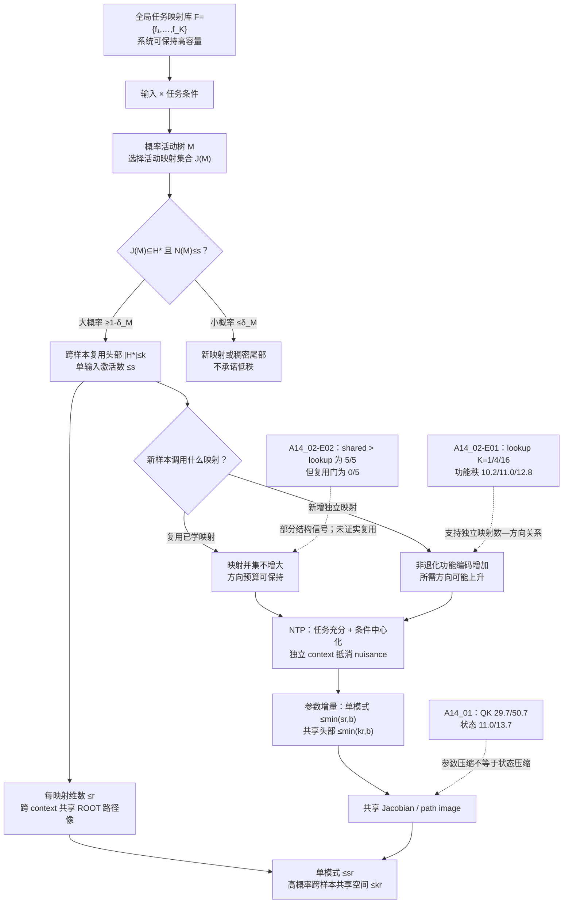

# NTP是否把层级语义学成低秩空间？

## 问题描述

> 长程的低秩 hierarchical 组合结构，能否理论证明，在 NTP 训练下，是否会形成低秩的表征空间和参数空间？

## 回答

- **建模：** 我们现在将任务相关语言计算建模为：一个全局高秩的任务映射库；每个输入—任务条件诱导一棵概率树，只调用其中一部分任务映射，在以下核心假设下，能够证明我们的表征和参数空间在NTP训练范式下秩被控制，但不是绝对低秩。
- **核心假设：** 

    令 $N(M)$ 为模型实际执行一次条件计算中的有效映射块数。存在一个至多含 $k$ 个已学映射的共享头部 $\mathcal H_\star$，使 $\Pr[\mathcal J_{\rm eff}(M)\subseteq\mathcal H_\star,\ N(M)\le s]\ge1-\delta_M$：大多数输入既只激活少量映射（树中的路径），又从同一个小映射集合中复用；小概率尾部可以调用新映射或稠密映射集合。这分别对应的是我们语言中的高频语义信息和低频长尾语义信息。
- **表征结论：** 若每个映射的任务维数至多为 $r$，且同一映射跨 context 进入共享 ROOT 路径像，则单一活动模式最多需要 $sr$ 个任务方向；全部高概率样本共同位于至多 $kr$ 维 ROOT 任务空间。小概率尾部不保证低秩，也不等于必然高秩。
- **参数结论：** 在显式任务映射参数块、受控初始化、固定输出对比空间和保持子空间的 SGD 类优化器下，单模式任务参数增量秩至多为 $\min(sr,b)$，共享头部参数增量秩至多为 $\min(kr,b)$。这不是完整 Transformer 参数矩阵全局低秩。
- **rare/common 实验结论：** 
rare 指频率出现少的实例，common 指频率出现较多的实例；common mapping 指模型已经在组合上证明可复用可泛化的的任务映射。
    > 一个少见低频样本若调用已有 common mapping，不增加映射并集，因此理论上不需要新增任务方向，表征是低秩的；只有任务新增非退化独立映射时，所需方向才可能上升。换句话说就是：低频的表征不一定高秩，还要看低频表征对应的任务的映射函数是不是高秩的。

## 术语

- **任务映射：** 把局部任务充分信息映到下一步任务状态或 next token 的可复用函数；不能只凭生成器使用同一公式认定模型已经学会。
- **共享映射头部：** 覆盖大部分样本、且已经通过 held-out 复用能力门的一小组映射；它控制跨样本方向并集。
- **条件功能秩：** 冻结原输出头后，保持 held-out NTP 功能所需的最少 ROOT 方向数。
- **共享路径像：** 同一任务映射在不同 context 中经过 Transformer 后，主要到达同一个 ROOT 子空间。

## 当前建模、数学结论与实验的对应

## 实验带来的认识更新（按与主命题的相关性）

1. **A14_02 的 $K$ 趋势直接回答“独立功能数是否改变任务秩”：** 在能力 5/5 通过、曝光和 context 配置相同的 lookup 控制中，跨 16 个 rule IDs 的独立映射数 $K=1/4/16$ 时，ROOT 功能秩为 10.2/11.0/12.8。它正向支持本生成器中的“跨样本独立映射并集 $k$ 增大，功能方向可以上升”，而不是线性比例定律；它不检验单样本活动数 $s$（[A14_02-E01 结果](../../Projects/from-attention-to-search/main/experiments/A14/14_02_relation_reuse_root_effective_rank/A14_02_E01_shared_rule_vs_lookup_root_rank/summary_cn.md)）。
2. **A14_02 同时更新“是否真的复用”：** A14_02-E02 中 shared 在 5/5 配对 seeds 上都高于 lookup（均值 0.2125 vs 0.0640），提供了部分结构敏感性的方向性线索；但 shared 未见组件配对仍为 0/5 通过，低于 0.80 能力门。因此不能说“完全没有复用信号”，也不能把它升级为可靠的已学 common mapping 或低秩证据；该实验没有测 rank（[A14_02-E02 结果](../../Projects/from-attention-to-search/main/experiments/A14/14_02_relation_reuse_root_effective_rank/A14_02_E02_component_recombination_capability/summary_cn.md)）。
3. **A14_01 最后检查参数—状态桥：** 独立重建中，`share16/random_unshared` 的组合 QK 功能秩均值为 29.7/50.7，状态功能秩为 11.0/13.7；极端方向一致，但中间条件不单调、相关性不显著，且复用与规则数量同时变化。因此它只支持有边界的复合条件差异，不能把参数压缩按比例解释成表征压缩（[结果](../../Projects/from-attention-to-search/main/experiments/A14/14_tree_low_rank_language_structure/A14_E08_relation_reuse_state_bridge/summary_cn.md)）。

## 裁定

- **当前可以声称：** “高概率样本复用小映射头部，同时每个输入只激活少量映射”与“新增独立映射扩大方向并集”给出了一个自洽的条件秩模型；共享头部、局部低维和 ROOT 路径像复用共同构成高概率跨样本任务表征低秩的充分条件。
- **当前不能声称：** 单样本大概率稀疏单独推出跨样本低秩；A14_02-E02 已证明 rare/common 的低秩规律；NTP 自动学会共享映射；完整参数矩阵或 raw hidden state 全局低秩；条件功能秩已推出 Router。
- **最强不确定性：** 一般 Transformer 是否会把同一已学任务映射跨 context 映到共享 ROOT path image。
- **希望导师裁定：** 是否接受“任务映射库 + 概率稀疏调用 + 已学映射复用”作为 A14 的主模型，并把 A14_02 的 $K$ 趋势定位为映射并集—功能秩正证据、组件重组定位为复用能力边界、A14_01 定位为参数—状态桥证据？
- **下一步唯一动作：** 在最小单层 causal-attention 模型中证明或反驳 H8：已学同一映射是否跨 context 形成共享 ROOT Jacobian/path image；在此之前不新增正交实验。
- **恢复点：** 从[完整理论证明](NTP_conditional_low_rank_theory_package/01_理论论文_共享组合结构与条件低有效秩.md)的假设表与主定理开始，逐条核对 A14_01/A14_02 分别检验了哪一个前提。
