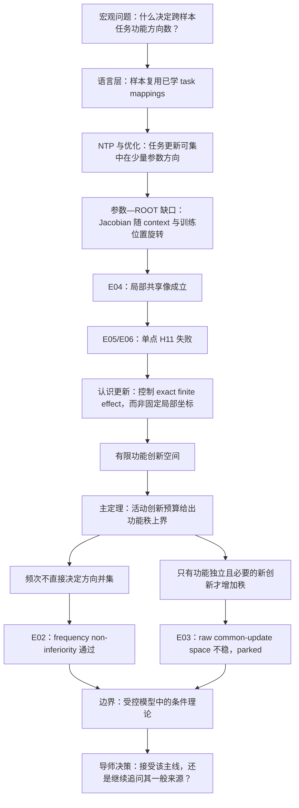

# 组会裁定：A14 的稳定对象是否应改为“有限功能创新空间”？

> **唯一问题：** 是否接受：A14 当前得到的是一个关于“有限功能创新空间”的优化动力学条件定理；E04–E06 支持该条件在当前受控模型中成立，但它尚未由一般 NTP 自动推出？

## 当前答案与认识更新（待研究者确认）

- **当前答案：** 接受这一表述。概率活动树、mapping 复用与每 mapping 自由度只在“exact finite task effect 的冻结读出可见部分形成有限创新并集”时，推出 $sr/kr$ 功能秩上界。
- **原认识错在哪里：** 把训练点的共享局部 Jacobian 像 H9-L，当成了能跨完整训练保持的固定坐标；E06 否定的是单点 H11，不是有限功能低维。
- **E04–E06 共同识别的新对象：** 局部 Jacobian 可以随 context 与训练位置旋转，但积分后的 learned secant 仍可跨 context 形成低维、冻结读出充分的有限功能创新。
- **E02 直接更新：** 在 strict zero-exposure unseen-cell 能力通过后，target frequency $1$ 对 $8$ 的 ROOT 功能秩为 $7.6$ 对 $7.4$；paired 差均值 $0.2$，单侧 95% upper bound $0.5<2$，所以 rare exact frequency 没有迫使方向数上升。
- **E03 边界更新：** common AdamW step space 的 held-out capture 只有 $0.478$--$0.631$，0/10 达到 $0.80$；因此状态功能复用不自动等于 raw parameter-update 空间共享，E03 按 Protocol parked。
- **[理论 v2](../../Projects/from-attention-to-search/main/stories/14_tree_low_rank_language_structure/04_finite_functional_innovation_theory_v2_cn.md) 真正新增：** 输出头商空间中的 finite innovation、exact path residual 的主定理、以及“只有独立且功能必要的新创新才增加最小秩”的条件下界。

## 关键证据、最强 rival 与边界

- **局部与有限的分离：** E04 以 tail 0.0393 / capture 0.9607 在 5/5 支持 H9-L；E06 以线性化误差 1.2595 在 5/5 否定 H11，却以 secant capture 0.9829、重放 CE +0.00022 nat 在 5/5 保持有限功能。
- **最强 rival：** E02 的 frequency non-inferiority 可能只属于当前小模型与 common-bijection 任务；同时 E03 已显示 raw AdamW update space 不能作为无需额外证明的 common-space 代理。
- **当前不能声称：** NTP 自动推出 finite innovation；raw ROOT 或完整参数矩阵低秩；所有 rare 数据低秩；自然语言、多层模型或 Router utility 已成立。

## 组会讲述流程

## 导师裁定、会后唯一下一步与恢复点

- **希望导师裁定：** 是否接受“finite innovation 是完整训练的标准理论对象；H9-L + H11 只保留为显式小更新分支”。
- **会后唯一下一步：** 保留 E02 的频次非劣效正结果；若重开 E03，只能在 fresh probes 上先验证 leave-target-out common ROOT-functional/secant space，不能用当前 confirmation capture 事后扩大 raw-update space。
- **恢复点：** 先讲清“功能状态方向复用已得到支持，但 raw 参数更新空间共享未得到支持”，再决定是否值得为 E03 写新版本 Protocol。

## 我的最终讲解（研究者填写）

- 我如何用一句话解释“有限功能创新”：
- 为什么 E06 没有推翻低秩故事：
- v2 相比 v1 真正增加了什么：
- 我希望导师裁定：
