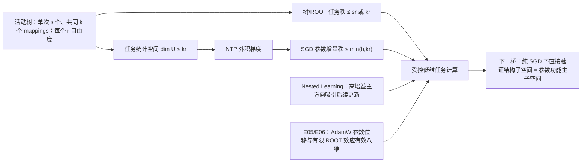
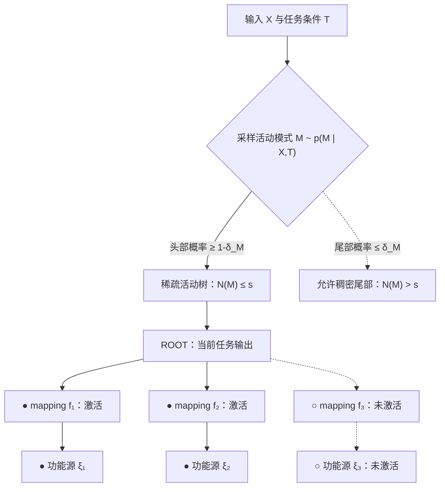

# 证明层级模型在 NTP 下会产生低秩任务参数更新

## 1. 结论

**在概率树的显式条件下，我们已经把少量可复用 mappings 依次连接到受控的树任务秩与 SGD 任务参数增量秩；受控 AdamW 实验进一步表明，实际参数更新及其有限 ROOT 效应确实集中在低维、功能充分的主子空间。** 

**Nested Learning相关的证明 补充了方向选择机制：已有高增益方向能带来更大的局部损失下降，因此后续更新倾向于复用并放大同一主子空间。** 这与实验中的低维更新收束一致，并把结构秩预算的证明与实际优化轨迹连接为一个受控解释。

**结论对象限定为任务参数增量和 ROOT 的任务功能方向。** 随机初始化后的完整权重通过“任务主谱是否形成”分析，而不以其代数秩作为结论对象。

mapping 是跨上下文复用的同一任务变换，$k$ 是其共同并集大小，$r$ 是单个 mapping 的最大任务自由度；固定模式的树/ROOT 方向预算为 $sr$，跨模式任务参数预算为 $kr$。

## 2. 机制与公式

1. 稀疏活动树把单次计算限制在 $s$ 个 mappings 内，共同 mapping 并集 $k$ 则限制跨样本任务统计空间。
2. NTP 对任务矩阵的梯度是反向误差 $v_t$ 与任务统计量 $\phi_t$ 的外积；当两侧张成空间受控时，任意步数的 SGD 求和保持同一秩预算。
3. Nested Learning 说明高增益方向为何吸引后续更新；AdamW 实验说明这一集中现象在当前受控 Transformer 中实际出现。

证明结论：
> 在受控一层模型进行NTP训练下，如果层级数据只调用 $k$ 个 mappings、每个 mapping 至多有 $r$ 个任务自由度，并且不同上下文中的任务无关梯度能够抵消，那么 SGD 的任务参数增量秩至多为 $\min(b,kr)$。

> NTP 反复强化跨上下文共享的任务方向，而上下文特异更新主要形成增长较慢的谱尾部，因此参数更新逐渐集中到离群主子空间。
$$ \Delta\Theta_T
=\underbrace{\Delta\Theta_{\text{task}}}_{O(T)}
+\underbrace{\Delta\Theta_{\text{nuisance}}}_{O(\sqrt T)}.$$

**关键公式：**
$$
q_{\mathrm{tree/ROOT}}(m)\le rN(m)\le rs,\qquad \dim U\le kr,\qquad \Delta\Theta_T=-\sum_{t=0}^{T-1}\eta_t v_t\phi_t^\top\ \Longrightarrow\ \operatorname{rank}(\Delta\Theta_T)\le\min(b,kr).
$$

**公式解释：** 同一组 mapping 活动预算与单 mapping 自由度，一侧控制树/ROOT 的任务方向，另一侧通过 NTP 外积梯度控制参数增量秩；[理论综合](../../Projects/from-attention-to-search/main/stories/14_tree_low_rank_language_structure/03_ntp_conditional_function_rank_cn.md) 给出条件证明，[Nested Learning](../backup/0629/docs/nested_prediction_spectral_anisotropy_causal_rewrite_v4_zh.md) 给出主方向被优化放大的局部机制。

## 3. 下一决策

**只剩一个桥：在随机初始化的一层 Transformer 中，用纯 SGD 直接检验“结构定义的任务子空间是否成为实际参数更新的功能主子空间”。**

需要回答的三个验证问题：

1. 生成器能否独立固定 $k$ 与 $r$，并由此预先给出结构秩预算？
2. 纯 SGD 的 $\Delta\Theta_T$ 是否落入该预算内的稳定主子空间？
3. 保留该子空间是否维持 NTP 功能，并在完整参数谱中形成可辨识的任务主谱？

- **对主线的推进作用：** 通过后，后续方法可直接采用低秩任务增量和主子空间控制。
- **完成判据：** 三个问题在独立种子和未见上下文上同时成立。
- **恢复时第一动作：** 固定参数块、随机初始化、纯 SGD 与 $k\times r$ 正交生成器，先写最小 Protocol。

## 4. 讲解流程图

### 概率活动树示意图

实线表示本次被调用的树路径，虚线表示未激活分支或低概率稠密尾部；该概率条件控制单次计算的活动源数，并不要求完整 mapping 库本身低维。

## 5. 实验结构与证据

**实验认识更新：** E05 中 AdamW 参数位移的八维捕获为 0.9975，保留该子空间后 CE 仅增加 0.00026 nat；E06 中精确有限 ROOT 效应的八维捕获为 0.9829，功能重放 CE 仅增加 0.00022 nat。两项结果共同支持当前受控模型的参数更新与任务效应集中在低维、功能充分的主子空间；纯 SGD 的结构直连由下一决策裁定。[E05](../../Projects/from-attention-to-search/main/experiments/A14/14_02_relation_reuse_root_effective_rank/A14_02_E05_trajectory_jacobian_closure/summary_cn.md) · [E06](../../Projects/from-attention-to-search/main/experiments/A14/14_02_relation_reuse_root_effective_rank/A14_02_E06_reference_jacobian_vs_secant/summary_cn.md)
