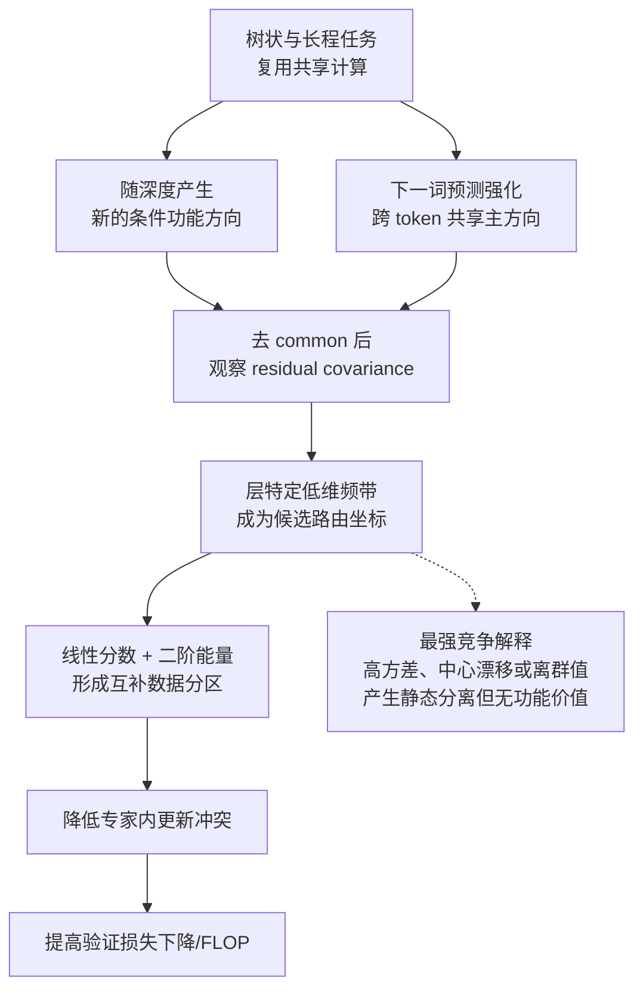
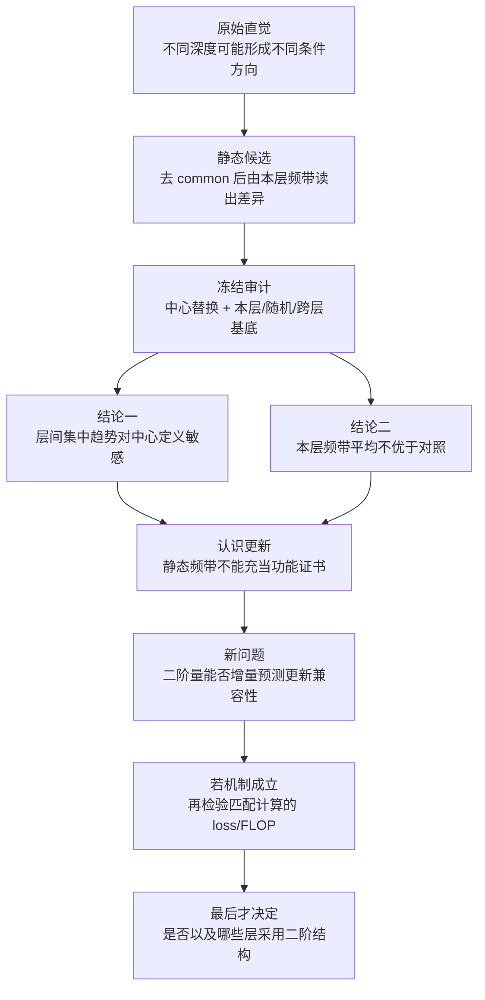

# 逐层Router表征频谱关系分析

## 1. 当前核心问题与认识更新

静态审计把研究对象从“哪一层应使用哪个频带”改写为一个功能问题：

> **在固定专家数量、负载和容量后，二阶特征能否产生互补而非垄断的数据分区，降低同一专家内部的更新冲突，并提高总体验证损失下降/FLOP？**

这里“互补分区”指分给同一专家的 token 在局部训练中相互促进，而非仅因某个能量分数普遍更大而被同一子空间垄断。当前只需依次回答三个子问题：二阶量是否含有线性 Gate 之外的兼容性信息；这种信息是否在匹配负载后仍成立；它能否在从头训练中转化为验证损失下降/FLOP。

## 2. 原始直觉

原始物理直觉是：下一词预测会强化跨 token 共享的主方向，而树状、长程任务可能在不同深度形成新的条件计算方向。于是我们曾推测：去除 common 后，各层 residual covariance 的不同谱段可能承载不同的 Router 区分信息，子空间投影能量因而可以成为逐层二阶 Router 的坐标。

原始直觉的完整假设链如下。图中的箭头都是待审查的物理先验，不是已经成立的因果结论：

当前冻结审计只触及“去 common 后是否出现层特定频带”这一静态桥梁，不能直接验证专家效用、更新兼容性或训练效率。

## 3. 两条确切结论

1. **结论一——本层固定谱带没有表现出特殊性。** **本层 covariance 构造的频带，对现有专家分组的能量区分力，平均不高于随机同维子空间或其他层基底。因此尚无证据认为“本层频谱”是特殊的路由坐标系。** 在全部 576 个“模型×层×读出×频带”比较中，本层频带相对两类对照的平均增量均不为正；峰值频带也随层非单调跳动。原始正能量还使 $99.1\%$--$99.3\%$ 的 token 由同一频带获胜；独立标准化虽缓解垄断，与专家标签的 NMI 仍仅为 $0.011$--$0.016$。这否定的是“固定全局 covariance 频带可直接指定专家子空间”，不是所有二阶特征。

1. **结论二——仅替换 Gate 读出时使用的中心，逐层专家负载趋势就发生明显变化，说明观察到的深层集中性依赖中心定义，而不一定来自深层功能分化。** 最强实例中，第 12 层负载 CV（8 个专家负载的标准差除以均值）由 $2.346$ 降到 $0.247$，原读出与冻结中心读出的专家分配一致率仅为 $0.180$；层深与负载 CV 的相关也由 $+0.615$ 变为 $-0.448$。这排除了“深层更集中即可证明深层功能分化”的解释，但不证明中心失配是实际训练中集中性的唯一原因。

## 4. 为什么要改用功能证书

静态频谱最多描述“数据沿哪些方向变化”，不能说明“哪些 token 放在同一专家训练会彼此帮助”。修正对象后的反事实审计也显示：真正换专家的 token，其稀疏输出 CKA 中位数仅为 $0.503/0.548$，说明专家局部并不可交换；但中心化干预的翻转率太低，尚不能裁定整体功能收益。由此，研究对象应从“哪个频带能复现现有专家标签”改为本页开头的匹配计算功能问题。

建议把两组 token 的对称一步交叉更新量作为周期性功能证书：

$$
C(A,B)=-\frac{1}{2}\!\left([L_B(\theta-\eta\nabla_\theta L_A(\theta))-L_B(\theta)]+[L_A(\theta-\eta\nabla_\theta L_B(\theta))-L_A(\theta)]\right).
$$

$C(A,B)>0$ 表示两组在当前专家中相互促进，$C(A,B)<0$ 表示更新冲突。它只作为周期性功能证书，不作为逐步训练目标，也不直接监督 Router。最强竞争解释是：二阶分数可能只重现能量尺度、负载偏置或已有标签，并因全正能量形成垄断，而没有提供线性分数之外的兼容性信息。

## 5. 因果链与研究流程图

## 6. 唯一下一决策

**现在只裁定：是否采用上述对称一步交叉更新量，作为“互补而非垄断分区”的主定义？**

- 主线影响：批准后，二阶 Router 的必要条件将从“频带复现专家标签”改为“在严格匹配负载与改路由数量后，对该功能证书提供线性 Gate 之外的残差预测增益”。
- 完成标准：固定 $A/B$ 的独立采样、单步更新、对称化、负载/容量/专家数匹配，以及证书的重复性判据；此时才形成最小机制 Protocol。
- 恢复动作：研究者先审核该功能定义；若不批准，先重定义“更新兼容性”，不继续设计或训练二阶 Router。

## 7. 证据入口

- [冻结 Gate 频带审计与完整表格](../0728/router_layer_band_probe/results/summary.md)
- [修正对象后的 Router 输出反事实审计](router_output_counterfactual/summary_cn.md)

## 8. 组会上的todo

1. 使用middle 谱频带进行分发，看看用这个谱频带分发和换用其他的基底分发，是否存在变化，怎么度量变化的好坏
2. 调整实验，验证层深和频谱之间的关系，不同实验设置
3. 