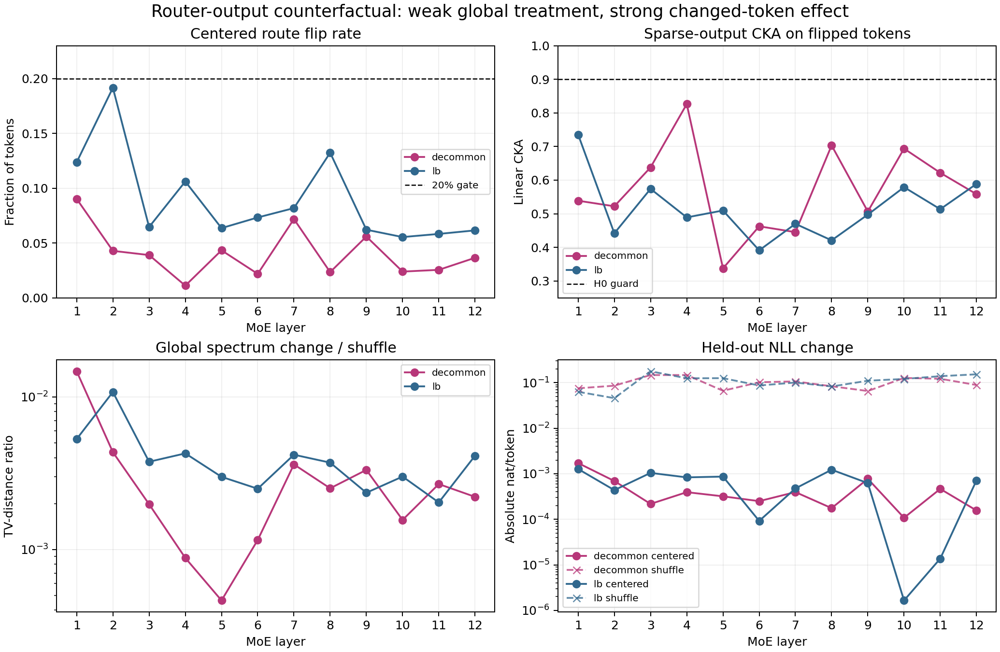
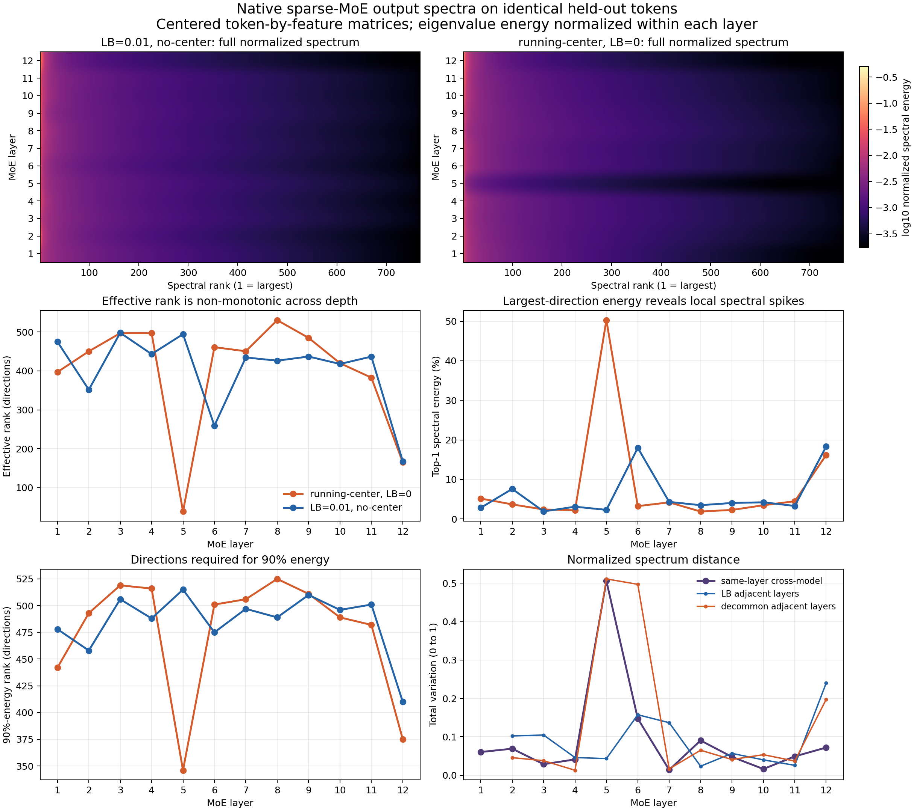

# Detailed: Router Output Counterfactual Audit

Protocol: [protocol.md](protocol.md)  
Summary: [summary.md](summary.md)  
Chinese summary: [summary_cn.md](summary_cn.md)

## 0. Quick Recap

**Purpose:** test immediate frozen-model sensitivity to sparse-expert identity while holding input, native token weight, expert loads, shared expert, and every other route fixed.

**Registered verdict:** insufficient. Both models completed all 12 layers, but zero layers passed the 20% centered-flip treatment-strength gate.

**Decision evidence:** centered reassignment produced small all-token and downstream changes, but flip-only sparse-output CKA was 0.34--0.83. Aggregate spectra therefore missed large changed-token geometry differences.

## 1. Terminology / Definitions

| Term | Concrete object | Unit / range | Decision role | Limitation |
| --- | --- | --- | --- | --- |
| Router reference $g_\ell$ | attention-branch output passed as the second MLP argument | 768-vector/token | Computes Native and centered scores | Not the expert input |
| Expert input $h_\ell$ | post-attention normalized state passed as the first MLP argument | 768-vector/token | Input to all sparse/shared expert MLPs | Not the deployed Router input |
| Native sparse output | $w_t^{native}f_{e_t}(h_t)$ | 768-vector/token | Primary object | Excludes shared expert |
| Exact quota | eight expert counts equal Native counts | integer vector | Removes load as a cause | May reduce flip rate |
| Flip-only CKA | linear CKA on centered-flipped token rows | $[0,1]$ | Tests local interchangeability | Does not measure loss |
| Spectrum TV | half-L1 distance between normalized singular-energy vectors | $[0,1]$ | Measures global spectral shape | Ignores token correspondence |

## 2. Alignment And Decision Point

This is an operationalization audit adjacent to A06_00. It tests immediate expert non-interchangeability, a necessary but insufficient condition for functional specialization. It does not test positive expert utility and therefore does not update the active A06 anchor.

## 3. Protocol Compliance Audit

| Requirement | Result |
| --- | --- |
| Exactly two step-40k models | passed |
| Same held-out documents | passed; manifest hashes identical across models |
| 32-document calibration / 64-document evaluation | passed |
| All 12 layers | passed for both models |
| Exact Native expert loads in Centered and shuffle | passed in 24/24 cases |
| All eight expert outputs audited | finite in 24/24 cases |
| Shared output invariant | exact in 24/24 cases |
| Native no-op replay | block/final CKA 1.0, KL 0, NLL delta 0 in 24/24 cases |
| Shuffle positive control | passed in 24/24 cases |
| Centered flip $\ge0.20$ | failed in 24/24 cases |

The primary result is therefore treatment-strength insufficient, not a pass or rejection of H0.

## 4. Setup

- Checkpoints: the registered LB and running-center/decommon model directories at step 40,000.
- Architecture after checkpoint inference: 12 layers, hidden width 768, 8 sparse experts, top-1, unnormalized top-1 probability, one shared expert.
- Data: independent DCLM `global-shard_02_of_10`; deterministic document-hash split; 16,384 evaluation tokens.
- Hardware: one H100 80GB per model, executed concurrently.
- Fixed Native token weight: required because `norm_topk_prob=False`; otherwise changing the center would also change expert-output amplitude.
- Centered assignment: centered score argmax followed by deterministic minimum-score-penalty repair to exact Native quotas.
- Shuffle: deterministic permutation of Native labels, preserving exact quotas.
- Propagation: only one target-layer MLP is forced; later layers operate natively on the counterfactual state.

## 5. Implementation Correction From No-Op Debugging

The first smoke replay failed. Tensor-by-tensor comparison showed that the expert input was reproduced exactly but recomputed labels agreed with the literal MLP only about 75%. The checkpoint configuration then established `gating_reference=oracle`: the decoder passes the attention output as the Router reference and the normalized hidden state as the expert input.

The runner was corrected before any full counterfactual result was inspected:

1. capture both tensors in the MLP pre-hook;
2. compute Native/centered labels and Native gate weights from the attention reference;
3. compute all expert outputs from the expert input;
4. require literal no-op equality.

The corrected smoke and full run passed exact no-op. The failed pre-correction smoke files were removed from the final reading surface.

## 6. Main Results

### 6.1 Treatment strength

| Model | Raw centered flip median / max | Exact-quota flip median / max | Shuffle flip median |
| --- | ---: | ---: | ---: |
| LB | .1200 / .3561 | .0689 / .1916 | .8705 |
| decommon | .0749 / .2123 | .0377 / .0902 | .8354 |

Exact load matching removed many raw centered flips. No layer crossed the registered 0.20 gate.

### 6.2 Sparse-output geometry

| Model | All-token centered CKA | Flip-only CKA | Center Frobenius change | Shuffle Frobenius change | Raw $R$ | Flip-adjusted $R$ |
| --- | ---: | ---: | ---: | ---: | ---: | ---: |
| LB | .9941 | .5035 | .1082 | 1.0590 | .00699 | .06196 |
| decommon | .9974 | .5484 | .0750 | 1.0478 | .00306 | .09059 |

All values are 12-layer medians. Unchanged tokens dominate all-token CKA, while the flip-only subset shows that expert identity strongly changes sparse output.

### 6.3 Global spectra

| Model | Center spectrum TV | Shuffle spectrum TV | Ratio | Center top-32 angle | Shuffle top-32 angle | Effective-rank change center / shuffle |
| --- | ---: | ---: | ---: | ---: | ---: | ---: |
| LB | .000398 | .100799 | .00373 | .457° | 40.468° | .072 / 122.907 |
| decommon | .000224 | .097007 | .00237 | .360° | 42.503° | .050 / 114.791 |

The global spectrum is almost unchanged under centered reassignment. This does not contradict flip-only CKA because the treatment changes few rows and spectrum metrics discard token correspondence.

### 6.4 Downstream propagation

| Model | Block CKA | Final-hidden CKA | Center KL | Shuffle KL | KL ratio | Median center $\Delta$NLL | Max absolute center $\Delta$NLL | Median shuffle $\Delta$NLL |
| --- | ---: | ---: | ---: | ---: | ---: | ---: | ---: | ---: |
| LB | .999673 | .999714 | .001369 | .110517 | .0132 | .000668 | .001273 | .115637 |
| decommon | .999810 | .999837 | .000850 | .094566 | .0080 | .000357 | .001719 | .095627 |

These effects are small relative to shuffle, but the low centered flip rate prevents a functional-equivalence claim.

## 7. Visualization Audit

**Question:** do treatment strength, token-level geometry, aggregate spectrum, and NLL tell the same story?  
**Metric and unit:** route fraction; CKA; spectrum-TV ratio on a log scale; absolute NLL change in nat/token on a log scale.  
**Data:** every point is one layer from the 64-document evaluation set.  
**Expected if H0 were supported:** at least eight layers above the 20% flip gate, flip-only CKA above 0.90, and small spectrum/NLL ratios.  
**Observed:** treatment strength fails everywhere; flip-only CKA fails the equivalence guard everywhere; spectrum and NLL ratios remain small.  
**Allowed conclusion:** weak global treatment plus strong changed-token sparse-output sensitivity.  
**Limitation:** no formal H0 verdict is possible.

### 7.1 Descriptive native layerwise spectrum appendix

**Question:** on identical held-out inputs, how does the natural-forward sparse-MoE output spectrum vary across layers and between the two frozen checkpoints?  
**Object:** for model $m$ and layer $\ell$, $Y_{m,\ell}$ contains all 16,384 Native sparse outputs $w_t^{native}f_{e_t}(h_t)$ as rows. Each matrix is feature-centered.  
**Metric:** if $s_i$ are singular values, $p_i=s_i^2/\sum_j s_j^2$. The figure reports the full $p_i$ distribution, effective rank, top-direction energy, 90%-energy rank, and total-variation distance between normalized spectra. Total centered variance is retained separately so normalization does not hide scale growth.  
**Integrity:** both manifests contain the same evaluation-token SHA256 `aa9873b87e5f181dddffcf498c53268ce86f893f843852e9d2bbc04e79401160`. All 24 90%-energy ranks exactly reproduce the original run; maximum effective-rank replay error is 0.0047.

| Model / layer | Effective rank | First-direction energy | Top-32 energy | 90%-energy rank |
| --- | ---: | ---: | ---: | ---: |
| decommon L5 | 38.8 | 50.3% | 64.0% | 346 |
| LB L5 | 494.5 | 2.31% | 22.7% | 515 |
| decommon L6 | 461.0 | 3.26% | 25.3% | 501 |
| LB L6 | 259.2 | 18.0% | 36.3% | 475 |
| decommon L12 | 165.1 | 16.2% | 51.7% | 375 |
| LB L12 | 167.8 | 18.3% | 51.1% | 410 |

**Observed result:** effective rank is non-monotonic in both models. The decommon layer-5 spectrum contains a single dominant direction and returns to a broad spectrum at layer 6; LB instead shows its strongest intermediate-layer concentration at layer 6. Both models concentrate at layer 12. Same-layer cross-model spectrum TV has median 0.0546, is at most 0.10 in 10/12 layers, and peaks at 0.506 in layer 5. Centered output variance nevertheless grows by about 420x (decommon) and 532x (LB) from layer 1 to layer 12, so scale growth and normalized shape must remain separate claims.  
**Allowed conclusion:** these checkpoint spectra contain localized layer-specific concentration events, not a monotonic depth-to-low-rank law; most same-layer normalized spectra are similar except the layer-5/6 region.  
**Cannot prove:** which training intervention caused a spectral event, whether the dominant direction is common or functional, whether it predicts Router utility, or whether layer-specific spectra improve loss/FLOP.

## 8. Failure Decomposition

| Stage | Evidence | Status | Meaning |
| --- | --- | --- | --- |
| Data/model identity | manifests and document hashes match | passed | no split mismatch |
| No-op implementation | exact in corrected run | passed | counterfactual engine valid |
| Load control | exact counts | passed | load is not changed |
| Positive control | shuffle flips 71%--88%, CKA low, NLL rises | passed | metrics can detect a large intervention |
| Centered treatment strength | max 19.16% / 9.02% | failed | primary H0 test insufficient |
| Aggregate spectrum metric | near-zero change despite low flip-only CKA | proxy failure for local effects | effective rank/spectrum alone is inadequate |

The run does not falsify the physical prior that Router identity matters. It falsifies the operational assumption that global spectrum is sufficient to detect token-specific route effects, and it shows that exact-load centered replay is too weak for the registered global equivalence decision.

## 9. Claim Boundary

**Supported:** changed-token sparse outputs depend materially on expert identity; global spectra are insensitive to this sparse local change; shared/residual/subsequent computation dilutes the observed global effect.

**Not supported:** H0 support/rejection, positive utility, Native optimality, model-family causality, training-time formation, semantic specialization, or compute-normalized gain.

## 10. Next Decision

Decide whether assignment structure matters after matching both load and flip count. A valid follow-up must compare centered and random assignments with the same exact expert counts, same number of changed tokens, same Native token weights, and the same held-out states. It should not begin with from-scratch training.

## 11. Artifact Map

- protocol: [protocol.md](protocol.md)
- canonical summary: [summary.md](summary.md)
- Chinese summary: [summary_cn.md](summary_cn.md)
- runner: [run_experiment.py](run_experiment.py)
- aggregator: [summarize_results.py](summarize_results.py)
- native-spectrum runner: [analyze_native_layer_spectra.py](analyze_native_layer_spectra.py)
- native-spectrum aggregator: [summarize_native_layer_spectra.py](summarize_native_layer_spectra.py)
- combined verdict: [results/combined_verdict.json](results/combined_verdict.json)
- per-model raw tables: [LB](results/lb_layer_metrics.csv), [decommon](results/decommon_layer_metrics.csv)
- combined table: [tables/layer_metrics.csv](tables/layer_metrics.csv)
- model summary: [tables/model_summary.csv](tables/model_summary.csv)
- central figure: [figures/router_output_counterfactual.png](figures/router_output_counterfactual.png)
- native-spectrum summary: [tables/native_layer_spectral_summary.csv](tables/native_layer_spectral_summary.csv)
- complete native-spectrum distribution: [tables/native_layer_spectral_distribution.csv](tables/native_layer_spectral_distribution.csv)
- native-spectrum distances: [tables/native_layer_spectral_comparison.csv](tables/native_layer_spectral_comparison.csv)
- native-spectrum figure: [figures/native_layer_spectra.png](figures/native_layer_spectra.png)
