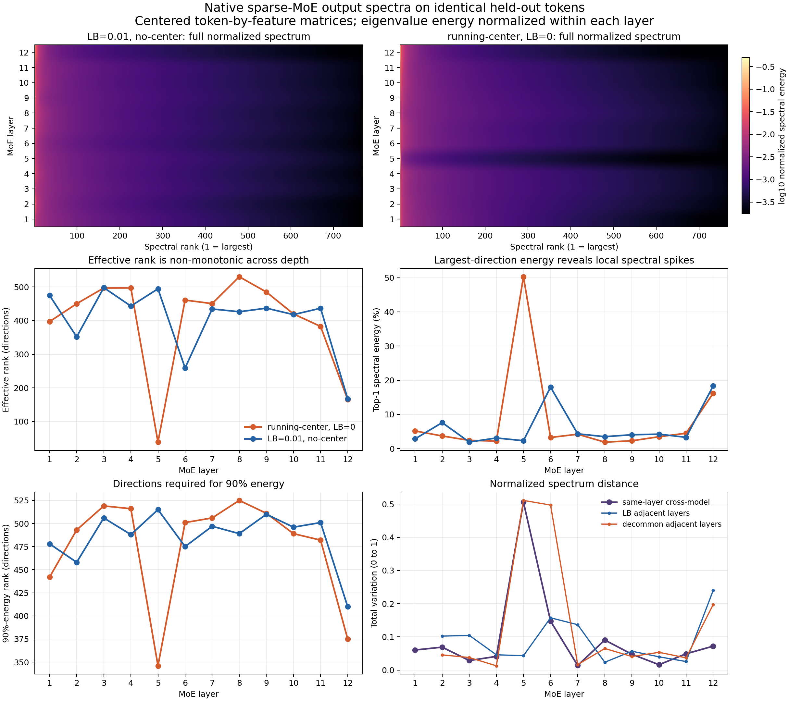
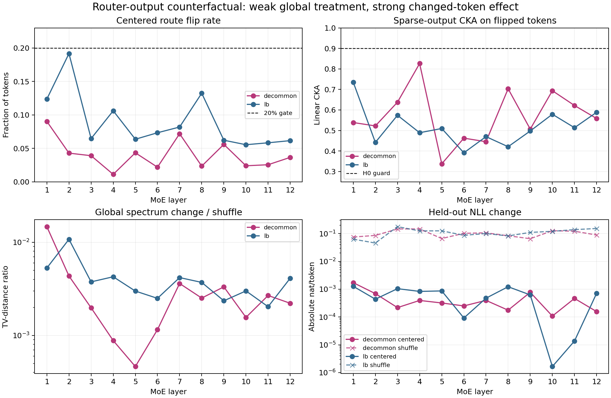

# 结果：Router 是否显著塑造专家输出表征？

## 结论

**按预注册规则，结果是证据不足；不能支持“Router 影响很小”。** 两个模型都没有任何一层达到20%的 Centered route-flip 闸门：LB 的逐层中位数/最大值为 $6.89\%/19.16\%$，decommon 为 $3.77\%/9.02\%$。因此，全 token 的 $R_\ell$、最终 CKA 和 NLL 变化虽很小，也可能只是因为真正被干预的 token 太少。

但实验得到一个更重要的认识：

> **整体奇异谱几乎不变，不代表 Router 没有改变 token 获得的专家功能输出。**

在真正翻转专家的 token 上，稀疏输出 CKA 的逐层中位数只有：

- LB：$0.503$，最低 $0.391$；
- decommon：$0.548$，最低 $0.337$。

这远低于预注册的 $0.90$ 等价护栏。也就是说，被改路由的 token 确实获得了显著不同的专家输出；专家并非局部可交换。

## 三层认识

| 层面 | LB | decommon | 当前判断 |
| --- | ---: | ---: | --- |
| Centered flip 中位数 | 6.89% | 3.77% | 干预强度不足 |
| Flip-only sparse CKA | .503 | .548 | 改路由 token 的专家输出明显不同 |
| 全局谱距离 / shuffle | .00373 | .00237 | 整体谱几乎不变 |
| Block CKA | .999673 | .999810 | shared/residual 显著稀释局部变化 |
| Final-hidden CKA | .999714 | .999837 | 最终表征变化很小 |
| 最大 $|\Delta$NLL$|$ | .00127 | .00172 | 功能变化小，但不能作等价结论 |

因此，本实验同时观察到：

1. **局部影响强：** 被翻转 token 的 sparse expert output 明显改变。
2. **全局影响弱：** 由于翻转 token 少，并经过 shared、residual 和后续层传播，整体谱、最终 hidden 和 NLL 变化很小。
3. **主问题未关闭：** 当前不能区分“Router 本来影响小”和“Centered 干预太弱”。

## 实现层面的关键修正

两个 checkpoint 都使用 `gating_reference=oracle`：Router 实际读取 attention branch 输出，而专家读取 post-attention normalized hidden state。修正前若用专家输入重算路由，Native no-op 会失败。修正后24个模型×层 no-op 全部满足：block/final CKA 为1、logit KL为0、NLL误差为0。

这意味着：之前任何把专家输入直接当成 Router 输入的谱审计，都不能继续解释为“实际 Router 的频谱结构”。

## 认识更新

当前最安全的结论是：

> Router 对被改变路由的 token 具有明显的即时表征影响，但冻结中心化在严格负载匹配后改变的 token 太少，无法裁定其整体功能影响。全局奇异谱对这种局部变化非常不敏感，不能单独作为 Router 是否重要的判断指标。

## 补测：同一输入下的逐层 Native MoE 输出谱

此前只保存了 Native 相对 Centered/Shuffle 的谱变化以及 effective rank，并未保存两个模型的完整逐层绝对谱。现已在完全相同的16,384个 held-out token 上补齐：对每层 Native 稀疏专家输出矩阵按特征去均值，再将协方差特征值按总能量归一化。补测与旧表的24个90%能量秩完全一致，effective rank 最大误差仅0.0047。

直接结果不是“层越深，谱越低秩”，而是**少数层发生局部谱尖峰**：

- decommon 第5层的第一方向占50.3%能量，effective rank 降至38.8；第6层恢复到461.0。
- LB 的较强尖峰出现在第6层：第一方向占18.0%，effective rank 为259.2。
- 两个模型第12层再次共同集中：effective rank 为165.1/167.8，第一方向能量为16.2%/18.3%。
- 同层跨模型谱 TV 的中位数为0.0546，10/12层不超过0.10；最大差异集中在第5层，TV为0.506。

因此，当前只能说：**两个训练终点多数层的归一化谱形状接近，但谱集中事件发生在不同局部层；不存在稳定的逐层单调低秩化。** 这不能归因于 decommon 或 LB，因为两个模型同时改变了中心化方式与负载均衡训练。

## 唯一下一决策

下一步不应立即训练新 Router，而应让结构化路由和随机路由同时匹配：

- 八个专家的精确负载；
- 完全相同的 route-flip 数量；
- 相同的 Native token 权重。

然后比较 flip-only CKA、最终 logit KL 和 NLL。只有这样才能把“改变多少 token”与“如何改变 token”分开。

完整英文记录见 [summary.md](summary.md)，反事实逐层数据见 [layer_metrics.csv](tables/layer_metrics.csv)，Native 谱数据见 [native_layer_spectral_summary.csv](tables/native_layer_spectral_summary.csv) 和 [native_layer_spectral_distribution.csv](tables/native_layer_spectral_distribution.csv)。
