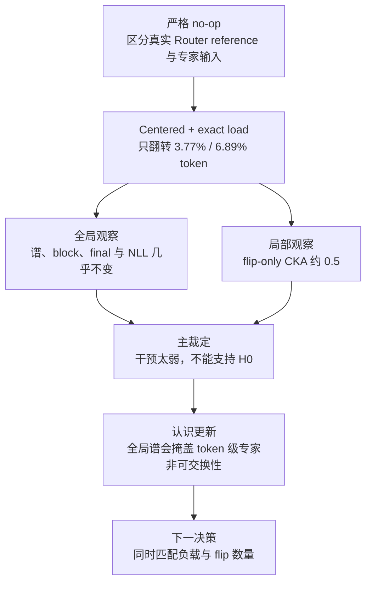

# 逐层 Router 干预的局部与全局表征分发分析

状态：独立命名的补充 focus；等待研究者审核结论措辞。

## 1. 问题

**核心问题：** 固定真实 Router reference、专家输入、参数、Native token 权重、专家负载和 shared expert，只改变目标层的专家身份，是否显著改变稀疏输出与最终预测？

**必要子问题：**

1. Centered 反事实是否改变了足够多的 token？
2. 整体谱稳定时，被改路由 token 的输出几何是否仍改变？
3. 局部变化是否传播到 block、final hidden 和 NLL？

## 2. 认识更新

**预注册主裁定为证据不足，不能支持“Router 影响很小”。** 严格负载匹配后，LB 和 decommon 没有任何一层达到20%的 Centered flip 闸门，中位数仅为6.89%和3.77%；因此极小的全 token $R_\ell$ 与 NLL 变化受到干预强度限制。但在真正改变专家的 token 上，稀疏输出 CKA 中位数只有0.503和0.548，远低于0.90等价护栏。这建立了“专家身份会明显改变被翻转 token 的即时输出”，同时否定了“整体奇异谱稳定即可推出 Router 不重要”的指标解释；它不能证明 Native 专家更有用或 Router 塑造了训练期专家形成。

### 机制解释

这两个 checkpoint 的 Router 与专家读取不同张量：

$$
e_t=\arg\max_e W_e(g_{\ell,t}-\mu_\ell),
\qquad
y^{sparse}_{\ell,t}=w_t^{native}f_{e_t}(h_{\ell,t}),
\qquad g_{\ell,t}\ne h_{\ell,t}.
$$

$g_{\ell,t}$ 是 attention-branch Router reference，$h_{\ell,t}$ 是 post-attention normalized expert input。只有专家身份 $e_t$ 被改变；Native 权重、负载和 shared 路径保持不变。Centered 只翻转少量 token，所以整体谱、block 和最终输出被大量未改变 token 与 shared/residual 稀释；但 flip-only CKA 直接暴露了局部非可交换性。

## 3. 唯一下一决策

- **要裁定：** 在专家负载和 route-flip 数量都完全相同的条件下，结构化 Centered 改路由是否比随机改路由产生不同的 token 输出与最终损失？
- **主线作用：** 若仍不同，说明分配结构而非仅干预规模决定传播；若不不同，停止把冻结中心几何解释成功能路由。
- **完成判据：** 两种条件使用相同负载、相同翻转 token 数、相同 Native 权重，并比较 flip-only CKA、logit KL 与 NLL。
- **恢复动作：** 先冻结“相同 flip 集合”还是“仅相同 flip 数量”，二者不能混用。

## 4. 讲解流程图

## 5. 一段话讲完证据

两个 step-40k 模型、同一批64个未见 DCLM 文档和全部12层均完成；24/24层 exact-load、shared invariance、全专家有限性、shuffle 正对照和 no-op 均通过。Centered 的最大 flip 仅19.16%与9.02%，故0层有效；但 flip-only CKA 最低达0.391与0.337，而整体谱距离只相当于 shuffle 的0.37%与0.24%，最终最大 $|\Delta$NLL$|$ 仅0.00127与0.00172 nat/token。直接结果是“局部输出改变、全局传播弱、主等价问题未关闭”。

**完整证据：** [中文摘要](router_output_counterfactual/summary_cn.md) · [完整记录](router_output_counterfactual/detailed.md) · [逐层表](router_output_counterfactual/tables/layer_metrics.csv)
