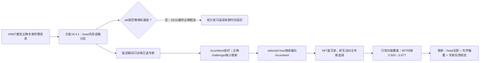

# 从 head 先学到专家反馈锁定：有用的 tail 为什么没有纠正 Router？

状态：0731 两项受控机制实验已完成；下一步转入四层层级表征与功能路由联合建模。

## 1. 问题

**唯一问题：** 当 middle/tail（M/T）确实包含决定正确专家的信息时，它们没有纠正早期 head 分区，究竟是因为低方差使路由长期像随机基底一样漂移，还是因为它们只学得较慢，而已选专家在这段时间内变强，形成了反馈锁定？

H/M/T 是三个等维输入块，分别编码正确专家所需的一个独立比特；标准化信噪比相同，只有方差为16:4:1。这样 M/T 的“有用”是生成真值，不依赖自然文本语义解释。

## 2. 认识更新

**一句话回答：** 低方差本身只延迟正确路由，不会把 tail 变成随机基底；但这段延迟足以让 selected-expert training 把早期 head 分区固化——incumbent 先变好、正确细专家缺少更新，Router 后续即使能看见 M/T，也没有效能证据完成纠错。

“功能稳定时间”要求准确率至少0.90、换路由比例不超过0.02，并连续三次成立。native H/M/T 全部32/32最终稳定，平均约需552/912/1,938步；tail等能化后只需615步。random tail虽很快几乎不换路由，准确率却始终约0.50，因此低flip不等于功能稳定。

“M/T细分纠错率”表示head粗类选对后，M/T还能否选对四个细专家。只训练已选专家时长期停在0.500；保持Router输入、随机流、前向数和每token一次更新不变，只把更新给功能真值专家后升到0.977，增量0.477，95%区间[0.476,0.479]。早期正确challenger只得到约0.040更新份额，且incumbent损失更低。

因此，head支配不是单阶段现象：**covariance先造成学习时间差，专家共同演化再把时间差变成效能差。** 等方差能让tail更早学，却不能保证专家反馈允许它改路由。

## 3. 决定性证据

| 比较 | 指标要回答什么 | 结果 | 认识 |
| --- | --- | ---: | --- |
| native H/M/T | 正确路由何时同时稳定 | 552 / 912 / 1,938步 | 方差造成有序延迟 |
| equalized T | 延迟是否来自能量 | 615步 | 放大能量基本消除延迟 |
| random T | 低flip能否代表正确 | 0/32通过；准确率0.501 | 稳定错误不能叫功能稳定 |
| selected-only | 专家反馈下M/T能否纠错 | 细分纠错0.500；exact route 0.244 | 早期粗分区被锁定 |
| oracle coverage | 只改更新覆盖能否恢复 | 细分纠错0.977；增量0.477 | 专家反馈是充分的锁定机制 |

完整证据：[反馈锁定结果](../../Projects/from-attention-to-search/main/experiments/A15/15_04_expert_feedback_tail_lockin/A15_04_E01_selected_feedback_tail_correction/summary_cn.md)；[功能稳定性结果](../../Projects/from-attention-to-search/main/experiments/A15/15_05_low_variance_route_stability/A15_05_E01_functional_route_stability/summary_cn.md)。

## 4. 解释流程图

## 5. 边界与唯一下一决策

- **成立范围：** 线性随机Gate、八个线性专家、合成H/M/T功能真值、matched-SNR与每token一次专家更新。
- **仍不能说：** 自然DCLM的M/T一定有用；oracle coverage可部署；解除锁定一定改善语言模型loss/FLOP；不同层同名谱带编码同一信息。
- **唯一下一决策：** 建立四层概率树小模型，把粗类、条件内细类和组合变量作为逐层功能真值；独立calibration只离线估计一次层×谱画像，再比较selected-only与稀疏challenger/counterfactual coverage。
- **完成判据：** 先通过未见组合能力门；再形成“层×频带×功能变量”矩阵，并同时报告正确性+持续性、专家更新覆盖和matched-FLOP held-out loss。只有challenger不增加推理top-1计算且改善功能分发与loss，才进入真实文本外部验证。
- **恢复时第一动作：** 冻结概率树粗/细/组合标签、四层能力门和matched-compute三臂合同；不要先设计新PCA Router或启动无功能真值的DCLM训练。
