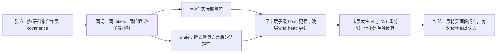

# Qwen3-8B 中父级与子级语义是否占据不同谱位置？

状态：0802 实验已完成；层特异语义角色选择性 Pass，统一父级=head 与末层单独反转 Fail。

## 1. 本日唯一回答的问题

**问题：** 当每层 covariance 基底由独立自然语料拟合，并把同一个目标概念的 token、位置和句长严格配对后，父级/粗粒度角色与子级/细粒度角色是否稳定偏向不同谱位置？

这里的 head、middle、tail 只是每层中背景方差由大到小的方向区间；不同层的同名频带不保证编码相同信息。

## 2. 认识更新

**一句话回答：** 父/子语义角色确实对应层特异的频谱差异，但没有统一的“父级更偏 head、子级更偏 tail”规律。

原始能量（raw）是目标 token 在某方向上的平方投影，回答它实际贡献了多少激活能量，但背景方差大的 head 天然占优；白化能量（whitened）再除以该方向在独立自然语料中的背景方差，回答目标 token 是否相对日常波动特别偏好该方向。

1. 早中层的稳定 head 差异多为子级更强：block 5--19 中有 10 层通过链级、模板、置换、相邻层和白化阈值护栏。
2. 晚层出现相反阶段：block 25--32 的 8 层全部稳定表现为父级白化 head 更强。
3. block 36 又表现为子级 head 更强、父级 middle/tail 更强，说明终端层发生频带间重分配；它不是唯一的末层反转。
4. 因而 covariance rank 能描述语义角色随层改变的表征画像，但不能被命名为固定的“粗语义频带”或“细语义频带”。

## 3. 决定性证据

| Head 白化比较 | 父级均值 | 子级均值 | 配对父/子倍数 | 结论 |
| --- | ---: | ---: | ---: | --- |
| block 10 | 1.135 | 1.180 | 0.961 | 子级更偏 head；稳定 |
| block 29 | 0.625 | 0.578 | 1.080 | 父级更偏 head；稳定 |
| block 35 | 0.369 | 0.376 | 0.982 | 不能区别于零 |
| block 36 | 0.413 | 0.452 | 0.915 | 子级局部更偏 head；非末层单独反转 |

图中横轴是 embedding 与 36 个 block 输出，纵轴是“父级减子级”的每方向平均能量；正值表示父级更强，负值表示子级更强。左图保留背景方差并用对称对数轴，右图除去背景方差、无量纲；阴影是按 32 条语义链配对重采样的 95% 区间。

## 4. 判断流程图

## 5. 边界与唯一下一决策

- **有效性门：** 128 个最小对全部通过 token/span/位置/长度/关系先行检查；37/37 层的 H/M/T calibration 半分稳定；hidden-state replay 误差为 0；数值重构与能量守恒通过。
- **成立范围：** 冻结 `/data/share/Qwen3-8B`、32 条英语学科链、四种模板和一个独立 DCLM covariance 语料。
- **仍不能说：** covariance rank 因果产生语义、深层一定在做组合、某频带应直接指导 Router、该画像能改善专家训练，或该规律适用于所有模型。
- **最强未决解释：** 两阶段画像可能依赖这一模型或这一自然语料基底，而不是普遍的网络深度规律。
- **唯一下一决策：** 是否在独立模型或独立自然语料基底上复核 block 5--19 的“子级更 head”和 block 25--32 的“父级更 head”。
- **完成判据：** 使用同一批预先冻结的 256 条文本、相同配对和统计规则，复现两阶段符号及多数层支持；只有复现后，才允许把特定层 × 频带送入功能效用检验。
- **恢复时第一动作：** 选择“第二模型”或“第二自然 calibration 语料”作为唯一外部复现轴，不同时改变模型、文本和基底来源。

完整结果：[中文摘要](../../Projects/from-attention-to-search/main/experiments/A15/15_02_layerwise_representation_spectral_atlas/A15_02_02_E02_qwen3_independent_role_atlas/summary_cn.md)；[全部实际文本](../../Projects/from-attention-to-search/main/experiments/A15/15_02_layerwise_representation_spectral_atlas/A15_02_02_E02_qwen3_independent_role_atlas/provenance/actual_semantic_text_sequences.json)。
