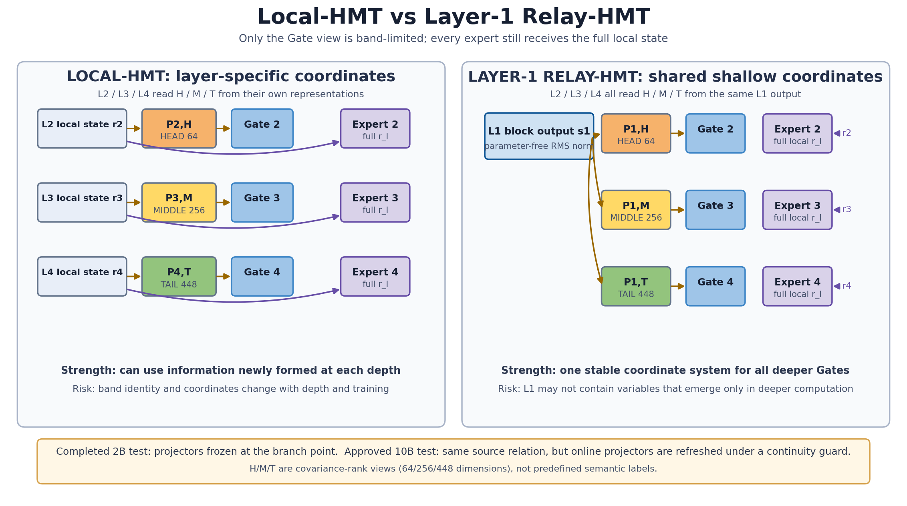

# 不同层的高、中、低方差信息，能否直接用来安排 Router 分工？

状态：已有阶段性答案。Qwen3-8B 的静态检查和四层 MoE 的 2B 训练已经完成；更长的 10B 对照训练尚未给出最终结果。

## 1. 本日唯一回答的问题

**问题：** 把每层表示按“在自然文本中波动从大到小”排成 head、middle、tail 后，父级粗语义和子级细语义是否会稳定落在不同位置，并呈现“网络越深、谱带越靠后，语义越细”的规律，从而可以直接规定 Router 的分工？

**为什么重要：** 如果规律稳定，我们可以直接告诉后层 Router 应看哪段信息；如果规律会随层改变，就必须通过真实训练比较哪种分法对模型更有用。

## 2. 认识更新

**一句话回答：** 父级和子级语义在不同层确实会表现出不同的频谱偏好，但这种偏好不随深度单调移动；两类语义的实际能量都主要落在 head，因此固定的“第二层看 head、第三层看 middle、第四层看 tail”还不能被当成正确分工。

1. **层与频带共同决定粗细语义画像，但这种画像不随网络深度单调改变。** 父、子两种角色的实际投影能量都主要落在 head；去掉 head 本来波动较大的优势后，第 5--19 个 Transformer 模块多为子级更偏 head，第 25--32 个模块转为父级更偏 head，最后一个模块又是 head 偏子级、middle/tail 偏父级。并非每层都有可靠差异，但不同深度阶段对父、子语义的相对刻画确实不同，因此同名频带不能被理解成跨层不变的粗语义或细语义。

2. **Router 更容易先学会频谱中大奇异值方向，因此显式分频带是合理的设计起点，但不是已经证明正确的专家分工。** 此前的受控实验表明，大方差方向会被线性 Gate 更快学到；因此我们可以主动规定 Router 看哪些频带，给它一个明确的区分方向。不过“更容易学到”不等于“按这个方向分专家一定更好”，最终仍要由未见文本损失和专家选择质量裁定。

3. **根据以上认识构造了两种方法，小规模数据 2B 训练结果更支持“后三层共享一个浅层信息来源”的方法，而不支持“随层深把本层频带依次后移”，但目前在估计数据子空间存在困难，因为数据的会导致分布偏移，需要构造合理方法学到投影算子。** Local 让第 2/3/4 层分别看本层 head/middle/tail：同一专家收到的梯度冲突更少，但未见文本的终点损失反而高 0.002174 nat/token。Relay 把第一层指定为后三层共同来源（不冻结第一层参数），终点损失低 0.001756 nat/token，所选专家也更接近把 token 送遍所有专家后找到的最佳专家。不过 Relay 前期适应较慢，整个训练过程没有更快得到好模型；同维随机 Relay 也尚未完成，因此不能把晚期优势归因于频谱本身。

## 3. 例子与图示

**静态文本例子：** 对同一个目标词 algebra，我们比较“mathematics contains algebra”（algebra 是更细的子级）和“algebra contains linear algebra”（algebra 是更粗的父级）。两条文本中的 algebra 使用同一 token id、位于同一位置，而且包含关系在读取目标词前已经完整出现。

去掉各方向原有波动大小后，head 上的父/子强度比在第 10 个模块为 0.961（子级更强），在第 29 个模块为 1.080（父级更强），在第 36 个模块又为 0.915（子级更强）；但第 36 个模块的 middle/tail 仍是父级更强。这说明网络在不同深度重新安排了父、子语义，而不是沿一条固定频谱轴由粗走向细。

**两种架构图示（右边架构目前的初步训练结果好于baseline和左边结果）**

**读图：** 左侧 Local 中，第 2/3/4 层 Router 分别看本层的 head/middle/tail；右侧 Relay 中，三个后层 Router 都从第一层取信息，只是分别读取第一层的 head/middle/tail。两种方法都没有截断专家输入：专家仍看到本层完整表示，变化的只是 Router 用什么信息选择专家。

**完整证据：** [自包含综合报告](layer_band_composition_and_progressive_routing/report.md)；[Qwen3-8B 静态结果](../../Projects/from-attention-to-search/main/experiments/A15/15_02_layerwise_representation_spectral_atlas/A15_02_02_E02_qwen3_independent_role_atlas/summary_cn.md)；[2B 训练结果](../../Projects/from-attention-to-search/main/experiments/A15/15_05_functional_coordinate_admission/A15_05_03_E01_progressive_band_source_routing_2b/summary_cn.md)。

## 4. 解释流程图（AI 初稿，研究者修改）

~~~mermaid
flowchart LR
    A["父级和子级的实际能量都主要在 head"] --> B["排除 head 本来波动大的优势后，两种角色的相对强弱仍会随层改变"]
    B --> C["不存在“层越深、谱带越靠后，语义越细”的固定规律"]
    C --> D["因此把 H→M→T 交给 Router 只是一个待检验方案"]
    D --> E["每层看自己的频带：更新冲突减少，但最终损失变差"]
    D --> F["后层共同看第一层：最终损失和选专家结果略好"]
    E --> G["固定 H→M→T 尚未成立；稳定的浅层信息来源值得继续严格验证"]
    F --> G
~~~

## 5. 边界与下一步

- **成立范围：** 一个冻结的 Qwen3-8B、32 条父子语义链，以及四层 MoE 的两次独立 0.629B→2B 配对续训。
- **仍不能说：** 深层一定表示更细语义；tail 就是叶子节点；Local 变差已经被证明是表征漂移；Relay 已经提高整体训练效率或形成稳定专家分工。
- **最强未决解释：** Relay 可能只是因为给后三层提供了一个稳定、低维的共同信息源而受益，并不一定因为这个信息源恰好是 covariance 频带。
- **唯一下一决策：** 完成从初始化开始的 10B 五组对照训练，判断 Relay 的终点优势能否保持，并排除“任意稳定低维信息都一样有效”。
- **完成判据：** 两次独立训练都保持健康负载，且频带 Relay 的 10B 未见文本损失同时低于“完整去均值输入”“每层看自己的频带”和“同维随机 Relay”；否则不把它升级为新的 Router 方法。
- **恢复时第一动作：** 工程检查通过后运行十条正式训练；所有终点齐备后先比较未见文本损失，再检查选专家质量与同专家更新冲突是否给出一致解释。
