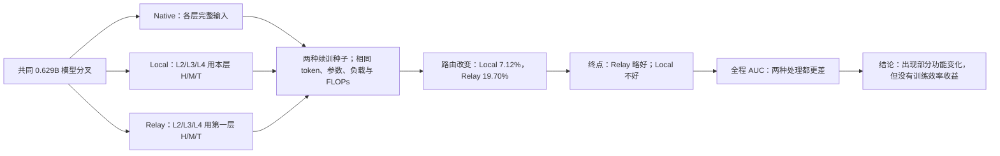

# 显式 H→M→T 路由能否产生有益的层级专家分工？

状态：A15_05_03_E01 已完成；正式裁定为 specialization-only without quality pass。

## 1. 本次唯一回答的问题

**问题：** 以前没有观察到频带对应的有益专家分化，是否只是因为原生 Router 没有按频带分发；如果显式让第 2/3/4 层依次按 head/middle/tail 路由，能否形成更有用的专家并提高匹配计算下的训练效率？

Head、middle、tail 分别是 covariance 方差由大到小的 64/256/448 个方向；它们是几何位置，不预先代表粗、中、细语义。

## 2. 认识更新

**一句话回答：** 显式频带路由能强制改变路由和部分专家功能，但没有提高整个续训区间的 loss/FLOP，因此“原模型没按频带分发”不是缺少有益层级分化的充分解释。

Held-out NLL 表示模型预测未见 token 的平均意外程度，越低越好；NLL AUC 是从公共 0.629B 分叉到 2B 之间整条损失曲线的平均高度，越低才表示同样计算下学得更快。

1. 本层 H→M→T 的 pooled 终点 NLL 比 native 差 0.002174 nat/token，且整段 AUC 差 0.02298，说明逐层本地频带日程没有收益。
2. 第一层频带 relay 的 pooled 2B 终点比 native 好 0.001756 nat/token，两个续训种子方向一致，但整段 AUC 仍差 0.02135；它是付出早期适应成本后晚期略微反超，不是训练效率提高。
3. local 与 relay 分别改变后三层平均 7.12% 与 19.70% 的路由，且负载可比，证明干预有效而不是 no-op。
4. relay 选择专家的反事实遗憾在两个种子中都下降，但专家效用差异变小、输出更相似，其他冲突指标不一致；不能称为清晰的层级专业化。
5. 因此，显式结构可以制造分化现象，但有益分工仍需要直接的专家效用目标；固定 covariance rank 本身不是功能标签。

## 3. 决定性证据

横轴是解析匹配的累计训练 FLOPs，纵轴是 held-out NLL；黑色为完整输入 native，蓝色为各层本地 H→M→T，橙色为第一层 H→M→T relay。两种处理在最左侧先明显变差，relay 到约 1.5B token 才追平并在 2B 略低；整条橙线的平均高度仍高于黑线。

## 4. 判断流程图

## 5. 边界与唯一下一决策

- **有效性门：** 六条 2B 训练全部成功、零重试；四个注册里程碑最差负载熵 0.974、最大专家份额 17.9%；同种子三臂的实际 batch 哈希完全一致。
- **成立范围：** 一个四层 H768 DCLM MoE 从 0.629B token 后分叉的两套配对续训；频带基底在分叉时冻结。
- **仍不能说：** H→M→T 是自然语义层级、第一层包含后层全部信息、relay 终点优势来自 covariance 身份、从初始化或更深模型也成立，或该方法提高了训练效率。
- **最强未决解释：** relay 的晚期优势可能来自稳定浅层瓶颈或一般正则化，而不是频带语义；本实验没有同维随机日程，无法区分。
- **唯一下一决策：** 关闭固定 H→M→T rank 日程；只有可学习的跨层功能坐标先在 held-out 专家效用或更新兼容性上超过同维随机和错误层，才允许再次进入匹配训练。
- **完成判据：** 两个独立训练种子中，功能坐标都降低专家选择遗憾或更新冲突，并且随后同时改善终点 NLL 与 NLL AUC。
- **恢复时第一动作：** 先定义和冻结功能坐标的准入 Protocol，不直接增加新的固定频带训练 arm。

完整结果：[中文摘要](../../Projects/from-attention-to-search/main/experiments/A15/15_05_functional_coordinate_admission/A15_05_03_E01_progressive_band_source_routing_2b/summary_cn.md)；[完整证据账本](../../Projects/from-attention-to-search/main/experiments/A15/15_05_functional_coordinate_admission/A15_05_03_E01_progressive_band_source_routing_2b/detailed.md)。
