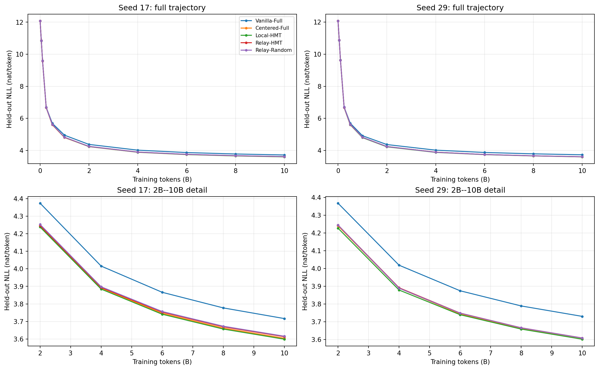
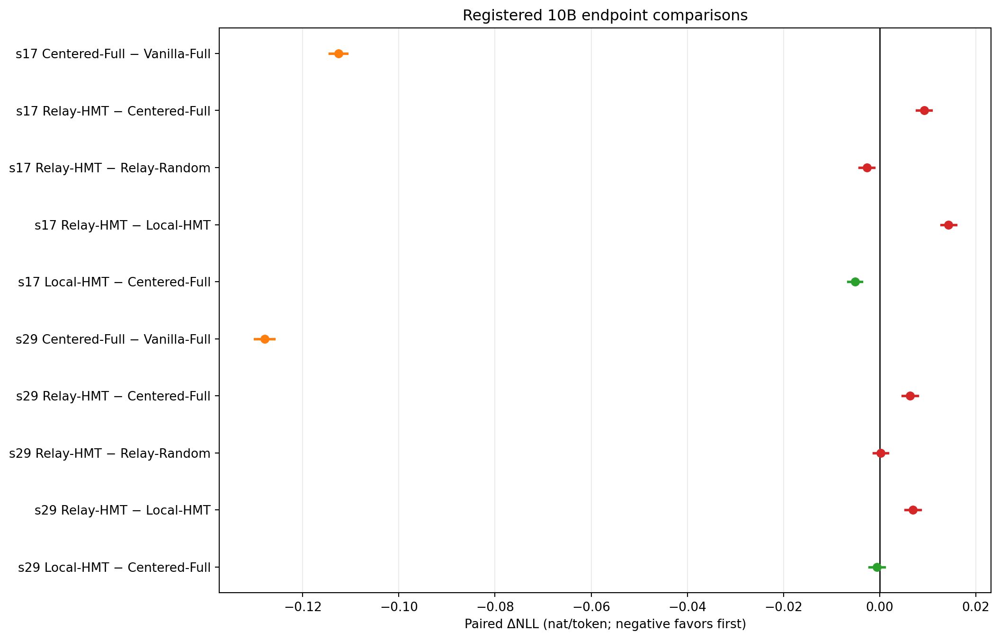
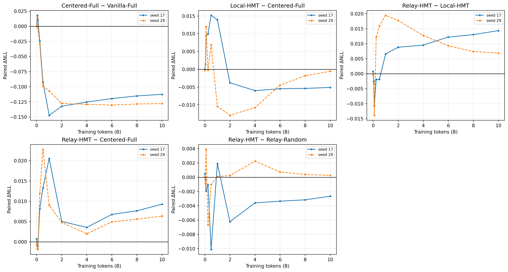
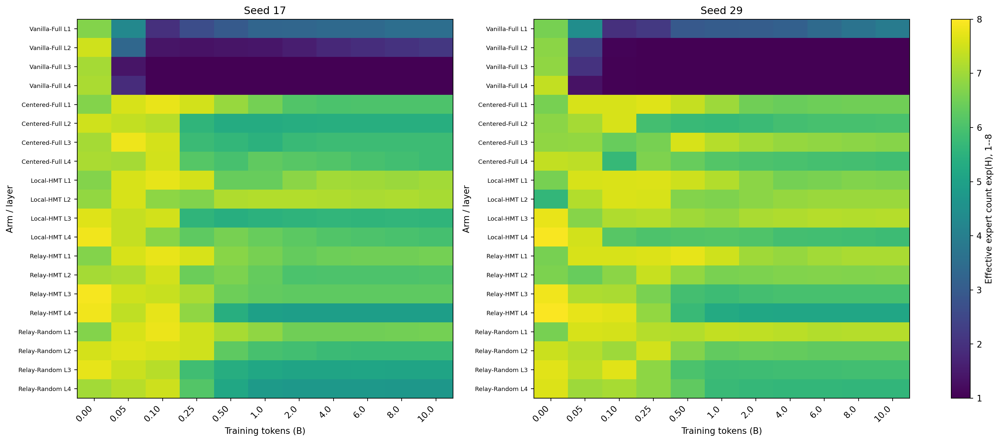
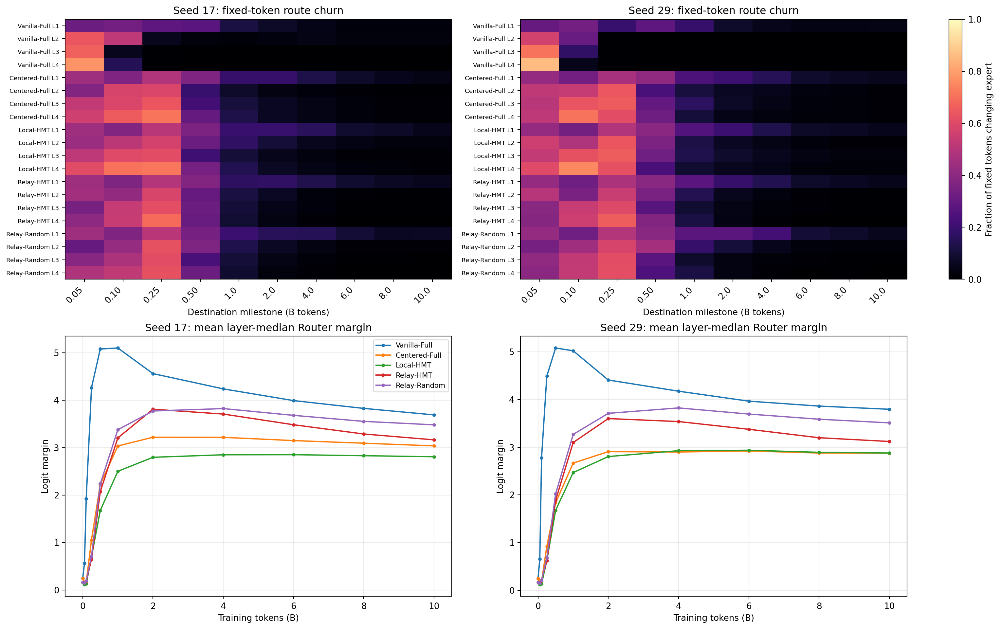
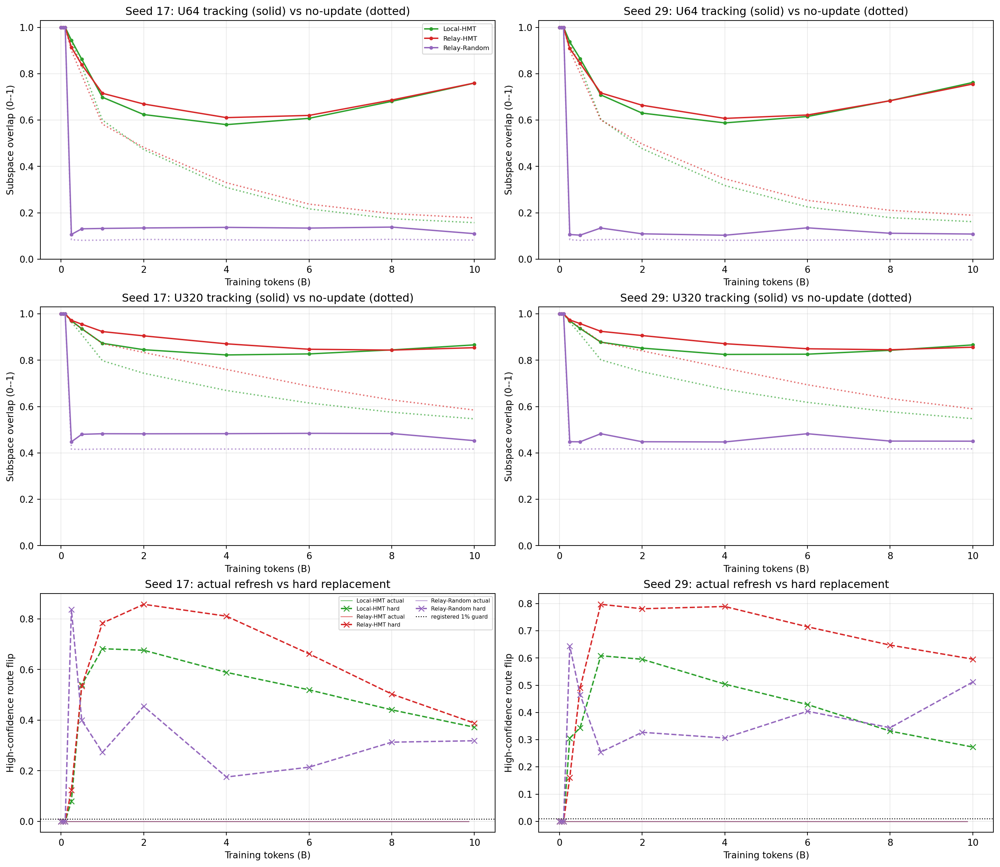
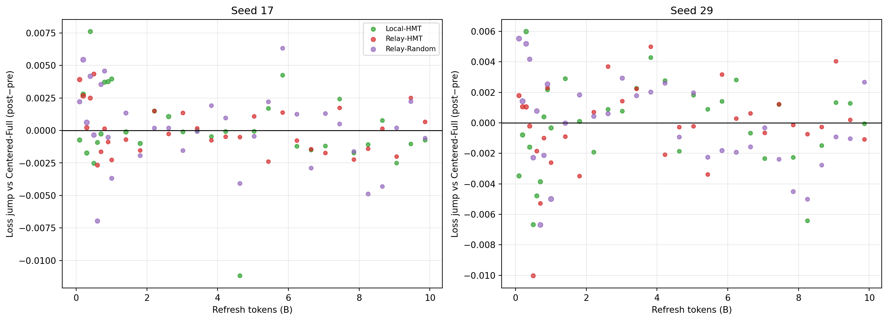
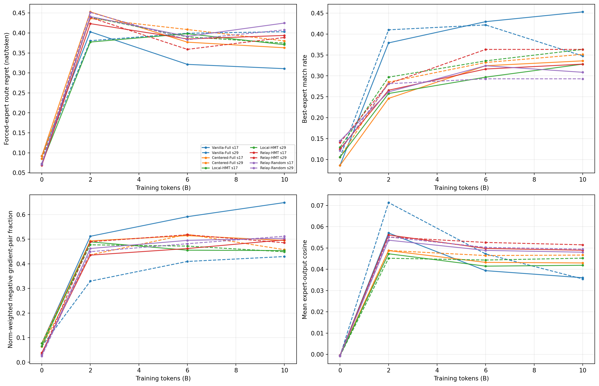
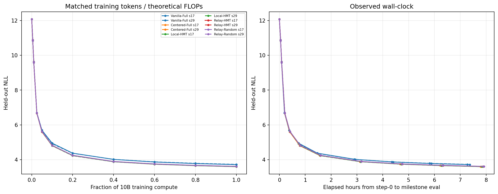

# 在线频谱 Router 五臂 10B 训练：完整评估报告

状态：最终版
实验：`A15_00_E01_10b_five_arm_training`
主裁定：**本实验不支持 Relay-HMT；Local-HMT 在两个种子上都是最低 NLL 点估计，但尚未达到“两种子均明确优于 Centered-Full”的决定性标准。**

## 0. 摘要

本实验问的是：在模型、数据、初始化和 10B-token 预算配对后，持续更新的 covariance 频带能否帮助 Router，以及固定第一层频带作为后层 Relay 是否优于逐层读取本层频带和同维随机 Relay。

结果可以压缩为六句话：

1. **去均值是最明确的收益来源：** Centered-Full 在两个种子上都比 Vanilla-Full 低约 $0.11$--$0.13$ nat/token，并避免了后层几乎全部 token 流向单一专家。
2. **Local-HMT 是两个种子的最低终点点估计：** 但它相对 Centered-Full 只在 seed 17 明确改善，seed 29 的区间跨零，因此不能宣称已稳定胜出。
3. **固定第一层 Relay 没有带来优势：** Relay-HMT 在两个种子上都明确劣于 Local-HMT，也明确劣于 Centered-Full。
4. **covariance 频带身份没有通过随机 Relay 对照：** Relay-HMT 只在 seed 17 优于 Relay-Random，seed 29 无法区分，未满足注册条件。
5. **在线更新器本身工作正常：** 它比“永不更新”更接近当前 covariance 目标，并把实际刷新造成的高置信 token 换专家率压到 0；直接硬切换目标则会使约四分之一到二分之一的高置信 token 换专家。
6. **更新平滑不等于路由有用：** 当前最可靠的知识更新是“连续在线追踪可实现，但浅层 Relay-HMT 没有转化成预测质量收益”。

## 1. 具体解决什么问题

### 1.1 唯一主问题

在四层小型 DCLM MoE 中，以下变化能否在 10B tokens 后降低未见文本的 next-token NLL：

- 对 Router 输入去 running mean；
- 让第 2/3/4 层 Router 分别只看动态 head/middle/tail；
- 让第 2/3/4 层统一读取第一层的 head/middle/tail；
- 使用 covariance 排名频带，而非任意同维平滑随机子空间。

NLL 是正确下一个 token 的平均负对数概率，单位为 nat/token；越低表示模型对未见文本预测越好。

### 1.2 为什么需要五臂

| Arm | Router 实际读取什么 | 隔离的解释 |
| --- | --- | --- |
| Vanilla-Full | 每层完整本层表征，不减均值 | 标准基线 |
| Centered-Full | 每层完整本层表征减 running mean | 去均值本身 |
| Local-HMT | L1 使用 centered full；L2/L3/L4 分别使用本层动态 H/M/T | 本层频带限制的整体效应 |
| Relay-HMT | L1 使用 centered full；L2/L3/L4 分别使用第一层动态 H/M/T | 固定浅层来源是否有益 |
| Relay-Random | 与 Relay-HMT 同来源、维度、更新器和梯度路径，但使用随机混合子空间 | covariance 频带身份是否特殊 |

H/M/T 是按 covariance 特征值从大到小排列后的 64/256/448 维区间。它们是几何排名，不预设语义层级。所有专家仍接收完整本层输入，只有 Gate 的观察坐标不同。

## 2. 模型、数据与训练合同

- 模型：4 个 Transformer block，hidden size 768，8 个稀疏专家加 1 个共享专家，top-1 routing。
- 训练：BF16，AdamW，学习率 $10^{-4}$，warmup 636 steps，统一 load-balancing 系数 0.01。
- 序列与批量：sequence length 1024，global batch 768，每步 786,432 tokens。
- 预算：12,716 steps，即每个 job 10,000,269,312 tokens；学习率曲线保留已注册的 100B cosine horizon。
- 数据：所有 arm 使用同一 DCLM 来源、tokenizer、逐步数据顺序和验证文档顺序。
- 种子：17、29；同 seed 五臂共享公共 step-0 参数、专家参数和数据/RNG 合同。
- 任务：5 arms × 2 seeds，共 10 个独立单节点 8×5090 job；全部达到 10B，零重试，终点评估齐全。
- 验证：固定 1,024 篇未见文档，逐文档保存 NLL。
- 在线统计：固定独立 WOS token；前 65,536 tokens 用于 covariance，另 16,384 tokens 用于连续性守卫。
- 统计 token artifact SHA-256：`5c8cca2b0821f25b8e7abc50d7653dfba8d71e9ccf167fee61b82624116a52e4`。
- 不可变源码：`/data/250010109/MoE_Router/experiments/20260803_online_spectral_router_training_v9/`；manifest SHA-256 为 `5b1dda74acc5ff7f8bd8cc05c0485c1eeb8694769f91ec6e16658ef3d3e1dd8f`。

保存点为 0、50M、100M、250M、500M、1B、2B、4B、6B、8B 和 10B。全部里程碑都有 checkpoint、1,024 篇文档 NLL、路由状态和可重建的 TensorBoard/JSONL 记录。

## 3. 主裁定：谁的终点损失最低

### 3.1 绝对终点

| Arm | Seed 17 NLL | Seed 29 NLL | 两 seed 点估计排序 |
| --- | ---: | ---: | --- |
| Local-HMT | **3.59874** | **3.60203** | 1 / 1 |
| Centered-Full | 3.60384 | 3.60259 | 2 / 2 |
| Relay-HMT | 3.61309 | 3.60892 | 3 / 4 |
| Relay-Random | 3.61576 | 3.60866 | 4 / 3 |
| Vanilla-Full | 3.71639 | 3.73053 | 5 / 5 |

Local-HMT 在两种初始化下都是最低点估计，但“最低点估计”不等于已稳定优于第二名；必须看同一文档上的配对差。

### 3.2 注册配对差

定义

$$
\Delta\mathrm{NLL}(A-B)=\mathrm{NLL}_A-\mathrm{NLL}_B.
$$

负值表示 A 更好。每个 seed 使用相同 1,024 篇文档做 10,000 次配对 bootstrap；只有区间整体低于零才称该 seed 明确支持 A。

| 比较 | Seed 17，95% CI | Seed 29，95% CI | 裁定 |
| --- | ---: | ---: | --- |
| Centered − Vanilla | $-0.11254$ [$-0.11445,-0.11074$] | $-0.12795$ [$-0.13003,-0.12596$] | **去均值 Pass** |
| Local − Centered | $-0.00510$ [$-0.00654,-0.00371$] | $-0.00056$ [$-0.00211,+0.00098$] | H1 **未获支持** |
| Relay-HMT − Local | $+0.01436$ [$+0.01280,+0.01590$] | $+0.00689$ [$+0.00535,+0.00846$] | H2 **Fail** |
| Relay-HMT − Centered | $+0.00925$ [$+0.00769,+0.01080$] | $+0.00633$ [$+0.00476,+0.00791$] | 完整 Relay **Fail** |
| Relay-HMT − Relay-Random | $-0.00266$ [$-0.00420,-0.00115$] | $+0.00026$ [$-0.00123,+0.00175$] | H3 **Fail** |

这里 H1 的“未获支持”表示没有满足两 seed 都明确改善的注册规则，不等于 Local-HMT 已被证明有害。

图 1 的横轴是累计训练 token（十亿），纵轴是 held-out NLL；越低越好。上排展示从初始化到 10B，下排放大 2B--10B。Local-HMT 从约 2B 后成为最低点估计，但 seed 29 的优势在后期逐渐缩小。

图 2 中横轴是配对 $\Delta$NLL，黑线为零；点在左侧表示标签中的第一个 arm 更好，横线是文档级 95% 区间。Relay-HMT 相对 Local 和 Centered 的两种子区间都完整落在右侧，这是“不支持 Relay”的决定性证据。

## 4. 训练过程：差异何时出现

图 3 显示：

- 去均值的收益约在 500M--1B 后迅速形成，之后一直保持很大优势；
- Local-HMT 早期略差，约 2B 后转为更低点估计；seed 17 的优势保持约 $0.004$--$0.006$，seed 29 的优势则从中期约 $0.01$ 收缩到终点接近零；
- Relay-HMT 在约 1B 后持续劣于 Local-HMT，延长到 10B 没有产生反转；
- 因此现有 10B 轨迹已经足以否定“Relay 只是训练得慢、再多一点就会自然追上”的简单解释，但不能排除不同超参数或更大模型下出现其他结果。

## 5. Expert use：路由是否健康

“有效专家数”定义为专家使用分布熵的指数 $\exp(H)$：1 表示几乎只用一个专家，8 表示八个专家接近均衡。它衡量使用广度，不衡量专家是否学到了有用分工。

图 4 的横轴是训练 token，纵轴是 arm 与层，颜色条从 1 到 8；颜色越亮表示使用越广。固定 guard token 上：

- Vanilla-Full 的 L3/L4 很早退化到接近 1 个有效专家，10B 时两 seed 的逐层最坏专家份额都接近 100%；
- Centered-Full、Local-HMT 和两个 Relay 都保留多专家使用，10B 的 held-out 最坏层最大专家份额约为 0.229--0.358；
- Local-HMT 的 guard-set 层均有效专家数约为 6.41/6.65，是五臂中最高；
- 所有 arm 的结构性 capacity drop 都为 0。

因此去均值在本设置中同时带来大幅 NLL 改善和防止负载坍缩；但仅凭这一实验不能证明 NLL 收益完全由负载改善中介。Relay 的负载也健康，却没有更低 NLL，说明“更均衡”本身不够。

## 6. 路由过程：改了多少、是否突然跳变

“route churn”是在相邻保存点上，同一批固定 token 换专家的比例；“margin”是第一名与第二名专家 logit 的差，越大表示选择越坚决。

图 5 上排颜色越亮，表示相邻保存点之间更多 token 换专家；下排是四层 median margin 的平均：

- 主要路由重组发生在 1B 前，随后各臂 churn 快速下降；
- Vanilla 后层 churn 变小不是稳定分工的正证据，而是坍缩后几乎没有可变路由；
- Local-HMT 的 margin 最低但负载最广，说明它保留了较多接近决策边界的选择；
- Relay 的 margin 较高，但没有转化为更好的 NLL，因此“更自信”不能当成路由正确性。

## 7. 在线更新：基准、目标与准确度

### 7.1 更新器究竟在追什么

在线更新器不是在预测标签。它的目标是在模型表征变化时，追踪固定统计语料上 EMA covariance 的精确嵌套子空间：

- $U_{64}$：head 的 64 维目标；
- $U_{320}$：head+middle 的 320 维目标；
- H/M/T 分别由 $P_{64}$、$P_{320}-P_{64}$、$I-P_{320}$ 得到。

每次刷新先计算精确目标，再用 Procrustes 对齐与 Grassmann 回溯选择最大安全步长。统计分解不参与反向传播。

### 7.2 三个基准

1. **精确目标：** 当前 EMA covariance 的精确子空间；重合度为 1，但直接部署可能使路由突变。
2. **从不更新：** 一直使用 step-0 子空间；连续但会逐渐陈旧。
3. **实际部署：** 平滑向精确目标移动，并受 route-flip、负载变化与 margin-normalized logit change 约束。

子空间准确度定义为

$$
A(U,V)=\frac{\lVert U^\top V\rVert_F^2}{k}\in[0,1].
$$

1 表示完全相同；独立随机 64/320 维子空间的期望约为 0.083/0.417。RMS 主角度是同一差异的角度表达，0°最好。

### 7.3 10B 追踪准确度

下表对 Local 的三个来源层取中位数，对 Relay 使用唯一第一层来源。

| Arm / seed | $U_{64}$ 实际 / 不更新 | $U_{64}$ RMS 角 | $U_{320}$ 实际 / 不更新 | $U_{320}$ RMS 角 |
| --- | ---: | ---: | ---: | ---: |
| Local-HMT / 17 | 0.760 / 0.157 | 30.2° | 0.866 / 0.547 | 23.0° |
| Local-HMT / 29 | 0.762 / 0.162 | 30.1° | 0.866 / 0.548 | 22.9° |
| Relay-HMT / 17 | 0.760 / 0.178 | 30.5° | 0.854 / 0.585 | 24.1° |
| Relay-HMT / 29 | 0.756 / 0.189 | 30.9° | 0.856 / 0.591 | 23.8° |
| Relay-Random / 17 | 0.110 / 0.082 | 73.3° | 0.453 / 0.417 | 53.2° |
| Relay-Random / 29 | 0.108 / 0.083 | 73.3° | 0.451 / 0.418 | 53.4° |

HMT 部署子空间明显优于从不更新，并保留精确目标约 84%--85% 的 head 方差捕获和约 94%--95% 的 head+middle 方差捕获；但 24°--31° 的角度说明它并非精确追踪。

Relay-Random 的目标由完整特征基底再乘固定 Haar 矩阵得到，包含大量易旋转的低特征值方向，因此目标本身比 HMT 更难稳定追踪。它的实际重合仅略高于随机/不更新水平。这个不对称性限制了对 Relay-Random 的正向解释；不过 Relay-HMT 最终仍没有稳定优于它，因此不会制造虚假的 covariance 正结论。

### 7.4 连续性是否实现

| Arm / seed | 刷新次数 | median $\gamma$ | 实际 median / max 全 token flip | 实际最大高置信 flip | 10B 硬切换高置信 flip |
| --- | ---: | ---: | ---: | ---: | ---: |
| Local / 17 | 32 | 1/16 | 0.287% / 2.161% | 0 | 34.9% |
| Local / 29 | 32 | 1/16 | 0.439% / 2.386% | 0 | 24.8% |
| Relay-HMT / 17 | 32 | 1/16 | 0.162% / 2.893% | 0 | 38.0% |
| Relay-HMT / 29 | 32 | 1/16 | 0.159% / 2.258% | 0 | 33.5% |
| Relay-Random / 17 | 32 | 1/8 | 0.653% / 3.723% | 0 | 1.54% |
| Relay-Random / 29 | 32 | 1/16 | 1.309% / 4.053% | 0 | 0.59% |

所有实际刷新均接受非零步长，最大高置信 flip 为 0，最大 $R_{cont}<0.01$，最大专家份额变化也低于 1 个百分点。H4 因此 **Pass**。

图 6 上两排中，实线是实际部署相对精确目标的重合度，点线是 step-0 不更新基线；下排的实线贴近 0，表示实际刷新没有翻转高置信 token，虚线叉号表示硬切换会造成的大量翻转。该图回答“更新器是否兼顾追踪和连续”，不回答这些频带是否有功能价值。

## 8. 刷新是否造成 NLL 跳变

对每次刷新，比较前 16 步与后 16 步的训练 LM loss 变化，再减去同 seed Centered-Full 在相同步数的变化。这是一种事件共现检查，不是严格因果干预。

六个 treatment×seed 条件各有 32 次刷新；差分中位数位于 $-3.8\times10^{-4}$ 到 $+2.4\times10^{-4}$，正值比例为 34%--56%，没有同向的系统跳变。因此当前 10B 运行**不支持“每次投影刷新会造成可见 NLL 跳变”**。这并不证明刷新完全没有瞬时影响，因为 mini-batch loss 噪声和窗口定义仍可能掩盖更短时间尺度效应。

## 9. 更深的专家机制评估

### 9.1 指标的物理含义

- **专家选择遗憾：** 对同一 token 强制遍历八个专家，比较 Router 实际所选专家与其中最低 loss 专家的差，单位 nat/token；越低表示当前 Router 更接近局部最优专家。
- **梯度冲突率：** 把 held-out 文档分成独立小组，对实际收到 token 的同一专家分别求梯度；若两组梯度余弦为负，说明它们要求该专家向相反方向更新。报告按梯度范数加权的负对比例；越低表示冲突较少。
- **专家输出冗余：** 同一输入经过不同专家后的输出余弦；越高表示专家功能越相似。

这些都是冻结 checkpoint 的局部诊断，不能替代终点 NLL，也不能单独证明长期因果机制。

### 9.2 10B 层均结果

| Arm | 选择遗憾 s17 / s29 | 冲突率 s17 / s29 | 输出冗余 s17 / s29 |
| --- | ---: | ---: | ---: |
| Centered-Full | 0.363 / 0.380 | 0.495 / 0.457 | 0.043 / 0.047 |
| Local-HMT | 0.371 / 0.375 | **0.454 / 0.449** | **0.042 / 0.045** |
| Relay-HMT | 0.394 / 0.389 | 0.497 / 0.486 | 0.049 / 0.051 |
| Relay-Random | 0.425 / 0.408 | 0.504 / 0.512 | 0.048 / 0.049 |

Local-HMT 的梯度冲突和输出冗余点估计略低于两个 Relay，与它较好的 NLL 排序相容；但它的专家选择遗憾并未在两个 seed 都优于 Centered-Full，因此这条机制链没有闭合。Relay 两臂的遗憾更高、输出更冗余，与它们没有 NLL 收益相容。

Vanilla 的部分局部遗憾数值看起来并不差，但它已经严重路由坍缩且 NLL 最差，这再次说明单一局部机制指标不能替代完整模型质量。

## 10. 计算与 wall-clock 公平性

所有 arm 训练 token、公共模型、专家激活数和注册理论训练预算相同；基线不执行虚假的 PCA。观察到：

- Vanilla 的中位训练吞吐约 397k/407k token/s；
- Centered 约 378k/377k token/s；
- Local、Relay-HMT、Relay-Random 约 370k--375k token/s；
- 每个 treatment 的 32 次统计刷新合计约 113--167 秒，只占约 7.8--7.9 小时总 wall-clock 的 0.4%--0.6%；
- 10B 评估时刻从 step-0 起约为 Vanilla 7.28--7.37 小时，其余 arm 7.78--7.92 小时。

因此 Local 的小幅点估计收益不是因为训练了更多 token；但若考虑真实部署成本，它付出了约 1%--2% 相对 Centered 的吞吐下降。Relay 没有质量收益，也没有 wall-clock 优势。

## 11. 假设裁定

| 假设 | Verdict | 直接理由 |
| --- | --- | --- |
| H1：Local-HMT 优于 Centered-Full | **Not supported** | 两 seed 点估计均更低，但 seed 29 配对区间跨零 |
| H2：固定浅层 Relay 优于本层频带 | **Fail** | Relay-HMT 在两个 seed 都明确劣于 Local-HMT |
| H3：Relay covariance 频带优于随机同维 Relay | **Fail** | seed 17 支持，seed 29 无法区分，未跨 seed 复现 |
| H4：平滑更新避免高置信路由硬跳 | **Pass** | 192 次刷新事件中最大高置信 flip 为 0，全部约束通过 |
| 主方法：Relay-HMT 优于三个对照 | **Fail** | 它未优于 Centered、Local 或 Random 的注册组合 |
| 工程/证据完整性 | **Pass** | 10/10 任务到 10B；110/110 路由快照、40/40 专家诊断、全部终点逐文档 NLL 齐全 |

## 12. 决定性的认识更新

1. **这组模型中，Router 去均值比频带身份更重要：它是唯一跨两个种子都产生大幅、明确 NLL 收益的结构变化。**
2. **动态本层 H/M/T 是一个值得保留的弱信号，而不是已获证实的方法：它在两个 seed 上都给出最低点估计，但决定性证据不足。**
3. **固定第一层坐标没有降低后层 Router 的有效搜索难度：Relay-HMT 的终点和后半程轨迹都稳定劣于 Local-HMT。**
4. **covariance 频带的几何身份没有获得训练效用证书：Relay-HMT 未稳定超过同维随机 Relay。**
5. **EMA + Grassmann + continuity guard 成功解决了“如何平滑更新”的工程问题，却没有解决“更新到什么坐标才有用”的功能问题。**
6. **专家使用更广、margin 更大、刷新更平滑或局部冲突更低都不是充分条件；最终必须由配对 held-out NLL 裁定。**

## 13. 结论边界与唯一下一决策

本实验只能支持四层 H768、8-expert、top-1、DCLM、两个 seed、10B 预算下的结论。它不能证明 H/M/T 具有普遍语义层级，不能证明 Local 的点估计收益来自 covariance 身份，也不能说明更大模型或更长预算会保持相同排序。

最关键的剩余 rival 是：Local-HMT 的点估计优势可能只是动态低维约束或正则化，而不是 H/M/T 排名本身。当前没有 Local-Random arm，无法分离。

**唯一下一决策：** 是否建立一个目标运动量与追踪精度都匹配的 Local-Random 对照，并与 Local-HMT、Centered-Full 做两 seed 配对复核；在这个缺口关闭前，不扩大 Relay-HMT，也不把 Local-HMT 写成 covariance-specific 改进。

## 14. 证据入口

- [评估合同](evaluation_contract.md)
- [九张图的 plot contract](plot_contracts.md)
- [10B 终点 NLL](tables/endpoint_nll.csv)
- [注册终点配对差](tables/endpoint_pairwise_nll.csv)
- [全部里程碑 NLL](tables/milestone_nll.csv)
- [在线追踪准确度](tables/online_tracking.csv)
- [实际刷新遥测](tables/online_refresh.csv)
- [硬切换反事实](tables/online_hard_replace.csv)
- [刷新事件研究](tables/refresh_event_study.csv)
- [专家机制摘要](tables/expert_function_summary.csv)
- [运行时间与吞吐](tables/runtime_summary.csv)
- [完整性清单](tables/analysis_completeness.json)
- [Canonical Protocol](../../../Projects/online-spectral-router-training/main/experiments/A15/A15_00_E01_10b_five_arm_training/protocol.md)

原始 checkpoints、逐 token 路由数组、TensorBoard events 与完整 telemetry 保留在：

`/data/250010109/MoE_Router/outputs/online_spectral_router_training/`
