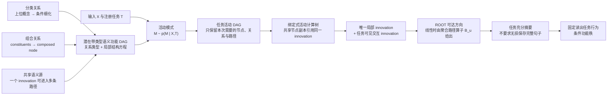

# A14 数学模型修订草案：从概率活动树到“分类—组合—任务激活”语义 DAG

材料基线是现有 [概率活动树理论](../../../Projects/from-attention-to-search/main/stories/14_tree_low_rank_language_structure/02_probabilistic_sparse_activation_tree_cn.md) 与 [A14 当前条件功能秩综合](../../../Projects/from-attention-to-search/main/stories/14_tree_low_rank_language_structure/03_ntp_conditional_function_rank_cn.md)。

## 0. 中心裁定

候选认识可以作为下一版基础，但必须采用以下严格版本：

> 用“带类型 DAG + 节点局部结构方程”表示一个预注册任务相关的潜在语义功能库。给定输入—任务，选择其中的活动子图；确定性无环计算可展开为活动计算树，但展开得到的同源副本必须共享同一个 innovation，不能当成独立源。分类边只表示条件细化；多父组合只有在结构方程含有非加性交互时才产生组合 innovation；ROOT 只要求对注册任务充分。

最强竞争解释在一个重要范围内成立：

> 任意固定加性线性 DAG 都可展开为带共享变量绑定的树，甚至折叠为从全部源到 ROOT 的一个线性映射。因此，DAG 拓扑、多父节点和路径数量本身不产生新的秩性质。

DAG 的真实增量分为三类：

1. **语义增量：**区分分类继承、因素组合和任务聚合。
2. **共享约束：**同一语义源沿多条路径出现时仍是同一随机变量或功能源，不是多个独立副本。
3. **交互增量：**联合因素产生主效应空间之外、且被任务读出使用的新方向。

其中只有第三类能在原始源维数之外直接增加线性可达方向；前两类主要改变正确计数、因果身份和潜在计算复用。

---

## 1. 原概率活动树理论的最短回顾

给定输入 $X$ 与任务 $T$，

$$
M\sim p(M\mid X,T).
$$

固定活动模式 $M=m$ 后，活动功能源 $u$ 提供局部 innovation

$$
\xi_u\in S_u,\qquad \dim S_u=r_u\le r.
$$

在线性活动树中，每个源到 ROOT 只有一条活动路径，路径算子为 $B_u(m)$，因此

$$
h_\rho(m)=\sum_{u\in A(m)}B_u(m)\xi_u.
$$

定义

$$
\mathcal R_\rho(m)
=
\sum_{u\in A(m)}B_u(m)S_u,
\qquad
q(m)=\dim\mathcal R_\rho(m).
$$

于是

$$
q(m)
\le
\sum_{u\in A(m)}r_u
\le
rN(m).
$$

若 $\Pr[N(M)\le s]\ge1-\delta$，则

$$
\Pr[q(M)\le sr]\ge1-\delta.
$$

这证明的是**单次条件计算的线性可达维数上界**。它不证明自然语言是一棵树、活动摘要任务充分、自然语义天然低秩，或 Router 有效。

---

## 2. 术语与关系类型

| 术语 | 严格含义 | 不等于 |
|---|---|---|
| taxonomy parent/child | 上位类别到下位类别的“is-a / refinement”关系 | 计算中的输入与聚合器 |
| constituent/composed node | 多个组成因素联合决定一个组合语义 | 多个 taxonomy parent |
| computational predecessor/aggregator | 信息沿计算边从前驱源流向聚合节点 | taxonomy 上位/下位概念 |
| semantic depth | 从 taxonomy 顶层到当前概念的细化边数 | 计算步数、组合阶数、秩 |
| computational depth | 活动 DAG 中从源到 ROOT 的最长依赖路径长度 | 分类深度 |
| functional rank | 在固定注册任务、固定读出和容差下，保持任务行为所需的最少表示方向数 | raw rank、分类深度、节点数 |

因此：

- “更细粒度”表示条件分类信息增加；
- “更组合”表示存在多因素联合结构；
- “更深层”必须说明是 semantic depth 还是 computational depth；
- “更高秩”只表示注册行为需要更多独立方向。

四者不得互换。

### 为什么简单分类树不足

分类树只能表达“线性代数是代数的一个细分类别”。它不能表达“代数结构”和“线性约束”必须联合出现才能形成某个组合性质。

即使允许 taxonomy 多重继承，它仍只说明类别隶属关系，不能说明多父输入是：

- 相加；
- 取交；
- 条件选择；
- 双线性交互；
- 或其他联合函数。

因此组合语义不仅需要多父 DAG，还需要节点结构方程。DAG 给出依赖关系，结构方程决定是否真的存在组合创新。

---

## 3. 模型 A：纯分类细化

### 3.1 分类变量

令 $Z$ 表示从某个语义对象总体中抽取的对象。定义不同粒度的类别变量

$$
C_0=c_0(Z),\qquad C_1=c_1(Z),\qquad C_2=c_2(Z).
$$

存在确定性上卷映射

$$
\pi_1(C_1)=C_0,\qquad \pi_2(C_2)=C_1.
$$

在每个父类别内部，引入分支变量 $\Delta_\ell$，使得

$$
C_\ell\cong(C_{\ell-1},\Delta_\ell).
$$

第 $\ell$ 次细化增加的条件信息为

$$
I_\ell^{\mathrm{tax}}
=
H(C_\ell\mid C_{\ell-1})
=
H(\Delta_\ell\mid C_{\ell-1}).
$$

由于父类别是子类别的确定函数，

$$
H(C_\ell)
=
H(C_{\ell-1})+H(C_\ell\mid C_{\ell-1}).
$$

这里的熵是跨语义对象分布定义的；单独写一条固定的“数学—代数—线性代数”路径并没有非零熵。

### 3.2 完整表示与局部 innovation

令完整类别表示为 $z_\ell\in\mathcal H_\ell$，继承映射为

$$
J_\ell:\mathcal H_{\ell-1}\to\mathcal H_\ell.
$$

定义

$$
z_\ell
=
J_\ell z_{\ell-1}
+
\xi_\ell(C_{\ell-1},\Delta_\ell).
$$

其中：

- $z_\ell$ 是完整子概念表示；
- $J_\ell z_{\ell-1}$ 是已经从父概念继承的信息；
- $\xi_\ell$ 是相对父概念新增的局部信息。

为避免依赖任意坐标分解，把真正的分类 innovation 定义在商空间中：

$$
\mathcal I_\ell^{\mathrm{tax}}
=
\operatorname{span}\{[\xi_\ell]\}
\subseteq
\mathcal H_\ell/J_\ell\mathcal H_{\ell-1},
$$

并记

$$
r_\ell^{\mathrm{tax}}
=
\dim\mathcal I_\ell^{\mathrm{tax}}.
$$

展开到第 $L$ 层：

$$
z_L
=
J_{L:0}z_0
+
\sum_{\ell=1}^{L}J_{L:\ell}\xi_\ell.
$$

因此不能把 $z_0,z_1,\ldots,z_L$ 都当作新的独立源；它们重复包含祖先信息。应计数的是 $z_0$ 与各层非零的局部 innovation。

### 3.3 条件信息量不等于方向数

$H(C_\ell\mid C_{\ell-1})$ 是信息量，$r_\ell^{\mathrm{tax}}$ 是给定表示机制中的方向数。没有编码精度、噪声、间隔或读出限制时，二者不存在一般等价关系：

- 一个分类比特可以被冗余编码到很多方向；
- 很多离散类别也可能被编码进一个连续坐标；
- 新 innovation 可能存在，但注册任务完全忽略它。

**模型 A 回答：**分类粒度增加时，新增了多少条件分支信息，以及哪些表示成分是相对父节点的新信息。

**模型 A 不回答：**这些 innovation 是否被某个任务调用、是否产生组合语义、是否到达 ROOT、是否提高功能秩。

---

## 4. 模型 B：最小组合 DAG

### 4.1 加性线性 DAG

设 $G=(V,E)$ 为有限 DAG，ROOT 为 $\rho$。每个节点具有局部 innovation

$$
\xi_v\in S_v,\qquad \dim S_v=r_v.
$$

固定活动子图 $M$ 后，

$$
h_v
=
\xi_v
+
\sum_{u\in\operatorname{pa}_M(v)}
W_{u\to v}h_u.
$$

这里的 $\operatorname{pa}_M(v)$ 是计算前驱，不是 taxonomy parent。

对路径

$$
p=(u=v_0\to v_1\to\cdots\to v_k=\rho),
$$

定义有序路径乘积

$$
W_p
=
W_{v_{k-1}\to v_k}\cdots W_{v_0\to v_1}.
$$

同一源可能存在多条到 ROOT 的路径。定义聚合路径算子

$$
B_u(M)
=
\sum_{p\in\operatorname{Paths}_M(u,\rho)}W_p.
$$

若 $u=\rho$，空路径算子取恒等映射。

### 4.2 线性 DAG 路径展开命题

令 $A(M)$ 为在活动子图中具有局部 innovation 且能到达 ROOT 的**唯一 DAG 节点集合**。则

$$
h_\rho(M)
=
\sum_{u\in A(M)}B_u(M)\xi_u.
$$

相应地，

$$
\mathcal R_\rho(M)
=
\sum_{u\in A(M)}B_u(M)S_u,
$$

以及

$$
q(M)
=
\dim\mathcal R_\rho(M)
\le
\sum_{u\in A(M)}
\dim\bigl(B_u(M)S_u\bigr)
\le
\sum_{u\in A(M)}r_u.
$$

若 $r_u\le r$，则仍有

$$
q(M)\le rN(M),
\qquad N(M)=|A(M)|.
$$

### 4.3 证明思路

按 DAG 的拓扑序递归展开每个 $h_v$。源 $u$ 对节点 $v$ 的总系数满足：

$$
B_{u\to v}
=
\sum_{w\in\operatorname{pa}(v)}
W_{w\to v}B_{u\to w}.
$$

该递推恰好枚举所有从 $u$ 到 $v$ 的有向路径。取 $v=\rho$ 即得路径和公式。随后利用：

1. 线性映射不增加源空间维数；
2. 子空间和的维数不超过各子空间维数之和。

### 4.4 多路径是否增加同一源的维数

不会突破源维数上界：

$$
\dim B_u(M)S_u\le\dim S_u=r_u.
$$

多路径可以：

- 改变同一源在 ROOT 的线性像；
- 使不同路径相长；
- 使路径互相抵消；
- 使单一路径的低秩像通过算子求和恢复到至多 $r_u$ 维。

但它不能把同一个 $r_u$ 维随机变量变成多个独立的 $r_u$ 维源。

将 DAG 展开成树时，同一节点会产生多个路径副本。这些副本必须引用同一个 $\xi_u$。若把它们当作独立变量，就把“路径出现次数”错误地当成“独立功能源数”。

### 4.5 三种多父现象的区别

| 机制 | ROOT 效应 | 是否产生新方向 |
|---|---|---|
| 纯线性多父组合 | 不同唯一源的线性像相加 | 只可能因增加了独立源而增加 |
| 同一共享源的多路径复用 | 聚合为单一算子 $B_u\xi_u$ | 不超过该源本身的维数 |
| 非线性交互组合 | 出现不能写成父节点主效应之和的新特征 | 可能增加新的线性与功能方向 |

因此，最强竞争解释对纯线性表达能力成立：固定线性 DAG 没有超出带共享变量约束的展开树。

---

## 5. 最小非线性交互

考虑两个 constituent $a\in S_a$、$b\in S_b$ 和一个 composed node $v$：

$$
h_v
=
\xi_v
+
W_a a
+
W_b b
+
\Phi_v(a,b).
$$

前三项形成主效应空间

$$
\mathcal L_v
=
S_v+W_aS_a+W_bS_b.
$$

交互像空间为

$$
\mathcal K_v
=
\operatorname{span}
\{\Phi_v(a,b):a\in S_a,b\in S_b\}.
$$

真正的表示交互 innovation 不是完整 $\mathcal K_v$，而是它相对主效应空间新增的商空间：

$$
\mathcal I_v^{\mathrm{int}}
=
(\mathcal L_v+\mathcal K_v)/\mathcal L_v,
$$

$$
t_v
=
\dim\mathcal I_v^{\mathrm{int}}.
$$

只有 $t_v>0$ 时，交互才在表示空间中创造 constituent 主效应之外的新方向。

若 $\Phi_v$ 为双线性映射，则存在矩阵 $K_v$ 使

$$
\Phi_v(a,b)=K_v(a\otimes b),
$$

从而

$$
\dim\mathcal K_v
\le
\min\{\dim\mathcal H_v,\ r_ar_b\}.
$$

但“新表示方向”仍不等于“新功能方向”。设固定任务读出为 $W_T$。若交互方向落入 $\ker W_T$，或与已有任务可见主效应冗余，则它不增加功能秩。

### 非线性后的定理修订

若所有交互都能显式提升为有限维交互特征，且产生后沿线性路径传播，则可写成

$$
q(M)
\le
\sum_{u\in A_{\mathrm{loc}}(M)}r_u
+
\sum_{v\in A_{\mathrm{int}}(M)}
\dim\mathcal K_v.
$$

原来的 $rN(M)$ 必须改成“局部 innovation 预算 + 交互特征预算”。

对一般非线性 DAG，不能仅由原始源数推出全局线性子空间上界。此时必须区分：

- **局部内在维数：**光滑映射的局部 Jacobian 秩，至多为输入自由度总数；
- **全局线性可达维数：**非线性像的线性包维数，可以远大于输入自由度；
- **固定读出功能秩：**注册任务实际需要保存的方向数。

因此，非线性可以产生新的全局线性方向，却没有创造新的独立外生随机变量。

**模型 B 回答：**多父线性传播、共享路径与交互创新分别如何改变 ROOT 可达空间。

**模型 B 不回答：**一次任务会选择哪些节点、ROOT 是否任务充分、活动模式是否可从输入识别。

---

## 6. 模型 C：任务条件活动与摘要

### 6.1 潜在带类型 DAG

定义

$$
\mathcal G
=
(V,
E_{\mathrm{tax}}
\mathbin{\dot\cup}
E_{\mathrm{comp}}
\mathbin{\dot\cup}
E_{\mathrm{agg}},
\mathcal F).
$$

其中：

- $E_{\mathrm{tax}}$：分类细化关系；
- $E_{\mathrm{comp}}$：constituent 到 composed node 的输入关系；
- $E_{\mathrm{agg}}$：任务计算中信息源到聚合节点或 ROOT 的候选关系；
- $\mathcal F$：各节点的局部结构方程和 innovation 空间。

$E_{\mathrm{tax}}$ 默认只约束类别与条件，不自动成为计算传播边。

### 6.2 活动模式与活动子图

给定输入—任务：

$$
M\sim p(M\mid X,T).
$$

模式 $M$ 选择一个有限、ROOT 可达、依赖闭合的活动子图

$$
G_M=(V_M,E_M,\rho).
$$

若一个 composed node 被选择，它所需的 constituent 也必须进入活动闭包。

定义两类活动功能源：

$$
A_{\mathrm{loc}}(M)
=
\{\text{被调用且能影响 ROOT 的唯一局部 innovation}\},
$$

$$
A_{\mathrm{int}}(M)
=
\{\text{被调用且具有非零商空间增量的交互 innovation}\}.
$$

祖先完整表示、路径副本和重复出现的共享节点都不重复计数。

### 6.3 从活动 DAG 到活动树

把 $G_M$ 从 ROOT 反向展开，可得到公式树或活动计算树 $\mathcal U(M)$：

- 一个共享 DAG 节点可能在树中出现多次；
- 所有副本绑定到同一个局部 innovation 和同一个确定性子计算；
- 多父交互节点在树中保留其联合算子；
- 展开树可能比 DAG 指数级更大，因此它表示单次计算语义，不表示最优计算成本。

纯线性情况下，$\mathcal U(M)$ 退化为原概率活动树并满足路径和公式。非线性情况下，它仍是单次计算树，但不再满足原来的纯线性源路径和定理。

### 6.4 ROOT 可达空间与条件维数

令 $\xi^0$ 为固定基线，完整活动计算为

$$
h_\rho=F_M((\xi_u)_{u\in A_{\mathrm{loc}}(M)}).
$$

先定义可达集合：

$$
\mathscr H_\rho(M)
=
\{F_M(\xi):\xi_u\in S_u\}.
$$

再定义其线性方向包：

$$
\mathcal R_\rho(M)
=
\operatorname{span}
\{h-h_\rho(\xi^0):h\in\mathscr H_\rho(M)\},
$$

$$
q(M)=\dim\mathcal R_\rho(M).
$$

在线性 DAG 中，这一定义严格退化为

$$
\mathcal R_\rho(M)
=
\sum_u B_u(M)S_u.
$$

### 6.5 任务充分性

令 $Z$ 表示完整输入中与注册任务可能相关的全部信息，$Y_T$ 为注册目标。ROOT 对任务 $T$ 精确充分，当

$$
Y_T\perp Z\mid h_\rho,T.
$$

等价地，ROOT 保留了预测 $Y_T$ 所需的信息，但不要求重建 $Z$。

定义最优任务风险

$$
R_T^\star(H)
=
\inf_g
\mathbb E[\ell(g(H,T),Y_T)].
$$

若

$$
R_T^\star(h_\rho)-R_T^\star(Z)\le\varepsilon,
$$

则称 ROOT 为 $\varepsilon$-任务充分。

低 $q(M)$ 不推出任务充分；关闭所有路径可令 $q(M)=0$，同时丢失任务答案。

### 6.6 固定读出条件功能秩

固定任务读出 $W_T$、模式 $M$ 和由 calibration 确定的基线 $b_{M,T}$。对正交投影 $P$，定义

$$
h_\rho^P
=
b_{M,T}
+
P(h_\rho-b_{M,T}).
$$

固定读出条件功能秩为

$$
k_{\mathrm{func}}^{\mathrm{fix}}(\epsilon;M,T)
=
\min_P
\left\{
\operatorname{rank}P:
\mathbb E\!\left[
\bigl(
\ell(W_Th_\rho^P,Y_T)
-
\ell(W_Th_\rho,Y_T)
\bigr)_+
\mid M,T
\right]
\le\epsilon
\right\}.
$$

$P$ 必须在最终评估前冻结，不能使用测试标签选择。

若活动 DAG 线性、ROOT 已通过任务充分性或能力门，并且投影外没有任务可见残差，则

$$
k_{\mathrm{func}}^{\mathrm{fix}}(0;M,T)
\le
q(M)
\le
\sum_{u\in A_{\mathrm{loc}}(M)}r_u.
$$

若还满足 $\Pr[N(M)\le s\mid T]\ge1-\delta$ 和 $r_u\le r$，则恢复旧结论：

$$
\Pr[
k_{\mathrm{func}}^{\mathrm{fix}}(0;M,T)\le sr
\mid T
]
\ge1-\delta.
$$

非线性情况下，应以局部 innovation 与任务可见交互 innovation 的联合预算替代 $sr$。

**模型 C 回答：**潜在库全局可以很大，而一次任务实际调用多少唯一局部因素、多少交互因素，以及这些因素经哪些共享路径形成任务摘要。

**模型 C 不回答：**活动模式是否能被学习、是否对应专家、稀疏选择是否优于共享计算、或 Router 是否产生实际效用。

---

## 7. 四个决定性反例

### 反例 1：分类更深，但没有 innovation

令

$$
C_1=(C_0,0),\qquad C_2=(C_1,0),
$$

并令

$$
\xi_1=\xi_2=0.
$$

虽然 taxonomy 路径从深度 $0$ 增至 $2$，但

$$
H(C_1\mid C_0)=H(C_2\mid C_1)=0,
$$

表示方向和功能源数都不增加。

**裁定：**semantic depth 本身不改变秩。

### 反例 2：每次细化增加正交 innovation

令 $Z_1,\ldots,Z_L$ 为条件独立的非退化分支变量，

$$
C_\ell=(C_{\ell-1},Z_\ell),
$$

并取

$$
z_L
=
z_0e_0+\sum_{\ell=1}^{L}Z_\ell e_\ell,
$$

其中 $e_0,\ldots,e_L$ 正交。则每层

$$
H(C_\ell\mid C_{\ell-1})=H(Z_\ell)>0,
$$

且在这些方向都变化并被读出使用时，可达维数随深度增长到 $L+1$。

**裁定：**维数增长来自正交 innovation，不来自分类深度本身。

### 反例 3：多条线性路径仍是一个源

令一维源为 $\xi_u=z$，并有两条路径分别把它映到 $e_1$ 和 $e_2$：

$$
h_\rho=z e_1+z e_2=z(e_1+e_2).
$$

路径数为 $2$，但

$$
\dim\operatorname{span}\{h_\rho(z)\}=1.
$$

若两条路径符号相反，甚至可完全抵消。

**裁定：**路径数不等于独立功能数；共享源必须按唯一 innovation 计数。

### 反例 4：双线性交互产生新方向

令 $a,b\in\mathbb R$，ROOT 为

$$
h_\rho(a,b)
=
ae_1+be_2+ab\,e_3.
$$

主效应只张成 $\operatorname{span}(e_1,e_2)$。样本

$$
(1,0),\quad(0,1),\quad(1,1)
$$

产生

$$
e_1,\quad e_2,\quad e_1+e_2+e_3,
$$

因此整体张成三维空间。

映射 $(a,b)\mapsto(a,b,ab)$ 的局部内在维数仍至多为 $2$，但其全局线性包为 $3$ 维。若注册读出还需要 $ab$ 方向，则功能秩也需要该新方向；若任务只读取 $a,b$，则 $e_3$ 不增加功能秩。

**裁定：**交互可以产生新线性方向，但是否成为功能创新取决于任务读出。

---

## 8. 七项理论判断

| 问题 | 裁定 |
|---|---|
| 1. 分类树只是条件变量，还是潜在图的一部分？ | 两个层次同时存在：稳定的 taxonomy 关系属于潜在 typed DAG；具体输入落在哪条分类路径上属于 $X,T$ 条件和活动模式。taxonomy 边不自动成为计算边。 |
| 2. 固定线性 DAG 能否推广路径展开和 $q(M)\le rN(M)$？ | 能，严格成立。把唯一源的所有路径聚合为 $B_u(M)$，并按唯一局部 innovation 计数。 |
| 3. 多路径共享是否破坏源数上界？ | 不会。$\dim B_uS_u\le\dim S_u$。只有路径副本获得独立状态、独立噪声或独立 innovation 时，它们才成为新源。 |
| 4. 非线性交互如何修订旧定理？ | 原始源的 $rN$ 线性子空间界一般失效。必须加入有限交互特征预算；若无有限特征闭包，只能讨论非线性可达集合、局部切空间或任务功能秩。 |
| 5. 分类细化应增加完整子节点还是局部 innovation？ | 只计相对父节点的局部 innovation。完整子节点含有继承信息，逐层计数会重复。 |
| 6. 是否建模完整句子语义？ | 不应把完整语义无损表示作为当前目标。潜在 DAG 只能是预注册任务相关的语义功能假设；ROOT 只要求相对任务充分。 |
| 7. DAG 是真实理论对象还是表示便利？ | 在线性输入—输出表达与秩上，它主要是带共享约束的表示便利；当节点同一性决定复用、交互项产生非零任务可见 innovation、或任务选择复用子图时，它才增加真实理论对象。 |

---

## 9. 旧理论保留、修改与新增

| 项目 | 旧理论 | 下一版处理 |
|---|---|---|
| 潜在结构 | 隐式功能库或完整树 | 新增带类型语义功能 DAG |
| 单次计算 | 概率活动树 | 保留为活动 DAG 的绑定式展开树 |
| 活动模式 | $M\sim p(M\mid X,T)$ | 完整保留 |
| 功能源 | 局部 innovation | 保留并强化为“相对父节点、唯一、不重复计数” |
| 路径算子 | 每源到 ROOT 唯一路径乘积 | 修改为多路径聚合算子 $B_u=\sum_pW_p$ |
| 线性维数界 | $q(M)\le rN(M)$ | 对固定线性 DAG 严格保留 |
| 分类细化 | 未显式建模 | 新增条件熵与 quotient innovation |
| 多父组合 | 未区分加性与交互 | 新增 composed node 结构方程 |
| 非线性交互 | 不在原定理内 | 新增交互 innovation 预算；不再无条件使用 $rN$ |
| 任务充分性 | 与低维条件独立 | 完整保留 |
| 固定读出功能秩 | ROOT 任务行为方向 | 保留，并与 raw reachable rank、内在维数分开 |
| Router 结论 | 条件低维不推出 Router utility | 完整保留；新增其理论必要条件，但不设计方法 |

---

## 10. 从潜在 DAG 到任务摘要

---

## 11. 为什么该模型可能对 MoE Router 有意义

该模型的意义不是为语义画一张更复杂的图，而是定义三个不同预算：

$$
D_{\mathrm{lib}}
=
\text{潜在功能库的总创新预算},
$$

$$
D(M)
=
\sum_{u\in A_{\mathrm{loc}}(M)}r_u
+
\sum_{v\in A_{\mathrm{int}}(M)}t_v,
$$

$$
k_{\mathrm{func}}^{\mathrm{fix}}(M,T)
=
\text{注册任务实际需要保存的方向数}.
$$

一个对稀疏 Router 真正有启发性的理论区间应满足

$$
k_{\mathrm{func}}^{\mathrm{fix}}(M,T)
\le
q(M)
\le
D(M)
\ll
D_{\mathrm{lib}}
$$

在大多数任务条件下成立，同时还必须满足：

1. **复用：**同一局部功能源或组合算子跨输入重复出现，而不是每个输入拥有独立子图。
2. **功能异质性：**不同模式需要不同任务函数；否则一个共享计算即可处理全部条件。
3. **条件可选择性：**所需模式能由执行前可见的 $X,T$ 条件确定或预测。
4. **任务充分性：**稀疏活动摘要没有删除注册任务必需的信息。
5. **效用—成本差异：**选择匹配功能相对不匹配功能或同成本共享基线具有真实优势。

当前数学模型最多定义前四项应是什么，不证明第五项。因此它能启发 Router 应围绕“任务需要哪些唯一功能 innovation”建模，而不能推出按 taxonomy 深度、节点数或几何秩路由有效。

如果所有模式调用同一任务函数，或者 $D(M)\approx D_{\mathrm{lib}}$，那么 DAG 即使描述正确，也没有稀疏 Router 价值。

---

## 12. Claim Boundary

### 可以作为数学结论保留

- 固定加性线性 DAG 具有严格的路径和展开。
- 多路径共享不突破唯一源维数给出的上界。
- 分类细化应以相对父节点的 quotient innovation 计数。
- 双线性或其他非线性交互可产生 constituent 主效应之外的新线性方向。
- 非线性模型必须把原始源自由度、全局线性包和固定读出功能秩分开。
- ROOT 可以只对注册任务充分，不必无损保存完整语义。

### 只能作为建模假设

- 自然语言的任务相关语义功能可以被一个有限 typed DAG 近似。
- 大多数输入—任务只调用少量局部和交互 innovation。
- 同一语义源或组合函数在不同输入间稳定复用。
- 活动 DAG 的展开树近似真实模型的一次内部计算。

### 不能声称

- 完整自然语言或“语义世界”本体是 DAG；
- taxonomy 深度、组合父节点数或路径数天然提高或降低秩；
- 非线性出现就一定产生任务可见新方向；
- 活动子图自动任务充分；
- 条件低维自动产生专家分化；
- typed DAG、功能秩或共享路径已经证明 MoE Router utility；
- 展开树保留了 DAG 的实际计算成本优势；
- 当前模型已经决定任何数据、训练目标、Router 架构或训练方法。

## 唯一待研究者裁定的数学建模选择

> 是否接受“潜在语义结构用带类型 DAG 表示，单次任务计算仍用活动树表示；分类节点只记录条件细化，组合节点显式记录交互 innovation，ROOT 只要求任务充分”作为下一版数学模型的基础？