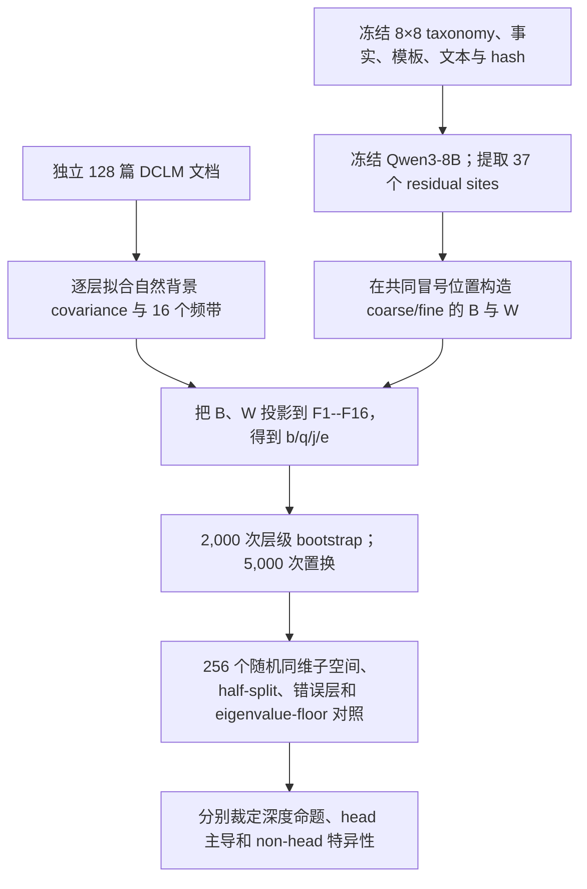
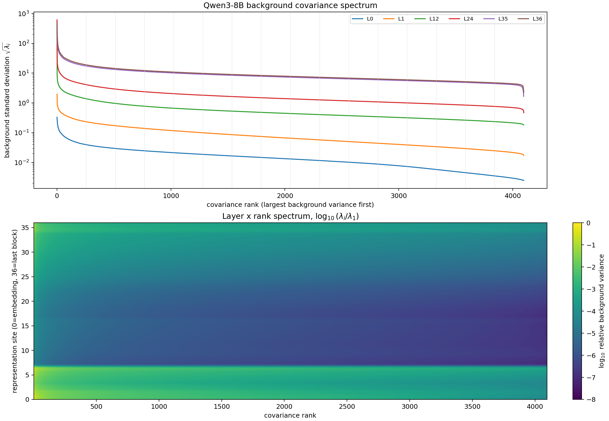
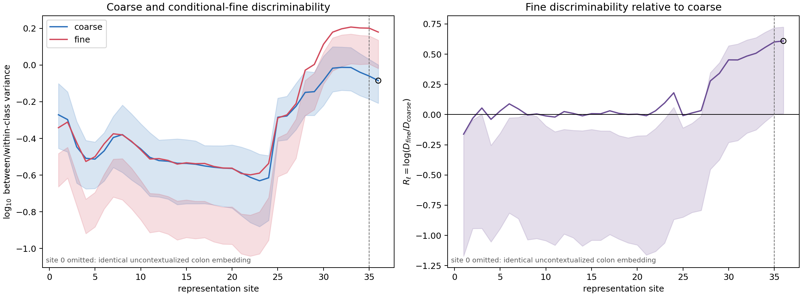
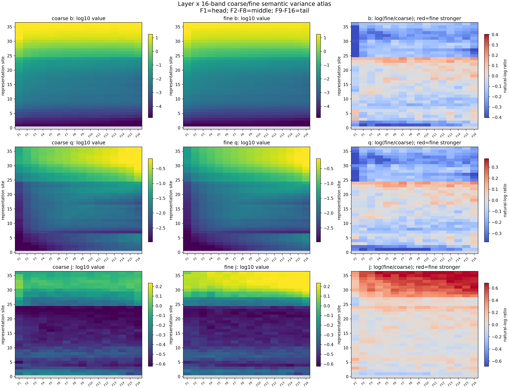
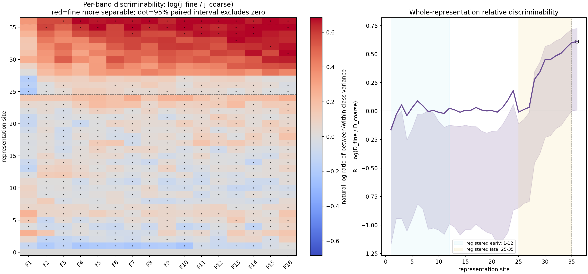
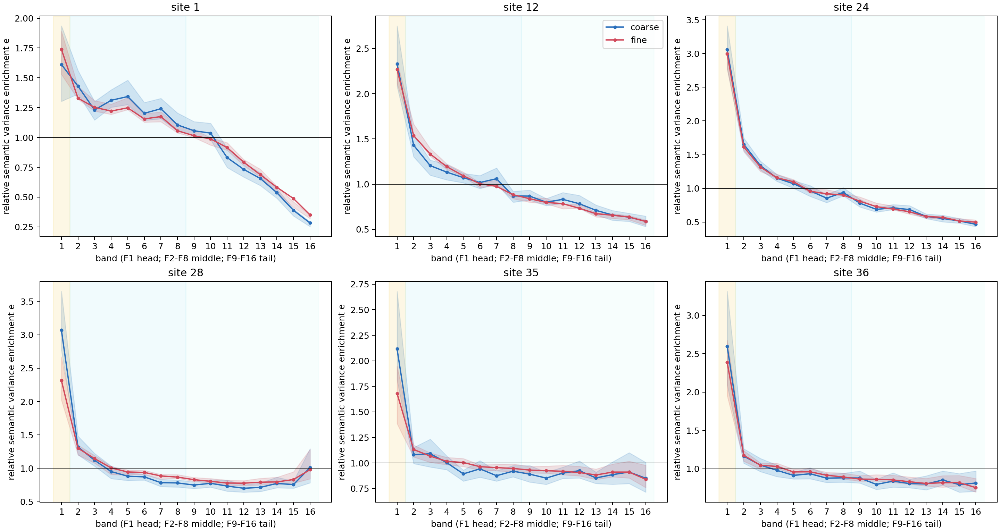

# 大模型中的语义粒度、方差区分性与频谱 Router 设计

> Qwen3-8B 冻结静态审计的理论、方法、结果与设计启示

- 日期：2026-08-04
- 模型：冻结的本地 Qwen3-8B
- 核心实验：A15_01_05_E01
- 正式裁定：`depth_pass_spectral_fail`
- 文档性质：阶段性综合报告；不是新的 Router Protocol，也不是训练收益证明

## 摘要

本报告回答三个连续但不能混为一谈的问题：第一，粗粒度与细粒度语义在大模型各层中是否具有不同的可区分性；第二，这些语义差异落在自然语料 covariance 谱的哪些位置；第三，这种表征画像能够为 Router 设计提供什么、又不能提供什么。

我们在冻结的 Qwen3-8B 上构造了一个平衡的两级学术语义树：8 个粗类别，每类 8 个细类别，每个细类别由 4 个句式模板和 2 组互不重叠的事实描述，共形成 512 条不泄漏正确类别名称的英文文本。模型在统一的 `Classification:` 末尾读取位置上产生表征；独立的 128 篇 DCLM 自然文档、65,536 个 token 用于拟合每层 covariance 基底。模型没有被微调，也没有根据结果选择概念、层或频带。

决定性结果有三条：

1. **细粒度语义在深层相对更容易区分。** 早层 blocks 1--12 的细/粗区分度比约为 1.00，晚层 blocks 25--35 为 1.57；到 block 35 为 1.82，最后一个 block 36 为 1.84，没有末层单独反转。
2. **细粒度更可分，不等于细粒度具有更大的激活方差。** 在 block 35，粗语义在 head/middle/tail 的每方向实际类别间方差为 38.08/17.49/15.91，细语义为 24.97/15.04/13.42；细语义的实际方差反而更小。它的优势来自同类文本更紧凑，即类别间信号相对于类内模板扰动更强。
3. **粗、细语义的实际方差都由谱头主导，但细粒度的深层区分优势横跨大多数频带。** 该优势没有稳定且超过随机同维方向地集中在 middle 或 tail，因此不能把固定 covariance rank 当作“细语义专属通道”。

这带来的 Router 认识是：covariance 可以解释哪些方向容易被线性 Gate 先学到，却不能单独决定哪些方向能形成有用专家分工。当前证据不支持固定 middle/tail 的 band-only Router；更合理的候选是先离线识别每层稳定的功能判别坐标，再让 Router 学习这些坐标对专家相对效用的增量，而不是在线反复做谱分解。

---

## 1. 引言：我们真正关心的不是“哪条曲线更高”

MoE Router 的任务不是简单把 token 分成不同组，而是把 token 分给对它更有相对处理优势的专家。频谱研究之所以可能帮助 Router，是因为线性 Gate 的有限时间学习会受到输入 covariance 的影响：高方差方向产生更大的平均梯度尺度，因此往往更早被学到。然而，这只说明“容易学习”，不说明“功能上有用”。

语义粒度研究进一步提出一个自然问题：粗类别，例如“数学”，可能较早形成；条件于“数学”之后，代数、分析、拓扑等细类别可能需要更深的计算才能分清。如果这一层级确实存在，我们希望知道：

1. 深层是否真的更善于区分同一父类内部的细类别？
2. 这种改善是因为细语义产生了更大的激活变化，还是因为细类表征更稳定、更少受模板措辞干扰？
3. 这种改善集中在 covariance head、middle、tail 中的某一段，还是跨谱发生？
4. 画像能否转化为低成本、功能可验证的 Router 条件？

这四问对应四种不同的证据对象：层深区分度、实际语义方差、频带定位和专家效用。任何一个对象都不能替另一个作答。

### 1.1 本实验的三个 verdict

| 命题 | 裁定 | 人话结论 |
| --- | --- | --- |
| 细语义相对粗语义是否随层深更可分 | **Pass** | 深层更清楚地组织了同一粗类内部的细分类 |
| 粗、细语义的实际类别间方差是否以 F1 最大 | **Pass** | 两类语义实际变化都主要落在自然背景的高方差方向 |
| 细语义是否特异富集于 middle/tail | **Fail** | 深层细类优势跨谱出现，没有固定 non-head 专属通道 |

本实验没有训练 Router，因此没有“Router 收益”的 verdict。

---

## 2. 数学纠偏：方差、投影能量与区分性不是同一个量

本节给出阅读后续图表所需的最小数学基础。更完整的理论与数据定义见[《语义组合深度与频谱方差：从概念澄清到可执行数据设计》](../../../0803/docs/01_语义组合深度与频谱方差_理论与数据设计.md)。

### 2.1 covariance 特征值的物理意义

对第 $\ell$ 层从独立自然语料收集的中心化表征矩阵 $X_\ell$ 做奇异值分解：

$$
X_\ell=Q_\ell S_\ell U_\ell^\top,
\qquad
\Sigma_\ell=\frac{1}{N-1}X_\ell^\top X_\ell
=U_\ell\Lambda_\ell U_\ell^\top.
$$

第 $i$ 个特征值满足

$$
\lambda_{\ell,i}
=\mathbb E\left[\left(u_{\ell,i}^{\top}(h_\ell-\mu_\ell)\right)^2\right].
$$

因此，大 $\lambda_i$ 的准确含义是：自然语料表征沿方向 $u_i$ 的平均平方波动较大。它不意味着这个方向“拥有更多数据点”，也不意味着“每个 token 都带有某个属性”，更不意味着这个方向必然更有语义价值。所有 token 都参与同一个 covariance 估计；特征值只描述它们沿某方向散开的程度。

小 $\lambda_i$ 同样有多种可能：它可能是噪声，也可能是受到强约束的稳定信号、稀有条件信号，或幅度很小但十分精确的判别方向。因此“小奇异值 = 无用信息”也是错误的。

### 2.2 单个样本投影与群体语义方差

对一个目标表征 $h$，令 $x=h-\mu_{\mathrm{bg}}$，其在自然背景谱方向上的投影为

$$
a_i=u_i^\top x.
$$

两个常见量是：

$$
\text{raw}_i=a_i^2,
\qquad
\text{white}_i=\frac{a_i^2}{\lambda_i+\epsilon}.
$$

- `raw` 保留自然背景的方差尺度，回答“这个样本实际上在该方向贡献了多少能量”。
- `white` 除去该方向平时就很大的波动，回答“相对于自然背景，这个样本在该方向是否异常”。

仅投影到单位特征向量 $u_i$ 并没有去除奇异值；要去除背景尺度，幅度必须除以 $\sqrt{\lambda_i}$，平方能量必须除以 $\lambda_i$。

但单个样本的投影仍不能回答“一个语义类别是否可区分”。要回答语义问题，必须同时比较不同类别中心之间的变化和同一类别内部的变化。

### 2.3 粗细语义的 between/within 分解

令 $h_{\ell,p,c,t}$ 表示第 $\ell$ 层的读取状态，其中：

- $p$ 是粗类别，例如 mathematics；
- $c$ 是该粗类内部的细类别，例如 algebra；
- $t$ 是描述同一细类的模板和事实组合。

定义细类中心 $\mu_{p,c}=\mathbb E_t h_{p,c,t}$，粗类中心 $\mu_p=\mathbb E_{c,t}h_{p,c,t}$。则：

$$
B^{\mathrm{coarse}}_\ell=\operatorname{Cov}_{p}(\mu_p)
$$

描述不同粗类别中心之间的方差；

$$
B^{\mathrm{fine}}_\ell
=\mathbb E_p\operatorname{Cov}_{c\mid p}(\mu_{p,c})
$$

描述在同一个粗类别内部，不同细类别中心之间的方差。

相应的类内扰动为：

$$
W^{\mathrm{coarse}}_\ell
=\mathbb E_p\operatorname{Cov}_{c,t}(h_{p,c,t}\mid p),
$$

$$
W^{\mathrm{fine}}_\ell
=\mathbb E_{p,c}\operatorname{Cov}_{t}(h_{p,c,t}\mid p,c).
$$

这里 $B$ 是“类别中心离得多远”，$W$ 是“同一类别因模板、措辞和事实选择而散得多开”。

### 2.4 为什么 variance 大不等于更可区分

全状态区分度定义为

$$
D_{\ell,g}
=\frac{\operatorname{tr}(B_{\ell}^{g})}
{\operatorname{tr}(W_{\ell}^{g})+\epsilon},
\qquad g\in\{\mathrm{coarse},\mathrm{fine}\}.
$$

$D$ 没有量纲。$D=1$ 表示类别中心之间的总变化与同类内部扰动处在同一数量级；$D$ 越大，表示类别中心相对更分开、同类样本相对更紧凑。它不是分类准确率，也不是语言模型 loss。

细类相对粗类的区分优势为

$$
R_\ell
=\log\frac{D_{\ell,\mathrm{fine}}}{D_{\ell,\mathrm{coarse}}}.
$$

- $R_\ell=0$：粗细区分度相同；
- $R_\ell>0$：细类相对更容易区分；
- $e^{R_\ell}=1.5$：细类的 between/within 比是粗类的 1.5 倍。

关键纠正是：$R>0$ 可以由 $B_{fine}$ 变大造成，也可以由 $W_{fine}$ 变小造成。只有把二者分别报告，才能知道深层“细类更可分”的物理来源。

### 2.5 四个频谱指标各自回答什么

把 4096 个自然背景谱方向按特征值从大到小分成 16 个等维频带，每带 256 维。对频带 $k$：

$$
b_{\ell,g,k}
=\frac{1}{256}\operatorname{tr}
\left(U_{\ell,k}^{\top}B_{\ell}^{g}U_{\ell,k}\right)
$$

是每方向实际类别间语义方差，单位是 activation$^2$/direction。

$$
q_{\ell,g,k}
\approx\frac{1}{256}\sum_{i\in k}
\frac{u_i^\top B_{\ell}^{g}u_i}{\lambda_i+\epsilon}
$$

是相对自然背景方差的语义强度，回答“语义变化相对该方向平时波动是否异常”。

$$
j_{\ell,g,k}
=\frac{\operatorname{tr}(U_{\ell,k}^{\top}B_{\ell}^{g}U_{\ell,k})}
{\operatorname{tr}(U_{\ell,k}^{\top}W_{\ell}^{g}U_{\ell,k})+\epsilon}
$$

是频带内区分度，回答“该频带中的类别间信号相对同类内部扰动有多强”。

最后，$e$ 把 $b$ 除以全谱每方向平均语义方差，用于描述某带相对全谱的富集程度；$e=1$ 是全谱平均水平。

| 量 | 物理问题 | 直接回答 | 不能回答 |
| --- | --- | --- | --- |
| $\lambda$ | 自然语料通常在哪些方向变化大 | 背景几何 | 语义价值、类别可分性 |
| $b$ | 某种语义实际在哪些方向产生类别间变化 | 实际语义方差位置 | 同类是否紧凑、专家是否有用 |
| $q$ | 语义变化相对背景是否异常 | 背景归一化选择性 | 类别间与类内的信噪比 |
| $j$ | 类别间信号相对类内扰动有多强 | 频带区分性 | 因果计算、Router 收益 |
| $D,R$ | 整个表征是否越来越区分粗/细语义 | 基底无关的深度画像 | 信息写入来自哪一分支 |

### 2.6 三种“深度”必须分开

本实验研究的是 **taxonomy 粒度**：父类与其条件内子类。它没有操纵组合步数，因此不能把“细粒度”直接称为“更 compositional”。

- 网络深度：第几个 Transformer block；
- 语义粒度：粗类别还是条件内细类别；
- 组合深度：完成任务需要多少次关系组合或函数复合。

三者可能相关，但任何两者都不应互相定义。

---

## 3. 物理先验、假设与最强竞争解释

### 3.1 物理先验

预训练模型的早层首先处理局部词法和广泛共享的方向；随着上下文在残差流中累积，深层可能把同一粗领域内部的细微差异组织得更稳定。因此，我们预期细类的相对区分度随深度提高。

与此同时，既有 Router 动力学实验表明，线性 Gate 在有限训练时间内更容易学习高方差方向。由此产生第二个先验：无论粗语义还是细语义，其实际变化都可能首先落在 covariance head；但这不排除细语义相对背景或相对类内噪声在 non-head 中更突出。

### 3.2 预注册命题

1. **深度命题 $H_{depth}$：**晚层的 $R_\ell$ 高于早层，即细类相对粗类更可分。
2. **实际方差命题 $H_{head}$：**粗、细语义的 $b$ 都以 F1 最大。
3. **频谱特异命题 $H_{nonhead}$：**细语义在晚层的 middle 与 tail 相对富集，且超过随机同维方向。

### 3.3 最强竞争解释

- 深层优势可能只因为读取位置更接近输出，而非逐层构造了细语义。
- 文本长度、模板或事实 bundle 可能泄漏粗细标签。
- 任何高维随机子空间都可能读出相同信息，固定谱带并不特殊。
- late-layer residual state 是此前全部计算的累积结果；它不告诉我们信息是由当前 attention 还是 MLP 新写入的。
- 若 middle/tail 特征值近简并，单个频带会在 calibration split 之间旋转，图中局部亮点可能没有稳定坐标身份。

实验的控制和停止规则围绕这些 rival 构造，而不是为了让主假设更容易通过。

---

## 4. 数据构造：用平衡语义树把粗细粒度变成可测对象

### 4.1 为什么不用概念词本身

如果直接读取“mathematics”或“algebra”词 token，结果可能只反映词形、词频和 embedding，而不是上下文对语义类别的组织。为此，数据只提供描述，不出现正确父类或子类名称；模型必须在阅读描述后，于统一的 `Classification:` 冒号位置形成可用于分类的上下文状态。

### 4.2 两级 taxonomy

| 粗类别 | 8 个细类别 |
| --- | --- |
| mathematics | algebra, analysis, geometry, topology, number theory, combinatorics, probability, statistics |
| physics | mechanics, electromagnetism, thermodynamics, optics, quantum physics, relativity, condensed matter physics, particle physics |
| chemistry | organic, inorganic, physical, analytical, electrochemistry, nuclear, polymer, theoretical chemistry |
| biology | genetics, ecology, evolutionary biology, cell biology, molecular biology, microbiology, developmental biology, physiology |
| computer science | algorithms, operating systems, networks, databases, artificial intelligence, programming languages, graphics, cybersecurity |
| economics | microeconomics, macroeconomics, econometrics, international, labor, public, development, financial economics |
| medicine | cardiology, neurology, oncology, immunology, endocrinology, gastroenterology, pulmonology, nephrology |
| linguistics | phonetics, phonology, morphology, syntax, semantics, pragmatics, sociolinguistics, psycholinguistics |

每个细类有至少 6 个经人工审核的事实原子。将它们分成两组互不重叠的 3-fact bundle，再放入 4 个等价模板，得到每个细类 8 条描述：

$$
8\ \text{父类}\times 8\ \text{子类}\times 4\ \text{模板}\times 2\ \text{事实组}
=512\ \text{条文本}.
$$

其中模板 0/1 的 256 条为 design split，模板 2/3 的 256 条只作封存确认。统计单位是父类、子类和模板的层级结构，不把 512 条相关句子伪装成 512 个独立语义实验。

### 4.3 实际文本示例

以 mathematics → algebra 为例，正确标签没有出现在文本中：

```text
Topic description: This topic studies symbolic expressions and equations with unknown quantities;
it also uses abstract operations satisfying closure and inverse properties;
a central concern is structure-preserving maps between formal systems.
Identify the broad academic field and the specific subfield.
Classification:
```

另一组不重叠事实为：

```text
Topic description: This topic studies polynomials and systems transformed by exact rules;
it also uses groups, rings, and fields defined through axioms;
a central concern is solutions derived by manipulating symbolic relations.
Identify the broad academic field and the specific subfield.
Classification:
```

全部 512 条实际文本、token ids、左右 padding、读出 span、标签、模板、事实原子与哈希见[数据 manifest](../../../../Projects/from-attention-to-search/main/experiments/A15/15_01_shallow_head_guided_deep_routing/A15_01_05_E01_qwen3_coarse_fine_semantic_variance_atlas/provenance/actual_semantic_text_sequences.json)。数据集总 SHA-256 为 `cb440b98d81bac3f9813344f85e6efdbd994b7b988d8009ba64e207e64a11859`。

### 4.4 固定了什么

- 8×8 类别平衡、每细类模板数和事实数；
- 正确标签字符串不出现在描述中；
- 四种模板与两组不重叠事实；
- 所有序列通过 masked left padding 对齐到 58 token；
- 读出均为绝对位置 57 的冒号 token；
- 显式 position ids 保持自然 token 的相对位置，不向正文加入可见 filler；
- design/confirmation split、文本顺序和所有哈希在看结果前固定。

没有完全固定的是自然描述长度、事实难度、领域在预训练语料中的频率和 Qwen3 对各学科的先验熟悉度。长度单变量只能达到粗/细 0.191/0.184 的准确率，而机会水平为 0.125；对长度、模板和事实 bundle 做残差化后，主方向保持。领域频率与预训练熟悉度仍可能影响绝对数值，因此跨模型和跨 taxonomy 的普遍性尚未建立。

---

## 5. 模型、自然背景与执行步骤

### 5.1 模型与读取对象

- 路径：`/data/share/Qwen3-8B`
- 架构：`Qwen3ForCausalLM`
- 规模：36 个 decoder blocks，hidden size 4096
- tokenizer：`Qwen2TokenizerFast`，词表 151,669
- 前向 dtype：bfloat16
- 统计：FP64 moments、特征分解与检验
- 模型 manifest SHA-256：`3e33117aebc01710cf1011093bbf4c2700336fce4600788f15d80d69f165dc25`

读取 embedding 输出及 36 个 block 在 final model norm 之前的 raw residual output，共 37 个 representation sites。site 0 的冒号只有固定 embedding、尚未接收上下文，因此语义区分度标为 N/A；正式深度比较从 block 1 开始。

### 5.2 独立自然语料 covariance

covariance 不由 512 条语义测试文本拟合，而来自 128 篇独立 DCLM 文档，每篇固定 512 token，共 65,536 token。这样，谱排名描述的是模型面对普通自然文本时的背景几何，而不是测试 taxonomy 自己构造出的主成分。

- 源文件：`global-shard_02_of_10/local-shard_0_of_10/shard_00000000_processed.jsonl.zst`
- 源文件 SHA-256：`4c5ce60258943051758148653c448bb57724af7592cc9d3e9c053cc6f9e10323`
- 固定 token SHA-256：`5c2e9f6b7d307436eda018b7719bc38cddab6387881d77f89bc74fb717b2f792`
- 新语义文本、定义和模板的完全句子泄漏数：0

每层单独拟合 $\Sigma_\ell=U_\ell\Lambda_\ell U_\ell^\top$。频谱分解仅作离线测量，不进入 Qwen3 的推理路径。

### 5.3 16 个等秩频带

每层将 4096 个方向按 $\lambda$ 从大到小划分：

- F1：ranks 1--256，称为 head；
- F2--F8：ranks 257--2048，合称 middle；
- F9--F16：ranks 2049--4096，合称 tail。

所有粗频带结果使用每方向平均，避免 tail 因维度多而机械获得更大总量。

### 5.4 执行闭环



没有训练、optimizer、checkpoint selection 或根据结果选层。四类模板必须同向，八次 leave-one-parent-out 必须同号；频带结论还必须通过随机同维、calibration half-split、错误层基底和小特征值阈值对照。

---

## 6. 结果一：自然背景谱本身高度各向异性



### 6.1 如何读上半图

- 横轴：每层 4096 个 covariance 方向，按自然背景方差从大到小排序；越靠左，$\lambda_i$ 越大。
- 纵轴：$\sqrt{\lambda_i}$，即沿该方向的自然背景标准差，采用对数刻度。
- 颜色：不同 representation site；L0 为 embedding，L1/L12/L24/L35/L36 为代表 block 输出。

曲线左端陡高、随后形成长尾，说明自然语言表征高度各向异性。不同层的整体纵向尺度也明显变化，但这种跨层绝对幅度包含 residual scale、normalization 和累计写入效应，不能直接解释成“深层语义更多”。

### 6.2 如何读下半热图

- 横轴：每层内部的 covariance rank；
- 纵轴：representation site，0 为 embedding，36 为最后一个 block；
- colorbar：$\log_{10}(\lambda_i/\lambda_1)$。

色条中的 0 表示与本层最大背景方差相同，-4 表示只有最大方差的 $10^{-4}$，-8 表示 $10^{-8}$。这是每层内部的相对谱形，不是跨层绝对激活能量。热图表明 head 与 tail 的尺度差可跨越多个数量级，也解释了为什么只看 raw 投影会天然偏向 head。

---

## 7. 结果二：深层细粒度语义相对更可分



### 7.1 左图

- 横轴：representation site 1--36；site 0 因共享的无上下文冒号 embedding 被省略。
- 纵轴：$\log_{10}D$，即类别间方差/类别内方差的十进制对数。
- 蓝线：粗类别；红线：条件于父类的细类别。
- 阴影：按父类→子类→模板的层级配对 bootstrap 95% 区间。
- 竖虚线和空心圆：将 block 35 与最后一个 block 36 单独标出。

两条曲线在早中层接近；约从 block 28 起，细类曲线稳定高于粗类。注意纵轴是比值的对数，不是激活方差本身。

### 7.2 右图

- 纵轴：$R_\ell=\log(D_{fine}/D_{coarse})$；
- 水平 0：粗细区分度相同；
- 正值：细类相对更可分；
- 紫色阴影：配对 bootstrap 95% 区间。

早层 blocks 1--12 的中位 $R=0.0009$，即 $e^R\approx1.00$；晚层 blocks 25--35 的中位 $R=0.4523$，即细/粗区分度比约 1.57。预注册早晚差分为

$$
T_{\mathrm{depth}}=0.4514,
\qquad 95\%\ \mathrm{CI}=[0.3327,1.1891].
$$

四种模板的早晚差分全部为正，八次去掉一个父类后的结果也全部为正，因此趋势不是由单一模板或单一学科驱动。

### 7.3 最后一层是否反转

| 位置 | $D_{coarse}$ | $D_{fine}$ | 细/粗区分度比 |
| --- | ---: | ---: | ---: |
| block 28 | 0.710 | 0.938 | 1.32 |
| block 30 | 0.825 | 1.298 | 1.57 |
| block 35 | 0.871 | 1.590 | 1.82 |
| block 36 | 0.823 | 1.513 | 1.84 |

最后一层没有单独反转：粗、细 $D$ 都略降，但细类相对粗类的比值仍从 1.82 增至 1.84。

### 7.4 各层真实方差、类内方差与自然背景方差

下面给出封存确认模板上的全状态统计，不再按频带展开。自然背景总方差是独立 DCLM 校准语料 covariance 的迹 $\operatorname{tr}(\Sigma_{\ell}^{bg})$；类别间方差 $B$ 是类别中心之间的总平方变化；类内方差 $W$ 是同一标签分辨率内部的总平方变化。对粗类别，$W_{coarse}$ 合法地包含同一父类下不同子类以及不同措辞的变化；对细类别，$W_{fine}$ 只包含同一子类的模板与事实表述变化。因此“类内”始终相对于当前标签粒度定义，不能把 $W_{coarse}$ 只解释成同义改写噪声。

所有方差单位均为全 4096 维 residual state 的 activation$^2$；$D=B/W$ 与“细/粗 $D$”无量纲。Block 0 是所有文本共享、尚未接收上下文的冒号 embedding，其 $B$ 与 $W$ 都退化为零，故不列入。背景、$B$ 和 $W$ 的绝对值会同时受到 residual 尺度与逐层累计写入影响；跨层数值变大是直接观察，但不能单独解释成语义信息增加。

| Block | 背景总方差 | 粗类间方差 $B$ | 粗类内方差 $W$ | 粗区分度 $D$ | 细类间方差 $B$ | 细类内方差 $W$ | 细区分度 $D$ | 细/粗 $D$ |
| ---: | ---: | ---: | ---: | ---: | ---: | ---: | ---: | ---: |
| 1 | 73.4 | 0.0624 | 0.117 | 0.536 | 0.0448 | 0.0983 | 0.456 | 0.85 |
| 2 | 131 | 0.127 | 0.251 | 0.504 | 0.101 | 0.207 | 0.489 | 0.97 |
| 3 | 202 | 0.237 | 0.664 | 0.358 | 0.225 | 0.595 | 0.378 | 1.06 |
| 4 | 313 | 0.594 | 1.92 | 0.310 | 0.547 | 1.84 | 0.298 | 0.96 |
| 5 | 505 | 1.07 | 3.48 | 0.307 | 1.04 | 3.28 | 0.316 | 1.03 |
| 6 | 807 | 1.77 | 5.19 | 0.340 | 1.74 | 4.68 | 0.372 | 1.09 |
| 7 | $2.50\times10^5$ | 3.65 | 9.07 | 0.403 | 3.31 | 7.85 | 0.422 | 1.05 |
| 8 | $2.51\times10^5$ | 6.76 | 16.2 | 0.418 | 5.86 | 14.1 | 0.416 | 1.00 |
| 9 | $2.51\times10^5$ | 10.5 | 27.5 | 0.382 | 9.42 | 24.5 | 0.384 | 1.01 |
| 10 | $2.51\times10^5$ | 12.5 | 35.9 | 0.349 | 11.4 | 33.0 | 0.345 | 0.99 |
| 11 | $2.52\times10^5$ | 12.3 | 39.1 | 0.314 | 11.4 | 37.2 | 0.308 | 0.98 |
| 12 | $2.52\times10^5$ | 15.9 | 52.9 | 0.301 | 15.5 | 50.2 | 0.309 | 1.03 |
| 13 | $2.52\times10^5$ | 17.9 | 59.7 | 0.299 | 17.2 | 57.0 | 0.302 | 1.01 |
| 14 | $2.52\times10^5$ | 19.5 | 66.9 | 0.291 | 18.7 | 64.7 | 0.288 | 0.99 |
| 15 | $2.52\times10^5$ | 19.9 | 68.4 | 0.291 | 19.3 | 65.8 | 0.293 | 1.01 |
| 16 | $2.53\times10^5$ | 22.7 | 78.9 | 0.288 | 22.1 | 76.2 | 0.290 | 1.01 |
| 17 | $3.88\times10^5$ | 23.1 | 81.8 | 0.282 | 22.9 | 78.9 | 0.291 | 1.03 |
| 18 | $3.89\times10^5$ | 29.4 | 106 | 0.277 | 28.9 | 103 | 0.280 | 1.01 |
| 19 | $3.90\times10^5$ | 38.3 | 140 | 0.274 | 37.5 | 136 | 0.275 | 1.00 |
| 20 | $3.91\times10^5$ | 52.6 | 192 | 0.273 | 51.6 | 188 | 0.274 | 1.00 |
| 21 | $3.92\times10^5$ | 76.1 | 294 | 0.259 | 75.0 | 293 | 0.256 | 0.99 |
| 22 | $3.94\times10^5$ | 96.8 | 396 | 0.244 | 99.6 | 395 | 0.252 | 1.03 |
| 23 | $3.98\times10^5$ | 120 | 511 | 0.234 | 131 | 508 | 0.258 | 1.10 |
| 24 | $4.06\times10^5$ | 221 | 912 | 0.243 | 256 | 880 | 0.291 | 1.20 |
| 25 | $4.17\times10^5$ | $1.02\times10^3$ | $1.96\times10^3$ | 0.519 | 815 | $1.58\times10^3$ | 0.515 | 0.99 |
| 26 | $4.29\times10^5$ | $1.44\times10^3$ | $2.73\times10^3$ | 0.528 | $1.16\times10^3$ | $2.17\times10^3$ | 0.535 | 1.01 |
| 27 | $4.44\times10^5$ | $2.35\times10^3$ | $3.95\times10^3$ | 0.596 | $1.83\times10^3$ | $2.97\times10^3$ | 0.616 | 1.03 |
| 28 | $4.66\times10^5$ | $5.26\times10^3$ | $7.41\times10^3$ | 0.710 | $4.29\times10^3$ | $4.57\times10^3$ | 0.938 | 1.32 |
| 29 | $4.99\times10^5$ | $8.21\times10^3$ | $1.15\times10^4$ | 0.716 | $6.86\times10^3$ | $6.80\times10^3$ | 1.008 | 1.41 |
| 30 | $5.33\times10^5$ | $1.56\times10^4$ | $1.90\times10^4$ | 0.825 | $1.26\times10^4$ | $9.74\times10^3$ | 1.298 | 1.57 |
| 31 | $5.92\times10^5$ | $3.07\times10^4$ | $3.19\times10^4$ | 0.962 | $2.25\times10^4$ | $1.49\times10^4$ | 1.512 | 1.57 |
| 32 | $6.50\times10^5$ | $4.24\times10^4$ | $4.37\times10^4$ | 0.972 | $3.13\times10^4$ | $1.99\times10^4$ | 1.577 | 1.62 |
| 33 | $7.14\times10^5$ | $5.38\times10^4$ | $5.54\times10^4$ | 0.970 | $4.00\times10^4$ | $2.48\times10^4$ | 1.612 | 1.66 |
| 34 | $7.79\times10^5$ | $6.13\times10^4$ | $6.71\times10^4$ | 0.914 | $4.83\times10^4$ | $3.03\times10^4$ | 1.594 | 1.74 |
| 35 | $6.86\times10^5$ | $7.37\times10^4$ | $8.46\times10^4$ | 0.871 | $6.08\times10^4$ | $3.83\times10^4$ | 1.590 | 1.82 |
| 36 | $9.16\times10^5$ | $8.54\times10^4$ | $1.04\times10^5$ | 0.823 | $7.34\times10^4$ | $4.85\times10^4$ | 1.513 | 1.84 |

表中最重要的对比不是“哪一列随层变大”，而是同一层内的 $B/W$。例如 block 35 的细类别间方差低于粗类别（$6.08\times10^4<7.37\times10^4$），但细类内方差只有粗类的约 45%，因此细区分度为 1.590，高于粗区分度 0.871。完整逐频带来源分别见 [band_metrics.csv](../../../../Projects/from-attention-to-search/main/experiments/A15/15_01_shallow_head_guided_deep_routing/A15_01_05_E01_qwen3_coarse_fine_semantic_variance_atlas/tables/band_metrics.csv) 与 [eigenvalue_band_summary.csv](../../../../Projects/from-attention-to-search/main/experiments/A15/15_01_shallow_head_guided_deep_routing/A15_01_05_E01_qwen3_coarse_fine_semantic_variance_atlas/tables/eigenvalue_band_summary.csv)。

---

## 8. 结果三：实际语义方差在 head，细类区分优势却跨谱出现



这张九宫格必须按行和列共同阅读。

### 8.1 坐标与色条

- 所有子图横轴：F1--F16；F1=head，F2--F8=middle，F9--F16=tail。
- 所有子图纵轴：representation site；越向上层越深。
- 左列：粗语义；中列：细语义；右列：$\log(\mathrm{fine}/\mathrm{coarse})$。
- 右列 colorbar：红色为细类更强，蓝色为粗类更强，白色附近为相近。

三行分别是：

1. 第一行 $b$：每方向实际类别间方差，左/中 colorbar 为 $\log_{10}$ activation$^2$/direction。
2. 第二行 $q$：除以自然背景 $\lambda$ 后的相对异常强度，左/中 colorbar 为 $\log_{10}$ 无量纲比值。
3. 第三行 $j$：类别间/类内方差比，左/中 colorbar 为 $\log_{10}$ 区分度。

### 8.2 第一行：实际方差不是“细类越深越大”

第一行中，粗、细两幅图的 F1 在 blocks 1--35 都是 16 带最大值。因此，粗细语义的实际类别间方差都由 head 主导。

以 block 35 为例：

| 语义粒度 | head $b$ | middle $b$ | tail $b$ |
| --- | ---: | ---: | ---: |
| 粗类别 | 38.08 | 17.49 | 15.91 |
| 细类别 | 24.97 | 15.04 | 13.42 |

单位均为 activation$^2$/direction。细语义的实际方差在三个宽频带都低于粗语义。因此，“细语义深层更可分”绝不能改写成“细语义深层 variance 更大”。

### 8.3 第二行：背景归一化后也不能直接谈可分性

$q$ 会放大相对于自然背景较异常的低方差方向，因此 tail 的数值可以上升。但 $q$ 没有减去同一语义类别内部的模板和事实扰动；它只能说明相对背景异常，不能说明类别中心比类内样本更容易分开。

### 8.4 第三行：真正的细类深层优势

block 35 的宽频带 $j$ 为：

| 语义粒度 | head $j$ | middle $j$ | tail $j$ |
| --- | ---: | ---: | ---: |
| 粗类别 | 1.05 | 0.82 | 0.88 |
| 细类别 | 1.43 | 1.53 | 1.72 |

细类的 $j$ 在三个频带都更高，尤其 tail，但这并非因为细类 $B$ 更大，而是因为同一细类的模板与事实变体在深层更紧凑，即 $W_{fine}$ 更小。右下图从约 block 28 开始大范围变红，说明提升不是单一频带现象。

---

## 9. 决定性热图：深层优势是 broad-spectrum，不是 middle/tail 专属



### 9.1 左图

- 横轴：F1--F16；
- 纵轴：representation site；
- 颜色：$\log(j_{fine}/j_{coarse})$；
- 红色：细类区分度更高；蓝色：粗类区分度更高；
- 黑点：该单元的配对 95% 区间不跨 0；
- 水平参考线：标出预注册晚层窗口与最后一个 block 的独立检查。

约从 block 28 开始，红色同时覆盖 F1、middle 和 tail，多数晚层单元达到配对稳定。这是“深层细类相对更可分”的频谱展开。

### 9.2 右图

右图是不依赖 covariance 基底的全状态 $R_\ell$。浅蓝区域是预注册早层 blocks 1--12，浅黄区域是晚层 blocks 25--35；竖虚线与空心圆单列 block 35/36。它与左侧跨谱变红同步，说明深度结果不是某个不稳定频带基底制造的。

### 9.3 为什么仍然判定 middle/tail 特异性 Fail

晚层细语义的 middle/tail 相对方差份额点估计只高约 3.5%/3.7%；对应 95% 区间约为 $[-0.4\%,5.8\%]$ 与 $[-1.2\%,10.8\%]$，都跨 0。随机同维方向的晚层 q95 对数比为 0.0617，也高于真实 middle/tail 的点估计。

因此，我们可以说“细类优势延伸到 middle/tail”，但不能说“细类特异地位于 middle/tail”。这两个句子的证据要求不同。

---

## 10. 代表层的频带曲线：head 富集与 non-head 平坦化



- 横轴：F1--F16；背景着色区分 head、middle 和 tail。
- 纵轴：相对语义方差富集 $e$；水平线 $e=1$ 表示该带等于全谱每方向平均语义方差。
- 蓝线：粗语义；红线：细语义；阴影为配对区间。
- 六个面板依次为 site 1、12、24、28、35、36；site 28 是细/粗区分度开始持续上升的转折位置。

site 1、12、24 中，粗细曲线都从 F1 向 tail 下降；site 28 开始出现晚层重组，site 35/36 的 non-head 曲线更平，但 F1 仍最强。粗细曲线在多数频带相互接近或交叉，没有形成“粗类固定在 head、细类固定在 tail”的层级分工。

---

## 11. 有效性门与最终裁定

### 11.1 通过的护栏

- 512 条文本 hidden-state replay 最大误差为 0；
- covariance 重构与能量守恒误差低于 $1.77\times10^{-6}$；
- 新语义文本与 calibration 自然文档的完全句子泄漏为 0；
- 所有有上下文的站点都能从完整状态读出粗、细变量；
- 长度单变量远未达到语义 probe 的能力；
- 2,000 次层级 bootstrap、5,000 次置换、256 个随机同维方向、八次 leave-one-parent-out 和四模板方向检查完成；
- F1 在 calibration 两半之间稳定。

### 11.2 局限性护栏

若干 middle/tail 单带处于近简并谱中，其 projector 在 calibration 两半之间会旋转。这意味着热图可以描述该次基底下的能量分布，却不能把单个 F2--F16 当成跨数据稳定的语义坐标。

### 11.3 typed verdict

$$
\boxed{\texttt{depth\_pass\_spectral\_fail}}
$$

- **Pass：**细语义相对粗语义的区分度随层深增加。
- **Pass：**粗、细实际语义方差都由 F1 head 主导。
- **Fail：**细语义没有获得 middle/tail 特异富集证书。

这不是 `insufficient`：主要数据和测量门均通过；失败的是一个有效、可检验但未被支持的频谱特异假设。

---

## 12. 决定性的认识更新

### 12.1 关于语义粒度

Qwen3-8B 的深层 residual state 确实更清楚地组织了同一粗类内部的细分类。这个现象从约 block 28 开始，在 block 35/36 最强，并跨模板和父类复现。

### 12.2 关于 variance

细类深层更可分不是因为细类产生更大的类别间 variance。block 35 的细类 $b$ 在 head、middle、tail 都低于粗类；它更可分主要因为同一细类的不同描述在深层收缩得更紧，即 within-class variance 更小。

### 12.3 关于频谱位置

粗、细语义的实际类别间变化都以 head 最大。深层细类的区分优势虽然覆盖 middle/tail，却没有集中到某个固定 non-head rank，也没有超过同维随机方向形成特异坐标。

### 12.4 关于“深层更 compositional”

本数据只定义父类与条件内子类，没有操纵组合步数。因此结果支持“深层更区分细粒度 taxonomy”，不支持“深层执行更多组合计算”。要回答 compositionality，必须另设原子相同、组合步数不同且测试保留新组合的任务。

---

## 13. 对 Router 设计的启示

### 13.1 已经可以否定的朴素设计

不能因为线性 Gate 容易学习 head，就把 head 当成功能目标；也不能因为深层细类优势覆盖 tail，就让深层 Router 固定只看 tail。此前两项独立证据进一步约束这一点：

1. 固定 middle/tail 虽会产生大量新 token 邻域，但没有稳定预测哪些 token 共同训练更兼容；
2. 在匹配计算的 2B DCLM 训练中，固定 head/middle/tail band-only Router 都没有优于完整表征 native Router。native held-out NLL 为 4.246669 nat/token；head、middle、tail、middle+tail 相对 native 分别更差 0.001784、0.005600、0.003697、0.003308 nat/token。

因此，频谱 rank 是有用的诊断坐标，不是已经通过验证的 dispatch 坐标。

### 13.2 更合理的设计内核：层别功能坐标，而非固定频带

本实验提示一个更保守的结构：

- 早层可以提供稳定的粗条件候选；
- 晚层可以提供在该粗条件内部更清晰的细粒度残差信息；
- 但这些信息不应按固定 F1/F2--F8/F9--F16 读取，而应由每层学习到的低秩功能投影提取。

候选形式为：

$$
z_{\ell,e}
=z^{\mathrm{native}}_{\ell,e}
+\alpha_\ell\left[A_\ell\,\phi_\ell(h_\ell)\right]_e,
$$

其中 $z^{native}$ 保留当前层完整表征 Router，$\phi_\ell$ 是层别、低秩、固定计算量的功能读出器，$A_\ell$ 把它转换成专家相对分数，$\alpha_\ell$ 从 0 开始以避免破坏初始负载。频谱画像只作为离线教师或诊断，不要求在线 SVD。

### 13.3 $\phi_\ell$ 应该学习什么

候选功能读出器不应以复现 coarse/fine 标签为最终目标，而应预测 Router 真正需要的对象：

1. **专家相对效用：**同一 token 强制经过不同专家时，哪个专家带来的 held-out loss 更低；
2. **共同训练兼容性：**分到同一专家的 token 是否提出方向相容的参数更新；
3. **条件内残差：**在早层粗条件已经确定后，晚层哪些变化仍能预测专家相对优势。

语义标签可以帮助解释 $\phi_\ell$，但不能代替专家效用证书。

### 13.4 最小可识别对照

任何后续 Router 训练至少需要比较：

| 条件 | 作用 |
| --- | --- |
| native full-state | 正常 Router 基线 |
| learned layer-specific functional projection | 核心候选 |
| same-dimension random projection | 排除“多一个低维通道” |
| wrong-layer projection | 检验层别信息身份 |
| token-shuffled functional projection | 排除分布或额外参数效应 |
| fixed H/M/T bands | 与已知谱坐标基线比较 |

主判据应是相同累计 FLOPs 下的 held-out NLL；专家效用遗憾、更新冲突、margin、route flip、负载和专家重复性用于解释机制，不能替代最终训练收益。

### 13.5 从静态画像到 Router 的资格链


这条链避免两种常见跳跃：从“能读出语义”直接跳到“适合路由”，以及从“改变了路由”直接跳到“改善了专家训练”。

---

## 14. 结论边界

### 14.1 本报告建立了什么

1. 在这套平衡、无标签泄漏的英文学术 taxonomy 上，Qwen3-8B 深层对条件内细分类具有更高的相对区分度。
2. 这种优势主要体现为更好的 between/within 信噪比，而不是更大的细类实际方差。
3. 粗、细实际语义方差都以自然背景谱头最大。
4. 细类深层优势跨谱出现，没有固定 middle/tail 特异通道。

### 14.2 本报告不能声称什么

- covariance rank 因果地产生了粗细语义；
- 深层一定进行了组合计算；
- Qwen3 的所有任务或其他模型都有相同画像；
- 单个 F2--F16 频带是稳定、普遍的语义坐标；
- head、middle 或 tail 适合直接指导 Router；
- 某种频谱 Router 会改善专家形成、训练效率或最终 loss；
- residual state 中的信息就是该层 attention 或 MLP 新写入的信息。

### 14.3 未固定因素是否可接受

对“本模型、本 taxonomy 的冻结表征画像”而言，剩余的领域频率、事实难度和预训练熟悉度是可接受的生态差异，因为类别完全平衡、模板和事实 bundle 成对、统计按语义层级重采样，且 leave-one-parent-out 全部同向。

对“普遍的语义深度规律”而言，这些因素仍不可忽略，因此需要独立 taxonomy、不同领域和不同模型复现。当前证据只支持模型与数据条件化结论。

---

## 15. Conclusion

本研究把一个容易混淆的直觉拆成了三个可裁定命题。第一，深层确实让同一粗类别内部的细类相对更可分；第二，这一提升不是细类 variance 变大，而是细类表示相对类内扰动更稳定；第三，粗细语义的实际变化都由 covariance head 主导，而细类的深层区分优势广泛分布于整个频谱，没有形成固定 middle/tail 通道。

因此，对 Router 最重要的认识不是“深层应该看 tail”，而是：**谱决定线性 Gate 容易先学什么，功能信噪比决定某个表示是否值得用于区分，专家相对效用最终决定这种区分是否值得路由。**

当前唯一下一决策是：是否在一套独立、同样平衡且无标签泄漏的 taxonomy 上，复现不依赖频谱基底的 $T_{depth}$；复现通过后，再定位 attention/MLP 的新增写入并进入功能坐标准入。在此之前，不启动固定频带 Router 训练。

---

## 16. 证据与来源索引

- [理论与数据设计主文](../../../0803/docs/01_语义组合深度与频谱方差_理论与数据设计.md)
- [正式 Protocol](../../../../Projects/from-attention-to-search/main/experiments/A15/15_01_shallow_head_guided_deep_routing/A15_01_05_E01_qwen3_coarse_fine_semantic_variance_atlas/protocol_cn.md)
- [结果摘要](../../../../Projects/from-attention-to-search/main/experiments/A15/15_01_shallow_head_guided_deep_routing/A15_01_05_E01_qwen3_coarse_fine_semantic_variance_atlas/summary_cn.md)
- [完整证据账本](../../../../Projects/from-attention-to-search/main/experiments/A15/15_01_shallow_head_guided_deep_routing/A15_01_05_E01_qwen3_coarse_fine_semantic_variance_atlas/detailed.md)
- [全部实际语义文本](../../../../Projects/from-attention-to-search/main/experiments/A15/15_01_shallow_head_guided_deep_routing/A15_01_05_E01_qwen3_coarse_fine_semantic_variance_atlas/provenance/actual_semantic_text_sequences.json)
- [固定频带共同训练兼容性结果](../../../../Projects/from-attention-to-search/main/experiments/A15/15_02_middle_tail_functional_resolution/A15_02_01_E01_cross_update_compatibility_gate/summary_cn.md)
- [2B 匹配计算固定频带分发结果](../../../../Projects/from-attention-to-search/main/experiments/A15/15_03_matched_band_dispatch_effect/A15_03_E01_2b_matched_band_dispatch/summary_cn.md)
