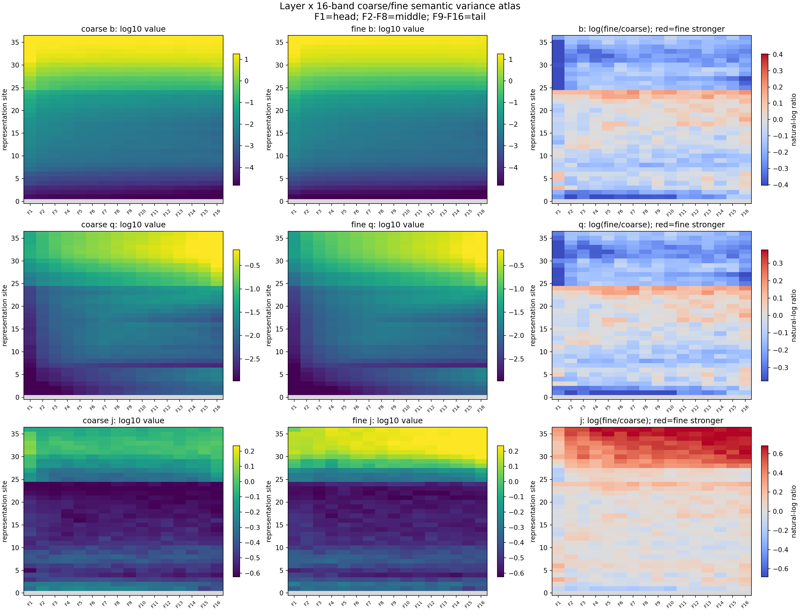
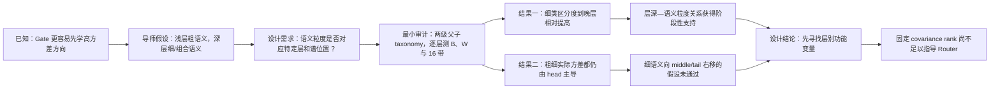

# 为什么要建立“语义粒度 × 层深 × 频谱”画像：它能否支撑分层 Router？

状态：冻结 Qwen3-8B 的两级语义粒度审计已完成；正式裁定为 `depth_pass_spectral_fail`。

## 1. 唯一回答的问题

**实验动机：** 浅层可能先形成较粗、较短程的语义，深层再形成更细、更多步组合的语义；如果这些信息还稳定落在不同 covariance rank，就可能据此设计“浅层分粗、深层分细”的 Router。

**本次最小问题：** 在真正研究长程/短程组合之前，先用父类—子类这一个最简单的语义层级检验：粗语义是否已在浅层可分，细语义是否到深层才相对更可分；同时，细语义是否随层深从大奇异值 head 稳定移向较小奇异值的 middle/tail？

目的是为了层级 Router 建立第一张“语义粒度 × 网络层深 × 频谱位置”画像。

## 2. 认识更新

**一句话回答：** 目前实验结论只支持“细语义在深层相对更可分”，不支持“细语义稳定右移到较小奇异值频带”；因此层深携带了可研究的语义粒度结构。
我们在冻结 Qwen3-8B 上构造了 8 个学术父类、每类 8 个子类的平衡数据；512 条文本不出现正确标签名，并在同一个冒号位置读取。独立 DCLM 自然语料只用于定义每层 covariance 谱，避免测试文本自己决定谱基底。

为避免把 residual 尺度误认成语义区分，实验把“不同类别中心相距多远”的类别间方差 $B$，除以“同一标签粒度内部散得多开”的类内方差 $W$：

$$
D=\frac{B}{W+\epsilon}.
$$

1. **随层深增加，粗粒度和细粒度语义的方差都在增大，深层的细粒度语义“区分度”更大：** 早层 blocks 1--12 的细/粗区分度比约为 1.00，晚层 blocks 25--35 为 1.57，block 35/36 为 1.82/1.84；细语义在晚层相对更可分，最后一层没有反转。
2. **绝对方差不能单独解释可分性问题，需要结合同一类语义的表征随模板、措辞等发生的变化进行分析：** 粗、细类别间方差都随模型深度总体增大，自然背景总方差也同步增大；到 block 35，细类的类别间方差仍低于粗类，但其类内变化相对更小，所以 $D$ 更高。
3. **谱能量差异都主要集中在head部分：** 粗、细语义的实际类别间方差都以 F1 head 最大；晚层细类区分优势扩展到 head、middle、tail 全谱，却没有稳定、超过同维随机方向地富集于 middle/tail。

## 3. 决定性原始结果图

横轴 F1--F16 按自然背景方差从大到小排列，纵轴从 embedding 到 block 36。左列是粗类，中列是细类，右列是细/粗对数比；右列红色表示细类更强、蓝色表示粗类更强。第一行 $b$ 是实际类别间方差，第二行 $q$ 是除去自然背景方差后的相对强度，第三行 $j=B/W$ 才是类别区分度。

第一行说明实际类别间方差随深度总体增大且始终 head 较强；第二行只表示相对自然背景是否异常，不能单独判断类别可分性；右下图约从 block 28 起跨 F1--F16 变红，说明晚层细类的相对区分优势是 broad-spectrum，而不是只向右侧频带移动。完整数值与对照见：[各层背景、类间与类内方差表](docs/semantic_granularity_variance_router_report/report.md#74-各层真实方差类内方差与自然背景方差)、[原始画像分析](docs/semantic_granularity_variance_router_report/report.md#8-结果三实际语义方差在-head细类区分优势却跨谱出现)、[随机方向裁定](docs/semantic_granularity_variance_router_report/report.md#9-决定性热图深层优势是-broad-spectrum不是-middletail-专属)。

## 4. 从导师问题到实验裁定

## 5. 结论边界与唯一下一决策

- **成立范围：** 冻结 Qwen3-8B、英文 8×8 学术 taxonomy、统一读取位置和独立 DCLM covariance；这是静态表征画像，不是训练因果。
- **本次没有回答：** 长程是否比短程语义更晚出现；深层是否执行组合计算；任何层或频带是否改善专家效用、NLL 或训练效率。
- **最强未决解释：** 晚层细类优势可能依赖当前 taxonomy、提示形式和预训练熟悉度，而不是可泛化的语义层级规律。
- **唯一下一决策：** 在第二套独立、平衡、无标签泄漏的 taxonomy 上，同时复现全 residual 的层深效应与 `o_proj` 前注意力输出的层深效应，并重新执行全局单头选择校正。
- **完成判据：** 两种读取对象的晚层减早层效应 95% 下界均大于零，4/4 模板与 8/8 父类留一同向，并至少复现一个经过全局校正的晚层单头；否则该画像只保留为当前 taxonomy 条件化结果。
- **恢复时第一动作：** 冻结第二套 taxonomy、事实、模板和数据 hash，写复制实验 Protocol；在复现通过前，不启动固定频带或跨层 Router 训练。
