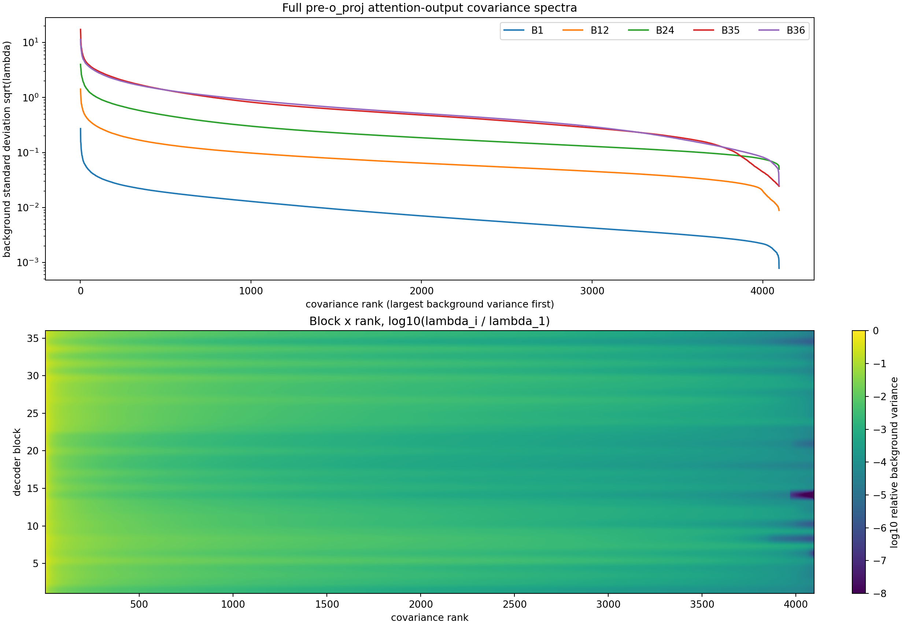
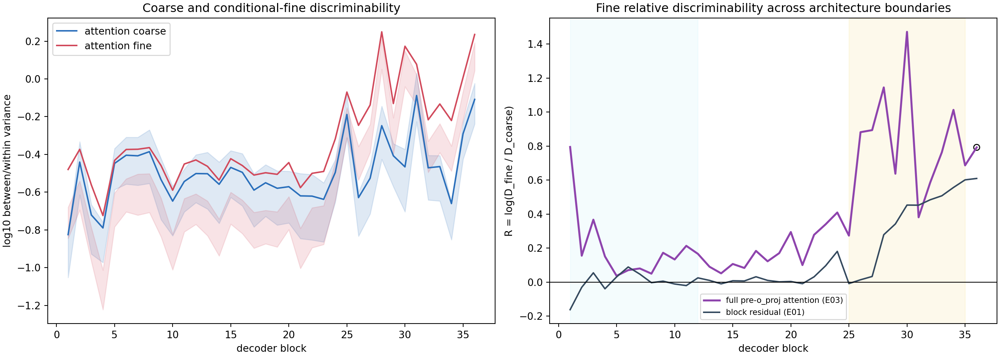
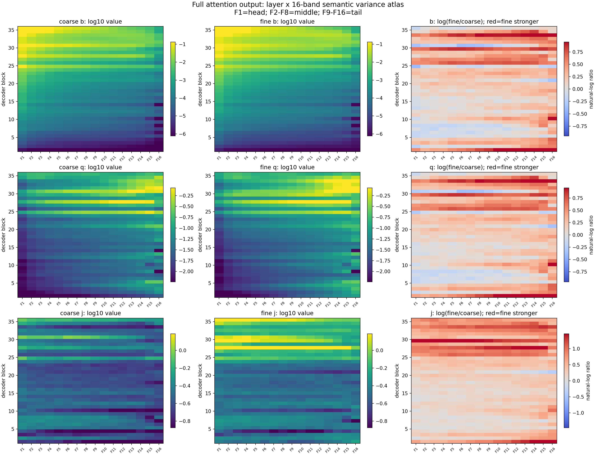
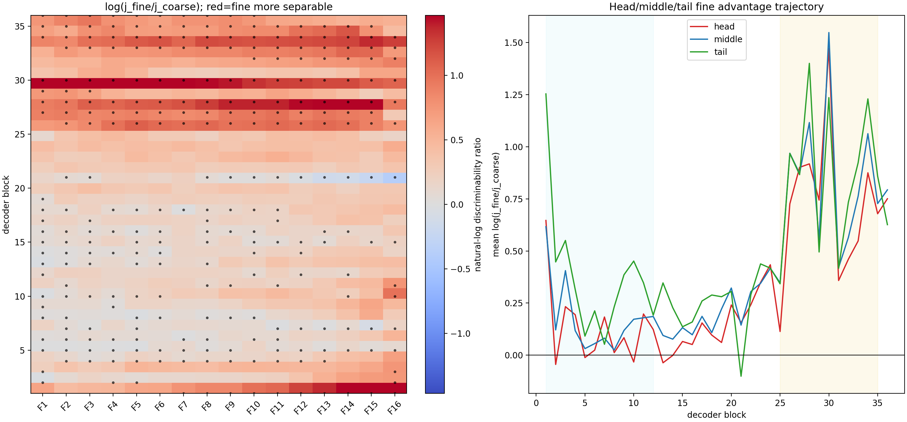

# Qwen3-8B attention 输出中的粗细语义深度与频谱画像

日期：2026-08-05  
模型：冻结的 `/data/share/Qwen3-8B`  
实验：A15_01_05_E03  
正式裁定：**`depth_pass_spectral_fail`**

## 摘要

本实验回答一个具体问题：**此前在完整 block residual 中观察到的“深层更容易区分细粒度语义”，是否已经存在于 attention 自身的输出中；如果存在，它位于自然语料 covariance 谱的什么位置？**

我们复用完全相同的 512 条粗细语义文本和 65,536 个独立自然语料 token，直接读取 Qwen3-8B 每个 decoder block 中 `self_attn.o_proj` 的 4096 维输入，即 32 个注意力头完成加权聚合、但尚未经过 `o_proj` 的全宽 attention 输出。

结果是：

1. **深度效应成立。**细粒度语义相对粗粒度语义的区分度，从早层的 1.17 倍升至晚层的 2.15 倍；四个模板和八个父类留一检查全部同向，最后一层没有反转。
2. **实际语义方差仍由谱头主导。**从 block 1 到 block 35，粗、细语义每方向的实际类别间方差都在第一谱带 F1 最大。
3. **固定 middle/tail 坐标不成立。**晚层 tail 有细语义相对富集的描述性趋势，但换用两个独立 calibration half 各自拟合的基底后，它没有在每个晚层保持同号；middle 也没有通过其他稳健性门。
4. **与完整 block residual 的方向一致。**两种架构边界都支持“晚层细类更可分、实际方差 head-dominant、没有稳定 non-head 通道”；attention 中这一信号在 `o_proj` 和 MLP 之前已经可见。

因此，认识更新不是“attention 的 tail 专门编码细语义”，而是：

> 细粒度语义的深层增强在 attention 输出中已经形成，但它是跨谱分布的区分结构；自然背景谱头仍承载最多实际语义方差，而固定 middle/tail 还没有获得稳定语义坐标的证书。

## 1. 为什么要做这个实验

既有 E01 在完整 decoder block residual 上发现：同一粗类内部的细类，在晚层比早层更容易区分。但完整 block residual 已经混合了：

1. attention 加权聚合；
2. attention 的 `o_proj`；
3. 残差相加；
4. 后续归一化；
5. MLP 更新。

因此，只看 residual 无法知道细粒度语义的深层增强是在 attention 输出中已经出现，还是主要由后续模块形成。

本实验把读取边界前移到 `self_attn.o_proj` 的输入，并保持模型、文本、读出 token、粗细标签、自然语料和全部统计定义不变。这样可以回答“信号最迟在哪个架构边界已经存在”，但仍不是模块消融实验。

## 2. 精确表征对象

Qwen3-8B 每层有 32 个 query head，每个 head 输出 128 维。attention 根据当前 token 对上下文 value 向量完成加权求和后，得到

$$
a_\ell
=\operatorname{concat}
\left(a_{\ell,1},\ldots,a_{\ell,32}\right)
\in\mathbb R^{4096}.
$$

本实验读取的就是 $a_\ell$，即 `self_attn.o_proj` 的直接输入。

需要澄清：旧 E01 读取的是**完整 decoder block 的 raw residual output**，不是严格意义上的“MoE 接收的 post-attention 输入”。所以本报告中的比较是：

$$
\text{pre-`o_proj` full attention output}
\quad\text{vs}\quad
\text{full block residual output}.
$$

两者之间不是只相差一个变量，不能把差值直接归因给 `o_proj`、MLP 或残差中的某一个模块。

## 3. 数据：完全复用，不按结果筛选

### 3.1 语义数据

数据结构为：

$$
8\ \text{个粗类}
\times 8\ \text{个条件细类}
\times 4\ \text{个模板}
\times 2\ \text{组独立事实}
=512\ \text{条文本}.
$$

所有文本都在相同的 `Classification:` 末尾冒号 token 读取状态。正文不泄漏正确标签字符串。T1/T2 是设计模板，T3/T4 是封存确认模板。

- 全部实际文本、token ids、标签与读出位置：[actual_semantic_text_sequences.json](provenance/actual_semantic_text_sequences.json)
- 数据 SHA-256：`cb440b98d81bac3f9813344f85e6efdbd994b7b988d8009ba64e207e64a11859`

### 3.2 自然背景 covariance

每层 attention 的 covariance 由 128 篇独立 DCLM 文档拟合，每篇固定 512 token，共 65,536 token。它们与 512 条语义文本独立，不含相同模板句。

- calibration manifest：[calibration_manifest.json](provenance/calibration_manifest.json)
- calibration tensor SHA-256：`d88620267dbdc9c2b87ec24c2f51d9e6fb317cb8c051ec96503414ea9bff60b9`
- 两个独立 half：32,768 / 32,768 token

E02 只保存了每个 128 维 head 内部的 covariance。由于完整 4096 维 covariance 还包含不同 head 之间的交叉项，本实验重新提取了全宽二阶矩，不能用 32 个块对角矩阵拼成替代品。

## 4. 指标在物理上表示什么

### 4.1 类别间方差与类别内方差

对粗类，类别间方差 $B^{coarse}$ 衡量不同父类中心相距多远；类别内方差 $W^{coarse}$ 包含同一父类中不同子类、模板和措辞的变化。

对细类，$B^{fine}$ 衡量同一父类内不同子类中心相距多远；$W^{fine}$ 只衡量同一细类在不同模板和事实表述下的变化。

定义区分度：

$$
D_g
=\frac{\operatorname{tr}(B^g)}
{\operatorname{tr}(W^g)+\epsilon}.
$$

它的物理意义是：**类别中心之间的距离，相对于“同一个类别换一种说法”所造成的波动有多大。**

- $D$ 大：类别中心分得开，同类表述较紧凑；
- $D$ 小：类间差异被同类措辞变化淹没；
- $D$ 不是分类准确率，也不证明模型在下游决策中使用了该信息。

为了公平比较粗细粒度，定义：

$$
R_\ell
=\log\frac{D_{\ell,fine}}{D_{\ell,coarse}}.
$$

- $R=0$：粗细相对区分度相同；
- $R=\log 2\approx0.693$：细类区分度约为粗类的 2 倍；
- $R<0$：粗类相对更容易区分。

### 4.2 自然背景 covariance 谱

对每层 attention 输出拟合：

$$
\Sigma_\ell=U_\ell\Lambda_\ell U_\ell^\top,
$$

并按自然背景方差从大到小排列 4096 个方向，切成 16 个等秩 256 维谱带：

- F1：head；
- F2--F8：middle；
- F9--F16：tail。

上图横轴是按自然背景方差从大到小排列的方向，纵轴是背景标准差 $\sqrt{\lambda_i}$，使用对数刻度；曲线下降越快，表示少数 head 方向承载越多自然文本变化。下图纵轴是 block，横轴是谱 rank，colorbar 是 $\log_{10}(\lambda_i/\lambda_1)$；颜色越暗表示该方向相对本层最大方差越小。

### 4.3 四个频带量

| 量 | 计算含义 | 物理问题 | 不能证明 |
| --- | --- | --- | --- |
| $b$ | 每方向实际类别间方差 | 这类语义实际在哪个谱带贡献了多少激活变化？ | 类别是否稳定可分 |
| $q$ | $b$ 除以背景特征值 | 相对该方向平日波动，语义信号是否异常强？ | 类别内是否紧凑 |
| $j$ | 频带内 $B/W$ | 该频带能否把类别中心与同类措辞扰动分开？ | 模型是否因果使用该带 |
| $e$ | 频带 $b$ 除以全谱平均 $b$ | 该频带占这类语义实际方差的相对份额 | 固定方向是否跨数据稳定 |

## 5. 执行与有效性门

模型全程冻结，使用 bfloat16 前向；每批 Gram 矩阵在 GPU 上以 FP32 计算，跨批全局 moment 在 CPU 上以 FP64 累积。两个 GPU 分别处理奇数层和偶数层；每个 GPU 都读取相同 128 篇 calibration 文档。

| 有效性门 | 结果 |
| --- | ---: |
| 36 层覆盖 | 36/36 |
| calibration half token 数 | 32,768 / 32,768 |
| 语义记录 | 512/512 |
| hook 重放最大误差 | 0 |
| 32 头拼接最大误差 | 0 |
| 分头投影重构原生 `o_proj` 相对误差 | $1.50\times10^{-7}$ |
| FP32 Gram 与直接 FP64 相对误差 | 最大 $7.03\times10^{-8}$ |
| covariance 重构、能量守恒 | Pass |
| H/M/T calibration half 稳定性 | Pass |

因此，最终的 spectral fail 不是数值不稳定或读取错误。

## 6. 结果一：细粒度相对区分度在 attention 晚层增强

| 阶段 | $R$ 中位数 | 细/粗区分度比 |
| --- | ---: | ---: |
| 早层 blocks 1--12 | 0.153 | 1.17× |
| 晚层 blocks 25--35 | 0.764 | 2.15× |
| block 35 | 0.686 | 1.99× |
| block 36 | 0.792 | 2.21× |

预注册早晚差分为

$$
T_{attention}=0.611,
\qquad
95\%\ \text{basic-bootstrap interval}=[0.624,1.156].
$$

basic-bootstrap 区间针对层级重采样的偏差做反射校正，因此不要求围绕点估计对称，轻微不包含点估计不代表计算错误。四个模板的早晚差分和八次父类留一差分全部为正。

左图：横轴是 decoder block，纵轴是 $\log_{10}D$。蓝线是粗类、红线是细类，数值越高表示类别中心相对同类措辞扰动越清楚。阴影是按语义层级配对重采样的不确定区间。

右图：纵轴是 $R=\log(D_{fine}/D_{coarse})$；0 表示粗细相同，越高表示细类相对更可分。紫线是本实验 attention，深灰线是 E01 residual；浅蓝背景为早层，黄色背景为晚层，空心点单列 block 36。

**直接回答：**细粒度语义的相对区分度在 attention 输出中确实随深度增强，且最后一层没有单独反转。

## 7. 结果二：实际语义方差仍主要位于谱头

这张图的阅读方式是：

- 横轴：F1--F16，按自然背景方差从大到小；
- 纵轴：decoder block 1--36；
- 第一列：粗语义；
- 第二列：细语义；
- 第三列：$\log(fine/coarse)$，红色为细类相对更强，蓝色为粗类相对更强；
- 第一行 $b$：实际类别间方差；第二行 $q$：背景归一化语义方差；第三行 $j$：类别间/类别内区分度；
- 前两列的 colorbar 是 $\log_{10}$ 数值，颜色每增加 1 表示原量约增大 10 倍；第三列 colorbar 是自然对数比，0 表示粗细相同。

在 blocks 1--35，粗、细两类的 $b$ 都是 F1 最大，比例为 100%。因此：

> 深层细类变得更可分，并不意味着它的实际语义方差主峰从 head 移到了 middle 或 tail。

## 8. 结果三：tail 有趋势，但没有固定坐标证书

晚层细类相对粗类的实际方差份额对数比为：

| 频带组 | 点估计 | 95% 区间 | 含义 |
| --- | ---: | ---: | --- |
| Head | -0.107 | [-0.165, -0.065] | 细类相对少用一些 head 份额 |
| Middle | -0.010 | [-0.040, 0.005] | 没有分辨出的相对差异 |
| Tail | +0.162 | [0.132, 0.253] | 细类相对多用一些 tail 份额 |

同维随机方向的晚层 q95 为 0.059，tail 点估计 0.162 高于它；设计模板、干扰变量残差化和不同特征值 floor 也都保持正向。但注册判据还要求：使用两个独立 calibration half 分别拟合基底时，这一方向在**每个晚层**都保持正向。该条件失败。

因此必须区分：

- **允许说：**当前全数据基底中存在晚层细类相对 tail 富集的描述性趋势；
- **不能说：**tail 是跨自然语料稳定、可直接交给 Router 的细语义坐标。

左图横轴是 F1--F16，纵轴是 block，颜色为 $\log(j_{fine}/j_{coarse})$。红色表示该带对细类的类别间/类别内比更高；黑点表示配对 95% 区间不跨零。右图把 16 带聚合为 head、middle、tail，纵轴仍是细/粗区分度对数比。

图中晚层红色并不只集中在某一列，而是跨多个带出现。这支持“跨谱重组”，不支持“固定某个 rank 就是细语义通道”。

## 9. 与 block residual 的比较

| 表征边界 | 早层细/粗比 | 晚层细/粗比 | 早晚差分 $T$ | block 35 / 36 |
| --- | ---: | ---: | ---: | ---: |
| `o_proj` 前全宽 attention | 1.17× | 2.15× | 0.611 | 1.99× / 2.21× |
| 完整 block residual | 1.00× | 1.57× | 0.451 | 1.82× / 1.84× |

两者共同支持：

1. 晚层细类相对更可分；
2. 最后一层没有反转；
3. 实际语义方差以 F1 为主；
4. 固定 middle/tail 未通过稳定性或随机方向门。

attention 的 $R$ 数值更高，但不能写成“后续 residual 路径削弱了细类信息”，因为两个对象的坐标、尺度和类别内噪声都不同，且中间有多个模块。可以确认的是：**细类相对区分信号最迟在 `o_proj` 前已经存在，不需要等到完整 block 结束才首次出现。**

完整数值见 [attention_vs_residual.csv](tables/attention_vs_residual.csv)。

## 10. 对 Router 设计的意义

本实验对 Router 的意义是边界性而非直接方案：

1. attention 输出已含随深度增强的细粒度区分信号，因此未来 Router 若读取该边界，理论上并非“信息尚未形成”；
2. 但实际语义方差仍主要位于 head，且固定 non-head rank 不稳定，所以不能把 F2--F16 直接写成细语义 Router；
3. 更合理的候选是学习**功能监督下的低维坐标**，再检查它是否稳定预测专家相对效用，而不是把 covariance rank 本身当成功能标签；
4. 在进入训练前，必须先在独立 taxonomy 上复现不依赖频带的深度效应。

## 11. 审计中发现的旧 E02 修正

为了复用 E02 semantic states，我们对旧逐 head 分析做了轴顺序一致性检查。旧实现混用了 NumPy 基本索引与高级索引，模板轴在 reshape 前被移到首维，打乱了 parent/template 层级。修正并加入回归测试后：

- pooled attention 深度效应仍成立：$T_{attention}=0.611$；
- 经过全局选择校正的突出 layer-head 从 14 个修正为 9 个；
- 原先唯一的 `L32H27-F1` 频带通过不再成立；
- E02 正式 verdict 修正为 `attention_depth_pass_head_localization_pass_spectral_fail`。

本次 E03 使用修正后的轴顺序，且全宽深度统计与修正后的 E02 pooled 统计吻合到约 $10^{-7}$，构成独立一致性检查。

## 12. 决定性认识更新

1. **细粒度语义的深层增强在 attention 输出中已经形成，而不是只能在完整 residual 中看到。**
2. **“深层更能区分细类”来自类别中心与类别内扰动关系的改善，不等于细类产生了更大的绝对激活。**
3. **粗、细语义的实际类别间方差主峰都在谱头；深层细类优势没有表现为统一的向深谱带迁移。**
4. **tail 有值得复验的相对富集趋势，但当前不足以成为固定坐标，更不足以直接设计 Router。**
5. **attention 与 residual 结果方向一致，但两者差异不是模块因果证据。**

## 13. 结论边界与下一决策

本实验只适用于一个冻结 Qwen3-8B、一套平衡英文 taxonomy、共同的 readout token 和一套独立 DCLM calibration。它不能证明：

- attention 因果产生细粒度语义；
- 深层一定执行 compositional computation；
- covariance rank 因果决定语义；
- tail 或 middle 适合直接指导 Router；
- 任何频带能够提高专家兼容性或训练效率。

**唯一下一决策：**使用一套独立、平衡、无标签泄漏的 taxonomy，同时复现 pre-`o_proj` attention 与完整 block residual 的正向深度差分；在复现前，固定 middle/tail 不进入 Router 训练。

## 14. 证据入口

- [正式 Protocol](../../../Projects/from-attention-to-search/main/experiments/A15/15_01_shallow_head_guided_deep_routing/A15_01_05_E03_qwen3_full_attention_output_semantic_variance_atlas/protocol_cn.md)
- [中文结果摘要](../../../Projects/from-attention-to-search/main/experiments/A15/15_01_shallow_head_guided_deep_routing/A15_01_05_E03_qwen3_full_attention_output_semantic_variance_atlas/summary_cn.md)
- [完整证据账本](../../../Projects/from-attention-to-search/main/experiments/A15/15_01_shallow_head_guided_deep_routing/A15_01_05_E03_qwen3_full_attention_output_semantic_variance_atlas/detailed.md)
- [本报告内完整语义文本](provenance/actual_semantic_text_sequences.json)
- [本报告内 calibration manifest](provenance/calibration_manifest.json)
- [本报告内模型 manifest](provenance/model_manifest.json)
- [typed verdict](provenance/verdict.json)
