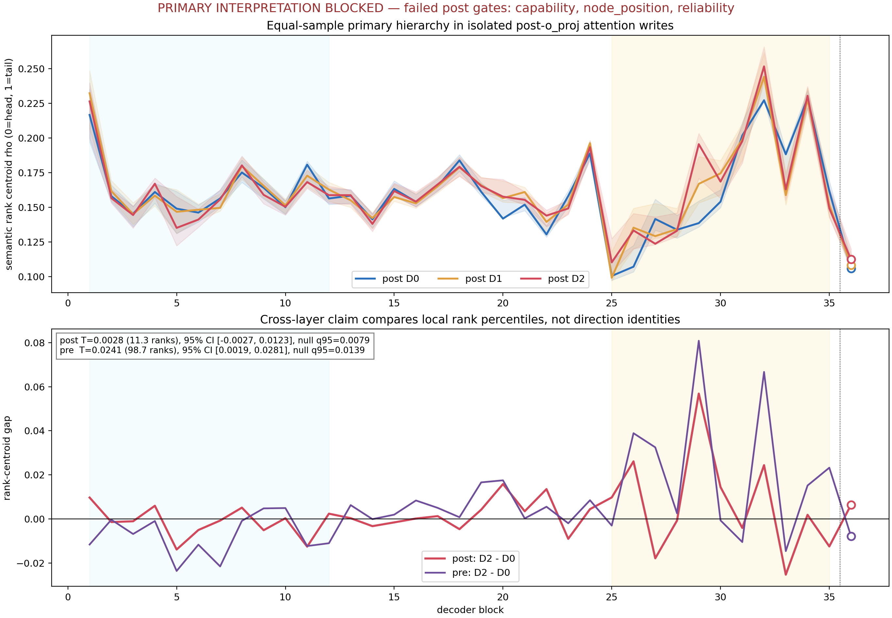
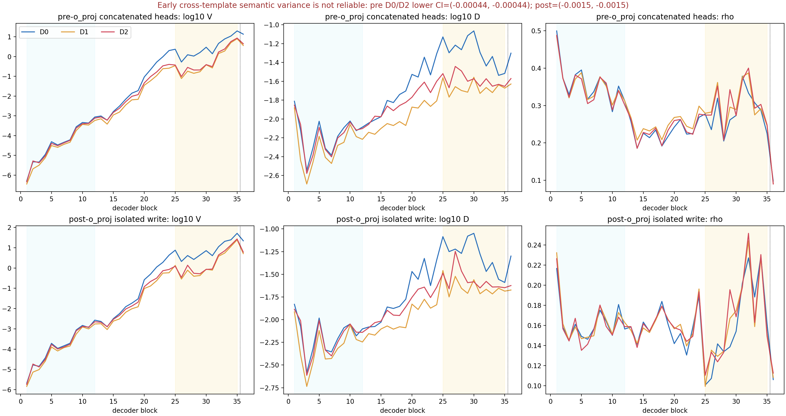
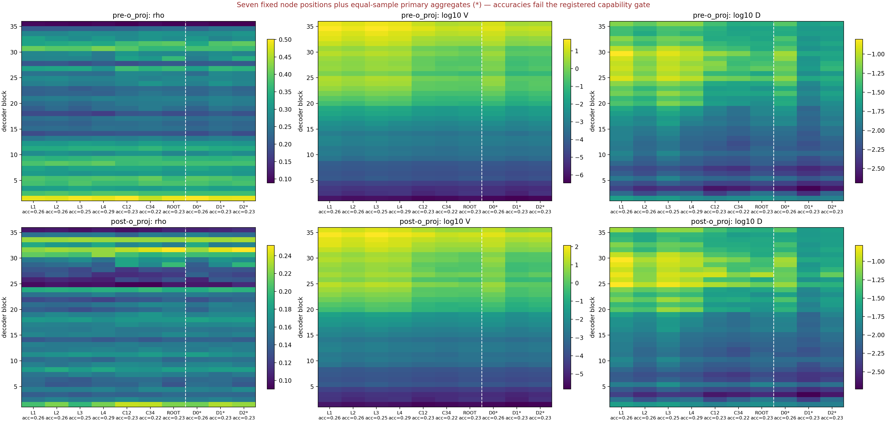
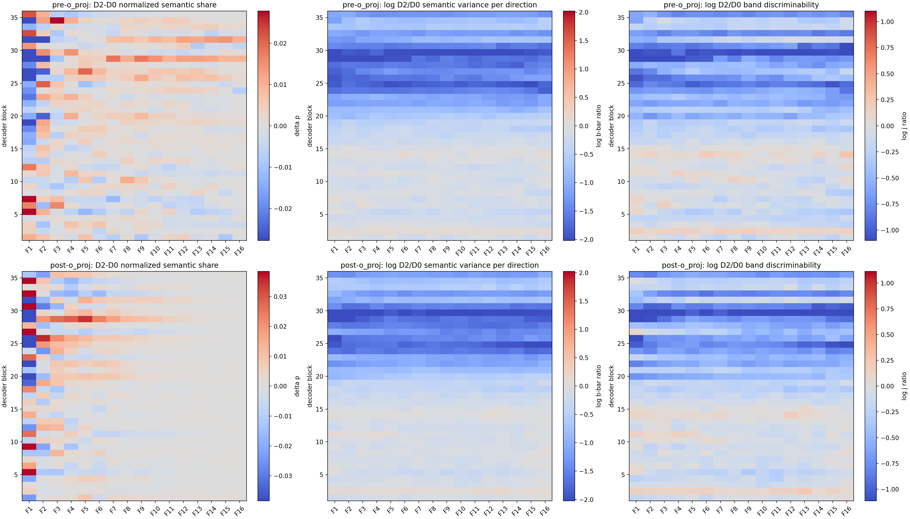
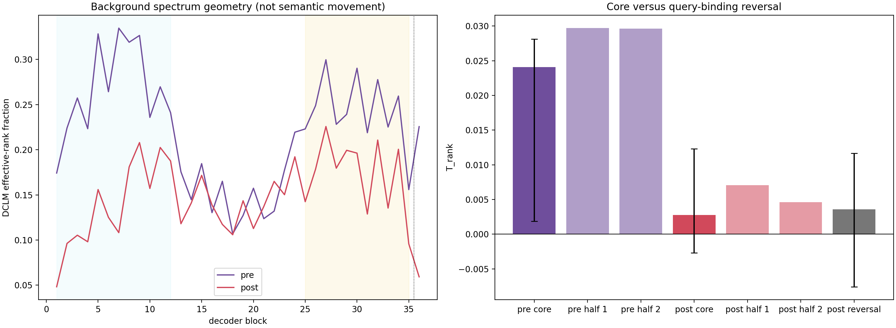

# Qwen3-8B 组合层级 Attention Write 数据谱静态审计

## 0. 结论先行

本次注册结果为 **`insufficient_capability`（模型任务能力不足，因此不能对谱右移主假设给出科学 Pass/Fail）**。

主站点 isolated post-`o_proj` 的诊断量为：组合四条边（D2）相对一条边（D0）的谱秩重心差，从早层到晚层只增加 0.00276，约等于 4096 维中的 11.3 个本层秩；95% 区间为 [-0.00269, 0.01229]，跨过零，而且小于条件交换零假设 q95=0.00792。即使暂时不看能力门，这也不是注册意义上的正向右移。

pre-`o_proj` 多头拼接出现了正诊断：0.02409，约 98.7 个本层秩，95% 区间 [0.00189, 0.02811]，超过零假设 q95=0.01393。但它不能被解释为支持主假设，因为：

1. 模型对 D0/D1/D2 的正确率只有 26.2%/22.7%/23.0%，远低于注册门槛 70%/55%/40%；
2. 早层的跨模板语义 covariance 在 pre 和 post 两个站点都不可靠；
3. post 的四个叶节点替换中只有一个保留主比较的正号，节点位置鲁棒性失败。

更重要的是，组合层级的相对区分度并未随层深增强：post 的 $T_D=-0.547$，95% 区间 [-0.933,-0.222]；pre 的 $T_D=-0.686$，区间 [-0.940,-0.300]。当前实验看到的是 D0 信号在晚层增长得更强，而不是 D2 相对 D0 变得更可读。

因此，明天与导师讨论时最准确的表述是：

> 导师所说的“谱向右移动”若要成为可检验命题，应当指同一受控语义变量在每层各自数据 covariance 谱上的归一化质量分布发生变化，而不是追踪同一个特征向量。我们的公平构造已经完成，但 Qwen3-8B 没有稳定解决当前组合任务，早层也没有跨模板可靠语义基线；所以 post 没有支持性诊断，pre 的正诊断也不能解释。当前结果更新的是任务接口，而不是组合语义谱理论本身。

## 1. 导师问题到底应该怎样形式化？

### 1.1 看的确实是数据谱，不是参数谱

每一层、每一个表征站点，都用独立 DCLM calibration hidden states 的 covariance 做特征分解：

$$
\Sigma^{bg}_{\ell,s}=U_{\ell,s}\Lambda_{\ell,s}U_{\ell,s}^{\top}.
$$

这和把 SAE feature 投影到 MLP 参数矩阵的奇异方向是两个不同问题。本实验不使用参数谱，也不使用 SAE 字典方向。

### 1.2 “向右”不是同一个方向跨层移动

第 10 层第 500 个方向和第 30 层第 500 个方向没有身份等价关系。本实验只比较**本层局部秩百分位**：一个方向在自己的层和站点里，相对于 DCLM 背景方差是高秩（head）还是低背景方差的较大秩（middle/tail）。

4096 个方向按秩分为 16 个等宽频带，每带 256 维：F1 是 head，F2--F8 是 middle，F9--F16 是 tail。层级 $g$ 的类别间语义 covariance 在带 $k$ 的归一化份额是 $p_{g,k}$，谱秩重心是

$$
\rho_g^{(16)}=\sum_{k=1}^{16}\frac{k-0.5}{16}p_{g,k}.
$$

主统计量比较 D2-D0 的重心差是否从早层增大到晚层：

$$
T_{rank}
=\operatorname{median}_{25:35}(\rho_{D2}-\rho_{D0})
-\operatorname{median}_{1:12}(\rho_{D2}-\rho_{D0}).
$$

$T_{rank}>0$ 的含义只是：晚层 D2 相对 D0 把更多**可靠的归一化语义方差**放到本层更大的谱秩百分位。它不等于同一个方向被搬运，不等于绝对方差峰值离开 head，也不等于 tail 是复杂语义模块。

### 1.3 “深层处理复杂信息”不能推出“方差向 tail 移动”

至少有四种逻辑上独立的现象：

| 可能现象 | $T_D$（相对可读性） | $T_{rank}$（相对秩位置） | 含义 |
| --- | --- | --- | --- |
| A | 正 | 正 | D2 相对更可读且重分配到更大本层秩 |
| B | 正 | 非正 | D2 更可读，但仍在原有谱带被放大 |
| C | 非正 | 正 | 位置变了，但并未更可读，需警惕归一化假象 |
| D | 非正 | 非正 | 没有这两类现象，或任务/信号不足 |

导师的机制直觉最多提供 A 的候选先验，不能从“深层更复杂”直接推导 A。本实验预先允许四种结果，并用能力与可靠性门防止把 C 的假象写成结论。当前属于“证据不足；诊断更接近 D”。

## 2. 为什么这样构造层级数据？

### 2.1 一个 world 是一棵完整七节点树

每个 world 有五个单 token 人名 $e_0,\ldots,e_4$ 和四条二维关系边 $r_1,\ldots,r_4$：

```text
                         ROOT / D2: e0 -> e4，需要 4 条边
                         /                              \
          C12 / D1: e0 -> e2，2 条边      C34 / D1: e2 -> e4，2 条边
               /              \                 /              \
 L1 / D0: e0->e1  L2 / D0: e1->e2  L3 / D0: e2->e3  L4 / D0: e3->e4
```

D0、D1、D2 不是标签层级，而是得到答案必须组合的原子关系数量：1、2、4 条边。这样直接操纵“组合需求”，不同于之前 coarse/fine taxonomy 的语义粒度。

### 2.2 所有节点看到同样的事实

每条 prompt 都放入同样四条事实、同样计算规则和完整八类答案词。只改变 query 的起点和终点。这样 D2 不会因为看到更多事实而与 D0 不同；D0 也必须在相同长上下文中定位相关边。

### 2.3 一个具体例子

冻结的 `w000`：

```text
Thomas is 1 step right and 1 step down from David.
Kelly is 1 step right and 0 steps up from Thomas.
Taylor is 1 step right and 1 step down from Kelly.
Ross is 1 step right and 0 steps up from Taylor.
```

该 world 的主比较为：

| 深度 | Query | 需要的边 | 答案 |
| --- | --- | ---: | --- |
| D0 / L1 | Thomas 相对 David | 1 | southeast |
| D1 / C12 | Kelly 相对 David | 2 | southeast |
| D2 / ROOT | Ross 相对 David | 4 | southeast |

这个例子中三个答案恰好相同，但完整数据在每个深度、每个固定节点上都严格平衡八个方向，不能通过深度猜答案。

### 2.4 如何避免节点位置混淆？

每个 world 的主 D0 不是永远选 L1，而是用冻结 Latin schedule 在 L1--L4 中平衡轮换；主 D1 在 C12/C34 中轮换；D2 是唯一 ROOT。每个深度都保留 256 个 world。随后再把 L1--L4、C12、C34、ROOT 七个节点分别测一遍，检查主效果是不是某个位置造成。

### 2.5 数据量和匹配

| 项目 | 冻结值 |
| --- | ---: |
| world | 256 |
| 模板 | 4；T1/T2 设计，T3/T4 确认 |
| 答案 | 8 个方位词，每个深度和节点均平衡 |
| 七节点 core | 7,168 = 256×7×4 |
| 等样本主比较 | 3,072 = 256×3×4 |
| 主确认集 | 每个深度 512 条 |
| required-edge counterfactual | 768 |
| query-binding reversal | 768 |
| 总 prompt | 8,704 |
| 模板 token 长度 | 160 / 166 / 167 / 160 |

统计单位始终是 world，不把同一个 world 的节点或四种措辞当成独立样本。

## 3. 两个表征站点

模型为冻结 Qwen3-8B：36 个 decoder block，hidden size 4096，32 个 attention head，每头 128 维。在每条 prompt 最后 `Answer:` 的冒号位置抓取：

1. **多头拼接 / pre-`o_proj`：**$a_\ell=\operatorname{Concat}(head_1,\ldots,head_{32})\in\mathbb R^{4096}$；
2. **isolated post-`o_proj`：**$y_\ell=W_{O,\ell}a_\ell\in\mathbb R^{4096}$，在 residual addition 之前。

没有抓 block residual，也没有加入 MLP、RMSNorm、SAE、Router 或参数谱。pre 和 post 各自使用自己的 DCLM covariance，不能把两个站点的第 $i$ 个 eigenvector 当成同一坐标。

## 4. 如何公平处理“大层级和小层级方差尺度不同”？

本实验不使用单一指标，而是按顺序分开三个问题：

| 指标 | 具体计算 | 回答什么 | 不能回答什么 |
| --- | --- | --- | --- |
| $V$ | 类别间 covariance 的 trace | 有多少绝对语义方差 | 是否稳定、在哪里 |
| $D=B/W$ | 类别间方差 / 同类 world+模板方差 | 类别中心是否相对可分 | 谱位置 |
| $V_\times$ | 不同模板估计的类别中心做 cross-product | 语义几何能否跨模板复现 | 绝对方差不能为负；它可因噪声为负 |
| $p_k$ | 第 $k$ 带 $B$ / 全谱 $B$ | 可靠信号的归一化位置 | 信号是否足够大 |
| $\rho^{(16)}$ | $p_k$ 的本层秩重心 | 是否相对右移 | 同方向跨层运输 |
| $\bar b_k$ | 每方向原始 $B$ | 频带绝对尺度 | 特异性 |
| $j_k$ | 频带 $B/W$ | 频带内区分度 | Router 效用 |

规则是先看 $V$、$D$ 和 $V_\times$，确认不同层级都有可靠信号；再解释 $p_k$ 和 $\rho$。因此，大层级绝对方差小不会自动被判作“更靠 tail”，小层级绝对方差大也不会自动支配位置统计。

## 5. 注册测试流程

1. 检查答案平衡、长度、事实、query 位置、单 token alias 和无类别泄漏。
2. 不看谱，先测冻结模型的八分类 next-token 能力。
3. 用 required-edge counterfactual 检查模型预测是否响应每条必要边。
4. 检查 36 层 pre 拼接与 direct `o_proj` 输出，无 residual 混入。
5. 检查独立 DCLM covariance、两半基底、重构和能量守恒。
6. 用 T3/T4 confirmation、2,000 次 world bootstrap 和 2,000 次同 world 条件交换计算 $T_{rank}$。
7. 检查跨模板 $V_\times$；失败时不解释归一化位置。
8. 用四个 leaf 和两个 internal substitution 检查节点位置。
9. 用 query-binding reversal 检查事实不变、query 绑定反转是否伪造同样的右移。
10. 最后才显示谱带热力图；它只能描述，不能越过失败门改变 verdict。

## 6. 实验结果

### 6.1 能力门失败，但必要边响应通过

| 深度 | correct/total | accuracy | Wilson lower | 注册 accuracy 门 |
| --- | ---: | ---: | ---: | ---: |
| D0 | 134/512 | 0.2617 | 0.2255 | 0.70 |
| D1 | 116/512 | 0.2266 | 0.1924 | 0.55 |
| D2 | 118/512 | 0.2305 | 0.1961 | 0.40 |

八分类 chance 是 0.125。模型有一定信号，但没有稳定完成任务。

改变一条必要关系边后，新答案相对旧答案的 log-odds 改变量在 D0/D1/D2 分别为 1.780、0.625、0.493，bootstrap 区间下界均大于零；所有边位置点估计也为正。即模型确实读到了必要事实，但其固定 next-token 决策不足以支撑可靠组合语义审计。

### 6.2 主站点 post 没有注册右移诊断

| 站点 | $T_{rank}$ | 等价本层 ranks | 95% 区间 | swap q95 | 诊断 |
| --- | ---: | ---: | ---: | ---: | --- |
| pre 多头拼接 | 0.02409 | 98.7 | [0.00189,0.02811] | 0.01393 | 数值正，但 mandatory gates 失败 |
| post isolated write | 0.00276 | 11.3 | [-0.00269,0.01229] | 0.00792 | 不通过注册效应规则 |



浅蓝区是 blocks 1--12，浅黄区是 blocks 25--35，block 36 用空心点单独显示。下图比较的是每层自己的 rank percentile，不是同一个方向。

### 6.3 组合层级相对区分度没有随层深增强

| 站点 | $T_D$ | 95% 区间 |
| --- | ---: | ---: |
| pre | -0.686 | [-0.940,-0.300] |
| post | -0.547 | [-0.933,-0.222] |

post 晚层 $V$ 中位数为 D0=7.153、D1=0.866、D2=1.217；晚层 $D$ 为 0.0537、0.0216、0.0255。D0 的绝对方差和区分度增长明显更强，这正说明层级间尺度不可直接混在一个归一化位置指标里。



### 6.4 早层跨模板语义基线不可靠

pre/post 的早层 D0 与 D2，12 个 block 中没有一个 $V_\times>0$；bootstrap 区间全部在零下。晚层 $V_\times$ 为正，但 $T_{rank}$ 是“晚层减早层”的差分，早层语义几何本身不复现，就不能把差分解释为真实移动。

### 6.5 post 节点位置鲁棒性失败

把主 D0 分别替换为 L1、L2、L3、L4 后，post 的 ROOT-minus-leaf 早晚差分为 -0.00105、-0.00032、-0.00103、+0.00225；主效应为正时应至少 3/4 同号，实际只有 1/4。pre 四个位置都为正，但仍被能力和可靠性门否决。



### 6.6 谱带热力图只能作为失败诊断

三列分别画 D2-D0 的归一化份额、每方向原始语义方差比和带内区分度比。它们显示 late blocks 中层级尺度和频带形状变化很大，但能力与可靠性失败后，不能把任何红色 cell 称为“组合语义目的地”。



背景谱 effective rank 的变化只说明 DCLM 全局几何变化。query-binding reversal 没有独立通过右移规则，因此没有发现一个简单的 query 绑定伪效应，但这一控制也不能修复任务能力。



## 7. 对原先疑惑的明确审核

| 原先说法 | 审核 |
| --- | --- |
| 深层更复杂，所以方差应该往 tail 移 | 不成立；这是待证伪先验，不是逻辑推论 |
| 每层第 500 个方向可以跨层追踪 | 不成立；本实验只比较本层 rank percentile |
| 去掉模板 hidden state 后就是 clean semantic state | 过强；两向中心化只去除加性模板/world 主效应，不能保证纯语义 |
| 组合层级越高，原始方差应该越大 | 不需要，也未观察到；必须把 $V$、$D$、位置拆开 |
| pre 的约 99-rank 正诊断说明假设成立 | 不成立；能力与早层可靠性门失败 |
| post 没有正诊断，所以一般理论被否定 | 不成立；当前 verdict 是 insufficient，不是科学 Fail |
| SAE 字典基底应该作为组合节点 | 本实验不支持；先用可干预、可平衡的外部语义节点定义问题，SAE 只能是后续表征映射 |
| 当前可以开始 Router 训练 | 不成立；没有有效谱坐标或任务能力证据 |

## 8. 运行与可追溯性

实验使用三个单节点 8×5090 SPOT ACP 作业：

| Job | 作用 | 状态 |
| --- | --- | --- |
| `om-pbybysxg` | 8,704 条 prompt、36 层、pre/post 抽取与合并 | SUCCEEDED |
| `om-bj8mm9ot` | 两站点完整统计、bootstrap、null 和 controls | 科学数组完成后 JSON 序列化失败；自动 retry 同样 |
| `om-v4omoym1` | 从已完成数组确定性重建 verdict 和制品 | SUCCEEDED |

中间失败只发生在把 NumPy 整数写入 JSON 的最后一步。修复没有改变数据、模型、hidden states、covariance、bootstrap/null 数组、指标、阈值或条件，也没有重选结果。

完整英文证据记录见 [detailed.md](../../../../../Projects/from-attention-to-search/main/experiments/A15/15_02_layerwise_representation_spectral_atlas/A15_02_04_E01_compositional_attention_write_atlas/detailed.md)，注册协议见 [protocol.md](../../../../../Projects/from-attention-to-search/main/experiments/A15/15_02_layerwise_representation_spectral_atlas/A15_02_04_E01_compositional_attention_write_atlas/protocol.md)。

## 9. 与导师讨论时的唯一下一决策

是否允许做一次**只修任务接口、不看谱结果**的能力修复：冻结当前 256 个 world、七节点层级、答案平衡、pre/post 站点、DCLM bases、指标和门槛，只调整能够让模型明确执行空间加法的提示接口或模型规模。候选版本只有在独立 held-out capability screen 达到 D0/D1/D2 ≥70%/55%/40%、三者 Wilson lower >25%，且早层 D0/D2 跨模板 covariance 下界为正后，才能开启一次新的谱确认；筛选期间严禁查看候选谱曲线。
