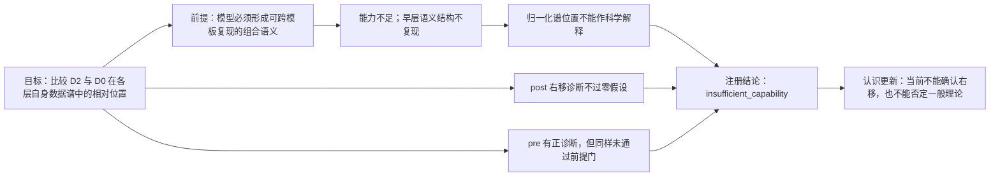

# 组合深度增加是否使晚层 attention write 的语义方差相对右移？

## 1. 本次回答的问题

在冻结 Qwen3-8B、事实内容和样本数匹配的七节点关系树中，把回答所需的组合深度从一条边 D0 增加到四条边 D2，是否会使可靠语义方差在晚层 isolated post-`o_proj` attention write 中，相对分配到每层自身 DCLM activation-covariance 的更大谱秩百分位？

## 2. 认识更新（逐点）

1. **对核心研究问题的确切回答：当前实验不能确认“组合越深，晚层语义方差越向右”。** 主站点 post-`o_proj` 没有通过预注册的正效应检验；同时，模型任务能力与早层语义可靠性不合格。因此当前只能判为“证据不足”，既不能声称右移成立，也不能据此否定一般理论。

2. **导师所说的“向右”只能理解为本层谱秩分布的变化，不能理解为同一个方向跨层移动。**“本层谱秩重心”是语义类别间方差在本层 16 个等秩频带上的平均位置，0 靠近高背景方差的 head，1 靠近低背景方差的 tail；“右移量”是 D2-D0 的重心差从早层到晚层的增量。每层都重新计算 DCLM covariance 基底，所以比较的是各层自身的 rank percentile，而不是追踪“第 500 个方向”。post 的右移量为 0.00276，相当于 4096 维中的 11.3 个本层秩；95% 区间 [-0.00269,0.01229] 跨过零，且小于条件交换零假设的第 95 百分位 0.00792。

3. **当前结论是证据不足，不是已经证伪一般理论。** 一/两/四边条件 D0/D1/D2 的八分类正确率只有 26.2%/22.7%/23.0%，低于 70%/55%/40% 门槛；早层 D0/D2 的类别结构不能跨模板复现；post 的四个叶节点替换中只有一个保持主效应正号。改变任一必要关系边后，模型对新答案的支持都会上升，说明它会响应关系事实，但尚未稳定形成可用于谱定位的组合语义。因此注册 verdict 是 `insufficient_capability`，不能把 post 的非正结果升级成一般性科学 Fail。

4. **pre-`o_proj` 的正诊断也不能作为支持证据。** pre 的右移量为 0.02409，约 98.7 个本层秩，95% 区间 [0.00189,0.02811]；但它同样未通过能力门和早层跨模板可靠性门。与此同时，组合相对区分度——类别间方差除以同类 world/模板方差——从早层到晚层反而下降，post 为 -0.547、pre 为 -0.686。当前任务中连“D2 相对 D0 随层深更可读”都没有出现，因此“深层处理复杂信息”不能直接推出“方差向 tail 移动”。

## 3. 决定性证据

图上半是 post 的 D0/D1/D2 本层谱秩重心，下半是 post/pre 的 D2-D0 差。浅蓝与浅黄分别为注册早层和晚层；block 36 为空心边界点。红字意味着曲线只能作为失败诊断，不能上升为组合语义谱结论。完整 setting、数据例子、七节点测试和五张图见 [self-contained report](docs/qwen3_compositional_attention_write_spectral_atlas/report.md)。

## 4. 判断流程

## 5. 边界与唯一下一决策

**成立范围：**已确认这里应研究数据 covariance 的本层秩分布，而非参数谱或跨层同一方向；当前公平七节点任务没有给出有效 post 右移证据。**最强未决解释：**失败来自当前提示接口没有让模型稳定执行组合，而不是模型不存在组合表征。**不能声称：**组合语义位于 middle/tail、pre 正诊断成立、attention 因果执行组合、SAE feature 等于语义节点，或该坐标可用于 Router。

**唯一下一决策：**是否批准一次“谱结果封存”的任务接口修复；冻结现有 world、层级、平衡、两表征、covariance bases、指标和阈值，只调整提示接口或模型规模。**完成判据：**独立留出集达到 D0/D1/D2 accuracy ≥70%/55%/40%，三者正确率的 95% Wilson 置信下界均 >25%，且早层 D0/D2 跨模板 covariance 下界均大于零。**恢复动作：**导师确认后先运行能力与可靠性筛查；达标前不打开任何候选谱图。
