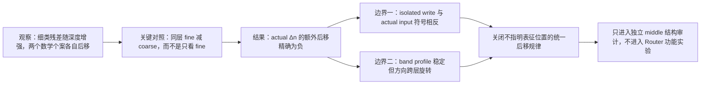

# 更细语义是否会比粗语义获得额外的深层谱后移？

状态：A15_02_05_E01 已完成；以下认识更新是按研究者授权形成的 AI 初稿，等待研究者纠正或确认核心判断。

## 1. 认识更新

**更细语义不是没有进入深层，而是没有表现成“相对粗语义统一地向更后谱位移动”。**粗、细语义残差在早晚层都能跨两组独立表达复现，且细类残差的绝对强度明显增长；失败的是更强的定位关系：同一层内先做 fine-minus-coarse 配对后，细类的谱位优势从早层的正值消失为晚层的近零/负值。

## 2. 本日唯一回答的问题

在冻结 Qwen3-8B 的实际 attention 引起的 MLP 输入增量 $\Delta n$ 中，同一父类内部的细类语义虽然会随深度增强，但是否会比跨父类的粗语义获得额外、更靠后的本地谱定位；组合数学与线性代数是否体现为稳定而相近的这种细类方向？

## 3. 结果如何支持认识更新

“归一化本地秩重心”表示语义残差的能量落在本层 DCLM covariance 排序的什么百分位，0 靠高背景方差端，1 靠低背景方差端。主指标 $T_\rho$ 比较 fine-minus-coarse 重心在 25--35 层与 1--12 层的中位差。实测 $T_\rho=-0.009573$，注册的单侧 95% 下界/上界为 [-0.011199, -0.004492]，因此是精确的 `nonpositive_location_fail`，不是样本不足或区间太宽。

这也使“谱后移具体发生了什么”更清楚了：组合数学和线性代数各自的原始秩重心确实从早层向后移动 +0.0735 和 +0.0570，但粗粒度语义也在随深度重排，所以个案原始后移不能推出细粒度具有额外后移。孤立 post-`o_proj` attention write 的描述性 $T_\rho$ 为 +0.011327，而实际 $\Delta n$ 为 -0.009573；谱后移因此依赖观察的是“写入源”还是“真正到达 MLP 的输入变化”，不能被写成不指明表征位置的普遍层规律。

组合数学和线性代数进一步暴露了按 band 平均的缺陷。两者在所有 36 层都通过 split-half 可靠性门，同层 16-band profile 的总体中位相关高达 0.9943；可是同层实际方向的中位 cosine 是 -0.1801，各自跨层的 early-to-late 方向 cosine 中位数也只有 0.0024 和 0.0034。也就是说，两个语义可以把能量放在几乎相同的谱段，甚至同一个语义的谱形状跨层很像，但具体承载方向已经旋转得近乎正交。

因此这个实验对三个问题的回答程度不同：它直接否定 actual $\Delta n$ 中“细粒度比粗粒度额外后移”的统一规律；它确认粗细语义强度都存在并显示写入位置会改变谱定位，但不能判断语义在哪一步被创造或使用；它直接描述了两个数学细类的可靠性、谱形状与方向关系，但不能把两个案例外推为所有细类，更不能由相似谱形状推出共同功能。

完整 F1--F16 中，F2--F7 的 fine-minus-coarse 归一化变化是描述性正值，F8--F16 为负，但只有 F1 通过 16-band 最大值校正，任何绝对 band 变化都未通过。这里没有一个可事后命名为“细语义 middle”的合格坐标，也没有相反 band 同时显著的抵消证书。

## 4. 解释流程图（AI 初稿，研究者修改）

## 5. 边界与唯一下一决策

- **可以说：**在这一冻结模型、平衡英语 taxonomy、共同 readout 和 actual $\Delta n$ 中，可靠细类残差没有获得超出粗类残差的额外深层右移；band 级稳定也不足以证明方向稳定。
- **不能说：**深层没有更细语义、middle 或 tail 没有信息、RMSNorm 因果删除语义、组合数学与线性代数共享同一机制，或任何 Router/专家选择会受益或受损。
- **完整证据：**[结果摘要](../../Projects/from-attention-to-search/main/experiments/A15/15_02_layerwise_representation_spectral_atlas/A15_02_05_E01_balanced_taxonomy_attention_write_atlas/summary.md)；[完整证据账本](../../Projects/from-attention-to-search/main/experiments/A15/15_02_layerwise_representation_spectral_atlas/A15_02_05_E01_balanced_taxonomy_attention_write_atlas/detailed.md)。
- **唯一下一决策：**是否批准或修正现有 A15_03 middle-band decomposition，使其把绝对 middle 强度、归一化份额、middle 内部迁移、跨层方向稳定、representation-site 差异和同维 Haar 对照放进同一个冻结判据。
- **完成标准：**只冻结一个 middle 对象和一个主 verdict，能够区分真实内部稳定与归一化、宽 band 平均、抵消和方向旋转；不得由事后选 band 或具体案例挽救。
- **恢复动作：**打开 [A15_03 draft Protocol](../../Projects/from-attention-to-search/main/experiments/A15/15_03_middle_band_information/A15_03_E01_middle_band_stability_decomposition/protocol.md) 审核上述对象与停止规则，不启动 Router 实验。
