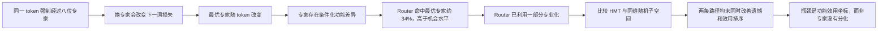

# Router 是否真正利用了已经形成的专家差异？

## 1. 本次回答的具体问题

在同一 seed、同一 held-out 数据和 2B/5B/10B 冻结 checkpoint 上，专家是否已经对同一 token 形成不同的下一词效用；如果已经形成，按 covariance 排出的 H/M/T Router 是否比同维随机子空间更会选择当前有用的专家？

## 2. 认识更新

**一句话结论：** 专家已经形成对下一词损失有真实影响、且随 token 改变的功能差异，Router 也利用了其中一部分；但 covariance H/M/T 没有比同维随机子空间更准确地把 token 送给当前更有用的专家。

这里用两个直接量判断 Router 功能。**选专家遗憾**是 Router 实际选择造成的下一词损失，减去八位专家中最低的反事实损失，单位为 nat/token，越低越好；**分数—效用相关**比较 Router 对八位专家的打分排序与八位专家实际反事实效用的排序，越高表示 Router 越知道谁对当前 token 有用。

专家是否分化则使用同输入 CKA 和强制替换损失共同判断。CKA 比较两位专家对完全相同输入所形成的样本关系几何，1 表示高度相似、0 表示关系结构不同；低 CKA 只有与“换专家会改变损失”和“最优专家随 token 变化”同时出现，才支持功能分化，而不是单纯坐标变化或噪声。

## 3. 决定性证据

| 10B 配对比较 | HMT 减随机的遗憾 | HMT 减随机的分数—效用相关 | 判断 |
| --- | ---: | ---: | --- |
| Local-HMT − Local-Random | $-0.01042$，95% CI $[-0.02878,0.00753]$ | $-0.00022$，95% CI $[-0.01313,0.01278]$ | 遗憾点估计略好但不确定，排序没有改善 |
| Relay-HMT − Relay-Random | $+0.01352$，95% CI $[-0.00361,0.03052]$ | $-0.01121$，95% CI $[-0.02745,0.00481]$ | 两个点估计均不利，区间仍跨零 |

两条 HMT 路径都没有同时达到“遗憾更低且分数—效用相关更高”的预注册条件，Holm 校正检验也未通过，因此 covariance 频带身份没有取得功能证书。

读图时，左图位于零左侧才表示 HMT 的选专家遗憾更低，右图位于零右侧才表示 HMT 的效用排序更准；横线是按 128 篇文档配对重采样的 95% 区间。四条区间全部跨零，所以局部有利点估计不能升级为稳定优势。

功能证书失败不是因为专家没有分化：五臂同输入专家输出 CKA 均值为 $0.326$--$0.335$，强制换专家后的 NLL 标准差为 $0.467$--$0.505$ nat/token；最优专家在八位专家间近似均匀分布，而 Router 选中反事实最优专家约 $34\%$，高于 $12.5\%$ 的机会水平。这说明专家已有 token 条件化功能差异，Router 知道一部分，但尚未充分利用。

## 4. 判断流程图

## 5. 边界与唯一下一决策

- **成立范围：** seed 17、五个具有可微负载均衡损失的四层 MoE、2B--10B 冻结 checkpoint，以及一次 token、一次目标层的局部强制专家干预。
- **不能声称：** H/M/T 永远无效；随机路由普遍更好；CKA 下降导致终点 NLL；专家已形成可命名的语义职业；结论能够跨 seed、模型尺度或更长训练外推；或 PCGrad 已在本模型上有效。
- **最强剩余解释：** 专家效用确实存在，但 covariance 方差排名不是承载这种效用的正确坐标；Router 的 margin 和稳定性也不能替代选择正确性。
- **唯一下一决策：** 先判断 A15_07 的 conditional-fine 方向能否跨表达复现并超过同维随机与标签置换；只有取得语义方向证书后，才用本实验的专家遗憾和分数—效用相关做独立功能准入。
- **完成判据与恢复动作：** A15_07 的 held-out 方向证书通过才恢复功能实验；PCGrad 是否适用另由 A16 的原始梯度余弦、范数比与一步损失变化 Protocol 判断，不能由当前结果代答。

