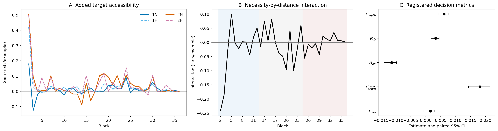
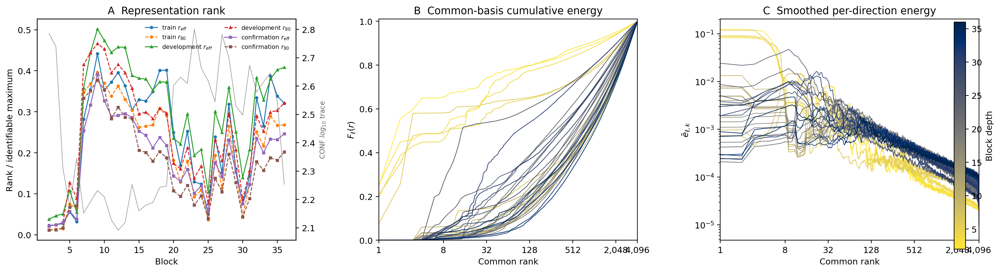

# 深层注意力写入是否比浅层增加更多远程组合目标可访问性？

```text
type: daily_research_report
status: AI_DRAFT_AWAITING_HUMAN_CONFIRMATION
human_audit_scope: question_method_and_claim_boundary; result wording awaiting confirmation
evidence_state: CANONICAL_RESULT_AVAILABLE
date: 2026-08-11
topic: layerwise_long_range_added_accessibility
canonical_anchor: Projects/from-attention-to-search/main/problem_anchors/15_spectral_representation_and_functional_routing/15_08_target_conditioned_layer_innovation/subanchors/15_08_01_layerwise_long_range_compositional_innovation_anchor.md
frozen_protocol: Projects/from-attention-to-search/main/experiments/A15/15_08_target_conditioned_layer_innovation/A15_08_01_E02_layerwise_long_range_gain_and_representation_rank_blocks_2_36/protocol.md
canonical_summary: Projects/from-attention-to-search/main/experiments/A15/15_08_target_conditioned_layer_innovation/A15_08_01_E02_layerwise_long_range_gain_and_representation_rank_blocks_2_36/summary.md
canonical_detailed: Projects/from-attention-to-search/main/experiments/A15/15_08_target_conditioned_layer_innovation/A15_08_01_E02_layerwise_long_range_gain_and_representation_rank_blocks_2_36/detailed.md
```

> **当前状态：**正式实验、证据资格审计和两组中央图已经完成；注册 verdict 为
> `H2_LC_FAIL_CONTROL_DEGRADATION`。下面的结果性认识更新仍是 AI 草案，等待
> 研究者确认；确认前不生成 problem focus。

## 1. 一句话直觉

> 先在每一层问：“本层 attention 写入后，正确答案是否比只看写入前状态更
> 容易读出？”再用一跳/两跳与近程/远程的匹配对照，判断这种新增可访问性是否
> 随深度更偏向远程且必要的桥接事实。

我们不直接把两个层的隐藏状态相减。不同层状态已经累积了不同计算，差值混合了
attention、MLP、残差搬运和重编码，不能单独解释为“后层新学到的知识”。本轮
只在**同一层、同一 token、同一归一化位置**做精确写入差分，再把各层得到的
留出目标增益放到统一单位 `nats/example` 中比较。

学长的[方差区间报告](../../0810/docs/DAILY_SUMMARY_ADVISOR_VARIANCE_INTERVAL_20260810.md)
已经表明：参数谱上的方差增长区间没有稳定优于同维随机方向。因此，谱位置只
能描述“变化在哪里”，不能定义“新增信息”。

## 2. 唯一问题与两个假设

本轮唯一需要裁定的问题是：

> 在冻结 Qwen3-8B、同一答案前决策位置和匹配关系任务中，扣除一般位置移动与
> 一般两跳难度后，深层 attention 写入是否比浅层增加更多与“远程且必要的
> 桥接事实”有关的终端答案可访问性？

| 研究先验 | 本轮可检验对象 | 本轮不能替代的更强结论 |
| --- | --- | --- |
| H2：深层在浅层基础上学到新信息 | H2-LC：深层的“必要性 × 距离”新增可访问性交互大于浅层 | 不是 Shannon 信息创造，也不证明深层保留浅层全部信息 |
| H1：新信息具有低秩表征结构 | H1-REP：逐层描述匹配交互更新的协方差谱和表征有效秩 | 不等于任务读出秩，不给 Router 准入结论 |

H2-LC 承担正式 Pass / Fail / Insufficient 判定；H1-REP 当前没有预注册的绝对
低秩阈值，只报告轨迹和跨划分稳定性。

## 3. 数据如何隔离“长程且必要”

一个 **world（关系世界）**包含两张随机双射表：

$$
S_i\xrightarrow{\phi_w}B_i\xrightarrow{\psi_w}Y_i.
$$

| 符号 | 含义 |
| --- | --- |
| $w$ | 一个独立关系世界，也是统计重采样单位 |
| $i\in\{1,\ldots,8\}$ | world 内的目标编号 |
| $S_i$ | 两跳查询给出的源实体 |
| $B_i$ | 连接源实体与答案的桥接实体 |
| $Y_i$ | 八个平衡终端答案码之一 |
| $\phi_w(S_i)=B_i$ | 两跳查询必须使用的桥接事实 |
| $\psi_w(B_i)=Y_i$ | 一跳和两跳都需要的终点事实 |

一跳查询直接给出 $B_i$，所以桥接事实存在但不必要；两跳查询只给出 $S_i$，
所以必须先使用桥接事实。终点事实始终靠近查询，只把目标桥接事实与一个同关系、
同 token 长度的干扰事实交换到近处或远处。

| 条件 $c$ | 查询 | 桥接事实位置 | 桥接事实是否必要 |
| --- | --- | --- | --- |
| $1N$ | 一跳 | 近程 | 否 |
| $1F$ | 一跳 | 远程 | 否 |
| $2N$ | 两跳 | 近程 | 是 |
| $2F$ | 两跳 | 远程 | 是 |

同一 $(w,i)$ 的四条记录保持答案、事实集合、模板族和总长度一致。输入固定为
1,024 tokens；终点事实距决策 token 8--24 tokens，近程桥接事实为 32--64，
远程桥接事实为 512--768。

| 数据划分 | 用途 | 规模 |
| --- | --- | ---: |
| TRAIN | 拟合离线线性模型，并构造公共激活基 | 128 worlds / 4,096 records |
| DEVELOPMENT | 选择 ridge 正则强度并冻结校正 | 64 worlds / 2,048 records |
| CONFIRMATION | 只评价已经冻结的对象 | 128 worlds / 4,096 records |

三个划分按完整 world 分离。Qwen3-8B 始终冻结；训练的只有离线线性读出器。

## 4. 从层内写入到“新增可访问性”

### 4.1 先得到合法差分，再排除旧状态可线性预测部分

Qwen3-8B 有 36 个 block，隐藏宽度 $d=4096$。E01 发现第 1 层写入前旧状态
$X_1$ 在该 token 上结构性恒定，无法满足冻结标准化，因此 E02 在确认标签打开前
将注册比较范围固定为 blocks 2--36；对第 $\ell$ 个注册 block 定义：

这里 **block** 是 Transformer 重复堆叠的一层计算；**attention** 是从上下文
聚合信息的子模块；**residual 状态**是各子模块共同读写的 token 向量；
**RMSNorm** 是按向量均方根缩放状态的归一化。

$$
X_\ell=N_\ell(h_\ell),\qquad
Z_\ell=N_\ell(h_\ell+a_\ell),\qquad
U_\ell=Z_\ell-X_\ell.
$$

| 符号 | 形状 | 白话含义 | 来源 |
| --- | ---: | --- | --- |
| $\ell\in\{2,\ldots,36\}$ | 标量 | 注册比较的 block 编号 | 已知索引 |
| $h_\ell$ | $4096$ | 本层 attention 写入前的 residual 状态 | 模型提取 |
| $a_\ell$ | $4096$ | attention 输出投影后、加回 residual 前的写入 | 模型提取 |
| $N_\ell$ | 映射 | 本层 post-attention RMSNorm | 冻结模型组件 |
| $X_\ell$ | $4096$ | 假设不加入本层 attention 写入时的 MLP 输入 | 计算量 |
| $Z_\ell$ | $4096$ | 实际加入写入后的 MLP 输入 | 计算量 |
| $U_\ell$ | $4096$ | 本层 attention 写入造成的精确归一化变化 | 计算量 |

$U_\ell$ 只说明“计算发生了什么变化”，仍可能是旧内容的搬运或重编码。为此，
只用 TRAIN 拟合 ridge（岭回归：在线性拟合中加入 $L_2$ 平方惩罚）模型
$\widehat m^U_{\ell,c}$，从旧状态预测更新：

$$
\widehat m^U_{\ell,c}
=\arg\min_m
\frac1n\left\|U_{\ell,c}-m(X_{\ell,c})\right\|_F^2
+\lambda\|m\|_F^2,
$$

$$
R_{U,\ell,c}=U_{\ell,c}-\widehat m^U_{\ell,c}(X_{\ell,c}).
$$

这里 $n$ 是 TRAIN 记录数，$\|\cdot\|_F$ 是把矩阵元素平方求和的 Frobenius
范数，$\lambda$ 是由 DEVELOPMENT 选择的正则强度，$R_U$ 是旧状态在线性
模型下未能重构的剩余更新。TRAIN 按完整 world 交叉拟合，避免用见过同一
world 的模型制造过于乐观的训练残差。$R_U$ 仍只是候选增量，不是知识矩阵。

### 4.2 用留出目标增益定义“可访问”

对每层 $\ell$ 和条件 $c$，从 $X$ 拟合基础八分类读出器 $b_{\ell,c}$，从
$R_U$ 拟合加性修正器 $q_{\ell,c}$。两者只在 TRAIN 拟合、由 DEVELOPMENT
选择正则，并在 CONFIRMATION 打开前冻结。

对一条确认样本 $(w,i,c)$，先写两个八维答案分数：

$$
s^0_{\ell,c}=b_{\ell,c}\!\left(X_{\ell,c}^{(w,i)}\right),
\qquad
s^+_{\ell,c}=s^0_{\ell,c}
+q_{\ell,c}\!\left(R_{U,\ell,c}^{(w,i)}\right).
$$

再定义单条样本增益：

$$
g_{\ell,c}^{(w,i)}
=CE(s^0_{\ell,c},Y_i)-CE(s^+_{\ell,c},Y_i)
=\log\frac{p^+_{\ell,c}(Y_i)}{p^0_{\ell,c}(Y_i)}.
$$

| 符号 | 含义 | 是否学习得到 |
| --- | --- | --- |
| $b_{\ell,c}:\mathbb R^{4096}\to\mathbb R^8$ | 只看旧状态的基础读出器 | 是，随后冻结 |
| $q_{\ell,c}:\mathbb R^{4096}\to\mathbb R^8$ | 候选增量提供的附加答案分数 | 是，随后冻结 |
| $s^0$ / $s^+$ | 加入增量修正前 / 后的八个 logits | 由冻结读出器计算 |
| $CE(s,Y)=-\log\operatorname{softmax}(s)_Y$ | 正确答案的交叉熵，越低越好 | 否 |
| $p^0(Y_i)$ / $p^+(Y_i)$ | 修正前 / 后给正确答案的概率 | 否 |
| $g$ | 加入候选增量后的正确答案对数概率增益 | 最终测量量 |

$g>0$ 表示候选增量提高正确答案概率；$g=0$ 表示没有改善；$g<0$ 表示有害。
单位为 `nats/example`。它不是“知识体积”，只是在冻结线性读出器族下的留出
目标可访问性。

### 4.3 从单条增益得到深浅层比较

先在一个 CONFIRMATION world 内平均八个目标，再对 worlds 等权平均：

$$
G_{\ell,c}
=\frac1{128}\sum_{w=1}^{128}\frac18\sum_{i=1}^{8}
g_{\ell,c}^{(w,i)}.
$$

$G_{\ell,c}$ 是第 $\ell$ 层、条件 $c$ 的平均新增可访问性。每层的
“必要性 × 距离”交互为：

$$
I_\ell
=(G_{\ell,2F}-G_{\ell,2N})
-(G_{\ell,1F}-G_{\ell,1N}).
$$

第一项是桥接事实必要时的远近差；第二项是桥接事实不必要时的同类位置控制。
最终主指标比较预先固定的深层 blocks 25--36 与浅层 blocks 2--12：

$$
T_{depth}
=\operatorname{median}_{\ell=25}^{36}I_\ell
-\operatorname{median}_{\ell=2}^{12}I_\ell.
$$

$T_{depth}>0$ 的点估计表示深层交互更大；正式结论必须由以完整 world 为单位的
配对 95% 区间和预注册守卫共同决定。blocks 13--24 只描述中层轨迹。

## 5. 表征秩与公共坐标回答什么

功能增益回答“增加了多少目标可访问内容”；表征谱只回答“对应向量更新的能量
是否集中在少数方向”。两者不能互相替代。

对同一 world 和目标构造匹配交互更新：

$$
D_{\ell,w,i}
=(R_{U,\ell,2F}-R_{U,\ell,2N})
-(R_{U,\ell,1F}-R_{U,\ell,1N}).
$$

在每个 world 内对八个 $D_{\ell,w,i}$ 中心化并计算协方差 $\Sigma_{D,\ell}$。
若非负特征值为 $\mu_{\ell,1}\ge\mu_{\ell,2}\ge\cdots$，令
$p_{\ell,j}=\mu_{\ell,j}/\sum_k\mu_{\ell,k}$，则：

$$
r_{eff,\ell}
=\exp\!\left(-\sum_jp_{\ell,j}\log p_{\ell,j}\right),
$$

$$
r_{80,\ell}^{var}
=\min\left\{r:\frac{\sum_{j=1}^{r}\mu_{\ell,j}}
{\sum_j\mu_{\ell,j}}\ge0.8\right\}.
$$

$r_{eff}$ 表示整条谱相当于多少个同等活跃方向；$r_{80}^{var}$ 表示解释 80%
更新方差所需的最少方向数。二者都是**表征能量秩**，不使用答案标签，也不是
“多少维足以读出答案”的任务秩。

为了让 35 个注册层在同一方向坐标中比较，只用 TRAIN 构造公共激活基：

$$
\Sigma_{common}
=\frac1{35}\sum_{\ell=2}^{36}
\frac{\Sigma_{D,\ell}^{TRAIN}}
{\operatorname{tr}(\Sigma_{D,\ell}^{TRAIN})},
\qquad
\Sigma_{common}=V_{common}\Lambda_{common}V_{common}^{\top}.
$$

$\operatorname{tr}$ 是总方差；逐层除以总方差后再等权平均，避免高能量层垄断
公共方向。$V_{common}$ 是冻结的公共正交基，$\Lambda_{common}$ 是对应方差。
各层投影后的逐方向能量曲线使用同一横轴；显示时可用固定 9-rank 平滑，但所有
计算和判定使用原始数据。

## 6. 正式结果：交互增强，但目标单元的绝对增益下降

任务能力、桥接依赖、四卡表征身份、确认前冻结和证据清单全部通过，因此这次
结果具备正式解释资格。五个注册量如下，单位均为 `nats/example`：

| 注册量 | 点估计与配对 95% 区间 | 直接含义 |
| --- | ---: | --- |
| $T_{depth}$ | +0.006102 [0.004119, 0.007669] | 深层差中差显著大于浅层 |
| $M_D$ | +0.003328 [0.001715, 0.004508] | 深层交互本身为正 |
| $A_{2F}$ | **-0.011422 [-0.013994, -0.009812]** | 深层远程两跳绝对增益反而下降 |
| $T_{depth}^{head}$ | +0.018116 [0.014273, 0.021431] | 线性 headroom 校正后仍为正 |
| $T_{cap}$ | +0.001621 [-0.000873, 0.002821] | 与同预算错配修正的区分仍不精确 |

因此，不能只看到 $T_{depth}>0$ 就说“深层新增了更多长程信息”。差中差可以因为
四个条件的相对移动而变大；本轮真正希望增长的 $2F$ 绝对新增可访问量却显著
下降。冻结判定把该结果映射为 `H2_LC_FAIL_CONTROL_DEGRADATION`。



图 A 保留 blocks 2--36 的四条条件曲线，图 B 是逐层 $I_\ell$，图 C 是五项注册
区间。它能支持上述具名 Fail，但不能说明哪个向量方向存储了知识，也不能证明
模型原生使用线性读出信号。

## 7. 表征谱结果：非单调重分配，不是一个统一低秩结论

CONFIRMATION 上，$r_{eff}$ 从 block 2 的 18.77 到 block 9 的 350.76；
$r_{80}^{var}$ 从 10 到 338。代表性层为：

| block | $r_{eff}$ | $r_{80}^{var}$ | trace |
| ---: | ---: | ---: | ---: |
| 2 | 18.77 | 10 | 610.19 |
| 12 | 260.79 | 279 | 123.51 |
| 25 | 52.04 | 36 | 415.46 |
| 36 | 220.89 | 181 | 179.38 |

公共基前 32 个方向在不同层保留的 CONFIRMATION 能量差别很大：block 2 为
74.18%，block 12 为 5.85%，block 25 为 53.81%，block 36 为 8.56%。因此
当前更准确的描述是“层间发生明显但非单调的谱重分配”，而不是“新增表征始终
低秩”或“越深越低秩”。H1-REP 没有预注册阈值，本轮不能把这些数值升级为
H1 Pass/Fail。



## 8. 认识更新、边界与唯一下一决策

### 待研究者确认的唯一认识更新

> 在当前 Qwen3-8B、关系任务、答案前 token 和线性读出族中，深层的“必要性 ×
> 距离”交互虽然更强，却没有带来更大的远程两跳绝对新增可访问量；因此交互量
> 不能单独作为“深层学到更多长程新信息”的度量。

### 不能推出什么

- 不能说深层总信息更少，或深层没有产生任何新表征。
- 不能把 $U$、$R_U$、$D_\ell$ 或协方差谱称为知识本身。
- 不能由局部低秩层推出少数方向足以完成目标读出。
- 不能证明模型原生使用该信号，也不能推出专家效用或 Router 收益。

### 唯一下一决策

在任何 Router 实验之前，先决定是否把下一问题改成直接围绕
$G_{\ell,2F}$ 的逐层绝对新增可访问量，并继续用同预算、目标无关修正作为匹配
对照；不要再以差中差 $I_\ell$ 的上升单独定义新增知识增长。

### 来源

- **问题来源：**[0810 组会记录](../../0810/meeting_notes/note.md)
- **前序负向证据：**[方差区间报告](../../0810/docs/DAILY_SUMMARY_ADVISOR_VARIANCE_INTERVAL_20260810.md)
- **前序局部度量：**[第 25 层新增可访问性日报](../../0810/docs/daily_report_layer25_conditional_innovation.md)
- **Anchor：**[A15_08_01 中文版](../../../Projects/from-attention-to-search/main/problem_anchors/15_spectral_representation_and_functional_routing/15_08_target_conditioned_layer_innovation/subanchors/15_08_01_layerwise_long_range_compositional_innovation_anchor_cn.md)
- **E01 标准化守卫记录：**[Summary](../../../Projects/from-attention-to-search/main/experiments/A15/15_08_target_conditioned_layer_innovation/A15_08_01_E01_layerwise_long_range_gain_and_representation_rank/summary.md)
- **Frozen Protocol：**[A15_08_01_E02](../../../Projects/from-attention-to-search/main/experiments/A15/15_08_target_conditioned_layer_innovation/A15_08_01_E02_layerwise_long_range_gain_and_representation_rank_blocks_2_36/protocol.md)
- **Canonical Result：**[Summary](../../../Projects/from-attention-to-search/main/experiments/A15/15_08_target_conditioned_layer_innovation/A15_08_01_E02_layerwise_long_range_gain_and_representation_rank_blocks_2_36/summary.md) / [Detailed](../../../Projects/from-attention-to-search/main/experiments/A15/15_08_target_conditioned_layer_innovation/A15_08_01_E02_layerwise_long_range_gain_and_representation_rank_blocks_2_36/detailed.md)
