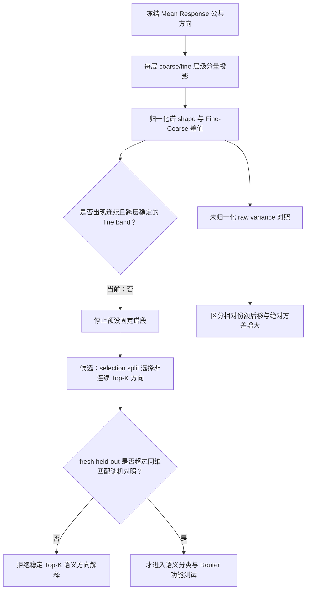

# 粗细粒度语义能否由不连续的 Top-K 公共参数方向稳定区分？

## 摘要

本报告回答两个递进问题：第一，在冻结 Mean Response 公共参数基中，coarse 与 fine 的完整归一化方差谱具体在哪里不同；第二，是否应继续预设一个连续 middle-late 区间，还是改为寻找差异最大的非连续 Top-K 方向。复用原 E03 的冻结 512 条数据、36 层 Attention-write、4096 维公共基和 2,000 次 parent bootstrap 后，shape 审计显示：coarse 与 fine 谱在大部分 rank 上高度重叠，fine 的平均后移主要来自谱最前端份额减少，并在约 0.20--0.91 的较后谱区域出现分散的小幅正差，而不是集中于一个连续、唯一的 fine band。未归一化曲线还显示，多数层 coarse 的总 raw variance 大于 fine，因此原正结果是**相对方差份额的重分配**，不是“fine 在后谱绝对方差普遍更大”。本报告的待确认判断是：停止把固定 `[0.50,0.75)` 当作候选空间；下一步只考虑逐层、非连续的 Top-K 差异方向，并要求它们在新鲜 held-out 数据上超过同维 rank-matched random/Haar 对照后，才允许进入语义或 Router 功能测试。

## 1. 从总体谱质心到具体曲线 shape

### 1.1 人类问题

前一实验得到：在同一个冻结 Mean Response 基下，fine 相对 coarse 的归一化方差谱质心在 blocks 1--35 上整体更靠后。该结果回答了“整体位置是否变化”，却没有回答：

1. 两条谱曲线是否真的在不同 rank 区间分开；
2. fine 质心后移是否由某个连续谱段承担；
3. 归一化 fine 曲线更高是否意味着该方向的 fine 原始方差更大；
4. 能否据此确定可用于区分语义或路由的具体方向。

质心是把完整曲线压成一个数。不同 shape 可以有相同质心，同样的质心差也可能来自一个集中峰值或许多小幅、分散的质量迁移。因此，要从“总体趋势”推进到“具体方向”，必须查看同一层、同一公共方向上的 coarse/fine 曲线以及逐方向差值。

### 1.2 本报告的唯一问题

> 当前证据是否支持预设一个连续的 fine 谱段；如果不支持，能否把下一候选严格缩成逐层、非连续的 Top-K Fine−Coarse 差异方向？

本报告前半部分是对已完成 E03 的事后描述性 shape 审计；后半部分只提出下一实验的候选定义，不声称 Top-K 已经得到 held-out 认证。

## 2. 数据、表征与公共坐标

### 2.1 数据和统计单位

数据是同一套 512 条平衡英文主题描述：

$$
8\ \text{parents}
\times 8\ \text{children/parent}
\times 4\ \text{templates}
\times 2\ \text{fact bundles}.
$$

模型是冻结的 Qwen3-8B。每条文本统一读取末尾 `Classification:` 冒号位置。本文的 **Attention-write** 指每层 `self_attn.o_proj` 输出、尚未加回 residual 的 4096 维向量。它是本层 Attention 分支写入的操作性对象，不等价于已经证明的 residual-relative 新信息。

语义层级不是两套独立文本，而是从相同 child means 中分解：

$$
d^C_{\ell p}=\mu_{\ell p}-\mu_\ell,
\qquad
d^M_{\ell pm}=\mu_{\ell pm}-\mu_{\ell p},
\qquad
d^F_{\ell pc}=\mu_{\ell pc}-\mu_{\ell p,m(c)}.
$$

- coarse：不同 parent 之间的变化；
- medium：同一 parent 内不同预设 child-pair 之间的变化；
- fine：同一 pair 内两个 child 之间的变化。

不确定性仍以 8 个 parent 为配对 bootstrap 单位，共 2,000 draws；36 层是一条共享数据的深度轨迹，不是 36 个独立重复。

### 2.2 Mean Response 公共参数基

第 $\ell$ 层 MLP 输入侧定义

$$
K_\ell
=W_{gate,\ell}^{\top}W_{gate,\ell}
+W_{up,\ell}^{\top}W_{up,\ell},
$$

并构造

$$
\bar K
=\frac1{36}\sum_{\ell=1}^{36}
\frac{K_\ell}{\operatorname{tr}K_\ell},
\qquad
\bar K=V\Lambda V^\top.
$$

$V=[v_1,\ldots,v_{4096}]$ 是所有层共同使用的坐标。rank 从“跨层平均归一化 MLP 输入参数响应较强”排到“较弱”。该基是比较尺子，不保证每个方向跨层具有相同语义，也不保证同时对角化每层 $K_\ell$。

## 3. Shape 审计方法

### 3.1 归一化谱：比较相对位置

对语义层级 $g\in\{C,F\}$ 和公共方向 $v_j$：

$$
e_{\ell,g,j}=v_j^\top B^g_\ell v_j,
\qquad
p_{\ell,g,j}
=\frac{e_{\ell,g,j}}{\sum_k e_{\ell,g,k}}.
$$

$e$ 是原始层级分量方差；$p$ 是该层级把自身总方差分配到方向 $j$ 的比例。每条 $p$ 曲线的总和都为 1，所以它只比较 shape 和相对位置。

为了降低单方向噪声、同时保持方向位置，将 4096 个 rank 固定分成 128 个等宽 bin，每个 bin 32 个方向：

$$
P_{\ell,g,b}=\sum_{j\in b}p_{\ell,g,j},
$$

$$
D_{\ell,b}
=100\bigl(P_{\ell,F,b}-P_{\ell,C,b}\bigr).
$$

$D$ 的单位是：该 32-direction bin 占全部归一化方差的百分点。因为两条谱都归一化，必有 $\sum_bD_{\ell,b}=0$；所以红色增加必然对应其他位置的蓝色减少。

### 3.2 未归一化谱：比较绝对方差

要回答“fine 曲线更高是否等于 fine 方差绝对值更大”，必须回到

$$
e_{\ell,g,j}
=p_{\ell,g,j}\operatorname{tr}(B^g_\ell).
$$

未归一化图比较同层、同方向的 raw component variance。它与归一化图回答不同问题，不能互相替代。

### 3.3 当前证据链与停止位置

当前工作停在 E：已经有理由停止固定 band，但尚未执行 F--I。

## 4. 直接结果

### 4.1 Coarse 与 fine 的谱高度重叠

图中蓝线是 coarse，红线是 fine；每条曲线面积均为 1，纵轴为 log scale。展示层 `1, 6, 12, 18, 24, 30, 35, 36` 是原 Protocol 预先冻结的层，不是根据 shape 事后挑选。

直接观察是：

- Block 1 的 shape 差异最大且最直观，coarse 在谱最前端具有更高相对密度，fine 在后方分配更多份额；
- 多数中深层中，两条曲线在绝大部分 rank 上重合，差异表现为多个位置的小幅波动；
- 没有出现 coarse 和 fine 分别占据两个低重叠窄峰的结构；
- 质心差因而不能解释为两个语义层级分别定位在两个清晰、可分离的维度区间。

### 4.2 差异主要是谱头减少与较后位置的分散增加

上图 A 是每层逐 bin 的 $D_{\ell,b}$；B 显示逐层逐 bin 的 pointwise parent-bootstrap 支持；C 先对 blocks 1--35 取逐 bin 轨迹中位数，再在每个 bootstrap draw 内复用同一组 parent 索引重算整条轨迹。

轨迹中位数层面：

| 逐 bin 结果 | 数量 | 位置形态 |
| --- | ---: | --- |
| coarse > fine，区间不跨 0 | 7/128 | 集中于谱最前端：rank 33--160 与 193--288 |
| fine > coarse，区间不跨 0 | 28/128 | 从 normalized rank 约 0.20 到 0.91 分散出现 |
| 区间跨 0 | 93/128 | 当前无法判定 |

这支持一个更具体但更窄的 shape 描述：

$$
\text{fine 的平均后移}
\approx
\text{谱最前端相对份额下降}
+
\text{较后大量离散位置的小幅份额增加}.
$$

它不支持一个连续、唯一、跨层固定的 fine band。图中的区间是 pointwise，不是对 128 bins 与 35 blocks 同时校正的区间，因此只承担 shape 解释，不能直接承担方向选择 verdict。

### 4.3 相对后移不等于 fine 原始方差更大

在 blocks 1--35 中，fine/coarse 总 raw variance 比值的中位数为 `0.527`，层间范围为 `0.309--1.320`。固定展示层中，只有 block 30 的总 raw variance 接近并略高于 coarse（`F/C=1.017`）；其他展示层都是 coarse 更大。

因此当前正结果应表述为：

> fine 相对于自身总方差，把更多份额分配到较后 Mean Response ranks。

不能表述为：

> fine 在这些后谱方向上的绝对方差普遍高于 coarse。

## 5. 不预设空间的 Top-K 候选

### 5.1 为什么从 fixed band 改成 non-contiguous Top-K

固定 `[0.50,0.75)` 曾作为辅助统计，是为了检验一个预先给定的 middle-late 区间；它不是由当前 shape 自动识别出的语义空间。现在的曲线显示正差分散在多个不连续 rank，而最稳定的负差集中在谱头。继续规定一个连续 band 会混入大量 unresolved 方向，也可能遗漏远离该 band 的有效方向。

因此下一候选应允许每层拥有不同、且不连续的方向集合。公共基仍保证不同层使用相同的候选向量字典，但具体选择 $S_\ell$ 可以依层变化。

### 5.2 候选方向的精确定义

在完全独立的 **SELECTION** 数据上，对每层定义：

$$
\delta^{sel}_{\ell,j}
=p^{sel}_{\ell,F,j}-p^{sel}_{\ell,C,j}.
$$

推荐同时冻结两类集合：

$$
S^{F}_{\ell}(K)
=\operatorname{TopK}_j\delta^{sel}_{\ell,j},
$$

$$
S^{C}_{\ell}(K)
=\operatorname{TopK}_j\bigl(-\delta^{sel}_{\ell,j}\bigr).
$$

- $S^F_\ell(K)$：selection 数据中 fine 相对份额增加最大的 K 个方向；
- $S^C_\ell(K)$：coarse 相对份额增加最大的 K 个方向；
- 方向不要求连续，也不要求不同层选择同一 rank；
- 选择时应使用未平滑的 4096 个方向；binning 只用于可视化，不能替代方向选择。

如果最终只需要一个差异集合，可以使用

$$
S^{diff}_{\ell}(K)
=\operatorname{TopK}_j|\delta^{sel}_{\ell,j}|,
$$

但必须同时保留 $\operatorname{sign}(\delta^{sel}_{\ell,j})$，否则会把 coarse-enriched 与 fine-enriched 方向混成一个无法解释的能量和。

### 5.3 数据划分与防止事后选择

现有 full/A/B 数据已经被用于形成和检查当前结论，不能再把 A 或 B 宣称为全新的 confirmation。正式 Top-K 认证需要新鲜数据：

| 划分 | 作用 | 允许操作 | 禁止操作 |
| --- | --- | --- | --- |
| SELECTION | 构造候选 | 计算 $\delta^{sel}$、冻结 K 和每层方向索引 | 报告最终功能结论 |
| DEVELOPMENT | 可选的方向稳定性检查 | 检查 sign、K 的预算敏感性 | 根据 TEST 结果调整 K |
| CONFIRMATION | 最终确认 | 只评价已冻结方向和对照 | 重新选方向、改 K、改层 |

三套数据都必须保留全部 8 个 parents 和 8 个 children，使用新的独立事实组合或表达模板，使 coarse/fine 层级分解在每个 split 内都可重新计算。Mean Response 参数基始终冻结，不接触语义数据。

### 5.4 推荐的最小确认指标

在 CONFIRMATION 上，不重新选方向，只计算冻结集合捕获的 Fine−Coarse 份额：

$$
C^F_\ell(K)
=\sum_{j\in S^F_\ell(K)}
\left(p^{test}_{\ell,F,j}-p^{test}_{\ell,C,j}\right),
$$

$$
C^C_\ell(K)
=\sum_{j\in S^C_\ell(K)}
\left(p^{test}_{\ell,C,j}-p^{test}_{\ell,F,j}\right).
$$

推荐以 $K=64$ 作为首个紧凑主预算，并把 $K=32,128$ 只作为预先冻结的预算敏感性检查；这是 AI 候选，正式执行前仍需研究者在 Protocol 中确认。选择 K 时不得查看 CONFIRMATION。

必须配置以下 matched controls：

1. **rank-matched random basis directions：**保持 K 和所选方向的 rank 分布，只随机替换具体方向；排除“只是选到了谱后或谱头”的解释；
2. **Haar random K-dimensional subspace：**排除任意同维旋转都能取得相同结果；
3. **selection-only shuffled labels：**在 selection 中打乱 coarse/fine 身份再选 Top-K，估计选择极值带来的虚假增益；
4. **固定连续 K-rank band：**作为旧 fixed-band 思路的直接对照，而不是新的主方法。

### 5.5 一个决定性 falsifier

> 若冻结的 $S^F_\ell(K)$ 和 $S^C_\ell(K)$ 在 fresh CONFIRMATION 上的捕获对比，不能超过 rank-matched random 方向的 95% control quantile，则“存在可复现的 coarse/fine Top-K 公共方向”被否定；不得用改变 K、换层或重新选择方向修复该结论。

方向 overlap、leave-one-parent-out sign 和相邻 K 预算仅作为有效性守卫。即使 Top-K 位置复现，也只说明公共方向携带稳定的语义粒度差异，仍不等于它能改善 Router。

## 6. 认识更新、边界与唯一下一决策

### 6.1 待研究者确认的认识更新

当前 shape 证据把原来的“fine 在谱中后段更强”收窄为：在冻结 Mean Response 排序中，fine 的**归一化方差位置**整体更后；这个后移由谱头份额减少和多个较后位置的分散增加共同构成。Coarse/fine 曲线高度重叠，没有证据支持一个连续、唯一、跨层固定的 fine 语义空间。多数层的 coarse raw variance 仍更大，所以观察结果是相对分配差异，而非 fine 绝对信号普遍增强。

这使下一方法不再是“寻找一个更合适的固定 band”，而是检验：由 selection 数据选出的少量非连续 Fine−Coarse 差异方向，是否能在 fresh held-out 数据中保留方向身份和差异捕获能力。

### 6.2 不能推出什么

- 当前 post-hoc bins 不是经过多重比较校正后的语义方向集合。
- 不能由 normalized curve 推出 fine 的原始方差或信息量更大。
- 不能把 Top-K variance contrast 直接称为本层相对 residual 的新增信息。
- 不能由语义粒度区分直接推出 expert choice、Router regret 或语言模型 NLL 改善。
- 不能使用已经看过的 A/B expression halves 冒充新的 held-out confirmation。

### 6.3 唯一下一决策

- **唯一下一决策：**是否批准一个 fresh-split、每层 non-contiguous Top-K 方向认证 Protocol，以 `K=64` 为推荐主预算、rank-matched random q95 为决定性对照。
- **完成标准：**返回每层冻结方向索引、fresh CONFIRMATION 的 $C^F_\ell(K)$/$C^C_\ell(K)$、matched-control quantile、方向稳定性守卫和一个明确的 Pass/Fail/Insufficient；Fail 后不继续语义 probe 或 Router。

其他问题全部 parked：在 Top-K 方向通过 held-out 认证之前，不训练 Router，不把方向映射为 expert，不继续调整固定谱段。

## 7. 证据与来源

- **问题与当前边界：**[A15_02 中文 Anchor](../../../Projects/from-attention-to-search/main/problem_anchors/15_spectral_representation_and_functional_routing/15_02_layerwise_representation_spectral_atlas/15_02_layerwise_representation_spectral_atlas_anchor_cn.md)
- **Frozen Protocol：**[E03 Protocol](../../../Projects/from-attention-to-search/main/experiments/A15/15_02_layerwise_representation_spectral_atlas/A15_02_06_E03_shared_basis_semantic_granularity/protocol.md)
- **Canonical Summary：**[E03 Summary](../../../Projects/from-attention-to-search/main/experiments/A15/15_02_layerwise_representation_spectral_atlas/A15_02_06_E03_shared_basis_semantic_granularity/summary.md)
- **Canonical Detailed：**[E03 Detailed](../../../Projects/from-attention-to-search/main/experiments/A15/15_02_layerwise_representation_spectral_atlas/A15_02_06_E03_shared_basis_semantic_granularity/detailed.md)
- **Shape 审计定义与边界：**[Coarse/Fine shape audit](../../../Projects/from-attention-to-search/main/experiments/A15/15_02_layerwise_representation_spectral_atlas/A15_02_06_E03_shared_basis_semantic_granularity/figures/posthoc_coarse_fine_shape_audit_cn.md)
- **逐层逐 bin 数值：**[posthoc_coarse_fine_shape_bins.csv](../../../Projects/from-attention-to-search/main/experiments/A15/15_02_layerwise_representation_spectral_atlas/A15_02_06_E03_shared_basis_semantic_granularity/tables/posthoc_coarse_fine_shape_bins.csv)
- **轨迹逐 bin 数值：**[posthoc_coarse_fine_shape_trajectory.csv](../../../Projects/from-attention-to-search/main/experiments/A15/15_02_layerwise_representation_spectral_atlas/A15_02_06_E03_shared_basis_semantic_granularity/tables/posthoc_coarse_fine_shape_trajectory.csv)

本报告没有修改 E03 的 frozen Protocol 或 registered verdict。Shape 图是事后描述性证据；Top-K 是下一候选方法，尚未执行。
