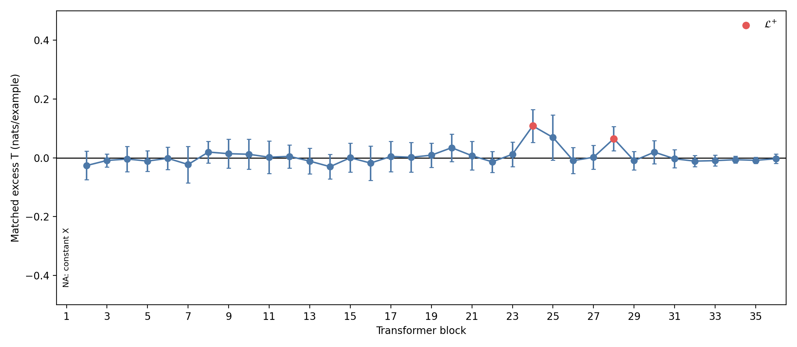
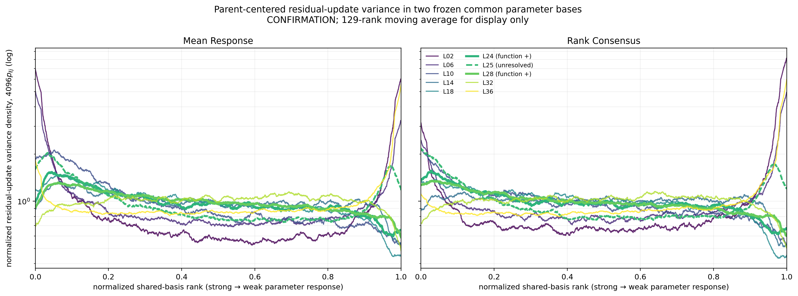

# 0817 研究汇报

## 汇报概要

### 本次要解决的核心问题

模型深层累计表征是否更能区分细粒度语义；哪些层的精确更新在旧状态之外增加了这种区分度？其中每一层增加的区分度，是否能够被一个低秩的子空间稳定激活？

### 核心假设

1. 模型深层表征更能区分细粒度的信息之间的差别；
2. 表征是低秩的；

### 整体思路

1. 首先定义第 $$\ell$$ 层同一个 token 的 Attention 写入前后状态：$$X_\ell\rightarrow Z_\ell$$。其中，$$X_\ell=N_\ell(h_\ell)$$ 是无本层 Attention 写入时的归一化旧状态，$$Z_\ell=N_\ell(h_\ell+a_\ell)$$ 是加入本层 Attention 写入后的实际 MLP/候选 Router 输入。二者之差 $$U_\ell=Z_\ell-X_\ell$$ 是本层造成的精确更新；再去除旧状态能够线性预测的部分，得到候选新增更新：

$$R_{U,\ell}=U_\ell-\widehat{\mathbb E}_{lin}[U_\ell\mid X_\ell].$$

这里，$$h_\ell$$ 是本层 Attention 写入前的 residual，$$a_\ell$$ 是本层 Attention write，$$N_\ell$$ 是同一个 post-Attention RMSNorm。

此时 $$R_{U,\ell}$$ 还不能称为新增信息，必须由后续留出功能增益裁定。

2. 验证新的信息在已知粗粒度的分类信息下，是否能够增加细粒度信息的分类准确率。然后使用PCA，检验使用多少Rank能够保持表征的功能作用
3. 2.成立，然后在2.基础上，在之前的参数参数均值公共基上投影，观察不同层间新信息的奇异值曲线，从而得到新空间

### 结论

1.  
2. 目前不能得出“深层能够线性读出大部分浅层信息，同时新增了非线性信息”这个结论。现有 CKA 只比较同一批 token 在不同层中“谁和谁更相似”，不能区分线性包含、非线性新增或者功能收益。CONFIRMATION 上相邻层 CKA 的中位数约为 0.861，但功能正层也没有共同断点：23→24 仍然很相似，CKA 为 0.926；27→28 和 28→29 分别为 0.739、0.682。当前只能说 token 之间的关系会随层改变，不能把这种改变直接叫作新增信息。若要判断深层是否包含浅层的线性信息，需要另做留出集上的跨层线性预测实验，本稿暂不加入尚未执行的结果。
3. 中间层 14–28 整体较平，功能正层 24、28 没有出现只占据某个很窄谱段的独特尖峰。

---

## 具体实验

### 实验一

#### 实验目的

定义L层，验证新的信息在已知粗粒度的分类信息下，是否能够增加细粒度信息的分类准确率

#### 实验对象

$$X_{25}=N_{25}(h_{25}),\ Z_{25}=N_{25}(h_{25}+a_{25}),\ U_{25}=Z_{25}-X_{25},\ R_{U,25}=U_{25}-\widehat{\mathbb E}_{lin}[U_{25}\mid X_{25}]$$；$$R_{U,25}$$ 是旧状态在线性模型下不能预测的更新部分，是否属于新增细粒度可访问性仍由留出功能增益裁定

#### 实验数据

使用父类—子类数量平衡的条件细粒度分类数据，TRAIN、DEVELOPMENT、CONFIRMATION 讲同一个概念，但是叙述方式不同；已知父类后预测其内部子类，例如 mathematics→combinatorics、mathematics→linear algebra

#### 实验过程

1. 冻结模型和 decision token，在第 25 层提取同一样本的 $$X_{25}$$、$$Z_{25}$$、$$U_{25}$$，并验证 $$Z_{25}=X_{25}+U_{25}$$
2. 对所有可检验层重复同一过程：只用 TRAIN 从 $$X_\ell$$ 预测 $$U_\ell$$，得到 $$R_{U,\ell}$$。然后比较两条读出分支：old-only 只使用本层旧状态 $$X_\ell$$ 预测细类；old-plus-full-$$R_U$$ 在同一个 $$X_\ell$$ 基础上再加入本层 $$R_{U,\ell}$$。所有正则只用 DEVELOPMENT 选择。
3. 在未参与选择的 CONFIRMATION 上比较细类目标的交叉熵增益

#### 实验结果

1. block 1 因为同一个 decision token 的 $$X_1$$ 恒定，属于结构性不可检验；其余 35 层中，25 层的原始 true gain 大于 0，17 层在扣除 duplicate-$$X$$ 和 mismatch 对照后仍有正的点估计。
2. 全层同时校正后，只有 block 24、28 的区间完全高于 0。block 24 的扣除对照后收益为 0.1087，同时 95% 区间为 [0.0526, 0.1649]；block 28 为 0.0653，区间为 [0.0239, 0.1067]。
3. block 25 的扣除对照后收益为 0.0693，但区间为 [-0.0073, 0.1460]，因此只能记作未决。其余层也不能说成“已经证明没有新增”，因为它们的同时区间都跨过 0。

#### 实验结论

1. 当前能够确认的新增细粒度可访问性发生在 block 24、28，是局部层现象；结果不支持“层越深，每一层新增越多”。
2. $$R_{U,\ell}$$ 只能叫作旧状态在线性模型下不能预测的候选更新。只有真实 $$R_U$$ 同时胜过重复使用同一 $$X$$ 的容量对照和样本错配对照，才能称为当前线性模型族下的新增可访问性；它还不等于信息论意义上的全新知识。

### 实验二

#### 实验目的

把不同层的候选新增更新放到同一套公共参数坐标中比较，看它们主要激活哪些方向、这种激活是否随层移动，以及功能正层的更新能否被一个较小的子空间保留。

#### 实验对象

每一层同一个 decision token 的 $$R_{U,\ell}$$；分析时先减去对应父类的 TRAIN 均值，避免父类之间本来就很大的差异盖住父类内部的细粒度变化。

#### 实验数据

1. 使用实验一冻结得到的 Qwen3-8B 表征，不重新训练模型；
2. TRAIN、DEVELOPMENT、CONFIRMATION 各 640 条，三个切分沿用相同的 8 个父类 × 每父类 8 个子类的平衡结构；
3. 每条样本取同一个 decision token，每层 $$R_{U,\ell}$$ 的维度为 4096；
4. 主分析覆盖 block 2–36，共 35 个可检验层；
5. 公共谱完整曲线展示 block 2、6、10、14、18、24、25、28、32、36，其中 block 24、28 是实验一确认的功能正层，block 25 是未决层；
6. 公共基和 PCA 方向只用 TRAIN 构造，再原样用于 DEVELOPMENT 和 CONFIRMATION，检查是否能够迁移到新的表达模板。

#### 实验过程

1. 公共参数谱投影：把每层 $$R_{U,\ell}$$ 投到两套冻结公共基 Mean Response（平均参数响应）和 Rank Consensus（各层排名共识）上，比较每个公共方向分到的归一化方差，重点标出功能正层 24、28 和未决层 25。
2. CKA 分析：比较两层中同一批 token 的两两相似关系是否相同。CKA 高表示 token 的相对关系相似，但不表示两层功能相同，也不表示存在新增信息。
3. 协方差与 PCA：在 TRAIN 上寻找 token 更新共同变化的主方向，再把同一个投影空间用于 DEVELOPMENT 和 CONFIRMATION；同时与等维随机子空间比较，分别判断表征方差能否稳定压缩，以及分类功能能否由低维空间保留。

#### 实验结果

1. 公共谱曲线说明不同层的方差形状确实不同，但功能正层 24、28 没有只占据某个很窄谱段的独特尖峰。
2. Mean Response 公共基显示深层相对后移，深浅层 centroid 差为 +0.0285；Rank Consensus 却显示反向移动，差为 -0.0397。因此“新增更新随层稳定向参数谱后部移动”依赖公共基的构造，目前不能确认。
3. CONFIRMATION 上相邻层 CKA 中位数约为 0.861，功能正层没有共同的 CKA 断点，所以 CKA 只能描述跨层 token 几何变化，不能替代功能裁定。
4. 更新云比坐标独立打乱更有联合结构，但没有一层通过稳定表征低秩的完整判据。block 24、28 的 TRAIN PCA 空间在 CONFIRMATION 上分别只保留 42.1% 和 54.6% 的方差。
5. 功能正层 24、28 的分类收益都能在注册的 rank 256 PCA 空间中保留，但 rank 1–128 均没有通过完整判据。

#### 实验结论

1. 不同层的 token 更新在共同参数坐标中的形状会变化，但目前没有证据支持一个不依赖公共基、随深度稳定后移的窄谱子空间；谱形状也不能反过来证明某层有新增信息。
2. 当前不支持“新增更新具有跨模板稳定的表征低秩”，但 block 24、28 的目标功能可以压缩到 256 维。准确说法是“功能可压缩”，而不是“已经找到了一个稳定、极低秩、可直接用于 Router 的新信息空间”。
