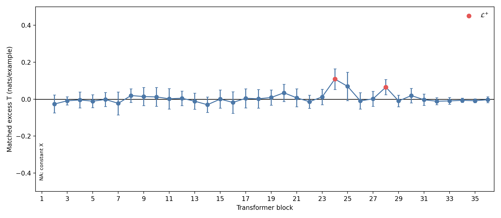
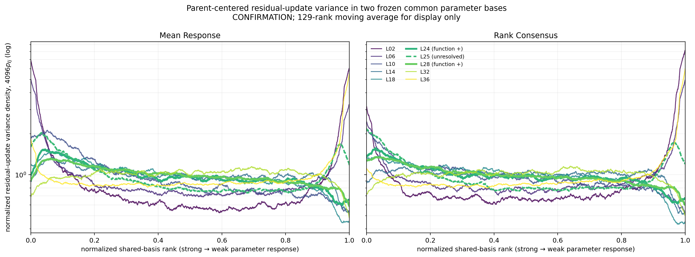

# 0817 组会汇报：逐层新增信息与公共参数谱分析

## 一、这次到底要回答什么

最终问题不是“哪一层的向量变化最大”，而是：

> 对同一个 token，本层 Attention 写入之后，是否出现了旧状态之外、能够帮助区分同一父类内部细粒度语义的信息；如果出现，这种功能新增发生在哪些层，又以什么样的跨层几何结构存在？

这句话要拆成两个有先后顺序的问题：

1. **功能问题**：哪一层的更新真的增加了细粒度标签的可访问性？
2. **表征问题**：已确认的更新在本层参数谱、公共参数谱、协方差主方向和低维子空间中是什么形状？

不能把顺序倒过来。谱曲线、PCA、CKA 或聚类只能描述几何；只有与同一 \(X\) 的功能对照比较，才能裁定“新增细粒度可访问性”。

---

## 二、实验一应该怎样读

### 2.1 实验对象

对第 \(\ell\) 个 block 的同一个 decision token 定义：

$$
X_\ell=N_\ell(h_\ell),\qquad
Z_\ell=N_\ell(h_\ell+a_\ell),\qquad
U_\ell=Z_\ell-X_\ell.
$$

- \(X_\ell\)：本层 Attention 写入之前的旧状态；
- \(Z_\ell\)：写入之后、模型实际送入 MLP 的状态；
- \(U_\ell\)：这一次写入造成的精确变化。

再用 TRAIN 拟合旧状态到更新的线性预测：

$$
\widehat U_\ell=f_\ell^{lin}(X_\ell),\qquad
R_{U,\ell}=U_\ell-\widehat U_\ell.
$$

\(R_U\) 的准确含义是：

> 本层更新中，不能由旧状态通过当前注册的线性映射重建的部分。

它此时还只是“候选新增更新”，不是已经证明的新信息。

### 2.2 为什么要做双分支同一 \(X\) 对照

分类比较使用同一份 old-only 预测作为底座：

- true 分支：在 \(X\) 之外加入真实 \(R_U\)；
- duplicate-\(X\) 分支：不加入 \(R_U\)，而是再给同一个 \(X\) 一个同容量校正头；
- mismatch 分支：加入来自同父类其他样本的错配 \(R_U\)。

白话解释：

> 如果多给一个分支就能涨分，那么 duplicate-\(X\) 也会涨；如果任意更新都能涨，那么 mismatch 也会涨。真实 \(R_U\) 必须同时赢过二者，才说明收益来自“这个样本自己的更新内容”，而不是模型容量或数据分布。

主统计量为：

$$
T_\ell=
G_\ell^{true}-
\max\left(
G_\ell^{dupX},
q_{.95}G_\ell^{mismatch}
\right).
$$

### 2.3 结果不能说成“其他层都没有”

35 个可检验层中：

- 25 层的 raw true gain 大于 0；
- 17 层在扣除两个对照后仍有正的点估计 \(T_\ell>0\)；
- 只有 block 24、28 的全层同时 95% 下界大于 0；
- 其余 33 层的同时区间都跨过 0，没有一层的同时上界小于等于 0。

所以正确判断是：

> 当前能够确认的正结果是 block 24、28；其余层证据不足，既不能宣布有新增，也不能宣布没有新增。

| Block | true gain | duplicate-\(X\) gain | mismatch q95 | \(T_\ell\) | 同时 95% 区间 | 判断 |
| ---: | ---: | ---: | ---: | ---: | ---: | --- |
| 24 | 0.1091 | -0.0027 | 0.0003 | 0.1087 | [0.0526, 0.1649] | 确认正收益 |
| 25 | 0.0959 | 0.0266 | 0.0017 | 0.0693 | [-0.0073, 0.1460] | 未决 |
| 28 | 0.0803 | 0.0150 | 0.0011 | 0.0653 | [0.0239, 0.1067] | 确认正收益 |

这张图的读法是：柱子是扣除最强对照后的点估计，误差线是对 35 层一起校正后的区间。只有整根误差线在 0 以上，才能记作确认正收益。

### 2.4 纠正“前面线性不可预测，后面也不该线性可读”的误区

这里其实有两个完全不同的预测问题：

$$
X_\ell\longrightarrow U_\ell
\qquad\text{和}\qquad
R_{U,\ell}\longrightarrow Y.
$$

第一个问题问“能否从旧状态重建更新向量”；第二个问题问“剩余更新是否包含与子类标签相关的方向”。前一个失败不推出后一个失败。

最简单的例子是：

$$
U=AX+c\,v+\epsilon.
$$

旧状态可以预测 \(AX\)，减掉以后仍留下 \(c\,v\)。只要类别 \(c\) 不同，沿 \(v\) 的符号或大小不同，线性分类器就能从残差预测类别。

白话说：

> “我不能根据原信件猜出老师会加哪句批注”，不等于“看到新增批注以后，我不能判断老师把信件分到了哪个类别”。

你的担心中仍有一部分是完全正确的：当前只去除了 \(X\) 对 \(U\) 的**线性可预测部分**，并没有去除 \(X\) 的任意非线性函数。例如若 \(U=x^2v\)，线性模型不能从 \(x\) 重建 \(x^2v\)，但残差中的 \(x^2\) 仍可能被线性分类器读取。因此实验一的严格结论是：

> block 24、28 增加了旧状态之外、在注册线性模型族下成立的细粒度可访问性。

不能升级成“产生了信息论意义上全新的知识”。若下一步要排除这个解释，应加入冻结的非线性 \(X\)-only / \(X\to U\) 对照，而不是修改本次已经注册完成的结论。

---

## 三、实验二：功能裁定以后再看表征

### 3.1 分析对象为什么仍然是 token-level 更新

先对每个父类减去 TRAIN 父类均值：

$$
\widetilde R_{\ell,i}
=R_{U,\ell,i}-\mu_{\ell,p(i)}^{train}.
$$

这样做的目的不是删除子类差异，而是避免“数学和医学本来就差得很远”主导协方差。留下的是同一父类内部，不同 token、不同子类怎样变化。

### 3.2 分析步骤及每一步的目的

1. **本层 MLP 参数谱**：回答本层更新在本层 gate/up 参数的强响应方向还是弱响应方向上能量更大。
2. **冻结公共参数谱**：把不同层放进同一把尺子，观察更新方差是否随深度向谱后部移动。
3. **协方差与 PCA**：寻找许多 token 共同变化的方向，并检验 TRAIN 找到的低维空间能否迁移到新模板。
4. **CKA**：比较不同层中“哪些 token 彼此相像”的关系是否改变。CKA 高表示 token 关系相似，不表示信息内容完全相同，也不表示低秩。
5. **父类内聚类**：检查 PCA 坐标是否自然按子类分组；它只是几何诊断，不能替代分类收益。
6. **低维功能保留**：把 \(R_U\) 投到低维 PCA 空间后重新做功能读出，并与同维随机子空间比较。这一步才回答“低维空间是否保留了功能”。

---

## 四、方案 A：完整公共参数谱方向曲线

### 4.1 这张图画的到底是什么

公共参数矩阵从每层 MLP 的 gate/up 参数得到：

$$
K_\ell=W_{gate,\ell}^{\top}W_{gate,\ell}
+W_{up,\ell}^{\top}W_{up,\ell}.
$$

我们使用两种已经冻结的公共排序：

- **Mean Response**：每层 \(K_\ell\) 先按 trace 归一化，再平均并做特征分解。白话说，是找“所有层平均起来最强的共同参数方向”。
- **Rank Consensus**：先看每一层对方向的相对排名，再汇总排名。白话说，是防止少数数值特别大的层支配公共排序。

对公共基中的第 \(j\) 个方向 \(b_j\)，计算 CONFIRMATION token 的方差：

$$
e_{\ell j}
=\operatorname{Var}_i(b_j^\top\widetilde R_{\ell,i}).
$$

每层内部归一化：

$$
p_{\ell j}=\frac{e_{\ell j}}{\sum_{k=1}^{4096}e_{\ell k}},
\qquad
d_{\ell j}=4096p_{\ell j}.
$$

图中画的是 \(d_{\ell j}\)，不是 \(R_U\) 的奇异值：

- 横轴：公共参数方向的排序，左边是参数响应强方向，右边是弱方向；
- 纵轴：该方向获得的归一化更新方差密度；
- \(d=1\)：若 4096 个方向平均分能量时的基线；
- \(d>1\)：该段方向得到的能量高于均匀分配；
- 129-rank 移动平均只为看清曲线，不参与任何统计裁定。

抽取层固定为 2、6、10、14、18、24、25、28、32、36；粗线 block 24、28 是功能正层，虚线 block 25 是未决层。

### 4.2 从图中能直接看出什么

1. 各层曲线并不相同，说明更新在共同参数坐标中的方差形状确实随层改变。
2. 中间层 14–28 整体较平，功能正层 24、28 没有出现只占据某个很窄谱段的独特尖峰。
3. block 36 在两套基的弱响应末端都明显抬升，但早层 2、6 也有很强的端点集中；因此不能把局部末端峰值直接读成“越深越后移”。
4. 功能正层在 CONFIRMATION 上也不是“最大谱能量一定位于后部”：block 24/28 在 Mean Response 的主导带均为 F2，在 Rank Consensus 中均为 F1。

| Block | 功能裁定 | Mean Response centroid | MR 主导带 | Rank Consensus centroid | RC 主导带 |
| ---: | --- | ---: | ---: | ---: | ---: |
| 24 | 正 | 0.449 | F2 | 0.454 | F1 |
| 25 | 未决 | 0.454 | F1 | 0.467 | F1 |
| 28 | 正 | 0.461 | F2 | 0.459 | F1 |
| 36 | 未确认功能新增 | 0.549 | F16 | 0.567 | F16 |

### 4.3 它支持和不支持什么

它支持：

> 不同层的 token 更新在公共参数方向上的方差分布不同，而且这种差异不是单一标量能够概括的。

它不支持：

- 不能仅凭谱形状宣布某层有新信息；
- 不能把末端峰值称为低秩；
- 不能说功能正层都落在参数谱后部；
- 不能把图中的曲线叫作 \(R_U\) 奇异值曲线。

完整注册统计进一步显示：Mean Response 的深浅层 centroid 差为 \(+0.0285\)，Rank Consensus 却为 \(-0.0397\)。两套合理公共基给出相反方向，所以“随深度稳定谱后移”的结论为 **basis-sensitive，证据不足**。

---

## 五、低秩问题要拆成两个判断

### 5.1 表征低秩

问题是：更新云的大部分方差是否集中在少数协方差主方向，而且 TRAIN 找到的空间能否稳定覆盖 DEVELOPMENT 和 CONFIRMATION？

结果：

- 真实 \(r_{80}\) 均小于坐标独立打乱的 q05，说明 token 更新不是独立坐标噪声，确有联合结构；
- 但没有一层通过“维数足够小 + 胜过打乱 + 两个新模板集均稳定保留方差”的完整合取；
- block 24 的 \(r_{80}=149\)，确认集只保留 42.1% 方差；
- block 28 的 \(r_{80}=106\)，确认集只保留 54.6% 方差。

结论：**没有证据支持稳定表征低秩。**

### 5.2 功能低秩

问题是：即使几何方差不能稳定压缩，目标分类功能是否仍能由少量方向保留？

结果：

- block 24、28 均在注册 rank 256 首次通过；
- rank 1–128 均未通过完整判据；
- 256 维占隐藏宽度 4096 的 6.25%，但占当前样本可识别上限 632 的 40.5%。

结论：**功能可以压缩到 256 维，但不能称为“极低秩”。**

这两个结论不冲突：一个空间可能丢掉很多与目标无关的方差，却保留分类所需的方向。

---

## 六、我们现在获得的五个独立判断

| 问题 | 当前答案 | 证据边界 |
| --- | --- | --- |
| 是否存在功能新增？ | 是，block 24、28 | 注册线性模型族下的确认结果 |
| 是否越深每层新增越多？ | 否，未见整体趋势 | 局部正层不能推出单调趋势 |
| 是否随深度稳定谱后移？ | 不能确认 | 两种公共基方向相反 |
| 表征是否稳定低秩？ | 不通过 | 有联合结构，但跨模板保留不足 |
| 功能是否可低维保留？ | 可压缩至 rank 256 | 尚未证明 Router 效用或因果使用 |

这张表是本次最重要的认识清理：不要再试图用一句“深层、后移、低秩”概括所有结果。

---

## 七、我该怎样自行判断一张结果图

看到任何新图时，依次问：

1. **对象是什么？** 是 \(X\)、\(U\)、\(R_U\)，还是投影后的 \(R_U\)？
2. **目标是什么？** 是解释方差、跨层相似度、分类收益，还是 Router 效用？
3. **对照是什么？** 有没有同一 \(X\) 的容量对照、错配对照或等维随机空间？
4. **泛化在哪里？** 方向和超参数是否只在 TRAIN 选择，并在新模板 CONFIRMATION 上固定检验？
5. **结论能到哪一步？** 几何现象不能自动升级成功能新增；线性可访问性不能升级成信息论新知识；低维读出不能升级成模型原生使用或 Router 有效。

只要其中一个问题答不出来，就先把结论降级成“描述性现象”。

---

## 八、明日可直接使用的白话讲法

> 我们先不从漂亮的子空间出发，而是先问本层 Attention 写入到底有没有带来旧状态之外、能区分同一大类内部子类的信息。我们把同一个 token 写入前后的状态相减，再减去旧状态能线性预测的更新。然后用同一个旧状态做双分支对照：一边加入真实剩余更新，另一边只重复使用旧状态，同时再和样本错配更新比较。35 个可检验层里，很多层点估计为正，但全层一起校正后，只有 24、28 层能确认，25 层仍然未决。因此不是“其他层都没有”，而是“目前只有两层证据足够”。
>
> 接着我们才分析这些 token 更新的几何。方案 A 把十个代表层投到两套冻结公共 MLP 参数基上，画每一个公共方向分到的归一化方差。曲线说明不同层的方差形状确实不同，但功能正层 24、28 并没有独占一个很窄或很靠后的谱段；而且两套公共基对整体后移给出相反结论，所以谱后移还不是稳健事实。
>
> 最后要区分两种低秩。更新云本身虽然比打乱数据更有结构，但训练集主方向迁移到新模板后保留不足，因此稳定表征低秩没有通过；另一方面，24、28 层的分类功能可以在 256 维 PCA 空间中保留。当前最准确的认识是：局部层存在可确认的线性功能新增，功能可压缩，但尚未证明存在跨层稳定的极低秩新信息空间，更没有证明这个空间能直接用于 Router。

---

## 九、下一步应怎样推进

优先级应是：

1. 为实验一增加冻结的非线性 \(X\)-only / \(X\to U\) rival，检验 block 24、28 的收益是否只是旧状态的非线性重编码；
2. 对 block 24、28 的 rank-256 空间做冻结干预或 Router 效用检验，判断模型是否真正使用该空间；
3. 若仍研究跨层共同空间，应以功能保留作为选择标准，并在新任务或新模板上验证，不再只按谱能量或 PCA 方差选方向。

暂时不应做的事：

- 不因为 block 36 谱末端峰值高就称其为新增信息层；
- 不因为 TRAIN 上 \(r_{80}\) 小就宣布稳定低秩；
- 不用 CKA 或聚类替代同一 \(X\) 功能对照；
- 不把本次 post-hoc 方案 A 曲线用于修改已经注册的实验判定。

## 十、对应证据

- 实验一逐层表：[layerwise_primary.csv](../../../../MoE_Router/experiments/20260816_a15_08_02_e01_layerwise_conditional_fine_added_accessibility/runs/a15-08-02-e01-20260816-full/tables/layerwise_primary.csv)
- 实验一裁定：[verdict.json](../../../../MoE_Router/experiments/20260816_a15_08_02_e01_layerwise_conditional_fine_added_accessibility/runs/a15-08-02-e01-20260816-full/verdict.json)
- 实验二完整总结：[summary.md](../../../Projects/from-attention-to-search/main/experiments/A15/15_08_target_conditioned_layer_innovation/A15_08_03_E01_function_admitted_update_spectral_rank_analysis/summary.md)
- 方案 A 生成收据：[common_basis_curve_receipt.json](../../../Projects/from-attention-to-search/main/experiments/A15/15_08_target_conditioned_layer_innovation/A15_08_03_E01_function_admitted_update_spectral_rank_analysis/evidence/common_basis_curve_receipt.json)
- 公共谱数据表：[common_parameter_spectrum.csv](../../../Projects/from-attention-to-search/main/experiments/A15/15_08_target_conditioned_layer_innovation/A15_08_03_E01_function_admitted_update_spectral_rank_analysis/tables/common_parameter_spectrum.csv)
