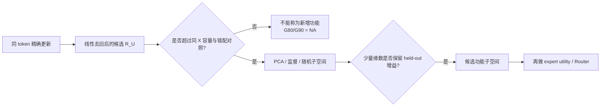

# 0819 汇报草稿：换数据后，新增信息涌现层在哪里？

> 本稿由 AI 依据已批准协议和完整运行结果整理。注册统计裁定已经确定；“认识更新”和下一步仍等待 dxy 自己判断并确认。

## 摘要

这次把原有逐层实验换到具有真实 domain--intent 结构的 CLINC150 数据。结果与此前 synthetic taxonomy 不同：blocks 2--36 没有任何一层的正确配对 $R_U$ 能超过同预算 duplicate-$X$ 对照，全部 simultaneous 95% 上界都小于 0。因此在当前功能定义下，新数据上没有恢复出“涌现层”，此前的 blocks 24/28 也没有复现。

因为完整 $R_U$ 本身未先证明是旧状态之外的增益，所以所有 $G_{80}/G_{90}$ 都是 NA。PCA 和 covariance 仍显示更新有几何结构，但现阶段只能称为候选结构，不能称为已确认的低维新增信息或 Router 子空间。

## 1. 目的

我们最终想找的是：**每一层是否存在一个紧凑子空间，专门保留该层相对旧状态新增加的、与细粒度区分有关的信息，并最终把它用于 Router 分发。**

本次只解决这个目标前面的两个关卡：

1. 在新的 CLINC150 数据上，哪些层真正增加了旧状态之外的细粒度 intent 线性可访问性？也就是恢复新数据上的“涌现层”。
2. 只有某层先证明完整 $R_U$ 有新增功能，才判断 PCA 的多少维能够在未见数据上保留该增益的 80% 或 90%。

换成一句白话：**先证明这层真的多带来了一点东西，再问这点东西能不能装进一个小空间。不能先看到一个小空间，就把它叫作新信息。**

## 2. 两次会议给我们的分析路线

### 2.1 0813：先比较同一个 token 怎么变

原来的公共基方差曲线，是先看每层所有 token 在各方向上有多分散。导师指出，它没有保留“同一个 token 前后如何改变”的配对关系。正确顺序是：

```text
同一 token 的前后状态配对
→ 得到每个 token 的更新向量
→ 对更新点云中心化并计算 covariance
→ 用 PCA 看主要联合变化方向
→ 必要时再对 token 的低维坐标聚类
```

covariance/PCA 的作用是描述更新点云：哪些方向共同变化、能量是否集中。它没有自动告诉我们这些方向是新增信息、任务相关信息或 Router 应用的方向。

### 2.2 0817：表示高秩与路由功能低秩要分开

会议进一步明确：token-wise difference 中可能混有旧 feature 的缩放、旋转、信息搬运和任务无关运动；PCA 前方向只保证方差/重构最优，不保证分类最优。即使完整表示高秩，完成一个特定分类或 gating 决策也可能只需要少量方向。

因此我们现在的证据顺序是：



## 3. 分析方法

### 3.1 数据和任务

- 数据是 CLINC150 的 150 个 in-scope intents，按 10 个 domain 组织，每个 domain 15 个 intents。
- TRAIN/DEVELOPMENT/TEST 分别为 15,000/3,000/4,500 条。
- primary task 已知 domain，只预测该 domain 内的 15 个 intent；10 个 domain 等权汇总。
- 模型是冻结的 Qwen3-8B；block 1 的 $X_1$ 在当前 decision token 上结构恒定，因此按注册规则不具备资格，实际分析 blocks 2--36。

### 3.2 实验对象

对同一个 token，在 block $\ell$ 的 Attention 写入前后定义

$$
X_\ell=N_\ell(h_\ell),\qquad
Z_\ell=N_\ell(h_\ell+a_\ell),\qquad
U_\ell=Z_\ell-X_\ell.
$$

再用 TRAIN 上的线性模型减去旧状态 $X_\ell$ 能预测的更新部分：

$$
R_{U,\ell}=U_\ell-widehat{\mathbb E}_{lin}[U_\ell\mid X_\ell].
$$

白话：$U$ 是 Attention 让本层 MLP 输入精确改变了多少；$R_U$ 是其中没有被当前线性旧状态模型预测到的剩余。但“预测不到”还不是“新增信息”，还要过功能对照。

### 3.3 功能判定

一条分支只使用旧状态 $X$；另一条在相同旧状态上加入正确配对的完整 $R_U$。但是多一条分支本身就可能提高性能，所以再加入两个对照：

- duplicate-$X$：第二条分支也只看同一个 $X$，检验额外读出容量；
- mismatch-$R_U$：使用错配样本的更新，检验通用更新几何。

主统计量是

$$
T_\ell=G_{\ell,full}-
\max\{G_{\ell,duplicate\text{-}X},q_{.95}(G_{\ell,mismatch})\}.
$$

只有 simultaneous 95% LCB$(T_\ell)>0$，才说该层增加了匹配的细粒度可访问性。

### 3.4 PCA 与低秩判定

每层都计算 $R_U$ 的 covariance spectrum，并测试 PCA ranks

$$
r\in\{1,2,4,8,16,32,64,128,256,512\}.
$$

PCA 还必须超过同秩 Haar 随机方向。更关键的是：只有 full-$R_U$ 先通过功能准入，才能把最小保留 $0.8G_{full}$/$0.9G_{full}$ 的维数记作 $r_{G80}/r_{G90}$。

## 4. 结果

### 4.1 结果一：新数据上没有恢复出功能涌现层


怎么读这张图：

- **横轴：**Transformer block，2 到 36。
- **上半图纵轴：**只用 $X_\ell$ 或 $Z_\ell$ 线性预测已知 domain 内 intent 的 TEST accuracy。它是“截至这一层累计有多少意图结构可读”，不是该层新增量。
- **下半图纵轴：**正确配对 full-$R_U$ 的 gain 减去更强的 duplicate-$X$/mismatch null，即 $T_\ell$。大于 0 且 simultaneous 区间整体高于 0，才是该 block 的新增可访问性。

观察：

- block 2 的 $X/Z$ accuracy 已为 90.82%/93.73%，之后总体升到约 98%。这只说明浅层 decision-token 表征已有很强线性区分边界，不说明模型已经“理解”细粒度意图，也不说明信息由 block 2 创造。
- 35 个 $T_\ell$ 全部显著小于 0。最接近 0 的 block 2 也是 -0.3032，95% simultaneous 区间为 [-0.3179,-0.2886]。
- blocks 24/28 分别为 -0.4781/-0.5957，因此 synthetic taxonomy 上的 24/28 正层没有在 CLINC150 上复现。

主因不是错配 $R_U$ 有用，而是 duplicate-$X$ 太强。以 block 24 为例，full-$R_U$ gain 是 0.1480，duplicate-$X$ gain 是 0.6261，mismatch q95 约为 0.0003。也就是说，旧状态中还有大量单一线性基线没有利用完、但第二条同预算 $X$ 分支能够取得的任务结构。

### 4.2 结果二：$G_{80}/G_{90}$ 全部是 NA


`NA` 的确切原因不是 PCA 没有跑，也不是维数上限不够，而是 full-$R_U$ 本身没有通过功能门。我们无法合法地问“保留一个未确认效应的 80%/90% 需要几维”。

图仍把各层、各 rank 的描述性 PCA 结果画出。例如 blocks 24/28 的 PCA-256 对未准入 full gain 的 80% 有轻微正 LCB，但对 90% 没通过。这个现象最多说明 PCA 头部含有比同秩随机方向更强的 intent 结构，不能写成“256 维保留完整新增功能”。

### 4.3 结果三：几何能量集中不等于功能低秩

pooled $R_U$ covariance 中，各层达到 80% 方差需要 180--434 维，达到 90% 需要 298--732 维。block 24 是 264/472，block 28 是 207/342。相对 4096 维，这说明能量有一定集中，但并非已经证明的 Router 功能秩。

我们还把这次 blocks 24/28 的 $R_U$ 与此前 domain 条件化实验逐数组核对，TRAIN/VALIDATION 数组完全一致。此前结果是：不同 domain 的判别方向可重复且有差别，但每个 domain 内的完整更新云仍然较宽；谱收窄的 simultaneous LCB 在 blocks 24/28 分别为 -0.0100/-0.0053。


因此目前不能说“整体高秩主要是多个窄 domain 子空间叠加”。更细的 intent 局部空间仍可能存在，但尚未被当前证据确认。

## 5. 结论

### 5.1 可以在汇报中说的结论

1. **涌现层没有在新数据上恢复。**在当前注册的线性 same-$X$ 判据下，blocks 2--36 都没有增加超过额外旧状态读出容量的细粒度 intent 可访问性；24/28 也未复现。
2. **$G_{80}/G_{90}$ 不是一个负的 rank 结果，而是未定义。**因为没有任何层先证明 full-$R_U$ 是匹配新增功能，所以没有合法的 full effect 可以谈 80%/90% 保留。
3. **几何结构存在，但证据链停在功能门之前。**PCA 比随机方向更有任务结构，covariance 能量也有集中；这不等于已找到新增信息子空间，更不等于已经能用于 Router。

### 5.2 不能说的结论

- 不能说模型没有细粒度 intent 信息；$X/Z$ accuracy 恰恰表明这种信息线性可读。
- 不能说 Attention 没有新计算或不存在非线性新信息。
- 不能说 PCA-256 已经保持功能完整性。
- 不能说低维 Router 不存在；这里只说明当前 $R_U$ 操作化没有通过前置归因门。

## 6. 用白话怎么讲

可以按下面这一段讲：

> 导师两次组会其实给了我们两个层次。第一层是看同一个 token 经过 Attention 后到底怎么变，所以我们把前后状态相减，再用协方差和 PCA 看很多 token 的变化是不是集中在少数方向。第二层是问这些方向有没有功能意义：它们是不是真的带来了旧状态之外的细意图区分，而不是因为读出器多了一条分支。换到 CLINC150 后，我们发现意图从浅层开始就已经很好线性可读，随着层数加深累计准确率还会升；但把真实更新和“再看一次同样的旧状态”比较后，35 层都没有赢，连最好的第 2 层也显著为负，24 和 28 层也没有复现。因此这次没有功能意义上的涌现层，G80/G90 只能写 NA。PCA 和协方差仍告诉我们更新有几何结构，但现在还不能把这个结构叫成新增信息子空间，更不能直接拿去做 Router。

一句话认识更新：

> **我们不是证明了“模型没有新信息”，而是发现当前线性 $R_U$ 定义还没有把本层特异收益与旧状态的额外读出容量分开。**

## 7. 下一步：等待 dxy 判断

AI 建议下一次只解决一个问题：**全层负结果究竟来自单一 $X$ 基线欠拟合，还是能力完全匹配后，正确配对 $R_U$ 仍没有 update-specific intent utility？**

最小验证是让 joint matched-capacity $X$-only 与 $X+R_U$ 使用相同总参数预算、相同 cross-fitting 和相同正则选择。若 $R_U$ 在这个比较中获胜，再恢复 PCA $G_{80}/G_{90}$ 和 Router；若仍不获胜，就应修改“新增信息”的操作化，而不是继续挑层或挑 PCA 维数。

## 8. Evidence / Source Map

- 冻结协议：[protocol.md](../../../Projects/from-attention-to-search/main/experiments/A15/15_08_target_conditioned_layer_innovation/A15_08_07_E01_clinc150_layerwise_conditional_intent_added_accessibility/protocol.md)
- 实验摘要：[summary.md](../../../Projects/from-attention-to-search/main/experiments/A15/15_08_target_conditioned_layer_innovation/A15_08_07_E01_clinc150_layerwise_conditional_intent_added_accessibility/summary.md)
- 详细记录：[detailed.md](../../../Projects/from-attention-to-search/main/experiments/A15/15_08_target_conditioned_layer_innovation/A15_08_07_E01_clinc150_layerwise_conditional_intent_added_accessibility/detailed.md)
- 最终数组：[layerwise_result.json](../../../Projects/from-attention-to-search/main/experiments/A15/15_08_target_conditioned_layer_innovation/A15_08_07_E01_clinc150_layerwise_conditional_intent_added_accessibility/evidence/layerwise_result.json)
- 0813 会议清晰版：[0813_meeting_merged_clean_record_cn.md](../../0813/meeting_notes/0813_meeting_merged_clean_record_cn.md)
- 0813 token 子空间思路：[subspace_token_clustering.md](../../0813/meeting_notes/subspace_token_clustering.md)
- 0817 任务记录：[0817_Missions_会议记录_校订版.md](../../0817/meeting_notes/0817_Missions_会议记录_校订版.md)
- 0817 直觉记录：[0817_intuition_会议记录_校订版.md](../../0817/meeting_notes/0817_intuition_会议记录_校订版.md)
