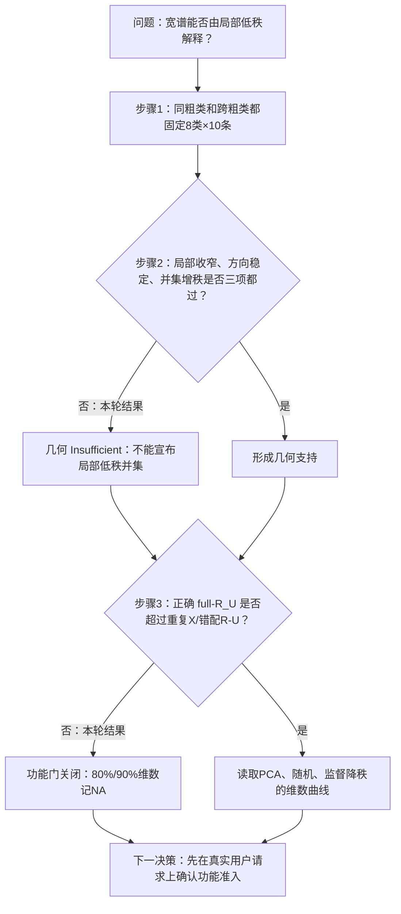

# 宽表征是否由局部低秩语义叠加，并能否压到低维仍保留功能？

```text
type: daily_research_report
status: AI_DRAFT_AWAITING_HUMAN_CONFIRMATION
date: 2026-08-19
topic: rank_router_update
canonical_anchor: Projects/from-attention-to-search/main/problem_anchors/15_spectral_representation_and_functional_routing/15_08_target_conditioned_layer_innovation/subanchors/15_08_06_semantic_conditioned_functional_subspace_anchor_cn.md
frozen_protocol: Projects/from-attention-to-search/main/experiments/A15/15_08_target_conditioned_layer_innovation/A15_08_06_E02_hierarchical_taxonomy_replication/protocol_cn.md
canonical_summary: Projects/from-attention-to-search/main/experiments/A15/15_08_target_conditioned_layer_innovation/A15_08_06_E02_hierarchical_taxonomy_replication/summary.md
canonical_detailed: Projects/from-attention-to-search/main/experiments/A15/15_08_target_conditioned_layer_innovation/A15_08_06_E02_hierarchical_taxonomy_replication/detailed.md
```

## 摘要

两次会议留下的核心问题是：$R_U$ 整体看起来很宽，是否只是很多语义条件下的局部低秩空间叠在一起；即便整体宽，单个细分类任务是否仍可由低维坐标完成。我们用严格平衡的粗类—细类学科数据，把“几何宽度”和“未见数据功能”分开测。结果是：不同粗类的判别方向合并后确实增秩，但局部谱没有显著变窄，方向稳定性也没达到注册幅度；完整 $R_U$ 相对只用 $X$ 有正增益，却没有稳定超过重复 $X$/错配 $R_U$。因此本报告的待确认判断是：目前不能宣布局部低秩并集，也不能报告 80%/90% 功能维数；监督方向看起来容易压缩，但不是表征低秩证据。唯一下一决策是先在真实用户请求的新确认集上把 full-$R_U$ 的样本配对功能准入做实，再讨论 Router。

## 1. 从两次会议到本轮唯一问题

### 1.1 两次会议分别提醒了什么

“Missions”会议纠正了一个过快推论：看到协方差谱很宽，只能说候选更新的表达很宽，不能说所有信息都高秩，更不能说分类或 gating 也需要这么多维。它同时提出竞争解释：整体宽谱可能由多个语义条件下不同的局部子空间叠加。

“Intuition”会议又用组合例子说明：一个表征可以有很多坐标，但某个分类任务只需一条判别方向。它也提醒，$U$ 不等于干净的新知识，里面可能含旧特征的放大、抵消和重混合；所以必须先做同一 $X$ 的功能对照。

两次会议合起来，不是问抽象的“语义到底高秩还是低秩”，而是问一个可判定的问题：

> 在冻结 Qwen3-8B 的 block 24/28 上，先判断同粗类细分类方向是否构成“窄而不同的局部空间并集”；再判断正确配对的 full-$R_U$ 是否有未见数据功能，只有通过后才读取低维投影保留率。

### 1.2 本轮结论与会议设想的关系

| 会议中的想法 | 本轮直接结果 | 认识更新 |
| --- | --- | --- |
| 整体宽谱可能是很多局部低秩空间叠加 | 并集增秩通过；局部收窄和方向幅度未过 | 只保留“方向不同”的弱版本，不能保留“主要由窄局部空间解释”的强版本 |
| 单个任务可能只需低维判别坐标 | 监督降秩曲线描述性 8 维饱和，但 full gate 关闭 | 任务坐标可能低维仍是活假设，尚未得到正式功能秩 |
| PCA 主方向可能容易被 gating 学到 | PCA 描述性交点需数百维，且同时随机超额守卫未过 | 容易对齐不等于适合分发；方差目标和路由效用目标不同 |
| 下一步可以直接做 Router | 本轮没有测专家相对效用 | 主旨没有错误，但 Router 还缺一个功能准入层，不能跳步 |

## 2. 任务、数据与术语

### 2.1 数据很简单：八个大学科，每个有八个子领域

数据共 1,920 条英文描述：8 个粗类（数学、物理、化学、生物、计算机、经济、医学、语言学），每个粗类 8 个细类；TRAIN、DEVELOPMENT、CONFIRMATION-v2 各 640 条，每个细类每份 10 条。最终确认集使用全新的表达模板，其中一半给 2 条事实线索、一半给 4 条，和训练/开发没有文本、模板、事实子集或 ID 重叠。

两条中文转述示例：

1. “抽象运算满足封闭与逆元；研究由公理定义的群、环和域。”标签：数学—代数。
2. “相变与自发有序；大量相互作用组分涌现宏观性质。”标签：物理—凝聚态物理。

为什么用它：同粗类和跨粗类任务都严格固定为 8 类×每类 10 条，能排除“类别更多/样本更多所以谱更宽”。它比此前真实用户请求数据更适合做受控机制验证；真实数据更自然、更接近 Router 输入，适合做下一轮外部确认。两者分工不同。

### 2.2 三个必须分开的量

- **表征宽度：**$R_U$ 的协方差要多少方向覆盖 90% 方差。这只说“云有多宽”。
- **功能保留维数：**投影后，在未见数据上保留完整 $R_U$ 增益的 80%/90% 需要多少输入维数。这才回答“压到多小还够用”。
- **Router 价值：**把样本送到某专家，相对其他专家能减少多少损失。本实验没测这个量。

$R_U=U-\widehat{\mathbb E}_{lin}[U\mid X]$：白话是从本层更新 $U$ 中减去可由旧状态 $X$ 线性预测的部分。它比直接看 $U$ 更干净，但仍不能叫“纯新知识”。

## 3. 方法：三个白话步骤



1. **先把比较做公平。** 同粗类任务和跨粗类任务都只有 8 个细类、每类 10 条；先减粗类 TRAIN 均值，避免只看到学科中心偏移。
2. **再问是不是“窄、稳、不同”。** 同粗类谱要更窄；同粗类反复抽样的方向要更相似；八个粗类方向拼起来要比反复抽同一粗类更增秩。三项必须一起成立。
3. **最后才问压到多少维。** 先看正确配对的完整 $R_U$ 是否稳定超过重复 $X$ 和 64 个错配 $R_U$；不过门，就不把任何过线位置叫功能秩。

监督降秩岭是一个可学习的低秩线性模块：用 TRAIN 标签同时学输入投影和修正头。它回答“给定这个 8-way 任务，少量监督坐标够不够”；由于中心化的 8-way 输出最多只有 7 个独立方向，它在 8 维饱和不能证明原始 4096 维表征只有 8 维。

## 4. 假设、对照与判定

### 4.1 决定性比较

| 问题 | 改变什么 | 保持什么不变 | 排除什么 |
| --- | --- | --- | --- |
| 局部并集 | 8 类来自同一粗类还是多个粗类 | 类别数、每类样本数、层、残差对象 | 类别/样本规模与粗类均值假象 |
| full 准入 | 正确 $R_U$、重复 $X$、错配 $R_U$ | base logits、参数容量、拟合代码、正则 | 额外容量或不依赖正确配对的收益 |
| 低维保留 | PCA 头/尾、64 条随机子空间、监督降秩及维数 | 同一 TRAIN/DEV/TEST 与读出器 | “随便给同样维数也可以” |

### 4.2 统计与证据资格

几何用每层 8 个同粗类任务和 64 个匹配跨粗类任务；方向稳定性 200 次半切，并集零假设 1,000 次。功能结果用 2,000 次层级 bootstrap，粗类等权，并在细类内重采样文本；block、方法和维数使用同时区间。最终确认集直到所有拟合和阈值冻结后才一次性打开。

证据整体为 `ELIGIBLE`。唯一偏差是几何 trace 恒等式最初用 float32 计算，最大误差 $6.58\times10^{-6}$，略高于 $10^{-6}$ 守卫；同一冻结数组用 float64 复算最大 $8.34\times10^{-16}$，144 个任务全部通过，未修改任何科学指标或结论。

## 5. 结果

### 5.1 实验一：只看到“方向并集变大”，没确认“每个局部空间很窄”


图分三块：左图横轴是 block 24/28 的同粗类与跨粗类任务，纵轴是覆盖 90% 方差所需方向占 79 的比例；中图纵轴是“同粗类重复方向相似度减跨粗类相似度”；右图纵轴是八个 rank-7 子空间拼接后的有效秩，灰柱是反复抽同一粗类的 q95。

- B24 跨—同谱宽差 0.013，同时下界 -0.025；B28 为 0.044，下界 -0.006。都没达到点阈值 0.05，区间也没完全大于 0。
- 方向差 B24 0.064、B28 0.093；下界都大于 0，但点估计没达到 0.10。
- 并集有效秩约 48.8/48.7，明显超过同粗类 null 的 22.4/25.0。

白话结论：不同学科确实有不同判别方向，但每个学科自己的 $R_U$ 也很宽；“整体宽主要由很多窄局部空间拼成”没有被确认。

### 5.2 实验二：完整 $R_U$ 能改善，但正确配对优势不够确定


横轴是投影维数 1--512（log2），纵轴是相对只用 $X$ 的交叉熵增益，单位 nats/样本。黑线是完整 $R_U$，黄/橙虚线是 80%/90%，酒红点线是准入 null；蓝线 PCA 头、青线 PCA 尾、橙线监督降秩；灰线/灰带是 64 个随机子空间。

- B24 full gain 0.1541，null 0.1191，差 0.0350，但同时下界 -0.0108。
- B28 full gain 0.0682，null 0.0554，差 0.0128，但同时下界 -0.0196。

所以两层准入都不通过。PCA 的描述性交点是 B24 256/512、B28 512/512；监督降秩为两层 8/8。但正式结果全部是 NA。PCA 相对同维随机子空间的同时超额也没有通过；监督降秩虽超过随机和标签置乱，仍受 full gate 与输出秩上限限制。

## 6. 结论、边界与唯一下一决策

### 6.1 一分钟白话认识更新

以前我们看到 $R_U$ 谱很宽，猜它可能是很多语义小空间拼起来的。现在更准确了：不同学科的判别方向确实不完全一样，把它们拼起来维数会涨；但每个学科内部并不明显窄，所以不能把宽谱主要解释成很多低秩小块。另一方面，监督学习确实能很快找到少量分类坐标，PCA 却需要很多维；这说明“方差最大”和“任务最有用”不是一回事。但因为正确样本的 $R_U$ 没有稳定超过错配对照，我们还没有资格把这些交点叫功能秩。

这也回答“为什么 gating 对齐 PCA 主方向却不最优”：PCA 找的是最响亮、变化最大的信号；Router 要找的是“送给哪个专家会比送给其他专家更有收益”的信号。一个大方差方向可能所有专家都共同需要，因此没有分发价值；一个小方差方向可能恰好决定专家差异。当前实验支持这种目标错位的直觉，但没有直接测专家效用，所以还不能宣布 Router 方案已验证。

### 6.2 不能推出什么

- 不能说语义、$U$ 或 $R_U$ 本质高秩/低秩。
- 不能把监督降秩的 8 维当成表征秩，也不能把 PCA 的 256/512 当成正式功能秩。
- 不能说模型原生使用这些方向，或 PCA/RRR 就是 Router 输入。
- 不能说 expert utility、专家专门化、持续学习或不遗忘得到改善。

### 6.3 唯一下一决策

- **唯一下一决策：**在真实用户请求的新确认集上，先只判断正确配对 full-$R_U$ 是否稳定超过 duplicate/mismatch null。
- **完成判据：**至少一个预注册 block 的 full-minus-null 同时 95% LCB $>0$；不过则功能维数继续为 NA，Router 支线停止。
- **其他问题：**LoRA、有限专家容量、长期遗忘全部 parked；等功能准入通过后再进入。

## 7. 证据与来源

- **问题来源：**[0817 Missions 会议记录](../../0817/meeting_notes/0817_Missions_会议记录_校订版.md)、[0817 Intuition 会议记录](../../0817/meeting_notes/0817_intuition_会议记录_校订版.md)
- **Frozen Protocol：**[protocol_cn.md](../../../Projects/from-attention-to-search/main/experiments/A15/15_08_target_conditioned_layer_innovation/A15_08_06_E02_hierarchical_taxonomy_replication/protocol_cn.md)
- **Canonical Summary：**[summary.md](../../../Projects/from-attention-to-search/main/experiments/A15/15_08_target_conditioned_layer_innovation/A15_08_06_E02_hierarchical_taxonomy_replication/summary.md)
- **Canonical Detailed：**[detailed.md](../../../Projects/from-attention-to-search/main/experiments/A15/15_08_target_conditioned_layer_innovation/A15_08_06_E02_hierarchical_taxonomy_replication/detailed.md)
- **决定性图表 lineage：**[typed decisions](../../../Projects/from-attention-to-search/main/experiments/A15/15_08_target_conditioned_layer_innovation/A15_08_06_E02_hierarchical_taxonomy_replication/tables/typed_decisions.csv)、[functional curves](../../../Projects/from-attention-to-search/main/experiments/A15/15_08_target_conditioned_layer_innovation/A15_08_06_E02_hierarchical_taxonomy_replication/tables/functional_curves.csv)
