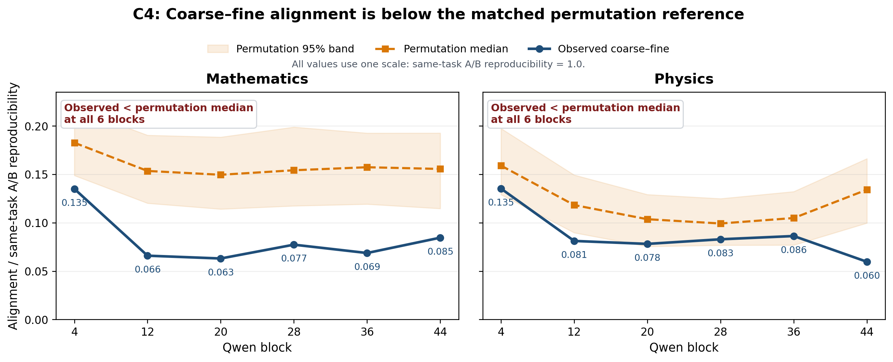
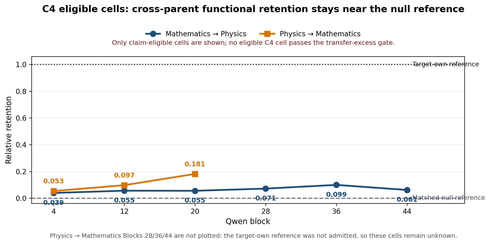

# 组会认识更新：粗细语义没有使用同一套判别方向

```text
type: meeting_knowledge_update
status: AI_DRAFT_AWAITING_HUMAN_CONFIRMATION
scope: one_problem
display_panel: C4_only
```

## 当前认识更新

1. **粗类和细类主要依赖不同的判别方向。**
2. **不同领域内部的细类区分，也主要依赖各自不同的判别方向。**在目前实际比较的
   数学与物理之间，没有观察到一套能够稳定互换的共同细粒度方向。

第二条只限于已经实验的数学与物理，不直接外推到所有领域。

本次主图只展示第一套受控自然语言面板（C4）。

## 结论一：粗类和细类判别空间基本不重合



### 这张图怎么看

- 蓝线是真实的粗—细方向重合，橙线是打乱类别标签后仍会出现的随机对齐参照。
- 数学和物理的六个层中，蓝线全部低于橙线：真实的粗—细对齐没有超过随机参照。
- 因此我们更新认识：**细类判别并不是沿用粗类判别空间继续细分，而是主要使用
  另一组方向。**
- 第 4 层虽然相对较高，但仍低于随机参照；后续层也没有共同的单调变化，所以
  这张图不能用于选择“最佳层”。

**汇报时直接说：**“我们原来猜粗类和细类可能在同一个子空间里，但六层中真实
重合都没有超过打乱标签后的参照，所以现在认为粗类和细类主要使用不同的判别
方向。”

## 结论二：不同领域内部的细类判别方向也不相同



### 这张图怎么看

- 蓝线把数学的细类判别空间用于物理分类，橙线把物理空间用于数学分类；每次都
  重新训练目标领域自己的分类器，因此比较的不是数学和物理标签，而是两套方向
  能否互相替代。
- 图中只画通过前置有效性检查的 9 个单元。0 表示只达到随机置换空间，1 表示达到
  目标领域自己的空间；所有点只有 0.039--0.181，明显更接近 0。
- 橙线在第 20 层后停止，是因为物理→数学的第 28/36/44 层中，数学自身空间没有
  先明确超过随机参照。这三个单元保持“未知”，不作为迁移失败证据，也不进入
  主效应曲线。
- 因此我们更新认识：**数学和物理内部的细类判别没有共享一套能够稳定互换的
  方向；目标领域自己的方向明显更有效。**

**汇报时直接说：**“即使几何方向不同，它们仍可能因为信息冗余而功能相同，所以
我们又让数学空间做物理分类、物理空间做数学分类。在证据充足的单元中，另一领域
的空间只能保留很少一部分效果；证据不足的三个单元没有被算作失败。因此当前认为
数学和物理的细类区分主要依赖各自不同的方向。”

## 最终一句话

> 模型没有把“粗类到细类”组织成一套逐级复用的公共坐标；在已测的数学与物理中，
> 不同领域内部的细类判别方向也没有形成一套稳定共享的坐标。

这仍不等于两个空间严格正交，也不等于已经证明必须采用某种路由器架构。

**本次组会只需确认：**是否接受上述两条认识作为当前阶段结论；若导师追问“实验
怎么做”，再进入[粗—细几何证据](../../../Projects/from-attention-to-search/main/experiments/A15/15_09_layerwise_coarse_fine_reuse_geometry/A15_09_E01_qwen3_30b_cross_depth_coarse_fine_reuse/summary.md)和
[跨领域功能证据](../../../Projects/from-attention-to-search/main/experiments/A15/15_10_cross_parent_fine_function_transfer/A15_10_E01_qwen3_30b_cross_parent_fine_function_transfer/summary.md)。
