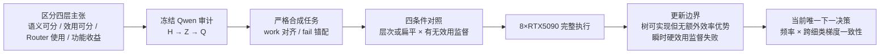

# A15_11 对话研究阅读包：表征可分性、残差专家树与反事实效用监督

```text
artifact_type: derived_conversation_reading_packet
status: READING_AID_NON_CANONICAL
created: 2026-08-30
evidence_scope: 8xRTX5090 canonical evidence only
owning_workstream: A15 counterfactual-utility residual expert growth
canonical_truth: Anchor + frozen Protocols + Summary + Detailed + human-confirmed Focus
mainline_change: none
```

## 这是什么

这是把 2026-08-29 至 2026-08-30 对话中形成的研究问题、理论补充、两项实验、执行过程、结果图表和认识更新重新整理成的中文阅读包。

它是**解释性阅读材料**，不是新的研究结果，也不替代正式研究记录。出现数字或结论冲突时，以本页“规范来源”中的 Anchor、Protocol、Summary、Detailed 和研究者已确认的 Focus 为准。

本包只汇总八张 RTX 5090 上的规范证据，不使用 H100 实验结果。后续理论版本中的数学勘误只用于纠正命题条件，不把其中的其他设备实验带入本包。

## 推荐阅读顺序

| 顺序 | 文档 | 读完应该能回答 |
|---:|---|---|
| 0 | [一页研究地图](00_one_page_map.md) | 这轮究竟问了什么，最终得到什么？ |
| 1 | [研究问题与理论补充](01_research_question_and_theory.md) | “语义可分、效用可分、Router 使用、功能收益”为何不能互换？ |
| 2 | [Qwen 表征审计](02_qwen_representation_audit.md) | 信息是在隐藏表征、门控投影还是前八名选择处损失？ |
| 3 | [合成 MoE 实验设计](03_synthetic_moe_design.md) | 为什么 work 可解、fail 有 $1/3$ 误差下界？四种条件怎样区分机制？ |
| 4 | [八卡 5090 执行与排障](04_5090_execution_and_debugging.md) | 四次作业分别失败在哪里，哪些修复影响科学结论？ |
| 5 | [结果、图表与失败分析](05_results_figures_and_failure_analysis.md) | 层次树、扁平非线性和效用监督分别得到什么结果？ |
| 6 | [认识更新、边界与当前下一决策](06_knowledge_update_claim_boundary_and_next_decision.md) | 哪些认识已经确定，哪些仍是假设，当前主线向哪里走？ |
| 7 | [自学与复核清单](07_self_study_checklist.md) | 如何确认自己真正理解了全部实验？ |

建议第一次阅读只读 0、2、5、6；需要复现实验逻辑时再读 1、3、4；最后用 7 自测。

## 研究链条



## 规范来源

### 人类确认的任务与结论

- [0829 核心任务 Focus](../../../0829/focus_gradient_consistent_hierarchical_routing.md)
- [A15_11 正式 Anchor](../../../../Projects/from-attention-to-search/main/problem_anchors/15_spectral_representation_and_functional_routing/15_11_gradient_consistent_hierarchical_routing/15_11_gradient_consistent_hierarchical_routing_anchor.md)

### Qwen 表征审计

- [冻结 Protocol](../../../../Projects/from-attention-to-search/main/experiments/A15/15_11_gradient_consistent_hierarchical_routing/A15_11_E01_qwen_native_router_access_gap/protocol.md)
- [结果 Summary](../../../../Projects/from-attention-to-search/main/experiments/A15/15_11_gradient_consistent_hierarchical_routing/A15_11_E01_qwen_native_router_access_gap/summary.md)
- [完整 Detailed](../../../../Projects/from-attention-to-search/main/experiments/A15/15_11_gradient_consistent_hierarchical_routing/A15_11_E01_qwen_native_router_access_gap/detailed.md)

### 合成残差专家树

- [冻结 Protocol](../../../../Projects/from-attention-to-search/main/experiments/A15/15_11_gradient_consistent_hierarchical_routing/A15_11_E03_counterfactual_utility_residual_tree/protocol.md)
- [结果 Summary](../../../../Projects/from-attention-to-search/main/experiments/A15/15_11_gradient_consistent_hierarchical_routing/A15_11_E03_counterfactual_utility_residual_tree/summary.md)
- [完整 Detailed](../../../../Projects/from-attention-to-search/main/experiments/A15/15_11_gradient_consistent_hierarchical_routing/A15_11_E03_counterfactual_utility_residual_tree/detailed.md)

### 执行完整性

- [最终 5090 完整性审计](/data/250010109/MoE_Router/experiments/20260829_a15_11_gradient_consistent_hierarchical_routing/runs/full-20260829T180400Z/completion_audit.json)

## 阅读纪律

本包统一使用以下证据标签：

- **已核验证据**：能够从规范结果文件直接核对的结果。
- **解释**：不改变结论，只把对象和依赖关系讲清楚。
- **AI 推断**：与结果一致但尚未被单独干预证明的机制解释。
- **AI 建议**：尚未成为当前正式任务或 Protocol 的候选方向。
- **未知**：现有材料无法回答。

## 版本边界

本次整理没有修改 Anchor、Protocol、Summary、Detailed、Focus、项目图或根目录同步面。它没有批准新实验，也没有改变当前唯一下一决策。
