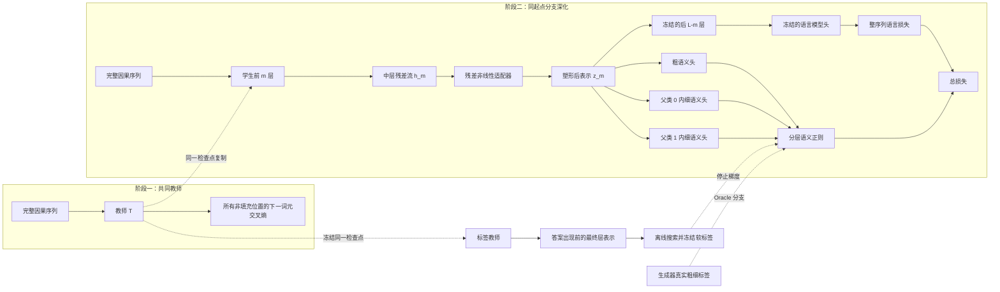

# 0830 最终执行覆盖说明

研究者在后续审核中明确批准以下四项修订，并授权数据生成、实现、smoke 与单节点四卡 reserved H100 全量运行：

1. 六层旧设定改为三层因果 Transformer；第三层答案前信息监督第二层新增模块。
2. 删除“首轮不进入动态专家”的旧停止线；首轮实现“单专家→两个父专家→冻结粗路径→每个父类两个叶专家”。
3. 平铺与分层条件在总可训练参数和单样本有效计算上匹配；另保留完全无语义正则的平铺下一词元基线。
4. 四标签数据固定为模 11 的两级四叶自然语言序列；真值标签与第三层搜索标签全部运行，Oracle 失败不取消 Search，只收窄解释边界。

本文件以下六层、单适配器、Oracle 门控后才运行 Search、暂不实现 Router/MoE 的内容均保留为历史设计演进，不再拥有执行优先级。唯一执行合同是 [A15_13_E01 Protocol](../../../Projects/from-attention-to-search/main/experiments/A15/15_13_semantic_supervision_middle_layer_formation/A15_13_E01_three_layer_semantic_supervision_residual_growth/protocol.md)，当前核心问题由 [A15_13 Focus](../focus_semantic_supervision_middle_layer_separability.md) 拥有。

# 执行结论

## 一句话结论

当前最先应验证的不是“怎样设计完整层次化 MoE”，而是下面这个更前置的因果命题：

> **在数据具有真实两级语义标签时，把正确语义标签作为中层辅助监督，能否让稠密因果 Transformer 的中层表示在未见模板上获得稳定的正线性间隔，同时不损害下一词元预测；若能，模型最终层产生的伪标签能否复现这一作用。**

## 四个直接回答

1. **合成数据应构造成“隐藏两级规则 + 组合式自然语言模板 + 完整因果序列”的自回归语言任务。**父类决定变换方向，子类决定父类内部的偏移规则；真实粗细标签不出现在文本中。模型对整条非填充序列计算下一词元交叉熵，查询答案位置另行报告任务损失与准确率，避免模板词预测掩盖规则学习失败。
2. **实验应先在稠密模型上按两个训练阶段做。**阶段一从头训练约 600 万参数的共同教师；阶段二从同一教师快照复制学生，只改变深化监督的标签来源。正确标签上界先裁定，通过后才开放教师最终层标签搜索。`Qwen3-0.6B-Base` 只是后续确认模型，不属于第一轮。
3. **模型评价不能只看 X-MoE 的表征坍缩指标。**主裁定应使用：未见模板上的低尾归一化间隔、条件细类判别度、下一词元负对数似然、类内残差有效秩。表征坍缩指标只作诊断，并且必须明确“类”指语义类还是专家分组。
4. **当前模型是“冻结标签教师 + 可训练学生前半骨干 + 单个中层残差非线性适配器 + 粗细语义头”，没有 Router。**教师最终层标签只从答案出现前的位置构造并停止梯度；学生后半骨干和语言模型头冻结，语言损失的梯度仍穿过它们作用到中层及前层。所有比较条件保持教师、学生起点、适配器、数据顺序和计算预算一致。

## 0830 研究者修订：本版优先级

本版用以下研究者明确判断覆盖旧稿中与之冲突的措辞：

1. 第一阶段语言目标必须是**整条非填充序列**的自回归下一词元交叉熵，而不是只在查询答案位置计算损失；
2. 查询答案位置的交叉熵与准确率仍须单独报告，因为整序列平均值可能被容易预测的模板词主导；
3. Tiny 模型不再让各条件独立从头训练，而是先训练一个共同教师，再从同一教师快照分支续训；
4. 第二阶段只改变“深化标签”来源：正确生成标签、打乱标签、或在正确标签上界通过后从冻结教师最终层搜索得到的标签；
5. 教师必须先通过任务能力、粗粒度知识和中层改进余量三类入口检查。未通过时属于入口证据不足，不得把后续失败解释为语义正则无效。

## 当前阶段的停止线

在 Oracle 条件尚未证明有效以前，不应进入：

- 多专家门控；
- 动态 $1\rightarrow2\rightarrow4$ 扩展；
- 无标签递归分裂；
- 专家功能分工结论；
- 大模型规模扩展。

这些问题都依赖一个更基本的前提：**语义监督是否真的能够把中层表示塑造成可泛化的可分几何。**

---

# 1. 研究问题与证据边界

## 1.1 会议后已经固定的认识

根据最新两次会议及会后技术对齐，当前研究主线应当写成：

1. 人工语义层级不等于表征方差大小层级；
2. 最大方差方向不等于最大判别方向；
3. 二维主成分图不能裁定完整高维空间是否可分；
4. 冻结表示中“含有语义信息”不等于“绝大多数样本具有稳定正间隔”；
5. 固定线性投影不能为严格不可线性分的数据创造新的线性边界；
6. 因而，问题可能不只是“没有找到正确子空间”，而是标准训练没有直接优化目标语义的可分几何；
7. 最新明确建议是：先以真实语义标签作 Oracle 上界，再研究能否从模型最终层搜索出可用伪标签。

## 1.2 当前唯一主问题

令 $c$ 表示粗语义，$f$ 表示父类内部的细语义。当前只回答：

> **正确的 $(c,f)$ 监督是否足以改变中层表示，使条件细类在未见表面模板上获得正低尾间隔？**

只有回答“是”，才进入第二个问题：

> **不读取真实标签时，从冻结教师模型最终层表示中得到的划分，能否提供接近 Oracle 的监督作用？**

## 1.3 当前不声称什么

即使 Oracle 和最终层伪标签都成功，也只能支持：

> 高层语义信号可以作为训练正则，促使中层形成更可分的表示。

它仍不能直接推出：

- Router 已经能够发现这些语义方向；
- 专家已经形成不同功能；
- 层次化专家树优于平坦专家集合；
- 真实自然语言中的全部语义具有同样结构；
- 该机制在大规模预训练中具有计算收益。

## 1.4 会议要点与首轮范围的对应

| 会议中的要点 | 证据身份 | 在本计划中的处理 |
|---|---|---|
| 父类应依赖子类共享属性，不依赖“粗类方差更大” | 导师机制直觉；方差必然性已被否定 | 用真实父类和父类内细类标签裁定，不用 PCA 顺序作语义顺序 |
| 逐层剔除 common、在条件子集中重估结构 | 未验证的后续机制 | 不加入首轮；先裁定表示能否被语义监督塑形 |
| 二维 PCA 混合不能判定高维不可分 | 数学边界 | 首轮使用全维固定线性读出和低尾归一化间隔；PCA 只可展示 |
| 标准下一词元预测未必把人工语义整理成线性边界 | 待干预验证的核心假设 | 用整序列共同教师与 Oracle 分支做直接干预比较 |
| 用深层已有语义反向监督前层 | 待验证的方案 | 教师标签只从答案前最终层构造，并显式让语义梯度作用到适配器和学生前层 |
| 最终层天然已有可用的粗细语义 | 会议假设，不是已有事实 | 冻结教师后先做粗信号入口审计；细候选不稳定则标记 Search 入口不足 |
| 先用真标签证明可行，再做无标签搜索 | 已明确的实验依赖 | 先 A/B/C Oracle 上界；只有通过才开放 D/E Search |
| 粗到细应逐步推进，不必一次学会所有层级 | 训练策略直觉 | 首轮用“共同教师先形成任务/粗入口→分支深化”的两阶段依赖；不额外引入粗头先训、细头后开的第三课程阶段 |
| 对照应比较正确标签与模型自生成标签 | 已明确的裁定建议 | 两者都保留，但自生成标签在 Oracle 通过后才实现 |
| “总损失保持不变” | 会议原文中的歧义 | 明确修正：加正则后总目标必然改变；保持不变的是语言损失定义、容量、数据顺序与预算 |
| 先单 expert，再考虑多层 gating 和 $1\rightarrow2\rightarrow4$ | 已明确的范围顺序 | 首轮只用一个中层残差适配器，不实现 Router 或 MoE |
| 算力不足使精细语义学习受限 | 会后推测，尚无对照证据 | 不当作硬件瓶颈结论；用小模型和受控任务降低成本，失败时仍区分容量、数据、优化与监督原因 |
| 复杂真实语义更接近目标 | 长期外部有效性问题 | 不加入第一轮；先在模板化自然语言合成序列中得到可解释因果结果 |

为保持首轮最小，“平坦四叶 Oracle 对照”和“非交互任务”暂不进入首个 Oracle 上界门。它们只在要进一步声称“层级结构本身优于一般语义监督”时必要；当前先回答“正确条件粗细标签是否足以塑形表示”。

---

# 2. 数学形式化

## 2.1 数据生成变量

每个样本由五类变量生成：

$$
(c,f,u,t,n).
$$

其中：

- $c\in\{0,1\}$：粗语义，即根节点的两个子类；
- $f\in\{0,1\}$：给定父类后的细语义；
- $u$：真正参与任务计算的内容变量；
- $t$：不改变语义的表面模板；
- $n$：与标签无关的干扰变量。

生成器先得到一个完整自然语言序列

$$
x_{1:T}=G(c,f,u,t,n),
$$

其中查询答案词元由 $y=F(c,f,u)$ 决定。训练目标覆盖整条序列中的所有非填充下一词元；评价时另行标记模板词、演示输入、演示输出、查询和答案等位置。必须满足：改变 $c$ 或 $f$ 会改变查询答案生成规则，因此模型不能只依赖其中一个变量完成查询预测。

## 2.2 模型表示

设稠密因果 Transformer 有 $L$ 层。第一个查询答案词元出现之前的最后一个因果位置记为 $p^*$，第 $\ell$ 层该位置的表示为

$$
h_\ell(x)=H_\ell(x)_{p^*}\in\mathbb R^d.
$$

所有语义头、线性读出和教师标签搜索都只能读取 $p^*$ 的表示。禁止读取答案词元或其后的状态，否则标签搜索可能直接抄取训练目标，不能再解释为前答案语义信息。

在固定中层 $m$ 插入非线性残差适配器，得到

$$
z_m(x)
=
\operatorname{Norm}\!\left(
 h_m(x)+B\,\sigma(A\operatorname{Norm}(h_m(x)))
\right),
$$

其中 $A\in\mathbb R^{r\times d}$、$B\in\mathbb R^{d\times r}$，$r\ll d$，$\sigma$ 为非线性激活。

物理含义是：

- $h_m$ 是原模型在中层形成的坐标；
- $A$ 抽取少量候选交互因素；
- 非线性 $\sigma$ 生成原线性函数族中没有的新特征；
- $B$ 把这些特征写回残差流；
- 残差结构保证初始时模型接近原模型。

## 2.3 语义可分性的主定义

对一个 $K$ 类线性分类器

$$
s_k(z)=w_k^\top z+b_k,
$$

样本真实类别为 $y$ 时，定义归一化多类间隔

$$
\gamma(z,y)
=
\min_{k\neq y}
\frac{(w_y-w_k)^\top z+(b_y-b_k)}{\|w_y-w_k\|_2}.
$$

- $\gamma>0$：样本位于正确决策区域；
- $\gamma$ 越大：到最近错误边界的安全距离越大；
- $\gamma<0$：至少有一个错误类别得分高于真实类别。

本项目的主指标不是平均间隔，而是未见模板测试集上的低尾间隔

$$
\Gamma_{0.05}=Q_{0.05}\bigl(\gamma(z_i,y_i)\bigr).
$$

它要求最困难的约 $5\%$ 样本也不大规模穿过边界。

## 2.4 层次化任务中的三个间隔

需要分别测量：

### 粗语义间隔

$$
\Gamma^C_{0.05}.
$$

### 条件细语义间隔

对每个父类单独拟合细类线性分类器，定义

$$
\Gamma^{F\mid C}_{0.05}
=
\min_{c\in\{0,1\}}
Q_{0.05}\bigl(\gamma_F(z_i,f_i)\mid c_i=c\bigr).
$$

取两个父类中的较差者，是为了避免模型只把一个分支学好。

### 四叶类别间隔

令叶类别为 $y_{\mathrm{leaf}}=2c+f$，测量

$$
\Gamma^{\mathrm{leaf}}_{0.05}.
$$

当前第一裁定以 $\Gamma^{F\mid C}_{0.05}$ 为主，因为导师提出的是“先分父类，再在父类内部继续分”。

---

# 3. 核心理论

## 3.1 定理一：固定线性映射不能创造线性可分性

**命题 1。**设 $A$ 是任意固定线性映射。若变换后的表示 $Ah_i$ 可由线性分类器严格分开，则原表示 $h_i$ 也可由线性分类器严格分开。

**证明。**若存在 $w$ 使二分类样本满足

$$
y_i w^\top Ah_i>0,
$$

令 $\widetilde w=A^\top w$，则

$$
y_i\widetilde w^\top h_i
=
y_iw^\top Ah_i>0.
$$

因此原空间已经存在对应线性分类器。多类情形对每个类别权重作相同复合即可。证毕。

**含义。**PCA、随机投影、固定降维和固定 common-removal 可以改善条件数、去掉干扰或降低样本复杂度，但不能凭空制造原表示中不存在的线性边界。

## 3.2 定理二：语义交互需要非线性特征

令

$$
c,q\in\{-1,+1\},\qquad f=cq.
$$

原始表示为 $x=(c,q)$。四个点形成异或结构，$f$ 不能由 $x$ 的全局线性函数分开。

加入交互特征

$$
\phi(x)=(c,q,cq),
$$

则第三坐标正好等于 $f$，因此细语义立即线性可分。

**含义。**需要的不是机械升维，而是由语义结构决定的新坐标。父类信息 $c$ 与局部细类线索 $q$ 组合后，才恢复真正细语义 $f$。

## 3.3 定理三：逼近分离原型即可得到正间隔

对某个节点的每个类别 $k$ 给定原型 $p_k$，原型最小距离为

$$
\Delta=\min_{j\neq k}\|p_j-p_k\|_2.
$$

**命题 2。**若所有样本满足

$$
\|z_i-p_{y_i}\|_2\leq\varepsilon,
\qquad
\varepsilon<\frac{\Delta}{2},
$$

则使用

$$
s_k(z)=p_k^\top z-\frac12\|p_k\|_2^2
$$

进行分类时，所有样本均正确，且归一化间隔满足

$$
\gamma_i\geq\frac{\Delta}{2}-\varepsilon>0.
$$

**证明。**对任意错误类 $k$，

$$
s_y(z)-s_k(z)
=
\frac12\left(\|z-p_k\|_2^2-\|z-p_y\|_2^2\right).
$$

由三角不等式

$$
\|z-p_k\|_2\geq\|p_y-p_k\|_2-\varepsilon.
$$

令 $\Delta_{yk}=\|p_y-p_k\|_2$，则

$$
s_y(z)-s_k(z)
\geq
\Delta_{yk}\left(\frac{\Delta_{yk}}2-\varepsilon\right).
$$

除以法向量范数 $\Delta_{yk}$，得到

$$
\gamma_{y,k}(z)
\geq
\frac{\Delta_{yk}}2-\varepsilon
\geq
\frac\Delta2-\varepsilon>0.
$$

证毕。

**含义。**语义监督的作用可以严格写成：先规定类别中心之间的安全距离，再训练映射减小样本到正确中心的误差。只要误差小于原型间距的一半，正间隔自动成立。

## 3.4 语义交叉熵为何推动分数差增长

令固定单位原型为 $p_k$，语义概率为

$$
\pi_k(z)=
\frac{\exp(p_k^\top z/\tau)}{
\sum_j\exp(p_j^\top z/\tau)}.
$$

交叉熵对表示的负梯度为

$$
-\nabla_z\ell
=
\frac1\tau\left(p_y-\sum_j\pi_jp_j\right).
$$

当原型正交时，对任意错误类 $k$，沿一次表示梯度下降后，正确类相对错误类的分数差增加量为

$$
\Delta(s_y-s_k)
=
\frac\eta\tau(1-\pi_y+\pi_k)>0.
$$

这说明语义损失在理想化局部模型中确实直接推动正确类别的 logit gap 增大。

**边界。**真实训练更新的是共享网络参数，不同样本梯度可能冲突，因此该结果是局部机制，不是深层 Transformer 的全局收敛定理。

## 3.5 为什么必须先做 Oracle

设二分类伪标签以概率 $\eta$ 被独立翻转：

$$
\widetilde y=
\begin{cases}
y,&1-\eta,\\-y,&\eta.
\end{cases}
$$

则

$$
\mathbb E[\widetilde y\mid y]=(1-2\eta)y.
$$

在小 logit 区域，语义梯度的有效方向会被约缩放为 $1-2\eta$：

- $\eta<1/2$：仍保留与真实语义一致的平均方向；
- $\eta=1/2$：平均语义信号消失；
- $\eta>1/2$：平均方向反转。

因此，若连真实标签都不能塑造中层表示，就没有理由直接研究更噪声的最终层伪标签。Oracle 是整个方案的必要上界门。

## 3.6 为什么当前必须先使用稠密模型

Router 会同时引入：

- 离散或稀疏分配；
- 专家负载变化；
- 专家函数差异；
- 路由梯度导致的表示变化；
- token 丢弃与通信约束。

若一开始加入 MoE，实验失败时无法区分：

1. 语义监督本身无效；
2. 中层映射容量不足；
3. Router 没有学到语义边界；
4. 专家没有获得有效梯度；
5. 负载均衡与语义目标冲突。

稠密模型先隔离第一个因果问题：**相同计算路径下，语义监督是否改变表示几何。**

---

# 4. 合成数据的具体构造

## 4.1 两层数据体系

建议同时保留两个合成层次：

1. **连续几何单元测试**：验证非线性交互和指标实现是否正确；
2. **语言式层次规则任务**：用于从头训练 Transformer 和 Qwen3-0.6B 续训。

连续单元测试不能替代语言模型实验，但可以在数分钟内排除实现错误。

## 4.2 连续几何单元测试

生成

$$
c,q\sim\operatorname{Unif}\{-1,+1\},
\qquad
f=cq,
$$

以及高方差无关噪声

$$
\nu\sim\mathcal N(0,\sigma^2I_{d_n}).
$$

输入为

$$
x=(c,q,\nu).
$$

比较：

- 线性模型；
- 参数量匹配的线性升维；
- 两层非线性多层感知机；
- 显式交互映射 $(c,q,cq,\nu)$。

预期：细标签 $f$ 在前两者中不能严格线性分，在后两者中可以；当 $\sigma$ 很大时，PCA 头部主要由噪声占据，但判别方向仍可能存在。

## 4.3 语言式主数据：层次化模变换预测

### 4.3.1 隐变量与规则

取素数模空间

$$
\mathcal U=\mathbb Z_{11}.
$$

粗语义 $c$ 决定变换方向：

$$
a_c=
\begin{cases}
+1,&c=0,\\
-1,&c=1.
\end{cases}
$$

定义两个局部偏移

$$
b_0=1,\qquad b_1=3.
$$

### 交互主任务

令

$$
q=c\oplus f,
$$

并定义叶规则

$$
T_{c,f}(u)=a_cu+b_q\pmod{11}.
$$

这里：

- 父类 $c$ 表示“保持方向”或“反转方向”；
- 从局部输入输出关系可读出的偏移编号是 $q$；
- 真正细类为 $f=c\oplus q$；
- 因而细语义需要把父类与局部线索组合起来。

这正对应理论中的交互关系。

### 非交互对照任务（Oracle 上界门通过后的机制对照）

令

$$
q=f,
\qquad
T^{\mathrm{direct}}_{c,f}(u)=a_cu+b_f\pmod{11}.
$$

此时细语义由局部偏移直接决定，不需要父类条件交互。它只在 Oracle 上界门通过后用于回答更强的机制问题：若层次语义监督在两种任务中产生完全相同的独有收益，就不能把收益归因于“父类条件交互”。

## 4.4 一个完整自回归序列怎样生成

每个样本包含三个演示和一个查询：

$$
(u_1,T(u_1)),\ (u_2,T(u_2)),\ (u_3,T(u_3)),\ u_*.
$$

生成器把它渲染为包含句首、自然语言提示、三个演示、一个查询、答案和句尾的完整序列，例如：

> 观察：2 变为 3；5 变为 6；8 变为 9。现在 4 应变为：

随后接答案 $T(4)$ 与句尾词元。模型按因果顺序预测整条序列中的每个下一词元，而不是只优化最后答案；查询答案位置仍单独标记，作为任务能力的直接评价对象。

对另一叶规则，表面句式完全相同，但演示中的输入输出关系不同。真实 $(c,f)$ 只保存在元数据中，不作为类别词元写入文本。

每条序列必须保存位置角色：

```text
BOS / template / demonstration_input / demonstration_output /
query / pre_answer / answer / EOS
```

这使整序列交叉熵可以分解为模板位置、演示位置和查询答案位置。全序列训练不会掩盖一个事实：在第一个演示输出出现前，隐藏规则尚未被唯一识别，该位置可能具有不可约条件熵；因此不得用“全序列损失没有接近零”单独判定教师未学会任务。

若只在查询答案位置计算交叉熵，实验就会变成“给定完整上下文的条件答案分类”，而不再完整对齐标准自回归语言训练。这会遗漏三个问题：模型是否学会序列格式与演示关系；语义正则是否与真实的全序列语言梯度冲突；以及方法在标准因果语言模型目标下是否仍成立。因此本计划用整序列损失训练，但必须用答案和位置角色分解防止模板词稀释核心任务信号。

## 4.5 生成算法

对每个样本执行：

1. 均匀采样 $c,f$；
2. 根据主任务或对照任务计算 $q$；
3. 无放回采样 $u_1,u_2,u_3,u_*$；
4. 计算演示输出与目标 $y=T_{c,f}(u_*)$；
5. 检查当前三个演示是否能唯一确定四个候选叶规则；若不能则重采样；
6. 采样组合式自然语言模板 $t$，渲染完整序列并标记每个词元的位置角色；
7. 采样与语义无关的演示顺序、标点、连接词和冗余信息；
8. 保存完整词元序列、逐位置下一词元目标、查询答案位置及完整元数据。

## 4.6 为什么该构造适合当前问题

### 原因一：语义树是真实生成结构

四个叶节点不是人工事后贴标签，而是四个确定的函数规则。粗、细标签都有可验证的数学定义。

### 原因二：下一词元必须依赖粗、细语义

对固定 $u$，改变 $c$ 会改变斜率，改变 $f$ 会改变偏移选择。数据生成前必须检查反事实敏感性：

$$
\Pr[T_{c,f}(u)\neq T_{1-c,f}(u)]\geq0.9,
$$

$$
\Pr[T_{c,f}(u)\neq T_{c,1-f}(u)]\geq0.9.
$$

### 原因三：单词频率不能直接泄露类别

每个 $T_{c,f}$ 都是 $\mathbb Z_{11}$ 上的置换。若输入均匀采样，则各类别中的输入和输出符号边缘分布相同。类别差异存在于**符号之间的关系**，而不在单个高频词元。

### 原因四：可生成同语义多表面改写

相同的 $(c,f,u_1,u_2,u_3,u_*)$ 可以用多种句式、顺序和连接词表达，因而可以直接测量表面不变性。

### 原因五：具有明确的 work / control 对

交互任务要求父类条件组合；非交互任务不要求。两者共享类别数、词表、样本数、目标熵和模型容量。

## 4.7 自然语言模板设计

模板负责表面语言，模变换负责隐藏任务。不要人工写几十个完全独立模板，而应把模板拆成可组合槽位：

- 开头：`观察`、`根据以下对应`、`已知这些变换`、`查看规律`；
- 演示连接：分号、逗号、换行、编号；
- 关系表达：`变为`、`对应到`、`映射为`；
- 查询：`现在 x 应变为`、`求 x 的结果`；
- 演示顺序：原顺序、逆序、随机顺序；
- 冗余信息：不影响规则的编号或礼貌词。

构造 $4\times3\times2=24$ 个基础组合模板；查询措辞、演示顺序和冗余短语按预先冻结的平衡表附加，而不改变隐藏规则。训练、开发和测试按**组合**切分，而不是让测试出现完全未训练的词元。所有词汇部件都必须在训练中出现，但开发和测试的组合未出现。

第一轮只声称“模板化自然语言序列中的受控机制”。模板不能把 $c$、$f$、叶类别或变换名称直接写入文本；否则语言交叉熵可以通过抄取标签完成查询，失去表征塑形检验意义。

## 4.8 数据切分

建议默认规模：

| 切分 | 样本数 | 模板 | 用途 |
|---|---:|---|---|
| TRAIN | 100,000 | 16 个组合 | 训练模型与线性探针 |
| DEV-ID | 8,000 | 训练组合的新内容 | 监控同分布训练 |
| DEV-OOD | 8,000 | 4 个未见组合 | 选择正则强度与检查泛化 |
| TEST-ID | 12,000 | 训练组合的新内容 | 同分布最终报告 |
| TEST-OOD | 24,000 | 4 个冻结的未见组合 | 唯一主裁定 |

四个叶类严格平衡。内容元组按稳定哈希在训练、开发和测试之间隔离；同一潜在样本的不同表面改写不得跨越这三个内容集合。TEST 在模型、超参数和分析脚本冻结前不得查看。

## 4.9 数据记录格式

每条样本至少保存：

```json
{
  "sample_id": "...",
  "text": "...",
  "token_ids": ["..."],
  "position_roles": ["template", "demonstration_input", "...", "answer"],
  "answer_positions": ["..."],
  "target_token": 7,
  "coarse_label": 1,
  "fine_label": 0,
  "leaf_label": 2,
  "local_code_q": 1,
  "rule_type": "interaction",
  "template_family": "T17",
  "content_tuple": [2, 5, 8, 4],
  "paraphrase_group_id": "...",
  "split": "train"
}
```

## 4.10 数据泄露审计

训练模型前必须完成五项自动测试：

1. **唯一规则测试**：三个演示只能对应一个叶规则；
2. **类别平衡测试**：四个叶类样本数完全一致；
3. **单词袋泄露测试**：只看词元计数的线性模型对粗、细类别的平衡准确率不高于 $55\%$；
4. **反事实依赖测试**：翻转 $c$ 或 $f$ 时目标在至少 $90\%$ 内容上改变；
5. **模板独立测试**：模板编号与语义标签的互信息接近零；
6. **答案前信息边界测试**：所有用于语义头、读出和标签搜索的索引严格早于第一个答案词元；
7. **逐位置可预测性审计**：报告不同位置角色的经验条件熵与基线损失，标记首个演示输出等规则尚不可识别的位置，避免把不可约损失误判为训练失败；
8. **内容与改写隔离测试**：训练、开发、测试的内容元组不交叉，同一 `paraphrase_group_id` 不跨集合。

若任何一项失败，不能进入模型训练。

---

# 5. 三组实验及其三要素

# 5.1 实验 0：连续几何单元测试

## 目的与假设

**目的：**验证“线性映射不能创造边界、非线性交互可以创造边界”，并校验 margin、判别度和有效秩代码。

**假设：**线性模型和线性升维不能解决 $f=cq$；非线性模型和显式 $cq$ 坐标可以使测试低尾间隔转正。

## 分析方法

- 训练集与测试集独立采样；
- 比较四类映射；
- 扫描噪声维度与噪声方差；
- 报告测试准确率、$\Gamma_{0.05}$、正间隔比例、有效秩；
- 画 PCA 仅作说明，不能作裁定。

## 可能结论

- 若线性升维也显示严格可分，优先检查数据泄露或 probe 实现；
- 若非线性模型仍不可分，检查优化、容量和标签定义；
- 只有该单元测试正确，才能相信后续 Transformer 分析代码。

# 5.2 实验 1：Tiny 共同教师与两阶段深化

## 目的与假设

**目的：**先让一个共同语言教师仅靠整序列下一词元预测学会受控任务并至少形成最终层粗粒度知识，再检验不同深化标签是否改变同一起点下的中层粗细表示。

**主假设：**在交互任务中，正确标签条件相对继续语言训练与打乱标签：

1. 提高 $\Gamma^{F\mid C}_{0.05}$ 并使其转正；
2. 提高未见内容、未见模板的细语义平衡准确率；
3. 不显著恶化整序列负对数似然和查询答案负对数似然；
4. 若后续开放非交互对照，收益应明显大于该对照中的独有收益；该条不属于首个 Oracle 上界门。

## 模型

使用一个约 600 万参数的因果 Transformer：

| 项目 | 设定 |
|---|---:|
| 层数 $L$ | 6 |
| 隐藏维度 $d$ | 256 |
| 注意力头数 | 8 |
| 前馈维度 | 1024 |
| 归一化 | 前置 RMSNorm |
| 激活 | SwiGLU |
| 位置编码 | RoPE |
| 词表 | 生成器专用，约 128 个词元 |
| 最大长度 | 64 |
| 词嵌入与输出头 | 权重共享 |
| 中层位置 $m$ | 第 3 层后 |
| 适配器瓶颈 $r$ | 64 |

阶段一训练完整教师骨干。阶段二保留一份完全冻结的标签教师，并从同一教师快照复制所有学生：冻结学生词嵌入、第 4 至 6 层、最终归一化和语言模型头；更新第 1 至 3 层、中层适配器和语义头。语言损失的梯度仍通过冻结的后半网络传回前半网络。适配器在所有条件中都存在，输出投影 $B$ 零初始化，使阶段二起点与教师函数一致。

## 两个训练阶段与入口门

### 阶段一：共同教师

教师只优化整序列下一词元损失，不使用粗、细标签。教师检查点只能按开发集语言任务指标选择，不能用真实语义标签选择。

进入阶段二前必须同时检查：

1. **任务能力：**查询答案损失和准确率证明模型确实学会隐藏变换，不能只靠模板词降低整序列损失；
2. **粗粒度知识：**冻结检查点后，最终层答案前表示至少能稳定读出粗标签；这只验证信息入口存在，不证明模型原生使用该划分；
3. **深化余量：**目标中层的条件细类低尾间隔尚未饱和。若中层已经稳定为正，则当前数据没有足够余量检验“深化塑形”；
4. **搜索资格分离：**最终层只有粗信息而没有稳定细信息时，正确标签分支仍可运行，但最终层细标签搜索必须记为未具备入口条件，而不是把搜索失败解释为正则失败。

为避免边跑边改，正式 Protocol 可从以下数值起步，但它们仍是 `PROPOSED`：

- DEV-ID 查询答案准确率至少 $95\%$，DEV-OOD 至少 $85\%$，且均明显高于答案边缘频率基线；
- 教师检查点冻结后，最终层答案前表示的粗类线性读出 DEV-OOD 平衡准确率至少 $80\%$，bootstrap $95\%$ 置信区间下界高于 $55\%$；
- 第 3 层条件细类的 DEV-OOD $\Gamma^{F\mid C}_{0.05}\leq0$；若已稳定为正，当前“从不可分变可分”问题无改进余地，应先换层位或提高任务难度。

这些语义读出只在语言指标选定并冻结教师后做一次入口审计，不得反向用于教师检查点挑选。须在正式 Anchor/Protocol 中由研究者确认；本设计稿不据此授权运行。

### 阶段二：同一教师后的深化分支

第一轮先运行：

| 条件 | 深化标签 | 作用 |
|---|---|---|
| A. NTP-only continuation | 无 | 同教师、同模块、同预算的继续语言训练基线 |
| B. Oracle | 生成器真实 $(c,f)$ | 检验正确语义监督的上界 |
| C. Shuffled-fine oracle | 保留真实粗标签 $c$，在每个父类内按改写组平衡打乱细标签 $f$ | 保持粗监督、损失形式和细类频率，排除非语义细分组与通用辅助正则解释 |

Oracle 通过后才开放同一阶段的后续分支：

| 条件 | 深化标签 | 作用 |
|---|---|---|
| D. Search | 冻结教师最终层答案前表示搜索得到的标签 | 检验模型学得的标签能否替代真值 |
| E. Shuffled-fine search | 保留冻结候选的粗划分，在每个候选父类内按改写组打乱细软标签 | 排除细标签频率和通用软正则效应 |

这里的“逐步深化”首先指依赖顺序：共同教师先形成任务能力和粗粒度入口，阶段二再学习粗标签及父类条件细标签。第一轮不再增加第三个时间阶段或动态 $1\rightarrow2\rightarrow4$ 门控；若以后要比较“先只训粗类、再开启细类”的显式课程，必须另行注册，因为它会改变优化路径。

## 训练目标

设一条非填充序列为 $x_{1:T}$，整序列下一词元损失为

$$
\mathcal L_{\mathrm{NTP}}
=
-\frac{1}{T-1}
\sum_{t=1}^{T-1}
\log p_\theta(x_{t+1}\mid x_{\leq t}).
$$

查询答案位置集合记为 $\mathcal A$。答案损失

$$
\mathcal L_{\mathrm{answer}}
=
-\frac{1}{|\mathcal A|}
\sum_{t\in\mathcal A}
\log p_\theta(x_t\mid x_{<t})
$$

只作为单独报告和非劣保护量，不另加到训练目标中，因为它已包含在整序列损失内。

在答案前中层表示 $z_m$ 上设置一个二分类粗语义头，以及每个父类内部各一个二分类细语义头：

$$
q_C=\operatorname{softmax}(W_Cz_m),
\qquad
q_F^{(c)}=\operatorname{softmax}(W_F^{(c)}z_m).
$$

Oracle 正则为

$$
\mathcal L_{\mathrm{reg}}^{\mathrm{oracle}}
=
\operatorname{CE}(q_C,c)
+
\operatorname{CE}(q_F^{(c)},f).
$$

这避免旧稿中“粗类二分类加四叶分类”重复注入粗类信息。搜索分支使用冻结教师软标签的软目标交叉熵；对固定教师分布，它与教师到学生的 KL 散度只相差一个对学生参数无关的常数。

总损失为

$$
\mathcal L
=
\mathcal L_{\mathrm{NTP}}
+
\lambda\mathcal L_{\mathrm{reg}}.
$$

整序列损失按有效词元平均，语义正则按序列平均。由于两者归一化单位不同，$\lambda$ 必须通过共享可训练参数上的梯度范数匹配冻结，不能直接沿用答案单位置损失下的数值。

## 优化设置

- 每个随机种子先训练一个共同教师，然后用该种子的同一检查点配对分支；“共同”指同一种子内各条件共用起点，不是五个种子共用一份权重；
- 阶段一与阶段二分别拥有冻结的步数、学习率和检查点选择规则；不得按测试语义指标早停；
- 阶段一每 200 步在 DEV-ID/DEV-OOD 评估；在满足查询答案任务门的快照中，先取 DEV-OOD 答案负对数似然最低者，再以 DEV-OOD 整序列负对数似然打破并列；不满足者记为教师任务门失败，不用语义标签挑选其他快照；
- 阶段二所有分支使用相同初始化、batch 顺序、更新范围和训练步数；
- 优化器候选：AdamW，基础学习率 $3\times10^{-4}$，权重衰减 0.1，全局 batch 256，$5\%$ warmup 后余弦衰减；
- 建议的首轮冻结预算是阶段一 8,000 个优化步、阶段二每分支 4,000 步；每 200 步保存快照，5 个配对随机种子；
- $\lambda$ 先由梯度范数匹配得到基准值 $\lambda_0$，使共享可训练参数上

  $$
  \frac{\|\lambda_0g_{\mathrm{reg}}\|}{\|g_{\mathrm{NTP}}\|}\approx0.1,
  $$

  再在 $\{0.3\lambda_0,\lambda_0,3\lambda_0\}$ 中只用独立开发流程选择。上述步数、教师能力阈值和选择规则均仍为 `PROPOSED`，不得从旧稿的单阶段 10,000 步与联合早停自动继承。

## 分析方法

- 分别报告整序列、模板位置、演示输出位置和查询答案位置的负对数似然；
- 在第 1 至 6 层同一答案前位置提取表示，禁止读取答案；
- 使用完全相同的归一化和固定线性读出；
- 报告逐层语义间隔、语义判别度、类内残差有效秩、整序列与答案损失；
- Oracle 上界门先只跑交互任务；通过后才以非交互任务检查父类条件交互是否有独有作用；
- 所有阶段二分支必须来自同一冻结教师并使用配对数据顺序。

## 可能结论

1. **教师门失败：**属于任务或入口证据不足，不能裁定语义正则；
2. **Oracle 成功、Shuffled-fine oracle 失败：**支持正确条件细语义监督在当前两阶段系统中塑造中层表示；
3. **Oracle 与 Shuffled-fine oracle 都成功：**收益更可能来自粗监督、通用辅助正则、随机细分组或优化变化；
4. **训练集成功、未见模板失败：**语义头只记住表面模板；
5. **语义间隔上升但整序列或答案损失变差：**只能说明语义—语言任务权衡，不能称为有效深化；
6. **两种任务同样受益：**只能说明标签监督有用，尚不能说明父类条件交互具有额外价值；
7. **Oracle 失败：**停止最终层标签搜索，先定位数据任务、层位、优化冲突或正则对象；
8. **Oracle 成功、Search 失败：**表示塑形上界可行，但教师标签发现或标签质量不足。

# 5.3 实验 2：Qwen3-0.6B-Base 续训确认

本节是 Tiny 两阶段机制门通过后的后续设计，不属于第一轮执行范围。其序列格式、整序列语言损失、答案位置指标、答案前表示边界和教师—学生分支必须与 Tiny 阶段同构；不得继续沿用旧稿的答案单位置训练定义。

## 为什么选 Base 而不是 Instruct

`Qwen3-0.6B-Base` 是预训练因果语言模型，避免指令微调和偏好对齐引入额外监督来源。官方配置为 28 层、隐藏维度 1024、前馈维度 3072、16 个查询头和 8 个键值头，适合作为一个有真实预训练表征、但仍可控和可训练的确认模型。

## 目的与假设

**目的：**检验在真实预训练表示已经形成后，深层语义监督能否通过续训改变中层几何，而不只是从零训练时有效。

**假设：**从同一语言教师快照出发，Oracle 条件在未见模板上提高中层条件细类低尾间隔，保留真实粗标签但组内打乱细标签的对照不产生相同收益，且整序列与查询答案负对数似然均保持非劣。

## 教师—学生流程

1. 用主合成数据仅优化整序列下一词元交叉熵，对 `Qwen3-0.6B-Base` 做短程任务适配，得到教师快照 $T$；
2. 冻结教师 $T$；
3. 从同一快照复制学生 $S_A,S_B,S_C$；
4. 在第 14 个 Transformer block 后插入同一残差适配器；
5. 使用相同初始化、batch 顺序和更新预算训练 A/B/C；
6. Oracle 通过后，才生成并冻结 Search 标签，训练 D/E。

## Qwen 中层模块

令第 14 层答案前位置表示为 $h_{14}$。适配器为

$$
z_{14}
=
\operatorname{RMSNorm}
\left[
 h_{14}
 +B\operatorname{SwiGLU}(A\operatorname{RMSNorm}(h_{14}))
\right],
$$

其中

$$
A\in\mathbb R^{64\times1024},
\qquad
B\in\mathbb R^{1024\times64}.
$$

该模块约含 13 万个主矩阵参数。所有条件均包含同一个模块。

## 参数更新范围

主协议：

- 冻结词嵌入；
- 更新第 1 至 14 个 block；
- 更新中层适配器和语义头；
- 冻结第 15 至 28 个 block、最终 RMSNorm 与语言模型头；
- NTP 梯度仍通过冻结的后半网络传回前半网络。

这样做的原因是：

1. 语义梯度必须真正作用到中层及其之前的表示；
2. 冻结后半模型，避免它通过重新适配掩盖中层变化；
3. 固定语言模型头，使 NTP 非劣约束具有明确含义。

若显存不足，允许使用统一的 LoRA 备选，但必须在所有条件中完全一致：

- rank 16；
- 作用于前 14 层的注意力 $q,o$ 投影和前馈网络上、下投影；
- 适配器和语义头仍全参数训练。

LoRA 结果只能表述为“受限更新子空间下的验证”。

## Qwen 优化设置

- 精度：BF16；
- 最大序列长度：64；
- 全局 batch：64 或 128，所有条件一致；
- 前半骨干学习率：$2\times10^{-6}$；
- 适配器与语义头学习率：$1\times10^{-4}$；
- warmup：$5\%$；
- 梯度裁剪：1.0；
- 训练 1 至 3 个 epoch，由 DEV-OOD 早停；
- 至少 3 个随机种子；
- 适配器输出投影零初始化。

## 0.6B 能回答与不能回答的问题

### 可以回答

- 正确语义标签能否通过续训改变中层表示；
- 改变是否出现在未见模板上；
- 改变是否沿层传播；
- NTP 与语义几何是否存在优化冲突；
- 最终层搜索标签是否有用。

### 不能单独回答

- 大规模模型中是否普遍成立；
- 自然语言开放域语义是否同样可分；
- 完整 MoE 是否获得专家专业化；
- 动态专家树是否节省计算；
- 该方法在工业预训练规模是否稳定。

因此，0.6B 是**机制确认模型**，不是最终外部有效性证明。

---

# 6. 最终层标签搜索

## 6.1 进入条件

只有当 Oracle 同时满足以下条件，才实现 Search：

1. $\Gamma^{F\mid C}_{0.05}$ 在 TEST-OOD 上显著提高且转正；
2. Oracle 显著优于 Shuffled-fine oracle；
3. 整序列与查询答案 NLL 均不恶化；
4. 收益在至少 3 个随机种子上方向一致。

此外，冻结教师必须具有可搜索的入口：最终层答案前表示中的候选粗划分通过非坍缩、改写一致性和 bootstrap 稳定性检查。若教师只满足粗粒度入口而父类内候选不稳定，则记录 `SEARCH_FINE_ENTRY_INSUFFICIENT`；不得用真实细标签替搜索过程补门后仍称为无标签搜索。

## 6.2 表示来源

对冻结教师最终层**第一个答案词元之前**的位置表示

$$
h_L^T(x)
$$

作样本级 $\ell_2$ 归一化。教师在整个标签生成和学生训练过程中保持冻结，标签缓存到磁盘，禁止随学生更新而漂移。

若表示提取位置已经看到答案词元，候选标签无论多稳定都属于目标泄漏并失去资格。

## 6.3 两级候选划分

1. 对所有训练样本的最终层表示做平衡球面 $K$-means，$K=2$，生成粗划分候选；
2. 在每个粗簇内部再次做平衡球面 $K$-means，$K=2$，生成四叶划分；
3. 使用 50 个初始化和多个 bootstrap 子样本，得到候选集合；
4. 按距簇中心的温度 softmax 得到软标签。

## 6.4 不读取真值的选择规则

候选选择使用严格的分级规则，而不是用真实标签调权重：

### 第一步：非坍缩门

拒绝任一叶簇比例小于 $15\%$ 的候选。

### 第二步：表面改写一致性

同一个 `paraphrase_group_id` 的不同模板应尽量得到相同划分。保留一致性最高的前 $20\%$ 候选。

### 第三步：bootstrap 稳定性

用样本两两同簇矩阵计算不同 bootstrap 运行之间的调整兰德一致性，选择最稳定候选。

### 第四步：任务增量解释力

冻结教师表示，训练一个参数量固定的小线性头，比较“只用查询内容”与“查询内容加候选簇编号”预测目标词元的 DEV-OOD NLL。以 NLL 降幅作最终 tie-break。

选定后立即冻结。只有冻结以后，才允许用真实 $(c,f)$ 计算语义对齐度。

## 6.5 Search 正则

若冻结候选给出软标签 $r_s$，学生语义头输出 $q_s$，则使用软目标交叉熵

$$
\mathcal L_{\mathrm{reg}}^{\mathrm{search}}
=
-\sum_k \operatorname{stopgrad}(r_{s,k})\log q_{s,k}.
$$

因为教师标签冻结，该式与 $\operatorname{KL}(\operatorname{stopgrad}(r_s)\|q_s)$ 对学生参数具有相同梯度。

## 6.6 Search 的评价

冻结后报告：

- 粗标签与真实 $c$ 的调整互信息；
- 四叶标签与真实 $2c+f$ 的调整互信息；
- Hungarian 匹配准确率；
- 相对匹配置换空参照的显著性；
- Search 对中层 margin、NTP NLL 和有效秩的影响。

Search 成功只说明教师最终层含有可利用的划分，不说明 Router 已经能够在线发现该划分。

---

# 7. 模型分析指标

## 7.1 指标必须回答三个正交问题

模型不能用一个标量总分选择，而应同时回答：

$$
\boxed{\text{语义是否更可分}}
\quad+
\boxed{\text{任务功能是否保持}}
\quad+
\boxed{\text{类内剩余信息是否过度坍缩}}.
$$

## 7.2 主指标一：未见模板低尾间隔

主裁定为

$$
\Gamma^{F\mid C}_{0.05}.
$$

线性 probe 协议必须固定：

1. 表示先逐样本 $\ell_2$ 归一化；
2. 在 TRAIN 表示上训练 $L_2$ 正则多项逻辑回归；
3. 正则系数只在 NTP-only 的 DEV-OOD 上选择一次，随后所有条件共用；
4. TEST-OOD 只做一次最终评估；
5. 报告 5% 分位数、正间隔比例和 bootstrap 95% 置信区间。

## 7.3 主指标二：正则化 Fisher 语义判别度

定义类内与类间协方差

$$
\Sigma_W
=
\sum_k\pi_k
\mathbb E[(z-\mu_k)(z-\mu_k)^\top\mid y=k],
$$

$$
\Sigma_B
=
\sum_k\pi_k(\mu_k-\mu)(\mu_k-\mu)^\top.
$$

使用 Ledoit-Wolf 或固定收缩

$$
\widetilde\Sigma_W
=(1-\rho)\Sigma_W
+
\rho\frac{\operatorname{Tr}(\Sigma_W)}dI,
$$

定义

$$
D_{\mathrm{sem}}
=
\operatorname{Tr}
\left(
\widetilde\Sigma_W^{-1}\Sigma_B
\right).
$$

它衡量“类间均值变化相对于类内噪声有多强”。粗类和每个父类内部的细类分别计算，不把所有细类混成一个统计量。

## 7.4 主指标三：整序列语言功能与查询答案功能

整序列训练后必须同时报告：

- TEST-ID 和 TEST-OOD 的逐有效词元平均负对数似然；
- 查询答案词元的负对数似然与准确率；
- 按位置角色分解的模板、演示输入、演示输出、查询和答案负对数似然；
- 相对 NTP-only 的差值及置信区间。

整序列平均损失是训练目标和语言功能保护量；查询答案损失是隐藏规则任务能力保护量。前者不能替代后者，因为大量容易预测的模板词可以掩盖答案预测恶化；后者也不能替代前者，因为只保持答案不能证明完整自回归任务未受损。

两个损失分别应用候选非劣界：

$$
\Delta\operatorname{NLL}
\leq
\max(0.01\ \text{nat},\ 1\%\times\operatorname{NLL}_{\mathrm{base}}).
$$

若语义间隔提高但任一注册功能损失超过对应界，不能称为有效改进，只能称为语义—功能权衡。界值目前仍为 `PROPOSED`，须在正式 Protocol 中确认。

## 7.5 类内残差有效秩

令类内残差协方差为 $\Sigma_W$，特征值为 $\lambda_j$，归一化谱为

$$
p_j=\frac{\lambda_j}{\sum_k\lambda_k}.
$$

有效秩定义为

$$
r_{\mathrm{eff}}(\Sigma_W)
=
\exp\left(-\sum_jp_j\log p_j\right).
$$

报告归一化值

$$
\bar r_{\mathrm{eff}}=\frac{r_{\mathrm{eff}}}d.
$$

这里使用类内残差而不是总协方差，因为总有效秩可能仅由类间均值扩张造成。当前保护条件建议设为：Oracle 的类内残差有效秩不低于 NTP-only 的 $90\%$，并同时报告置信区间。

## 7.6 表面不变性

同一潜在样本的不同模板构成一个改写组。报告：

1. 线性 probe 在组内的预测一致率；
2. 组内表示方差相对于全局方差的比例；
3. 从表示预测模板编号的准确率。

理想结果是：语义 probe 更好，而模板 probe 不更好。

## 7.7 梯度冲突诊断

在共享可训练参数上分别计算

$$
g_{\mathrm{NTP}}=\nabla_\theta\mathcal L_{\mathrm{NTP}},
\qquad
g_{\mathrm{reg}}=\nabla_\theta\mathcal L_{\mathrm{reg}}.
$$

记录

$$
\cos(g_{\mathrm{NTP}},g_{\mathrm{reg}})
=
\frac{\langle g_{\mathrm{NTP}},g_{\mathrm{reg}}\rangle}
{\|g_{\mathrm{NTP}}\|\|g_{\mathrm{reg}}\|}.
$$

若长期显著为负且 NTP 变差，说明两个目标在当前层或当前数据上发生功能冲突。

## 7.8 X-MoE 的 RC 应如何使用

X-MoE 使用

$$
\operatorname{RC}
=
\operatorname{Tr}(\Sigma_W\Sigma_B^\dagger).
$$

论文中“类”由路由到不同专家的分组定义，较小 RC 被解释为同一专家内表示相对专家间中心发生更强收缩。

该指标不能单独用于本项目，原因有四个：

1. **依赖类定义。**用专家分组、粗语义或细语义计算，会得到不同含义；
2. **方向只在类间子空间内。**$\Sigma_B^\dagger$ 不观察与类均值无关的大量方向；
3. **小 RC 不总是坏事。**若“类”是真实语义类，类内变紧可能正是分类目标；
4. **不能测语义对齐。**随机分组也可能改变 RC，却不形成正确语义边界。

因此建议只报告两个诊断版本：

- $\operatorname{RC}_{\mathrm{sem}}$：按真实语义类计算，仅描述类内压缩；
- $\operatorname{RC}_{\mathrm{expert}}$：以后真正加入 MoE 后按专家分组计算，监控路由诱导坍缩。

在当前稠密阶段，没有专家分组，$\operatorname{RC}_{\mathrm{expert}}$ 不存在。模型选择应依赖 margin、NTP 和类内残差有效秩，而不是要求一个抽象的“RC 不过低”。

## 7.9 最终选择规则

Oracle 被判为有效，需要同时满足：

1. TEST-OOD 上 $\Gamma^{F\mid C}_{0.05}>0$；
2. Oracle 相对 NTP-only 的 margin 增量置信区间下界大于 0；
3. Oracle 显著优于 Shuffled-fine oracle；
4. 整序列 NLL 与查询答案 NLL 分别满足非劣界；
5. 类内残差有效秩保持至少基线的 $90\%$；
6. 收益在随机种子和两个父类分支上方向一致。

不把这些量压成一个加权总分，避免一个指标掩盖另一个指标的失败。

---

# 8. 精确架构与信号流

## 8.1 架构图



## 8.2 前向实现

对 batch 中每个样本：

1. 用 teacher forcing 计算学生整段序列的隐藏状态；
2. 对整段序列逐词元应用中层残差适配器，再通过冻结的后半模型与语言头；
3. 在所有非填充下一词元位置计算并平均交叉熵，同时单独记录查询答案位置损失；
4. 只取第一个答案词元出现前的 $z_m(p^*)$ 计算粗语义头和对应父类内的条件细语义头；
5. 根据分支读取无语义损失、Oracle、组内打乱 Oracle、冻结 Search 或组内打乱 Search 标签；
6. 按已冻结的下一词元损失定义和语义正则强度合并损失并反向传播。

适配器必须进入主 NTP 前向路径，而不是只接一个旁路分析头。否则只能证明“旁路线性头可以读出标签”，不能证明模型主表示被改变。

## 8.3 梯度边界

- Oracle 标签是数据常数；
- Search 标签由冻结教师离线生成并停止梯度；
- 学生语义头、适配器和指定前层接收语义梯度；
- 教师不更新；
- 所有阶段二条件都从同一阶段一教师检查点复制；
- 所有条件中的整序列语言损失项、位置遮罩与平均方式完全相同；
- 所有条件中的模型容量与更新参数集合完全相同。

## 8.4 为什么使用一个适配器而不是多个专家

当前一个适配器的作用只是回答：

> 是否存在一个任务对齐的非线性映射，能够把已有信息组织成更可分的中层几何？

若一个适配器都不能做到，引入多个专家不会解决最根本的监督问题；若一个适配器可以做到，才有理由研究 Router 是否能把不同条件映射分配给不同专家。

## 8.5 以后进入 MoE 的条件

只有 Oracle 和 Search 都通过后，第三阶段才把单适配器替换为：

$$
z_m
=
h_m+
\sum_{e=1}^E g_e(h_m)B_e\sigma(A_eh_m).
$$

届时新增评价才包括：

- 语义路由纯度；
- 专家负载熵；
- 路由波动率；
- 专家输出功能差异；
- $\operatorname{RC}_{\mathrm{expert}}$；
- 参数量匹配的平坦 MoE 对照。

这些不属于当前实验。

---

# 9. 结果解释矩阵

| 结果模式 | 可以得出的结论 | 不能得出的结论 | 下一步 |
|---|---|---|---|
| 共同教师未通过查询任务或粗粒度入口门 | 当前教师训练或数据定义不足以支撑阶段二 | 语义正则无效 | 停止分支训练，修复教师入口 |
| 教师中层条件细类已饱和 | 当前层位没有可归因的改进空间 | 语义监督已经普遍无用 | 更换层位或难度，重新冻结入口 |
| Oracle margin 转正，整序列与答案功能保持，Shuffled-fine oracle 无效 | 正确条件细语义监督能塑造中层几何 | 最终层无标签搜索有效 | 开放 Search |
| Oracle 与 Shuffled-fine oracle 同样有效 | 粗监督、通用辅助正则或优化扰动足以解释收益 | 正确细语义结构是原因 | 修正对照或标签定义 |
| Oracle 仅训练集有效 | 模型记忆表面模板 | 形成了语义表示 | 增强 OOD 与不变性约束 |
| Oracle margin 提高，但整序列或查询答案功能越过非劣界 | 存在语义—语言任务冲突 | 得到更好模型 | 调整层位、强度或标签 |
| Oracle 降低类内有效秩过多 | 可能发生过度类内压缩 | 表示整体更优 | 增加残差信息保护后再测 |
| Tiny 成功，Qwen 失败 | 从零形成可行，但预训练模型难重塑或更新受限 | 机制普遍无效 | 检查层位与更新范围 |
| Oracle 成功，Search 失败 | 表示塑形机制成立，标签发现未解决 | 自监督方案成立 | 研究最终层划分方法 |
| 教师只有稳定粗候选，父类内细候选不稳定 | 粗粒度搜索可入场，细粒度搜索证据不足 | 无标签两级深化成立 | 记录 `SEARCH_FINE_ENTRY_INSUFFICIENT`，不用真值补门 |
| Oracle 与 Search 都成功 | 最终层标签可提供有效中层正则 | Router 或专家专业化成立 | 才进入单层 MoE |

---

# 10. 推荐执行顺序

## 第 0 步：先完成数据人工审计，再写正式 Protocol

当前 Focus 中修订后的四部分白话设计已由研究者确认。现在的第一个未决块是数据定义：先逐条审计附录 C 的四标签样例，再把确认后的学习任务写入项目本地正式 `protocol.md`。正式 Protocol 需冻结：

- 完整序列生成函数、位置角色映射和答案前边界 $p^*$；
- 内容、规则、模板的切分及 TEST 哈希；
- 阶段一教师检查点选择规则与三类入口门；
- 阶段二 A/B/C 与有条件的 D/E；
- 整序列、查询答案、语义间隔和残差信息的裁定规则。

在数据定义未由研究者确认、Protocol 未通过审计并记录明确执行授权前，以下步骤都不执行。

## 第 1 步：数据与指标单元测试

验证生成器唯一性、完整序列 shift 对齐、非填充损失遮罩、位置角色标注、答案前无泄漏、未知规则时早期演示输出的可约下界，margin 与有效秩实现。

## 第 2 步：阶段一——训练一个 Tiny 共同教师

只使用整序列下一词元交叉熵训练教师。检查点只根据开发集语言任务指标选择，不使用真实粗细标签选模型。

## 第 3 步：冻结教师并做入口审计

检查查询答案任务是否学会、答案前最终层是否至少含有粗粒度信号，以及目标中层的条件细类间隔是否尚有改进余地。任一必要入口失败就停止阶段二。

## 第 4 步：阶段二 A/B/C——先裁定 Oracle 上界

从同一冻结教师检查点复制 NTP-only、Oracle 和 Shuffled-fine oracle 学生，使用完全配对的初始化、数据顺序与更新预算。

## 第 5 步：只做 Oracle 判决

不提前使用 Search 结果调整数据、层位或正则强度。Oracle 不通过则记录失败模式并停止。

## 第 6 步：有条件的 Tiny Search D/E

只有 Oracle 通过，且教师最终层候选划分通过对应搜索入口门，才生成并冻结 Search 软标签，训练 Search 与 Shuffled-fine search。

## 第 7 步：后续 Qwen3-0.6B-Base 确认

只在 Tiny 机制门通过后，用同构的整序列教师—学生协议复现 A/B/C，再依门决定 D/E。

## 第 8 步：决定是否进入 MoE

只有稠密模型上 Oracle 与 Search 均表现出正确方向，才单独设计将适配器扩为多专家与 Router 的新实验；这不是本计划已授权的一部分。

---

# 11. 如何阅读并真正理解本文

## 第一遍：只确认研究问题

只读“执行结论”“第 1 节”和“结果解释矩阵”。读完应能准确复述：

> 当前先训练一个完整序列语言教师，再从同一检查点验证正确语义监督能否使中层条件细类的未见模板间隔转正，同时保持整序列与查询答案功能；不是直接验证层次化 MoE。

## 第二遍：手推三个核心公式

亲手完成：

1. $w^TAh=(A^Tw)^Th$，理解为什么线性映射不能创造边界；
2. $f=cq$，理解为什么细类需要父类与局部线索交互；
3. $\varepsilon<\Delta/2$，理解为什么逼近分离原型会产生正间隔。

若这三条没有真正掌握，不要开始讨论架构扩展。

## 第三遍：手算四个叶规则

任取 $u=2$，分别计算四个 $(c,f)$ 下的 $T_{c,f}(2)$；再计算交互任务中的 $q=c\oplus f$。确认：

- 父类决定方向；
- 局部偏移线索是 $q$；
- 真正细类需要结合父类恢复；
- 目标确实同时依赖两个变量。

## 第四遍：沿梯度路径读架构

从 $\mathcal L_{\mathrm{reg}}$ 反向追踪：

> 语义头 → $z_m$ → 适配器 → $h_m$ → 前 $m$ 层参数。

再确认教师标签一侧停止梯度。若语义损失没有进入学生主干，就没有完成会议中所说的“把深层监督传到前层”。

再从整序列语言损失反向追踪：

> 所有非填充位置 → 冻结语言头与后半层 → $z_m$ → 适配器与前半层。

冻结参数仍允许梯度穿过；否则阶段二的语言功能约束不会作用到被塑形的表示。

## 第五遍：理解为什么 RC 不是主指标

分别思考“类”取以下三种定义时 RC 的意义：

- 真实语义类；
- 随机分组；
- 路由专家分组。

你会看到，同一个数值方向不能跨定义直接解释，因此必须用语义 margin 和类内残差有效秩分开回答两个问题。

## 六个自检问题

1. 为什么当前先用稠密模型而不是 MoE？
2. 为什么整序列交叉熵与查询答案损失必须同时报告？
3. 为什么答案词元必须同时依赖 $c$ 与 $f$？
4. 保留真实粗标签的 Shuffled-fine oracle 排除了什么替代解释？
5. 为什么语义头和搜索都只能读取答案出现前的表示？
6. Oracle 失败时为什么必须停止 Search？

能够不用文档准确回答这六问，才算真正理解本方案。

---

# 12. 最小组会汇报版本

可以用五句话汇报：

1. 我们不再把语义层级等同于方差大小，而是直接研究训练能否构造目标语义的可分几何。
2. 我们用两级四叶规则生成完整的模板化自然语言因果序列，真实粗细标签不出现在文本中，查询答案同时依赖父类和细类。
3. 第一阶段用所有非填充位置的下一词元交叉熵训练一个共同 Tiny 教师，并单独检查查询任务、粗粒度知识和中层改进余地。
4. 第二阶段从同一教师检查点比较 NTP-only、Oracle 和保留真实粗标签的 Shuffled-fine oracle，用未见模板条件细类低尾间隔、整序列与答案功能、类内残差有效秩联合裁定。
5. 只有 Oracle 通过，才从冻结教师的答案前最终层表示搜索伪标签；只有 Search 也通过，才另行研究 Router 与多专家。

---

# 13. 参考依据

1. 用户提供的《0828 组会录音逐句校订与下一步研究方向》，尤其是第 12 部分关于最终层语义标签、中层正则、Oracle／Search 对照的最新技术对齐。
2. Qwen Team, *Qwen3 Technical Report*, arXiv:2505.09388；官方 `Qwen/Qwen3-0.6B-Base` 模型配置。
3. Zewen Chi et al., *On the Representation Collapse of Sparse Mixture of Experts*, NeurIPS 2022, arXiv:2204.09179。

---

# 附录 A：实验配置摘要

```yaml
status: PROPOSED_UNCONFIRMED

synthetic_task:
  modulus: 11
  slopes: [1, -1]
  offsets: [1, 3]
  demonstrations_per_sample: 3
  primary_rule_type: interaction
  deferred_rule_control: direct_control_after_oracle_passes
  sequence_form: templated_natural_language_causal_sequence
  training_objective: full_sequence_next_token_cross_entropy
  loss_positions: all_non_padding_next_tokens
  semantic_readout_position: immediately_before_first_answer_token
  saved_position_roles:
    - bos
    - template
    - demonstration_input
    - demonstration_output
    - query
    - pre_answer
    - answer
    - eos
  train_size: 100000
  dev_id_size: 8000
  dev_ood_size: 8000
  test_id_size: 12000
  test_ood_size: 24000

tiny_model:
  layers: 6
  hidden_size: 256
  attention_heads: 8
  ffn_size: 1024
  max_length: 64
  middle_layer: 3
  adapter_rank: 64
  optimizer: AdamW
  learning_rate: 3.0e-4
  weight_decay: 0.1
  global_batch_size: 256
  seeds: 5

tiny_training:
  stage_1:
    role: common_teacher
    objective: full_sequence_next_token_cross_entropy_only
    max_optimizer_steps: 8000
    checkpoint_interval_steps: 200
    checkpoint_selection: dev_language_metrics_only
    post_freeze_entry_gates:
      - query_answer_task_learned
      - final_pre_answer_representation_has_coarse_signal
      - middle_conditional_fine_margin_has_headroom
  stage_2:
    initialization: same_frozen_teacher_checkpoint
    optimizer_steps_per_branch: 4000
    trainable_student_layers: [1, 3]
    frozen_student_layers: [4, 6]
    frozen_embedding_final_norm_and_lm_head: true
    trainable_modules: [middle_adapter, hierarchical_semantic_heads]
    language_gradient_through_frozen_late_layers: true

qwen_confirmation:
  backbone: Qwen/Qwen3-0.6B-Base
  layers: 28
  hidden_size: 1024
  middle_layer: 14
  adapter_rank: 64
  trainable_backbone_layers: [1, 14]
  frozen_backbone_layers: [15, 28]
  backbone_learning_rate: 2.0e-6
  adapter_head_learning_rate: 1.0e-4
  precision: bfloat16
  seeds: 3

conditions:
  - ntp_only
  - oracle
  - shuffled_fine_oracle_with_true_coarse
  - search_after_oracle_passes
  - shuffled_fine_search_after_oracle_passes

primary_metrics:
  - ood_conditional_fine_q05_margin
  - ood_full_sequence_nll
  - ood_query_answer_nll_and_accuracy
  - role_conditioned_nll
  - within_semantic_residual_effective_rank
  - oracle_vs_shuffled_difference
```

# 附录 B：已确认两阶段依赖与当前停止线

> **研究者已确认“整序列共同教师 → 教师入口门 → 同检查点 A/B/C Oracle 上界 → 有条件 Search”的两阶段白话设计。当前停在数据定义人工审计；数据未确认前不写正式 Protocol，不实现或运行。Oracle 未通过，不开放最终层标签搜索、Router 或多专家。**

# 附录 C：四标签自然语言序列的人工审计样例

## C.1 审计状态与当前问题

**状态：**`HUMAN_AUDIT_IN_PROGRESS`。以下只是数据对象的候选定义，不是已冻结数据集，不是正式 Protocol，也不授权写生成器或训练模型。

当前需要裁定的具体问题是：

> **当一个完整自回归语言教师已经学会根据多个演示推断隐藏变换，并在答案前最终层含有粗标签信息、但中层父类内细标签仍没有稳定正间隔时，从同一教师检查点出发的正确粗细监督，能否在不损害整序列和查询答案预测的前提下，把该中层细表示塑造成未见模板上的稳定正间隔？**

与之对应的假设链是：

1. **入口假设：**仅用整序列下一词元交叉熵，Tiny 教师可以学会查询任务，且答案前最终层至少可读出粗标签；
2. **核心干预假设：**标准语言目标可以保留任务信息，却不保证中层已按人工粗细语义组织；因而正确语义正则应当改善父类内细标签的未见模板低尾间隔；
3. **标签发现假设：**若正确标签上界成立，冻结教师答案前最终层中的稳定候选划分，可能用软标签复现同方向改善。

第 2 条是首个核心干预问题；第 1 条是它的入场资格；第 3 条只在第 2 条通过后开放。

## C.2 四个标签在当前候选数据中代表什么

每条样本有两个生成变量：粗标签 $c\in\{0,1\}$ 与给定父类后的细标签 $f\in\{0,1\}$。因而有四个叶标签 $(c,f)$，但它们不是四个出现在文本中的类别词。

在当前候选中：

- $c=0$ 表示“沿正方向变换”，$c=1$ 表示“沿反方向变换”；
- 局部偏移编码为 $q=c\oplus f$，其中 $\oplus$ 是二值异或；
- 模为 11，两个偏移是 1 和 3；
- 叶规则为

  $$
  T_{c,f}(u)=a_cu+b_{c\oplus f}\pmod{11},
  $$

  其中 $a_0=1$、$a_1=-1$、$b_0=1$、$b_1=3$。

所以四个叶规则是：

| 审计标签 | 粗标签 $c$ | 细标签 $f$ | 文本背后的真实变换 |
|---|---:|---:|---|
| L00 | 0 | 0 | $y=u+1\pmod{11}$ |
| L01 | 0 | 1 | $y=u+3\pmod{11}$ |
| L10 | 1 | 0 | $y=-u+3\pmod{11}$ |
| L11 | 1 | 1 | $y=-u+1\pmod{11}$ |

这个定义故意让相同局部偏移编码 $q$ 在两个父类中对应不同的 $f$，因此要恢复全局细标签，必须结合粗方向与局部偏移线索。

## C.3 一条训练样本的候选定义

一条样本是一个完整因果序列：

```text
句首 + 自然语言提示 + 三个输入→输出演示 + 一个查询 + 答案 + 句尾
```

模型训练时预测这条序列中所有非填充下一词元。下面把“答案出现前的可见前缀”与“查询答案”分开展示，便于检查标签泄漏。真实 $(c,f)$、L00–L11 和规则名称只保存在元数据中，不出现在模型可见文本中。

## C.4 八条待研究者校正的样例

### L00：$c=0,f=0$

**L00-A**

- 可见前缀：“一个编号转换器遵循某条未公开规则。已经观察到：编号 1 被转换为 2；编号 4 被转换为 5；编号 7 被转换为 8。请继续按照同一规则回答：编号 9 会被转换为”
- 答案：“10。”
- 完整序列：可见前缀 + “10。” + 句尾标记。

**L00-B**

- 可见前缀：“档案员使用一种固定但未说明的方式重写卡片编号。记录显示，0 对应 1，2 对应 3，6 对应 7。沿用相同方式，8 应该对应”
- 答案：“9。”

### L01：$c=0,f=1$

**L01-A**

- 可见前缀：“一个编号转换器遵循某条未公开规则。已经观察到：编号 1 被转换为 4；编号 4 被转换为 7；编号 7 被转换为 10。请继续按照同一规则回答：编号 9 会被转换为”
- 答案：“1。”

**L01-B**

- 可见前缀：“档案员使用一种固定但未说明的方式重写卡片编号。记录显示，0 对应 3，2 对应 5，6 对应 9。沿用相同方式，8 应该对应”
- 答案：“0。”

### L10：$c=1,f=0$

**L10-A**

- 可见前缀：“一个编号转换器遵循某条未公开规则。已经观察到：编号 1 被转换为 2；编号 4 被转换为 10；编号 7 被转换为 7。请继续按照同一规则回答：编号 9 会被转换为”
- 答案：“5。”

**L10-B**

- 可见前缀：“档案员使用一种固定但未说明的方式重写卡片编号。记录显示，0 对应 3，2 对应 1，6 对应 8。沿用相同方式，8 应该对应”
- 答案：“6。”

### L11：$c=1,f=1$

**L11-A**

- 可见前缀：“一个编号转换器遵循某条未公开规则。已经观察到：编号 1 被转换为 0；编号 4 被转换为 8；编号 7 被转换为 5。请继续按照同一规则回答：编号 9 会被转换为”
- 答案：“3。”

**L11-B**

- 可见前缀：“档案员使用一种固定但未说明的方式重写卡片编号。记录显示，0 对应 1，2 对应 10，6 对应 6。沿用相同方式，8 应该对应”
- 答案：“4。”

## C.5 一条样例的位置角色

以 L00-A 为例：

| 片段 | 位置角色 | 是否进入整序列交叉熵 | 是否允许语义头/教师标签搜索读取 |
|---|---|---|---|
| “一个编号转换器……” | 模板词 | 是 | 否 |
| “1 被转换为 2……” | 演示输入/输出 | 是 | 否 |
| “编号 9” | 查询输入 | 是 | 否 |
| 最后一个“转换为”之后、答案之前 | 答案前表示位置 $p^*$ | 是 | **是，唯一允许位置** |
| “10” | 查询答案 | 是 | 否，读取它会造成目标泄漏 |
| “。”与句尾 | 答案后/句尾 | 是 | 否 |

## C.6 本轮需要研究者逐项判定的问题

1. “一条样本 = 三个演示 + 一个查询 + 一个答案”是否就是想要的学习单位？
2. 粗标签是“变换方向”、细标签是“给定父类后的条件偏移身份”，这是否与会议想要的粗细知识一致？
3. 当前样例只是“用自然语言渲染的数学规则归纳”，是否足以做第一个机制门，还是必须从第一轮就换成真实词义/句法规则？
4. 数字 0–10 的模 11 规则是否过强地把任务变成算术，而不是语义归纳？
5. 三个演示是否应在每条样本中唯一确定四个叶规则之一，还是应保留部分歧义以测试不确定推理？
6. 查询答案是否必须设计为单个专用词元，从而避免数字被分成多个词元后引入长度差异？
7. 同一潜在样本是否需要多个等义模板，并以 `paraphrase_group_id` 绑在同一数据切分内？
8. 四个叶标签是否应保持数学上完全平衡，还是会议想要的“从粗到细”本来就包含不同频率？

## C.7 这些样例与会议记录的对应和边界

| 会议要求 | 样例中的具体实现 | 尚未解决的边界 |
|---|---|---|
| 先用简单、可解释数据验证原理 | 四个叶都是可手算的确定变换 | 它是否过于算术化，仍需研究者判断 |
| 数据本身具有粗到细的组合结构 | $c$ 决定方向，$f$ 的恢复需要结合 $c$ 与局部偏移编码 | 这种“函数层级”是否就是目标“语义层级”尚未确认 |
| 先用真标签测可行性 | 生成器保存 $(c,f)$，但不向模型显示 | 真标签只能用于 Oracle、审计与最终评价 |
| 利用最终层语义反向塑造前层 | 只在查询答案出现前的 $p^*$ 提取教师与学生表示 | 教师是否真的含有稳定粗/细候选必须由入口门实测 |
| 先单模块，再考虑动态门控 | 数据审计不引入 Router、多专家或动态增长 | 即使表示塑形成功，也不能直接推出专家分工 |

**本附录的唯一下一决策：**由研究者逐条修正 C.2–C.6，直到四个标签的生成含义、一条样本的可见内容和查询目标都与真正研究任务一致。
