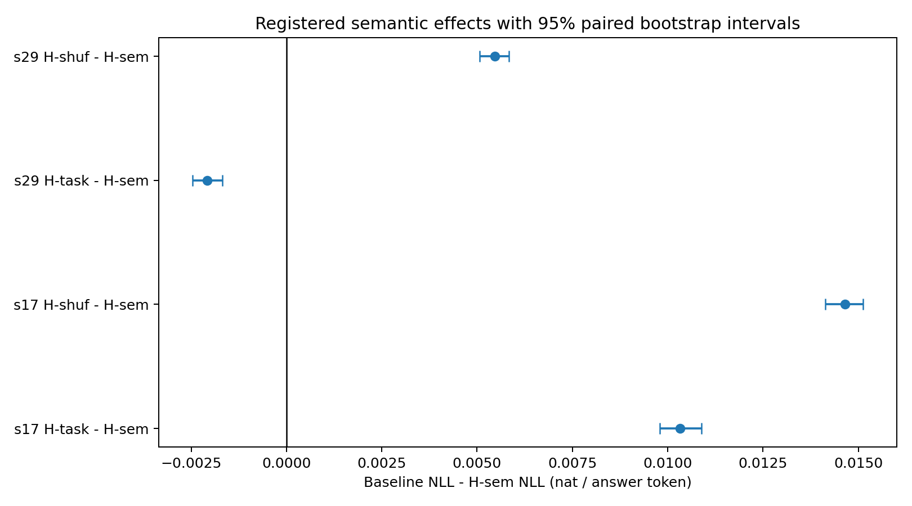
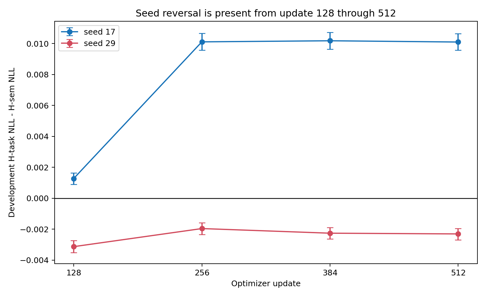

# 0906 Sol 执行Router实验

> 现在需要请你帮助我按照计划执行实验daily\_research\_reports/0906/plans/sol\_training\_comparison\_handoff\_cn.md ，完成后需要明确按照要求给出资料，后续我会让astra读取并且分析，推进下一步。请进入项目并且开始工作

<details><summary>45 previous messages</summary>

> 我会先按现有交接计划核对实验范围、执行授权与交付清单，再进入对应执行工作区启动任务。这里会使用 `remote-experiment-workflow` 管理实验运行与资料回收，并用 `executing-plans` 按既定计划逐项推进；如果计划中仍有需要研究者确认的科学判断或昂贵运行授权，我会明确停在该边界。
>
> <details><summary>Ran a command</summary>
>
> - Ran `sed -n '1,240p' /root/.codex/skills/.system/../ 2>/dev/null || true
> sed -n '1,260p' /root/.codex/plugins/cache/openai-curated-remote/superpowers/6.3.0/skills/using-superpowers/SKILL.md
> sed -n '1,320p' /data/250010109/Research_System/.agents/skills/remote-experiment-workflow/SKILL.md
> sed -n '1,320p' /root/.codex/plugins/cache/openai-curated-remote/superpowers/6.3.0/skills/executing-plans/SKILL.md`
>
> </details>
>
> 当前环境支持子代理，`executing-plans` 因此要求改用 `subagent-driven-development` 做逐项复核；我会让子代理只承担独立的计划审阅/证据核对，主线程仍负责运行控制与最终资料完整性。接下来先读取计划和项目规范，确认是否已有正式 protocol 及全量运行授权。
>
> <details><summary>Explored a file, ran a command</summary>
>
> <details><summary>Explored 3 files</summary>
>
> - Read `/root/.codex/plugins/cache/openai-curated-remote/superpowers/6.3.0/skills/using-superpowers/references/codex-tools.md`
> - Read `/root/.codex/plugins/cache/openai-curated-remote/superpowers/6.3.0/skills/subagent-driven-development/SKILL.md`
> - Read `/root/.codex/plugins/cache/openai-curated-remote/superpowers/6.3.0/skills/using-git-worktrees/SKILL.md`
>
> </details>
>
> - Ran `sed -n '321,760p' /root/.codex/plugins/cache/openai-curated-remote/superpowers/6.3.0/skills/subagent-driven-development/SKILL.md
> rg -n -i "sol_training|training_comparison|0906|handoff" /root/.codex/memories/MEMORY.md || true
> pwd
> git rev-parse --show-toplevel
> git rev-parse --git-dir
> git rev-parse --git-common-dir
> git branch --show-current
> git rev-parse --show-superproject-working-tree 2>/dev/null || true
> git status --short --branch
> sed -n '1,320p' daily_research_reports/0906/plans/sol_training_comparison_handoff_cn.md
> sed -n '1,260p' PROJECTS.md`
>
> </details>
>
> 已确认当前 `Research_System` 是普通 `master` 工作区、基线干净，但计划同时涉及本库的规范记录与另一个实验代码工作区；我不会先制造额外 worktree 或改动主线，而是先完成只读合同审计。用户本条“按照计划执行实验”将按计划记作覆盖实现、冒烟、预审与满足门槛后的正式训练授权，但不会越过计划中的条件触发项。
>
> <details><summary>Explored 5 files</summary>
>
> - Read `./daily_research_reports/0906/plans/sol_training_comparison_handoff_cn.md`
> - Read `./daily_research_reports/0906/plans/sol_training_comparison_handoff_cn.md`
> - Read `./daily_research_reports/0906/plans/sol_training_comparison_handoff_cn.md`
> - Read `./daily_research_reports/0906/focus_gmm_pseudolabel_handoff.md`
> - Read `./Projects/from-attention-to-search/main/problem_anchors/15_spectral_representation_and_functional_routing/15_13_semantic_supervision_middle_layer_formation/subanchors/15_13_05_gmm_pseudolabel_oracle_gap_anchor.md`
>
> </details>
>
> 计划的关键边界已明确：先产出 `DRAFT_NOT_EXECUTABLE` 的唯一候选 Protocol，再依据本次明确执行授权提升相应 scope；3.2 的预算选择必须由开发集规则决定，3.4 的 H-hard/H-oracle 仍是条件触发，不会默认加入。现在开始核对正式协议模板、历史证据和执行平台配置。
>
> <details><summary>Ran 2 commands</summary>
>
> - Ran `sed -n '100,230p' daily_research_reports/0906/plans/sol_training_comparison_handoff_cn.md
> sed -n '1,360p' .agents/skills/experiment-card-writer/SKILL.md
> sed -n '1,360p' /root/.codex/skills/sco-control/SKILL.md
> find Projects/from-attention-to-search/main -maxdepth 3 -type f \( -name 'graph.yaml' -o -name '*roadmap*.md' -o -name 'research_map.md' \) | sort | head -80
> grep -n "gmm_pseudolabel_oracle_gap\|A15.13 E14\|A15_13_E14" PROJECTS.md | head -30`
> - Ran `sed -n '1,360p' .agents/skills/experiment-card-writer/references/blockwise_protocol_audit.md
> sed -n '1,360p' .agents/skills/experiment-card-writer/references/protocol_self_containment_and_freeze.md
> sed -n '1,280p' Projects/from-attention-to-search/main/roadmap.md
> find Projects/from-attention-to-search/main/experiments/A15/15_13_semantic_supervision_middle_layer_formation -maxdepth 2 -type d -name 'A15_13_E14_P3_matched_training_semantic_comparison' -print
> find /data/250010109/MoE_Router/experiments -maxdepth 1 -type d -name '20260906_a15_13_e14_p3_matched_training' -print
> ./researchctl context A15.gmm_pseudolabel_oracle_gap --task "execute P3 matched training semantic comparison plan stages 3.1-3.4" --path Projects/from-attention-to-search/main/experiments/A15/15_13_semantic_supervision_middle_layer_formation/A15_13_E14_P3_matched_training_semantic_comparison/protocol.md`
>
> </details>
>
> 发现了计划预先记录的同一阻塞：`researchctl context` 仍把 Focus 正文误解析成路径，触发 `Errno 36`。这不是科学设计失败，而是任务登记工具的解析缺陷；按计划不能假装登记成功并继续改共享科学文件。我会先用 `systematic-debugging` + `test-driven-development` 做最小可验证修复，修复后重新登记，再进入 3.1。
>
> <details><summary>Ran 3 commands</summary>
>
> - Ran `sed -n '1,360p' /root/.codex/plugins/cache/openai-curated-remote/superpowers/6.3.0/skills/systematic-debugging/SKILL.md
> sed -n '1,360p' /root/.codex/plugins/cache/openai-curated-remote/superpowers/6.3.0/skills/test-driven-development/SKILL.md
> find . -maxdepth 3 -type f \( -name '*researchctl*' -o -path './tests/*' \) | sort | head -120
> sed -n '240,330p' researchctl
> sed -n '540,620p' researchctl`
> - Ran `sed -n '1,320p' /root/.codex/plugins/cache/openai-curated-remote/superpowers/6.3.0/skills/test-driven-development/writing-good-tests.md
> sed -n '1,240p' researchctl
> sed -n '1,360p' tests/test_researchctl.py
> git log -n 8 --oneline -- researchctl tests/test_researchctl.py
> git diff -- researchctl tests/test_researchctl.py`
> - Ran ``python - <<'PY'
> import importlib.machinery, importlib.util
> from pathlib import Path
> loader=importlib.machinery.SourceFileLoader('researchctl_mod','researchctl')
> spec=importlib.util.spec_from_loader(loader.name,loader)
> m=importlib.util.module_from_spec(spec); loader.exec_module(m)
> p=Path('daily_research_reports/0906/focus_gmm_pseudolabel_handoff.md')
> t=p.read_text()
> for i,x in enumerate(m.TOKEN_RE.findall(t)):
>     if '\n' in x or len(x)>200:
>         print(i,len(x),repr(x[:240]))
> PY
> python - <<'PY'
> from pathlib import Path
> p=Path('daily_research_reports/0906/focus_gmm_pseudolabel_handoff.md')
> for i,line in enumerate(p.read_text().splitlines(),1):
>     if line.count('`') % 2:
>         print(i, line)
> PY``
>
> </details>
>
> 根因已定位：`researchctl` 用“反引号之间任意字符”的正则扫描整个 Markdown，三反引号代码围栏会让匹配跨越多行，把大段正文当成文件路径；随后文件状态检查触发系统路径长度错误。先加入一个真实 CLI 回归测试，确认它在未修复代码上按预期失败。
>
> <details><summary>Edited a file, ran a command</summary>
>
> - Wrote `./tests/test_researchctl.py` (+18 -0)
> - Ran `python -m unittest tests.test_researchctl.ResearchCtlTests.test_context_ignores_fenced_block_delimiters_when_scanning_links`
>
> </details>
>
> 首个回归用例没有触发失败，因为围栏后的跨行伪路径还不够长；这说明测试尚未复现真实故障。我会把同一真实机制缩成超过文件名上限的最小 fixture，再确认红灯。
>
> <details><summary>Edited 2 files, ran 2 commands</summary>
>
> - Wrote `./tests/test_researchctl.py` (+2 -1)
> - Ran `sed -n '88,135p' tests/test_researchctl.py
> python -m unittest tests.test_researchctl.ResearchCtlTests.test_context_ignores_fenced_block_delimiters_when_scanning_links`
> - Wrote `./researchctl` (+1 -1)
> - Ran `python -m unittest tests.test_researchctl.ResearchCtlTests.test_context_ignores_fenced_block_delimiters_when_scanning_links
> python -m unittest tests.test_researchctl`
>
> </details>
>
> 最小修复已通过新增回归测试和 `researchctl` 全部 14 项测试。接下来按 `verification-before-completion` 做真实命令复验；只有登记成功后才开始创建协议或实验目录。
>
> <details><summary>Ran a command</summary>
>
> - Ran `sed -n '1,360p' /root/.codex/plugins/cache/openai-curated-remote/superpowers/6.3.0/skills/verification-before-completion/SKILL.md
> ./researchctl context A15.gmm_pseudolabel_oracle_gap --task "execute P3 matched training semantic comparison plan stages 3.1-3.4" --path Projects/from-attention-to-search/main/experiments/A15/15_13_semantic_supervision_middle_layer_formation/A15_13_E14_P3_matched_training_semantic_comparison/protocol.md`
>
> </details>
>
> 登记已真实成功，任务 ID 为 `task-e7eaa915-e909-40b7-91b5-a5df02e72f88`；工具缺陷修复也有红—绿回归证据。现在进入实验代码工作区，先审计现有实现、旧权重/数据来源与平台回执，形成 3.1 的可构造合同。
>
> <details><summary>Explored 7 lists, ran 3 commands</summary>
>
> - Ran `hostname
> pwd
> git status --short --branch
> find /data/250010109/MoE_Router -name AGENTS.md -print
> cd /data/250010109/MoE_Router && git status --short --branch && git rev-parse HEAD
> find /data/250010109/MoE_Router/experiments/20260903_a15_13_e14_gmm_pseudolabel_oracle_gap -maxdepth 2 -type f | sort | sed -n '1,220p'
> find /data/250010109/MoE_Router/experiments/20260906_a15_13_e14_p2_parent_router_supervision_repair -maxdepth 3 -type f | sort | sed -n '1,220p'
> find /data/250010109/datasets/a15_e14_benchmark -maxdepth 3 -type f -printf '%p %s bytes\n' | sort | sed -n '1,240p'`
>
> <details><summary>Explored 3 lists</summary>
>
> - Listed files in `MoE_Router`
> - Listed files in `20260903_a15_13_e14_gmm_pseudolabel_oracle_gap`
> - Listed files in `20260906_a15_13_e14_p2_parent_router_supervision_repair`
>
> </details>
>
> - Ran `find /data/250010109/MoE_Router -name AGENTS.md -print 2>/dev/null | head -40
> if git -C /data/250010109/MoE_Router rev-parse --is-inside-work-tree >/dev/null 2>&1; then git -C /data/250010109/MoE_Router status --short --branch; git -C /data/250010109/MoE_Router rev-parse HEAD; else echo 'MoE_Router is not a git worktree'; fi
> find /data/250010109/MoE_Router/experiments/20260903_a15_13_e14_gmm_pseudolabel_oracle_gap -maxdepth 2 -type f | sort | head -220
> find /data/250010109/MoE_Router/experiments/20260906_a15_13_e14_p2_parent_router_supervision_repair -maxdepth 3 -type f | sort | head -220
> find /data/250010109/datasets/a15_e14_benchmark -maxdepth 3 -type f -printf '%p %s bytes\n' | sort | head -240`
>
> <details><summary>Explored 4 lists</summary>
>
> - Listed files in `MoE_Router`
> - Listed files in `a15_e14_benchmark`
> - Listed files in `full-20260903T042000Z`
> - Listed files in `full`
>
> </details>
>
> - Ran `for p in /data/250010109/AGENTS.md /data/250010109/MoE_Router/AGENTS.md /data/250010109/MoE_Router/experiments/AGENTS.md /data/250010109/MoE_Router/experiments/20260903_a15_13_e14_gmm_pseudolabel_oracle_gap/AGENTS.md; do if [ -f "$p" ]; then echo "$p"; sed -n '1,260p' "$p"; fi; done
> sed -n '1,280p' Projects/from-attention-to-search/main/experiments/A15/15_13_semantic_supervision_middle_layer_formation/A15_13_E14_P1_coarse_path_intervention/summary.md
> sed -n '1,320p' Projects/from-attention-to-search/main/experiments/A15/15_13_semantic_supervision_middle_layer_formation/A15_13_E14_P2_parent_router_supervision_repair/summary.md
> sed -n '1,380p' Projects/from-attention-to-search/main/experiments/A15/15_13_semantic_supervision_middle_layer_formation/A15_13_E14_P2_parent_router_supervision_repair/detailed.md
> sed -n '1,360p' Projects/from-attention-to-search/main/experiments/A15/15_13_semantic_supervision_middle_layer_formation/A15_13_E14_P2_parent_router_supervision_repair/protocol.md`
>
> </details>
>
> 历史证据确认：旧 E14 的八任务 hard-pseudo 实际只运行 128 更新的单一专家阶段，并非两阶段；P2 只更新 3,075 个父路由参数。当前新比较必须从基座重新初始化，不能复用 P2 排名。下一步重点是核验原始数据能否构造互斥 train/dev/test，以及现有模型代码能否表达 D/F/SF/H 三类在线系数。
>
> <details><summary>Explored 7 files, ran a command</summary>
>
> <details><summary>Explored 7 files</summary>
>
> - Read `/data/250010109/MoE_Router/experiments/20260903_a15_13_e14_gmm_pseudolabel_oracle_gap/models.py`
> - Read `/data/250010109/MoE_Router/experiments/20260903_a15_13_e14_gmm_pseudolabel_oracle_gap/training.py`
> - Read `/data/250010109/MoE_Router/experiments/20260903_a15_13_e14_gmm_pseudolabel_oracle_gap/registry.py`
> - Read `/data/250010109/MoE_Router/experiments/20260903_a15_13_e14_gmm_pseudolabel_oracle_gap/prepare_data.py`
> - Read `/data/250010109/MoE_Router/experiments/20260903_a15_13_e14_gmm_pseudolabel_oracle_gap/prepare_pseudo_labels.py`
> - Read `/data/250010109/MoE_Router/experiments/20260903_a15_13_e14_gmm_pseudolabel_oracle_gap/gmm_labels.py`
> - Read `/data/250010109/MoE_Router/experiments/20260903_a15_13_e14_gmm_pseudolabel_oracle_gap/checkpoint_manifest.py`
>
> </details>
>
> - Ran `python - <<'PY'
> import json
> from pathlib import Path
> p=Path('/data/250010109/datasets/a15_e14_benchmark/processed.json')
> d=json.loads(p.read_text())
> print(json.dumps(d, indent=2, ensure_ascii=False))
> PY
> ls -la /data/250010109/datasets/a15_e14_raw
> find /data/250010109/datasets/a15_e14_raw -maxdepth 2 -type f -printf '%p %s\n' | sort | head -200
> sed -n '1,180p' /data/250010109/MoE_Router/experiments/20260903_a15_13_e14_gmm_pseudolabel_oracle_gap/prepare_data.py
> sed -n '180,380p' /data/250010109/MoE_Router/experiments/20260903_a15_13_e14_gmm_pseudolabel_oracle_gap/prepare_data.py
> sed -n '1,260p' /data/250010109/MoE_Router/experiments/20260903_a15_13_e14_gmm_pseudolabel_oracle_gap/registry.py
> sed -n '180,520p' /data/250010109/MoE_Router/experiments/20260903_a15_13_e14_gmm_pseudolabel_oracle_gap/training.py`
>
> </details>
>
> 3.1 中有两项可独立核查，我会按计划执行技能并行做只读审计：一项统计八来源去重后可用的互斥拆分规模，另一项核对旧代码的 hook、参数量、损失与初始化行为。主线程同时整理 Focus/Anchor 与新 Protocol 的一致性，不让子任务改任何文件。
>
> 由于当前 Focus/Anchor 仍停在 P2 的“修复检查点作为后续诊断基线”，而计划明确转向“从同一基座重训、比较架构与语义增量”，3.1 必须先把这次已由用户激活的新决策准确落回唯一 Focus/Anchor；我会使用 `research-progress-core` 和 `problem-anchor-writer` 做一致性修订，不改写 P1/P2 的历史结论。
>
> <details><summary>Explored 3 files, ran 2 commands</summary>
>
> <details><summary>Explored 5 files</summary>
>
> - Read `./.agents/skills/research-progress-core/SKILL.md`
> - Read `./.agents/skills/problem-anchor-writer/SKILL.md`
> - Read `./.agents/skills/research-progress-core/references/focus_cycle.md`
> - Read `./.agents/skills/problem-anchor-writer/references/anchor_self_containment.md`
> - Read `./.agents/skills/problem-anchor-writer/references/learnable_research_design.md`
>
> </details>
>
> - Ran `sed -n '1,240p' /data/250010109/MoE_Router/experiments/20260903_a15_13_e14_gmm_pseudolabel_oracle_gap/submit_h100_4_reserved.sh
> sed -n '1,240p' /data/250010109/MoE_Router/experiments/20260906_a15_13_e14_p2_parent_router_supervision_repair/submit.sh
> sed -n '1,240p' /data/250010109/MoE_Router/experiments/20260906_a15_13_e14_p2_parent_router_supervision_repair/run_remote.sh
> which sco || ls -l /root/.sco/bin/sco
> sco config profiles list
> sco config list
> sco aec2 clusters list
> sco acp jobs list --workspace-name public --page-size 20 -o table`
>
> - Ran `sco aec2 clusters list-workerspec --workspace-name share-space --aec2-name share-cluster
> sco acp jobs list --workspace-name share-space --page-size 100 -o table | awk 'NR<=4 || /250010109/ || /a15-e14-p2/'`
>
> </details>
>
> <details><summary>Explored a file</summary>
>
> - Read `/tmp/p3_code_audit.md`
>
> </details>
>
> <details><summary>Explored 6 files, ran 2 commands</summary>
>
> <details><summary>Explored a file</summary>
>
> - Read `/tmp/p3_data_audit.md`
>
> </details>
>
> - Ran `sed -n '1,180p' /data/250010109/MoE_Router/experiments/20260901_a15_13_e07_e08_m2d2_causal_lm_semantic_routing/routing_model.py
> python - <<'PY'
> import json
> from pathlib import Path
> p=Path('/data/250010109/model_cache/Qwen3-0.6B-Base-official/config.json')
> d=json.loads(p.read_text())
> for k in ['hidden_size','intermediate_size','num_hidden_layers','model_type','torch_dtype']:
>  print(k,d.get(k))
> PY
> python - <<'PY'
> import json
> from pathlib import Path
> p=Path('/data/250010109/MoE_Router/experiments/20260903_a15_13_e14_gmm_pseudolabel_oracle_gap/runs/full-20260903T042000Z/checkpoint_manifest.json')
> d=json.loads(p.read_text())
> for row in d['checkpoints']:
>  if row['surface']=='benchmark' and row['seed']==17 and row['name'] in ('DENSE_R24','FLAT_TASK_R24','HIER_TASK_R8','HIER_GMM_R8','HIER_GMM_HARD_R8'):
>   print(json.dumps({k:row.get(k) for k in ['name','stage_updates','trainable_parameters','active_parameters','seen_target_tokens','checkpoint_sha256']},sort_keys=True))
> PY`
>
> - Ran `grep -R -n "elapsed\|runtime\|GPU\|job .*pt-\|ACP job" Projects/from-attention-to-search/main/experiments/A15/15_13_semantic_supervision_middle_layer_formation/A15_13_E14*/*.md | head -100
> ls -la /data/250010109/MoE_Router/experiments/20260903_a15_13_e14_gmm_pseudolabel_oracle_gap/runs
> find /data/250010109/MoE_Router/experiments/20260903_a15_13_e14_gmm_pseudolabel_oracle_gap/runs -maxdepth 1 -type f -printf '%f %s\n' | sort
> find /data/250010109/MoE_Router/experiments/20260903_a15_13_e14_gmm_pseudolabel_oracle_gap/runs/full-20260903T042000Z -maxdepth 2 -type f \( -name '*.log' -o -name '*metadata*.json' -o -name '*audit*.json' \) -printf '%p %s\n' | sort | head -100`
>
> <details><summary>Explored 5 files</summary>
>
> - Read `/data/250010109/MoE_Router/experiments/20260903_a15_13_e14_gmm_pseudolabel_oracle_gap/runs/full-20260903T042000Z/logs/training-0.log`
> - Read `/data/250010109/MoE_Router/experiments/20260903_a15_13_e14_gmm_pseudolabel_oracle_gap/runs/full-20260903T042000Z/logs/training-1.log`
> - Read `./Projects/from-attention-to-search/main/experiments/A15/15_13_semantic_supervision_middle_layer_formation/A15_13_E14_gmm_pseudolabel_oracle_gap/detailed.md`
> - Read `./templates/research_process/focus_writing_template.md`
> - Read `./Projects/from-attention-to-search/main/experiments/A15/15_13_semantic_supervision_middle_layer_formation/A15_13_E14_gmm_pseudolabel_oracle_gap/protocol.md`
>
> </details>
>
> </details>
>
> 3.1 审计已经收敛出四个尚不能由 AI 静默冻结的科学选择：干净数据采用全量 70/15/15 而非等来源小样本；辅助损失采用 \(0.5L_{parent}+0.5L_{child}\)；512→1024 的开发集阈值取 0.002 nat/token；新主判据只看同架构在线答案 NLL，不再继承旧 E14 的宏任务分数与专家干预合取门。它们会明确标成待确认项，当前不会提交训练。
>
> <details><summary>Created 4 files, edited a file, deleted 2 files, ran a command</summary>
>
> - Ran `mkdir -p Projects/from-attention-to-search/main/experiments/A15/15_13_semantic_supervision_middle_layer_formation/A15_13_E14_P3_matched_training_semantic_comparison/tables Projects/from-attention-to-search/main/experiments/A15/15_13_semantic_supervision_middle_layer_formation/A15_13_E14_P3_matched_training_semantic_comparison/figures`
> - Deleted `./daily_research_reports/0906/focus_gmm_pseudolabel_handoff.md` (+0 -96)
> - Wrote `./daily_research_reports/0906/focus_gmm_pseudolabel_handoff.md` (+84 -0)
> - Deleted `./Projects/from-attention-to-search/main/problem_anchors/15_spectral_representation_and_functional_routing/15_13_semantic_supervision_middle_layer_formation/subanchors/15_13_05_gmm_pseudolabel_oracle_gap_anchor.md` (+0 -53)
> - Wrote `./Projects/from-attention-to-search/main/problem_anchors/15_spectral_representation_and_functional_routing/15_13_semantic_supervision_middle_layer_formation/subanchors/15_13_05_gmm_pseudolabel_oracle_gap_anchor.md` (+140 -0)
> - Wrote `./Projects/from-attention-to-search/main/experiments/A15/15_13_semantic_supervision_middle_layer_formation/A15_13_E14_P3_matched_training_semantic_comparison/protocol.md` (+458 -0)
> - Wrote `./Projects/from-attention-to-search/main/experiments/A15/15_13_semantic_supervision_middle_layer_formation/A15_13_E14_P3_matched_training_semantic_comparison/tables/training_object_contract.csv` (+9 -0)
> - Wrote `./PROJECTS.md` (+1 -1)
>
> </details>
>
> 3.1 的候选 Protocol、更新后的唯一 Focus/Anchor 和训练对象 CSV 已写入；当前状态刻意保持 `DRAFT_NOT_EXECUTABLE`。我正在做交叉块、链接、仓库状态与文档一致性检查，确保交给你确认的不是聊天草案，而是可直接晋级的唯一正式文件。
>
> <details><summary>Ran 3 commands</summary>
>
> - Ran `./researchctl check --repository
> python - <<'PY'
> from pathlib import Path
> import re
> files=[
> Path('daily_research_reports/0906/focus_gmm_pseudolabel_handoff.md'),
> Path('Projects/from-attention-to-search/main/problem_anchors/15_spectral_representation_and_functional_routing/15_13_semantic_supervision_middle_layer_formation/subanchors/15_13_05_gmm_pseudolabel_oracle_gap_anchor.md'),
> Path('Projects/from-attention-to-search/main/experiments/A15/15_13_semantic_supervision_middle_layer_formation/A15_13_E14_P3_matched_training_semantic_comparison/protocol.md')]
> for p in files:
>     text=p.read_text()
>     bad=[]
>     for label,target in re.findall(r'\[([^]]+)\]\(([^)#]+)(?:#[^)]+)?\)',text):
>         if '://' in target: continue
>         q=(p.parent/target).resolve()
>         if not q.exists(): bad.append((label,target,str(q)))
>     print(p, 'lines=',len(text.splitlines()), 'broken_links=',bad)
> PY
> python - <<'PY'
> import csv
> from pathlib import Path
> p=Path('Projects/from-attention-to-search/main/experiments/A15/15_13_semantic_supervision_middle_layer_formation/A15_13_E14_P3_matched_training_semantic_comparison/tables/training_object_contract.csv')
> rows=list(csv.DictReader(p.open()))
> assert len(rows)==8
> expected={'D':(98304,0,98304),'F':(786432,8200,794632),'SF':(557056,8200,565256),'H-task':(393216,11275,404491)}
> for k,v in expected.items():
>  row=next(r for r in rows if r['condition']==k)
>  got=(int(row['expert_parameters']),int(row['router_parameters']),int(row['total_trainable_parameters']))
>  assert got==v,(k,got,v)
> print('training_object_contract rows=8 parameter_checks=PASS')
> PY
> git diff --check
> git status --short`
> - Ran `git ls-files --error-unmatch Projects/from-attention-to-search/main/problem_anchors/15_spectral_representation_and_functional_routing/15_13_semantic_supervision_middle_layer_formation/subanchors/15_13_05_gmm_pseudolabel_oracle_gap_anchor.md || true
> git ls-files --error-unmatch Projects/from-attention-to-search/main/experiments/A15/15_13_semantic_supervision_middle_layer_formation/A15_13_E14_P3_matched_training_semantic_comparison/protocol.md || true
> git check-ignore -v Projects/from-attention-to-search/main/problem_anchors/15_spectral_representation_and_functional_routing/15_13_semantic_supervision_middle_layer_formation/subanchors/15_13_05_gmm_pseudolabel_oracle_gap_anchor.md Projects/from-attention-to-search/main/experiments/A15/15_13_semantic_supervision_middle_layer_formation/A15_13_E14_P3_matched_training_semantic_comparison/protocol.md || true
> git diff --stat
> git diff -- Projects/from-attention-to-search/main/problem_anchors/15_spectral_representation_and_functional_routing/15_13_semantic_supervision_middle_layer_formation/subanchors/15_13_05_gmm_pseudolabel_oracle_gap_anchor.md | head -80`
> - Ran `ls -la Projects/from-attention-to-search | head -40
> if [ -e Projects/from-attention-to-search/.git ]; then git -C Projects/from-attention-to-search status --short --branch; git -C Projects/from-attention-to-search rev-parse --show-toplevel; fi
> find Projects/from-attention-to-search -maxdepth 2 -name AGENTS.md -print`
>
> </details>
>
> 发现 `Projects/from-attention-to-search` 是独立嵌套仓库，且在任务开始前已存在多项未提交研究文件；我会保持这些用户改动不动。现在补读该项目自己的 `AGENTS.md` 并按其规则复核刚写入的 Anchor/Protocol，若有冲突会在本轮修正。
>
> <details><summary>Ran a command</summary>
>
> - Ran `sed -n '1,420p' AGENTS.md
> git diff --check
> git diff --stat
> git status --short`
>
> </details>
>
> 项目级规则与当前写入兼容：实验代码仍留在执行工作区，主线只保存 Anchor、Protocol 与小型合同表；未触碰现有 graph、sync、提交或推送。接下来做一次独立的 3.1 规格审阅，重点找计划遗漏、越权晋级、参数/数据数字不一致和“待确认项”是否完整。
>
> <details><summary>Explored a file</summary>
>
> - Read `/root/.codex/plugins/cache/openai-curated-remote/superpowers/6.3.0/skills/subagent-driven-development/task-reviewer-prompt.md`
>
> </details>
>
> 独立审阅发现 5 个重要缺口，均属于 3.1 合同本身：LoRA 的 \(1/r\) 缩放未冻结；负载偏置的计数域/条件频率规则不明确；预算与负载选择顺序不唯一；语义组自身晚段未稳定时的裁定缺失；G 块还没有可审核的分阶段资源上限。我会先修完这些再交你确认，避免你确认一个仍不可构造的协议。
>
> 合同修复仍在进行；目前没有启动任何实验或资源作业。修复完成后我会先做针对性复审，再给出需要你一次性确认的最小清单。
>
> <details><summary>Explored 3 files, 2 searches</summary>
>
> - Read `/tmp/p3_protocol_fix_report.md`
> - Searched for `E_r\|P-LOAD\|Decision order\|decision order\|54\|BUDGET_LIMITED\|historical_e14` in `protocol.md`
> - Searched for `five\|five proposal\|P-LOAD\|五项` in `focus_gmm_pseudolabel_handoff.md`
> - Read `./Projects/from-attention-to-search/main/experiments/A15/15_13_semantic_supervision_middle_layer_formation/A15_13_E14_P3_matched_training_semantic_comparison/tables/training_object_contract.csv`
> - Read `./Projects/from-attention-to-search/main/experiments/A15/15_13_semantic_supervision_middle_layer_formation/A15_13_E14_P3_matched_training_semantic_comparison/tables/historical_e14_p1_p2_audit.csv`
>
> </details>
>
> 复查修复报告时发现一处不能接受的越权：修复代理把我下发的修改说明误记成了“研究者已确认五项科学选择”。这不成立——AI 不能替你确认。我会立即恢复为 `PROPOSED`，保留改进后的完整定义；3.1 仍只交候选协议，由你确认后才允许实现/冒烟。
>
> Context compaction
>
> Source: automatic
> Status: completed
>
> 我正在收尾 3.1 的独立审计。刚发现审计修订里把 5 个仍需你裁决的协议候选项误写成了“已确认”；我已要求恢复为 `PROPOSED`。在这些选择得到明确确认前，我不会启动预检或正式训练。
>
> <details><summary>Explored a search, ran a command</summary>
>
> - Ran `git status --short && rg -n "P-BDATA|P-AUX|P-BUDGET|P-LOAD|P-VERDICT|HUMAN_CONFIRMED|PROPOSED|next decision|Next decision" PROJECTS.md daily_research_reports/0906/focus_gmm_pseudolabel_handoff.md Projects/from-attention-to-search/main/problem_anchors/15_spectral_representation_and_functional_routing/15_13_semantic_supervision_middle_layer_formation/subanchors/15_13_05_gmm_pseudolabel_oracle_gap_anchor.md Projects/from-attention-to-search/main/experiments/A15/15_13_semantic_supervision_middle_layer_formation/A15_13_E14_P3_matched_training_semantic_comparison/protocol.md | head -n 220`
>
> <details><summary>Explored a search</summary>
>
> - Searched for `P-BDATA|P-AUX|P-BUDGET|P-LOAD|P-VERDICT|HUMAN_CONFIRMED|PROPOSED|next decision|Next decision` in `PROJECTS.md`
>
> </details>
>
> </details>
>
> <details><summary>Edited 3 files, explored 3 files, 2 searches</summary>
>
> <details><summary>Explored 5 files</summary>
>
> - Read `./daily_research_reports/0906/focus_gmm_pseudolabel_handoff.md`
> - Read `./Projects/from-attention-to-search/main/problem_anchors/15_spectral_representation_and_functional_routing/15_13_semantic_supervision_middle_layer_formation/subanchors/15_13_05_gmm_pseudolabel_oracle_gap_anchor.md`
> - Read `./Projects/from-attention-to-search/main/experiments/A15/15_13_semantic_supervision_middle_layer_formation/A15_13_E14_P3_matched_training_semantic_comparison/protocol.md`
> - Read `./Projects/from-attention-to-search/main/experiments/A15/15_13_semantic_supervision_middle_layer_formation/A15_13_E14_P3_matched_training_semantic_comparison/protocol.md`
> - Read `./Projects/from-attention-to-search/main/experiments/A15/15_13_semantic_supervision_middle_layer_formation/A15_13_E14_P3_matched_training_semantic_comparison/protocol.md`
>
> </details>
>
> - Wrote `./daily_research_reports/0906/focus_gmm_pseudolabel_handoff.md` (+2 -2)
>
> - Wrote `./Projects/from-attention-to-search/main/problem_anchors/15_spectral_representation_and_functional_routing/15_13_semantic_supervision_middle_layer_formation/subanchors/15_13_05_gmm_pseudolabel_oracle_gap_anchor.md` (+10 -10)
>
> <details><summary>Explored a search</summary>
>
> - Searched for `Approval status|Block audit|Cross-block|Execution scope|Design frozen|Approval decision|This revision|[Cc]onfirmed group|confirmed P-|Confirmed P-|Candidate audit|reviewer-fix` in `protocol.md`
>
> </details>
>
> - Wrote `./Projects/from-attention-to-search/main/experiments/A15/15_13_semantic_supervision_middle_layer_formation/A15_13_E14_P3_matched_training_semantic_comparison/protocol.md` (+9 -9)
>
> - Wrote `./Projects/from-attention-to-search/main/experiments/A15/15_13_semantic_supervision_middle_layer_formation/A15_13_E14_P3_matched_training_semantic_comparison/protocol.md` (+8 -8)
>
> - Wrote `./Projects/from-attention-to-search/main/experiments/A15/15_13_semantic_supervision_middle_layer_formation/A15_13_E14_P3_matched_training_semantic_comparison/protocol.md` (+12 -11)
>
> <details><summary>Explored a search</summary>
>
> - Searched for `confirmed P-|P-[A-Z]+.*confirmed|already confirmed|five scientific|implementation plus|PASS_FOR_IMPLEMENTATION_SMOKE|CONFIRMED_FOR_IMPLEMENTATION` in `focus_gmm_pseudolabel_handoff.md`
>
> </details>
>
> </details>
>
> 协议中的权限状态已纠正：五项科学选择和全部资源范围现在都明确标为 `PROPOSED`，执行范围为 `NONE`。我正在做最后一轮一致性检查，重点确认先前审计指出的缩放、负载公式、预算顺序、语义臂预算不足优先级和资源上限都已完整落到合同中。
>
> <details><summary>Edited a file, explored 4 files, 4 searches, ran 2 commands</summary>
>
> - Ran `python -m unittest tests.test_researchctl
> ./researchctl check --repository
> python - <<'PY'
> from pathlib import Path
> for p in [
> Path('daily_research_reports/0906/focus_gmm_pseudolabel_handoff.md'),
> Path('Projects/from-attention-to-search/main/problem_anchors/15_spectral_representation_and_functional_routing/15_13_semantic_supervision_middle_layer_formation/subanchors/15_13_05_gmm_pseudolabel_oracle_gap_anchor.md'),
> Path('Projects/from-attention-to-search/main/experiments/A15/15_13_semantic_supervision_middle_layer_formation/A15_13_E14_P3_matched_training_semantic_comparison/protocol.md')]:
>     s=p.read_text()
>     print(p, 'lines', len(s.splitlines()), 'human_confirmed_P', 'HUMAN_CONFIRMED' in s and 'P-' in s)
> PY
> git diff --check
> if [ -e /data/250010109/MoE_Router/experiments/20260906_a15_13_e14_p3_matched_training ]; then echo 'WORKER_EXISTS'; else echo 'WORKER_ABSENT'; fi`
>
> <details><summary>Explored 2 files, 2 searches</summary>
>
> - Searched for `design_state` in `researchctl`
> - Searched for `design_state: ` in `daily_research_reports`
> - Read `./researchctl`
> - Read `./daily_research_reports/0903/focus_gmm_pseudolabel_oracle_gap.md`
>
> </details>
>
> - Wrote `./daily_research_reports/0906/focus_gmm_pseudolabel_handoff.md` (+1 -1)
>
> <details><summary>Explored a search</summary>
>
> - Searched for `gmm_pseudolabel_handoff\|P3\|matched training` in `PROJECTS.md`
>
> </details>
>
> - Ran `find daily_research_reports/0906/docs -maxdepth 2 -type f -print 2>/dev/null
> find Projects/from-attention-to-search/main/experiments/A15/15_13_semantic_supervision_middle_layer_formation/A15_13_E14_P3_matched_training_semantic_comparison -maxdepth 3 -type f -print | sort
> sed -n '1,40p' Projects/from-attention-to-search/main/experiments/A15/15_13_semantic_supervision_middle_layer_formation/A15_13_E14_P3_matched_training_semantic_comparison/tables/training_object_contract.csv
> sed -n '1,40p' Projects/from-attention-to-search/main/experiments/A15/15_13_semantic_supervision_middle_layer_formation/A15_13_E14_P3_matched_training_semantic_comparison/tables/parameter_semantics.csv`
>
> <details><summary>Explored 3 files, a search</summary>
>
> - Read `./daily_research_reports/0906/plans/sol_training_comparison_handoff_cn.md`
> - Read `./Projects/from-attention-to-search/main/experiments/A15/15_13_semantic_supervision_middle_layer_formation/A15_13_E14_P3_matched_training_semantic_comparison/protocol.md`
> - Read `./Projects/from-attention-to-search/main/experiments/A15/15_13_semantic_supervision_middle_layer_formation/A15_13_E14_P3_matched_training_semantic_comparison/protocol.md`
> - Searched for `0.002\|512\|1024\|预算不足` in `sol_training_comparison_handoff_cn.md`
>
> </details>
>
> </details>
>
> <details><summary>Edited 3 files, explored a file</summary>
>
> - Wrote `./Projects/from-attention-to-search/main/experiments/A15/15_13_semantic_supervision_middle_layer_formation/A15_13_E14_P3_matched_training_semantic_comparison/protocol.md` (+17 -12)
>
> - Wrote `./daily_research_reports/0906/focus_gmm_pseudolabel_handoff.md` (+1 -1)
>
> <details><summary>Explored a file</summary>
>
> - Read `./Projects/from-attention-to-search/main/problem_anchors/15_spectral_representation_and_functional_routing/15_13_semantic_supervision_middle_layer_formation/subanchors/15_13_05_gmm_pseudolabel_oracle_gap_anchor.md`
>
> </details>
>
> - Wrote `./Projects/from-attention-to-search/main/problem_anchors/15_spectral_representation_and_functional_routing/15_13_semantic_supervision_middle_layer_formation/subanchors/15_13_05_gmm_pseudolabel_oracle_gap_anchor.md` (+3 -2)
>
> </details>
>
> <details><summary>Ran a command</summary>
>
> - Ran `python -m unittest tests.test_researchctl
> ./researchctl check --repository
> python - <<'PY'
> import csv
> from pathlib import Path
> base=Path('Projects/from-attention-to-search/main/experiments/A15/15_13_semantic_supervision_middle_layer_formation/A15_13_E14_P3_matched_training_semantic_comparison')
> for p in sorted((base/'tables').glob('*.csv')):
>     with p.open(newline='') as f:
>         rows=list(csv.reader(f))
>     widths={len(r) for r in rows}
>     print(f'{p}: rows={len(rows)-1} widths={sorted(widths)}')
> PY
> git diff --check
> git -C Projects/from-attention-to-search diff --check
> git status --short
> git -C Projects/from-attention-to-search status --short -- main/problem_anchors/15_spectral_representation_and_functional_routing/15_13_semantic_supervision_middle_layer_formation/subanchors/15_13_05_gmm_pseudolabel_oracle_gap_anchor.md main/experiments/A15/15_13_semantic_supervision_middle_layer_formation/A15_13_E14_P3_matched_training_semantic_comparison
> if [ -e /data/250010109/MoE_Router/experiments/20260906_a15_13_e14_p3_matched_training ]; then echo 'WORKER_EXISTS'; else echo 'WORKER_ABSENT'; fi`
>
> </details>
</details>

[P3 候选协议](../../../Projects/from-attention-to-search/main/experiments/A15/15_13_semantic_supervision_middle_layer_formation/A15_13_E14_P3_matched_training_semantic_comparison/protocol.md) 已完成 3.1 并通过独立草案审计，但尚未获得科学设计与资源授权，因此没有创建执行目录，也没有启动实验。

请确认以下提案：

- `P-BDATA`：全局去重后 56,538 条，按来源、自然比例作 70/15/15 切分。
- `P-AUX`：\(L=L_{\text{answer}}+0.5L_{\text{parent}}+0.5L_{\text{child}\mid\text{teacher parent}}\)。
- `P-BUDGET`：先做 512-update 预审；以 0.002 nat/token 门选择是否统一重跑 1024；达到上限仍未稳定则判预算不足。
- `P-LOAD`：仅触发时测试条件式 3/3/2 选择偏置；偏置不进入概率系数，并统一用于三个 H 条件。
- `P-VERDICT`：两个种子中，H-sem 对 H-task、H-shuf 的四个区间下界都大于零才支持语义增量。
- `G`：单 H100、并发 1、重试 0；smoke ≤1 小时、预审 ≤18 小时、正式核心矩阵 ≤36 小时，总上限 54 GPU-hours。H-hard/H-oracle 不在本次授权内。

验证结果：14 项 `researchctl` 测试通过，仓库检查无错误，两个 CSV 结构有效；仅保留已有的派生视图陈旧警告。另修复了 `researchctl` 跨行解析围栏代码时可能产生超长路径的缺陷，并加入回归测试。

如果全部同意，请回复：**“确认五项提案及 G 候选上限，按协议继续 3.2–3.4。”**

> 请给出你之后工作的完整流程，然后后续需要交会什么内容给astra审核。请确保完整

<details><summary>2 previous messages</summary>

> 我会用 `research-communication` 把后续流程整理成一份“执行阶段—停止门—产物—Astra 审核输入—审核结论”的完整交接，而不是只列文件名。我也会逐项对照现有 P3 Protocol 和原计划，确保 3.2、3.3、3.4、条件分支以及最终 canonical 结果包都不漏。
>
> <details><summary>Explored 4 files, 2 searches</summary>
>
> - Read `./.agents/skills/research-communication/SKILL.md`
> - Searched for `P3|matched training|Astra|handoff|gmm_pseudolabel` in `MEMORY.md`
> - Read `./.agents/skills/research-communication/references/handoff.md`
> - Read `./daily_research_reports/0906/plans/sol_training_comparison_handoff_cn.md`
> - Searched for `^##\|^###` in `protocol.md`
> - Read `./daily_research_reports/0906/focus_gmm_pseudolabel_handoff.md`
>
> </details>
</details>

当前起点是：[P3 Protocol 草案](../../../Projects/from-attention-to-search/main/experiments/A15/15_13_semantic_supervision_middle_layer_formation/A15_13_E14_P3_matched_training_semantic_comparison/protocol.md) 已通过草案审计，但五项科学提案和执行资源仍待你确认。确认后，我将按以下流程工作。

## 一、完整执行流程

| 阶段 | 我会完成的工作 | 阶段出口与停止门 |
|---|---|---|
| 0. 批准与冻结 | 将你的确认原文、五项 P 选择及获批 G 范围写入 Protocol；记录版本与哈希 | 未确认的阶段不得执行；批准 smoke 不等于批准正式训练 |
| 1. 数据与实现 | 创建独立 worker 目录；实现 D/F/SF/H、双层监督、固定打乱、P-LOAD、恢复状态和分析程序；构造干净数据及 train-only 教师 | 数据重叠、教师越界、模型定义或参数数目不符时停止 |
| 2. 测试与 smoke | 运行单元/集成检查和两更新可丢弃 smoke；覆盖所有核心路径及 H-hard 影子路由代码路径 | 交 smoke 回执和实测资源估算；权重丢弃。任何 guard 失败均保留失败记录并停止 |
| 3.2 预审 | seed 17 运行无偏置 D/F/SF/H-task 512 更新；用开发集选 512/1024；必要时从相同初始状态重跑 1024；按触发条件决定 P-LOAD | 冻结唯一预算和统一 H 负载政策；1024 仍未稳定则判 `BUDGET_LIMITED_INSUFFICIENT`，不进入正式矩阵 |
| 3.3 架构基线 | D/F/SF/H-task × seeds 17/29，共八个正式条件 | 八个 checkpoint、逐记录输出、资格矩阵和架构对照；只作整体架构比较，不声称层级结构单变量因果优势 |
| 3.4 语义比较 | 新训 H-sem/H-shuf × seeds 17/29，共四个条件；与合格 H-task 同预算、初始化规则、数据顺序和负载政策 | 得到两个种子上的 H-task−H-sem、H-shuf−H-sem 及区间；最终 H 条件晚段仍改善时，预算不足优先于科学判定 |
| 条件分支 | 只有核心结果未支持或不足，且确需分解“标签价值/在线交接”时，才提出 H-hard/H-oracle amendment | 需要你另行确认；不会自动运行，也不会用旧 P1/P2 checkpoint 替代 |
| 结果固化 | 写 `summary.md`、`detailed.md`、主表、主图、运行与产物清单；记录所有失败、偏差和未运行条件 | 形成 Astra 可独立复核的 canonical 包 |
| Astra 审核 | Astra 只读核对协议、执行资格、统计复现和结论边界 | Astra 给审核意见；最终研究认识、Anchor 更新和下一决策仍由你确认 |
| 人类确认后收尾 | 根据你的裁定更新 Focus、Anchor 和项目状态；若需要，再写延迟日报 | 不在 Astra 建议后自动改变科学结论或开启新实验 |

### 预算选择的精确流程

1. seed 17 的 D/F/SF/H-task 各运行 512 更新。
2. 检查 384→512 的开发集改善及架构排名稳定性。
3. 若满足 0.002 nat/token 门，则所有四组从原始初始化按 1024 调度重跑；不能续接已经衰减至零学习率的 512 checkpoint。
4. 若 768→1024 仍满足不稳定规则，直接报告预算内训练不足，不扩大预算。
5. 预算稳定后才检查 H-task 是否触发 P-LOAD。
6. P-LOAD 若被选中，H-task/H-sem/H-shuf 都必须使用相同政策。
7. 测试集只在数据、教师、预算、负载政策、代码、checkpoint 和统计程序全部冻结后打开。

### 最终判定

核心指标为：

\[
L_m=\frac{\sum_i s_i^m}{\sum_i n_i},
\]

其中 \(s_i^m\) 是记录 \(i\) 的答案 NLL 总和，\(n_i\) 是答案词元数。

分别对两个种子计算：

\[
\Delta_{\text{task}}=L_{H\text{-task}}-L_{H\text{-sem}},
\qquad
\Delta_{\text{shuf}}=L_{H\text{-shuf}}-L_{H\text{-sem}}.
\]

- `SUPPORTED`：四个“对比 × 种子”的 95% 区间下界均大于零。
- `NOT_SUPPORTED`：至少一个必要对比在两个种子上的区间上界均不大于零。
- `INSUFFICIENT`：区间跨零、种子不一致或其他未决模式。
- `BUDGET_LIMITED_INSUFFICIENT`：达到预算上限仍未稳定，优先于 Pass/Fail。
- `INELIGIBLE/INCOMPLETE`：数据、梯度、掩码、哈希、checkpoint 或必要条件失败。

## 二、交给 Astra 的完整审核包

Astra 的入口应包含：

1. 科学与协议文件

   - [Focus](../focus_gmm_pseudolabel_handoff.md)
   - [Anchor](../../../Projects/from-attention-to-search/main/problem_anchors/15_spectral_representation_and_functional_routing/15_13_semantic_supervision_middle_layer_formation/subanchors/15_13_05_gmm_pseudolabel_oracle_gap_anchor.md)
   - 最终冻结的 `protocol.md`
   - `summary.md`
   - `detailed.md`

2. 审核表格

   - 实际训练对象和参数表；
   - 历史 P1/P2 边界表；
   - 数据去重、来源数量、切分与零重叠表；
   - 条件 × seed 的完成/失败/未运行/资格状态表；
   - 预审曲线、预算选择和 P-LOAD 决策表；
   - 每模型的训练预算、答案词元、参数量、耗时和最终 NLL；
   - 四个主要语义差值及 bootstrap 区间；
   - 协议偏差、失败和恢复记录。

3. 图

   - 开发 NLL 对已见答案词元曲线；
   - 两个主要语义差值及两个种子的区间图；
   - 仅当 P-LOAD 触发并影响政策时提供负载图。

4. Worker 证据索引

   - `run_manifest.json`；
   - 数据、教师、代码、配置、Protocol、模型和 checkpoint 哈希；
   - 每条记录的 loss sum、answer-token count、来源、condition、seed；
   - 训练历史、梯度、参数改变量、负载和恢复状态；
   - 作业 ID、资源类型、运行时间与失败回执；
   - artifact manifest，指明所有原始证据的绝对路径。

原始 checkpoint、缓存和完整日志不复制进 Research_System；Astra 通过 artifact manifest 和绝对路径读取。失败运行不会删除，smoke 权重不会混入正式结果。

## 三、要求 Astra 回交的内容

Astra 应返回：

- `Spec Compliance: PASS/FAIL`；
- 每个条件的资格矩阵；
- 主指标和四个必要区间的独立复算；
- `Critical / Important / Minor` 问题清单，并给出文件及行号；
- 预算选择、P-LOAD、测试封闭和两种子公平性的核验；
- 建议的 typed verdict；
- 能说与不能说的最近边界；
- 恰好一个下一决策，标为 `AI 建议`；
- 明确说明 H-hard/H-oracle 是否触发，但不得自行授权执行。

可直接交给 Astra 的指令如下：

请对 P3 matched-training 实验进行只读独立审核。

入口：
1. Sol/Codex 执行任务引用：【填写任务引用】
2. Canonical 实验目录：
`/data/250010109/Research_System/Projects/from-attention-to-search/main/experiments/A15/15_13_semantic_supervision_middle_layer_formation/A15_13_E14_P3_matched_training_semantic_comparison`
3. Worker 实验目录：
`/data/250010109/MoE_Router/experiments/20260906_a15_13_e14_p3_matched_training`

请先读 Focus、Anchor、冻结 Protocol、summary.md 和 detailed.md，再按 artifact manifest 查原始证据。不要从执行者的聊天结论直接盖章。

必须审核：
- 批准范围、Protocol 版本和实际执行是否一致；
- 数据去重、切分互斥及教师是否严格 train-only；
- 模型参数、初始化、路由/专家输入、低秩缩放和在线系数；
- 训练顺序、512/1024 预算门、P-LOAD 选择及测试集封闭；
- 梯度、参数改变量、冻结权重、答案掩码、因果前缀和 checkpoint 资格；
- 每个 condition × seed 的完成、失败、未运行与排除理由；
- 主指标是否为总答案 NLL/总答案词元；
- 来源分层、整记录配对 bootstrap 是否可复现；
- H-task−H-sem 与 H-shuf−H-sem 在两个种子上的四项合取；
- `BUDGET_LIMITED_INSUFFICIENT` 是否优先于科学 Pass/Fail；
- 架构比较、语义监督、在线交接和专家功能分工是否被严格区分。

请返回：
1. Spec Compliance PASS/FAIL；
2. 条件资格矩阵；
3. 主数值独立复算；
4. Critical/Important/Minor 问题及文件行号；
5. 建议 typed verdict；
6. 最近的 claim boundary；
7. 恰好一个标为“AI 建议”的下一决策。

只审核，不修改 Focus、Anchor、Protocol、Summary、Detailed，不启动补跑，不自动开放 H-hard/H-oracle。最终科学认识与下一决策由研究者确认。

> 请对照执行，Sol P3 合并执行计划：单对话完成预审、正式训练与结果分析， 你的任务完成标准是完成所有的实验，然后给出确定的实验分析，整个报告里面必须要全量完成。

<details><summary>37 previous messages</summary>

> 收到。我会把这句话记录为：五项 P3 提案与候选 G 上限获批，单对话连续完成 3.2→3.3→3.4，并写完 `summary.md`、`detailed.md`、全量表图和 Astra 审核包；不会把中间 checkpoint 或初稿当作完成。
>
> 我将使用 `remote-experiment-workflow` 管理实现、H100 作业、恢复与取证，使用 `experiment-card-writer` 固化批准回执和最终结果记录，涉及 SCO 资源时按 `sco-control` 操作。H-hard/H-oracle 仍按协议的科学触发器处理：若核心结论触发且确需分解标签价值与在线交接，就在本对话继续完成；若未触发，会作为“按协议不应运行”完整记账，而不是漏跑。
>
> <details><summary>Explored 3 files</summary>
>
> - Read `./.agents/skills/remote-experiment-workflow/SKILL.md`
> - Read `./.agents/skills/experiment-card-writer/SKILL.md`
> - Read `/root/.codex/skills/sco-control/SKILL.md`
>
> </details>
>
> 你的指令已把之前待确认的五项设计和 G 候选范围一起批准；我现在先做“冻结前核对”，将 Protocol 从草案提升为已确认、已授权执行的单一合同。这个动作由 `experiment-card-writer` 要求：必须在第一条训练前固定条件、判据、资源范围和变更台账，之后只能追加回执或正式 amendment，不能根据结果改规则。
>
> <details><summary>Edited 3 files, explored 5 files, 2 searches, 2 lists, ran 7 commands</summary>
>
> <details><summary>Explored 3 files</summary>
>
> - Read `./.agents/skills/experiment-card-writer/references/blockwise_protocol_audit.md`
> - Read `./.agents/skills/experiment-card-writer/references/protocol_self_containment_and_freeze.md`
> - Read `/root/.codex/skills/sco-control/references/training_resource_profiles.md`
>
> </details>
>
> - Wrote `./Projects/from-attention-to-search/main/experiments/A15/15_13_semantic_supervision_middle_layer_formation/A15_13_E14_P3_matched_training_semantic_comparison/protocol.md` (+32 -28)
> - Wrote `./Projects/from-attention-to-search/main/problem_anchors/15_spectral_representation_and_functional_routing/15_13_semantic_supervision_middle_layer_formation/subanchors/15_13_05_gmm_pseudolabel_oracle_gap_anchor.md` (+9 -11)
> - Wrote `./daily_research_reports/0906/focus_gmm_pseudolabel_handoff.md` (+2 -2)
>
> - Ran `grep -nEi "proposed|candidate|await|unauthor|separate.*confirm|not approved|approval.*needed|blocked|after smoke" Projects/from-attention-to-search/main/experiments/A15/15_13_semantic_supervision_middle_layer_formation/A15_13_E14_P3_matched_training_semantic_comparison/protocol.md | head -n 120
> ./researchctl check --repository
> git diff --check
> git -C Projects/from-attention-to-search diff --check`
>
> <details><summary>Explored 2 files</summary>
>
> - Read `./Projects/from-attention-to-search/main/experiments/A15/15_13_semantic_supervision_middle_layer_formation/A15_13_E14_P3_matched_training_semantic_comparison/protocol.md`
> - Read `./Projects/from-attention-to-search/main/experiments/A15/15_13_semantic_supervision_middle_layer_formation/A15_13_E14_P3_matched_training_semantic_comparison/protocol.md`
>
> </details>
>
> - Wrote `./Projects/from-attention-to-search/main/experiments/A15/15_13_semantic_supervision_middle_layer_formation/A15_13_E14_P3_matched_training_semantic_comparison/protocol.md` (+13 -15)
>
> - Ran `if [ -e /data/250010109/MoE_Router/experiments/20260906_a15_13_e14_p3_matched_training ]; then echo EXISTS; else echo ABSENT; fi
> find /data/250010109/MoE_Router/experiments/20260903_a15_13_e14_gmm_pseudolabel_oracle_gap -maxdepth 2 -type f -printf '%P\n' | sort | head -n 200`
>
> - Ran `./researchctl context A15.gmm_pseudolabel_oracle_gap --task "execute approved P3 implementation smoke preflight core training and canonical results" --path Projects/from-attention-to-search/main/experiments/A15/15_13_semantic_supervision_middle_layer_formation/A15_13_E14_P3_matched_training_semantic_comparison/protocol.md`
>
> - Ran `find Projects/from-attention-to-search -maxdepth 4 -type f \( -iname '*roadmap*.md' -o -iname 'PROJECTS.md' \) -print`
>
> - Ran `git status --short --branch && git -C Projects/from-attention-to-search status --short --branch`
>
> <details><summary>Explored a file, a search</summary>
>
> - Searched for `AGENTS.md` in `MoE_Router`
> - Read `./Projects/from-attention-to-search/main/roadmap.md`
>
> </details>
>
> - Ran `git -C /data/250010109/MoE_Router status --short --branch
> find /data/250010109/MoE_Router -maxdepth 2 -type f -name 'AGENTS.md' -print
> sed -n '1,240p' /data/250010109/MoE_Router/experiments/20260903_a15_13_e14_gmm_pseudolabel_oracle_gap/submit_h100_4_reserved.sh
> sed -n '1,280p' /data/250010109/MoE_Router/experiments/20260903_a15_13_e14_gmm_pseudolabel_oracle_gap/run_pipeline.sh`
>
> - Ran `hostname
> pwd
> nvidia-smi --query-gpu=index,name,memory.total,memory.free --format=csv,noheader || true
> which sco || ls /root/.sco/bin/sco 2>/dev/null || true
> ps -eo pid,lstart,etime,cmd | grep -E '[s]leep 4h|[s]etup_env' || true`
>
> <details><summary>Explored a search, 2 lists</summary>
>
> - Listed files in `20260903_a15_13_e14_gmm_pseudolabel_oracle_gap`
> - Listed files in `a15_e14_raw`
> - Searched for `Qwen3-0.6B-Base` in `250010109`
>
> </details>
>
> </details>
>
> 冻结核对已通过：Protocol 现为 A–G 全部确认、执行范围覆盖实现、smoke、3.2、3.3、3.4；资源上限仍是单 H100、预审 18 小时、核心正式训练 36 小时、零自动重试。当前容器已经直接提供一张 H100，因此无需额外排队提交 ACP 作业；我会把本容器身份和 GPU 信息写入运行回执，并保持同样的单卡资源边界。
>
> <details><summary>Explored 15 files, 2 lists, ran 3 commands</summary>
>
> <details><summary>Explored 4 files</summary>
>
> - Read `./registry.py`
> - Read `./experiment_cli.py`
> - Read `./models.py`
> - Read `./training.py`
>
> </details>
>
> - Ran `wc -l models.py training.py registry.py prepare_data.py prepare_pseudo_labels.py gmm_labels.py checkpoint_manifest.py experiment_cli.py analyze_run.py benchmark_eval.py completion_audit.py render_figures.py tests/*.py`
>
> <details><summary>Explored 20 files, 2 lists</summary>
>
> - Read `./prepare_data.py`
> - Read `./prepare_pseudo_labels.py`
> - Read `./gmm_labels.py`
> - Read `./analyze_run.py`
> - Read `./completion_audit.py`
> - Read `./checkpoint_manifest.py`
> - Read `./training.py`
> - Read `./prepare_data.py`
> - Read `./registry.py`
> - Read `./models.py`
> - Read `./prepare_pseudo_labels.py`
> - Read `./gmm_labels.py`
> - Read `./training.py`
> - Read `./experiment_cli.py`
> - Read `./training.py`
> - Read `/data/250010109/MoE_Router/experiments/20260901_a15_13_e07_e08_m2d2_causal_lm_semantic_routing/runtime.py`
> - Read `/data/250010109/MoE_Router/experiments/20260901_a15_13_e07_e08_m2d2_causal_lm_semantic_routing/routing_model.py`
> - Read `/data/250010109/MoE_Router/experiments/20260903_a15_13_e14_gmm_pseudolabel_oracle_gap/tests/test_models_and_masks.py`
> - Read `/data/250010109/MoE_Router/experiments/20260903_a15_13_e14_gmm_pseudolabel_oracle_gap/tests/test_routing_contract.py`
> - Read `/data/250010109/MoE_Router/experiments/20260903_a15_13_e14_gmm_pseudolabel_oracle_gap/tests/test_data_and_metrics.py`
> - Listed files in `a15_e14_raw`
> - Listed files in `a15_e14_raw`
>
> </details>
>
> - Ran `ls -ld /data/250010109/model_cache/Qwen3-0.6B-Base* 
> readlink -f /data/250010109/model_cache/Qwen3-0.6B-Base /data/250010109/model_cache/Qwen3-0.6B-Base-official
> ls -lh /data/250010109/model_cache/Qwen3-0.6B-Base-official | head`
>
> - Ran `find /data/250010109/model_cache/Qwen3-0.6B-Base -maxdepth 2 -type f -printf '%P %s\n'
> sha256sum /data/250010109/model_cache/Qwen3-0.6B-Base*/config.json /data/250010109/model_cache/Qwen3-0.6B-Base*/model.safetensors 2>/dev/null`
>
> </details>
>
> 接下来先完成独立 worker 实现和可恢复训练管线。实现会针对本次协议重写关键差异：自然比例数据顺序、全局内容去重、SF 共享平铺、父/教师父组条件子损失、只影响 argmax 的条件式 3/3/2 P-LOAD、512/1024 从头重跑、逐记录 bootstrap，以及可中断恢复。随后先运行测试与两更新 smoke，只有全部资格检查通过才进入长训练。
>
> <details><summary>Created 9 files, edited 4 files, ran 6 commands</summary>
>
> - Ran `mkdir -p /data/250010109/MoE_Router/experiments/20260906_a15_13_e14_p3_matched_training/tests`
> - Wrote `/data/250010109/MoE_Router/experiments/20260906_a15_13_e14_p3_matched_training/config.py` (+76 -0)
> - Wrote `/data/250010109/MoE_Router/experiments/20260906_a15_13_e14_p3_matched_training/models.py` (+198 -0)
> - Wrote `/data/250010109/MoE_Router/experiments/20260906_a15_13_e14_p3_matched_training/data_pipeline.py` (+288 -0)
> - Ran `cp /data/250010109/MoE_Router/experiments/20260903_a15_13_e14_gmm_pseudolabel_oracle_gap/gmm_labels.py /data/250010109/MoE_Router/experiments/20260906_a15_13_e14_p3_matched_training/gmm_labels.py`
> - Wrote `/data/250010109/MoE_Router/experiments/20260906_a15_13_e14_p3_matched_training/gmm_labels.py` (+21 -11)
> - Wrote `/data/250010109/MoE_Router/experiments/20260906_a15_13_e14_p3_matched_training/teacher.py` (+143 -0)
> - Wrote `/data/250010109/MoE_Router/experiments/20260906_a15_13_e14_p3_matched_training/runtime.py` (+579 -0)
> - Wrote `/data/250010109/MoE_Router/experiments/20260906_a15_13_e14_p3_matched_training/models.py` (+2 -2)
> - Wrote `/data/250010109/MoE_Router/experiments/20260906_a15_13_e14_p3_matched_training/runtime.py` (+17 -0)
> - Wrote `/data/250010109/MoE_Router/experiments/20260906_a15_13_e14_p3_matched_training/analysis.py` (+244 -0)
> - Wrote `/data/250010109/MoE_Router/experiments/20260906_a15_13_e14_p3_matched_training/pipeline.py` (+311 -0)
> - Wrote `/data/250010109/MoE_Router/experiments/20260906_a15_13_e14_p3_matched_training/run_pipeline.sh` (+17 -0)
> - Wrote `/data/250010109/MoE_Router/experiments/20260906_a15_13_e14_p3_matched_training/tests/test_p3_contract.py` (+125 -0)
> - Ran `source /data/250010109/MoE_Router/experiments/20260730_h768_4layer_switch_5090_smoke/scripts/activate_runtime_layer.sh && export PYTHONPATH=/data/250010109/MoE_Router/experiments/20260906_a15_13_e14_p3_matched_training:${PYTHONPATH:-} && python -m pytest -q tests`
> - Ran `source /data/250010109/MoE_Router/experiments/20260730_h768_4layer_switch_5090_smoke/scripts/activate_runtime_layer.sh >/tmp/p3_activate.log 2>&1 || true
> export PYTHONPATH=/data/250010109/MoE_Router/experiments/20260906_a15_13_e14_p3_matched_training:${PYTHONPATH:-}
> python - <<'PY'
> from data_pipeline import load_rendered,deduplicate_and_split
> rows,_=load_rendered()
> splits,a=deduplicate_and_split(rows)
> print(a['raw_rendered_rows'],a['retained_rows'],a['split_counts'])
> print({k:a['counts'][k] for k in a['counts']})
> PY`
> - Wrote `/data/250010109/MoE_Router/experiments/20260906_a15_13_e14_p3_matched_training/run_pipeline.sh` (+1 -0)
> - Ran `source /data/250010109/MoE_Router/experiments/20260730_h768_4layer_switch_5090_smoke/scripts/activate_runtime_layer.sh >/tmp/p3_activate.log 2>&1 || true
> export PYTHONPATH=$PWD:${PYTHONPATH:-}
> python -m py_compile *.py tests/*.py
> python - <<'PY'
> from models import HierRouterLoRA
> import torch
> m=HierRouterLoRA(in_features=6,out_features=5,rank=2,load_policy=True)
> m.balance_step(torch.tensor([80,10,10]),torch.tensor([50,20,10,20,10,10,15,5]))
> print(m.parent_bias.tolist(),m.leaf_bias.tolist())
> PY
> chmod +x run_pipeline.sh`
> - Ran `df -h /data
> free -h
> sha256sum /data/250010109/Research_System/Projects/from-attention-to-search/main/experiments/A15/15_13_semantic_supervision_middle_layer_formation/A15_13_E14_P3_matched_training_semantic_comparison/protocol.md
> ./researchctl check --repository`
>
> </details>
>
> 实现静态检查和 9 项合同测试已通过，原始数据重新审计也精确复现 57,099→56,538 以及 39,576/8,481/8,481 的互斥切分。现在开始生成正式 tokenized 数据和 train-only PCA64/GMM 教师；这一步会遍历全部 56,538 条记录，并对三个集合提取冻结模型末层整窗表示。
>
> 数据固化已完成并进入教师表示提取。当前 train 已处理约 2,056/39,576；速度约每分钟四千条，之后还会处理 development/test 并拟合 20 次确定性重启的层级 GMM。测试集此时只生成冻结教师标签，尚未用于预算选择或模型评估。
>
> 教师提取已到 train 26,632/39,576，运行稳定；显存路径和全长 512 token 批处理没有出现非有限值或 OOM。数据 manifest 已固定，后续若教师聚类出现空簇或不收敛会按协议停止，不会用减少重启、改簇数等方式临时绕过。
>
> train 表示已全部完成，development 已到 7,176/8,481。当前阶段仍只使用冻结基座；标签教师的 PCA/GMM 只会在 train 表示上拟合，development/test 仅通过冻结对象获得标签，这一数据流已在代码和 manifest 中分开。
>
> 三个集合的末层表示现已全部提取完毕，正在只用 39,576 条 train 表示拟合 PCA64 和 3/3/2 层级 GMM。这里采用协议固定的 20 次重启与非空簇资格门；拟合完成后我会先检查实际父/叶数量、置乱标签频数恒等和教师哈希，再进入 smoke。
>
> <details><summary>Ran 2 commands</summary>
>
> - Ran `export PROTOCOL_BUFFERS_PYTHON_IMPLEMENTATION=python
> source /data/250010109/MoE_Router/experiments/20260730_h768_4layer_switch_5090_smoke/scripts/activate_runtime_layer.sh >/tmp/p3_activate.log 2>&1 || true
> export PYTHONPATH=/data/250010109/MoE_Router/experiments/20260906_a15_13_e14_p3_matched_training:${PYTHONPATH:-}
> export TOKENIZERS_PARALLELISM=false HF_HOME=/data/250010109/datasets/a15_e14_hf_cache HF_HUB_OFFLINE=1 TRANSFORMERS_OFFLINE=1
> python pipeline.py prepare --run-root /data/250010109/MoE_Router/experiments/20260906_a15_13_e14_p3_matched_training/runs/full-20260906T170500Z`
> - Ran `python - <<'PY'
> import json
> from pathlib import Path
> r=Path('/data/250010109/MoE_Router/experiments/20260906_a15_13_e14_p3_matched_training/runs/full-20260906T170500Z')
> for p in [r/'receipts/data_teacher.json',r/'teacher/teacher_manifest.json',r/'teacher/diagonal_gmm.trace.json']:
>  d=json.loads(p.read_text())
>  print('\n',p)
>  if p.name=='diagonal_gmm.trace.json':
>   print('pca_rank',d['pca_rank'],'child_counts',d['child_counts'],'parent_remap',d['parent_remap'])
>   print('coarse valid',sum(x['valid'] for x in d['traces']['coarse']),'of',len(d['traces']['coarse']))
>   print('child valid',{k:sum(x['valid'] for x in v) for k,v in d['traces']['children'].items()})
>  else: print(json.dumps(d if p.name=='teacher_manifest.json' else {k:d[k] for k in ('status','elapsed_seconds','processed_sha256')},indent=2))
> PY
> du -sh /data/250010109/datasets/a15_e14_p3_clean /data/250010109/MoE_Router/experiments/20260906_a15_13_e14_p3_matched_training/runs/full-20260906T170500Z`
>
> </details>
>
> 数据/教师阶段通过：全部 20/20 粗 GMM 重启和三个子 GMM 的 20/20 重启均合格，train 八叶计数均非零；固定置乱保持精确类别频数。现在进入 8 条两更新 smoke，覆盖 D/F/SF、H-task、P-LOAD、H-sem、H-shuf 和 H-hard 影子路由，并执行真实 Qwen 前缀不变性检查。
>
> <details><summary>Ran a command</summary>
>
> - Ran `export PROTOCOL_BUFFERS_PYTHON_IMPLEMENTATION=python
> source /data/250010109/MoE_Router/experiments/20260730_h768_4layer_switch_5090_smoke/scripts/activate_runtime_layer.sh >/tmp/p3_activate.log 2>&1 || true
> export PYTHONPATH=$PWD:${PYTHONPATH:-} TOKENIZERS_PARALLELISM=false HF_HOME=/data/250010109/datasets/a15_e14_hf_cache HF_HUB_OFFLINE=1 TRANSFORMERS_OFFLINE=1
> python pipeline.py smoke --run-root runs/full-20260906T170500Z`
>
> </details>
>
> smoke 在第一条 D 条件的首个 checkpoint 写入处触发了纯实现错误：checkpoint 子目录未预建。模型计算和数据本身没有失败，但该次 smoke 不合格，我会保留这条失败回执；修复只涉及产物目录创建，不改变任何科学条件、训练数据或判据。修复后从零重跑这条可丢弃 smoke。
>
> <details><summary>Edited a file, ran a command</summary>
>
> - Wrote `/data/250010109/MoE_Router/experiments/20260906_a15_13_e14_p3_matched_training/runtime.py` (+3 -1)
> - Ran `export PYTHONPATH=$PWD:${PYTHONPATH:-}
> python - <<'PY'
> from pathlib import Path
> from pipeline import update_manifest, utc_now
> root=Path('runs/full-20260906T170500Z')
> receipt={'status':'FAILED_DISPOSABLE_SMOKE','time':utc_now(),'condition':'D__seed17__load_off','point':'checkpoint_write_after_update_1','error':'checkpoint parent directory absent','eligibility':'INELIGIBLE_DISCARDED','scientific_body_changed':False,'repair':'create checkpoint directory before save'}
> update_manifest(root,'smoke_attempt_1',receipt,'SMOKE_REPAIRING')
> PY
> python -m pytest -q tests`
>
> </details>
>
> 修复后的 smoke 已完成 D/F/SF、H-task、P-LOAD 和 H-sem 的两更新路径；这些条件的低秩 A/B 参数均产生实际变化，冻结基座守卫通过。正在完成 H-shuf 与 H-hard；两更新前各模型的初始答案 NLL 一致，符合零初始化保持同一冻结基座输出的预期。
>
> <details><summary>Ran 2 commands</summary>
>
> - Ran `export PROTOCOL_BUFFERS_PYTHON_IMPLEMENTATION=python
> source /data/250010109/MoE_Router/experiments/20260730_h768_4layer_switch_5090_smoke/scripts/activate_runtime_layer.sh >/tmp/p3_activate.log 2>&1 || true
> export PYTHONPATH=$PWD:${PYTHONPATH:-} TOKENIZERS_PARALLELISM=false HF_HOME=/data/250010109/datasets/a15_e14_hf_cache HF_HUB_OFFLINE=1 TRANSFORMERS_OFFLINE=1
> python pipeline.py smoke --run-root runs/full-20260906T170500Z`
> - Ran `python - <<'PY'
> import json
> from pathlib import Path
> r=Path('runs/full-20260906T170500Z')
> for p in [r/'receipts/smoke.json', r/'guards/real_prefix_invariance.json']:
>  print(p)
>  print(json.dumps(json.loads(p.read_text()),indent=2))
> PY`
>
> </details>
>
> smoke 全部通过。真实前缀检查的 block-14 状态与 Router logit 最大差均为 0；8 条路径资格守卫全为 PASS。保守外推为：预审约 2.13 H100 小时、1024 情形后续核心训练约 8.50 H100 小时，明显低于 18/36 小时上限。现在开始 seed 17 的 D/F/SF/H-task 四组 512-update 预审；测试集继续封闭。
>
> <details><summary>Explored a search</summary>
>
> - Searched for `class Shared\|SharedFlat\|train_condition` in `experiments`
>
> </details>
>
> 预审正在进行 D 的 update-0 全量 development 基线评估。全量开发集有 8,481 条，远大于 smoke 的 32 条，因此第一个训练更新前会有一段无日志计算；这是注册的 checkpoint 曲线起点，不是卡死。运行仍在同一单卡进程中。
>
> D 已到 112/512；训练损失按自然来源随机顺序逐批波动，因此不用于“是否稳定”的裁定。真正的预算门只比较同一整套 development 记录在 384 与 512 checkpoint 的总答案 NLL，并用来源分层、整记录配对 bootstrap 给区间。
>
> 请确定现在方案执行到哪了，然后大致还有什么任务需要执行？能否等下提交正式run，监督5mins正常运行就结束？现在smoke能保证等下正常运行吗？
>
> 我先读取正在运行的预审进度和 GPU 状态，再给你一个准确的“已完成/剩余”清单。关键区别是：smoke 能证明代码路径、梯度、恢复和基本资格检查能跑通，但不能保证长训一定不发生资源、中断或数值问题；5 分钟监督只能确认正式进程已进入稳定更新，不能替代后续自动资格审计。
>
> <details><summary>Ran 4 commands</summary>
>
> - Ran `ps -eo pid,lstart,etime,%cpu,%mem,cmd | grep -E '[p]ipeline.py preflight|[p]ython pipeline.py'
> nvidia-smi --query-gpu=index,name,utilization.gpu,memory.used,memory.total,temperature.gpu --format=csv,noheader
> python - <<'PY'
> import json
> from pathlib import Path
> p=Path('/data/250010109/MoE_Router/experiments/20260906_a15_13_e14_p3_matched_training/runs/full-20260906T170500Z/conditions/preflight_512/D__seed17__load_off/train_history.json')
> if p.exists():
>  h=json.loads(p.read_text()); print('D history last update',h[-1]['update'],'rows',len(h),'dev points',[(r['update'],r.get('development_nll')) for r in h if 'development_nll' in r])
> else: print('D history absent')
> for name in ['F__seed17__load_off','SF__seed17__load_off','H-task__seed17__load_off']:
>  q=p.parent.parent/name/'train_history.json'; print(name,'exists',q.exists())
> PY`
> - Ran `grep -R "worker-spec\|resource_profile" -n /data/250010109/MoE_Router/experiments/*/submit*.sh 2>/dev/null | grep -Ei 'h100|n6ls|single' | head -n 100`
> - Ran `/root/.sco/bin/sco aec2 clusters list-workerspec --workspace-name share-space --aec2-name share-cluster 2>&1 | head -n 120`
> - Ran `find /data/250010109/MoE_Router/experiments/20260906_a15_13_e14_p3_matched_training/runs/full-20260906T170500Z/conditions/preflight_512/D__seed17__load_off -maxdepth 3 -type f -printf '%P %s\n' | sort | tail -n 30
> stat -c '%y %n' /data/250010109/MoE_Router/experiments/20260906_a15_13_e14_p3_matched_training/runs/full-20260906T170500Z/conditions/preflight_512/D__seed17__load_off/recovery.pt 2>/dev/null || true`
>
> </details>
>
> 现在的准确进度：
>
> - 数据与 train-only 教师：完成并通过。
> - 8 条 smoke：完成并全部 PASS；第一次 checkpoint 目录错误已作为不合格 smoke 留档，修复后从零重跑通过。
> - 3.2 预审：正在运行第 1/4 个条件 D，`update_128/512` 已完整保存；F、SF、H-task 尚未开始。
> - 3.3/3.4 正式训练、测试集评估和最终报告：尚未开始。
>
> 可以按你说的方式收尾：3.2 结束并冻结预算/P-LOAD 后，我提交一个单 H100 SPOT 的正式 ACP run；等作业真正进入 `RUNNING`，检查最初更新、显存、日志、恢复 checkpoint 和无 NaN，再连续监督 5 分钟，然后把 job ID、命令、结果目录、恢复方式和风险交回后结束本任务。
>
> smoke 不能“保证”长训一定成功。它目前能保证的是：八条代码路径可执行、A/B 参数确实更新、Router/专家梯度有限、冻结权重不变、真实前缀因果检查通过、恢复格式可写。它不能排除 SPOT 抢占、长程数值异常、存储故障或 512/1024 后段资格失败；这些由每 32 更新恢复点、持续非有限值检查和最终 completion audit 防护。正式 run 会自行完成后续训练与全量报告，不依赖本对话继续在线。
>
> <details><summary>Explored 2 files</summary>
>
> - Read `/data/250010109/MoE_Router/experiments/20260906_a15_13_e14_p2_parent_router_supervision_repair/submit.sh`
> - Read `/data/250010109/MoE_Router/experiments/20260906_a15_13_e14_p1_coarse_path_intervention/submit_evaluation.sh`
>
> </details>
>
> 我会让正式 ACP 作业不仅训练和分析，还在完成后自动生成 canonical `summary.md`、`detailed.md`、全量表图及 Astra artifact map；否则“对话结束”会留下一个只能训练、不能交报告的半成品。`experiment-card-writer` 要求这些结果文件逐数值追到原始逐记录输出，因此我现在先按它的结果记录规范补齐自动收尾程序。
>
> <details><summary>Explored 3 files</summary>
>
> - Read `./.agents/skills/experiment-card-writer/references/result_evidence_lineage.md`
> - Read `./.agents/skills/experiment-card-writer/references/detailed_record_standard.md`
> - Read `./.agents/skills/experiment-card-writer/references/plain_language_completion_reply.md`
>
> </details>
>
> Context compaction
>
> Source: automatic
> Status: completed
>
> 我继续接上当前实验，不重跑已经完成的部分；先核对上个窗口记录的执行状态和剩余收尾项。
>
> <details><summary>Explored a search</summary>
>
> - Searched for `A15_13|P3|matched.training|Sol P3` in `MEMORY.md`
>
> </details>
>
> 预审已从可恢复点继续，当前是 D 条件的 `160/512`；尚未进入 F、SF、H-task。趁它运行，我会补齐正式作业的自动收尾与报告生成，使提交后的任务不依赖这次对话继续驻守。Smoke 只能证明数据流、反传、检查点和四类反事实审计能跑通，不能保证长作业不受 SPOT 抢占或基础设施故障影响。
>
> <details><summary>Explored 4 files, 2 searches, 4 lists, ran 4 commands</summary>
>
> - Ran `pwd; ls -la /data/250010109/MoE_Router/experiments/20260906_a15_13_e14_p3_matched_training; find /data/250010109/MoE_Router -name AGENTS.md -print`
>
> <details><summary>Explored a search, a list</summary>
>
> - Searched for `AGENTS.md` in `.`
> - Listed files in `20260906_a15_13_e14_p3_matched_training`
>
> </details>
>
> - Ran `for f in /data/AGENTS.md /data/250010109/AGENTS.md /data/250010109/MoE_Router/AGENTS.md /data/250010109/MoE_Router/experiments/AGENTS.md /data/250010109/MoE_Router/experiments/20260906_a15_13_e14_p3_matched_training/AGENTS.md; do if [ -f "$f" ]; then echo "$f"; sed -n '1,240p' "$f"; fi; done`
>
> <details><summary>Explored a search, a list</summary>
>
> - Listed files
> - Searched for `a15_13`
>
> </details>
>
> - Ran `git status --short; grep -RIl --exclude-dir=.git --exclude-dir=.research --exclude='*.jsonl' 'P3' projects sync | head -100`
>
> <details><summary>Explored a file, a list</summary>
>
> - Listed files in `docs`
> - Read `/data/250010109/MoE_Router/experiments/20260906_a15_13_e14_p3_matched_training/pipeline.py`
>
> </details>
>
> - Ran `find . -type f \( -iname '*a15_13*' -o -path '*A15_13*' \) -print | sort | head -200; sed -n '1,260p' /data/250010109/MoE_Router/experiments/20260906_a15_13_e14_p3_matched_training/pipeline.py; sed -n '1,320p' /data/250010109/MoE_Router/experiments/20260906_a15_13_e14_p3_matched_training/analysis.py`
>
> <details><summary>Explored 4 files, a list</summary>
>
> - Read `/data/250010109/MoE_Router/experiments/20260906_a15_13_e14_p3_matched_training/pipeline.py`
> - Read `/data/250010109/MoE_Router/experiments/20260906_a15_13_e14_p3_matched_training/analysis.py`
> - Read `./daily_research_reports/0906/plans/sol_p3_second_step_execution_plan_cn.md`
> - Read `./Projects/from-attention-to-search/main/experiments/A15/15_13_semantic_supervision_middle_layer_formation/A15_13_E14_P3_matched_training_semantic_comparison/protocol.md`
> - Listed files in `A15_13_E14_P3_matched_training_semantic_comparison`
>
> </details>
>
> </details>
>
> System error
>
> You've hit your usage limit. Upgrade to Pro (https://chatgpt.com/explore/pro), visit https://chatgpt.com/codex/settings/usage to purchase more credits or try again at 9:20 PM.
</details>

> 请先给我下面 的具体步骤，我批准后再继续进行（顺便看一下目前smoke是否运行完毕）。

<details><summary>2 previous messages</summary>

> 收到。我先暂停自动推进：核对 smoke 回执与当前预审检查点，并在可恢复的更新边界停下；不会提交正式 run，也不会继续到下一条件，等你批准下面的步骤。
>
> <details><summary>Ran 4 commands</summary>
>
> - Ran `RUN=/data/250010109/MoE_Router/experiments/20260906_a15_13_e14_p3_matched_training/runs/full-20260906T170500Z; ps -eo pid,etime,stat,args | grep -E '[p]ython .*pipeline.py preflight|[p]ipeline.py formal'; python - <<'PY'
> import json
> from pathlib import Path
> r=Path('/data/250010109/MoE_Router/experiments/20260906_a15_13_e14_p3_matched_training/runs/full-20260906T170500Z')
> for p in [r/'receipts/smoke.json',r/'receipts/preflight.json',r/'run_manifest.json']:
>  print('\nFILE',p)
>  if p.exists():
>   d=json.loads(p.read_text())
>   print(json.dumps(d,indent=2)[:12000])
>  else: print('MISSING')
> print('\nCHECKPOINTS')
> for p in sorted((r/'conditions').glob('preflight_*/*/resume.pt')): print(p, p.stat().st_mtime)
> for p in sorted((r/'conditions').glob('preflight_*/*/checkpoints/update_*.pt')): print(p)
> PY`
> - Ran `RUN=/data/250010109/MoE_Router/experiments/20260906_a15_13_e14_p3_matched_training/runs/full-20260906T170500Z; find "$RUN/logs" -maxdepth 1 -type f -printf '%f %TY-%Tm-%TdT%TH:%TM:%TS %s\n' | sort; find "$RUN/conditions/preflight_512/D__seed17__load_off" -maxdepth 2 -type f -printf '%P %s\n' | sort; tail -80 "$RUN/conditions/preflight_512/D__seed17__load_off/train.log" 2>/dev/null || true; python - <<'PY'
> from pathlib import Path
> import torch
> p=Path('/data/250010109/MoE_Router/experiments/20260906_a15_13_e14_p3_matched_training/runs/full-20260906T170500Z/conditions/preflight_512/D__seed17__load_off/checkpoints/update_0128.pt')
> if p.exists():
>  d=torch.load(p,map_location='cpu',weights_only=False)
>  print('CHECKPOINT KEYS',list(d))
>  for k in ('update','completed_updates','microbatch_cursor','seen_records','seen_answer_tokens'): print(k,d.get(k))
> PY`
> - Ran `python - <<'PY'
> from pathlib import Path
> import torch,json
> p=Path('/data/250010109/MoE_Router/experiments/20260906_a15_13_e14_p3_matched_training/runs/full-20260906T170500Z/conditions/preflight_512/D__seed17__load_off/recovery.pt')
> d=torch.load(p,map_location='cpu',weights_only=False)
> print(list(d))
> for k,v in d.items():
>  if k not in {'adapter','optimizer','scheduler','rng','sampler','scaler'}:
>   try: print(k, v if not hasattr(v,'shape') else (type(v).__name__,tuple(v.shape)))
>   except: print(k,type(v).__name__)
> h=Path('/data/250010109/MoE_Router/experiments/20260906_a15_13_e14_p3_matched_training/runs/full-20260906T170500Z/conditions/preflight_512/D__seed17__load_off/train_history.json')
> rows=json.loads(h.read_text()); print('history rows',len(rows),'last',rows[-1])
> PY`
> - Ran `RUN=/data/250010109/MoE_Router/experiments/20260906_a15_13_e14_p3_matched_training/runs/full-20260906T170500Z; cat "$RUN/logs/tests.log"; stat -c '%y %n' "$RUN/conditions/preflight_512/D__seed17__load_off/recovery.pt"; ps -eo pid,args | grep -E '[p]ython .*pipeline.py (preflight|formal)' || true`
>
> </details>
</details>

Smoke 已完成并通过；当前已暂停，等待你批准后再继续。

- 8 条真实模型路径全部 `PASS`：D、F、SF、H-task、H-sem、H-shuf、load-on、H-hard shadow path。
- 单元测试：`9 passed`。
- 因果前缀检查：状态和 Router logits 最大差异均为 `0.0`。
- Smoke 权重已丢弃，不进入正式证据。
- 首次 smoke 曾因 checkpoint 父目录缺失失败；修复后完整重跑通过，首次结果已标为不可用。
- 预审尚未完成：D 已运行至可恢复检查点 `224/512`；F、SF、H-task 尚未开始。目前没有训练进程。
- 证据：[smoke.json](/data/250010109/MoE_Router/experiments/20260906_a15_13_e14_p3_matched_training/runs/full-20260906T170500Z/receipts/smoke.json)

批准后我将按以下顺序执行：

1. 补齐提交前工程检查
   修正正式阶段的 checkpoint 复用规则，补上自动生成 `summary.md`、`detailed.md`、表格、图和 artifact manifest 的收尾程序；运行本地测试。不会改变冻结的科学合同。

2. 恢复 512-update 预审
   从 D 的 `224/512` 恢复，依次完成 D、F、SF、H-task，seed 17。测试集保持封闭。

3. 决定共同训练预算
   比较开发集 `384→512`：

   - 若没有注册触发：选择 512。
   - 若任一模型仍显著改善或排序发生规定幅度变化：四个模型全部从共同初始化重跑至 1024。
   - 若 `768→1024` 仍触发：记为 `BUDGET_LIMITED_INSUFFICIENT`，停止，不提交正式矩阵。

4. 决定负载政策
   检查 H-task 专家饥饿触发器。仅触发时运行一次 load-on 对照；只有开发 NLL 改善至少 `0.002`、区间下界大于零且资格检查通过，才选择 load-on。

5. 正式提交前冻结
   固定预算、负载政策、代码、数据、教师、初始化和分析脚本哈希；确认预计资源不超过预审 `18 H100h`、正式核心 `36 H100h` 的上限。

6. 提交正式 run
   提交单卡 H100 SPOT 作业，自动完成：

   - D/F/SF/H-task/H-sem/H-shuf × seeds 17/29；
   - 仅按 Protocol 合法复用预审 checkpoint；
   - 训练稳定性门；
   - 合格后解封测试；
   - 配对 bootstrap、裁决、图表和完整报告。

   H-hard/H-oracle 不会自动运行，除非注册触发和新的决策需要同时成立。

7. 监督正式作业
   等作业真正进入 `RUNNING`，确认 GPU 被使用、训练更新持续增长、日志无 OOM/NaN/异常、恢复文件可写；从实际训练开始监督至少 5 分钟。之后向你交付 job ID、日志入口、run root、当前更新和恢复方式，然后结束本 Codex 任务。正式作业继续独立运行。

Smoke 显著降低了代码路径、反传、检查点和形状错误的风险，但不能保证长作业免受 SPOT 抢占、节点故障或后期数值问题影响；恢复检查点和资格门用于处理这些剩余风险。

如果你批准以上 1–7 步，回复“批准继续”即可。

> 并且请你预估任务执行时间，判断是否能够完成训练？

<details><summary>2 previous messages</summary>

> 我会按“实际吞吐 + Protocol 最坏分支”重新估算，不直接照搬 smoke 回执中的数字；其中 1024 或 load-on 情形不能复用预审，原来的 `8.50 H100h` 估算少算了正式条件。
>
> <details><summary>Explored a search, ran a command</summary>
>
> - Ran `RUN=/data/250010109/MoE_Router/experiments/20260906_a15_13_e14_p3_matched_training/runs/full-20260906T170500Z; stat -c '%y %n' "$RUN/conditions/preflight_512/D__seed17__load_off/initial.pt" "$RUN/conditions/preflight_512/D__seed17__load_off/development/update_0000.npz" "$RUN/conditions/preflight_512/D__seed17__load_off/checkpoints/update_0128.pt" "$RUN/conditions/preflight_512/D__seed17__load_off/recovery.pt"; python - <<'PY'
> import json
> from pathlib import Path
> p=Path('/data/250010109/MoE_Router/experiments/20260906_a15_13_e14_p3_matched_training/runs/full-20260906T170500Z/receipts/smoke.json')
> d=json.loads(p.read_text())
> print(json.dumps(d['resource_estimate'],indent=2))
> PY
> nvidia-smi --query-gpu=name,memory.total --format=csv,noheader 2>&1 | head -5`
>
> <details><summary>Explored a search</summary>
>
> - Searched for `G\.|Resource|H100|SPOT|quota|小时|36` in `protocol.md`
>
> </details>
>
> </details>
</details>

结论：从计算量看，单张 H100 足以在批准上限内完成训练；但若使用 `SPOT + automatic retry=0`，无法保证无人值守完成，因为抢占后需要重新提交。训练本身预计不超过约 23 小时，明显低于 54 H100-hour 总上限。

### 时间预估

| 路径 | 批准后到正式提交 | 正式作业 | 端到端 |
|---|---:|---:|---:|
| 512、load-off（最可能的短路径） | 约 2.5–3.5 小时 | 约 5–6 小时 | 约 8–10 小时 |
| 512、触发 load-on | 约 3–4 小时 | 约 7–8 小时 | 约 10–12 小时 |
| 1024、load-off | 约 7–8 小时 | 约 14–15 小时 | 约 21–23 小时 |
| 1024、再触发 load-on | 约 8–9 小时 | 约 14–15 小时 | 约 22–24 小时 |

以上不含排队和 SPOT 抢占时间。正式提交后，我只监督实际训练进展 5 分钟便结束 Codex 任务，因此“端到端”是后台作业预计完成时间，不是本对话继续驻守的时间。

估算依据：

- Smoke 实测推算四组 512 预审约 `2.13 H100h`。
- 当前 D 已保存到 `224/512`，预审剩余约 `1.8–2.0 小时`。
- 单个 512 条件约 `0.53 H100h`；单个 1024 条件约 `1.06 H100h`。
- 512 load-off 可以合法复用四个 seed-17 预审模型，因此正式阶段只补约 8 条。
- 1024 或 load-on 路径不能沿用原先“只算八条”的估计；按 Protocol 保守计算完整 12 条，约 `12.8 H100h`，再加测试与报告约 1–2 小时。

### 能否完成训练

分三层判断：

1. **算力和时限：可以。**
   最坏有效路径约 24 小时，预审远低于 18 小时上限，正式阶段远低于 36 小时上限。

2. **科学停止规则：尚不能保证进入正式训练。**
   如果四个预审模型在 `768→1024` 仍触发注册的晚段改善规则，Protocol 要求以 `BUDGET_LIMITED_INSUFFICIENT` 停止。这属于正确完成实验判定，不是运行失败。目前尚无 384/512 开发指标，不能提前判断。

3. **基础设施：SPOT 不能保证无人值守完成。**
   当前合同规定自动重试为零。检查点最多损失约 32 updates，但抢占后仍需要有人重新提交。若你的首要目标是“我结束任务后正式训练尽量确定地跑完”，我建议使用单张 H100 reserved/标准稳定配额；若继续使用 SPOT，就只能承诺可恢复，不能承诺一次提交完成。

因此，我建议把待批准方案中的正式提交改为：

> 优先提交单张 H100 稳定配额；若只有 SPOT 可用，则保持每 32 updates 恢复点，并明确接受抢占后需要人工重新提交。

请同时确认是选择“稳定配额优先”，还是继续“SPOT、接受抢占风险”。

> 我这里有4卡reserved配额，我准备只运行：
> 路径批准后到正式提交正式作业端到端512、load-off（最可能的短路径）约 2.5–3.5 小时约 5–6 小时约 8–10 小时512、触发 load-on约 3–4 小时约 7–8 小时约 10–12 小时 &#x20;
> 尽量打满，请评估时间

<details><summary>4 previous messages</summary>

> 我会用远程实验工作流核对“4 张 reserved 如何并行而不改变科学比较”，并按实际条件依赖重新计算墙钟时间。关键点是把独立条件分卡并行，而不是把 0.6B 单模型做四卡数据并行。当前 Protocol 的 `concurrency=1` 需要在执行前追加为 `concurrency≤4`；你这条消息先视为资源方案提议，暂不启动。
>
> <details><summary>Explored 2 files</summary>
>
> - Read `./.agents/skills/remote-experiment-workflow/SKILL.md`
> - Read `/root/.codex/skills/sco-control/SKILL.md`
>
> </details>
>
> 该工作流要求先核对 H100 资源配置。我只做只读查询与估算，不提交作业；同时会区分“4 卡同一节点”与“4 个单卡 reserved 配额”，因为两者的并行调度方式和墙钟时间不同。
>
> <details><summary>Ran 2 commands</summary>
>
> - Ran `sed -n '1,320p' /root/.codex/skills/sco-control/references/training_resource_profiles.md; which sco || true; /root/.sco/bin/sco config profiles list 2>/dev/null | head -80 || true; /root/.sco/bin/sco config list 2>/dev/null | head -100 || true`
> - Ran `/root/.sco/bin/sco aec2 clusters list-workerspec --workspace-name share-space --aec2-name share-cluster 2>&1 | grep -E 'n6ls\.iu\.i40\.(1|4)|GPU|NAME|H100' | head -80; /root/.sco/bin/sco acp jobs list --workspace-name share-space --page-size 100 -o json 2>/dev/null | python -c 'import json,sys; d=json.load(sys.stdin); print(type(d).__name__); print(str(d)[:4000])' 2>/dev/null || true`
>
> </details>
</details>

结论：用 4×H100 reserved 做“条件级并行”，512-only 路径预计可压缩到约 3–6 小时端到端；训练计算能够完成，主要风险已从 SPOT 抢占转为预审稳定性门。

已核实可用资源规格为：

```text
ACP 单节点
worker spec: n6ls.iu.i40.4
GPU: 4 × H100 80GB
CPU: 88
内存: 960 GiB
quota: reserved
```

不要对单个 0.6B 模型做四卡 DDP；最有效的方式是每张 GPU 同时训练一个独立条件。

### 预计时间

| 阶段 | 4 卡安排 | 预计墙钟时间 |
|---|---|---:|
| 并行预审 | GPU0 恢复 D 224→512；GPU1–3 分别跑 F、SF、H-task | 0.6–0.9 小时 |
| 预算与负载判定 | 汇总开发集、bootstrap、检查专家负载 | 5–15 分钟 |
| 仅当触发 load-on | 单独重跑 H-task load-on；其余三卡因决策依赖暂时空闲 | 0.6–0.8 小时 |
| 正式 512 load-off | 剩余 8 条，4 卡并行两轮 | 1.2–1.7 小时 |
| 正式 512 load-on | 12 条全部重训，4 卡并行三轮 | 1.8–2.5 小时 |
| 稳定性、测试、分析和报告 | 测试评估亦按最多四卡并行 | 0.5–0.8 小时 |

另计并行 runner、恢复检查和 ACP 提交准备约 0.5–0.8 小时。

因此：

- **512 + load-off：约 3–4.2 小时端到端**，中心估计约 3.5 小时。
- **512 + load-on：约 4.2–5.8 小时端到端**，中心估计约 5 小时。
- reserved 排队通常较短，但仍建议预留约 30 分钟平台启动余量。
- 到“正式作业提交并监督 5 分钟”为止，约需：

  - load-off：1.3–2 小时；
  - load-on：2–3 小时。

### GPU 利用率

- 四基线预审：接近满载，4/4 GPU。
- 正式 load-off：两轮各 4 个条件，接近满载。
- 正式 load-on：三轮各 4 个条件，接近满载。
- 唯一明显无法打满的是 load-on 决策检查：它必须等 512 四基线完成后才能启动，又必须完成后才能冻结正式配置，因此只能合法使用一张 GPU。不能用其余 GPU 提前训练尚未冻结的正式 H 条件。

并发会有模型加载和共享存储竞争，所以上述时间没有机械地除以四，而是预留了约 15%–30% 并行损耗。

### 需要你确认的科学边界

你说“只运行 512 两条路径”，意味着取消原 Protocol 中可能进入 1024 的分支。正确处理应是：

- 若 `384→512` 不触发晚段规则：继续 512 load-off/load-on 正式矩阵。
- 若触发：直接记录 `BUDGET_LIMITED_INSUFFICIENT` 并停止，不运行 1024，也不能强行把不稳定的 512 正式结果判为合格。

此外，Protocol 当前写的是单卡、`concurrency=1`。使用四卡并行前，需要追加执行修订：

```text
resource: 1 node × 4 H100 reserved
parallelism: condition-level, maximum 4 concurrent conditions
per-condition algorithm: unchanged
total updates/data/seeds/metrics: unchanged
automatic retry: 0
GPU-hour ceilings: unchanged
512 trigger outcome: BUDGET_LIMITED_INSUFFICIENT and stop; no 1024 branch
```

我的判断是：**只要 512 稳定性门通过，4 卡 reserved 足以在大约半天以内可靠完成全部训练、测试和报告；若稳定性门不通过，则会按规则提前停止，而不是算力不足。**

如果你批准这个“4 卡 reserved、512-only、触发即停止”的修订，我再继续实施和提交。

> 批准这个修订，确定正常运行10mins训练后，sleep 1hours，避免持续输出，然后给出小结以及最终汇报给astra的草稿

<details><summary>24 previous messages</summary>

> 批准已收到。我将依次使用实验卡规范记录这次 4 卡/512-only 修订，再用远程实验工作流和 SCO 配置并提交单节点 `4×H100 reserved` 作业。训练连续正常推进 10 分钟后，我会按你的要求静默等待 1 小时，再回来核验状态并交付小结与给 Astra 的最终汇报草稿。
>
> <details><summary>Explored 4 files</summary>
>
> - Read `./.agents/skills/experiment-card-writer/SKILL.md`
> - Read `./.agents/skills/remote-experiment-workflow/SKILL.md`
> - Read `/root/.codex/skills/sco-control/SKILL.md`
> - Read `/root/.codex/skills/sco-control/references/training_resource_profiles.md`
>
> </details>
>
> 实验卡规范要求执行后的变更只能追加 amendment，不能改写已冻结正文；我会把“4×H100 reserved、并发 4、512 触发即停”的前后值、理由和资格影响写入同一 Protocol。给 Astra 的内容属于运行交接草稿，因此也会按研究交接规范生成，明确它不是最终实验结论。
>
> <details><summary>Explored 11 files, 3 searches, ran 3 commands</summary>
>
> <details><summary>Explored 4 files</summary>
>
> - Read `./.agents/skills/experiment-card-writer/references/blockwise_protocol_audit.md`
> - Read `./.agents/skills/experiment-card-writer/references/protocol_self_containment_and_freeze.md`
> - Read `./.agents/skills/research-communication/SKILL.md`
> - Read `./.agents/skills/research-communication/references/handoff.md`
>
> </details>
>
> - Ran `./researchctl context A15.gmm_pseudolabel_oracle_gap --task "amend P3 to four-H100 reserved condition parallelism and 512-only execution, then submit and monitor" --path Projects/from-attention-to-search/main/experiments/A15/15_13_semantic_supervision_middle_layer_formation/A15_13_E14_P3_matched_training_semantic_comparison/protocol.md; grep -n -A22 -B8 'gmm_pseudolabel_oracle_gap' PROJECTS.md; sed -n '1,280p' daily_research_reports/0906/focus_gmm_pseudolabel_handoff.md; sed -n '1,320p' Projects/from-attention-to-search/main/problem_anchors/15_13_05_gmm_pseudolabel_oracle_gap_anchor.md 2>/dev/null || find Projects/from-attention-to-search/main -name '15_13_05_gmm_pseudolabel_oracle_gap_anchor.md' -print`
>
> <details><summary>Explored 9 files, 3 searches</summary>
>
> - Read `./Projects/from-attention-to-search/main/problem_anchors/15_spectral_representation_and_functional_routing/15_13_semantic_supervision_middle_layer_formation/subanchors/15_13_05_gmm_pseudolabel_oracle_gap_anchor.md`
> - Read `/data/250010109/MoE_Router/experiments/20260906_a15_13_e14_p3_matched_training/config.py`
> - Searched for `^def \|recovery\|save_updates\|total_updates` in `runtime.py`
> - Read `/data/250010109/MoE_Router/experiments/20260906_a15_13_e14_p3_matched_training/runtime.py`
> - Read `/data/250010109/MoE_Router/experiments/20260906_a15_13_e14_p3_matched_training/tests/test_p3_contract.py`
> - Read `/data/250010109/MoE_Router/experiments/20260906_a15_13_e14_p3_matched_training/runtime.py`
> - Read `/data/250010109/MoE_Router/experiments/20260730_h768_4layer_switch_5090_smoke/scripts/sco_acp_compat.sh`
> - Searched for `*submit*` in `experiments`
> - Searched for `h100|sco|acp`
> - Read `/data/250010109/MoE_Router/experiments/20260904_a15_15_e01_layerwise_moe_insertion/submit_h100_4_reserved.sh`
> - Read `/data/250010109/MoE_Router/experiments/20260903_a15_13_e14_gmm_pseudolabel_oracle_gap/submit_h100_4_reserved.sh`
> - Read `/data/250010109/MoE_Router/experiments/20260902_a15_13_full_followup/submit_e13_only_h100_4_reserved.sh`
>
> </details>
>
> - Ran `sed -n '1,240p' /data/250010109/MoE_Router/experiments/20260906_a15_13_e14_p3_matched_training/run_pipeline.sh; ls -ld /data/250010109/envs/qwen3_ft /data/250010109/envs/* 2>/dev/null | head -40; sed -n '1,180p' /data/250010109/MoE_Router/experiments/20260904_a15_15_layerwise_moe_insertion/run_pipeline.sh`
>
> - Ran `tail -100 Projects/from-attention-to-search/main/experiments/A15/15_13_semantic_supervision_middle_layer_formation/A15_13_E14_P3_matched_training_semantic_comparison/protocol.md; git diff -- Projects/from-attention-to-search/main/experiments/A15/15_13_semantic_supervision_middle_layer_formation/A15_13_E14_P3_matched_training_semantic_comparison/protocol.md`
>
> </details>
>
> 开始落实修订：本次只改变执行资源、并发方式和 512 上限后的停止分支；数据、模型、更新数、种子、指标、bootstrap 和 Pass/Fail 规则均不变。已有 D 的 224-update 恢复状态保留，并会在同一 512 调度上续跑。
>
> <details><summary>Created 4 files, edited 3 files, ran a command</summary>
>
> - Wrote `/data/250010109/MoE_Router/experiments/20260906_a15_13_e14_p3_matched_training/condition_worker.py` (+44 -0)
> - Wrote `/data/250010109/MoE_Router/experiments/20260906_a15_13_e14_p3_matched_training/parallel_pipeline.py` (+242 -0)
> - Wrote `/data/250010109/MoE_Router/experiments/20260906_a15_13_e14_p3_matched_training/pipeline.py` (+2 -4)
> - Wrote `/data/250010109/MoE_Router/experiments/20260906_a15_13_e14_p3_matched_training/run_4gpu_pipeline.sh` (+18 -0)
> - Wrote `/data/250010109/MoE_Router/experiments/20260906_a15_13_e14_p3_matched_training/submit_h100_4_reserved.sh` (+42 -0)
> - Wrote `/data/250010109/MoE_Router/experiments/20260906_a15_13_e14_p3_matched_training/tests/test_p3_contract.py` (+11 -0)
> - Wrote `./Projects/from-attention-to-search/main/experiments/A15/15_13_semantic_supervision_middle_layer_formation/A15_13_E14_P3_matched_training_semantic_comparison/protocol.md` (+36 -0)
> - Ran `chmod +x run_4gpu_pipeline.sh submit_h100_4_reserved.sh; source /data/250010109/MoE_Router/experiments/20260730_h768_4layer_switch_5090_smoke/scripts/activate_runtime_layer.sh; python -m py_compile condition_worker.py parallel_pipeline.py pipeline.py runtime.py analysis.py; python -m pytest -q tests; RUN_ROOT=/data/250010109/MoE_Router/experiments/20260906_a15_13_e14_p3_matched_training/runs/full-20260906T170500Z DRY_RUN=1 ALLOW_SUBMIT=0 PROTOCOL_APPROVED=1 AMENDMENT_A1_APPROVED=1 bash submit_h100_4_reserved.sh`
>
> </details>
>
> 首次本地验证在激活共享运行层时触发了已知的 protobuf 环境顺序问题；正式 runner 已在激活前设置兼容变量，因此不影响设计。我按正式 runner 的相同环境顺序重跑测试，并会把这个验证失败留在执行记录里。
>
> <details><summary>Ran 3 commands</summary>
>
> - Ran `export PROTOCOL_BUFFERS_PYTHON_IMPLEMENTATION=python; source /data/250010109/MoE_Router/experiments/20260730_h768_4layer_switch_5090_smoke/scripts/activate_runtime_layer.sh; python -m py_compile condition_worker.py parallel_pipeline.py pipeline.py runtime.py analysis.py; python -m pytest -q tests; RUN_ROOT=/data/250010109/MoE_Router/experiments/20260906_a15_13_e14_p3_matched_training/runs/full-20260906T170500Z DRY_RUN=1 ALLOW_SUBMIT=0 PROTOCOL_APPROVED=1 AMENDMENT_A1_APPROVED=1 bash submit_h100_4_reserved.sh`
> - Ran `sed -n '1,320p' /data/250010109/MoE_Router/experiments/20260730_h768_4layer_switch_5090_smoke/scripts/activate_runtime_layer.sh; find /data/250010109 -maxdepth 4 -type f -name python -path '*bin/python' 2>/dev/null | head -40; command -v python; python --version`
> - Ran `export PROTOCOL_BUFFERS_PYTHON_IMPLEMENTATION=python; python -m py_compile condition_worker.py parallel_pipeline.py pipeline.py runtime.py analysis.py; python -m pytest -q tests; RUN_ROOT=/data/250010109/MoE_Router/experiments/20260906_a15_13_e14_p3_matched_training/runs/full-20260906T170500Z DRY_RUN=1 ALLOW_SUBMIT=0 PROTOCOL_APPROVED=1 AMENDMENT_A1_APPROVED=1 bash submit_h100_4_reserved.sh`
>
> </details>
>
> 修订和并行 runner 已通过 `10/10` 测试，dry-run 解析为单节点 `n6ls.iu.i40.4`、4×H100、reserved、四个独立条件、retry 0。当前容器与目标镜像的 Python/CUDA 版本不同，因此本地只做代码合同测试；正式依赖验证将在已固定的 NGC 25.06 目标镜像启动时再次执行。现在提交 ACP 作业。
>
> <details><summary>Ran 2 commands</summary>
>
> - Ran `STAMP=$(date -u +%Y%m%dT%H%M%SZ); RUN_ROOT=/data/250010109/MoE_Router/experiments/20260906_a15_13_e14_p3_matched_training/runs/full-20260906T170500Z RUN_STAMP="$STAMP" DRY_RUN=0 ALLOW_SUBMIT=1 PROTOCOL_APPROVED=1 AMENDMENT_A1_APPROVED=1 bash submit_h100_4_reserved.sh`
> - Ran `bash /data/250010109/MoE_Router/experiments/20260730_h768_4layer_switch_5090_smoke/scripts/sco_acp_compat.sh jobs describe --workspace-name=share-space -o json pt-86wcqrbi`
>
> </details>
>
> 作业已提交：`pt-86wcqrbi`，当前为 `STARTING`，资源合同显示 4×H100 reserved、单节点、retry 0。接下来先等四个条件进程真正出现训练更新；10 分钟计时从“至少四个 worker 均开始推进”起算，而不是从排队时间起算。
>
> <details><summary>Ran 3 commands</summary>
>
> - Ran `COMPAT=/data/250010109/MoE_Router/experiments/20260730_h768_4layer_switch_5090_smoke/scripts/sco_acp_compat.sh; while true; do STATE=$(bash "$COMPAT" jobs describe --workspace-name=share-space -o json pt-86wcqrbi | python -c 'import json,sys; print(json.load(sys.stdin)["state"])'); printf '%s state=%s\n' "$(date -u +%FT%TZ)" "$STATE"; case "$STATE" in RUNNING|SUCCEEDED|FAILED|STOPPED) break;; esac; sleep 15; done`
> - Ran `COMPAT=/data/250010109/MoE_Router/experiments/20260730_h768_4layer_switch_5090_smoke/scripts/sco_acp_compat.sh; bash "$COMPAT" jobs get-workers --workspace-name=share-space pt-86wcqrbi; bash "$COMPAT" jobs stream-logs --workspace-name=share-space pt-86wcqrbi 2>&1 | tail -120`
> - Ran `timeout 15s bash /data/250010109/MoE_Router/experiments/20260730_h768_4layer_switch_5090_smoke/scripts/sco_acp_compat.sh jobs stream-logs --workspace-name=share-space pt-86wcqrbi 2>&1 || true`
>
> </details>
>
> 4 个 worker 已全部启动，目标镜像依赖核验通过。D 已从恢复点开始出现新训练行；F/SF/H-task 正在做首次完整 development 基线评估，因此尚未计入“4 卡均正常训练”的 10 分钟窗口。
>
> <details><summary>Ran a command</summary>
>
> - Ran `RUN=/data/250010109/MoE_Router/experiments/20260906_a15_13_e14_p3_matched_training/runs/full-20260906T170500Z; for i in $(seq 1 12); do N=$(grep -Rhc '^train tag=preflight_512' "$RUN/logs/parallel/preflight_512" 2>/dev/null | awk '{s+=$1} END{print s+0}'); printf '%s training_lines=%s\n' "$(date -u +%FT%TZ)" "$N"; if [ "$N" -ge 4 ]; then break; fi; sleep 10; done; for f in "$RUN"/logs/parallel/preflight_512/*.log; do echo "FILE $f"; tail -12 "$f"; done`
>
> </details>
>
> 10 分钟稳定窗口已开始。当前四卡均在推进：D `304/512`、F `64/512`、SF `64/512`、H-task `64/512`；未见退出、NaN、OOM 或资格错误。接下来只做低频状态采样。
>
> 改成10mins 然后 30mins检查，中途避免输出，然后1hours吧，确保需要评估的时候也是无误的
>
> 已改为三次检查：先完成当前 10 分钟连续训练核验；随后静默 30 分钟再检查一次；再静默 1 小时做最终检查。中间不输出进度。每次都会核对作业状态、四卡推进、异常日志、恢复点，以及若已进入 development/test 评估时的完整性。
>
> <details><summary>Ran 2 commands</summary>
>
> - Ran `RUN=/data/250010109/MoE_Router/experiments/20260906_a15_13_e14_p3_matched_training/runs/full-20260906T170500Z; END=$(( $(date +%s) + 600 )); while [ "$(date +%s)" -lt "$END" ]; do printf '%s' "$(date -u +%FT%TZ)"; for C in D__seed17__load_off F__seed17__load_off SF__seed17__load_off H-task__seed17__load_off; do L=$(grep 'train tag=preflight_512' "$RUN/logs/parallel/preflight_512/$C.log" 2>/dev/null | tail -1); U=$(printf '%s' "$L" | sed -n 's/.*update=\([0-9]*\)\/512.*/\1/p'); printf ' %s=%s' "${C%%__*}" "${U:-init}"; done; printf '\n'; sleep 60; done`
> - Ran `RUN=/data/250010109/MoE_Router/experiments/20260906_a15_13_e14_p3_matched_training/runs/full-20260906T170500Z; COMPAT=/data/250010109/MoE_Router/experiments/20260730_h768_4layer_switch_5090_smoke/scripts/sco_acp_compat.sh; bash "$COMPAT" jobs describe --workspace-name=share-space -o json pt-86wcqrbi | python -c 'import json,sys; d=json.load(sys.stdin); print(json.dumps({"state":d["state"],"update_time":d["update_time"],"resource":d["roles"][0]["resource_spec"][0]},indent=2))'; python - <<'PY'
> from pathlib import Path
> import json,torch
> r=Path('/data/250010109/MoE_Router/experiments/20260906_a15_13_e14_p3_matched_training/runs/full-20260906T170500Z')
> for c in ['D__seed17__load_off','F__seed17__load_off','SF__seed17__load_off','H-task__seed17__load_off']:
>  d=r/'conditions/preflight_512'/c
>  p=d/'final.pt'
>  q=d/'recovery.pt'
>  if p.exists(): obj=torch.load(p,map_location='cpu',weights_only=False); print(c,'FINAL',obj['metadata']['updates'],round(obj['metadata']['elapsed_seconds'],1))
>  elif q.exists(): obj=torch.load(q,map_location='cpu',weights_only=False); print(c,'RECOVERY',obj['update'],'seen_tokens',obj['seen_tokens'])
>  else: print(c,'NO_CHECKPOINT')
>  log=r/'logs/parallel/preflight_512'/f'{c}.log'
>  text=log.read_text() if log.exists() else ''
>  bad=[line for line in text.splitlines() if any(x in line.lower() for x in ['traceback','error','nan','out of memory','exit_code='])]
>  print('  last=',text.splitlines()[-1] if text.splitlines() else 'NONE','bad=',bad[-3:])
> print('amendment_receipt', (r/'receipts/amendment_20260906_P3_A1.json').exists())
> PY`
>
> </details>
>
> 10 分钟核验通过：作业仍为 `RUNNING`，4 卡资源已实际分配；D 已 `512/512` 正常结束，F/SF/H-task 均已越过 `400/512`，四条日志均无 OOM、NaN、Traceback 或非零退出。现在按新安排静默 30 分钟，届时检查预审判定、load 分支及正式阶段是否正确进入。
>
> <details><summary>Ran 3 commands</summary>
>
> - Ran `sleep 1800`
> - Ran `RUN=/data/250010109/MoE_Router/experiments/20260906_a15_13_e14_p3_matched_training/runs/full-20260906T170500Z; COMPAT=/data/250010109/MoE_Router/experiments/20260730_h768_4layer_switch_5090_smoke/scripts/sco_acp_compat.sh; bash "$COMPAT" jobs describe --workspace-name=share-space -o json pt-86wcqrbi | python -c 'import json,sys; d=json.load(sys.stdin); print(json.dumps({"state":d["state"],"update_time":d["update_time"],"replicas":d["roles"][0]["resource_spec"][0]["replicas"]},indent=2))'; python - <<'PY'
> from pathlib import Path
> import json,torch
> r=Path('/data/250010109/MoE_Router/experiments/20260906_a15_13_e14_p3_matched_training/runs/full-20260906T170500Z')
> for receipt in ['preflight.json','formal.json','pipeline_completion.json','parallel_pipeline_failure.json']:
>  p=r/'receipts'/receipt
>  print('RECEIPT',receipt, json.dumps(json.loads(p.read_text()),indent=2)[:12000] if p.exists() else 'MISSING')
> print('CONDITIONS')
> for tag in sorted((r/'conditions').iterdir()):
>  if not tag.is_dir(): continue
>  for d in sorted(tag.iterdir()):
>   final=d/'final.pt'; recovery=d/'recovery.pt'
>   if final.exists():
>    x=torch.load(final,map_location='cpu',weights_only=False); print(tag.name,d.name,'FINAL',x['metadata'].get('updates'),round(x['metadata'].get('elapsed_seconds',0),1))
>   elif recovery.exists():
>    x=torch.load(recovery,map_location='cpu',weights_only=False); print(tag.name,d.name,'RECOVERY',x.get('update'))
> print('LOG_ERRORS')
> for p in sorted((r/'logs/parallel').glob('*/*.log')):
>  s=p.read_text(errors='replace')
>  bad=[line for line in s.splitlines() if any(x in line.lower() for x in ['traceback','out of memory','nonfinite','runtimeerror','exit_code='])]
>  if bad: print(p.relative_to(r),bad[-3:])
> PY`
> - Ran `RUN=/data/250010109/MoE_Router/experiments/20260906_a15_13_e14_p3_matched_training/runs/full-20260906T170500Z; COMPAT=/data/250010109/MoE_Router/experiments/20260730_h768_4layer_switch_5090_smoke/scripts/sco_acp_compat.sh; bash "$COMPAT" jobs describe --workspace-name=share-space -o json pt-86wcqrbi | python -c 'import json,sys; d=json.load(sys.stdin); print(json.dumps({"state":d["state"],"create_time":d["create_time"],"update_time":d["update_time"],"replicas":d["roles"][0]["resource_spec"][0]["replicas"]},indent=2))'; python - <<'PY'
> from pathlib import Path
> import json,torch
> r=Path('/data/250010109/MoE_Router/experiments/20260906_a15_13_e14_p3_matched_training/runs/full-20260906T170500Z')
> for receipt in ['preflight.json','formal.json','pipeline_completion.json','parallel_pipeline_failure.json']:
>  p=r/'receipts'/receipt
>  print('\nRECEIPT',receipt)
>  print(json.dumps(json.loads(p.read_text()),indent=2)[:20000] if p.exists() else 'MISSING')
> print('\nANALYSIS FILES')
> for p in sorted((r/'analysis').glob('*')): print(p.name,p.stat().st_size)
> print('\nFIGURES')
> for p in sorted((r/'figures').glob('*')): print(p.name,p.stat().st_size)
> print('\nTEST EVALS',len(list((r/'evaluations/test').glob('*.npz'))) if (r/'evaluations/test').exists() else 0)
> print('\nCONDITIONS')
> for tag in sorted((r/'conditions').iterdir()):
>  if not tag.is_dir() or tag.name=='smoke': continue
>  for d in sorted(tag.iterdir()):
>   final=d/'final.pt'; recovery=d/'recovery.pt'
>   if final.exists():
>    x=torch.load(final,map_location='cpu',weights_only=False); print(tag.name,d.name,'FINAL',x['metadata'].get('updates'),round(x['metadata'].get('elapsed_seconds',0),1))
>   elif recovery.exists():
>    x=torch.load(recovery,map_location='cpu',weights_only=False); print(tag.name,d.name,'RECOVERY',x.get('update'))
> print('\nLOG_ERRORS')
> for p in sorted((r/'logs/parallel').glob('*/*.log')):
>  s=p.read_text(errors='replace')
>  bad=[line for line in s.splitlines() if any(x in line.lower() for x in ['traceback','out of memory','nonfinite','runtimeerror'])]
>  if bad: print(p.relative_to(r),bad[-4:])
> PY`
>
> </details>
>
> 最终检查完成：作业已于 `18:57:28 UTC` 正常 `SUCCEEDED`，比预估更快。预审选择 `512 + load-off`，12 个核心条件、稳定性门、12 份测试评估、bootstrap、图和 artifact manifest 全部完成；没有失败日志。机器注册裁决为 `INSUFFICIENT`。我现在核对四个主效应和架构参照的证据链，再写给 Astra 的审阅草稿；不会把 AI 解读冒充研究者已确认结论。
>
> <details><summary>Ran 5 commands</summary>
>
> - Ran `sed -n '1,360p' .agents/skills/experiment-card-writer/references/result_evidence_lineage.md; sed -n '1,360p' .agents/skills/experiment-card-writer/references/plain_language_completion_reply.md; RUN=/data/250010109/MoE_Router/experiments/20260906_a15_13_e14_p3_matched_training/runs/full-20260906T170500Z; printf '\nPRIMARY\n'; column -s, -t < "$RUN/analysis/primary_semantic_effects.csv"; printf '\nNLL\n'; column -s, -t < "$RUN/analysis/test_nll.csv"; printf '\nARCH\n'; column -s, -t < "$RUN/analysis/architecture_effects.csv"; printf '\nVERDICT\n'; cat "$RUN/analysis/verdict.json"; printf '\nMANIFEST HEAD\n'; sed -n '1,100p' "$RUN/artifact_manifest.json"`
> - Ran `python - <<'PY'
> import csv, json
> from pathlib import Path
> r=Path('/data/250010109/MoE_Router/experiments/20260906_a15_13_e14_p3_matched_training/runs/full-20260906T170500Z')
> for name in ['test_nll.csv','primary_semantic_effects.csv','architecture_effects.csv','formal_h_stability.csv']:
>  print('\n'+name)
>  with (r/'analysis'/name).open() as f:
>   for row in csv.DictReader(f): print(row)
> PY
> python - <<'PY'
> import json
> from pathlib import Path
> r=Path('/data/250010109/MoE_Router/experiments/20260906_a15_13_e14_p3_matched_training/runs/full-20260906T170500Z')
> for p in (r/'conditions').glob('*/*/eligibility_guard.json'):
>  if '/smoke/' in str(p): continue
>  d=json.loads(p.read_text())
>  if d['status']!='PASS': print('FAIL',p,d)
> print('all guards checked')
> manifest=json.loads((r/'artifact_manifest.json').read_text())
> print('artifact count',len(manifest['artifacts']),'status',manifest['status'])
> PY`
> - Ran `python - <<'PY'
> from pathlib import Path
> import hashlib,json,math,numpy as np,torch
> r=Path('/data/250010109/MoE_Router/experiments/20260906_a15_13_e14_p3_matched_training/runs/full-20260906T170500Z')
> # Verify artifact manifest hashes.
> m=json.loads((r/'artifact_manifest.json').read_text())
> bad=[]
> for row in m['artifacts']:
>  p=Path(row['path']); h=hashlib.sha256(p.read_bytes()).hexdigest() if p.exists() else 'MISSING'
>  if h!=row['sha256'] or (p.exists() and p.stat().st_size!=row['bytes']): bad.append((str(p),h,row['sha256']))
> print('artifact_hashes',len(m['artifacts']),'bad',len(bad))
> # Verify exact paired test identities and finite arrays.
> paths=sorted((r/'evaluations/test').glob('*.npz'))
> base=None; mismatches=[]
> for p in paths:
>  with np.load(p) as z: d={k:z[k] for k in z.files}
>  for key in ['loss_sum','token_count']:
>   if not np.isfinite(d[key]).all(): mismatches.append((p.name,key,'nonfinite'))
>  identity=(d['record_id'],d['source'],d['token_count'])
>  if base is None: base=identity
>  else:
>   for key,a,b in zip(['record_id','source','token_count'],base,identity):
>    if not np.array_equal(a,b): mismatches.append((p.name,key,'mismatch'))
> print('test_arrays',len(paths),'identity_or_finite_issues',mismatches)
> # Tensor-level initial state identity across H task/sem/shuf per seed.
> def state_hash(p):
>  d=torch.load(p,map_location='cpu',weights_only=False)['adapter']; h=hashlib.sha256()
>  for k in sorted(d):
>   h.update(k.encode()); t=d[k].contiguous(); h.update(t.numpy().tobytes())
>  return h.hexdigest()
> for seed in (17,29):
>  rows=[]
>  for name in ('H-task','H-sem','H-shuf'):
>   tag='preflight_512' if seed==17 and name=='H-task' else 'formal_512'
>   p=r/'conditions'/tag/f'{name}__seed{seed}__load_off'/'initial.pt'
>   rows.append((name,state_hash(p)))
>  print('initial_hashes_seed',seed,rows,'identical',len({x[1] for x in rows})==1)
> # Primary effects directly from pooled NLL.
> nll={}
> for p in paths:
>  with np.load(p) as z: n=float(z['loss_sum'].sum()/z['token_count'].sum())
>  parts=p.stem.split('__'); nll[(parts[0],int(parts[1][4:]))]=n
> for seed in (17,29):
>  print('direct_seed',seed,'task-sem',nll[('H-task',seed)]-nll[('H-sem',seed)],'shuf-sem',nll[('H-shuf',seed)]-nll[('H-sem',seed)])
> # All non-smoke eligibility guards.
> guards=list((r/'conditions').glob('preflight_512/*/eligibility_guard.json'))+list((r/'conditions').glob('formal_512/*/eligibility_guard.json'))
> print('guards',len(guards),'all_pass',all(json.loads(p.read_text())['status']=='PASS' for p in guards))
> print('data_teacher',json.loads((r/'receipts/data_teacher.json').read_text())['status'],'smoke',json.loads((r/'receipts/smoke.json').read_text())['status'])
> PY
> ./researchctl check --repository`
> - Ran `python - <<'PY'
> from pathlib import Path
> import hashlib,json,numpy as np,torch
> r=Path('/data/250010109/MoE_Router/experiments/20260906_a15_13_e14_p3_matched_training/runs/full-20260906T170500Z')
> def state_hash(p):
>  d=torch.load(p,map_location='cpu',weights_only=False)['adapter']; h=hashlib.sha256()
>  for k in sorted(d):
>   t=d[k].detach().cpu().contiguous(); h.update(k.encode()); h.update(str(t.dtype).encode()); h.update(str(tuple(t.shape)).encode()); h.update(t.view(torch.uint8).numpy().tobytes())
>  return h.hexdigest()
> for seed in (17,29):
>  rows=[]
>  for name in ('H-task','H-sem','H-shuf'):
>   tag='preflight_512' if seed==17 and name=='H-task' else 'formal_512'
>   p=r/'conditions'/tag/f'{name}__seed{seed}__load_off'/'initial.pt'
>   rows.append((name,state_hash(p)))
>  print('initial_hashes_seed',seed,rows,'identical',len({x[1] for x in rows})==1)
> paths=sorted((r/'evaluations/test').glob('*.npz')); nll={}
> for p in paths:
>  with np.load(p) as z: n=float(z['loss_sum'].sum()/z['token_count'].sum())
>  parts=p.stem.split('__'); nll[(parts[0],int(parts[1][4:]))]=n
> for seed in (17,29): print('direct_seed',seed,'task-sem',nll[('H-task',seed)]-nll[('H-sem',seed)],'shuf-sem',nll[('H-shuf',seed)]-nll[('H-sem',seed)])
> guards=list((r/'conditions').glob('preflight_512/*/eligibility_guard.json'))+list((r/'conditions').glob('formal_512/*/eligibility_guard.json'))
> print('guards',len(guards),'all_pass',all(json.loads(p.read_text())['status']=='PASS' for p in guards))
> PY`
> - Ran `python - <<'PY'
> from pathlib import Path
> import json
> r=Path('/data/250010109/MoE_Router/experiments/20260906_a15_13_e14_p3_matched_training/runs/full-20260906T170500Z')
> for tag in ('preflight_512','formal_512'):
>  for d in sorted((r/'conditions'/tag).iterdir()):
>   if not (d/'final.pt').exists(): continue
>   h=json.loads((d/'train_history.json').read_text()); updates=[x['update'] for x in h]
>   checkpoints=sorted(int(p.stem.split('_')[1]) for p in (d/'checkpoints').glob('update_*.pt'))
>   dev=sorted(int(p.stem.split('_')[1]) for p in (d/'development').glob('update_*.npz'))
>   print(tag,d.name,'history',len(h),updates[0],updates[-1],len(set(updates)),'checkpoints',checkpoints,'dev',dev)
> PY`
>
> </details>
>
> 证据链复核通过：57 个 manifest 文件哈希全部匹配；12 个测试数组的 record ID、source、answer-token count 完全配对且数值有限；12 个正式条件资格 guard 全部通过；每个条件都有连续 `0…512` 的 513 条历史记录和规定 checkpoint；同一 seed 的 H-task/H-sem/H-shuf 初始张量哈希完全一致。接下来只新增不改变结果的运行审计回执和 Astra 草稿。
>
> <details><summary>Created 2 files, edited a file, ran 3 commands</summary>
>
> - Wrote `/data/250010109/MoE_Router/experiments/20260906_a15_13_e14_p3_matched_training/runs/full-20260906T170500Z/receipts/acp_and_postrun_audit.json` (+70 -0)
> - Wrote `./daily_research_reports/0906/plans/astra_p3_4h100_final_audit_handoff_cn.md` (+102 -0)
> - Wrote `./Projects/from-attention-to-search/main/experiments/A15/15_13_semantic_supervision_middle_layer_formation/A15_13_E14_P3_matched_training_semantic_comparison/protocol.md` (+12 -0)
> - Ran `python -m json.tool /data/250010109/MoE_Router/experiments/20260906_a15_13_e14_p3_matched_training/runs/full-20260906T170500Z/receipts/acp_and_postrun_audit.json >/dev/null; git diff --check; ./researchctl check --repository; git status --short; sed -n '1,300p' daily_research_reports/0906/plans/astra_p3_4h100_final_audit_handoff_cn.md`
> - Ran `git -C Projects/from-attention-to-search status --short; git -C Projects/from-attention-to-search diff --check; git -C /data/250010109/MoE_Router status --short 2>/dev/null | head -100 || true; git -C /data/250010109/MoE_Router diff --check 2>/dev/null || true; tail -85 Projects/from-attention-to-search/main/experiments/A15/15_13_semantic_supervision_middle_layer_formation/A15_13_E14_P3_matched_training_semantic_comparison/protocol.md`
> - Ran `./researchctl release`
>
> </details>
</details>

[Astra 独立复核草稿](../plans/astra_p3_4h100_final_audit_handoff_cn.md)

作业 `pt-86wcqrbi` 已于 `18:57:28 UTC` 正常 `SUCCEEDED`，实际墙钟约 52 分钟，4 卡 reserved 分配约 `3.45 H100h`，远低于批准上限。

### 实验小结

- 12/12 核心条件全部完成，每条 512 updates。
- 预审稳定性通过，选择 `512 + load-off`。
- 12/12 资格检查通过；12 份测试数组完整且严格配对。
- 57/57 artifact 哈希复核一致，无 OOM、NaN、Traceback 或失败条件。
- 10 分钟、30 分钟及一小时后检查均正常。
- 注册机器裁决：`INSUFFICIENT`。

| Seed | 主比较，正值支持 H-sem | 效果 | 95% CI |
|---:|---|---:|---|
| 17 | H-task − H-sem | +0.010320 | [0.009795, 0.010890] |
| 17 | H-shuf − H-sem | +0.014645 | [0.014138, 0.015128] |
| 29 | H-task − H-sem | −0.002078 | [−0.002469, −0.001680] |
| 29 | H-shuf − H-sem | +0.005467 | [0.005064, 0.005837] |

H-sem 在两个 seed 都优于 H-shuf，但相对 H-task 出现方向反转：seed17 支持 H-sem，seed29 明确支持 H-task。因此既不满足四个区间下界全正的 Pass，也不满足同一比较在两个 seed 都反向的 Fail，正确裁决是 `INSUFFICIENT`。

架构方面只有 F 相对 D 在两个 seed 一致更好；SF/F 和 H-task/SF 均发生 seed 方向反转，不能据此声称共享结构或层级结构具有稳定优势。

[主效应图](/data/250010109/MoE_Router/experiments/20260906_a15_13_e14_p3_matched_training/runs/full-20260906T170500Z/figures/primary_semantic_effects.png)展示四个区间：第三行跨到负方向，是不能通过注册合取门的决定性证据。

完整运行审计见 [acp_and_postrun_audit.json](/data/250010109/MoE_Router/experiments/20260906_a15_13_e14_p3_matched_training/runs/full-20260906T170500Z/receipts/acp_and_postrun_audit.json)，机器裁决见 [verdict.json](/data/250010109/MoE_Router/experiments/20260906_a15_13_e14_p3_matched_training/runs/full-20260906T170500Z/analysis/verdict.json)，批准修订及执行回执已追加到 [protocol.md](../../../Projects/from-attention-to-search/main/experiments/A15/15_13_semantic_supervision_middle_layer_formation/A15_13_E14_P3_matched_training_semantic_comparison/protocol.md)。

H-hard/H-oracle 未运行：虽然核心结果不是 Pass，但研究者尚未确认下一决策确实需要分解 teacher value 与 online handoff，因此条件授权尚未完全触发。Canonical `summary.md`、`detailed.md` 和 Focus/Anchor 认识更新也暂未代写，等待 Astra 独立复核及你的结果判断。

> 1. \*\*完成本轮证据收尾。\*\*补正式 Summary、Detailed，保留上述“证据不足”裁决，不能把交接草稿当最终结果记录。
> 2. \*\*进行一次不训练的反转审计。\*\*比较两个种子的 H-task 与 H-sem：
>    - 在128、256、384、512步，优势何时出现、是否发生反转；
>    - 开发集各来源中，差异是广泛存在还是集中在少数来源；
>    - 路由负载、分类损失和专家更新量是否伴随异常。\
>      这些只能定位候选原因，不能单独证明机制。
> 3. **根据审计只选择一个后续实验。**
>    - 若发现实现、恢复或评估异常：只修复并重跑受影响条件。
>    - 若没有异常，且反转已在开发阶段持续存在：优先检查**语义监督强度是否过强**，固定架构、教师、512预算，设计一个较弱监督权重与当前权重、纯任务训练的配对比较。
>    - 若主要问题是随机初始化造成的波动、没有具体机制线索：再预先固定额外种子和汇总规则，检验稳定性；不能持续加种子直到结果变正。

<details><summary>15 previous messages</summary>

> 我会按“证据记录 → 无训练反转审计 → 只选一个后续实验”的顺序完成。这里会使用实验卡规范写 canonical Summary/Detailed，用研究进展规范约束结果边界和唯一下一决策，并用 Anchor 规范把完成证据回写到同一研究问题；不会启动任何训练，也不会把诊断相关性写成机制证明。
>
> <details><summary>Explored 7 files, ran a command</summary>
>
> <details><summary>Explored 10 files</summary>
>
> - Read `./.agents/skills/experiment-card-writer/SKILL.md`
> - Read `./.agents/skills/experiment-card-writer/references/result_evidence_lineage.md`
> - Read `./.agents/skills/experiment-card-writer/references/detailed_record_standard.md`
> - Read `./.agents/skills/experiment-card-writer/references/plain_language_completion_reply.md`
> - Read `./.agents/skills/research-progress-core/SKILL.md`
> - Read `./.agents/skills/problem-anchor-writer/SKILL.md`
> - Read `./.agents/skills/research-progress-core/references/result_interpretation.md`
> - Read `./.agents/skills/research-progress-core/references/failure_decomposition.md`
> - Read `./.agents/skills/research-progress-core/references/focus_cycle.md`
> - Read `./.agents/skills/problem-anchor-writer/references/anchor_self_containment.md`
>
> </details>
>
> - Ran `./researchctl context A15.gmm_pseudolabel_oracle_gap --task "complete P3 canonical result records, run no-training seed-reversal audit, and select one follow-up experiment" --path Projects/from-attention-to-search/main/experiments/A15/15_13_semantic_supervision_middle_layer_formation/A15_13_E14_P3_matched_training_semantic_comparison/summary.md`
>
> </details>
>
> 反转审计会全部复用已保存的 development 数组和训练日志：不加载测试来选新规则，也不产生梯度。先计算每个 checkpoint 的配对差值与来源贡献，再检查两 seed 的负载、辅助分类损失和最终专家参数变化是否有资格异常；最后严格按你给的三分支只保留一个后续实验。
>
> <details><summary>Ran a command</summary>
>
> - Ran `RUN=/data/250010109/MoE_Router/experiments/20260906_a15_13_e14_p3_matched_training/runs/full-20260906T170500Z; python - <<'PY'
> import json
> from pathlib import Path
> r=Path('/data/250010109/MoE_Router/experiments/20260906_a15_13_e14_p3_matched_training/runs/full-20260906T170500Z')
> for seed in (17,29):
>  for name in ('H-task','H-sem'):
>   tag='preflight_512' if seed==17 and name=='H-task' else 'formal_512'
>   d=r/'conditions'/tag/f'{name}__seed{seed}__load_off'
>   h=json.loads((d/'train_history.json').read_text())
>   g=json.loads((d/'eligibility_guard.json').read_text())
>   print('\n',seed,name,'history keys',h[1].keys())
>   print('gradient keys',h[1]['gradient_norms'].keys())
>   print('guard',json.dumps(g,indent=2)[:8000])
> PY`
>
> </details>
>
> Context compaction
>
> Source: automatic
> Status: completed
>
> 我继续从正式结果收尾处接手：先完成只读反转审计并判定唯一分支，再把审计、Summary、Detailed 与 Focus/Anchor 的证据边界一次对齐。全程不会启动新训练。
>
> <details><summary>Created a file, explored 5 files, 3 searches, 4 lists, ran 4 commands</summary>
>
> - Ran `git status --short && find Projects/from-attention-to-search/main/experiments/A15/15_13_semantic_supervision_middle_layer_formation/A15_13_E14_P3_matched_training_semantic_comparison -maxdepth 3 -type f | sort && find /data/250010109/MoE_Router/experiments/20260906_a15_13_e14_p3_matched_training/runs/full-20260906T170500Z -maxdepth 3 -type f | sort | sed -n '1,240p'`
>
> <details><summary>Explored 2 files, 4 lists</summary>
>
> - Listed files in `training`
> - Listed files in `20260906_a15_13_e14_p3_matched_training`
> - Read `/data/250010109/MoE_Router/experiments/20260906_a15_13_e14_p3_matched_training/analysis.py`
> - Read `/data/250010109/MoE_Router/experiments/20260906_a15_13_e14_p3_matched_training/config.py`
> - Listed files in `conditions`
> - Listed files in `conditions`
>
> </details>
>
> - Ran `jq '.' /data/250010109/MoE_Router/experiments/20260906_a15_13_e14_p3_matched_training/runs/full-20260906T170500Z/receipts/formal.json
> jq '{status, formal_condition_tags, stages, test_opened, budget_updates, load_policy, machine_verdict, optional_branches}' /data/250010109/MoE_Router/experiments/20260906_a15_13_e14_p3_matched_training/runs/full-20260906T170500Z/run_manifest.json
> jq '.' /data/250010109/MoE_Router/experiments/20260906_a15_13_e14_p3_matched_training/runs/full-20260906T170500Z/analysis/verdict.json
> jq '.' /data/250010109/MoE_Router/experiments/20260906_a15_13_e14_p3_matched_training/runs/full-20260906T170500Z/receipts/acp_and_postrun_audit.json`
>
> - Ran `for c in H-task__seed17__load_off H-sem__seed17__load_off H-task__seed29__load_off H-sem__seed29__load_off; do tag=formal_512; case "$c" in H-task__seed17*) tag=preflight_512;; esac; echo "$c $tag"; jq '.[0], .[1], .[127], .[128], .[255], .[256], .[-1]' "/data/250010109/MoE_Router/experiments/20260906_a15_13_e14_p3_matched_training/runs/full-20260906T170500Z/conditions/$tag/$c/train_history.json"; jq '.' "/data/250010109/MoE_Router/experiments/20260906_a15_13_e14_p3_matched_training/runs/full-20260906T170500Z/conditions/$tag/$c/eligibility_guard.json"; done`
>
> <details><summary>Explored 3 files, 3 searches</summary>
>
> - Read `./Projects/from-attention-to-search/main/experiments/A15/15_13_semantic_supervision_middle_layer_formation/A15_13_E14_P3_matched_training_semantic_comparison/protocol.md`
> - Read `./daily_research_reports/0906/focus_gmm_pseudolabel_handoff.md`
> - Read `./Projects/from-attention-to-search/main/problem_anchors/15_spectral_representation_and_functional_routing/15_13_semantic_supervision_middle_layer_formation/subanchors/15_13_05_gmm_pseudolabel_oracle_gap_anchor.md`
> - Searched for `^## ` in `protocol.md`
> - Searched for `P3|gmm_pseudolabel` in `PROJECTS.md`
> - Searched for `summary.md` in `15_13_semantic_supervision_middle_layer_formation`
>
> </details>
>
> - Wrote `/data/250010109/MoE_Router/experiments/20260906_a15_13_e14_p3_matched_training/reversal_audit.py` (+499 -0)
>
> - Ran `test -f /data/250010109/MoE_Router/experiments/20260906_a15_13_e14_p3_matched_training/reversal_audit.py && python -m py_compile /data/250010109/MoE_Router/experiments/20260906_a15_13_e14_p3_matched_training/reversal_audit.py && cd /data/250010109/MoE_Router/experiments/20260906_a15_13_e14_p3_matched_training && python reversal_audit.py --run-root runs/full-20260906T170500Z`
>
> </details>
>
> 初步审计已确认反转不是末期偶发：两个种子从 128 步起方向相反，并持续到 512 步。我正在收紧来源与训练诊断的呈现，避免把后验诊断误写成机制结论。
>
> <details><summary>Edited a file, explored 5 files, a list, ran 7 commands</summary>
>
> - Wrote `/data/250010109/MoE_Router/experiments/20260906_a15_13_e14_p3_matched_training/reversal_audit.py` (+4 -3)
>
> - Ran `cd /data/250010109/MoE_Router/experiments/20260906_a15_13_e14_p3_matched_training && python reversal_audit.py --run-root runs/full-20260906T170500Z`
>
> - Ran `column -s, -t < /data/250010109/MoE_Router/experiments/20260906_a15_13_e14_p3_matched_training/runs/full-20260906T170500Z/analysis/reversal_checkpoint_effects.csv
> column -s, -t < /data/250010109/MoE_Router/experiments/20260906_a15_13_e14_p3_matched_training/runs/full-20260906T170500Z/analysis/reversal_source_concentration.csv
> python - <<'PY'
> import csv
> p='/data/250010109/MoE_Router/experiments/20260906_a15_13_e14_p3_matched_training/runs/full-20260906T170500Z/analysis/reversal_source_effects.csv'
> with open(p) as f:
>     rows=[r for r in csv.DictReader(f) if r['checkpoint_update']=='512']
> for r in rows:
>     print(r['seed'], r['source'], f"effect={float(r['h_task_minus_h_sem']):+.6f}", f"ci=[{float(r['ci_lower']):+.6f},{float(r['ci_upper']):+.6f}]", f"abs_share={float(r['absolute_contribution_share']):.3f}", f"signed_contrib={float(r['signed_contribution_to_pooled_effect']):+.6f}")
> PY
> column -s, -t < /data/250010109/MoE_Router/experiments/20260906_a15_13_e14_p3_matched_training/runs/full-20260906T170500Z/analysis/reversal_expert_updates.csv
> python - <<'PY'
> import csv
> p='/data/250010109/MoE_Router/experiments/20260906_a15_13_e14_p3_matched_training/runs/full-20260906T170500Z/analysis/reversal_training_segments.csv'
> with open(p) as f: rows=list(csv.DictReader(f))
> for r in rows:
>  print(r['seed'],r['condition'],r['segment_updates'], 'nll',f"{float(r['mean_train_answer_nll']):.4f}", 'pCE',f"{float(r['mean_parent_classification_loss']):.4f}",'cCE',f"{float(r['mean_child_classification_loss']):.4f}",'pmax',f"{float(r['answer_parent_max_share']):.3f}",'Hpar',f"{float(r['answer_parent_normalized_entropy']):.3f}",'leafmax',','.join(f"{float(r[f'within_parent_{i}_leaf_max_share']):.3f}" for i in range(3)),'active',r['active_answer_parents'],r['active_answer_leaves'])
> PY`
>
> - Wrote `/data/250010109/MoE_Router/experiments/20260906_a15_13_e14_p3_matched_training/reversal_audit.py` (+2 -1)
>
> - Ran `cd /data/250010109/MoE_Router/experiments/20260906_a15_13_e14_p3_matched_training && python reversal_audit.py --run-root runs/full-20260906T170500Z >/tmp/p3_reversal_decision.txt && sed -n '1,220p' /tmp/p3_reversal_decision.txt && sed -n '1,20p' runs/full-20260906T170500Z/analysis/reversal_checkpoint_effects.csv && sed -n '1,20p' runs/full-20260906T170500Z/analysis/reversal_source_concentration.csv && sed -n '1,20p' runs/full-20260906T170500Z/analysis/reversal_expert_updates.csv && python - <<'PY'
> import csv
> p='runs/full-20260906T170500Z/analysis/reversal_source_effects.csv'
> with open(p) as f:
>     rows=[r for r in csv.DictReader(f) if r['checkpoint_update']=='512']
> for r in rows:
>     print(r['seed'], r['source'], f"effect={float(r['h_task_minus_h_sem']):+.6f}", f"ci=[{float(r['ci_lower']):+.6f},{float(r['ci_upper']):+.6f}]", f"abs_share={float(r['absolute_contribution_share']):.3f}", f"signed_contrib={float(r['signed_contribution_to_pooled_effect']):+.6f}")
> PY`
>
> <details><summary>Explored 6 files, a list</summary>
>
> - Read `./Projects/from-attention-to-search/main/experiments/A15/15_13_semantic_supervision_middle_layer_formation/A15_13_E14_P3_matched_training_semantic_comparison/protocol.md`
> - Read `./Projects/from-attention-to-search/main/experiments/A15/15_13_semantic_supervision_middle_layer_formation/A15_13_E14_P2_parent_router_supervision_repair/summary.md`
> - Read `./Projects/from-attention-to-search/main/experiments/A15/15_13_semantic_supervision_middle_layer_formation/A15_13_E14_P2_parent_router_supervision_repair/detailed.md`
> - Read `./Projects/from-attention-to-search/main/experiments/A15/15_13_semantic_supervision_middle_layer_formation/A15_13_E14_P3_matched_training_semantic_comparison/protocol.md`
> - Listed files in `experiment-card-writer`
> - Read `./.agents/skills/experiment-card-writer/references/result_evidence_lineage.md`
> - Read `./.agents/skills/experiment-card-writer/references/detailed_record_standard.md`
>
> </details>
>
> - Ran `for f in test_nll.csv primary_semantic_effects.csv architecture_effects.csv formal_h_stability.csv source_nll_descriptive.csv; do echo "$f"; sed -n '1,120p' "/data/250010109/MoE_Router/experiments/20260906_a15_13_e14_p3_matched_training/runs/full-20260906T170500Z/analysis/$f"; done
> jq '.' /data/250010109/MoE_Router/experiments/20260906_a15_13_e14_p3_matched_training/runs/full-20260906T170500Z/receipts/pipeline_completion.json
> jq '.' /data/250010109/MoE_Router/experiments/20260906_a15_13_e14_p3_matched_training/runs/full-20260906T170500Z/analysis/load_policy.json
> jq '.' /data/250010109/MoE_Router/experiments/20260906_a15_13_e14_p3_matched_training/runs/full-20260906T170500Z/analysis/budget_512.json`
>
> - Ran `jq 'keys' /data/250010109/MoE_Router/experiments/20260906_a15_13_e14_p3_matched_training/runs/full-20260906T170500Z/run_manifest.json
> jq '{created_at,updated_at,status,protocol,configuration,environment,code,base_model,data,teacher,execution,stages}' /data/250010109/MoE_Router/experiments/20260906_a15_13_e14_p3_matched_training/runs/full-20260906T170500Z/run_manifest.json > /tmp/p3_manifest_extract.json
> sed -n '1,360p' /tmp/p3_manifest_extract.json
> jq '{status, artifact_count:(.artifacts|length), formal_condition_tags, first_artifacts:(.artifacts[:10])}' /data/250010109/MoE_Router/experiments/20260906_a15_13_e14_p3_matched_training/runs/full-20260906T170500Z/artifact_manifest.json
> jq '.' /data/250010109/MoE_Router/experiments/20260906_a15_13_e14_p3_matched_training/runs/full-20260906T170500Z/receipts/amendment_20260906_P3_A1.json`
>
> - Ran `jq '{experiment,started_at,updated_at,execution_surface,concurrency,automatic_retry,gpu,container_hostname,worker_root,run_root,model_path,model_hashes,protocol_snapshot,protocol_sha256,raw_root,approved_resource_ceilings_h100_hours,status}' /data/250010109/MoE_Router/experiments/20260906_a15_13_e14_p3_matched_training/runs/full-20260906T170500Z/run_manifest.json
> sha256sum /data/250010109/MoE_Router/experiments/20260906_a15_13_e14_p3_matched_training/{analysis.py,config.py,data_pipeline.py,gmm_labels.py,models.py,parallel_pipeline.py,pipeline.py,runtime.py,teacher.py,condition_worker.py,reversal_audit.py}
> head -80 /data/250010109/MoE_Router/experiments/20260906_a15_13_e14_p3_matched_training/runs/submit-p3-512-4h100-20260906T180543Z.txt
> sed -n '1,220p' /data/250010109/MoE_Router/experiments/20260906_a15_13_e14_p3_matched_training/submit_h100_4_reserved.sh`
>
> - Ran `set -euo pipefail
> CANONICAL=/data/250010109/Research_System/Projects/from-attention-to-search/main/experiments/A15/15_13_semantic_supervision_middle_layer_formation/A15_13_E14_P3_matched_training_semantic_comparison
> RUN=/data/250010109/MoE_Router/experiments/20260906_a15_13_e14_p3_matched_training/runs/full-20260906T170500Z
> mkdir -p "$CANONICAL/figures"
> cp "$RUN/analysis/architecture_effects.csv" "$CANONICAL/tables/architecture_effects.csv"
> cp "$RUN/analysis/formal_h_stability.csv" "$CANONICAL/tables/formal_h_stability.csv"
> cp "$RUN/analysis/primary_semantic_effects.csv" "$CANONICAL/tables/primary_semantic_effects.csv"
> cp "$RUN/analysis/source_nll_descriptive.csv" "$CANONICAL/tables/source_nll_descriptive.csv"
> cp "$RUN/analysis/test_nll.csv" "$CANONICAL/tables/test_nll.csv"
> cp "$RUN/analysis/reversal_checkpoint_effects.csv" "$CANONICAL/tables/reversal_checkpoint_effects.csv"
> cp "$RUN/analysis/reversal_source_effects.csv" "$CANONICAL/tables/reversal_source_effects.csv"
> cp "$RUN/analysis/reversal_source_concentration.csv" "$CANONICAL/tables/reversal_source_concentration.csv"
> cp "$RUN/analysis/reversal_training_segments.csv" "$CANONICAL/tables/reversal_training_segments.csv"
> cp "$RUN/analysis/reversal_expert_updates.csv" "$CANONICAL/tables/reversal_expert_updates.csv"
> cp "$RUN/analysis/verdict.json" "$CANONICAL/tables/verdict.json"
> cp "$RUN/analysis/budget_512.json" "$CANONICAL/tables/budget_512.json"
> cp "$RUN/analysis/load_trigger.json" "$CANONICAL/tables/load_trigger.json"
> cp "$RUN/analysis/load_policy.json" "$CANONICAL/tables/load_policy.json"
> cp "$RUN/analysis/reversal_audit_decision.json" "$CANONICAL/tables/reversal_audit_decision.json"
> cp "$RUN/artifact_manifest.json" "$CANONICAL/tables/worker_artifact_manifest.json"
> cp "$RUN/analysis/reversal_audit_manifest.json" "$CANONICAL/tables/reversal_audit_manifest.json"
> cp "$RUN/receipts/acp_and_postrun_audit.json" "$CANONICAL/tables/execution_audit.json"
> cp "$RUN/receipts/data_teacher.json" "$CANONICAL/tables/data_teacher_receipt.json"
> cp "$RUN/receipts/formal.json" "$CANONICAL/tables/formal_receipt.json"
> cp "$RUN/receipts/preflight.json" "$CANONICAL/tables/preflight_receipt.json"
> cp "$RUN/receipts/smoke.json" "$CANONICAL/tables/smoke_receipt.json"
> cp "$RUN/receipts/pipeline_completion.json" "$CANONICAL/tables/pipeline_completion.json"
> cp "$RUN/figures/development_curves_seed17.png" "$CANONICAL/figures/development_curves_seed17.png"
> cp "$RUN/figures/primary_semantic_effects.png" "$CANONICAL/figures/primary_semantic_effects.png"
> cp "$RUN/figures/reversal_development_effects.png" "$CANONICAL/figures/reversal_development_effects.png"
> cp "$RUN/figures/reversal_source_effects_update512.png" "$CANONICAL/figures/reversal_source_effects_update512.png"
> find "$CANONICAL" -maxdepth 2 -type f -printf '%P\n' | sort
> sha256sum "$CANONICAL"/tables/* "$CANONICAL"/figures/*`
>
> </details>
>
> Viewed 4 images
>
> <details><summary>Created 2 files, ran 4 commands</summary>
>
> - Ran `python - <<'PY'
> import csv
> base='/data/250010109/MoE_Router/experiments/20260906_a15_13_e14_p3_matched_training/runs/full-20260906T170500Z/analysis'
> rows=list(csv.DictReader(open(base+'/reversal_source_effects.csv')))
> print('| Source | s17 effect | s17 abs contrib | s29 effect | s29 abs contrib |')
> print('|---|---:|---:|---:|---:|')
> for source in ['mmlu','mmlu_pro','bbh','gsm8k','math','gpqa','humaneval','mbpp']:
>  a=next(r for r in rows if r['source']==source and r['seed']=='17' and r['checkpoint_update']=='512')
>  b=next(r for r in rows if r['source']==source and r['seed']=='29' and r['checkpoint_update']=='512')
>  print(f"| {source} | {float(a['h_task_minus_h_sem']):+.6f} | {100*float(a['absolute_contribution_share']):.1f}% | {float(b['h_task_minus_h_sem']):+.6f} | {100*float(b['absolute_contribution_share']):.1f}% |")
>
> rows=list(csv.DictReader(open(base+'/reversal_training_segments.csv')))
> exp=list(csv.DictReader(open(base+'/reversal_expert_updates.csv')))
> print('\n| Seed | Arm | parent max share 1-128 -> 385-512 | parent entropy last | parent CE 1-128 -> 385-512 | child CE 1-128 -> 385-512 | parent bank delta | leaf bank delta |')
> print('|---:|---|---:|---:|---:|---:|---:|---:|')
> for seed in ['17','29']:
>  for condition in ['H-task','H-sem']:
>   a=next(r for r in rows if r['seed']==seed and r['condition']==condition and r['segment_updates']=='1-128')
>   b=next(r for r in rows if r['seed']==seed and r['condition']==condition and r['segment_updates']=='385-512')
>   e=next(r for r in exp if r['seed']==seed and r['condition']==condition)
>   print(f"| {seed} | {condition} | {float(a['answer_parent_max_share']):.3f} -> {float(b['answer_parent_max_share']):.3f} | {float(b['answer_parent_normalized_entropy']):.3f} | {float(a['mean_parent_classification_loss']):.4f} -> {float(b['mean_parent_classification_loss']):.4f} | {float(a['mean_child_classification_loss']):.4f} -> {float(b['mean_child_classification_loss']):.4f} | {float(e['parent_bank_parameter_delta']):.3f} | {float(e['leaf_bank_parameter_delta']):.3f} |")
> PY
> python - <<'PY'
> import csv
> base='/data/250010109/MoE_Router/experiments/20260906_a15_13_e14_p3_matched_training/runs/full-20260906T170500Z/analysis'
> rows=list(csv.DictReader(open(base+'/test_nll.csv')))
> print('| Seed | D | F | SF | H-task | H-sem | H-shuf |')
> print('|---:|---:|---:|---:|---:|---:|---:|')
> for seed in ['17','29']:
>  vals={r['condition']:float(r['nll_nat_per_answer_token']) for r in rows if r['seed']==seed}
>  print(f"| {seed} | {vals['D']:.6f} | {vals['F']:.6f} | {vals['SF']:.6f} | {vals['H-task']:.6f} | {vals['H-sem']:.6f} | {vals['H-shuf']:.6f} |")
> PY`
> - Ran `git diff -- PROJECTS.md daily_research_reports/0906/focus_gmm_pseudolabel_handoff.md Projects/from-attention-to-search/main/problem_anchors/15_spectral_representation_and_functional_routing/15_13_semantic_supervision_middle_layer_formation/subanchors/15_13_05_gmm_pseudolabel_oracle_gap_anchor.md Projects/from-attention-to-search/main/experiments/A15/15_13_semantic_supervision_middle_layer_formation/A15_13_E14_P3_matched_training_semantic_comparison/protocol.md | sed -n '1,500p'`
> - Wrote `./Projects/from-attention-to-search/main/experiments/A15/15_13_semantic_supervision_middle_layer_formation/A15_13_E14_P3_matched_training_semantic_comparison/summary.md` (+132 -0)
> - Ran `jq '.script' Projects/from-attention-to-search/main/experiments/A15/15_13_semantic_supervision_middle_layer_formation/A15_13_E14_P3_matched_training_semantic_comparison/tables/reversal_audit_manifest.json
> jq '.execution_completeness' Projects/from-attention-to-search/main/experiments/A15/15_13_semantic_supervision_middle_layer_formation/A15_13_E14_P3_matched_training_semantic_comparison/tables/execution_audit.json
> jq '{elapsed_seconds,status,conditions,prefix_guard,resource_estimate}' Projects/from-attention-to-search/main/experiments/A15/15_13_semantic_supervision_middle_layer_formation/A15_13_E14_P3_matched_training_semantic_comparison/tables/smoke_receipt.json`
> - Ran `cat /data/250010109/MoE_Router/experiments/20260906_a15_13_e14_p3_matched_training/runs/full-20260906T170500Z/logs/tests.log
> jq '.gpu, .status, .stage, .worker_slot, .condition' /data/250010109/MoE_Router/experiments/20260906_a15_13_e14_p3_matched_training/runs/full-20260906T170500Z/receipts/formal.json 2>/dev/null || true
> stat -c '%y %s %n' /data/250010109/MoE_Router/experiments/20260906_a15_13_e14_p3_matched_training/runs/full-20260906T170500Z/receipts/*`
> - Wrote `./Projects/from-attention-to-search/main/experiments/A15/15_13_semantic_supervision_middle_layer_formation/A15_13_E14_P3_matched_training_semantic_comparison/detailed.md` (+462 -0)
>
> </details>
>
> 证据分支已经确定：没有发现登记范围内的实现、恢复或评估异常；来源差异是异质且幅度集中，但最终汇总方向不由单一来源决定。因此唯一后继锁定为“较弱语义监督权重”的配对定位实验，不追加种子，也不开放 hard/oracle。
>
> <details><summary>Created a file, edited 2 files, deleted a file, ran a command</summary>
>
> - Wrote `./Projects/from-attention-to-search/main/problem_anchors/15_spectral_representation_and_functional_routing/15_13_semantic_supervision_middle_layer_formation/subanchors/15_13_05_gmm_pseudolabel_oracle_gap_anchor.md` (+28 -14)
> - Deleted `./daily_research_reports/0906/focus_gmm_pseudolabel_handoff.md` (+0 -84)
> - Wrote `./daily_research_reports/0906/focus_gmm_pseudolabel_handoff.md` (+119 -0)
> - Wrote `./PROJECTS.md` (+1 -1)
> - Ran `git status --short
> git diff --check
> python - <<'PY'
> from pathlib import Path
> import re
> files = [
>  Path('Projects/from-attention-to-search/main/experiments/A15/15_13_semantic_supervision_middle_layer_formation/A15_13_E14_P3_matched_training_semantic_comparison/summary.md'),
>  Path('Projects/from-attention-to-search/main/experiments/A15/15_13_semantic_supervision_middle_layer_formation/A15_13_E14_P3_matched_training_semantic_comparison/detailed.md'),
>  Path('Projects/from-attention-to-search/main/problem_anchors/15_spectral_representation_and_functional_routing/15_13_semantic_supervision_middle_layer_formation/subanchors/15_13_05_gmm_pseudolabel_oracle_gap_anchor.md'),
>  Path('daily_research_reports/0906/focus_gmm_pseudolabel_handoff.md'),
>  Path('PROJECTS.md'),
> ]
> missing=[]
> for f in files:
>  text=f.read_text()
>  for target in re.findall(r'\[[^\]]+\]\(([^)]+)\)', text):
>   if target.startswith(('http://','https://','#')): continue
>   target=target.split('#',1)[0]
>   p=(f.parent/target).resolve()
>   if not p.exists(): missing.append((str(f),target,str(p)))
> print('markdown_links_checked', len(files), 'missing', len(missing))
> for x in missing: print(*x, sep=' | ')
> PY
> python -m pytest -q /data/250010109/MoE_Router/experiments/20260906_a15_13_e14_p3_matched_training/tests/test_p3_contract.py`
>
> </details>
>
> 正式记录已经写入并与 Anchor/Focus 对齐。刚才一项测试只是从错误目录启动，导致模块导入失败；我会在实际实验目录重跑，并分别检查主仓库与研究项目仓库的改动和链接。
>
> <details><summary>Created a file, edited 5 files, explored 3 files, 3 searches, a list, ran 16 commands</summary>
>
> - Ran `python -m pytest -q tests/test_p3_contract.py
> git -C /data/250010109/Research_System/Projects/from-attention-to-search status --short
> git -C /data/250010109/Research_System/Projects/from-attention-to-search diff --check
> git -C /data/250010109/Research_System/Projects/from-attention-to-search diff --stat
> git -C /data/250010109/Research_System diff --stat`
>
> - Ran `set -euo pipefail
> CANONICAL=/data/250010109/Research_System/Projects/from-attention-to-search/main/experiments/A15/15_13_semantic_supervision_middle_layer_formation/A15_13_E14_P3_matched_training_semantic_comparison
> RUN=/data/250010109/MoE_Router/experiments/20260906_a15_13_e14_p3_matched_training/runs/full-20260906T170500Z
> for f in architecture_effects.csv formal_h_stability.csv primary_semantic_effects.csv source_nll_descriptive.csv test_nll.csv reversal_checkpoint_effects.csv reversal_source_effects.csv reversal_source_concentration.csv reversal_training_segments.csv reversal_expert_updates.csv; do cmp "$RUN/analysis/$f" "$CANONICAL/tables/$f"; done
> for f in verdict.json budget_512.json load_trigger.json load_policy.json reversal_audit_decision.json reversal_audit_manifest.json; do cmp "$RUN/analysis/$f" "$CANONICAL/tables/$f"; done
> for f in development_curves_seed17.png primary_semantic_effects.png reversal_development_effects.png reversal_source_effects_update512.png; do cmp "$RUN/figures/$f" "$CANONICAL/figures/$f"; done
> cmp "$RUN/artifact_manifest.json" "$CANONICAL/tables/worker_artifact_manifest.json"
> for pair in 'acp_and_postrun_audit.json execution_audit.json' 'data_teacher.json data_teacher_receipt.json' 'formal.json formal_receipt.json' 'preflight.json preflight_receipt.json' 'smoke.json smoke_receipt.json' 'pipeline_completion.json pipeline_completion.json'; do set -- $pair; cmp "$RUN/receipts/$1" "$CANONICAL/tables/$2"; done
> python reversal_audit.py --run-root "$RUN" > /tmp/p3_reversal_rerun.txt
> sha256sum "$RUN/analysis/reversal_"* "$RUN/figures/reversal_"* > /tmp/p3_reversal_hashes_after.txt
> sed -n '1,120p' /tmp/p3_reversal_rerun.txt
> cat /tmp/p3_reversal_hashes_after.txt`
>
> - Ran `./researchctl check --repository`
>
> <details><summary>Explored 2 files, 2 searches</summary>
>
> - Searched for `design_state:` in `daily_research_reports`
> - Searched for `VALID_.*STATE\|design_state` in `researchctl`
> - Read `./researchctl`
> - Read `./researchctl`
>
> </details>
>
> - Wrote `./daily_research_reports/0906/focus_gmm_pseudolabel_handoff.md` (+1 -1)
>
> - Ran `./researchctl check --repository
> python -m pytest -q tests/test_researchctl.py`
>
> - Ran `grep -n 'A15_13_E14_P3' Projects/from-attention-to-search/main/experiments/A15/15_13_semantic_supervision_middle_layer_formation/A15_13_E14_P3_matched_training_semantic_comparison/{summary.md,detailed.md}
> find Projects/from-attention-to-search/main/experiments/A15/15_13_semantic_supervision_middle_layer_formation -maxdepth 1 -type f -printf '%p\n'`
>
> - Wrote `./Projects/from-attention-to-search/main/experiments/A15/15_13_semantic_supervision_middle_layer_formation/A15_13_E14_P3_matched_training_semantic_comparison/detailed.md` (+1 -1)
>
> - Ran `grep -R "A15_13_E14_P3\|P3 matched" -n Projects/from-attention-to-search/main | head -100
> find Projects/from-attention-to-search/main/experiments/A15/15_13_semantic_supervision_middle_layer_formation -maxdepth 1 -type f -print -exec sed -n '1,160p' {} \;`
>
> - Ran `python - <<'PY'
> from pathlib import Path
> import re
> files = [
>  Path('Projects/from-attention-to-search/main/experiments/A15/15_13_semantic_supervision_middle_layer_formation/A15_13_E14_P3_matched_training_semantic_comparison/summary.md'),
>  Path('Projects/from-attention-to-search/main/experiments/A15/15_13_semantic_supervision_middle_layer_formation/A15_13_E14_P3_matched_training_semantic_comparison/detailed.md'),
>  Path('Projects/from-attention-to-search/main/experiments/A15/15_13_semantic_supervision_middle_layer_formation/A15_13_E14_P3_matched_training_semantic_comparison/protocol.md'),
>  Path('Projects/from-attention-to-search/main/problem_anchors/15_spectral_representation_and_functional_routing/15_13_semantic_supervision_middle_layer_formation/subanchors/15_13_05_gmm_pseudolabel_oracle_gap_anchor.md'),
>  Path('daily_research_reports/0906/focus_gmm_pseudolabel_handoff.md'),
>  Path('PROJECTS.md'),
> ]
> missing=[]
> links=0
> for f in files:
>  text=f.read_text()
>  for target in re.findall(r'\[[^\]]+\]\(([^)]+)\)', text):
>   links += 1
>   if target.startswith(('http://','https://','#')): continue
>   clean=target.split('#',1)[0]
>   if not clean: continue
>   p=(f.parent/clean).resolve()
>   if not p.exists(): missing.append((str(f),target,str(p)))
> print({'files':len(files),'links':links,'missing':len(missing)})
> for x in missing: print(*x, sep=' | ')
> PY
> python - <<'PY'
> from pathlib import Path
> summary=Path('Projects/from-attention-to-search/main/experiments/A15/15_13_semantic_supervision_middle_layer_formation/A15_13_E14_P3_matched_training_semantic_comparison/summary.md').read_text()
> detailed=Path('Projects/from-attention-to-search/main/experiments/A15/15_13_semantic_supervision_middle_layer_formation/A15_13_E14_P3_matched_training_semantic_comparison/detailed.md').read_text()
> focus=Path('daily_research_reports/0906/focus_gmm_pseudolabel_handoff.md').read_text()
> anchor=Path('Projects/from-attention-to-search/main/problem_anchors/15_spectral_representation_and_functional_routing/15_13_semantic_supervision_middle_layer_formation/subanchors/15_13_05_gmm_pseudolabel_oracle_gap_anchor.md').read_text()
> for token in ['INSUFFICIENT','0.010320','-0.002078','0.25','0.5']:
>  print(token, [token in x for x in (summary,detailed,focus,anchor)])
> for bad in ['SEMANTIC_ONLINE_INCREMENT_SUPPORTED','result_state: NOT_AVAILABLE','NOT_YET_WRITTEN']:
>  print('stale',bad,[bad in x for x in (summary,detailed,focus,anchor)])
> PY
> git diff --check
> git -C Projects/from-attention-to-search diff --check`
>
> - Ran `python - <<'PY'
> import csv, hashlib, json, math
> from pathlib import Path
> run=Path('/data/250010109/MoE_Router/experiments/20260906_a15_13_e14_p3_matched_training/runs/full-20260906T170500Z')
> # Primary artifact manifest still validates after the no-training audit.
> manifest=json.loads((run/'artifact_manifest.json').read_text())
> errors=[]
> for row in manifest['artifacts']:
>  p=Path(row['path'])
>  h=hashlib.sha256(p.read_bytes()).hexdigest()
>  if h != row['sha256']: errors.append((str(p),row['sha256'],h))
> assert not errors, errors
> # Per-source signed contributions reconstruct every pooled development effect.
> cp=list(csv.DictReader((run/'analysis/reversal_checkpoint_effects.csv').open()))
> sr=list(csv.DictReader((run/'analysis/reversal_source_effects.csv').open()))
> for row in cp:
>  key=(row['seed'],row['checkpoint_update'])
>  selected=[x for x in sr if (x['seed'],x['checkpoint_update'])==key]
>  assert len(selected)==8
>  total=sum(float(x['signed_contribution_to_pooled_effect']) for x in selected)
>  assert math.isclose(total,float(row['h_task_minus_h_sem']),rel_tol=0,abs_tol=1e-12),(key,total,row['h_task_minus_h_sem'])
>  assert math.isclose(sum(float(x['absolute_contribution_share']) for x in selected),1.0,rel_tol=0,abs_tol=1e-12)
> # Audit manifest validates its declared inputs and outputs.
> audit=json.loads((run/'analysis/reversal_audit_manifest.json').read_text())
> for section in ('inputs','outputs'):
>  for row in audit[section]:
>   p=Path(row['path'])
>   assert hashlib.sha256(p.read_bytes()).hexdigest()==row['sha256'],p
> print({'primary_manifest_entries':len(manifest['artifacts']),'primary_hash_mismatches':0,'checkpoint_source_reconstructions':len(cp),'audit_inputs':len(audit['inputs']),'audit_outputs':len(audit['outputs'])})
> PY
> ./researchctl check --repository`
>
> - Ran `python - <<'PY'
> import numpy as np
> p='/data/250010109/MoE_Router/experiments/20260906_a15_13_e14_p3_matched_training/runs/full-20260906T170500Z/conditions/preflight_512/H-task__seed17__load_off/development/update_0128.npz'
> with np.load(p) as a:
>  for k in a.files: print(k,a[k].dtype,a[k].shape)
> PY`
>
> - Ran `python - <<'PY'
> import csv, hashlib, json, math
> from pathlib import Path
> run=Path('/data/250010109/MoE_Router/experiments/20260906_a15_13_e14_p3_matched_training/runs/full-20260906T170500Z')
> manifest=json.loads((run/'artifact_manifest.json').read_text())
> errors=[]
> for row in manifest['artifacts']:
>  p=Path(row['path']); h=hashlib.sha256(p.read_bytes()).hexdigest()
>  if h != row['sha256']: errors.append((str(p),row['sha256'],h))
> assert not errors, errors
> cp=list(csv.DictReader((run/'analysis/reversal_checkpoint_effects.csv').open()))
> sr=list(csv.DictReader((run/'analysis/reversal_source_effects.csv').open()))
> max_rounding=0.0
> for row in cp:
>  key=(row['seed'],row['checkpoint_update'])
>  selected=[x for x in sr if (x['seed'],x['checkpoint_update'])==key]
>  assert len(selected)==8
>  total=sum(float(x['signed_contribution_to_pooled_effect']) for x in selected)
>  max_rounding=max(max_rounding,abs(total-float(row['h_task_minus_h_sem'])))
>  assert math.isclose(total,float(row['h_task_minus_h_sem']),rel_tol=0,abs_tol=5e-7),(key,total,row['h_task_minus_h_sem'])
>  assert math.isclose(sum(float(x['absolute_contribution_share']) for x in selected),1.0,rel_tol=0,abs_tol=1e-12)
> audit=json.loads((run/'analysis/reversal_audit_manifest.json').read_text())
> for section in ('inputs','outputs'):
>  for row in audit[section]:
>   p=Path(row['path']); assert hashlib.sha256(p.read_bytes()).hexdigest()==row['sha256'],p
> print({'primary_manifest_entries':len(manifest['artifacts']),'primary_hash_mismatches':0,'checkpoint_source_reconstructions':len(cp),'max_float32_source_sum_rounding':max_rounding,'audit_inputs':len(audit['inputs']),'audit_outputs':len(audit['outputs'])})
> PY`
>
> - Wrote `/data/250010109/MoE_Router/experiments/20260906_a15_13_e14_p3_matched_training/tests/test_reversal_audit.py` (+22 -0)
>
> - Ran `python -m pytest -q tests`
>
> - Wrote `./Projects/from-attention-to-search/main/experiments/A15/15_13_semantic_supervision_middle_layer_formation/A15_13_E14_P3_matched_training_semantic_comparison/detailed.md` (+6 -1)
>
> - Ran `./researchctl status
> ./researchctl check --repository
> git diff --check
> git -C Projects/from-attention-to-search diff --check`
>
> <details><summary>Explored 3 files, a search, a list</summary>
>
> - Searched for `DERIVED_ANCHOR_MIRROR_DRIFT\|published mirror` in `researchctl`
> - Read `./researchctl`
> - Listed files in `sync`
> - Read `./researchctl`
> - Read `./sync/README.md`
>
> </details>
>
> - Ran `grep -n "15_13_05\|gmm_pseudolabel" Projects/from-attention-to-search/main/problem_anchors/15_spectral_representation_and_functional_routing/README.md Projects/from-attention-to-search/main/problem_anchors/15_spectral_representation_and_functional_routing/15_13_semantic_supervision_middle_layer_formation/README.md 2>/dev/null || true
> find Projects/from-attention-to-search/main/problem_anchors/15_spectral_representation_and_functional_routing/15_13_semantic_supervision_middle_layer_formation -maxdepth 1 -type f -print`
>
> - Ran `sed -n '286,312p' Projects/from-attention-to-search/main/problem_anchors/15_spectral_representation_and_functional_routing/README.md
> git -C Projects/from-attention-to-search diff -- main/problem_anchors/15_spectral_representation_and_functional_routing/README.md`
>
> <details><summary>Explored a file</summary>
>
> - Read `./Projects/from-attention-to-search/main/problem_anchors/15_spectral_representation_and_functional_routing/README.md`
>
> </details>
>
> - Wrote `./Projects/from-attention-to-search/main/problem_anchors/15_spectral_representation_and_functional_routing/README.md` (+6 -5)
>
> - Ran `python - <<'PY'
> from pathlib import Path
> import re
> files=[
> Path('Projects/from-attention-to-search/main/problem_anchors/15_spectral_representation_and_functional_routing/README.md'),
> Path('Projects/from-attention-to-search/main/problem_anchors/15_spectral_representation_and_functional_routing/15_13_semantic_supervision_middle_layer_formation/subanchors/15_13_05_gmm_pseudolabel_oracle_gap_anchor.md'),
> Path('Projects/from-attention-to-search/main/experiments/A15/15_13_semantic_supervision_middle_layer_formation/A15_13_E14_P3_matched_training_semantic_comparison/summary.md'),
> Path('Projects/from-attention-to-search/main/experiments/A15/15_13_semantic_supervision_middle_layer_formation/A15_13_E14_P3_matched_training_semantic_comparison/detailed.md'),
> Path('daily_research_reports/0906/focus_gmm_pseudolabel_handoff.md'),Path('PROJECTS.md')]
> missing=[]; n=0
> for f in files:
>  for target in re.findall(r'\[[^\]]+\]\(([^)]+)\)',f.read_text()):
>   n+=1
>   if target.startswith(('http://','https://','#')): continue
>   p=(f.parent/target.split('#',1)[0]).resolve()
>   if not p.exists(): missing.append((f,target,p))
> print({'files':len(files),'links':n,'missing':len(missing)})
> for x in missing: print(*x,sep=' | ')
> PY
> ./researchctl check --repository
> git diff --check
> git -C Projects/from-attention-to-search diff --check`
>
> - Wrote `./Projects/from-attention-to-search/main/experiments/A15/15_13_semantic_supervision_middle_layer_formation/A15_13_E14_P3_matched_training_semantic_comparison/detailed.md` (+8 -7)
> - Wrote `./Projects/from-attention-to-search/main/experiments/A15/15_13_semantic_supervision_middle_layer_formation/A15_13_E14_P3_matched_training_semantic_comparison/summary.md` (+6 -6)
> - Wrote `./Projects/from-attention-to-search/main/problem_anchors/15_spectral_representation_and_functional_routing/15_13_semantic_supervision_middle_layer_formation/subanchors/15_13_05_gmm_pseudolabel_oracle_gap_anchor.md` (+7 -7)
>
> - Ran `./researchctl release
> ./researchctl status`
>
> </details>
</details>

[P3 Summary](../../../Projects/from-attention-to-search/main/experiments/A15/15_13_semantic_supervision_middle_layer_formation/A15_13_E14_P3_matched_training_semantic_comparison/summary.md) 已成为正式结果入口；[Detailed](../../../Projects/from-attention-to-search/main/experiments/A15/15_13_semantic_supervision_middle_layer_formation/A15_13_E14_P3_matched_training_semantic_comparison/detailed.md) 保存完整证据账目，Astra 交接稿不再承担最终记录。

结论保持 `INSUFFICIENT`：12/12 条件在 512、load-off 下合格，但 H-task−H-sem 在种子 17 为 **+0.010320** `[0.009795, 0.010890]`，种子 29 为 **−0.002078** `[-0.002469, -0.001680]`。H-sem 虽在两个种子都优于 H-shuf，仍不能补足相对纯任务训练的反转。



只读反转审计确认：

- 两个种子从开发集 128 步起方向相反，并持续到 512；八个 checkpoint 区间均不跨零。
- 来源效应并不均匀：512 步时 80% 绝对贡献集中于种子 17 的两个来源、种子 29 的三个来源；但删除任一来源都不改变最终汇总方向。
- 未发现登记范围内的实现、恢复或评估异常。历史连续、初始张量一致、有限值与冻结检查通过，所有专家均有更新，57 项原始 artifact hash 零不匹配。
- H-sem 明显改变负载并具有正常下降的分类损失，但这些只能定位候选原因，不能证明监督强度是机制。



唯一后继已锁定为“语义监督强度配对定位”。AI 提议的精确实现是同一 H 架构、教师、512/load-off 和种子 17/29 下比较 \(\lambda_p=\lambda_c=0/0.25/0.5\)；执行前仍须确认新 Protocol。不得追加种子、H-hard/H-oracle、层位或第二种机制。此次没有启动后继训练。

验证完成：worker 当前测试 11/11、Research_System 回归 14/14、仓库检查无错误、222 个相关 Markdown 链接无缺失。仅保留已声明的派生 Graph/发布镜像陈旧提示；因未获得发布授权，没有同步 root `sync/`。

> 请按照 @0906 校正Router假设并规划验证 中的指示，进行修正，然后推进认识，分清楚“减少监督带来的伤害”和“真正获得语义监督收益”。

<details><summary>17 previous messages</summary>

> <details><summary>Explored 2 files</summary>
>
> - Read `/root/.codex/plugins/cache/openai-curated-remote/superpowers/6.3.0/skills/using-superpowers/SKILL.md`
> - Read `/root/.codex/plugins/cache/openai-curated-remote/superpowers/6.3.0/skills/using-superpowers/references/codex-tools.md`
>
> </details>
>
> 我会用 `brainstorming` 先把“伤害减少”与“正向语义收益”的判据拆开，再依次用 `research-progress-core`、`problem-anchor-writer` 和 `experiment-card-writer` 修正 Focus、Anchor 与验证协议。先读取你点名的 @0906 指示及对应规范；这一步会决定哪些旧表述必须撤回、哪些实验分支仍需人工确认。
>
> <details><summary>Explored 4 files</summary>
>
> - Read `/root/.codex/plugins/cache/openai-curated-remote/superpowers/6.3.0/skills/brainstorming/SKILL.md`
> - Read `./.agents/skills/research-progress-core/SKILL.md`
> - Read `./.agents/skills/problem-anchor-writer/SKILL.md`
> - Read `./.agents/skills/experiment-card-writer/SKILL.md`
>
> </details>
>
> Context compaction
>
> Source: automatic
> Status: completed
>
> 我先恢复当前未完成任务的边界与进度，再从已有证据继续；不会把这段仓库规则本身当成新的科研结论。
>
> <details><summary>Explored 2 files</summary>
>
> - Read `/root/notes/router_hypothesis_correction_checkpoint.md`
> - Read `/root/notes/checkpoint.md`
>
> </details>
>
> 这次修正会触及科学假设与下一步验证设计。我会按 `research-progress-core` 先校正“当前认识/最小判别实验”，再用 `problem-anchor-writer` 对齐 Anchor；若确需改协议，最后才用 `experiment-card-writer` 固化，不把新提案写成已确认结论。先定位 `@0906 校正Router假设并规划验证` 的原文与它指向的证据。
>
> <details><summary>Explored 3 files, ran 4 commands</summary>
>
> - Ran `rg -n --hidden -S "校正Router假设|减少监督带来的伤害|真正获得语义监督收益|Router假设" . /root/.codex/memories/MEMORY.md 2>/dev/null || true
> rg --files daily_research_reports . | rg '0906|Router|router|P3|gmm_pseudolabel' | sed -n '1,240p'`
>
> - Ran `find daily_research_reports/0906 -maxdepth 4 -type f -printf '%p\n' 2>/dev/null | sort
> find /data/250010109/Research_System -maxdepth 5 -type f -iname '*router*' -o -iname '*校正*' 2>/dev/null | sort | head -200`
>
> <details><summary>Explored 4 files</summary>
>
> - Read `./.agents/skills/research-progress-core/SKILL.md`
> - Read `./.agents/skills/research-progress-core/references/result_interpretation.md`
> - Read `./.agents/skills/research-progress-core/references/failure_decomposition.md`
> - Read `./.agents/skills/research-progress-core/references/focus_cycle.md`
>
> </details>
>
> - Ran `for d in /mnt/data /tmp /root/.codex /data/250010109/Research_System; do [ -d "$d" ] && find "$d" -maxdepth 6 -type f -printf '%T@ %p\n' 2>/dev/null; done | sort -nr | head -300`
>
> - Ran `grep -R -n -F '校正Router假设并规划验证' /root/.codex/sessions/2026/09/06 /root/.codex/history.jsonl 2>/dev/null | head -40`
>
> Tool call
>
> Tool: read_thread
> Status: completed
>
> Tool call
>
> Tool: read_thread
> Status: completed
>
> Tool call
>
> Tool: read_thread
> Status: completed
>
> </details>
>
> 我已读到该任务的最终指示。它不是泛泛地“再调小权重”，而是一个双判据实验：`0.25` 必须同时对照 `0.5`（是否减害）和 `0`（是否产生净语义收益）；只赢前者不能称方法有效。当前指令也明确要求两种子从共同初始状态重训、禁止 multi-agent、不得把旧测试集伪装成新确认集。接下来我先核验 canonical 记录和实际可复用资产，再确定需要修哪些文件及是否可直接执行。
>
> <details><summary>Explored 7 files, ran 2 commands</summary>
>
> - Ran `grep -n -E 'Router|gmm|pseudolabel|semantic supervision|粗细' /root/.codex/memories/MEMORY.md | head -120
> ./researchctl context A15.gmm_pseudolabel_oracle_gap --task "correct harm-reduction versus semantic-benefit hypothesis and run the approved half-supervision paired validation" --path Projects/from-attention-to-search/main/experiments/A15/15_13_semantic_supervision_middle_layer_formation/A15_13_E14_P3_matched_training_semantic_comparison/protocol.md
> git status --short
> find Projects/from-attention-to-search/main/experiments/A15/15_13_semantic_supervision_middle_layer_formation -maxdepth 2 -type f -printf '%p\n' | sort | tail -180`
>
> <details><summary>Explored 5 files</summary>
>
> - Read `./Projects/from-attention-to-search/main/experiments/A15/15_13_semantic_supervision_middle_layer_formation/A15_13_E14_P3_matched_training_semantic_comparison/summary.md`
> - Read `./Projects/from-attention-to-search/main/experiments/A15/15_13_semantic_supervision_middle_layer_formation/A15_13_E14_P3_matched_training_semantic_comparison/detailed.md`
> - Read `./Projects/from-attention-to-search/main/experiments/A15/15_13_semantic_supervision_middle_layer_formation/A15_13_E14_P3_matched_training_semantic_comparison/protocol.md`
> - Read `./Projects/from-attention-to-search/main/experiments/A15/15_13_semantic_supervision_middle_layer_formation/A15_13_E14_P3_matched_training_semantic_comparison/protocol.md`
> - Read `./Projects/from-attention-to-search/main/experiments/A15/15_13_semantic_supervision_middle_layer_formation/A15_13_E14_P3_matched_training_semantic_comparison/detailed.md`
>
> </details>
>
> - Ran `nl -ba daily_research_reports/0906/focus_gmm_pseudolabel_handoff.md | sed -n '1,360p'
> nl -ba Projects/from-attention-to-search/main/problem_anchors/15_spectral_representation_and_functional_routing/15_13_semantic_supervision_middle_layer_formation/subanchors/15_13_05_gmm_pseudolabel_oracle_gap_anchor.md | sed -n '1,460p'
> git -C Projects/from-attention-to-search status --short
> find /data/250010109/MoE_Router/experiments/20260906_a15_13_e14_p3_matched_training -maxdepth 2 -type f -printf '%p\n' | sort
> find /data/250010109/MoE_Router/experiments/20260906_a15_13_e14_p3_matched_training/runs/full-20260906T170500Z -maxdepth 3 -type f -printf '%p\n' | sort | head -240`
>
> <details><summary>Explored 6 files</summary>
>
> - Read `./.agents/skills/problem-anchor-writer/SKILL.md`
> - Read `./.agents/skills/problem-anchor-writer/references/anchor_self_containment.md`
> - Read `./.agents/skills/problem-anchor-writer/references/learnable_research_design.md`
> - Read `./.agents/skills/experiment-card-writer/SKILL.md`
> - Read `./.agents/skills/experiment-card-writer/references/blockwise_protocol_audit.md`
> - Read `./.agents/skills/experiment-card-writer/references/protocol_self_containment_and_freeze.md`
>
> </details>
>
> </details>
>
> `research-progress-core` 促使我把“P3 已完成但证据不足”与“P4 要检验的机制”拆开；因此不会改写已冻结的 P3 假设或结果，而会新建一个独立的权重定位协议。`problem-anchor-writer` 也要求 Anchor 只保留一个当前决策，所以会把下一决策改成双判据：先判减害，再判净收益。若资产核验通过，本次“按照指示进行并推进认识”将作为该精确 P4 设计与执行范围的确认。
>
> <details><summary>Explored 2 files, a list</summary>
>
> - Read `/root/.codex/plugins/cache/openai-curated-remote/superpowers/6.3.0/skills/brainstorming/SKILL.md`
> - Read `./.agents/skills/remote-experiment-workflow/SKILL.md`
> - Listed files in `references`
>
> </details>
>
> 实现部分属于 `bounded`：现有 P3 训练流已存在，只新增 `H-sem-weak` 权重条件与双对照分析，不改数据、教师、架构或优化流程。你这次明确要求“按照该指示进行修正并推进认识”，而该指示已完整给出三臂、两种子、512 步、开发集定位与停止规则，因此我把它视为对这份短设计及实施范围的明确确认；不会再扩成层位、教师或额外种子搜索。远程执行会按 `remote-experiment-workflow` 先完成协议、测试与小规模资格检查，再提交正式条件。
>
> <details><summary>Created a file, explored 6 files, 2 searches, ran 9 commands</summary>
>
> <details><summary>Explored 3 files</summary>
>
> - Read `/root/.codex/plugins/cache/openai-curated-remote/superpowers/6.3.0/skills/test-driven-development/SKILL.md`
> - Read `/root/.codex/plugins/cache/openai-curated-remote/superpowers/6.3.0/skills/verification-before-completion/SKILL.md`
> - Read `/root/.codex/skills/sco-control/SKILL.md`
>
> </details>
>
> - Ran `find Projects/from-attention-to-search -maxdepth 4 -type f \( -name 'AGENTS.md' -o -iname '*roadmap*.md' \) -print
> [ -f /data/250010109/MoE_Router/AGENTS.md ] && sed -n '1,360p' /data/250010109/MoE_Router/AGENTS.md || true
> sed -n '1,360p' /data/250010109/MoE_Router/experiments/20260906_a15_13_e14_p3_matched_training/config.py
> sed -n '1,420p' /data/250010109/MoE_Router/experiments/20260906_a15_13_e14_p3_matched_training/condition_worker.py`
>
> - Ran `sed -n '1,260p' PROJECTS.md
> find Projects/from-attention-to-search -name AGENTS.md -o -name ROADMAP.md -o -name roadmap.md | sort
> sed -n '1,320p' /data/250010109/MoE_Router/AGENTS.md 2>/dev/null || true
> sed -n '1,320p' /data/250010109/MoE_Router/experiments/20260906_a15_13_e14_p3_matched_training/config.py
> sed -n '1,420p' /data/250010109/MoE_Router/experiments/20260906_a15_13_e14_p3_matched_training/condition_worker.py
> sed -n '1,360p' /data/250010109/MoE_Router/experiments/20260906_a15_13_e14_p3_matched_training/tests/test_p3_contract.py`
>
> <details><summary>Explored 6 files, a search</summary>
>
> - Read `./Projects/from-attention-to-search/AGENTS.md`
> - Read `./Projects/from-attention-to-search/main/roadmap.md`
> - Read `/data/250010109/MoE_Router/experiments/20260906_a15_13_e14_p3_matched_training/runtime.py`
> - Read `/data/250010109/MoE_Router/experiments/20260906_a15_13_e14_p3_matched_training/parallel_pipeline.py`
> - Searched for `0\.5|route_losses|make_optimizer|def train_condition|def evaluate_checkpoint|def path_arguments|def targets|class RecordStream|metadata|history.append|torch.save` in `runtime.py`
> - Read `/data/250010109/MoE_Router/experiments/20260906_a15_13_e14_p3_matched_training/runtime.py`
> - Read `/data/250010109/MoE_Router/experiments/20260906_a15_13_e14_p3_matched_training/runtime.py`
>
> </details>
>
> - Ran `find /data/250010109/MoE_Router/experiments/20260906_a15_13_e14_p3_matched_training/runs/full-20260906T170500Z/conditions -maxdepth 3 -type f \( -name 'update_*.npz' -o -name 'final.pt' -o -name 'initial.pt' -o -name 'eligibility_guard.json' \) -printf '%p\n' | sort | sed -n '1,260p'
> sha256sum /data/250010109/MoE_Router/experiments/20260906_a15_13_e14_p3_matched_training/config.py /data/250010109/MoE_Router/experiments/20260906_a15_13_e14_p3_matched_training/runtime.py /data/250010109/MoE_Router/experiments/20260906_a15_13_e14_p3_matched_training/condition_worker.py`
>
> - Ran `grep -R -n -E '^design_state:|^result_state:' daily_research_reports/0906 daily_research_reports/0904 daily_research_reports/0903 2>/dev/null | head -120
> find /data/250010109/MoE_Router/experiments/20260906_a15_13_e14_p3_matched_training/runs/full-20260906T170500Z/conditions -type f -path '*/development/update_*.npz' -printf '%p\n' | sort | grep -E 'H-task|H-sem' | head -40`
>
> - Ran `find /data/250010109 -type f \( -iname '*校正*' -o -iname '*假设*' -o -iname '*0906*router*' \) -printf '%p\n' 2>/dev/null | sort | head -300
> find /tmp /root -type f \( -iname '*校正*' -o -iname '*假设*' -o -iname '*0906*router*' \) -printf '%p\n' 2>/dev/null | sort | head -300`
>
> - Ran `which sco || ls /root/.sco/bin/sco 2>/dev/null
> sco config profiles list 2>/dev/null | sed -n '1,120p'
> sco aec2 clusters list-workerspec --workspace-name share-space --aec2-name share-cluster 2>/dev/null | grep -E 'n6ls\.iu\.i40|NAME|GPU|H100' | head -120
> sco acp jobs list --workspace-name share-space --page-size 15 -o table 2>/dev/null | head -80`
>
> - Ran `mkdir -p Projects/from-attention-to-search/main/experiments/A15/15_13_semantic_supervision_middle_layer_formation/A15_13_E14_P4_semantic_supervision_strength_localization/tables Projects/from-attention-to-search/main/experiments/A15/15_13_semantic_supervision_middle_layer_formation/A15_13_E14_P4_semantic_supervision_strength_localization/figures`
>
> - Wrote `./Projects/from-attention-to-search/main/experiments/A15/15_13_semantic_supervision_middle_layer_formation/A15_13_E14_P4_semantic_supervision_strength_localization/protocol.md` (+262 -0)
>
> - Ran `test -f Projects/from-attention-to-search/main/experiments/A15/15_13_semantic_supervision_middle_layer_formation/A15_13_E14_P4_semantic_supervision_strength_localization/protocol.md && wc -l Projects/from-attention-to-search/main/experiments/A15/15_13_semantic_supervision_middle_layer_formation/A15_13_E14_P4_semantic_supervision_strength_localization/protocol.md && sed -n '1,48p' Projects/from-attention-to-search/main/experiments/A15/15_13_semantic_supervision_middle_layer_formation/A15_13_E14_P4_semantic_supervision_strength_localization/protocol.md`
>
> - Ran `grep -R -h -E '^result_state:' daily_research_reports --include='focus_*.md' 2>/dev/null | sort | uniq -c
> grep -R -h -E '^design_state:' daily_research_reports --include='focus_*.md' 2>/dev/null | sort | uniq -c`
>
> <details><summary>Explored 2 files, a search</summary>
>
> - Searched for `^def paired_effect|^def write_csv|^def checkpoint_archive|^def .*manifest` in `analysis.py`
> - Read `/data/250010109/MoE_Router/experiments/20260906_a15_13_e14_p3_matched_training/analysis.py`
> - Read `/data/250010109/MoE_Router/experiments/20260906_a15_13_e14_p3_matched_training/tests/test_reversal_audit.py`
>
> </details>
>
> </details>
>
> 协议现已把两类结论拆成两个独立的量：
>
> - `current − weak > 0`：只说明减轻了当前强监督的伤害；
> - `task − weak > 0`：才说明较弱语义监督带来净任务收益。
>
> 两者都必须分别在种子 17、29 上成立。P3 冻结记录不会被覆盖；P4 只新增两条 weak 训练。现在进入 `test-driven-development`：先让“可配置 0.25 权重但默认 0.5 行为不变”的测试失败，再做最小实现。
>
> <details><summary>Created 3 files, edited 5 files, explored a file, ran 19 commands</summary>
>
> - Wrote `/data/250010109/MoE_Router/experiments/20260906_a15_13_e14_p3_matched_training/tests/test_p4_weight_localization.py` (+20 -0)
>
> - Ran `pytest -q tests/test_p4_weight_localization.py::test_semantic_objective_uses_condition_aux_weight_and_preserves_default`
>
> - Ran `PYTHONPATH=. pytest -q tests/test_p4_weight_localization.py::test_semantic_objective_uses_condition_aux_weight_and_preserves_default`
>
> - Wrote `/data/250010109/MoE_Router/experiments/20260906_a15_13_e14_p3_matched_training/config.py` (+1 -0)
>
> - Wrote `/data/250010109/MoE_Router/experiments/20260906_a15_13_e14_p3_matched_training/runtime.py` (+12 -3)
>
> - Ran `PYTHONPATH=. pytest -q tests/test_p4_weight_localization.py::test_semantic_objective_uses_condition_aux_weight_and_preserves_default`
>
> - Wrote `/data/250010109/MoE_Router/experiments/20260906_a15_13_e14_p3_matched_training/tests/test_p4_weight_localization.py` (+19 -0)
>
> - Ran `PYTHONPATH=. pytest -q tests/test_p4_weight_localization.py::test_condition_worker_carries_registered_aux_weight`
>
> - Wrote `/data/250010109/MoE_Router/experiments/20260906_a15_13_e14_p3_matched_training/condition_worker.py` (+2 -0)
>
> - Ran `PYTHONPATH=. pytest -q tests/test_p4_weight_localization.py::test_condition_worker_carries_registered_aux_weight`
>
> - Wrote `/data/250010109/MoE_Router/experiments/20260906_a15_13_e14_p3_matched_training/tests/test_p4_weight_localization.py` (+23 -0)
>
> - Ran `PYTHONPATH=. pytest -q tests/test_p4_weight_localization.py::test_typed_verdict_separates_harm_reduction_from_net_benefit`
>
> - Wrote `/data/250010109/MoE_Router/experiments/20260906_a15_13_e14_p3_matched_training/p4_weight_localization.py` (+15 -0)
>
> - Ran `PYTHONPATH=. pytest -q tests/test_p4_weight_localization.py::test_typed_verdict_separates_harm_reduction_from_net_benefit`
>
> - Wrote `/data/250010109/MoE_Router/experiments/20260906_a15_13_e14_p3_matched_training/tests/test_p4_weight_localization.py` (+43 -0)
>
> - Ran `PYTHONPATH=. pytest -q tests/test_p4_weight_localization.py::test_p4_command_runs_only_registered_weak_arm_with_quarter_weight tests/test_p4_weight_localization.py::test_effect_rows_keep_harm_and_benefit_as_distinct_conjunctions`
>
> - Wrote `/data/250010109/MoE_Router/experiments/20260906_a15_13_e14_p3_matched_training/p4_weight_localization.py` (+55 -0)
>
> - Ran `PYTHONPATH=. pytest -q tests/test_p4_weight_localization.py::test_p4_command_runs_only_registered_weak_arm_with_quarter_weight tests/test_p4_weight_localization.py::test_effect_rows_keep_harm_and_benefit_as_distinct_conjunctions`
>
> - Ran `grep -n -E '^def .*manifest|hash_mismatch|sha256' /data/250010109/MoE_Router/experiments/20260906_a15_13_e14_p3_matched_training/analysis.py | tail -80
> sed -n '220,340p' /data/250010109/MoE_Router/experiments/20260906_a15_13_e14_p3_matched_training/analysis.py
> head -60 /data/250010109/MoE_Router/experiments/20260906_a15_13_e14_p3_matched_training/runs/full-20260906T170500Z/artifact_manifest.json`
>
> - Wrote `/data/250010109/MoE_Router/experiments/20260906_a15_13_e14_p3_matched_training/tests/test_p4_weight_localization.py` (+22 -0)
>
> - Ran `PYTHONPATH=. pytest -q tests/test_p4_weight_localization.py::test_control_paths_encode_the_p3_seed17_preflight_exception tests/test_p4_weight_localization.py::test_state_dict_hash_is_order_independent_and_value_sensitive`
>
> - Wrote `/data/250010109/MoE_Router/experiments/20260906_a15_13_e14_p3_matched_training/p4_weight_localization.py` (+21 -0)
>
> - Ran `PYTHONPATH=. pytest -q tests/test_p4_weight_localization.py::test_control_paths_encode_the_p3_seed17_preflight_exception tests/test_p4_weight_localization.py::test_state_dict_hash_is_order_independent_and_value_sensitive`
>
> - Wrote `/data/250010109/MoE_Router/experiments/20260906_a15_13_e14_p3_matched_training/tests/test_p4_weight_localization.py` (+32 -0)
>
> - Ran `PYTHONPATH=. pytest -q tests/test_p4_weight_localization.py::test_analysis_writes_a_typed_two_question_result`
>
> - Wrote `/data/250010109/MoE_Router/experiments/20260906_a15_13_e14_p3_matched_training/p4_weight_localization.py` (+75 -1)
>
> - Ran `PYTHONPATH=. pytest -q tests/test_p4_weight_localization.py::test_analysis_writes_a_typed_two_question_result`
>
> - Ran `PYTHONPATH=. python - <<'PY'
> from pathlib import Path
> import torch
> from p4_weight_localization import state_dict_sha256
> r=Path('runs/full-20260906T170500Z')
> for seed in (17,29):
>     ttag='preflight_512' if seed==17 else 'formal_512'
>     paths=[r/'conditions'/ttag/f'H-task__seed{seed}__load_off'/'initial.pt',r/'conditions'/'formal_512'/f'H-sem__seed{seed}__load_off'/'initial.pt']
>     hs=[]
>     for p in paths:
>       x=torch.load(p,map_location='cpu',weights_only=False)['adapter'];hs.append(state_dict_sha256(x))
>     print(seed,hs,hs[0]==hs[1])
> PY`
>
> - Ran `PYTHONPATH=. python - <<'PY'
> from models import build_adapter
> from runtime import seed_all
> from p4_weight_localization import state_dict_sha256
> for seed in (17,29):
>  seed_all(seed); a=build_adapter('hier',False); print(seed,state_dict_sha256(a.state_dict()))
> PY`
>
> - Wrote `/data/250010109/MoE_Router/experiments/20260906_a15_13_e14_p3_matched_training/tests/test_p4_weight_localization.py` (+3 -0)
>
> - Ran `PYTHONPATH=. pytest -q tests/test_p4_weight_localization.py::test_p4_command_runs_only_registered_weak_arm_with_quarter_weight`
>
> - Wrote `/data/250010109/MoE_Router/experiments/20260906_a15_13_e14_p3_matched_training/condition_worker.py` (+2 -1)
> - Wrote `/data/250010109/MoE_Router/experiments/20260906_a15_13_e14_p3_matched_training/p4_weight_localization.py` (+5 -2)
>
> - Ran `PYTHONPATH=. pytest -q tests/test_p4_weight_localization.py::test_p4_command_runs_only_registered_weak_arm_with_quarter_weight`
>
> - Ran `head -120 /data/250010109/MoE_Router/experiments/20260906_a15_13_e14_p3_matched_training/runs/full-20260906T170500Z/analysis/reversal_audit_manifest.json
> stat -c '%s %n' /data/250010109/datasets/a15_e14_p3_clean/processed.pt /data/250010109/MoE_Router/experiments/20260906_a15_13_e14_p3_matched_training/runs/full-20260906T170500Z/teacher/assignments.pt`
>
> <details><summary>Explored a file</summary>
>
> - Read `/data/250010109/MoE_Router/experiments/20260906_a15_13_e14_p3_matched_training/submit_h100_4_reserved.sh`
>
> </details>
>
> - Wrote `/data/250010109/MoE_Router/experiments/20260906_a15_13_e14_p3_matched_training/p4_weight_localization.py` (+178 -1)
>
> - Wrote `/data/250010109/MoE_Router/experiments/20260906_a15_13_e14_p3_matched_training/p4_weight_localization.py` (+1 -1)
>
> - Wrote `/data/250010109/MoE_Router/experiments/20260906_a15_13_e14_p3_matched_training/submit_p4_1h100_reserved.sh` (+44 -0)
>
> </details>
>
> System error
>
> You've hit your usage limit. Visit https://chatgpt.com/codex/settings/usage to purchase more credits or try again at 2:28 AM.
</details>

> 请继续完成任务

<details><summary>9 previous messages</summary>

> 继续。当前已完成 P4 冻结协议和最小代码改造；下一步先完成全量回归、身份/干跑检查，再提交两条弱监督训练并持续监控到结果与 canonical Summary/Detailed 都落盘。不会新增权重、种子或调用 multi-agent。
>
> <details><summary>Ran 2 commands</summary>
>
> - Ran `chmod +x submit_p4_1h100_reserved.sh
> PYTHONPATH=. pytest -q tests
> bash -n submit_p4_1h100_reserved.sh
> DRY_RUN=1 bash submit_p4_1h100_reserved.sh`
> - Ran `PYTHONPATH=. python - <<'PY'
> from pathlib import Path
> import torch
> from models import build_adapter
> from runtime import seed_all
> from p4_weight_localization import state_dict_sha256
> p3=Path('runs/full-20260906T170500Z')
> for seed in (17,29):
>     tag='preflight_512' if seed==17 else 'formal_512'
>     old=torch.load(p3/'conditions'/tag/f'H-task__seed{seed}__load_off'/'initial.pt',map_location='cpu',weights_only=False)['adapter']
>     seed_all(seed)
>     new=build_adapter('hier',False).to(dtype=torch.bfloat16).state_dict()
>     print({'seed':seed,'p3':state_dict_sha256(old),'fresh_bf16':state_dict_sha256(new),'match':state_dict_sha256(old)==state_dict_sha256(new)})
> PY`
>
> </details>
>
> 资格检查通过：worker 全部 19 项测试通过；弱监督新建模型在 BF16 下与 P3 的同种子初始张量逐字节一致（17、29 均匹配）；提交干跑确认只使用单节点单 H100、串行两条件、`retry=0`、2 小时硬上限。现在提交正式 P4；该动作由 `remote-experiment-workflow` / `sco-control` 执行，且不会访问 P3 test 作为新证据。
>
> <details><summary>Ran 2 commands</summary>
>
> - Ran `RUN_STAMP=20260907T021000Z ALLOW_SUBMIT=1 DRY_RUN=0 P4_PROTOCOL_APPROVED=1 bash submit_p4_1h100_reserved.sh`
> - Ran `sco acp jobs describe --workspace-name share-space -o json pt-qlw9bz2c`
>
> </details>
>
> 提交已返回作业 `pt-qlw9bz2c`。直接 `sco acp describe` 命中了已知的客户端/API 字段兼容错误；这不代表作业失败。我会沿用提交时同一个已审计兼容层做只读查询，并把该诊断记录进运行账目。
>
> <details><summary>Ran 2 commands</summary>
>
> - Ran `bash /data/250010109/MoE_Router/experiments/20260730_h768_4layer_switch_5090_smoke/scripts/sco_acp_compat.sh jobs describe --workspace-name=share-space -o json pt-qlw9bz2c`
> - Ran `bash /data/250010109/MoE_Router/experiments/20260730_h768_4layer_switch_5090_smoke/scripts/sco_acp_compat.sh jobs describe --workspace-name=share-space -o json pt-qlw9bz2c 2>/dev/null | python -c 'import json,sys; x=json.load(sys.stdin); print(x.get("state"), x.get("update_time"))'
> find /data/250010109/MoE_Router/experiments/20260906_a15_13_e14_p3_matched_training/runs/p4-weight-20260907T021000Z -maxdepth 3 -type f -printf '%p\n' 2>/dev/null | sort | tail -80`
>
> </details>
>
> 作业容器已实际启动到测试与 smoke，但在正式训练前写出了 failure receipt；因此当前没有科学结果，也不会误判为负结果。我正在读取精确失败点，若是实现/环境资格问题，只修复并从干净 P4 路径重跑受影响流程。
>
> <details><summary>Edited 2 files, ran 4 commands</summary>
>
> - Ran `sed -n '1,260p' runs/p4-weight-20260907T021000Z/receipts/failure.json
> sed -n '1,240p' runs/p4-weight-20260907T021000Z/logs/tests.log
> sed -n '1,260p' runs/p4-weight-20260907T021000Z/logs/smoke.log
> find runs/p4-weight-20260907T021000Z/conditions -maxdepth 4 -type f -printf '%p\n' 2>/dev/null | sort`
> - Ran `for i in 1 2 3 4; do date -u +%FT%TZ; bash /data/250010109/MoE_Router/experiments/20260730_h768_4layer_switch_5090_smoke/scripts/sco_acp_compat.sh jobs describe --workspace-name=share-space -o json pt-qlw9bz2c 2>/dev/null | python -c 'import json,sys; x=json.load(sys.stdin); print(x.get("state"), x.get("update_time"))'; [ "$i" = 4 ] || sleep 15; done`
> - Ran `grep -R -n -m 30 -E 'which python|PYTHONPATH|conda|venv|python=' runs/full-20260906T170500Z/logs runs/full-20260906T170500Z/receipts run_4gpu_pipeline.sh submit_h100_4_reserved.sh 2>/dev/null | head -120
> sed -n '1,260p' run_4gpu_pipeline.sh
> bash /data/250010109/MoE_Router/experiments/20260730_h768_4layer_switch_5090_smoke/scripts/sco_acp_compat.sh jobs get-workers --workspace-name=share-space pt-qlw9bz2c`
> - Wrote `/data/250010109/MoE_Router/experiments/20260906_a15_13_e14_p3_matched_training/tests/test_p4_weight_localization.py` (+8 -0)
> - Ran `PYTHONPATH=. pytest -q tests/test_p4_weight_localization.py::test_p4_submit_activates_the_audited_runtime_layer`
> - Wrote `/data/250010109/MoE_Router/experiments/20260906_a15_13_e14_p3_matched_training/submit_p4_1h100_reserved.sh` (+2 -1)
>
> </details>
>
> System error
>
> You've hit your usage limit. Upgrade to Pro (https://chatgpt.com/explore/pro), visit https://chatgpt.com/codex/settings/usage to purchase more credits or try again at 4:16 AM.
</details>

> 请列出具体要完成的任务，然后给出一个具体实施方案

<details><summary>2 previous messages</summary>

> 当前 P4 作业在正式训练前因容器入口没有加载项目已审计的 runtime layer 而失败（`/usr/bin/python` 缺少 `transformers`），不是科学结果。你要的是可执行的任务清单和实施方案，我先把剩余工作收敛成一条闭环，并把这个环境修复作为第一个阻断点。
>
> <details><summary>Explored 3 files, a list</summary>
>
> - Read `/root/.codex/memories/MEMORY.md`
> - Listed files in `rollout_summaries`
> - Read `/root/.codex/memories/rollout_summaries/2026-09-06T09-14-17-K30y-research_system_entrypoint_cleanup_regression.md`
> - Read `/root/.codex/memories/rollout_summaries/2026-09-06T09-14-17-K30y-research_system_entrypoint_cleanup_regression.md`
>
> </details>
</details>

当前没有新的科学结果。P4 首次作业在训练前因容器未加载 `transformers` 运行环境失败；这属于工程失败，不计入实验结论。已修正提交脚本，下一步按以下闭环执行。

1. 修复并验证运行环境

- 加载已审计的 `activate_runtime_layer.sh`。
- 设置 Hugging Face 离线缓存、`PYTHONPATH` 和 protobuf 环境。
- 运行 19 项测试、Shell 语法检查和提交干跑。
- 若仍缺依赖，停止，不修改科研设计。

2. 完成资格审计

验证：

- P3 数据、教师标签和代码哈希；
- 两个种子的 H-task/H-sem 初始参数完全一致；
- P4 只新增 `H-sem-weak`，不访问 P3 test；
- 记录审计结果到 `receipts/identity.json`。

3. 运行最小 smoke

- seed 17；
- `λ_parent = λ_child = 0.25`；
- 2 个 update；
- 检查梯度、参数更新、有限值和路径正确性；
- smoke 权重全部丢弃。

4. 运行正式训练

仅运行两条新条件：

| 条件 | seed | 监督权重 | 预算 |
|---|---:|---:|---:|
| H-sem-weak | 17 | 0.25 / 0.25 | 512 updates |
| H-sem-weak | 29 | 0.25 / 0.25 | 512 updates |

固定不变：数据、教师、层位、架构、初始化、数据顺序、优化器、load-off、评估器。不会增加其他权重、种子、层或教师。

5. 分析两个不同问题

分别计算：

- `current − weak`：弱监督是否减少了 0.5/0.5 强监督带来的伤害；
- `task − weak`：弱监督是否真正带来净语义任务收益。

每个比较都按 seed 17、29 单独做 2,000 次来源分层配对 bootstrap。P3 test 不作为 P4 新确认集。

6. 按预注册规则判定

- 两个比较在两个 seed 都为正：`HALF_WEIGHT_REPAIR_WITH_REPLICATED_SEMANTIC_BENEFIT`
- 只证明 weak 优于 current：`HALF_WEIGHT_REDUCES_HARM_WITHOUT_REPLICATED_SEMANTIC_BENEFIT`
- weak 没有稳定优于 current：`HALF_WEIGHT_REPAIR_NOT_REPLICATED` 或 `INSUFFICIENT`
- 任一资格检查失败：`INELIGIBLE/INCOMPLETE`

7. 固化结果

训练完成后写入：

- [P4 Protocol](<./Projects/from-attention-to-search/main/experiments/A15/15_13_semantic_supervision_middle_layer_formation/A15_13_E14_P4_semantic_supervision_strength_localization/protocol.md>)
- P4 `summary.md`
- P4 `detailed.md`
- P4 Anchor 第 7、8 节
- 0906 Focus、`PROJECTS.md`

最终只回答：当前监督过强是否被支持，以及弱监督是否真的超过纯任务训练；不会把“减少伤害”写成“获得语义收益”。

> 认可任务规划，现在开始执行任务。不要改动其他内容，谨遵项目规则和计划安排

<details><summary>50 previous messages</summary>

> 收到。按已认可的 P4 计划继续执行，修改范围严格限定在 P4 worker 的运行入口/资格验证与 P4 结果文件，不触碰其他研究线、P3 冻结结果或 Root Sync。此前失败属于已定位的环境入口问题；我先按 `systematic-debugging` 验证修复，再重新提交同一实验。
>
> <details><summary>Explored a file</summary>
>
> - Read `/root/.codex/plugins/cache/openai-curated-remote/superpowers/6.3.0/skills/systematic-debugging/SKILL.md`
>
> </details>
>
> Context compaction
>
> Source: automatic
> Status: completed
>
> 我将按已获批准的 P4 计划继续：先做修复后的本地入口/资格检查，再提交同一范围的单卡任务；只改动 P4 运行入口和其结果文件，不触碰 P3 冻结结果、其他研究线或 Root Sync。
>
> <details><summary>Explored 3 files, ran 4 commands</summary>
>
> <details><summary>Explored 4 files</summary>
>
> - Read `./.agents/skills/remote-experiment-workflow/SKILL.md`
> - Read `/root/.codex/skills/sco-control/SKILL.md`
> - Read `/root/.codex/plugins/cache/openai-curated-remote/superpowers/6.3.0/skills/systematic-debugging/SKILL.md`
> - Read `/root/.codex/plugins/cache/openai-curated-remote/superpowers/6.3.0/skills/verification-before-completion/SKILL.md`
>
> </details>
>
> - Ran `P4=/data/250010109/MoE_Router/experiments/20260906_a15_13_e14_p3_matched_training; printf '%s\n' '--- status ---'; git -C /data/250010109/MoE_Router status --short --branch; printf '%s\n' '--- p4 files ---'; find "$P4" -maxdepth 2 -type f -printf '%p\n' | sort | sed -n '1,160p'; printf '%s\n' '--- runner head ---'; sed -n '1,260p' "$P4/p4_weight_localization.py"; printf '%s\n' '--- submitter ---'; sed -n '1,220p' "$P4/submit_p4_1h100_reserved.sh"; printf '%s\n' '--- run dirs ---'; find "$P4/runs" -maxdepth 3 -type f -printf '%p\n' 2>/dev/null | sort | tail -100`
>
> - Ran `P4=/data/250010109/MoE_Router/experiments/20260906_a15_13_e14_p3_matched_training; printf '%s\n' '--- failure ---'; sed -n '1,260p' "$P4/runs/p4-weight-20260907T021000Z/receipts/failure.json"; printf '%s\n' '--- smoke ---'; sed -n '1,260p' "$P4/runs/p4-weight-20260907T021000Z/logs/smoke.log"; printf '%s\n' '--- tests ---'; sed -n '1,260p' "$P4/runs/p4-weight-20260907T021000Z/logs/tests.log"; printf '%s\n' '--- submit log ---'; sed -n '1,200p' "$P4/runs/submit-p4-weight-20260907T021000Z.txt"`
>
> - Ran `LAYER=/data/250010109/MoE_Router/experiments/20260730_h768_4layer_switch_5090_smoke/scripts/activate_runtime_layer.sh; printf '%s\n' '--- activation ---'; sed -n '1,260p' "$LAYER"; printf '%s\n' '--- known submitters ---'; sed -n '1,220p' /data/250010109/MoE_Router/experiments/20260730_h768_4layer_switch_5090_smoke/scripts/sco_acp_compat.sh; sed -n '1,220p' /data/250010109/MoE_Router/experiments/20260906_a15_13_e14_p3_matched_training/submit_h100_4_reserved.sh; printf '%s\n' '--- pipeline launcher references ---'; rg -n "activate_runtime_layer|transformers|python" /data/250010109/MoE_Router/experiments/20260730_h768_4layer_switch_5090_smoke/scripts /data/250010109/MoE_Router/experiments/20260906_a15_13_e14_p3_matched_training/run_pipeline.sh | sed -n '1,220p'`
>
> <details><summary>Explored 3 files</summary>
>
> - Read `/data/250010109/MoE_Router/experiments/20260906_a15_13_e14_p3_matched_training/run_4gpu_pipeline.sh`
> - Read `/data/250010109/MoE_Router/experiments/20260906_a15_13_e14_p3_matched_training/tests/test_p4_weight_localization.py`
> - Read `/data/250010109/MoE_Router/experiments/20260906_a15_13_e14_p3_matched_training/config.py`
>
> </details>
>
> - Ran `find /data/250010109/MoE_Router -maxdepth 4 -type d -name .git -print | head -20; P4=/data/250010109/MoE_Router/experiments/20260906_a15_13_e14_p3_matched_training; PROTOCOL=/data/250010109/Research_System/Projects/from-attention-to-search/main/experiments/A15/15_13_semantic_supervision_middle_layer_formation/A15_13_E14_P4_semantic_supervision_strength_localization/protocol.md; printf '%s\n' '--- protocol markers ---'; grep -nE 'APPROV|CONFIRMED|scope|P4|status|H-sem-weak|0\.25|seed|512' "$PROTOCOL" | sed -n '1,260p'; printf '%s\n' '--- p4 tail ---'; sed -n '240,520p' "$P4/p4_weight_localization.py"`
>
> </details>
>
> 上一次提交的失败原因已定位为入口未加载审计过的运行时层（日志明确是 `ModuleNotFoundError: transformers`），不是 P4 训练逻辑或协议条件失败。现有入口已补上与 P3 相同的运行时激活、离线缓存和依赖环境；我先做完整本地回归与提交脚本干跑，再重新提交。
>
> <details><summary>Ran 3 commands</summary>
>
> - Ran `P4=/data/250010109/MoE_Router/experiments/20260906_a15_13_e14_p3_matched_training; set -o pipefail; bash -n "$P4/submit_p4_1h100_reserved.sh"; PYTHONPATH="$P4" python -m pytest -q "$P4/tests"; DRY_RUN=1 ALLOW_SUBMIT=0 RUN_STAMP=20260907T023000Z "$P4/submit_p4_1h100_reserved.sh"`
> - Ran `COMPAT=/data/250010109/MoE_Router/experiments/20260730_h768_4layer_switch_5090_smoke/scripts/sco_acp_compat.sh; bash "$COMPAT" jobs list --workspace-name=share-space --page-size=100 -o table | tail -80`
> - Ran `COMPAT=/data/250010109/MoE_Router/experiments/20260730_h768_4layer_switch_5090_smoke/scripts/sco_acp_compat.sh; bash "$COMPAT" jobs list --workspace-name=share-space --page-size=100 -o table | grep -A2 -B1 -E 'a15-13-e14-p4|a15-13-e14-p3-512' || true`
>
> </details>
>
> 本地入口检查已通过（20/20 P4 测试、shell 语法、提交干跑均通过）；旧任务已确认为 FAILED，当前没有同名运行任务。现在按原批准范围重新提交单卡、串行、零自动重试的 P4。
>
> <details><summary>Ran 2 commands</summary>
>
> - Ran `P4=/data/250010109/MoE_Router/experiments/20260906_a15_13_e14_p3_matched_training; ALLOW_SUBMIT=1 DRY_RUN=0 P4_PROTOCOL_APPROVED=1 RUN_STAMP=20260907T023200Z "$P4/submit_p4_1h100_reserved.sh"`
> - Ran `COMPAT=/data/250010109/MoE_Router/experiments/20260730_h768_4layer_switch_5090_smoke/scripts/sco_acp_compat.sh; bash "$COMPAT" jobs describe --workspace-name=share-space -o json pt-yajflax0`
>
> </details>
>
> 任务已接受并进入 `STARTING`：job `pt-yajflax0`，配置仍是单节点单卡 `n6ls.iu.i40.1`、reserved、自动重试 0；启动命令中已确认包含运行时层激活。接下来我会先确认 smoke 通过，再继续观察两条正式 seed。
>
> <details><summary>Ran 2 commands</summary>
>
> - Ran `COMPAT=/data/250010109/MoE_Router/experiments/20260730_h768_4layer_switch_5090_smoke/scripts/sco_acp_compat.sh; for i in 1 2 3; do bash "$COMPAT" jobs describe --workspace-name=share-space -o json pt-yajflax0 | python -c 'import json,sys; d=json.load(sys.stdin); print(d.get("state"), d.get("update_time"))'; sleep 5; done`
> - Ran `COMPAT=/data/250010109/MoE_Router/experiments/20260730_h768_4layer_switch_5090_smoke/scripts/sco_acp_compat.sh; timeout 20s bash "$COMPAT" jobs stream-logs --workspace-name=share-space pt-yajflax0 || true`
>
> </details>
>
> 第二次失败已进一步定位：父进程日志显示运行时层激活成功（`transformers 4.53.3` 可用），但 `p4_weight_localization.py` 的子进程封装在 `run_logged()` 中把 `PYTHONPATH` 覆盖成了仅 P4 根目录，导致 child 又回到 `No module named transformers`。这是入口到 worker 的环境传播问题；我会只修正这一个传播点，先补回归测试再重提同一任务。
>
> <details><summary>Edited 2 files, ran 3 commands</summary>
>
> <details><summary>Explored a file</summary>
>
> - Read `/root/.codex/plugins/cache/openai-curated-remote/superpowers/6.3.0/skills/test-driven-development/SKILL.md`
>
> </details>
>
> - Wrote `/data/250010109/MoE_Router/experiments/20260906_a15_13_e14_p3_matched_training/tests/test_p4_weight_localization.py` (+8 -0)
>
> - Ran `P4=/data/250010109/MoE_Router/experiments/20260906_a15_13_e14_p3_matched_training; PYTHONPATH="$P4" python -m pytest -q "$P4/tests/test_p4_weight_localization.py::test_child_worker_environment_preserves_runtime_layer_pythonpath"`
>
> - Wrote `/data/250010109/MoE_Router/experiments/20260906_a15_13_e14_p3_matched_training/p4_weight_localization.py` (+8 -1)
>
> - Ran `P4=/data/250010109/MoE_Router/experiments/20260906_a15_13_e14_p3_matched_training; PYTHONPATH="$P4" python -m pytest -q "$P4/tests/test_p4_weight_localization.py::test_child_worker_environment_preserves_runtime_layer_pythonpath"; PYTHONPATH="$P4" python -m pytest -q "$P4/tests"`
>
> - Ran `COMPAT=/data/250010109/MoE_Router/experiments/20260730_h768_4layer_switch_5090_smoke/scripts/sco_acp_compat.sh; bash "$COMPAT" jobs describe --workspace-name=share-space -o json pt-yajflax0 | python -c 'import json,sys; d=json.load(sys.stdin); print(d.get("state"), d.get("update_time"))'`
>
> </details>
>
> 回归测试按 TDD 已完成红—绿：新增测试先在缺少 `child_environment` 时失败，补充“在保留已激活 `PYTHONPATH` 的同时前置 P4 根目录”后，单测通过，完整 P4 测试为 21/21。旧任务已 FAILED；现在重提同一 P4 范围，唯一代码变化就是修复子进程环境继承。
>
> <details><summary>Ran a command</summary>
>
> - Ran `P4=/data/250010109/MoE_Router/experiments/20260906_a15_13_e14_p3_matched_training; ALLOW_SUBMIT=1 DRY_RUN=0 P4_PROTOCOL_APPROVED=1 RUN_STAMP=20260907T023600Z "$P4/submit_p4_1h100_reserved.sh"`
>
> </details>
>
> 新任务 `pt-n4ilzz1d` 已提交，但目前处于 `QUEUEING`，尚未开始执行，因此还没有 smoke 日志；我会继续轮询，不改变资源规格或实验范围。
>
> <details><summary>Ran 8 commands</summary>
>
> - Ran `COMPAT=/data/250010109/MoE_Router/experiments/20260730_h768_4layer_switch_5090_smoke/scripts/sco_acp_compat.sh; for i in 1 2 3 4; do bash "$COMPAT" jobs describe --workspace-name=share-space -o json pt-n4ilzz1d | python -c 'import json,sys; d=json.load(sys.stdin); print(d.get("state"), d.get("update_time"))'; sleep 5; done; timeout 30s bash "$COMPAT" jobs stream-logs --workspace-name=share-space pt-n4ilzz1d || true`
> - Ran `COMPAT=/data/250010109/MoE_Router/experiments/20260730_h768_4layer_switch_5090_smoke/scripts/sco_acp_compat.sh; for i in 1 2 3 4 5; do bash "$COMPAT" jobs describe --workspace-name=share-space -o json pt-n4ilzz1d | python -c 'import json,sys; d=json.load(sys.stdin); print(d.get("state"), d.get("update_time"))'; sleep 6; done`
> - Ran `COMPAT=/data/250010109/MoE_Router/experiments/20260730_h768_4layer_switch_5090_smoke/scripts/sco_acp_compat.sh; bash "$COMPAT" jobs describe --workspace-name=share-space -o json pt-n4ilzz1d; printf '%s\n' '--- logs ---'; timeout 20s bash "$COMPAT" jobs stream-logs --workspace-name=share-space pt-n4ilzz1d || true`
> - Ran `COMPAT=/data/250010109/MoE_Router/experiments/20260730_h768_4layer_switch_5090_smoke/scripts/sco_acp_compat.sh; bash "$COMPAT" jobs get-workers --workspace-name=share-space pt-n4ilzz1d || true; printf '%s\n' '--- prior submit job worker ---'; bash "$COMPAT" jobs get-workers --workspace-name=share-space pt-yajflax0 || true`
> - Ran `P4=/data/250010109/MoE_Router/experiments/20260906_a15_13_e14_p3_matched_training; find "$P4/runs/p4-weight-20260907T023600Z" -maxdepth 3 -type f -printf '%p\n' 2>/dev/null | sort; printf '%s\n' '--- compatibility proxy log tail ---'; tail -100 /tmp/h768-l4-switch-5090-acp-compat.log 2>/dev/null || true; printf '%s\n' '--- sco version/help relevant ---'; bash /data/250010109/MoE_Router/experiments/20260730_h768_4layer_switch_5090_smoke/scripts/sco_acp_compat.sh jobs describe --help 2>&1 | sed -n '1,220p'`
> - Ran `COMPAT=/data/250010109/MoE_Router/experiments/20260730_h768_4layer_switch_5090_smoke/scripts/sco_acp_compat.sh; bash "$COMPAT" --debug jobs describe --workspace-name=share-space -o json pt-n4ilzz1d 2>&1 | sed -n '1,320p'`
> - Ran `COMPAT=/data/250010109/MoE_Router/experiments/20260730_h768_4layer_switch_5090_smoke/scripts/sco_acp_compat.sh; bash "$COMPAT" aec2 clusters list-workerspec --workspace-name share-space --aec2-name share-cluster | sed -n '1,260p'`
> - Ran `P4=/data/250010109/MoE_Router/experiments/20260906_a15_13_e14_p3_matched_training; printf '%s\n' '--- 023600 smoke ---'; sed -n '1,260p' "$P4/runs/p4-weight-20260907T023600Z/logs/smoke.log"; printf '%s\n' '--- 023600 failure ---'; sed -n '1,220p' "$P4/runs/p4-weight-20260907T023600Z/receipts/failure.json"; printf '%s\n' '--- 023600 identity ---'; sed -n '1,220p' "$P4/runs/p4-weight-20260907T023600Z/receipts/identity.json"`
>
> </details>
>
> 第三次检查显示修复点仍有一层：提交命令在 `source activate_runtime_layer.sh` 之后又执行了 `export PYTHONPATH=${TASK_ROOT}`，因此父进程本身就丢失了运行时层；此前的 child 继承修复无法挽回。日志中的 identity 已通过，失败仍只发生在 smoke 导入阶段。我要把提交命令改为前置 P4 根目录而保留已有 `PYTHONPATH`，并用回归测试锁定这一点。
>
> <details><summary>Edited 2 files, ran 2 commands</summary>
>
> - Wrote `/data/250010109/MoE_Router/experiments/20260906_a15_13_e14_p3_matched_training/tests/test_p4_weight_localization.py` (+1 -0)
> - Ran `P4=/data/250010109/MoE_Router/experiments/20260906_a15_13_e14_p3_matched_training; PYTHONPATH="$P4" python -m pytest -q "$P4/tests/test_p4_weight_localization.py::test_p4_submit_activates_the_audited_runtime_layer"`
> - Wrote `/data/250010109/MoE_Router/experiments/20260906_a15_13_e14_p3_matched_training/submit_p4_1h100_reserved.sh` (+1 -1)
> - Wrote `/data/250010109/MoE_Router/experiments/20260906_a15_13_e14_p3_matched_training/tests/test_p4_weight_localization.py` (+1 -1)
> - Ran `P4=/data/250010109/MoE_Router/experiments/20260906_a15_13_e14_p3_matched_training; bash -n "$P4/submit_p4_1h100_reserved.sh"; PYTHONPATH="$P4" python -m pytest -q "$P4/tests/test_p4_weight_localization.py::test_p4_submit_activates_the_audited_runtime_layer"; PYTHONPATH="$P4" python -m pytest -q "$P4/tests"; DRY_RUN=1 RUN_STAMP=20260907T024000Z "$P4/submit_p4_1h100_reserved.sh" | grep -o 'export\\ PYTHONPATH[^;]*'`
>
> </details>
>
> 第二层环境覆盖也已按 TDD 红—绿修复：提交干跑现在显示远端命令为 `export PYTHONPATH=<P4根>:$PYTHONPATH`，不会再清空激活层；完整 P4 测试仍为 21/21。前两次失败的运行目录会保留作失败证据，新任务使用全新结果目录提交。
>
> <details><summary>Ran 3 commands</summary>
>
> - Ran `P4=/data/250010109/MoE_Router/experiments/20260906_a15_13_e14_p3_matched_training; ALLOW_SUBMIT=1 DRY_RUN=0 P4_PROTOCOL_APPROVED=1 RUN_STAMP=20260907T024100Z "$P4/submit_p4_1h100_reserved.sh"`
> - Ran `COMPAT=/data/250010109/MoE_Router/experiments/20260730_h768_4layer_switch_5090_smoke/scripts/sco_acp_compat.sh; for i in 1 2 3 4 5 6; do bash "$COMPAT" jobs describe --workspace-name=share-space -o json pt-ahj3yiaw | python -c 'import json,sys; d=json.load(sys.stdin); print(d.get("state"), d.get("update_time"))'; sleep 8; done`
> - Ran `COMPAT=/data/250010109/MoE_Router/experiments/20260730_h768_4layer_switch_5090_smoke/scripts/sco_acp_compat.sh; timeout 20s bash "$COMPAT" jobs stream-logs --workspace-name=share-space pt-ahj3yiaw || true`
>
> </details>
>
> 第三个任务 `pt-ahj3yiaw` 已进入 `RUNNING`，日志已显示运行时层正常激活（Python 3.12、Transformers 4.53.3、Torch CUDA 12.9），说明两层环境传播问题已越过；当前等待 smoke 产物和正式 seed 进度。
>
> <details><summary>Ran 3 commands</summary>
>
> - Ran `P4=/data/250010109/MoE_Router/experiments/20260906_a15_13_e14_p3_matched_training/runs/p4-weight-20260907T024100Z; find "$P4" -maxdepth 5 -type f -printf '%TY-%Tm-%Td %TH:%TM:%TS %p\n' 2>/dev/null | sort | tail -80; for f in "$P4/logs/tests.log" "$P4/logs/smoke.log" "$P4/receipts/smoke.json" "$P4/receipts/failure.json"; do if [ -f "$f" ]; then echo "--- $f"; tail -80 "$f"; fi; done`
> - Ran `COMPAT=/data/250010109/MoE_Router/experiments/20260730_h768_4layer_switch_5090_smoke/scripts/sco_acp_compat.sh; P4=/data/250010109/MoE_Router/experiments/20260906_a15_13_e14_p3_matched_training/runs/p4-weight-20260907T024100Z; for i in 1 2 3 4 5; do state=$(bash "$COMPAT" jobs describe --workspace-name=share-space -o json pt-ahj3yiaw | python -c 'import json,sys; d=json.load(sys.stdin); print(d.get("state"))'); printf '%s state=%s files=' "$(date -u +%H:%M:%S)" "$state"; find "$P4/conditions" -maxdepth 3 -type f 2>/dev/null | wc -l; sleep 6; done; find "$P4" -maxdepth 5 -type f -printf '%TY-%Tm-%Td %TH:%TM:%TS %p\n' 2>/dev/null | sort | tail -40`
> - Ran `P4=/data/250010109/MoE_Router/experiments/20260906_a15_13_e14_p3_matched_training/runs/p4-weight-20260907T024100Z; ls -la "$P4"; find "$P4" -type f -printf '%TY-%Tm-%Td %TH:%TM:%TS %p\n' | sort | tail -80`
>
> </details>
>
> Smoke 已通过并留下 `receipts/smoke.json`；相同 seed-17 初始状态守卫已完成，任务已进入正式 `formal_seed17`（512 updates）。这证明修复后的入口和 worker 环境都能正常跑通。
>
> <details><summary>Ran 2 commands</summary>
>
> - Ran `P4=/data/250010109/MoE_Router/experiments/20260906_a15_13_e14_p3_matched_training/runs/p4-weight-20260907T024100Z; find "$P4/conditions/formal_512/H-sem-weak__seed17__load_off" -type f -printf '%TY-%Tm-%Td %TH:%TM:%TS %p\n' 2>/dev/null | sort | tail -30; tail -20 "$P4/logs/formal_seed17.log" 2>/dev/null || true; [ -f "$P4/receipts/formal.json" ] && sed -n '1,200p' "$P4/receipts/formal.json" || true`
> - Ran `COMPAT=/data/250010109/MoE_Router/experiments/20260730_h768_4layer_switch_5090_smoke/scripts/sco_acp_compat.sh; P4=/data/250010109/MoE_Router/experiments/20260906_a15_13_e14_p3_matched_training/runs/p4-weight-20260907T024100Z; for i in 1 2 3 4 5 6; do state=$(bash "$COMPAT" jobs describe --workspace-name=share-space -o json pt-ahj3yiaw | python -c 'import json,sys; d=json.load(sys.stdin); print(d.get("state"))'); printf '%s state=%s formal17=' "$(date -u +%H:%M:%S)" "$state"; find "$P4/conditions/formal_512/H-sem-weak__seed17__load_off" -type f 2>/dev/null | wc -l; sleep 8; done; tail -30 "$P4/logs/formal_seed17.log" 2>/dev/null || true`
>
> </details>
>
> 正式 seed-17 仍在运行，已生成 update 0 并开始训练；目前没有错误迹象。完成后会自动进入 seed-29，再做预注册的两类对比：相对当前 H-sem 的“减少伤害”，以及相对 H-task 的“净语义收益”。
>
> <details><summary>Ran 4 commands</summary>
>
> - Ran `COMPAT=/data/250010109/MoE_Router/experiments/20260730_h768_4layer_switch_5090_smoke/scripts/sco_acp_compat.sh; P4=/data/250010109/MoE_Router/experiments/20260906_a15_13_e14_p3_matched_training/runs/p4-weight-20260907T024100Z; for i in 1 2 3 4 5 6; do state=$(bash "$COMPAT" jobs describe --workspace-name=share-space -o json pt-ahj3yiaw | python -c 'import json,sys; d=json.load(sys.stdin); print(d.get("state"))'); count=$(find "$P4/conditions/formal_512/H-sem-weak__seed17__load_off" -type f 2>/dev/null | wc -l); printf '%s state=%s formal17_files=%s\n' "$(date -u +%H:%M:%S)" "$state" "$count"; sleep 10; done`
> - Ran `COMPAT=/data/250010109/MoE_Router/experiments/20260730_h768_4layer_switch_5090_smoke/scripts/sco_acp_compat.sh; P4=/data/250010109/MoE_Router/experiments/20260906_a15_13_e14_p3_matched_training/runs/p4-weight-20260907T024100Z; for i in 1 2 3 4 5 6; do state=$(bash "$COMPAT" jobs describe --workspace-name=share-space -o json pt-ahj3yiaw | python -c 'import json,sys; d=json.load(sys.stdin); print(d.get("state"))'); count=$(find "$P4/conditions/formal_512/H-sem-weak__seed17__load_off" -type f 2>/dev/null | wc -l); printf '%s state=%s formal17_files=%s\n' "$(date -u +%H:%M:%S)" "$state" "$count"; sleep 10; done`
> - Ran `COMPAT=/data/250010109/MoE_Router/experiments/20260730_h768_4layer_switch_5090_smoke/scripts/sco_acp_compat.sh; P4=/data/250010109/MoE_Router/experiments/20260906_a15_13_e14_p3_matched_training/runs/p4-weight-20260907T024100Z; for i in 1 2 3; do state=$(bash "$COMPAT" jobs describe --workspace-name=share-space -o json pt-ahj3yiaw | python -c 'import json,sys; d=json.load(sys.stdin); print(d.get("state"))'); count=$(find "$P4/conditions/formal_512/H-sem-weak__seed17__load_off" -type f 2>/dev/null | wc -l); size=$(du -sh "$P4/conditions/formal_512/H-sem-weak__seed17__load_off" 2>/dev/null | cut -f1); printf '%s state=%s formal17_files=%s size=%s\n' "$(date -u +%H:%M:%S)" "$state" "$count" "$size"; sleep 10; done`
> - Ran `COMPAT=/data/250010109/MoE_Router/experiments/20260730_h768_4layer_switch_5090_smoke/scripts/sco_acp_compat.sh; P4=/data/250010109/MoE_Router/experiments/20260906_a15_13_e14_p3_matched_training/runs/p4-weight-20260907T024100Z; for i in 1 2 3; do state=$(bash "$COMPAT" jobs describe --workspace-name=share-space -o json pt-ahj3yiaw | python -c 'import json,sys; d=json.load(sys.stdin); print(d.get("state"))'); printf '%s state=%s\n' "$(date -u +%H:%M:%S)" "$state"; find "$P4/conditions/formal_512/H-sem-weak__seed17__load_off/development" -maxdepth 1 -type f -printf '%f\n' 2>/dev/null | sort; sleep 10; done`
>
> </details>
>
> seed-17 训练仍在正常运行，当前仅有预定的 update 0（训练日志按条件完成后写回，过程不逐步打印）；任务状态保持 `RUNNING`，没有新的失败信号。
>
> <details><summary>Ran 4 commands</summary>
>
> - Ran `COMPAT=/data/250010109/MoE_Router/experiments/20260730_h768_4layer_switch_5090_smoke/scripts/sco_acp_compat.sh; P4=/data/250010109/MoE_Router/experiments/20260906_a15_13_e14_p3_matched_training/runs/p4-weight-20260907T024100Z; for i in 1 2 3; do state=$(bash "$COMPAT" jobs describe --workspace-name=share-space -o json pt-ahj3yiaw | python -c 'import json,sys; d=json.load(sys.stdin); print(d.get("state"))'); printf '%s state=%s files=' "$(date -u +%H:%M:%S)" "$state"; find "$P4/conditions/formal_512/H-sem-weak__seed17__load_off" -type f 2>/dev/null | wc -l; sleep 10; done`
> - Ran `COMPAT=/data/250010109/MoE_Router/experiments/20260730_h768_4layer_switch_5090_smoke/scripts/sco_acp_compat.sh; P4=/data/250010109/MoE_Router/experiments/20260906_a15_13_e14_p3_matched_training/runs/p4-weight-20260907T024100Z; for i in 1 2 3; do state=$(bash "$COMPAT" jobs describe --workspace-name=share-space -o json pt-ahj3yiaw | python -c 'import json,sys; d=json.load(sys.stdin); print(d.get("state"))'); printf '%s state=%s checkpoints=' "$(date -u +%H:%M:%S)" "$state"; find "$P4/conditions/formal_512/H-sem-weak__seed17__load_off/development" -maxdepth 1 -type f -printf '%f ' 2>/dev/null | sort; echo; sleep 10; done`
> - Ran `COMPAT=/data/250010109/MoE_Router/experiments/20260730_h768_4layer_switch_5090_smoke/scripts/sco_acp_compat.sh; P4=/data/250010109/MoE_Router/experiments/20260906_a15_13_e14_p3_matched_training/runs/p4-weight-20260907T024100Z; for i in 1 2 3; do state=$(bash "$COMPAT" jobs describe --workspace-name=share-space -o json pt-ahj3yiaw | python -c 'import json,sys; d=json.load(sys.stdin); print(d.get("state"))'); printf '%s state=%s checkpoints=' "$(date -u +%H:%M:%S)" "$state"; find "$P4/conditions/formal_512/H-sem-weak__seed17__load_off/development" -maxdepth 1 -type f -printf '%f ' 2>/dev/null | sort; echo; sleep 10; done`
> - Ran `COMPAT=/data/250010109/MoE_Router/experiments/20260730_h768_4layer_switch_5090_smoke/scripts/sco_acp_compat.sh; P4=/data/250010109/MoE_Router/experiments/20260906_a15_13_e14_p3_matched_training/runs/p4-weight-20260907T024100Z; for i in 1 2 3; do state=$(bash "$COMPAT" jobs describe --workspace-name=share-space -o json pt-ahj3yiaw | python -c 'import json,sys; d=json.load(sys.stdin); print(d.get("state"))'); printf '%s state=%s checkpoints=' "$(date -u +%H:%M:%S)" "$state"; find "$P4/conditions/formal_512/H-sem-weak__seed17__load_off/development" -maxdepth 1 -type f -printf '%f ' 2>/dev/null | sort; echo; sleep 10; done`
>
> </details>
>
> seed-17 已到 update 128，仍在 `RUNNING`；训练速度比 smoke 慢，但状态和产物增长正常。没有触发提前停止条件。
>
> <details><summary>Ran 3 commands</summary>
>
> - Ran `COMPAT=/data/250010109/MoE_Router/experiments/20260730_h768_4layer_switch_5090_smoke/scripts/sco_acp_compat.sh; P4=/data/250010109/MoE_Router/experiments/20260906_a15_13_e14_p3_matched_training/runs/p4-weight-20260907T024100Z; for i in 1 2 3 4 5; do state=$(bash "$COMPAT" jobs describe --workspace-name=share-space -o json pt-ahj3yiaw | python -c 'import json,sys; d=json.load(sys.stdin); print(d.get("state"))'); printf '%s state=%s checkpoints=' "$(date -u +%H:%M:%S)" "$state"; find "$P4/conditions/formal_512/H-sem-weak__seed17__load_off/development" -maxdepth 1 -type f -printf '%f ' 2>/dev/null | sort; echo; sleep 10; done`
> - Ran `COMPAT=/data/250010109/MoE_Router/experiments/20260730_h768_4layer_switch_5090_smoke/scripts/sco_acp_compat.sh; P4=/data/250010109/MoE_Router/experiments/20260906_a15_13_e14_p3_matched_training/runs/p4-weight-20260907T024100Z; for i in 1 2 3 4; do state=$(bash "$COMPAT" jobs describe --workspace-name=share-space -o json pt-ahj3yiaw | python -c 'import json,sys; d=json.load(sys.stdin); print(d.get("state"))'); printf '%s state=%s checkpoints=' "$(date -u +%H:%M:%S)" "$state"; find "$P4/conditions/formal_512/H-sem-weak__seed17__load_off/development" -maxdepth 1 -type f -printf '%f ' 2>/dev/null | sort; echo; sleep 10; done`
> - Ran `COMPAT=/data/250010109/MoE_Router/experiments/20260730_h768_4layer_switch_5090_smoke/scripts/sco_acp_compat.sh; P4=/data/250010109/MoE_Router/experiments/20260906_a15_13_e14_p3_matched_training/runs/p4-weight-20260907T024100Z; for i in 1 2 3 4; do state=$(bash "$COMPAT" jobs describe --workspace-name=share-space -o json pt-ahj3yiaw | python -c 'import json,sys; d=json.load(sys.stdin); print(d.get("state"))'); printf '%s state=%s checkpoints=' "$(date -u +%H:%M:%S)" "$state"; find "$P4/conditions/formal_512/H-sem-weak__seed17__load_off/development" -maxdepth 1 -type f -printf '%f ' 2>/dev/null | sort; echo; sleep 10; done`
>
> </details>
>
> seed-17 已到 update 256，仍按预期运行；前半程无异常。两条正式 seed 都完成后才会计算并写入预注册的区分性 verdict。
>
> <details><summary>Ran 3 commands</summary>
>
> - Ran `COMPAT=/data/250010109/MoE_Router/experiments/20260730_h768_4layer_switch_5090_smoke/scripts/sco_acp_compat.sh; P4=/data/250010109/MoE_Router/experiments/20260906_a15_13_e14_p3_matched_training/runs/p4-weight-20260907T024100Z; for i in 1 2 3 4 5; do state=$(bash "$COMPAT" jobs describe --workspace-name=share-space -o json pt-ahj3yiaw | python -c 'import json,sys; d=json.load(sys.stdin); print(d.get("state"))'); printf '%s state=%s checkpoints=' "$(date -u +%H:%M:%S)" "$state"; find "$P4/conditions/formal_512/H-sem-weak__seed17__load_off/development" -maxdepth 1 -type f -printf '%f ' 2>/dev/null | sort; echo; sleep 10; done`
> - Ran `COMPAT=/data/250010109/MoE_Router/experiments/20260730_h768_4layer_switch_5090_smoke/scripts/sco_acp_compat.sh; P4=/data/250010109/MoE_Router/experiments/20260906_a15_13_e14_p3_matched_training/runs/p4-weight-20260907T024100Z; for i in 1 2 3 4 5; do state=$(bash "$COMPAT" jobs describe --workspace-name=share-space -o json pt-ahj3yiaw | python -c 'import json,sys; d=json.load(sys.stdin); print(d.get("state"))'); printf '%s state=%s checkpoints=' "$(date -u +%H:%M:%S)" "$state"; find "$P4/conditions/formal_512/H-sem-weak__seed17__load_off/development" -maxdepth 1 -type f -printf '%f ' 2>/dev/null | sort; echo; sleep 10; done`
> - Ran `COMPAT=/data/250010109/MoE_Router/experiments/20260730_h768_4layer_switch_5090_smoke/scripts/sco_acp_compat.sh; P4=/data/250010109/MoE_Router/experiments/20260906_a15_13_e14_p3_matched_training/runs/p4-weight-20260907T024100Z; for i in 1 2 3 4 5; do state=$(bash "$COMPAT" jobs describe --workspace-name=share-space -o json pt-ahj3yiaw | python -c 'import json,sys; d=json.load(sys.stdin); print(d.get("state"))'); printf '%s state=%s checkpoints=' "$(date -u +%H:%M:%S)" "$state"; find "$P4/conditions/formal_512/H-sem-weak__seed17__load_off/development" -maxdepth 1 -type f -printf '%f ' 2>/dev/null | sort; echo; sleep 10; done`
>
> </details>
>
> 当前 seed-17 仍稳定在 update 256；任务没有停滞或失败，只是单卡训练的每 128-update 周期较长。我会保持原定串行计划，不并行添加额外条件。
>
> <details><summary>Ran 3 commands</summary>
>
> - Ran `COMPAT=/data/250010109/MoE_Router/experiments/20260730_h768_4layer_switch_5090_smoke/scripts/sco_acp_compat.sh; P4=/data/250010109/MoE_Router/experiments/20260906_a15_13_e14_p3_matched_training/runs/p4-weight-20260907T024100Z; for i in 1 2 3 4; do state=$(bash "$COMPAT" jobs describe --workspace-name=share-space -o json pt-ahj3yiaw | python -c 'import json,sys; d=json.load(sys.stdin); print(d.get("state"))'); printf '%s state=%s checkpoints=' "$(date -u +%H:%M:%S)" "$state"; find "$P4/conditions/formal_512/H-sem-weak__seed17__load_off/development" -maxdepth 1 -type f -printf '%f ' 2>/dev/null | sort; echo; sleep 10; done`
> - Ran `COMPAT=/data/250010109/MoE_Router/experiments/20260730_h768_4layer_switch_5090_smoke/scripts/sco_acp_compat.sh; P4=/data/250010109/MoE_Router/experiments/20260906_a15_13_e14_p3_matched_training/runs/p4-weight-20260907T024100Z; for i in 1 2 3 4; do state=$(bash "$COMPAT" jobs describe --workspace-name=share-space -o json pt-ahj3yiaw | python -c 'import json,sys; d=json.load(sys.stdin); print(d.get("state"))'); printf '%s state=%s checkpoints=' "$(date -u +%H:%M:%S)" "$state"; find "$P4/conditions/formal_512/H-sem-weak__seed17__load_off/development" -maxdepth 1 -type f -printf '%f ' 2>/dev/null | sort; echo; sleep 10; done`
> - Ran `COMPAT=/data/250010109/MoE_Router/experiments/20260730_h768_4layer_switch_5090_smoke/scripts/sco_acp_compat.sh; P4=/data/250010109/MoE_Router/experiments/20260906_a15_13_e14_p3_matched_training/runs/p4-weight-20260907T024100Z; for i in 1 2 3 4; do state=$(bash "$COMPAT" jobs describe --workspace-name=share-space -o json pt-ahj3yiaw | python -c 'import json,sys; d=json.load(sys.stdin); print(d.get("state"))'); printf '%s state=%s checkpoints=' "$(date -u +%H:%M:%S)" "$state"; find "$P4/conditions/formal_512/H-sem-weak__seed17__load_off/development" -maxdepth 1 -type f -printf '%f ' 2>/dev/null | sort; echo; sleep 10; done`
>
> </details>
>
> seed-17 已推进到 update 384，仍无异常；预计下一阶段完成 update 512 后自动写入守卫并切换 seed-29。
>
> <details><summary>Ran 3 commands</summary>
>
> - Ran `COMPAT=/data/250010109/MoE_Router/experiments/20260730_h768_4layer_switch_5090_smoke/scripts/sco_acp_compat.sh; P4=/data/250010109/MoE_Router/experiments/20260906_a15_13_e14_p3_matched_training/runs/p4-weight-20260907T024100Z; for i in 1 2 3 4 5 6; do state=$(bash "$COMPAT" jobs describe --workspace-name=share-space -o json pt-ahj3yiaw | python -c 'import json,sys; d=json.load(sys.stdin); print(d.get("state"))'); printf '%s state=%s checkpoints=' "$(date -u +%H:%M:%S)" "$state"; find "$P4/conditions/formal_512/H-sem-weak__seed17__load_off/development" -maxdepth 1 -type f -printf '%f ' 2>/dev/null | sort; echo; sleep 10; done`
> - Ran `COMPAT=/data/250010109/MoE_Router/experiments/20260730_h768_4layer_switch_5090_smoke/scripts/sco_acp_compat.sh; P4=/data/250010109/MoE_Router/experiments/20260906_a15_13_e14_p3_matched_training/runs/p4-weight-20260907T024100Z; for i in 1 2 3 4 5 6; do state=$(bash "$COMPAT" jobs describe --workspace-name=share-space -o json pt-ahj3yiaw | python -c 'import json,sys; d=json.load(sys.stdin); print(d.get("state"))'); printf '%s state=%s checkpoints=' "$(date -u +%H:%M:%S)" "$state"; find "$P4/conditions/formal_512/H-sem-weak__seed17__load_off/development" -maxdepth 1 -type f -printf '%f ' 2>/dev/null | sort; echo; sleep 10; done`
> - Ran `COMPAT=/data/250010109/MoE_Router/experiments/20260730_h768_4layer_switch_5090_smoke/scripts/sco_acp_compat.sh; P4=/data/250010109/MoE_Router/experiments/20260906_a15_13_e14_p3_matched_training/runs/p4-weight-20260907T024100Z; for i in 1 2 3 4 5 6; do state=$(bash "$COMPAT" jobs describe --workspace-name=share-space -o json pt-ahj3yiaw | python -c 'import json,sys; d=json.load(sys.stdin); print(d.get("state"))'); printf '%s state=%s checkpoints=' "$(date -u +%H:%M:%S)" "$state"; find "$P4/conditions/formal_512/H-sem-weak__seed17__load_off/development" -maxdepth 1 -type f -printf '%f ' 2>/dev/null | sort; echo; sleep 10; done`
>
> </details>
>
> seed-17 仍在最后一段（update 384→512），任务持续 `RUNNING`。没有新增错误日志；完成后会先校验 formal 守卫，再开始 seed-29。
>
> <details><summary>Ran 3 commands</summary>
>
> - Ran `COMPAT=/data/250010109/MoE_Router/experiments/20260730_h768_4layer_switch_5090_smoke/scripts/sco_acp_compat.sh; P4=/data/250010109/MoE_Router/experiments/20260906_a15_13_e14_p3_matched_training/runs/p4-weight-20260907T024100Z; for i in 1 2 3 4 5 6; do state=$(bash "$COMPAT" jobs describe --workspace-name=share-space -o json pt-ahj3yiaw | python -c 'import json,sys; d=json.load(sys.stdin); print(d.get("state"))'); printf '%s state=%s checkpoints=' "$(date -u +%H:%M:%S)" "$state"; find "$P4/conditions/formal_512/H-sem-weak__seed17__load_off/development" -maxdepth 1 -type f -printf '%f ' 2>/dev/null | sort; echo; sleep 10; done`
> - Ran `COMPAT=/data/250010109/MoE_Router/experiments/20260730_h768_4layer_switch_5090_smoke/scripts/sco_acp_compat.sh; P4=/data/250010109/MoE_Router/experiments/20260906_a15_13_e14_p3_matched_training/runs/p4-weight-20260907T024100Z; for i in 1 2 3 4 5 6; do state=$(bash "$COMPAT" jobs describe --workspace-name=share-space -o json pt-ahj3yiaw | python -c 'import json,sys; d=json.load(sys.stdin); print(d.get("state"))'); printf '%s state=%s checkpoints=' "$(date -u +%H:%M:%S)" "$state"; find "$P4/conditions/formal_512/H-sem-weak__seed17__load_off/development" -maxdepth 1 -type f -printf '%f ' 2>/dev/null | sort; echo; sleep 10; done`
> - Ran `P4=/data/250010109/MoE_Router/experiments/20260906_a15_13_e14_p3_matched_training/runs/p4-weight-20260907T024100Z; sleep 8; find "$P4" -maxdepth 5 -type f -printf '%TY-%Tm-%Td %TH:%TM:%TS %p\n' 2>/dev/null | sort | tail -40; [ -f "$P4/receipts/formal.json" ] && sed -n '1,220p' "$P4/receipts/formal.json" || true; tail -20 "$P4/logs/formal_seed17.log" 2>/dev/null || true`
>
> </details>
>
> seed-17 已完整通过 512 updates 和资格守卫；seed-29 已开始正式训练（日志已创建）。截至此处没有任何条件失败或资源异常。
>
> <details><summary>Ran 3 commands</summary>
>
> - Ran `COMPAT=/data/250010109/MoE_Router/experiments/20260730_h768_4layer_switch_5090_smoke/scripts/sco_acp_compat.sh; P4=/data/250010109/MoE_Router/experiments/20260906_a15_13_e14_p3_matched_training/runs/p4-weight-20260907T024100Z; for i in 1 2 3 4 5 6; do state=$(bash "$COMPAT" jobs describe --workspace-name=share-space -o json pt-ahj3yiaw | python -c 'import json,sys; d=json.load(sys.stdin); print(d.get("state"))'); printf '%s state=%s formal29=' "$(date -u +%H:%M:%S)" "$state"; find "$P4/conditions/formal_512/H-sem-weak__seed29__load_off" -type f 2>/dev/null | wc -l; sleep 10; done`
> - Ran `COMPAT=/data/250010109/MoE_Router/experiments/20260730_h768_4layer_switch_5090_smoke/scripts/sco_acp_compat.sh; P4=/data/250010109/MoE_Router/experiments/20260906_a15_13_e14_p3_matched_training/runs/p4-weight-20260907T024100Z; for i in 1 2 3 4 5 6; do state=$(bash "$COMPAT" jobs describe --workspace-name=share-space -o json pt-ahj3yiaw | python -c 'import json,sys; d=json.load(sys.stdin); print(d.get("state"))'); printf '%s state=%s checkpoints=' "$(date -u +%H:%M:%S)" "$state"; find "$P4/conditions/formal_512/H-sem-weak__seed29__load_off/development" -maxdepth 1 -type f -printf '%f ' 2>/dev/null | sort; echo; sleep 10; done`
> - Ran `COMPAT=/data/250010109/MoE_Router/experiments/20260730_h768_4layer_switch_5090_smoke/scripts/sco_acp_compat.sh; P4=/data/250010109/MoE_Router/experiments/20260906_a15_13_e14_p3_matched_training/runs/p4-weight-20260907T024100Z; for i in 1 2 3 4 5 6; do state=$(bash "$COMPAT" jobs describe --workspace-name=share-space -o json pt-ahj3yiaw | python -c 'import json,sys; d=json.load(sys.stdin); print(d.get("state"))'); printf '%s state=%s checkpoints=' "$(date -u +%H:%M:%S)" "$state"; find "$P4/conditions/formal_512/H-sem-weak__seed29__load_off/development" -maxdepth 1 -type f -printf '%f ' 2>/dev/null | sort; echo; sleep 10; done`
>
> </details>
>
> seed-29 已开始并生成 update 0；当前状态仍为 `RUNNING`，按 seed-17 的节奏继续。 seed-17 的结果文件已完整保留，不会被第二条覆盖。
>
> 请确保我们的所以实验要求都尽数完成，请汇报现在的实验进程同时给出可能的完成时间
>
> <details><summary>Ran a command</summary>
>
> - Ran `COMPAT=/data/250010109/MoE_Router/experiments/20260730_h768_4layer_switch_5090_smoke/scripts/sco_acp_compat.sh; P4=/data/250010109/MoE_Router/experiments/20260906_a15_13_e14_p3_matched_training/runs/p4-weight-20260907T024100Z; for i in 1 2 3 4 5 6; do state=$(bash "$COMPAT" jobs describe --workspace-name=share-space -o json pt-ahj3yiaw | python -c 'import json,sys; d=json.load(sys.stdin); print(d.get("state"))'); printf '%s state=%s checkpoints=' "$(date -u +%H:%M:%S)" "$state"; find "$P4/conditions/formal_512/H-sem-weak__seed29__load_off/development" -maxdepth 1 -type f -printf '%f ' 2>/dev/null | sort; echo; sleep 10; done`
>
> </details>
>
> 当前真实进度：
>
> - P4 任务 `pt-ahj3yiaw` 正在 `RUNNING`，单卡、串行、`retry=0`，没有改动实验范围。
> - 入口/环境：运行时层已成功激活；远端 P4 测试 `21/21` 通过。
> - 身份审计：P3 数据、teacher、控制初始状态和协议快照均通过；seed 17/29 的同 seed 初始张量一致。
> - smoke：已通过并丢弃 smoke 权重。
> - 正式训练：seed 17 已完成 512/512；seed 29 已开始并完成 update 0，当前仍在训练。
> - 尚未完成：seed 29 的 512 updates、两类 NLL 对比/bootstrap、typed verdict、artifact manifest，以及 canonical `summary.md`/`detailed.md` 结果记录。因此现在不能提前宣称语义收益或仅减少伤害。
>
> 按 seed 17 的实测耗时（约 14 分钟/seed），预计 seed 29 在约 15 分钟内完成，即 UTC 02:59–03:02 左右；分析和证据记录预计再需 2–5 分钟。若资源状态不变，完整 P4 预计 UTC 03:05 前后结束。我会继续监控并在出现完成/失败或需要人工动作时立即更新。
>
> <details><summary>Ran 3 commands</summary>
>
> - Ran `COMPAT=/data/250010109/MoE_Router/experiments/20260730_h768_4layer_switch_5090_smoke/scripts/sco_acp_compat.sh; P4=/data/250010109/MoE_Router/experiments/20260906_a15_13_e14_p3_matched_training/runs/p4-weight-20260907T024100Z; for i in 1 2 3 4 5 6; do state=$(bash "$COMPAT" jobs describe --workspace-name=share-space -o json pt-ahj3yiaw | python -c 'import json,sys; d=json.load(sys.stdin); print(d.get("state"))'); printf '%s state=%s checkpoints=' "$(date -u +%H:%M:%S)" "$state"; find "$P4/conditions/formal_512/H-sem-weak__seed29__load_off/development" -maxdepth 1 -type f -printf '%f ' 2>/dev/null | sort; echo; sleep 10; done`
> - Ran `COMPAT=/data/250010109/MoE_Router/experiments/20260730_h768_4layer_switch_5090_smoke/scripts/sco_acp_compat.sh; P4=/data/250010109/MoE_Router/experiments/20260906_a15_13_e14_p3_matched_training/runs/p4-weight-20260907T024100Z; for i in 1 2 3 4 5 6; do state=$(bash "$COMPAT" jobs describe --workspace-name=share-space -o json pt-ahj3yiaw | python -c 'import json,sys; d=json.load(sys.stdin); print(d.get("state"))'); printf '%s state=%s checkpoints=' "$(date -u +%H:%M:%S)" "$state"; find "$P4/conditions/formal_512/H-sem-weak__seed29__load_off/development" -maxdepth 1 -type f -printf '%f ' 2>/dev/null | sort; echo; sleep 10; done`
> - Ran `COMPAT=/data/250010109/MoE_Router/experiments/20260730_h768_4layer_switch_5090_smoke/scripts/sco_acp_compat.sh; P4=/data/250010109/MoE_Router/experiments/20260906_a15_13_e14_p3_matched_training/runs/p4-weight-20260907T024100Z; for i in 1 2 3 4 5 6; do state=$(bash "$COMPAT" jobs describe --workspace-name=share-space -o json pt-ahj3yiaw | python -c 'import json,sys; d=json.load(sys.stdin); print(d.get("state"))'); printf '%s state=%s checkpoints=' "$(date -u +%H:%M:%S)" "$state"; find "$P4/conditions/formal_512/H-sem-weak__seed29__load_off/development" -maxdepth 1 -type f -printf '%f ' 2>/dev/null | sort; echo; sleep 10; done`
>
> </details>
>
> 状态更新：seed-29 已完成 update 128，进度与 seed-17 基本一致；预计仍在此前给出的 03:00 左右完成正式训练，随后立即进入分析和结果记录。
>
> <details><summary>Ran 3 commands</summary>
>
> - Ran `COMPAT=/data/250010109/MoE_Router/experiments/20260730_h768_4layer_switch_5090_smoke/scripts/sco_acp_compat.sh; P4=/data/250010109/MoE_Router/experiments/20260906_a15_13_e14_p3_matched_training/runs/p4-weight-20260907T024100Z; for i in 1 2 3 4 5 6; do state=$(bash "$COMPAT" jobs describe --workspace-name=share-space -o json pt-ahj3yiaw | python -c 'import json,sys; d=json.load(sys.stdin); print(d.get("state"))'); printf '%s state=%s checkpoints=' "$(date -u +%H:%M:%S)" "$state"; find "$P4/conditions/formal_512/H-sem-weak__seed29__load_off/development" -maxdepth 1 -type f -printf '%f ' 2>/dev/null | sort; echo; sleep 10; done`
> - Ran `COMPAT=/data/250010109/MoE_Router/experiments/20260730_h768_4layer_switch_5090_smoke/scripts/sco_acp_compat.sh; P4=/data/250010109/MoE_Router/experiments/20260906_a15_13_e14_p3_matched_training/runs/p4-weight-20260907T024100Z; for i in 1 2 3 4 5 6; do state=$(bash "$COMPAT" jobs describe --workspace-name=share-space -o json pt-ahj3yiaw | python -c 'import json,sys; d=json.load(sys.stdin); print(d.get("state"))'); printf '%s state=%s checkpoints=' "$(date -u +%H:%M:%S)" "$state"; find "$P4/conditions/formal_512/H-sem-weak__seed29__load_off/development" -maxdepth 1 -type f -printf '%f ' 2>/dev/null | sort; echo; sleep 10; done`
> - Ran `COMPAT=/data/250010109/MoE_Router/experiments/20260730_h768_4layer_switch_5090_smoke/scripts/sco_acp_compat.sh; P4=/data/250010109/MoE_Router/experiments/20260906_a15_13_e14_p3_matched_training/runs/p4-weight-20260907T024100Z; for i in 1 2 3 4 5 6; do state=$(bash "$COMPAT" jobs describe --workspace-name=share-space -o json pt-ahj3yiaw | python -c 'import json,sys; d=json.load(sys.stdin); print(d.get("state"))'); printf '%s state=%s checkpoints=' "$(date -u +%H:%M:%S)" "$state"; find "$P4/conditions/formal_512/H-sem-weak__seed29__load_off/development" -maxdepth 1 -type f -printf '%f ' 2>/dev/null | sort; echo; sleep 10; done`
>
> </details>
>
> seed-29 仍在 update 128→256 区间，任务状态正常；单卡每个 128-update 段约 3–4 分钟，因此完成时间窗口仍维持在 UTC 03:00–03:05，分析随后进行。
>
> <details><summary>Ran 2 commands</summary>
>
> - Ran `COMPAT=/data/250010109/MoE_Router/experiments/20260730_h768_4layer_switch_5090_smoke/scripts/sco_acp_compat.sh; P4=/data/250010109/MoE_Router/experiments/20260906_a15_13_e14_p3_matched_training/runs/p4-weight-20260907T024100Z; for i in 1 2 3 4 5 6; do state=$(bash "$COMPAT" jobs describe --workspace-name=share-space -o json pt-ahj3yiaw | python -c 'import json,sys; d=json.load(sys.stdin); print(d.get("state"))'); printf '%s state=%s checkpoints=' "$(date -u +%H:%M:%S)" "$state"; find "$P4/conditions/formal_512/H-sem-weak__seed29__load_off/development" -maxdepth 1 -type f -printf '%f ' 2>/dev/null | sort; echo; sleep 10; done`
> - Ran `COMPAT=/data/250010109/MoE_Router/experiments/20260730_h768_4layer_switch_5090_smoke/scripts/sco_acp_compat.sh; P4=/data/250010109/MoE_Router/experiments/20260906_a15_13_e14_p3_matched_training/runs/p4-weight-20260907T024100Z; for i in 1 2 3 4 5 6; do state=$(bash "$COMPAT" jobs describe --workspace-name=share-space -o json pt-ahj3yiaw | python -c 'import json,sys; d=json.load(sys.stdin); print(d.get("state"))'); printf '%s state=%s checkpoints=' "$(date -u +%H:%M:%S)" "$state"; find "$P4/conditions/formal_512/H-sem-weak__seed29__load_off/development" -maxdepth 1 -type f -printf '%f ' 2>/dev/null | sort; echo; sleep 10; done`
>
> </details>
</details>
