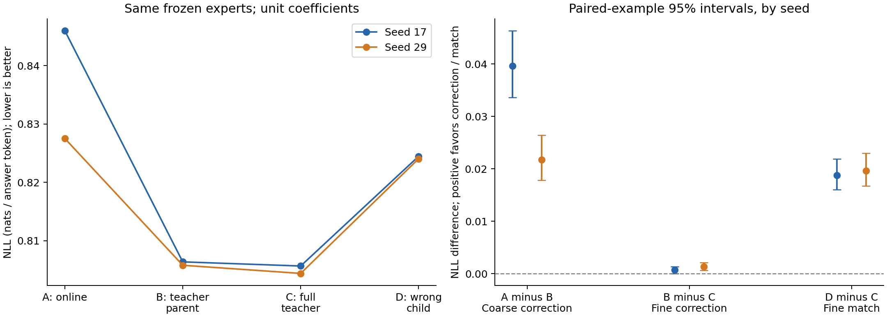
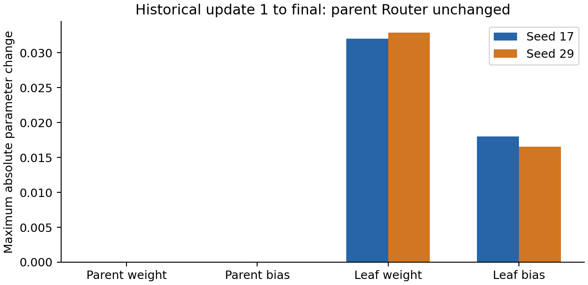
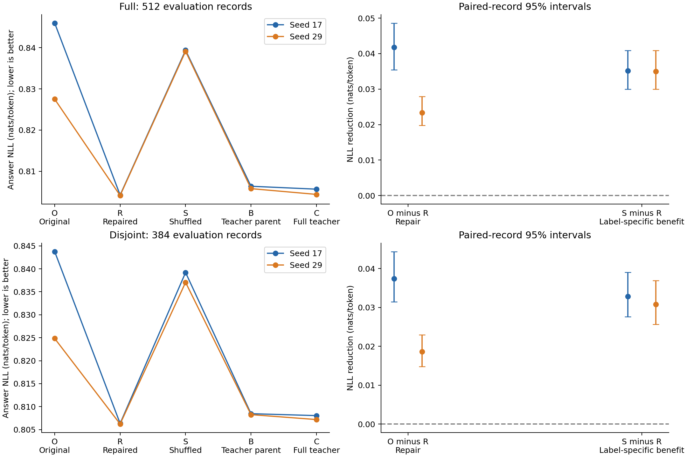
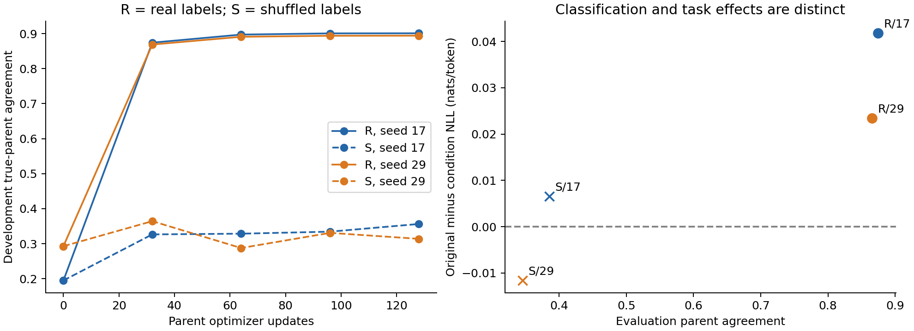
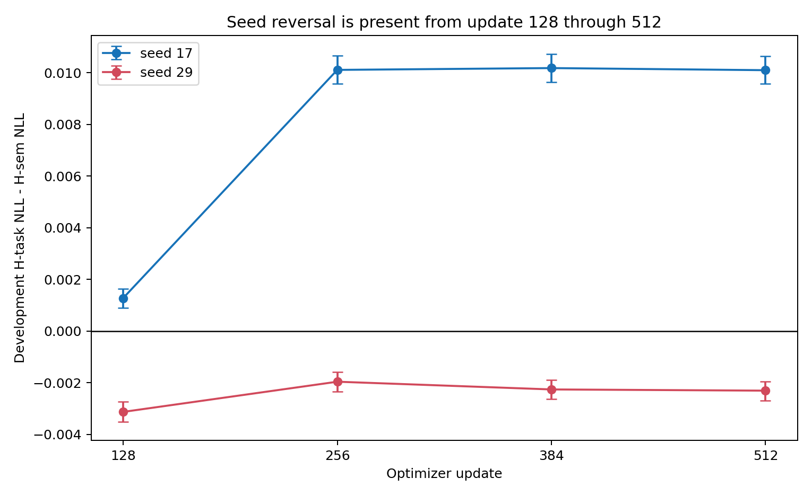
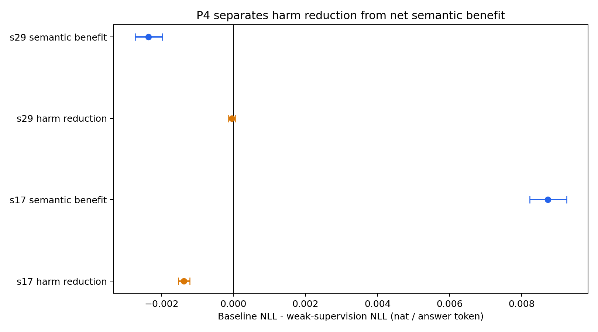

# 0908 实验规划审计 + 论文研究

> [0902 Router Selection - 0905 decision](chatgpt-conversation://6a982979-0634-83e8-8e0f-f4e1f8dcabbb) 请阅读该对话以及 [@0903\[1\]规划 SAE 粗细粒度路由分析](thread://01a06773-49c8-7e32-b504-00f3e5ddaad0?hostId=remote-ssh-codex-managed%3Amig)  + [@0903\[2\]运行实验1逐层静态审计](thread://01a0679c-7ee2-71f3-91b5-f4df234571db?hostId=remote-ssh-codex-managed%3Amig) ,现在我能给出的假设如下：
> 我怀疑离线语义标签交给在线Router时，可能存在几个问题：1. 离线语义给定的是最后一层的语义，而不是对应层的语义，很有可能对当层的语义目标发生干扰，如果用当层的语义标签，可能能够改善Router；2. 我怀疑早期的表征读出会造成Router的错训，因此会偏离oracle的语义分发；这个点我还不知道怎么继续验证
> 请基于对话给出我的认知纠正，然后给我阐明我们接下来的实验四段式验证，给出具体的目的和接下来要做的行为。再给我区分一下术语，让我知道哪些实验对象是要训练Router的，哪些是不训练的
> 接下来重新计划，我将在6:30开始我的工作，在这之前可以运行审计给出初步结果，然后调整推进方向

<details><summary>13 previous messages</summary>

> 我会先读取这三个对话，核对已有结果和“四段式验证”的上下文，再把你的两个假设拆成可验证的问题，明确哪些步骤只做审计、哪些需要训练 Router，并安排 6:30 前后的工作。
>
> <details><summary>Explored a file, 2 searches, a list, ran a command</summary>
>
> <details><summary>Explored a file, a search</summary>
>
> - Read `/root/.codex/plugins/cache/openai-curated-remote/superpowers/6.3.0/skills/using-superpowers/SKILL.md`
> - Searched for `static|静态|Router|Research_System` in `MEMORY.md`
>
> </details>
>
> Tool call
>
> Tool: read_thread
> Status: completed
>
> Tool call
>
> Tool: read_thread
> Status: completed
>
> <details><summary>Explored 2 files, a search, a list</summary>
>
> - Read `/root/.codex/plugins/cache/openai-curated-remote/superpowers/6.3.0/skills/using-superpowers/references/codex-tools.md`
> - Read `/root/.codex/plugins/cache/openai-curated-remote/superpowers/6.3.0/skills/brainstorming/SKILL.md`
> - Listed files in `250010109`
> - Searched for `static|静态|Router|Research_System` in `MEMORY.md`
>
> </details>
>
> Tool call
>
> Tool: read_thread
> Status: completed
>
> Tool call
>
> Tool: read_thread
> Status: completed
>
> Tool call
>
> Tool: read_thread
> Status: completed
>
> Tool call
>
> Tool: read_thread
> Status: completed
>
> - Ran `find /data/250010109 -maxdepth 3 -name AGENTS.md -print
> date -u
> nvidia-smi --query-gpu=index,name,memory.used,memory.total,utilization.gpu --format=csv,noheader`
>
> </details>
>
> 已有结果提示，需要把“标签在哪一层生成”和“标签用了多少上下文”分开：末层标签不一定错，但整窗标签可能包含当前词元还看不到的信息。另外，既有逐层审计测的是分类器能否读出标签，并没有训练实际分发的 Router。我会用 brainstorming 技能组织这次研究方案，先核对证据和可复用的审计入口。
>
> 你说的 6:30 是哪个日期、哪个时区？当前服务器时间为 9 月 6 日 07:56 UTC（北京时间 15:56）；我先继续核对结果与审计入口。
> - 9 月 7 日早上 6:30，北京时间
> - 9 月 6 日晚上 18:30，北京时间
>
> <details><summary>Explored 3 files, 2 searches, 2 lists</summary>
>
> - Read `./Research_System/AGENTS.md`
> - Searched for `*handoff*` in `MoE_Router`
> - Listed files in `experiments`
> - Read `./Research_System/AGENTS.md`
> - Read `./Research_System/.agents/skills/research-document-explainer/SKILL.md`
> - Listed files in `20260903_a15_13_e14_gmm_pseudolabel_oracle_gap`
> - Searched for `*E14*` in `experiments`
>
> </details>
>
> **你说的 6:30 是哪个日期、哪个时区？当前服务器时间为 9 月 6 日 07:56 UTC（北京时间 15:56）；我先继续核对结果与审计入口。**
>
> 9 月 6 日晚上 18:30，北京时间
>
> <details><summary>Explored 6 files</summary>
>
> - Read `./Research_System/.agents/skills/research-document-explainer/references/explanation_contract.md`
> - Read `./Research_System/.agents/skills/research-document-explainer/references/terminology_contract.md`
> - Read `./Research_System/.agents/skills/research-document-explainer/references/experiment_reasoning.md`
> - Read `./Research_System/.agents/skills/research-document-explainer/references/research_thinking.md`
> - Read `./Research_System/docs/research_terminology.md`
> - Read `./Research_System/PROJECTS.md`
>
> </details>
>
> 收到，按今天北京时间 18:30 安排。还有两点会影响计划：插层训练已经出现两个种子方向相反的结果，不能再把第 9 块当作已验证的最优插层；当前 SAE 层级也尚未形成覆盖全部类别的可靠教师。18:30 前最有价值的是核对旧伪标签专家的路径差距，以及审计所需的检查点、标签和数据是否齐全。
>
> <details><summary>Explored 9 files, 3 searches, a list, ran 3 commands</summary>
>
> <details><summary>Explored 9 files, a search</summary>
>
> - Read `./Research_System/PROJECTS.md`
> - Read `./Research_System/Projects/from-attention-to-search/main/focus/focus_gmm_pseudolabel_oracle_gap.md`
> - Read `./Research_System/Projects/from-attention-to-search/main/experiments/A15/15_13_semantic_supervision_middle_layer_formation/A15_13_E14_gmm_pseudolabel_oracle_gap/summary.md`
> - Read `./MoE_Router/experiments/20260903_a15_13_e14_gmm_pseudolabel_oracle_gap/completion_audit.py`
> - Read `./MoE_Router/experiments/20260903_a15_13_e14_gmm_pseudolabel_oracle_gap/checkpoint_manifest.py`
> - Searched for `*manifest*` in `runs`
> - Read `./MoE_Router/experiments/20260903_a15_13_e14_gmm_pseudolabel_oracle_gap/models.py`
> - Read `./MoE_Router/experiments/20260903_a15_13_e14_gmm_pseudolabel_oracle_gap/prepare_pseudo_labels.py`
> - Read `./Research_System/Projects/from-attention-to-search/main/experiments/A15/15_13_semantic_supervision_middle_layer_formation/A15_13_E14_gmm_pseudolabel_oracle_gap/summary.md`
> - Read `./Research_System/Projects/graphs/expert_specialization.graph.yaml`
>
> </details>
>
> - Ran `python - <<'PY'
> from pathlib import Path
> import json,numpy as np
> r=Path('/data/250010109/MoE_Router/experiments/20260903_a15_13_e14_gmm_pseudolabel_oracle_gap/runs/full-20260903T042000Z')
> m=json.loads((r/'checkpoint_manifest.json').read_text())
> for a in m['checkpoints']:
>  if 'hard' in a['model_key'].lower() or 'pseudo' in a['model_key'].lower():
>   print(a['model_key'],Path(a['checkpoint_path']).is_file(),a['checkpoint_path'])
> print('eval names',[p.name for p in (r/'evaluations').glob('*')][:35])
> print('data',m.get('data_hashes'))
> print('labels',[(str(p),p.stat().st_size) for p in (r/'pseudo_labels').glob('*/*')])
> PY
> grep -nE 'unit_coefficient|force_label|intervention ==|GMM|hard_pseudo|HARD' /data/250010109/MoE_Router/experiments/20260903_a15_13_e14_gmm_pseudolabel_oracle_gap/training.py
> sed -n '1,140p' /data/250010109/MoE_Router/experiments/20260903_a15_13_e14_gmm_pseudolabel_oracle_gap/registry.py`
>
> - Ran `sed -n '160,205p' /data/250010109/MoE_Router/experiments/20260903_a15_13_e14_gmm_pseudolabel_oracle_gap/training.py
> sed -n '258,355p' /data/250010109/MoE_Router/experiments/20260903_a15_13_e14_gmm_pseudolabel_oracle_gap/training.py
> python - <<'PY'
> import numpy as np
> from pathlib import Path
> r=Path('/data/250010109/MoE_Router/experiments/20260903_a15_13_e14_gmm_pseudolabel_oracle_gap/runs/full-20260903T042000Z/evaluations')
> for s in [17,29]:
>  for mode in ['intact','unit','force_label','wrong_same_parent','wrong_other_parent']:
>   p=r/f'benchmark__HIER_GMM_HARD_R8__seed{s}__{mode}.npz'
>   z=np.load(p)
>   print(s,mode,'nll',z['loss_sum'].sum()/z['token_count'].sum(),'shapes', {k:z[k].shape for k in z.files} if mode=='intact' else '')
> PY`
>
> <details><summary>Explored a file, 2 searches, a list</summary>
>
> - Searched for `def _path_arguments` in `training.py`
> - Searched for `replace\(|path_mode|pseudo_hard|evaluate_nll` in `experiment_cli.py`
> - Read `./MoE_Router/experiments/20260903_a15_13_e14_gmm_pseudolabel_oracle_gap/experiment_cli.py`
> - Listed files in `runtime_env`
>
> </details>
>
> - Ran `sed -n '350,455p' /data/250010109/MoE_Router/experiments/20260903_a15_13_e14_gmm_pseudolabel_oracle_gap/training.py
> sed -n '105,160p' /data/250010109/MoE_Router/experiments/20260903_a15_13_e14_gmm_pseudolabel_oracle_gap/training.py
> python - <<'PY'
> from pathlib import Path
> import numpy as np,json,hashlib
> r=Path('/data/250010109/MoE_Router/experiments/20260903_a15_13_e14_gmm_pseudolabel_oracle_gap/runs/full-20260903T042000Z')
> m=json.loads((r/'checkpoint_manifest.json').read_text())
> rng=np.random.default_rng(20260906)
> for s in (17,29):
>  key=f'benchmark__HIER_GMM_HARD_R8__seed{s}'
>  row=next(x for x in m['checkpoints'] if x['model_key']==key)
>  p=Path(row['checkpoint_path']); h=hashlib.sha256(p.read_bytes()).hexdigest()
>  a=np.load(r/'evaluations'/f'{key}__intact.npz'); b=np.load(r/'evaluations'/f'{key}__force_label.npz')
>  assert np.array_equal(a['token_count'],b['token_count']) and np.array_equal(a['source'],b['source'])
>  diff=a['loss_sum']-b['loss_sum']; count=a['token_count']
>  draw=rng.integers(0,len(count),(2000,len(count)))
>  delta=diff[draw].sum(1)/count[draw].sum(1)
>  print(json.dumps({'seed':s,'checkpoint_hash_match':h==row['checkpoint_sha256'],'examples':len(count),'answer_tokens':int(count.sum()),'gap':float(diff.sum()/count.sum()),'paired_example_bootstrap_95CI':np.quantile(delta,[.025,.975]).tolist(),'leaf_accuracy':float((a['route']==a['route_target']).mean()),'parent_accuracy':float((a['parent_route']==a['parent_target']).mean()),'forced_accuracy':float((b['route']==b['route_target']).mean()),'unit_exact_same_losses':bool(np.array_equal(a['loss_sum'],np.load(r/'evaluations'/f'{key}__unit.npz')['loss_sum']))}))
> PY`
>
> </details>
>
> 我已从原始评估数组复算出初步结果：两个种子的在线路径都比同一专家库的强制伪标签路径差，差值分别为 **0.040328、0.023130**。代码确认，两条路径的专家系数都为 1，因此这份差距不能归因于概率衰减。
>
> 还发现一个关键区别：这批专家训练时始终由伪标签分发，Router 当时只旁路学习，并不控制专家。因而“早期错误分发把专家训坏”不能解释这批模型的训练过程；更应先查 Router 为什么学不会原分配，以及它读取的位置是否合适。
>
> <details><summary>Explored a list, ran 2 commands</summary>
>
> - Ran `grep -n -A30 'def _route_loss' /data/250010109/MoE_Router/experiments/20260903_a15_13_e14_gmm_pseudolabel_oracle_gap/training.py
> grep -nE 'register_forward_pre_hook|mlp|capture' /data/250010109/MoE_Router/experiments/20260903_a15_13_e15_true_label_layerwise_static_audit/*.py | head -25
> sed -n '1,36p' /data/250010109/MoE_Router/experiments/20260903_a15_13_e14_gmm_pseudolabel_oracle_gap/training.py
> sed -n '1,48p' /data/250010109/Research_System/Projects/from-attention-to-search/main/focus/focus_sae_hierarchical_teacher_construction.md
> sed -n '1,35p' /data/250010109/Research_System/Projects/from-attention-to-search/main/experiments/A15/15_15_layerwise_moe_insertion_validation/A15_15_E01_layerwise_semantic_moe_insertion/summary.md
> sed -n '1,65p' /data/250010109/Research_System/Projects/from-attention-to-search/main/experiments/A15/15_13_semantic_supervision_middle_layer_formation/A15_13_E18_dataset_conditioned_sae_semantic_hierarchy/summary.md`
>
> - Ran `python - <<'PY'
> import importlib.util
> print('torch_available',importlib.util.find_spec('torch') is not None)
> PY
> sed -n '205,235p' /data/250010109/MoE_Router/experiments/20260903_a15_13_e14_gmm_pseudolabel_oracle_gap/training.py
> find /data/250010109/MoE_Router/experiments/20260903_a15_13_e15_true_label_layerwise_static_audit -maxdepth 3 -type f | head -15
> find /data/250010109 -maxdepth 4 -type f -path '*/bin/python*' | head -10`
>
> <details><summary>Explored a file, a list</summary>
>
> - Read `/root/.codex/plugins/cache/openai-curated-remote/superpowers/6.3.0/skills/systematic-debugging/SKILL.md`
> - Listed files in `checkpoints`
>
> </details>
>
> </details>
>
> 审计又发现一个更直接的实现疑点：八任务分支只运行第二阶段，但第二阶段的分类损失只监督细 Router；粗 Router 可能一直没有得到训练信号。我会按 systematic-debugging 技能核对它在各检查点中是否更新，并检查梯度。如果成立，必须先排除这个实现问题，才能把部署差距解释为语义标签或早期表征的问题。
>
> <details><summary>Explored 2 files, a search, ran 2 commands</summary>
>
> - Ran `python - <<'PY'
> from pathlib import Path
> import torch
> r=Path('/data/250010109/MoE_Router/experiments/20260903_a15_13_e14_gmm_pseudolabel_oracle_gap/runs/full-20260903T042000Z/conditions')
> for seed in (17,29):
>  d=r/f'benchmark__HIER_GMM_HARD_R8__seed{seed}'
>  states=[torch.load(p,map_location='cpu',weights_only=False)['adapter'] for p in sorted((d/'checkpoints').glob('*.pt'))]
>  final=torch.load(d/'final.pt',map_location='cpu',weights_only=False)['adapter']
>  print('seed',seed,'snapshots',len(states))
>  for k in ('parent_router.weight','parent_router.bias','leaf_router.weight','leaf_router.bias','parents.A','parents.B'):
>   if k in final:
>    print(k,'unchanged_all',all(torch.equal(s[k],final[k]) for s in states),'first_to_final_maxdelta',float((states[0][k].float()-final[k].float()).abs().max()))
>  print('keys',list(final)[:12])
> PY
> find /data/250010109/MoE_Router/experiments/20260901_a15_13_e07_e08_m2d2_causal_lm_semantic_routing -name routing_model.py
> find /data/250010109/MoE_Router/experiments/20260903_a15_13_e15_true_label_layerwise_static_audit -maxdepth 3 -name '*.py' | head -10`
>
> - Ran `python - <<'PY'
> import ast,sys
> from pathlib import Path
> import torch
> from torch.nn import functional as F
> root=Path('/data/250010109/MoE_Router/experiments/20260903_a15_13_e14_gmm_pseudolabel_oracle_gap')
> sys.path.insert(0,str(root))
> sys.path.insert(0,'/data/250010109/MoE_Router/experiments/20260901_a15_13_e07_e08_m2d2_causal_lm_semantic_routing')
> from models import HierRouterLoRA,RoutingOutput
> source=ast.parse((root/'training.py').read_text())
> node=next(n for n in source.body if isinstance(n,ast.FunctionDef) and n.name=='_route_loss')
> space={'torch':torch,'F':F,'RoutingOutput':RoutingOutput}
> exec(compile(ast.Module(body=[node],type_ignores=[]),str(root/'training.py'),'exec'),space)
> a=HierRouterLoRA(12,8,rank=2)
> x=torch.randn(2,4,12); h=torch.randn(2,4,8); leaf=torch.tensor([1,5]); parent=torch.tensor([0,1]); labels=torch.ones(2,4,dtype=torch.long)
> o=a(x,h,forced_leaf=leaf,unit_coefficient=True,stage=2)
> (o.delta.square().mean()+space['_route_loss'](o,parent,leaf,labels,2)).backward()
> print('original_stage2_hard_path', {n:None if p.grad is None else float(p.grad.norm()) for n,p in a.named_parameters() if 'router' in n})
> a.zero_grad(set_to_none=True)
> o=a(x,h,forced_leaf=leaf,unit_coefficient=True,stage=2)
> mask=labels[:,1:].ne(-100)
> coarse_loss=F.cross_entropy(o.parent_logits[:,:-1][mask], parent[:,None].expand_as(mask)[mask])
> (o.delta.square().mean()+space['_route_loss'](o,parent,leaf,labels,2)+coarse_loss).backward()
> print('diagnostic_add_parent_supervision', {n:None if p.grad is None else float(p.grad.norm()) for n,p in a.named_parameters() if 'router' in n})
> PY
> grep -nE 'register_forward_pre_hook|mlp' /data/250010109/MoE_Router/experiments/20260903_a15_13_e15_true_label_layerwise_static_audit/scripts/layerwise_static_audit.py | head -15
> date -u`
>
> <details><summary>Explored 3 files, a search</summary>
>
> - Searched for `register_forward_pre_hook|\.mlp\.` in `layerwise_static_audit.py`
> - Read `./MoE_Router/experiments/20260903_a15_13_e14_gmm_pseudolabel_oracle_gap/training.py`
> - Read `./MoE_Router/experiments/20260901_a15_13_e07_e08_m2d2_causal_lm_semantic_routing/routing_model.py`
> - Read `/root/.codex/plugins/cache/openai-curated-remote/superpowers/6.3.0/skills/verification-before-completion/SKILL.md`
>
> </details>
>
> </details>
</details>

**你的两个假设都值得保留，但现在应先排除一个已经查实的训练问题：八任务硬伪标签实验中的粗 Router 没有得到梯度。** 因此，当前不能把全部部署损失解释为“末层标签误导了前层”。

三个对话已读取，并核对了本地代码、检查点和原始评估数组。以下先给认知纠正，再给验证顺序和今天 **18:30（北京时间）** 前后的安排。

**先更新已有认识**

本次只读审计发现：

- 八任务实验没有先训练粗路由阶段，只执行了第二阶段。
- 第二阶段的分类损失只监督细 Router。
- 硬伪标签路径直接决定专家，且专家系数为 1，任务损失也无法通过这条路径训练粗 Router。
- 两个种子的粗 Router 权重、偏置，在第 1 次更新至最终检查点之间**完全不变**；细 Router 则有更新。
- 使用实际模块做最小反向计算，粗 Router 梯度确实为 `None`；补入粗分类监督后才出现梯度。

代码依据：[监督损失与路径设置](/data/250010109/MoE_Router/experiments/20260903_a15_13_e14_gmm_pseudolabel_oracle_gap/training.py:222)。

同时，我复算了同一专家库的答案词元负对数似然（NLL，即平均预测损失，越低越好）：

| 种子 | 原在线路径 | 强制原伪标签路径 | 在线路径多出的损失 |
|---|---:|---:|---:|
| 17 | 0.845991 | 0.805663 | +0.040328 |
| 29 | 0.827523 | 0.804393 | +0.023130 |
| 平均 | 0.836757 | 0.805028 | **+0.031729** |

**差距真实存在，但其中包含“粗 Router 没有训练”的实现因素。修复后还能剩下多少差距，才是语义交接问题的下一份证据。** 这项发现限定于上述八任务硬伪标签分支，不能直接推广到采用两阶段训练的 M2D2 实验。

对你的两个假设，建议这样改写：

| 原假设 | 更准确、可验证的版本 |
|---|---|
| 末层语义干扰当层；当层标签可能更好 | **在相同上下文范围、相同标签构造方法下，当层教师是否比末层教师更容易被路由器预测，并保留任务价值？** |
| 早期表征读出造成 Router 错训 | 分别检验：**浅层输入不易读出、序列早期信息不足、训练早期错误分发影响专家责任**。三者需要不同实验。 |

这里有三个关键区别。

第一，**层深与上下文范围是两个变量**。末层当前词元状态仍然是因果的，只能看见前缀；整窗平均则可能使用当前位置之后的信息。换成“当层整窗标签”，仍然没有消除未来信息问题。

第二，**容易预测的标签不一定值得分发**。从当层状态直接聚类，再用同一状态预测簇编号，可能只是学会了几何分区；必须另测专家和任务收益。

第三，**“训练早期错误分发训坏专家”不适用于这批硬伪标签专家**：训练期间实际分发始终由教师控制，Router 只在旁路学习。这个假设适用于由学习中 Router 控制专家的另一类训练。

此外，旧静态审计读取的是**多层感知机调用前状态**，上述部署 Router 实际读取的是**整个 Transformer 块进入时的状态**。两者之间隔着该块的注意力计算等操作。不能直接用旧审计曲线证明部署 Router 已经拿到了同一种输入。[部署读取位置](/data/250010109/MoE_Router/experiments/20260903_a15_13_e14_gmm_pseudolabel_oracle_gap/training.py:110)

**本次术语：训练了什么，是否控制分发**

| 对象 | 具体含义 | 是否训练 | 是否实际控制专家 |
|---|---|---|---|
| 离线教师 | 生成分组标签的聚类器或稀疏自编码器（SAE）及其分组规则 | 构造时可能训练；使用时冻结 | 强制教师路径时控制 |
| 读出探针 | 检查某个表示能否预测标签的小分类器 | **训练分类器**，冻结基座 | 否 |
| 影子 Router | 按教师标签学习，但暂不控制前向分发的路由器 | **训练 Router** | 训练时否 |
| 在线 Router | 根据当前可见信息实际选择专家 | 可以训练，也可以冻结评估 | 是 |
| 强制路径评估 | 外部指定专家编号，再测任务损失 | **不训练任何参数** | 外部编号控制 |
| Oracle 参考 | 使用真实类别指定路径的实验参考 | 专家通常另行训练；评估时冻结 | 真实类别控制 |
| 联合训练 | Router 与专家一起更新 | **训练 Router＋专家** | 取决于教师交接安排 |

**“冻结模型审计”不等于完全不训练：它可以训练探针。真正的区别是，是否更新基座、专家，以及分类器是否控制实际分发。** Oracle 也不是逐词元损失最优路径的数学保证。

**接下来的验证：四步，每步按“目的—假设—方法—结论分支”说明**

**第一步：训练与路径完整性审计——先确认比较对象有效。**

- **目的：**排除实现缺口，确定部署损失由哪一级路径产生。
- **假设：**未训练的粗 Router 是当前差距的重要来源。
- **方法：**冻结同一专家库和全部 Router，比较“预测粗＋预测细”“强制教师粗＋预测细”“强制教师粗＋教师细”，全部保持单位专家系数；再补“教师粗＋同父错误细”对照。
- **结论分支：**只强制粗路径就明显恢复，优先修复粗路由；强制细路径还带来明显恢复，再处理细路由。如果教师细路径并不优于错误细路径，就不能认定原标签与细专家具有可靠匹配。

**训练对象：无。** 本次已完成梯度、参数变化和原始损失复算；新增的粗路径单独干预尚未运行。

---

**第二步：固定专家，只修复 Router——先区分训练缺口与读出困难。**

- **目的：**检验完整训练的因果 Router 能追回多少收益。
- **假设：**补全粗细监督可以缩小差距；若历史信息读取仍不足，因果前缀摘要还能带来额外收益。
- **方法：**固定旧专家、旧标签、插入层和专家系数，按顺序比较：

| 条件 | Router 输入／训练变化 | 保护哪种解释 |
|---|---|---|
| 原模型 | 原样评估 | 历史参照 |
| 完整监督的当前词元 Router | 原输入；补全粗细监督 | 排除训练不完整 |
| 完整监督的前缀 Router | 当前状态＋截至当前位置的历史平均 | 检验历史读取方式 |
| 整窗读出诊断 | 允许读取整窗摘要 | 测量非因果信息的帮助，不能部署 |

当前词元与前缀条件匹配分类器容量、数据顺序和更新预算。先用分类损失训练影子 Router，再接入冻结专家评估。

- **结论分支：**当前词元修复已恢复大部分收益，就先修训练；前缀在相同预算外进一步降低任务损失，才支持历史读出机制。若只提高标签准确率、不降低任务损失，则应检查监督目标的功能价值。

**训练对象：只有 Router。基座与所有专家冻结。**

主要比较是：

\[
\Delta_{\text{前缀}}
=
L_{\text{完整监督当前词元}}
-
L_{\text{完整监督前缀}}.
\]

只有它为正，才说明前缀方案优于公平的当前词元对照。

---

**第三步：拆开教师层位与上下文范围——正式检验你的第一个假设。**

- **目的：**区分“末层来源不合适”和“整窗标签不适合当前前缀”。
- **假设：**限制为因果前缀后，当层教师仍可能比末层教师更适合在线预测。
- **方法：**固定 Router 插入位置和聚类方法，只做以下四格教师审计：

| 教师来源 | 整窗平均 | 因果前缀平均 |
|---|---|---|
| 末层 | 旧方案参照 | 隔离上下文范围 |
| Router 对应的具体输入位置 | 隔离层位 | 同时对齐层位与上下文 |

拟合只使用训练集。先检查分组稳定性、覆盖和留出数据上的可预测性；同层同输入构造的标签，要特别防止把“学会簇边界”解释为语义发现。

- **结论分支：**两种层位都因前缀化改善，首先支持上下文错位；固定前缀后当层仍更好，才支持层位匹配的读出优势。**两者都不能单独证明任务收益。**

**训练对象：聚类器及审计探针；此步不训练专家，也不部署新 Router。**

新标签改变了专家责任含义，不能把新簇编号直接塞进旧专家库证明有效。当前 SAE 也尚未形成完整可靠教师，不适合在这里同时替换聚类方法。[SAE 现有边界](Projects/from-attention-to-search/main/experiments/A15/15_13_semantic_supervision_middle_layer_formation/A15_13_E18_dataset_conditioned_sae_semantic_hierarchy/summary.md:14)

---

**第四步：功能与训练责任验证——最后判断是否成为方法。**

- **目的：**检验候选标签和交接方案是否真正改善可部署模型。
- **假设：**合格教师能塑造有用专家，完整训练的 Router 能保留这份价值。
- **方法：**只选前面胜出的一个候选，匹配训练预算比较任务损失训练、旧教师、新教师及频率匹配随机分组。分别报告教师强制路径与在线路径，并做删除、同父换错专家干预。若要检验“训练早期错误分发”，再对同一教师比较“从开始由 Router 分发”与“教师先分发、逐步交接”，保持初始化及预算匹配。
- **结论分支：**教师路径有效、在线失败，问题仍在交接；教师路径也无优势，停止优化标签恢复率；在线稳定优于匹配基线，才进入更大预算验证。

**训练对象：Router＋专家；本轮仍冻结基座。** 不同时扩大扫层、SAE 和注意力头实验。

**今天 18:30 前后的新安排**

| 北京时间 | 优先行为 | 应得到什么 |
|---|---|---|
| **现在：已完成** | 检查点核验、损失复算、粗 Router 梯度与权重审计 | 已确认训练缺口；保留真实部署差距 |
| 现在—17:00 | 优先补第一步的粗路径单独干预；检查可用运行资源 | 判断粗路径能解释多少损失 |
| 17:00—18:15 | 在吞吐允许时，先跑第二步的“完整监督当前词元”小预算修复 | 一个修复后的参照，先不混入新标签 |
| 18:15—18:30 | 汇总已完成结果、未完成项和耗时 | 供你开始工作时裁决 |
| **18:30—19:00** | 你检查修复恢复量与剩余差距 | 决定继续读出对照，还是进入教师审计 |
| 19:00 以后 | 按结果推进一个分支 | 前缀读出对照优先；教师四格后置 |

这张表是执行优先级，完成时间需由实测吞吐决定。**本轮已经运行的是只读审计和最小梯度验证，尚未修改训练代码或启动新训练。**

你在 18:30 首先需要回答的问题应收缩为：**“粗细 Router 都得到完整训练以后，同一专家库还剩多少在线交接损失？”** 这个答案会直接决定你的两个语义假设是否值得进入下一轮。

> 请给出第一步粗路径干预的具体计划，并且对应上具体4步规划

**第一步只做一件事：固定现有专家和 Router，外部纠正粗路径，测量任务损失能恢复多少。全程不训练参数。** 它对应四步规划中的“训练与路径完整性审计”，结果决定第二步先修粗 Router，还是同时处理细 Router。

**1. 目的**

判断已有的平均 **0.031729 NLL 部署差距**，有多少能通过“给定正确的伪标签粗路径”恢复，以及细专家是否真的与原伪标签匹配。

这里“正确”指**这批专家训练时使用的原伪标签**，不是人工真实类别，也不是重新生成的标签。

**2. 假设**

- **主要假设：**粗 Router 没有得到训练，使输入进入错误父组；强制原教师粗路径后，即使保留现有细 Router，也能明显降低任务损失。
- **竞争解释：**纠正粗路径仍不够，细 Router 也无法恢复教师分配；或者原伪标签细分本身缺乏专家功能价值。

**3. 分析方法**

固定八任务硬伪标签模型的两个种子 `17、29`，使用原来的 **512 条评估样本、30,442 个答案词元**。基座、语言头、共享专家、粗细专家、粗细 Router、标签及样本顺序全部冻结。所有条件的专家系数固定为 **1**。

运行以下四个条件：

| 条件 | 粗路径 | 细路径 | 回答的问题 |
|---|---|---|---|
| A：原在线路径 | 粗 Router 预测 | 在预测父组内，由细 Router 选择 | 原始部署损失是多少？ |
| B：只纠正粗路径 | **原教师粗标签** | **在教师父组内，重新由细 Router 选择** | 纠正父组能恢复多少？ |
| C：完整教师路径 | 原教师粗标签 | 原教师细标签 | 剩余细路径差距是多少？ |
| D：教师粗＋错误细 | 原教师粗标签 | 同父组内的其他细专家 | 原教师细专家是否真的更合适？ |

**B 的实现是关键：不能保留 A 选出的细专家。** A 的细专家可能属于错误父组；B 必须先把候选集合限制到教师父组，再用原细 Router 的分数重新选择。

D 使用实际标签文件中的父子映射。同父其他细专家逐一评估后取平均，避免只选某一个错误专家造成偏差；不改动该父组的粗专家。

具体执行分三项：

1. **先验证路径。** 检查 B 的父组全部等于教师父组、细专家全部属于该父组；C 完整匹配教师标签；D 保持父组不变且细专家不同。确认全部参数未更新、系数均为 1。
2. **统一前向评估。** 四个条件都在完整序列前向中应用路径干预，只在原答案掩码上计算损失；不能只改统计出来的路径记录。A、C 同时作为重放检查，与已有结果核对。
3. **逐样本配对分析。** 保存每条样本的损失总和、答案词元数、路径和任务来源；分别报告两个种子，并做 2,000 次样本级配对重采样，给出 95% 区间。

记四个条件的平均答案词元损失为 \(L_A,L_B,L_C,L_D\)，核心量是：

\[
\Delta_{\text{粗纠正}}=L_A-L_B
\]

表示**纠正父组，并让现有细 Router 在正确父组内选择**的收益。

\[
\Delta_{\text{细纠正}}=L_B-L_C
\]

表示父组正确以后，继续提供教师细标签的额外收益。

\[
\Delta_{\text{细匹配}}=L_D-L_C
\]

表示教师细专家是否优于同父错误专家。

三者均以正值为有利信号。另报告：

\[
R_{\text{粗纠正}}
=\frac{L_A-L_B}{L_A-L_C}.
\]

这是沿该干预顺序的恢复比例，**不是“粗 Router 独立解释了多少因果方差”**。纠正粗路径会同时改变粗专家和可选细专家，恢复比例也可能小于 0 或大于 100%，应原样报告。

**4. 结论分支，以及如何接上后续三步**

| 第一步的结果 | 可得到的结论 | 下一步行为 |
|---|---|---|
| B 接近 C，且两种子均明显优于 A | 给定教师父组后，现有细 Router 已能恢复大部分路径价值 | **第二步优先只训练粗 Router**，其余冻结；检验它能否在线复现 B |
| B 优于 A，但仍明显差于 C | 粗路由和父组内细路由都有缺口 | **第二步训练完整粗细 Router**；先用原当前词元输入建立修复基线 |
| B 与 A 接近，但 C 明显更好 | 只纠正父组不足，细路径是主要剩余问题 | 第二步重点检查细分类目标、父组约束与因果可预测性 |
| C 不稳定优于 D | 尚未证明教师细标签对应更合适的细专家 | 暂缓扩大交接训练，先查标签—专家匹配；不能只追求标签准确率 |
| B 比 A 更差 | 粗细路径存在交互或不匹配 | 先检查干预实现及逐任务差异，不直接解释为“粗语义无用” |
| 两种子相反或区间跨零 | 当前证据不足 | 保留不确定结论，不据此换教师或扩模型 |

与整体四步的对应关系是：

| 总体步骤 | 本步结束时要回答什么 | 训练对象 |
|---|---|---|
| **① 粗路径干预：本次计划** | 外部纠正哪一级路径能恢复收益？ | **不训练** |
| **② 固定专家修复 Router** | 完整训练的因果 Router 能否自行恢复这些路径收益？ | **只训练 Router** |
| **③ 教师层位 × 上下文审计** | 第二步仍有差距时，是教师层位还是上下文范围不合适？ | **拟合教师、训练探针；不训练专家** |
| **④ 功能与交接训练验证** | 候选方案能否产生优于匹配基线的可部署收益？ | **训练 Router＋专家，冻结基座** |

**第一步的交付物就是一张四条件损失表、一张三个干预差值图，以及一个第二步选择。** 对应原定 18:30 的决策节点，优先完成这份结果；此时不需要重训 SAE、生成新标签或重新扫描层位。

> 认同你的执行顺序，我们现在先开始执行第一步骤，将路径修复，然后进行架构审计

<details><summary>13 previous messages</summary>

> 我会先核对研究任务归属和执行协议，再落实第一步的四种路径干预。随后检查粗细路由监督、输入读取位置和训练阶段是否一致，用审计结果决定后续修复范围。
>
> <details><summary>Explored 2 files, ran a command</summary>
>
> <details><summary>Explored 4 files</summary>
>
> - Read `./PROJECTS.md`
> - Read `./Projects/from-attention-to-search/main/focus/focus_gmm_pseudolabel_oracle_gap.md`
> - Read `./.agents/skills/experiment-card-writer/SKILL.md`
> - Read `./.agents/skills/remote-experiment-workflow/SKILL.md`
>
> </details>
>
> - Ran `cat .agents/skills/experiment-card-writer/SKILL.md
> cat .agents/skills/research-progress-core/SKILL.md
> sed -n '1,130p' Projects/from-attention-to-search/main/problem_anchors/15_spectral_representation_and_functional_routing/15_13_semantic_supervision_middle_layer_formation/subanchors/15_13_05_gmm_pseudolabel_oracle_gap_anchor.md
> find daily_research_reports -name '*handoff*' -o -name '*gmm*'
> git status --short`
>
> </details>
>
> 我会使用实验协议和远程执行技能，把你刚批准的四条件方案写入正式协议后执行。当前被其他任务占用的是逐层静态审计和 SAE 构造；这次处理的是原八任务伪标签模型的路径交接问题，我会单独登记归属，保留它们的记录。
>
> <details><summary>Created 3 files, edited a file, explored 3 files, ran 5 commands</summary>
>
> - Ran `cat .agents/skills/experiment-card-writer/references/blockwise_protocol_audit.md
> cat .agents/skills/experiment-card-writer/references/protocol_self_containment_and_freeze.md
> cat /root/.codex/skills/sco-control/SKILL.md
> python - <<'PY'
> import torch
> print('torch',torch.__version__,'cuda',torch.cuda.is_available())
> if torch.cuda.is_available():
>  print(torch.cuda.get_device_name(0))
>  print(torch.empty(1,device='cuda'))
> PY
> sed -n '1,130p' /data/250010109/MoE_Router/experiments/20260903_a15_13_e14_gmm_pseudolabel_oracle_gap/submit_h100_4_reserved.sh
> find /data/250010109/MoE_Router -maxdepth 2 -name AGENTS.md -print`
>
> <details><summary>Explored 5 files</summary>
>
> - Read `/data/250010109/MoE_Router/experiments/20260901_a15_13_e07_e08_m2d2_causal_lm_semantic_routing/runtime.py`
> - Read `/data/250010109/MoE_Router/experiments/20260903_a15_13_e14_gmm_pseudolabel_oracle_gap/run_pipeline.sh`
> - Read `/data/250010109/MoE_Router/experiments/20260903_a15_13_e14_gmm_pseudolabel_oracle_gap/training.py`
> - Read `/root/.codex/plugins/cache/openai-curated-remote/superpowers/6.3.0/skills/test-driven-development/SKILL.md`
> - Read `/root/.codex/plugins/cache/openai-curated-remote/superpowers/6.3.0/skills/using-git-worktrees/SKILL.md`
>
> </details>
>
> - Ran `grep -n -A38 'def load_backbone' /data/250010109/MoE_Router/experiments/20260901_a15_13_e07_e08_m2d2_causal_lm_semantic_routing/runtime.py
> python - <<'PY'
> import transformers,torch
> print(transformers.__version__)
> print(torch.cuda.mem_get_info())
> PY
> sed -n '1,125p' /data/250010109/MoE_Router/experiments/20260730_h768_4layer_switch_5090_smoke/scripts/activate_runtime_layer.sh
> ls /data/250010109/dependency_packages
> cat .agents/skills/experiment-card-writer/references/result_evidence_lineage.md
> cat .agents/skills/experiment-card-writer/references/detailed_record_standard.md
> cat .agents/skills/experiment-card-writer/references/plain_language_completion_reply.md`
>
> - Ran `PYTHONPATH=/data/250010109/dependency_packages/a15_e14_datasets_py310:/data/250010109/dependency_packages/hf_transformers_qwen3 python - <<'PY'
> import transformers,torch
> print(transformers.__version__)
> print(torch.cuda.mem_get_info())
> from transformers import AutoModelForCausalLM
> print('import_ok')
> PY
> sed -n '1,35p' Projects/graphs/expert_specialization.graph.yaml
> ls /data/250010109/MoE_Router/experiments/20260903_a15_13_e14_gmm_pseudolabel_oracle_gap/tests`
>
> - Wrote `./Projects/from-attention-to-search/main/experiments/A15/15_13_semantic_supervision_middle_layer_formation/A15_13_E14_P1_coarse_path_intervention/protocol.md` (+63 -0)
> - Wrote `./Projects/from-attention-to-search/main/focus/focus_gmm_pseudolabel_handoff.md` (+53 -0)
>
> - Wrote `./PROJECTS.md` (+1 -0)
>
> - Wrote `/data/250010109/MoE_Router/experiments/20260906_a15_13_e14_p1_coarse_path_intervention/test_intervention.py` (+53 -0)
>
> - Ran `python -m pytest -q /data/250010109/MoE_Router/experiments/20260906_a15_13_e14_p1_coarse_path_intervention/test_intervention.py`
>
> - Ran `PYTHONPATH=/data/250010109/dependency_packages/hf_transformers_qwen3 python - <<'PY'
> import sys
> sys.path.append('/data/250010109/dependency_packages/a15_e14_datasets_py310')
> import numpy,torch,transformers
> print(numpy.__version__,torch.__version__,transformers.__version__)
> from transformers import AutoModelForCausalLM
> print('import_ok',torch.cuda.mem_get_info())
> PY`
>
> </details>
>
> 已登记本任务并保存你批准的协议。当前容器有可用的 40GB 显存分区，可以直接评估。实现上需要补通一个入口：原模型内部支持指定粗路径，但外层调用没有把它传进去；我会补上并验证，确保指定父组后，细 Router 在该组内重新选择。
>
> <details><summary>Created 2 files, edited a file, ran 6 commands</summary>
>
> - Wrote `/data/250010109/MoE_Router/experiments/20260906_a15_13_e14_p1_coarse_path_intervention/intervention.py` (+52 -0)
> - Ran `python -m pytest -q /data/250010109/MoE_Router/experiments/20260906_a15_13_e14_p1_coarse_path_intervention/test_intervention.py`
> - Wrote `/data/250010109/MoE_Router/experiments/20260906_a15_13_e14_p1_coarse_path_intervention/run_audit.py` (+204 -0)
> - Ran `python /data/250010109/MoE_Router/experiments/20260906_a15_13_e14_p1_coarse_path_intervention/run_audit.py --output /data/250010109/MoE_Router/experiments/20260906_a15_13_e14_p1_coarse_path_intervention/runs/smoke-v1 --limit 8`
> - Ran `python - <<'PY'
> from pathlib import Path
> import re
> paths=[Path('Projects/from-attention-to-search/main/focus/focus_gmm_pseudolabel_handoff.md'),Path('Projects/from-attention-to-search/main/experiments/A15/15_13_semantic_supervision_middle_layer_formation/A15_13_E14_P1_coarse_path_intervention/protocol.md')]
> for f in paths:
>  for dest in re.findall(r'\]\(([^)]+)\)',f.read_text()):
>   print(str(f),dest,(f.parent/dest).resolve().exists())
> PY`
> - Wrote `/data/250010109/MoE_Router/experiments/20260906_a15_13_e14_p1_coarse_path_intervention/run_audit.py` (+1 -0)
> - Ran `python /data/250010109/MoE_Router/experiments/20260906_a15_13_e14_p1_coarse_path_intervention/run_audit.py --output /data/250010109/MoE_Router/experiments/20260906_a15_13_e14_p1_coarse_path_intervention/runs/smoke-v2 --limit 8`
> - Ran `python - <<'PY'
> from pathlib import Path
> import json
> root=Path('/data/250010109/MoE_Router/experiments/20260903_a15_13_e14_gmm_pseudolabel_oracle_gap/runs/full-20260903T042000Z')
> m=json.loads((root/'checkpoint_manifest.json').read_text())
> print(json.dumps(m['reused_models'],indent=2)[:2000])
> PY`
> - Ran `python - <<'PY'
> import json
> from pathlib import Path
> r=Path('/data/250010109/MoE_Router/experiments/20260906_a15_13_e14_p1_coarse_path_intervention/runs/smoke-v2')
> m=json.loads((r/'metadata.json').read_text()); print(json.dumps(m['replay'],indent=2))
> PY
> ls /usr/local/bin/python* /usr/bin/python*`
>
> </details>
>
> 路径入口测试已通过，但本地重放未通过：样本、掩码和专家编号都一致，原在线损失却相差约 0.00354，超过预先固定的容差。我已停止本地完整评估。接下来会核对权重和数值环境，优先使用原实验的运行环境复现，不放宽判定标准。
>
> <details><summary>Created 2 files, explored 2 files, a list, ran 4 commands</summary>
>
> - Ran `cat /root/.codex/skills/sco-control/references/acp.md
> sed -n '1,170p' /data/250010109/MoE_Router/experiments/20260730_h768_4layer_switch_5090_smoke/scripts/sco_acp_compat.sh
> find /data/250010109/MoE_Router/experiments/20260903_a15_13_e15_true_label_layerwise_static_audit -maxdepth 3 -name '*submit*'
> python - <<'PY'
> from pathlib import Path
> import hashlib,json
> p=Path('/data/250010109/model_cache/Qwen3-0.6B-Base-official')
> for name in ('model.safetensors','config.json'):
>  h=hashlib.sha256()
>  with (p/name).open('rb') as f:
>   for b in iter(lambda:f.read(1<<20),b''):h.update(b)
>  print(name,h.hexdigest())
> PY`
>
> - Ran `sed -n '1,100p' /data/250010109/MoE_Router/experiments/20260903_a15_13_e15_true_label_layerwise_static_audit/scripts/submit_h100_1_spot.sh
> bash /data/250010109/MoE_Router/experiments/20260730_h768_4layer_switch_5090_smoke/scripts/sco_acp_compat.sh jobs list --workspace-name=share-space --page-size=5 -o json`
>
> <details><summary>Explored 2 files, a list</summary>
>
> - Read `/data/250010109/MoE_Router/experiments/20260903_a15_13_e14_gmm_pseudolabel_oracle_gap/resume_unified_evaluation.sh`
> - Listed files in `logs`
> - Read `/data/250010109/MoE_Router/experiments/20260903_a15_13_e14_gmm_pseudolabel_oracle_gap/runs/full-20260903T042000Z/completion_audit.json`
>
> </details>
>
> - Ran `python /data/250010109/MoE_Router/experiments/20260906_a15_13_e14_p1_coarse_path_intervention/run_audit.py --output /data/250010109/MoE_Router/experiments/20260906_a15_13_e14_p1_coarse_path_intervention/runs/smoke-batch8 --limit 8 --batch 8`
>
> - Wrote `/data/250010109/MoE_Router/experiments/20260906_a15_13_e14_p1_coarse_path_intervention/run_remote.sh` (+13 -0)
> - Wrote `/data/250010109/MoE_Router/experiments/20260906_a15_13_e14_p1_coarse_path_intervention/submit_evaluation.sh` (+20 -0)
>
> - Ran `bash /data/250010109/MoE_Router/experiments/20260906_a15_13_e14_p1_coarse_path_intervention/submit_evaluation.sh
> python -m pytest -q /data/250010109/MoE_Router/experiments/20260906_a15_13_e14_p1_coarse_path_intervention/test_intervention.py`
>
> </details>
>
> 基座和适配器的文件指纹均与原实验一致；改回原批大小后，重放仍未通过。已准备好使用原 PyTorch 2.8／CUDA 12.9 镜像的单张 H100 评估作业，包含小样本重放、四条件评估和 90 分钟进程上限，尚未提交。
>
> 这里只需确定新增算力的配额类型。SCO 的[资源规则](/root/.codex/skills/sco-control/references/acp.md)要求“Use `--quota-type spot` only when the user explicitly wants idle resources and accepts possible interruption”；之前批准的协议也仅登记了本地显卡，因此需要补这一项资源选择。
>
> 第一步评估将使用原运行镜像和单张 H100，最多运行 90 分钟、不训练参数。请选择配额类型：
> - 标准配额 reserved：按原实验配额类型执行
> - 空闲配额 spot：接受中断后重跑
>
> <details><summary>Created a file, ran 2 commands</summary>
>
> - Wrote `/data/250010109/MoE_Router/experiments/20260906_a15_13_e14_p1_coarse_path_intervention/analyze.py` (+107 -0)
> - Ran `python - <<'PY'
> from pathlib import Path
> import json
> r=Path('/data/250010109/MoE_Router/experiments/20260906_a15_13_e14_p1_coarse_path_intervention/runs')
> for name in ('smoke-v1','smoke-v2','smoke-batch8'):
>  p=r/name/'metadata.json'
>  m=json.loads(p.read_text())
>  m['status']='FAILED_PREFLIGHT' if name=='smoke-v1' else 'FAILED_REPLAY'
>  m['failure_reason']='Incompatible ONNX protobuf import before model load' if name=='smoke-v1' else 'Historical A replay NLL differs beyond fixed 1e-4 tolerance'
>  p.write_text(json.dumps(m,indent=2,sort_keys=True)+'\n')
>  print(name,m['status'],m.get('replay'))
> PY`
> - Ran `python - <<'PY'
> from pathlib import Path
> import json,csv
> src=Path('/data/250010109/MoE_Router/experiments/20260906_a15_13_e14_p1_coarse_path_intervention/runs/smoke-batch8/architecture_audit.json')
> a=json.loads(src.read_text())
> out=Path('Projects/from-attention-to-search/main/experiments/A15/15_13_semantic_supervision_middle_layer_formation/A15_13_E14_P1_coarse_path_intervention/tables')
> out.mkdir(exist_ok=True)
> rows=[]
> for seed,record in a['snapshots'].items():
>  for key,v in record['parameters'].items():rows.append({'seed':seed,'parameter':key,**v})
> with (out/'architecture_weight_audit.csv').open('w') as f:
>  w=csv.DictWriter(f,fieldnames=list(rows[0]));w.writeheader();w.writerows(rows)
> with (out/'architecture_gradient_audit.csv').open('w') as f:
>  w=csv.writer(f);w.writerow(['condition','parameter','gradient_is_none','gradient_norm'])
>  for c in ['original_gradient_norms','diagnostic_parent_loss_gradient_norms']:
>   for k,v in a[c].items():w.writerow([c,k,v is None,v])
> print('Architecture evidence tables written; no repaired checkpoint produced.')
> PY
> bash -n /data/250010109/MoE_Router/experiments/20260906_a15_13_e14_p1_coarse_path_intervention/run_remote.sh /data/250010109/MoE_Router/experiments/20260906_a15_13_e14_p1_coarse_path_intervention/submit_evaluation.sh
> python -m py_compile /data/250010109/MoE_Router/experiments/20260906_a15_13_e14_p1_coarse_path_intervention/intervention.py /data/250010109/MoE_Router/experiments/20260906_a15_13_e14_p1_coarse_path_intervention/run_audit.py /data/250010109/MoE_Router/experiments/20260906_a15_13_e14_p1_coarse_path_intervention/analyze.py`
>
> </details>
>
> 架构审计再次确认了两点：粗 Router 在全部七个保存点中都没有变化，原硬伪路径训练下也没有梯度；实际 Router 读取的是注意力之前的块输入，旧静态审计读取的则是注意力之后的多层感知机输入。两者不能当作同一个表示来比较。我已保存这些证据，并修好本步的粗路径干预入口；损失恢复量仍须等重放通过后才能报告。
>
> <details><summary>Created 2 files, edited 2 files, ran a command</summary>
>
> - Wrote `./Projects/from-attention-to-search/main/experiments/A15/15_13_semantic_supervision_middle_layer_formation/A15_13_E14_P1_coarse_path_intervention/detailed.md` (+70 -0)
> - Wrote `./Projects/from-attention-to-search/main/experiments/A15/15_13_semantic_supervision_middle_layer_formation/A15_13_E14_P1_coarse_path_intervention/protocol.md` (+6 -0)
> - Wrote `./Projects/from-attention-to-search/main/experiments/A15/15_13_semantic_supervision_middle_layer_formation/A15_13_E14_P1_coarse_path_intervention/summary.md` (+23 -0)
> - Wrote `./Projects/from-attention-to-search/main/focus/focus_gmm_pseudolabel_handoff.md` (+3 -1)
> - Ran `git diff --check
> python - <<'PY'
> from pathlib import Path
> import re
> root=Path('/data/250010109/Research_System')
> files=[root/'Projects/from-attention-to-search/main/focus/focus_gmm_pseudolabel_handoff.md']+list((root/'Projects/from-attention-to-search/main/experiments/A15/15_13_semantic_supervision_middle_layer_formation/A15_13_E14_P1_coarse_path_intervention').glob('*.md'))
> bad=[]
> for f in files:
>  for p in re.findall(r'\]\(([^)]+)\)',f.read_text()):
>   if not p.startswith(('http:','https:','#')) and not (f.parent/p).resolve().exists():bad.append((str(f),p))
> print('checked_markdown_files',len(files),'broken_links',bad)
> assert not bad
> PY`
>
> </details>
</details>

**粗路径干预入口已修复，两个功能测试通过；完整评估尚未开始。**

架构审计确认：

- 八任务硬伪路径训练中的粗 Router 没有梯度，七个检查点的参数完全不变。
- 实际 Router 与旧静态审计读取的位置不同。
- 本地重放损失未通过固定容差，已停止扩大运行，避免产生不可比结果。

已保存[审计记录](../../../Projects/from-attention-to-search/main/experiments/A15/15_13_semantic_supervision_middle_layer_formation/A15_13_E14_P1_coarse_path_intervention/summary.md)，并准备好原运行镜像下的单张 H100 评估作业。

**请在上面的选项中选择标准配额或空闲配额，随后即可提交。**

需要这项选择，是因为原协议只登记了本地显卡；[SCO 资源规则](/root/.codex/skills/sco-control/references/acp.md)要求空闲配额必须由用户明确选择并接受可能中断。此次无需重新确认实验设计。

> 选择标准配额，开始执行实验

<details><summary>16 previous messages</summary>

> 我会用标准配额提交单张 H100 作业，先验证原环境的小样本重放，通过后自动运行四条件、两个种子的完整评估。
>
> <details><summary>Edited 2 files, ran 3 commands</summary>
>
> - Ran `sed -n '20,39p' PROJECTS.md
> sed -n '1,85p' Projects/from-attention-to-search/main/focus/focus_gmm_pseudolabel_handoff.md
> tail -22 Projects/from-attention-to-search/main/experiments/A15/15_13_semantic_supervision_middle_layer_formation/A15_13_E14_P1_coarse_path_intervention/protocol.md
> cat /data/250010109/MoE_Router/experiments/20260906_a15_13_e14_p1_coarse_path_intervention/run_remote.sh`
> - Wrote `./Projects/from-attention-to-search/main/experiments/A15/15_13_semantic_supervision_middle_layer_formation/A15_13_E14_P1_coarse_path_intervention/protocol.md` (+2 -0)
> - Wrote `./Projects/from-attention-to-search/main/focus/focus_gmm_pseudolabel_handoff.md` (+2 -2)
> - Ran `ALLOW_SUBMIT=1 EVAL_QUOTA=reserved RUN_STAMP=reserved-20260906-p1-v1 bash /data/250010109/MoE_Router/experiments/20260906_a15_13_e14_p1_coarse_path_intervention/submit_evaluation.sh`
> - Ran `bash /data/250010109/MoE_Router/experiments/20260730_h768_4layer_switch_5090_smoke/scripts/sco_acp_compat.sh jobs describe --workspace-name=share-space -o json pt-a4qkvyya`
>
> </details>
>
> 作业 **pt-a4qkvyya** 已启动：单张 H100、标准配额。它会先核对旧路径的损失重放，通过后再评估四种路径；本步不更新模型参数。
>
> <details><summary>Edited 2 files, explored 3 files, ran 3 commands</summary>
>
> - Wrote `./Projects/from-attention-to-search/main/experiments/A15/15_13_semantic_supervision_middle_layer_formation/A15_13_E14_P1_coarse_path_intervention/protocol.md` (+2 -0)
> - Wrote `./Projects/from-attention-to-search/main/focus/focus_gmm_pseudolabel_handoff.md` (+3 -1)
>
> - Ran `tail -10 /data/250010109/MoE_Router/experiments/20260906_a15_13_e14_p1_coarse_path_intervention/runs/reserved-20260906-p1-v1/smoke.log
> cat /data/250010109/MoE_Router/experiments/20260906_a15_13_e14_p1_coarse_path_intervention/runs/reserved-20260906-p1-v1/tests.log`
>
> - Ran `find /data/250010109/MoE_Router/experiments/20260906_a15_13_e14_p1_coarse_path_intervention/runs/reserved-20260906-p1-v1 -maxdepth 2 -type f -print
> bash /data/250010109/MoE_Router/experiments/20260730_h768_4layer_switch_5090_smoke/scripts/sco_acp_compat.sh jobs stream-logs --workspace-name=share-space pt-a4qkvyya`
>
> - Ran `tail -12 /data/250010109/MoE_Router/experiments/20260906_a15_13_e14_p1_coarse_path_intervention/runs/reserved-20260906-p1-v1/smoke.log
> python - <<'PY'
> from pathlib import Path
> import json
> r=Path('/data/250010109/MoE_Router/experiments/20260906_a15_13_e14_p1_coarse_path_intervention/runs/reserved-20260906-p1-v1')
> for role in ('smoke','full'):
>  p=r/role/'metadata.json'
>  if p.exists():
>   m=json.loads(p.read_text()); print(role,m['status'],m.get('replay'),m.get('elapsed_seconds'))
> PY`
>
> <details><summary>Explored 3 files</summary>
>
> - Read `/data/250010109/MoE_Router/experiments/20260906_a15_13_e14_p1_coarse_path_intervention/runs/reserved-20260906-p1-v1/smoke.log`
> - Read `/data/250010109/MoE_Router/experiments/20260903_a15_13_e14_gmm_pseudolabel_oracle_gap/training.py`
> - Read `/data/250010109/MoE_Router/experiments/20260906_a15_13_e14_p1_coarse_path_intervention/intervention.py`
>
> </details>
>
> </details>
>
> 原环境中的在线路径和完整教师路径已精确重放，损失、路径和掩码均与旧结果一致。小样本检查还发现了新干预入口的一个问题：指定粗路径后，外层调用又把它清空了。我会补上贯穿外层调用的回归测试，修复后用相同配置重跑。
>
> <details><summary>Edited 3 files, ran 6 commands</summary>
>
> - Wrote `/data/250010109/MoE_Router/experiments/20260906_a15_13_e14_p1_coarse_path_intervention/test_intervention.py` (+48 -0)
> - Ran `python -m pytest -q /data/250010109/MoE_Router/experiments/20260906_a15_13_e14_p1_coarse_path_intervention/test_intervention.py`
> - Wrote `/data/250010109/MoE_Router/experiments/20260906_a15_13_e14_p1_coarse_path_intervention/intervention.py` (+1 -2)
> - Ran `python -m pytest -q /data/250010109/MoE_Router/experiments/20260906_a15_13_e14_p1_coarse_path_intervention/test_intervention.py`
> - Ran `python - <<'PY'
> import subprocess,json
> c=['bash','/data/250010109/MoE_Router/experiments/20260730_h768_4layer_switch_5090_smoke/scripts/sco_acp_compat.sh','jobs','describe','--workspace-name=share-space','-o','json','pt-a4qkvyya']
> m=json.loads(subprocess.check_output(c,text=True));print(m['name'],m['state'])
> PY`
> - Wrote `./Projects/from-attention-to-search/main/experiments/A15/15_13_semantic_supervision_middle_layer_formation/A15_13_E14_P1_coarse_path_intervention/protocol.md` (+2 -0)
> - Ran `ALLOW_SUBMIT=1 EVAL_QUOTA=reserved RUN_STAMP=reserved-20260906-p1-v2 bash /data/250010109/MoE_Router/experiments/20260906_a15_13_e14_p1_coarse_path_intervention/submit_evaluation.sh`
> - Ran `python - <<'PY'
> from pathlib import Path
> import json
> p=Path('/data/250010109/MoE_Router/experiments/20260906_a15_13_e14_p1_coarse_path_intervention/runs/reserved-20260906-p1-v1/smoke/metadata.json')
> m=json.loads(p.read_text());m['status']='FAILED_PATH_GUARD';m['failure_reason']='B forced parent overwritten by outer wrapper; repaired in v2, no full evaluation';p.write_text(json.dumps(m,indent=2,sort_keys=True)+'\n')
> PY`
> - Ran `python - <<'PY'
> import json,subprocess
> from pathlib import Path
> c=['bash','/data/250010109/MoE_Router/experiments/20260730_h768_4layer_switch_5090_smoke/scripts/sco_acp_compat.sh','jobs','describe','--workspace-name=share-space','-o','json','pt-5xgwtcam']
> m=json.loads(subprocess.check_output(c,text=True));print('job',m['name'],m['state'],m.get('start_time'))
> r=Path('/data/250010109/MoE_Router/experiments/20260906_a15_13_e14_p1_coarse_path_intervention/runs/reserved-20260906-p1-v2')
> for name in ('tests.log','smoke.log','full.log'):
>  p=r/name
>  if p.exists():print(name,p.read_text()[-1800:])
> PY`
>
> </details>
>
> 替代作业 **pt-5xgwtcam** 已通过全部小样本检查：两个种子的旧路径损失都精确复现，指定粗路径正确生效，模型参数保持冻结。现在已进入完整评估。
>
> <details><summary>Edited 2 files, ran 2 commands</summary>
>
> - Wrote `./Projects/from-attention-to-search/main/experiments/A15/15_13_semantic_supervision_middle_layer_formation/A15_13_E14_P1_coarse_path_intervention/protocol.md` (+2 -0)
> - Wrote `./Projects/from-attention-to-search/main/focus/focus_gmm_pseudolabel_handoff.md` (+1 -1)
> - Ran `python - <<'PY'
> from pathlib import Path
> import json
> r=Path('/data/250010109/MoE_Router/experiments/20260906_a15_13_e14_p1_coarse_path_intervention/runs/reserved-20260906-p1-v2')
> p=r/'full.log'
> print(p.read_text()[-1200:])
> PY`
> - Ran `python - <<'PY'
> from pathlib import Path
> import json
> r=Path('/data/250010109/MoE_Router/experiments/20260906_a15_13_e14_p1_coarse_path_intervention/runs/reserved-20260906-p1-v2')
> print((r/'full.log').read_text().replace('\x00','')[-1400:])
> m=json.loads((r/'full/metadata.json').read_text()); print('status',m['status'], 'replay',[(k,v['pass']) for k,v in m['replay'].items()])
> PY`
>
> </details>
>
> Context compaction
>
> Source: automatic
> Status: completed
>
> <details><summary>Ran 2 commands</summary>
>
> - Ran `python /data/250010109/MoE_Router/experiments/20260906_a15_13_e14_p1_coarse_path_intervention/analyze.py --run /data/250010109/MoE_Router/experiments/20260906_a15_13_e14_p1_coarse_path_intervention/runs/reserved-20260906-p1-v2/full --output /data/250010109/MoE_Router/experiments/20260906_a15_13_e14_p1_coarse_path_intervention/runs/reserved-20260906-p1-v2/analysis`
> - Ran `git status --short`
>
> </details>
>
> 完整评估已经完成。只替换粗路径、让原 Router 在该粗类内重新选择细专家，就恢复了两个种子分别 **98.2% 和 94.0%** 的离线—在线损失差距。本次没有训练任何参数；我正在核对统计结果与架构证据，随后写入结果记录。
>
> <details><summary>Explored 3 files, ran 3 commands</summary>
>
> - Ran `python - <<'PY'
> import subprocess,json,pathlib
> p='/data/250010109/MoE_Router/experiments/20260730_h768_4layer_switch_5090_smoke/scripts/sco_acp_compat.sh'
> m=json.loads(subprocess.check_output(['bash',p,'jobs','describe','--workspace-name=share-space','-o','json','pt-5xgwtcam'],text=True));print({k:m.get(k) for k in ['name','state','start_time','end_time']})
> w=pathlib.Path('/data/250010109/MoE_Router/experiments/20260906_a15_13_e14_p1_coarse_path_intervention')
> print((w/'analyze.py').read_text())
> PY`
>
> <details><summary>Explored 3 files</summary>
>
> - Read `./Projects/from-attention-to-search/main/focus/focus_gmm_pseudolabel_handoff.md`
> - Read `./Projects/from-attention-to-search/main/experiments/A15/15_13_semantic_supervision_middle_layer_formation/A15_13_E14_P1_coarse_path_intervention/summary.md`
> - Read `./Projects/from-attention-to-search/main/experiments/A15/15_13_semantic_supervision_middle_layer_formation/A15_13_E14_P1_coarse_path_intervention/detailed.md`
>
> </details>
>
> - Ran `python - <<'PY'
> from pathlib import Path
> p=Path('/data/250010109/MoE_Router/experiments/20260906_a15_13_e14_p1_coarse_path_intervention/analyze.py')
> s=p.read_text().replace("tokens = data['A']['token_count']", "for values in data.values():\n            values['loss_sum'] = values['loss_sum'].astype(np.float64)\n            assert np.isfinite(values['loss_sum']).all()\n            assert np.array_equal(data['A']['sample_index'], values['sample_index'])\n        tokens = data['A']['token_count']")
> p.write_text(s)
> PY
> python /data/250010109/MoE_Router/experiments/20260906_a15_13_e14_p1_coarse_path_intervention/analyze.py --run /data/250010109/MoE_Router/experiments/20260906_a15_13_e14_p1_coarse_path_intervention/runs/reserved-20260906-p1-v2/full --output /data/250010109/MoE_Router/experiments/20260906_a15_13_e14_p1_coarse_path_intervention/runs/reserved-20260906-p1-v2/analysis`
>
> - Ran `cat /data/250010109/MoE_Router/experiments/20260906_a15_13_e14_p1_coarse_path_intervention/runs/reserved-20260906-p1-v2/full/metadata.json; cat /data/250010109/MoE_Router/experiments/20260906_a15_13_e14_p1_coarse_path_intervention/runs/reserved-20260906-p1-v2/full/architecture_audit.json; tail -45 Projects/from-attention-to-search/main/experiments/A15/15_13_semantic_supervision_middle_layer_formation/A15_13_E14_P1_coarse_path_intervention/protocol.md; grep -n -E 'gmm_pseudolabel_handoff|STEP1_RESERVED' PROJECTS.md`
>
> </details>
>
> Viewed 2 images
>
> <details><summary>Ran a command</summary>
>
> - Ran `sed -n '170,290p' /data/250010109/MoE_Router/experiments/20260906_a15_13_e14_p1_coarse_path_intervention/run_audit.py; head -35 PROJECTS.md`
>
> </details>
>
> 架构审计也找到了具体原因：原八任务硬伪路径训练只监督细路由，粗路由没有收到梯度；两个种子的七个保存点中，粗路由参数均未变化。因此，目前应先验证“补上粗路由训练能否恢复在线收益”，还不能把主要失败归因于末层标签或早期表征。
>
> <details><summary>Explored a file, 2 searches, a list, ran 4 commands</summary>
>
> - Ran `find /data/250010109/MoE_Router/experiments/20260903_a15_13_e14_gmm_pseudolabel_oracle_gap/runs/full-20260903T042000Z -maxdepth 2 -type f | head -25; grep -n -E 'lr|learning_rate|updates|benchmark|stage2' /data/250010109/MoE_Router/experiments/20260903_a15_13_e14_gmm_pseudolabel_oracle_gap/run*.py | head -40; sed -n '1,110p' /data/250010109/MoE_Router/experiments/20260906_a15_13_e14_p1_coarse_path_intervention/run_audit.py`
>
> <details><summary>Explored a file, 2 searches, a list</summary>
>
> - Listed files in `benchmark__HIER_GMM_HARD_R8__seed17`
> - Searched for `lr|learning_rate|stage|epochs|updates|save` in `training.py`
> - Read `/data/250010109/MoE_Router/experiments/20260903_a15_13_e14_gmm_pseudolabel_oracle_gap/training.py`
> - Searched for `HIER_GMM_HARD_R8|benchmark|route_weight|epochs|train` in `registry.py`
>
> </details>
>
> - Ran `python - <<'PY'
> import json,pathlib
> p=pathlib.Path('/data/250010109/MoE_Router/experiments/20260903_a15_13_e14_gmm_pseudolabel_oracle_gap/runs/full-20260903T042000Z/conditions')
> for seed in [17,29]:
>  h=json.loads((p/f'benchmark__HIER_GMM_HARD_R8__seed{seed}/train_history.json').read_text());print(seed,len(h),h[-1],sorted(set(x['epoch'] for x in h)))
> PY`
>
> - Ran ``cat > /tmp/e14_p1_record.py <<'PY'
> from pathlib import Path
> import json,shutil,csv,hashlib
> import numpy as np
> w=Path('/data/250010109/MoE_Router/experiments/20260906_a15_13_e14_p1_coarse_path_intervention')
> r=w/'runs/reserved-20260906-p1-v2/full'; a=r.parent/'analysis'
> d=Path('/data/250010109/Research_System/Projects/from-attention-to-search/main/experiments/A15/15_13_semantic_supervision_middle_layer_formation/A15_13_E14_P1_coarse_path_intervention')
> x=json.loads((a/'results.json').read_text()); m=json.loads((r/'metadata.json').read_text()); audit=json.loads((r/'architecture_audit.json').read_text())
> for name,expected in m['code_sha256'].items(): assert hashlib.sha256(Path(name).read_bytes()).hexdigest()==expected
> for seed in [17,29]:
>  z={k:dict(np.load(r/f'seed{seed}_{k}.npz')) for k in ['A','B','C','D','D_shift1','D_shift2']}
>  den=z['D_shift1']['eligible'].astype(int)+z['D_shift2']['eligible'].astype(int)
>  assert np.array_equal(den,z['D']['alternatives']) and np.isin(den,[1,2]).all()
>  avg=(z['D_shift1']['loss_sum']*z['D_shift1']['eligible']+z['D_shift2']['loss_sum']*z['D_shift2']['eligible'])/den
>  assert np.array_equal(avg,z['D']['loss_sum'])
>  for k,v in z.items(): assert np.isfinite(v['loss_sum']).all() and v['token_count'].sum()==30442
> for sub in ['tables','figures']: (d/sub).mkdir(exist_ok=True)
> for f in a.glob('*.csv'): shutil.copy2(f,d/'tables'/f.name)
> for f in a.glob('*.png'): shutil.copy2(f,d/'figures'/f.name)
> for src,name in [(a/'results.json','results.json'),(r/'metadata.json','execution_metadata.json'),(r/'architecture_audit.json','architecture_audit.json')]: shutil.copy2(src,d/'tables'/name)
> def csvwrite(name,rows):
>  with (d/'tables'/name).open('w') as f:
>   c=csv.DictWriter(f,fieldnames=list(rows[0]));c.writeheader();c.writerows(rows)
> csvwrite('architecture_weight_audit.csv',[dict(seed=s,parameter=k,**v) for s,o in audit['snapshots'].items() for k,v in o['parameters'].items()])
> csvwrite('architecture_gradient_audit.csv',[dict(parameter=k,original_gradient_norm=v,diagnostic_parent_loss_gradient_norm=audit['diagnostic_parent_loss_gradient_norms'][k]) for k,v in audit['original_gradient_norms'].items()])
> rows='\n'.join(f"| {o['seed']} | {o['condition']} | {o['nll']:.9f} |" for o in x['rows'])
> contrasts='\n'.join(f"| {o['seed']} | {o['left']} − {o['right']} | {o['delta']:.9f} | [{o['ci_low']:.9f}, {o['ci_high']:.9f}] |" for o in x['contrasts'])
> (d/'summary.md').write_text(f'''# E14-P1: Supplying the teacher parent recovers most of the deployment gap
>
> Execution: COMPLETE; eligible frozen evaluation. Registered verdict: `COARSE_CORRECTION_SUPPORTED`.
> Knowledge wording: `AI_DRAFT_AWAITING_HUMAN_CONFIRMATION`.
> [Protocol](protocol.md) · [Detailed evidence](detailed.md)
>
> Supplying the original pseudo-teacher parent while reselecting the predicted child inside that parent recovers **98.24% and 93.96%** of the online-to-full-pseudo-teacher loss gap in seeds 17 and 29. The primary parent-correction contrast is positive with positive 95% interval lower endpoints in both seeds. No parameter was trained or updated. This is an externally supplied path intervention, not a repaired deployable Router.
>
> ## Conditions and direct result
>
> NLL means summed answer-target negative log probability divided by answer-token count, in nats per answer token; lower is better. Each seed uses the same 512 examples and 30,442 answer tokens. “Teacher” means the original offline pseudo assignment, not ground-truth semantic labels or the historical gold Oracle model.
>
> - A: original predicted parent and predicted child; online baseline.
> - B: teacher parent and a newly selected predicted child constrained to that parent.
> - C: original teacher parent and teacher child; privileged reference.
> - D: teacher parent and each wrong same-parent child; average alternative losses within each example before token aggregation. Parent sizes are 3, 3, 2.
>
> | Seed | Condition | NLL (nats/token) |
> |---|---|---:|
> {rows}
>
> | Seed | Contrast | Difference (nats/token) | Paired-example 95% interval |
> |---|---|---:|---|
> {contrasts}
>
> A−B measures parent correction, B−C the residual child correction, and D−C the matched-child advantage. The recovery fraction is (A−B)/(A−C), not an order-independent causal attribution. Intervals use 2,000 paired-example resamples separately for each fixed checkpoint; auxiliary intervals are descriptive.
>
> 
> How to read: the large A-to-B loss reduction appears in both seeds; the positive D-minus-C contrast shows a cost to selecting the wrong child even with the parent supplied. Fine correction remains positive, so B and C have not been established equivalent.
>
> ## Architecture finding
>
> The historical eight-task hard-pseudo branch runs only stage 2, where auxiliary supervision reaches the child Router only. Hard forced indices and unit expert coefficients eliminate the task-loss route to parent logits. A small backward check finds no parent gradient. All seven stored snapshots, updates 1 through 128, have exactly unchanged parent weights and biases in both seeds. Child weights change by maximum absolute values 0.032013 and 0.032875.
>
> 
> How to read: parent weight and bias changes are exactly zero; this figure describes historical parameter updates, not the performance of a newly trained Router.
>
> This is a concrete supervision defect that must be controlled before attributing the large handoff failure to final-layer teacher semantics or inaccessible early representations. It does not establish that online parent training will recover the privileged intervention benefit. The independently staged M2D2 branch is outside this defect's audited scope.
>
> ## Eligibility and boundary
>
> ACP job `pt-5xgwtcam` succeeded on one reserved H100. All three regression tests and the two-seed smoke passed. Full A/C per-example losses and paths exactly replay the historical arrays. Every path legality, sample identity, finiteness and frozen-parameter guard passed; optimizer updates: **0**. Earlier failed smoke runs are excluded.
>
> The teacher uses full-sequence final-layer means and therefore privileged later context. Results concern previously examined internal eight-task answer losses, not uncontaminated benchmark generalization. The deployed Router's block input and the earlier static audit's post-attention MLP input are different objects. No layer/context intervention, new labels, gold-Oracle comparison, or deployment training was run here.
>
> ## One next decision
>
> Choose whether step 2 should first train only the parent Router with experts and child Router frozen. AI recommendation: prioritize this minimal repair because parent correction removes most of the observed gap; retain the measured residual child gap as a later target. This training choice and its protocol remain unconfirmed; step 1 execution approval does not launch step 2.
> ''')
> old=(d/'detailed.md').read_text(); arch=old[old.index('## 4. Actual stage'):old.index('## 6. Evidence lineage')]
> (d/'detailed.md').write_text(f'''# Detailed: E14-P1 frozen coarse-path intervention
>
> Status: COMPLETE / ELIGIBLE. Registered verdict: `COARSE_CORRECTION_SUPPORTED`.
> Knowledge wording: `AI_DRAFT_AWAITING_HUMAN_CONFIRMATION`.
> [Protocol](protocol.md) · [Summary](summary.md).
>
> ## 1. Actual scope and training accounting
>
> This experiment has no training stages, optimizer, learning rate, accumulation, or new checkpoint. All base, output-head, expert and Router parameters were frozen; optimizer updates are zero. Evaluation batch size is 8. Each seed executes five complete 512-example passes: A, C, B, D-shift-1 and D-shift-2. The latter two enumerate wrong children, with eligibility masks for parent sizes (3,3,2); D is their per-example eligible average, not another forward pass. Each pass scores 30,442 answer tokens. No new task-only model, gold Oracle, shuffled-label null or matched deletion was evaluated. A is the baseline, C the privileged pseudo-teacher reference, B the parent correction and D the wrong-child control.
>
> Historical source training was **not staged** for this benchmark branch: only stage 2, 128 optimizer updates, microbatch 8 with accumulation 16. Both seed histories span epochs 0–3 and record 911,644 answer-target token exposures. Base and language head were frozen; shared, parent and leaf LoRA banks and Routers were nominal optimizer members, but the parent Router received no gradient. Objective: answer NLL plus child classification cross-entropy with unit weight. Nominal learning rates: LoRA 2e-4, Router 5e-4 with the historical schedule. Final update 128 is the selected checkpoint, without best-development selection; there is no earlier parent-training stage or stage handoff. Seven saved updates are 1,6,13,32,64,96,128. Current evaluation loads those final tensors unchanged. The separate M2D2 branch does have two stages and is not the treatment under audit.
>
> ## 2. Results and analysis
>
> The complete condition table, contrast definitions, intervals and eligible figures are in [Summary](summary.md). Machine-readable sources: [condition table](tables/condition_nll.csv), [contrasts](tables/contrasts.csv), [task-stratified descriptive table](tables/source_nll.csv), [analysis result](tables/results.json).
>
> Primary contrast A−B is 0.039619370 [0.033635655,0.046319138] for seed 17 and 0.021731576 [0.017851930,0.026396028] for seed 29. Both lower bounds exceed zero under the frozen rule. Residual B−C is 0.000708633 and 0.001398138; wrong-child D−C is 0.018794753 and 0.019650431. No equivalence threshold is introduced. Ratios are 0.982428268 and 0.939552293, conditional on this intervention order.
>
> All condition comparisons pair sample IDs, sources and answer-token counts. Analysis uses float64 accumulation of stored per-example losses, including paired differences, avoiding float32 reduction noise. Historical replay compares original stored arrays exactly; float64 display aggregates differ from old float32 aggregates by less than 6e-8 nats/token. This does not change raw losses, evaluation, tolerance or verdict. Bootstrap: 2,000 paired-example draws, NumPy generator seed 20260906, percentile 95%; checkpoints are analyzed separately, not pooled as independent examples. Seed mean is descriptive. No population-of-training-seeds or multiple-testing-adjusted auxiliary claim.
>
> ## 3. Execution and immutable evidence
>
> Worker: `{w}`.
> Eligible full run: `{r}`.
> Analysis: `{a}`.
> Historical run: `/data/250010109/MoE_Router/experiments/20260903_a15_13_e14_gmm_pseudolabel_oracle_gap/runs/full-20260903T042000Z`.
> Data: `/data/250010109/datasets/a15_e14_benchmark/processed.pt`.
> Base: `/data/250010109/model_cache/Qwen3-0.6B-Base-official`.
>
> ACP `pt-5xgwtcam`: SUCCEEDED; start 2026-09-06 09:24:08 UTC (17:24:08 Beijing). One reserved H100 80GB, one `n6ls.iu.i40.1` worker, original NGC 25.06 image. Smoke elapsed 17.825 seconds; full runner elapsed 42.315 seconds, excluding container startup and separate analysis. No automatic retries; 5,400-second process limit. Resource selection was explicitly authorized by the researcher.
>
> Command: `RUN_STAMP=reserved-20260906-p1-v2 timeout 5400 bash <worker>/run_remote.sh`.
> Analysis command: `python <worker>/analyze.py --run <eligible-full-run> --output <analysis-directory>`.
> Runtime: Python {m['python'].split()[0]}, PyTorch {m['torch']}, Transformers {m['transformers']}, NumPy {m['numpy']}; bf16 frozen base, historical attention implementation. Local analysis uses NumPy 1.24 with float64 accumulation.
>
> [Execution metadata](tables/execution_metadata.json) owns exact source-code, data, pseudo-label and adapter SHA-256 digests and replay/freeze checks. All five evaluation source-code hashes were rechecked after completion. Base safetensors SHA-256: `cd2a512003e2f9f3cd3c32a9c3573f820bb28c940f73c57b1ddaa983d9223eba`; config: `504a6b58c4271583724e66584b6b7698aea18450209df6b2f7582df0e89cee59`, verified against historical identity before execution.
>
> Raw arrays, logs and checkpoints remain on the worker. Curated metadata, tables and figures only are copied here. No original training code/checkpoint was modified; no commit, push or external publication occurred.
>
> {arch}
> ## 6. Guards, failures and exclusions
>
> Eligible run: 3/3 regression tests passed, including full outer-model parent forwarding and reset, parent-constrained child reselection, and uneven child-count enumeration. Both-seed smoke and full A/C replay have zero per-example loss error and exact route/source/count identity. All intervention paths are legal; B/C/D use supplied parents; C/D use supplied children. Model parameters have requires-grad disabled and adapter tensors compare exactly before/after. Full matrix is finite; every D average and its alternative counts were independently recomputed from saved arrays.
>
> Excluded local runs: `smoke-v1` failed ONNX/protobuf import; pure-Python protobuf allowed subsequent import. `smoke-v2` batch 2 and `smoke-batch8` failed original A replay at absolute aggregate errors 0.003542423 and 0.007956505 under local PyTorch 2.3/Python 3.10. No local full matrix ran and tolerance remained 1e-4.
>
> Excluded first reserved job `pt-a4qkvyya`, run `reserved-20260906-p1-v1`: original-runtime A/C smoke replay passed exactly but B parent guard failed. The intervention wrapper's base forward cleared the supplied parent. A regression test reproduced it; forwarding the argument through the base call fixed it. That job ended FAILED before replacement. Fresh directory `reserved-20260906-p1-v2` contains the only eligible full run. No failed outputs enter scientific aggregation.
>
> ## 7. Architecture evidence and visualization audit
>
> [Architecture JSON](tables/architecture_audit.json), [weight audit](tables/architecture_weight_audit.csv), [gradient audit](tables/architecture_gradient_audit.csv). The gradient diagnostic uses the actual adapter and routing loss with a small squared-output surrogate to inspect task-gradient reachability; it is not a language-model training experiment. The added-parent-loss diagnostic only proves a gradient route exists.
>
> | Figure | Question and computation | Aggregation and display | Allowed conclusion / limitation |
> |---|---|---|---|
> | `figures/path_intervention.png` | Does supplying the parent reduce answer loss? Stored per-example losses and token counts | Left: A/B/C/D token-weighted NLL by seed; right: paired differences with 95% intervals; nats/answer token | Frozen intervention benefit and wrong-child cost; no deployable training gain, equivalence, or semantic causal claim |
> | `figures/architecture_weight_audit.png` | Did historical Router parameters change? Exact snapshot tensors | Max absolute update-1-to-final tensor difference; seed-colored parent/leaf weights and biases | Parent parameters unchanged at stored snapshots; no initialization snapshot or repaired-model performance claim |
>
> Both rendered PNGs inspected: axes, legends, units and labels readable; values trace to tables; zero parent changes are represented on a zero-based axis. Fine differences are visible but their precise values and intervals must be read from the table. No curve smoothing or excluded-run data.
>
> ## 8. Boundary and next decision
>
> Teacher is the original pseudo label, not gold Oracle. Full-sequence teacher context is privileged. These are previously examined internal task losses, not uncontaminated generalization scores. The intervention replaces parent identity and consequently downstream computation; its recovery fraction is not a unique decomposition of independent causal effects. No current-layer labels or causal-prefix teacher were tested. The architecture failure prevents attributing the original large deployment gap solely to final-layer semantic mismatch or early readout failure.
>
> AI recommendation pending researcher judgment: step 2 first tests parent-only training with fixed experts and child Router, preserving labels and hook to isolate supervision repair. No step-2 training was started. Human result wording, Focus knowledge update and subsequent protocol are still pending; no delayed daily report is generated.
> ''')
> p=d/'protocol.md';s=p.read_text().replace('The earlier failed job has ended and is not billed concurrently by this runner.','The earlier job reported FAILED before replacement submission.')
> s+='\nCompletion receipt: replacement job `pt-5xgwtcam` reported SUCCEEDED. Both seeds completed all arms with exact historical A/C array replay and frozen-parameter guards. Full runner elapsed 42.315 seconds, optimizer updates zero. Analysis uses float64 reduction of stored per-example losses to avoid float32 summation noise; scientific definitions and guards are unchanged. Curated evidence is recorded in [Summary](summary.md) and [Detailed](detailed.md); interpretation awaits researcher confirmation.\n';p.write_text(s)
> f=Path('/data/250010109/Research_System/Projects/from-attention-to-search/main/focus/focus_gmm_pseudolabel_handoff.md');s=f.read_text().replace('status: STEP1_RESERVED_H100_RUNNING','status: STEP1_COMPLETE_AWAITING_HUMAN_RESULT')
> start=s.index('执行状态：');end=s.index('## 证据入口')
> s=s[:start]+'''执行状态：第一步已完成。标准配额单张 H100 作业 `pt-5xgwtcam` 成功；三个回归测试、两种子小样本及完整原路径重放、路径合法和参数冻结检查全部通过。优化器更新次数为零。
>
> AI 核验结果（`AI_DRAFT_AWAITING_HUMAN_CONFIRMATION`，不代填人工认识）：外部纠正粗路径恢复种子 17、29 的原交接差距 98.24% 和 93.96%；粗纠正损失收益分别为 0.039619370 和 0.021731576 nat/答案词元，两种子的配对 95% 区间下界均大于零。正式判定为支持粗路径纠正；细路由残余差距仍为 0.000708633 和 0.001398138，不能宣布两条路径等效。原八任务硬伪路径训练没有粗路由梯度，七个保存点粗路由参数均未变化。
>
> AI 建议：第二步先冻结专家和细路由，只训练粗路由，以验证补足监督能否带来在线收益。这仍是待人工选择的下一步；本次外部供给路径没有修好可部署 Router，也没有验证末层标签优劣。人工结果、不能声称的内容和下一决策尚待研究者填写或确认。
>
> '''+s[end:]
> s=s.replace('## 唯一下一决策','- [本步结果](../../../Projects/from-attention-to-search/main/experiments/A15/15_13_semantic_supervision_middle_layer_formation/A15_13_E14_P1_coarse_path_intervention/summary.md)\n- [完整证据](../../../Projects/from-attention-to-search/main/experiments/A15/15_13_semantic_supervision_middle_layer_formation/A15_13_E14_P1_coarse_path_intervention/detailed.md)\n\n## 唯一下一决策');f.write_text(s)
> p=Path('/data/250010109/Research_System/PROJECTS.md');s=p.read_text();s=s.replace('user approved E14-P1 frozen coarse-path intervention and architecture audit; no retraining in step 1;', 'E14-P1 reserved H100 job `pt-5xgwtcam` SUCCEEDED; verdict `COARSE_CORRECTION_SUPPORTED`; parent intervention recovers 98.24%/93.96% of handoff gap; zero training updates; human result wording and step-2 decision pending;')
> # Retain the primary workstream as the first registry row, as the existing prose requires.
> lines=s.splitlines();i=next(i for i,l in enumerate(lines) if l.startswith('| `A15.gmm_pseudolabel_oracle_gap`'));j=next(i for i,l in enumerate(lines) if l.startswith('| `A15.m2d2_semantic_representation_geometric_form`'))
> if i<j: line=lines.pop(i);j=next(i for i,l in enumerate(lines) if l.startswith('| `A15.m2d2_semantic_representation_geometric_form`'));lines.insert(j+1,line)
> p.write_text('\n'.join(lines)+'\n')
> print('Curated results written; code hashes, D aggregation and finiteness verified.')
> PY
> python /tmp/e14_p1_record.py``
>
> - Ran `python - <<'PY'
> from pathlib import Path
> import re,json
> root=Path('/data/250010109/Research_System');d=root/'Projects/from-attention-to-search/main/experiments/A15/15_13_semantic_supervision_middle_layer_formation/A15_13_E14_P1_coarse_path_intervention'
> files=list(d.glob('*.md'))+[root/'Projects/from-attention-to-search/main/focus/focus_gmm_pseudolabel_handoff.md']
> bad=[]
> for p in files:
>  s=p.read_text()
>  for t in re.findall(r'\]\(([^)]+)\)',s):
>   if not t.startswith(('http','#')) and not (p.parent/t.split('#')[0]).exists():bad.append((str(p),t))
>  for t in ['FULL_EVALUATION_NOT_RUN','FULL_EVALUATION_NOT_RUN','STEP1_RESERVED_H100_RUNNING','cloud quota selection pending']: assert t not in s,(p,t)
> print('Broken links:',bad);assert not bad
> x=json.loads((d/'tables/results.json').read_text())
> for seed in [17,29]:
>  n={r['condition']:r['nll'] for r in x['rows'] if r['seed']==seed}
>  for c in x['contrasts']:
>   if c['seed']==seed:assert abs((n[c['left']]-n[c['right']])-c['delta'])<1e-12
> print('Markdown references and independent contrast arithmetic: PASS')
> PY
> git diff --check`
>
> </details>
</details>

**第一步已完成，标准配额单张 H100 作业成功。粗路径干预和架构审计均已通过检查。**以下认识标记为待你确认。

### 1. 目的

固定模型参数，确定离线伪标签路径转为在线路由时，损失主要发生在粗分发还是细分发。

### 2. 假设

如果粗分发是主要断点，外部给定原伪标签的粗路径后，损失应明显下降。

### 3. 分析方法

- 两个训练种子，各评估相同的 512 条样本；**本次没有训练 Router 或专家，参数更新次数为零**。
- 比较四种路径：原在线路径、仅给定粗路径、给定完整伪标签路径、给定粗路径但换错细专家。
- 核查历史训练梯度、参数变化和实际读取位置；原在线与完整伪标签路径均精确复现历史结果。

### 4. 结论

1. **给定粗路径恢复了绝大部分交接损失：两个种子分别恢复 98.24% 和 93.96%。**

   答案预测损失越低越好；两个种子平均如下：

   | 路径 | 损失 |
   |---|---:|
   | 原在线路径 | 0.836757 |
   | 给定粗路径，重新预测细路径 | 0.806082 |
   | 完整原伪标签路径 | 0.805028 |
   | 给定粗路径，但换错细专家 | 0.824251 |

   两个种子的粗纠正收益，其 95% 区间下界均大于零。细路径仍有残余差距，不能宣布完全恢复。

   

   读图：左图从 A 到 B 的下降表示粗路径纠正收益；这里的教师是原伪标签，并非真实语义标签。

2. **原八任务硬伪路径训练存在粗路由监督缺失，当前不能先把失败归因于末层标签或早期表征。**

   该分支只执行细阶段训练，粗路由没有收到梯度；两个种子的七个保存点中，粗路由权重和偏置均未变化。这一发现仅针对本次八任务分支。

   

   读图：粗路由两项变化均为零，细路由参数则发生变化。

   **下一步建议：进入第二步，先固定专家和细路由，只训练粗路由，验证补足监督能否恢复真正的在线收益。**本次修复的是干预入口，尚未训练出修复后的在线 Router；第三步标签审计、第四步联合训练仍未启动。

完整记录：[结果摘要](../../../Projects/from-attention-to-search/main/experiments/A15/15_13_semantic_supervision_middle_layer_formation/A15_13_E14_P1_coarse_path_intervention/summary.md) · [审计与执行证据](../../../Projects/from-attention-to-search/main/experiments/A15/15_13_semantic_supervision_middle_layer_formation/A15_13_E14_P1_coarse_path_intervention/detailed.md)。

> 现在我需要你给我一个完整的对话解析，因为我不知道你使用的 checkpoint，它之前运行的时候，它的这个训练情况是怎么样子。我想请问一下，之前我们用的 checkpoint，它是在什么数据集上面训练，并且以什么方式训练？它是两阶段训练吗？并且第一阶段它的出力度专家的路由和吸力度专家的路由是否都训练了，还是说直接给定的？然后我们改变了什么对照变量，从而进行了该实验？这个点我需要明确搞清楚，才能进行下一步分析

<details><summary>4 previous messages</summary>

> 我会把本次使用的检查点追溯到原训练配置和训练记录，逐项说明：数据是什么、实际执行了哪些阶段、粗细路由如何训练，以及这次干预究竟只改变了什么。我会使用研究文档解释技能，按训练到评估的顺序讲清楚。
>
> <details><summary>Explored 3 files, a list, ran 3 commands</summary>
>
> <details><summary>Explored 2 files, a list</summary>
>
> - Read `./.agents/skills/research-document-explainer/SKILL.md`
> - Read `/data/250010109/MoE_Router/experiments/20260903_a15_13_e14_gmm_pseudolabel_oracle_gap/registry.py`
> - Listed files in `20260903_a15_13_e14_gmm_pseudolabel_oracle_gap`
>
> </details>
>
> - Ran `cat .agents/skills/research-document-explainer/references/{explanation_contract,terminology_contract,experiment_reasoning}.md; head -65 docs/research_terminology.md; cat /data/250010109/MoE_Router/experiments/20260903_a15_13_e14_gmm_pseudolabel_oracle_gap/prepare_data.py`
>
> <details><summary>Explored 2 files</summary>
>
> - Read `/data/250010109/MoE_Router/experiments/20260903_a15_13_e14_gmm_pseudolabel_oracle_gap/training.py`
> - Read `/data/250010109/MoE_Router/experiments/20260903_a15_13_e14_gmm_pseudolabel_oracle_gap/prepare_pseudo_labels.py`
>
> </details>
>
> - Ran `python - <<'PY'
> import json,torch
> from pathlib import Path
> p=Path('/data/250010109/datasets/a15_e14_benchmark/processed.pt');d=torch.load(p,map_location='cpu',weights_only=False)
> print('manifest',json.dumps({k:v for k,v in d['manifest'].items() if k!='sources'},ensure_ascii=False))
> print('unique sources', {k:v.get('unique_usable_rows') for k,v in d['manifest']['sources'].items()})
> for s,t in d['splits'].items():print(s,len(t['source']),len(set(t['record_id'])),int(t['answer_token_count'].sum()))
> for s in ['development','evaluation']:
>  print('train overlap',s,len(set(d['splits']['train']['record_id']) & set(d['splits'][s]['record_id'])))
> p=Path('/data/250010109/MoE_Router/experiments/20260903_a15_13_e14_gmm_pseudolabel_oracle_gap/runs/full-20260903T042000Z/conditions')
> for seed in [17,29]:
>  f=p/f'benchmark__HIER_GMM_HARD_R8__seed{seed}/final.pt';c=torch.load(f,map_location='cpu',weights_only=False);print(str(f));print(c['metadata'])
> PY`
>
> - Ran `sed -n '70,240p' /data/250010109/MoE_Router/experiments/20260903_a15_13_e14_gmm_pseudolabel_oracle_gap/models.py; head -100 /data/250010109/MoE_Router/experiments/20260903_a15_13_e14_gmm_pseudolabel_oracle_gap/gmm_labels.py`
>
> </details>
>
> 已核实：本次用的是“八任务混合数据上的硬伪标签专家”检查点，实际只训练了一个阶段，并未先完成粗阶段再进入细阶段。需要特别区分：训练时粗、细专家的执行路径都由伪标签给定，但只有细路由另外接受了分类监督；“给定路径”和“训练路由器”是两件事。
>
> <details><summary>Ran a command</summary>
>
> - Ran `sed -n '110,190p' /data/250010109/MoE_Router/experiments/20260903_a15_13_e14_gmm_pseudolabel_oracle_gap/gmm_labels.py; sed -n '265,282p' /data/250010109/MoE_Router/experiments/20260903_a15_13_e14_gmm_pseudolabel_oracle_gap/training.py; python - <<'PY'
> import torch
> p='/data/250010109/datasets/a15_e14_benchmark/processed.pt';d=torch.load(p,map_location='cpu',weights_only=False);tr=set(d['splits']['train']['record_id']);e=d['splits']['evaluation']
> for i,name in enumerate(d['sources']):
>  ids=[rid for k,rid in enumerate(e['record_id']) if e['source'][k]==i];print(name,sum(r in tr for r in ids))
> PY`
>
> </details>
</details>

**本次使用的检查点，并不是“先训练粗专家、再训练细专家”的两阶段模型。它是在八任务混合数据上，直接同时训练粗细专家的单阶段模型：训练时粗细执行路径都由离线伪标签给定，细路由另外接受分类监督，粗路由却没有收到训练梯度。**

我之前没有先把这个检查点的训练来历解释清楚，容易让你将它和另一条真正分阶段的实验混在一起。下面按“数据 → 标签 → 模型训练 → 本次干预”完整说明。你说的“出力度、吸力度”，我按“粗粒度、细粒度”理解。

**一、到底用了哪个检查点？**

检查点就是某次训练结束后保存的模型参数。本次用了**同一训练条件下，随机种子为 17 和 29 的两个最终检查点**，都取第 128 次参数更新后的版本，没有根据此次干预结果重新挑选。

原始条件名是 `benchmark__HIER_GMM_HARD_R8`，含义是：

- `benchmark`：八任务混合数据分支。
- `HIER`：共享、粗粒度、细粒度专家组成的层级结构。
- `GMM`：用高斯混合聚类生成伪标签。
- `HARD`：训练时直接指定专家编号。
- `R8`：每个低秩专家的秩为 8。

它是**“硬伪标签路径训练的专家模型”**。它既不是人工真值路径训练的模型，也不是另一组由在线路由实际选择训练路径的模型。

两个参数文件分别为：[种子 17 检查点](/data/250010109/MoE_Router/experiments/20260903_a15_13_e14_gmm_pseudolabel_oracle_gap/runs/full-20260903T042000Z/conditions/benchmark__HIER_GMM_HARD_R8__seed17/final.pt)、[种子 29 检查点](/data/250010109/MoE_Router/experiments/20260903_a15_13_e14_gmm_pseudolabel_oracle_gap/runs/full-20260903T042000Z/conditions/benchmark__HIER_GMM_HARD_R8__seed29/final.pt)。

**二、它在什么数据上训练，标签又从哪里来？**

底座是已经预训练好的 **Qwen3-0.6B-Base**。我们没有重新预训练底座，而是在它上面训练新增的专家模块和路由模块。

使用的数据是八个任务来源混合：

| 数据来源 | 内容 |
|---|---|
| MMLU、MMLU-Pro | 多学科选择题 |
| BBH | 多类推理题 |
| GSM8K、MATH | 数学问题及答案或解答 |
| GPQA | 高难度科学选择题 |
| HumanEval、MBPP | 编程问题及参考代码 |

每个来源抽取 512 条训练记录、64 条开发记录、64 条评估记录。因此：

| 集合 | 记录数 | 用途 |
|---|---:|---|
| 训练集 | 4,096 | 训练专家和路由 |
| 开发集 | 512 | 观察训练过程 |
| 评估集 | 512 | 本次固定路径干预 |

输入是“问题＋参考答案”，最大长度 512 个词元。**任务损失只计算答案部分的下一词元预测，不计算问题部分。**选择题主要预测答案选项，数学题和编程题则预测保存的解答或代码。

这里有一个已核实的数据边界：训练记录中存在重复。此次评估的 **128 条记录与训练集具有相同原始记录编号**，分别是 GPQA 的 64 条和 HumanEval 的 64 条。因此这组结果只能作为内部机制诊断，不能声称无污染的公开基准泛化收益。

离线伪标签的生成过程是：

1. 用**冻结的原始底座**读取每条“问题＋答案”。
2. 对最后一层所有有效词元的表示求平均，得到每条样本的一个向量。
3. 将向量投影到 64 维，再做层级聚类：先分 3 个粗组，再在粗组内分出合计 8 个细组，实际数量为 **3、3、2**。
4. 聚类模型只在训练表示上拟合，然后固定它，给开发集和评估集分配标签。

所以，**每条样本有一个粗标签和一个细标签；标签来自末层整段表示，包含答案信息，并不是每个位置独立产生的因果标签。**这些编号也不直接等于八个任务来源。

来源：[数据构造](/data/250010109/MoE_Router/experiments/20260903_a15_13_e14_gmm_pseudolabel_oracle_gap/prepare_data.py)、[伪标签生成](/data/250010109/MoE_Router/experiments/20260903_a15_13_e14_gmm_pseudolabel_oracle_gap/prepare_pseudo_labels.py)。

**三、原训练究竟怎么运行？粗细专家和粗细路由分别发生了什么？**

首先分清四个对象：

- **粗专家**：实际参与计算的粗粒度参数模块。
- **细专家**：实际参与计算的细粒度参数模块。
- **粗路由器**：预测应该选择哪个粗专家。
- **细路由器**：预测应该选择哪个细专家。

**专家参数被训练，不代表选择它的路由器也被训练。**

这个模型在底座的同一个位置加入了：1 个共享专家、3 个粗专家、8 个细专家。每次计算使用：

> 原模型输出＋共享专家输出＋一个粗专家输出＋一个细专家输出。

粗细专家都加在零起始编号为 14 的块中，即按“第一层”开始数时的第 15 个块。这里的“层级”是专家分组关系，**不意味着粗专家和细专家分别插在两个不同网络深度，也不意味着训练天然分成两阶段**。

原训练的实际情况如下：

| 对象 | 训练时如何参与前向计算 | 是否获得训练信号 |
|---|---|---|
| 原始底座与输出头 | 正常计算 | 冻结 |
| 共享专家 | 每条样本都使用 | 通过答案预测损失训练 |
| 粗专家 | 根据离线粗标签选中 | 通过答案预测损失训练 |
| 细专家 | 根据离线细标签选中 | 通过答案预测损失训练 |
| 粗路由器 | 计算分数，但分数不决定执行路径 | **没有梯度，未学到粗分发** |
| 细路由器 | 计算分数，但分数不决定执行路径 | **通过细标签分类损失训练** |

例如，某条样本的伪标签指定“粗组 2、该组的细专家 1”。训练时就使用这两个专家，**即使路由器预测的是另一个组，也不会改变此次专家计算路径**。

与此同时，程序仍然可以单独要求细路由器预测正确的细标签。其分类损失会更新细路由器。这就是为什么：

> **“实际路径直接给定”和“路由器接受监督训练”可以同时成立。**

本检查点的训练目标，按含义写就是：

$$
\text{总损失}
=
\text{答案预测损失}
+
\text{细标签分类损失}.
$$

其中细标签分类是在 **8 个细类之间**计算的；没有加入粗标签分类损失。专家输出系数又固定为 1，因此任务损失也不能通过概率系数传回粗路由器。

实际训练账目：

- **只有一个训练阶段**，代码将它标为“阶段 2”。
- 粗细专家从这个阶段开始一起训练，没有前置粗阶段。
- 每小批 8 条，累计 16 个小批更新一次参数，有效批量 128 条。
- 共 128 次更新，完整遍历这份 4,096 条训练记录 **4 次**。
- 每个种子累计预测训练答案词元 911,644 个。
- 专家初始学习率为 0.0002，路由器为 0.0005。
- 使用第 128 次更新后的最终参数。

因此，你问“第一阶段粗细路由是否都训练了”，对**本次检查点**的直接回答是：**它没有第一阶段。唯一阶段中，粗细执行路径都直接给定；细路由接受监督，粗路由没有接受有效训练。**

另一条多领域语料实验确实配置了粗、细两个训练阶段，但本次没有使用那条实验的检查点。原始分支区别可以在[条件登记](/data/250010109/MoE_Router/experiments/20260903_a15_13_e14_gmm_pseudolabel_oracle_gap/registry.py)和[训练实现](/data/250010109/MoE_Router/experiments/20260903_a15_13_e14_gmm_pseudolabel_oracle_gap/training.py)中核对。

**四、本次实验改变的对照变量是什么？**

这次没有继续训练。我们对上述两个检查点分别做评估，**只改变“由谁指定执行路径”**。

以下字母只是本次四个评估条件的简称：

| 条件 | 粗专家由谁选 | 细专家由谁选 | 回答的问题 |
|---|---|---|---|
| A：原在线路径 | 原粗路由器 | 原细路由器在预测粗组内选择 | 原部署损失是多少？ |
| B：只供给粗路径 | 原离线粗标签 | 原细路由器在给定粗组内重新选择 | 绕过粗分发错误能恢复多少？ |
| C：完整伪标签路径 | 原离线粗标签 | 原离线细标签 | 完全恢复原训练责任分配时，损失是多少？ |
| D：错细专家对照 | 原离线粗标签 | 该粗组内其他细专家 | 正确细专家是否真的比同组错误专家有用？ |

**B 的关键不是只把粗专家换掉、保留原细专家，而是在给定粗组内重新选择细专家。**否则可能出现父子不匹配，也无法回答“如果粗组正确，原细路由还能否工作”。

四组保持相同的对象包括：

- 底座、共享专家、粗细专家、粗细路由器的全部参数。
- 原伪标签、评估样本、答案计分位置。
- 专家系数，始终为 1。
- 路由读取位置和专家插入位置。

我们没有换教师层、没有改成当层标签、没有改用前缀标签，也没有改变路由器的读取位置。

工程上修复的“路径入口”，只是保证程序确实执行指定的粗路径，并在其中重新选择细专家。**它没有修复已经保存的粗路由器参数。**

**五、因此，这次结果应该怎样理解？**

已核验证据是：给定原伪标签粗路径后，两个检查点恢复了各自原交接差距的 **98.24% 和 93.96%**。这说明在这两个固定专家库中，供给粗路径可以恢复大部分损失。

但比较的两端是：

> 原在线路径 ↔ 原伪标签完整路径。

**不是：原在线路径 ↔ 人工真值路径训练的另一套专家模型。**

因此，这个百分比不能解释为“恢复了 98% 的人工真值模型收益”，也不能解释为“训练后的粗路由已经能达到这个效果”。

对你原先两个假设的认知纠正是：

- “末层标签可能不适合当层路由”仍是待验证假设；本次没有比较不同层的标签。
- “早期表征导致路由错训”目前需要先拆开：**这两个检查点的粗路由首先是没有训练到，而不是已经证实训练了仍学不好。**
- 细路由确实接受了训练；给定粗组后，它与完整伪标签路径仍有小幅差距，所以后续也不能直接宣布细路由完全正常。

下一步最明确的验证节点是：**保持这些专家、细路由、原标签和读取位置固定，只补上粗路由训练，再观察完全在线执行时能恢复多少收益。**这样才能开始区分“缺少监督”和“现有输入根本学不好这个标签”。

> 我已经理解我们的实验了。我认为现在确实应该确定我们的验证节点，然后我确定能够给你reserved资源进行验证，现在请你构建下一步验证计划，同时重新锚定我们现在所在实验计划的位置。

<details><summary>4 previous messages</summary>

> 下一步应锚定为“补足粗路由监督，能否恢复在线分发收益”。我会把它对应到四步规划中的第二步，固定专家、细路由、原伪标签和读取位置，形成可审阅的验证协议，并纳入你已授权的标准配额资源。
>
> <details><summary>Ran 2 commands</summary>
>
> - Ran `cat .agents/skills/experiment-card-writer/SKILL.md; cat .agents/skills/research-progress-core/SKILL.md; cat Projects/from-attention-to-search/main/focus/focus_gmm_pseudolabel_handoff.md; head -35 PROJECTS.md`
>
> - Ran `cat .agents/skills/experiment-card-writer/references/blockwise_protocol_audit.md .agents/skills/experiment-card-writer/references/protocol_self_containment_and_freeze.md; cat Projects/from-attention-to-search/main/problem_anchors/15_spectral_representation_and_functional_routing/15_13_semantic_supervision_middle_layer_formation/subanchors/15_13_05_gmm_pseudolabel_oracle_gap_anchor.md; head -45 Projects/graphs/expert_specialization.graph.yaml`
>
> <details><summary>Explored 2 files</summary>
>
> - Read `/root/.codex/plugins/cache/openai-curated-remote/superpowers/6.3.0/skills/brainstorming/SKILL.md`
> - Read `./.agents/skills/research-progress-core/SKILL.md`
>
> </details>
>
> </details>
>
> 我会加入一个必要对照：同样只训练粗路由，但把训练样本的粗标签打乱、保持各类数量不变。这样能区分“正确的样本—标签对应关系有效”和“仅仅让未训练的路由学会类别比例就有收益”。评估还会单列与训练记录不重叠的 384 条样本，防止原数据重复影响判断。
>
> <details><summary>Ran 2 commands</summary>
>
> - Ran ``cat > /tmp/write_p2_plan.py <<'PY'
> from pathlib import Path
> root=Path('/data/250010109/Research_System')
> d=root/'Projects/from-attention-to-search/main/experiments/A15/15_13_semantic_supervision_middle_layer_formation/A15_13_E14_P2_parent_router_supervision_repair'
> d.mkdir(parents=True,exist_ok=True)
> anchor='../../../../problem_anchors/15_spectral_representation_and_functional_routing/15_13_semantic_supervision_middle_layer_formation/subanchors/15_13_05_gmm_pseudolabel_oracle_gap_anchor.md'
> (d/'protocol.md').write_text('''# Protocol: E14-P2 parent-only supervision repair
>
> ## 0. Approval Snapshot
>
> Document status: `DRAFT_NOT_EXECUTABLE`. Scientific choices below are `AI_PROPOSAL` unless explicitly attributed to inspected sources. No implementation or training has begun.
>
> Resource choice: researcher has authorized RESERVED resources for the next validation. Do not ask again for quota selection. Proposed ceiling: one H100, sequential conditions, maximum 90 minutes, no automatic retries. This request asks for a plan; final new experimental details remain for design review.
>
> Owning Focus: [0906 handoff](../../../Projects/from-attention-to-search/main/focus/focus_gmm_pseudolabel_handoff.md), same problem and task owner as P1. This is step 2 of the existing four-step sequence, not a new workstream. Role: root-cause repair test. [Primary Anchor](ANCHOR) tests whether offline assignments can be handed to a causal block-14 Router while preserving task loss. Local clause: after P1 identified missing parent supervision, does training that parent predictor alone produce useful online dispatch? This does not replace the historical gold-Oracle verdict or test new labels.
>
> Treatment: original parent classifier trained to predict original pseudo parents. Controls: original untrained parent; identically trained parent with example-permuted labels; supplied teacher parent with original predicted child; supplied full pseudo path. Experts, child Router, teacher, input hook, unit coefficients and evaluation examples remain fixed.
>
> Primary metric: answer NLL reduction from original online routing, in nats/answer token. Qualification requires superiority to the shuffled-supervision control and improvement on record-disjoint evaluation. Pass requires positive lower paired-bootstrap endpoints for all these comparisons in both seeds. Fail means at least one required comparison has nonpositive upper endpoints in both seeds. Other eligible patterns are Insufficient. Report recovery continuously, without a post-hoc equivalence threshold.
>
> Cannot claim: universal deployability, unpolluted public benchmark performance, final-layer label optimality, a causal-prefix teacher, or a newly successful two-stage expert-training method. No new expert training, teacher fitting or layer selection.
>
> A–G: PROPOSED; internal consistency checked, human design confirmation pending. Existing P1 design remains frozen. New Focus experiment account is awaiting confirmation.
>
> ## 1. Terminology / Definitions
>
> Parent means one of three coarse expert groups. Child means one of eight fine experts with parent sizes (3,3,2). Teacher means the original frozen pseudo-label assignment, not human semantic truth. A Router is the classifier that chooses an expert. NLL is summed negative log probability of reference answer tokens divided by their count. Online means routing decisions use causal model states without supplying teacher labels during evaluated inference; reference previous answer tokens remain available under ordinary teacher-forced likelihood evaluation. It is not a free-generation score.
>
> ## 2. Anchor Alignment
>
> The Anchor's handoff clause and task-loss metric are retained. P1 fixed-path evaluation found parent correction recoveries 98.24%/93.96%, and no historical parent gradient in the eight-task hard-pseudo branch. Those observations motivate a repair, but do not establish learnability. Parent-only learning tests the missing supervision path while keeping the proposed teacher context and input representation unchanged. [P1 evidence](../A15_13_E14_P1_coarse_path_intervention/summary.md).
>
> ## 3. Tested Hypothesis
>
> Adding original pseudo-parent classification supervision to the existing parent Router lowers fully online answer NLL in both checkpoints. The sample-specific teacher relation must outperform matched training with shuffled labels; class-frequency adjustment alone is insufficient to establish the proposed mechanism.
>
> ## 4. Rival Explanations
>
> 1. Category-prior correction rather than meaningful sample-label association: match label frequencies via fixed whole-example permutation.
> 2. Causal input cannot predict a full-sequence teacher, or the linear readout/finite optimization budget is inadequate: report parent classification losses and accuracy on train/development/evaluation, without inferring intrinsic impossibility from a negative result.
> 3. Improvement depends on repeated training items: predeclare the record-disjoint evaluation subset. It excludes two sources, so report its changed composition and do not generalize it to all eight tasks.
>
> ## 5. Data Construction And Provenance
>
> Reuse `/data/250010109/datasets/a15_e14_benchmark/processed.pt` with SHA-256 `e6320e7aba92c8d9caa36ce43bda5d695843070a54955e63776893334d58a6b6`.
> Eight sources: MMLU, MMLU-Pro, BBH, GSM8K, MATH, GPQA, HumanEval, MBPP. Existing splits: train 4096, development 512, evaluation 512; max length 512. Training contains 3434 unique record IDs. Evaluation contains 512 unique IDs and 30442 answer tokens. 128 evaluation IDs occur in training: 64 GPQA and 64 HumanEval. Record-disjoint evaluation consists of the remaining 384 examples; derive its token denominator from the immutable masks and record it before training. Retain full historical data for paired comparability; no repartition or new task download.
>
> Pseudo assignments: original E14 run `full-20260903T042000Z/pseudo_labels/benchmark/assignments.pt`, digest `64baa7bc0d737f26927a509727716481a5a8862f953d7d60db1c5bc435f705fa`. They were fitted to train-only projections/clusters of frozen final-layer whole-sequence means, including reference answers. No refit in P2. Model training may use train states/labels only; development is monitoring only; evaluation cannot choose hyperparameters or checkpoints. Historical evaluation is already seen and is not called untouched confirmation.
>
> ## 6. Learning Task And Permitted Supervision
>
> At each position predicting an answer token, read the original causal block-14 input vector and predict the example's pseudo parent. Broadcast the per-example parent to those prediction positions only. Exclude padding and positions whose next-token target is masked. Input is the 1024-dimensional causal hidden state; no source ID, future-token aggregate, answer label, teacher logits or child assignment is appended as a feature.
>
> Train supervision is original parent labels in treatment and a fixed example permutation of those labels in the control. Use NumPy generator seed 20260906 for one permutation of the 4096 train-example indices, preserving counts; broadcast after permutation. Reuse it across checkpoint seeds. Do not permute individual tokens or development/evaluation ground targets. Log permutation indices, digest and fraction unchanged. No claim that every permuted label differs.
>
> ## 7. Model / Architecture And Frozen Variants
>
> Base: frozen Qwen3-0.6B-Base. Start from original `benchmark__HIER_GMM_HARD_R8__seed17/final.pt` and seed29 counterpart in the E14 source run. Digests: `a783d46fcc77233ed94afdaaf898cb9f31033f76a568dcb66de3a93f983862c2` and `6e933452334524a22147e6d065e4e27f89a5badf6a64aa4fcfee94802cc70cac`.
>
> Only the existing 1024-to-3 parent linear classifier (3075 parameters including bias) changes. Initialize from that checkpoint's parent, with a fresh optimizer. Shared, parent and child expert banks, child Router, base and language head are frozen. Preserve block-14 pre-attention input capture and rank-8 expert banks in its MLP down projection. All inference expert coefficients remain one. No capacity increase, extra context, new input hook, or probability weighting.
>
> Extract/cache bf16 causal states at answer-prediction positions using each original checkpoint in eval mode; block input precedes the adapter and is not a function of the parent output at that block. Verify cached states/logits against direct forwards. Classifier weights originate in bf16 and are cast to float32 for optimization; cast trained weights to bf16 for deployment. Both treatment and shuffled control use identical casts; zero-step deployed weights must reproduce the original checkpoint exactly.
>
> ## 8. Training Objective And Optimization
>
> Exactly one parent-only training stage, not rerunning expert stages. Objective: mean cross entropy over valid answer-prediction positions in each original eight-example microbatch, divided by accumulation 16; no task-loss term, no child loss, no balance loss. Gradients reach only parent weight and bias. At batch boundaries reproduce the old sample-balanced ordering, `balanced_order(source, seed, epoch)`.
>
> 128 optimizer updates; 4 full passes through 4096 training records; microbatch 8, accumulation 16. AdamW, learning rate 5e-4, weight decay 0.01, betas (0.9,0.999), epsilon 1e-8; warmup 5 updates followed by cosine decay to zero as the historical schedule; clip parent gradient norm at 1.0. Effective example batch 128. Train token exposures must equal 911644. Identical setup for shuffled control. No hyperparameter sweep.
>
> Save update 0, 32, 64, 96, 128 parent states and train/development classification metrics. Select final update 128 regardless of development score. Development observations cannot cause extra epochs, stopping for performance, or selection. Degenerate labels, nonfinite values, unexpected counts or frozen-parameter mutation stop execution as an engineering failure. Optimization adequacy remains a boundary of a negative result.
>
> ## 9. Conditions, Seeds, And Checkpoints
>
> | Condition | Training | Evaluated selection | Protected comparison |
> |---|---|---|---|
> | O: original | None | Original predicted parent/child | Baseline |
> | R: repaired | Parent only; true original pseudo labels | Trained parent, original child reselected within predicted parent | Missing-supervision repair |
> | S: shuffled | Parent only; permuted pseudo labels | Trained parent, original child reselected within predicted parent | Frequency/optimization rival |
> | B: teacher parent | None | Supplied parent, original child reselected there | P1 correction reference |
> | C: full teacher | None | Supplied parent and child | Residual fine-path reference |
>
> Two source seeds, 17/29; R/S both start afresh from the corresponding same original checkpoint. Total: four parent training runs, 512 optimizer updates across runs. One deployment evaluation per condition and source seed on the complete 512 examples. B and C are privileged references, not new trained models or mathematical lower bounds. P1 D wrong-child result remains background; no repeat necessary to adjudicate P2. Check that supplied-parent B and full-teacher C are invariant to parent replacement.
>
> ## 10. Primary Metric And Frozen Analysis Plan
>
> For condition k, $L_k=\\sum_i s_{ki}/\\sum_i n_i$ where s is summed answer negative log probability and n the answer-token count. Primary repair effect is $L_O-L_R$. Qualification effect is $L_S-L_R$. Compute both on full evaluation and record-disjoint evaluation, separately per seed. Recovery relative to supplied-parent reference is $(L_O-L_R)/(L_O-L_B)$; report undefined for zero denominator and do not clip. Also report R−B and R−C; a positive recovery is not equivalence.
>
> Use float64 reductions and 2000 paired-example percentile 95% bootstrap intervals with NumPy seed 20260906. Identical resampled indices across all conditions within each population, independently resample the full and disjoint populations. Unit of independence is evaluation record, not token. No pooled seed-population interval; report seeds individually and a descriptive unweighted mean. All required positive contrasts form a conjunction, not a menu for picking a favorable result. Auxiliary accuracy and residual intervals are descriptive. No post-hoc exclusions, outlier removal or threshold changes. Any missing required output yields Incomplete, not a negative scientific verdict.
>
> ## 11. Secondary Metrics And Guards
>
> Report true-parent agreement at answer-prediction positions, parent CE, per-parent predicted loads, per-source answer losses, and wrong-parent versus correct-parent strata. Agreement is not expert utility or end-task gain; load is not semantic evidence. Full and disjoint NLL protect the decision. No free-generation score required.
>
> Verify original data/checkpoint/assignment hashes, record-ID intersections, answer masks and source counts. Eval routes must not consume teacher labels in O/R/S. Prefix invariance check: changing suffix tokens cannot alter an earlier cached state or Router logits within the fixed numerical tolerance. Freeze/nonfinite/path-validity guards and source-code/config hashes are mandatory.
>
> ## 12. Known Good / Known Bad / Known Confusing Cases
>
> Known good: one forced parent selects only its allowed children; real CE backward produces finite nonzero parent gradients while all other learned tensors remain frozen. Known bad: intentional parent-child mismatch or label leakage is caught. Known confusing: parent accuracy rises but task loss does not; this is not a successful repair. An aggregate improvement that fails shuffled or disjoint qualification cannot be promoted.
>
> ## 13. Scientific Procedure And Stage Contracts
>
> | Phase | Input / operation | Output / handoff | Gate and failure |
> |---|---|---|---|
> | Identity and cache | Original data/checkpoints; extract causal states and train-only targets | Immutable cache, IDs, masks, hashes; no updates | Reject source mismatch, suffix dependence or mask errors |
> | Small smoke | Fresh disposable copies; 8 examples and 2 parent updates per label condition | Gradient/freeze checks, direct/cache comparisons, O/B/C replay | Replay paths exact and absolute aggregate loss error <=1e-4; no-op weights exact; never carry smoke weights to full training |
> | Parent-only stage | Fresh original parent; real/shuffled labels; fixed 128-update schedule | Four final parent checkpoints, curves, full parameter accounting | No parameters outside parent change; finite final output and exact budget |
> | Full model evaluation | Inject each final parent; original frozen experts and child Router | O/R/S/B/C paired arrays and task metrics | Predicted-route modes cannot access teacher; B/C remain invariant |
> | Analysis | Fixed arrays, full/disjoint masks, registered bootstrap | Summary, Detailed, tables and inspected figures | Use the one verdict rule; no post-result tuning |
>
> Cache/direct Router logits should match exactly when identical bf16 operations are used; for a float32 diagnostic cast use maximum absolute logit tolerance 1e-5 against the same float32 direct calculation. Causal suffix check uses max hidden difference 1e-5 after conversion to float32, in the same runtime and batch shape. A failure stops promotion and is investigated without relaxing thresholds using task results.
>
> ## 14. Algorithm, Output, And Provenance Contract
>
> Proposed worker: `/data/250010109/MoE_Router/experiments/20260906_a15_13_e14_p2_parent_router_supervision_repair`. Worker holds cache, code, raw arrays, gradients, logs, parent checkpoints and job receipts. Use original PyTorch 2.8/Python 3.12 NGC 25.06 image on one reserved H100, historical bf16 backbone/evaluator and batch 8. Do not modify E14 or P1 worker sources. Verify source digests and snapshot dependencies at execution, since other tasks may edit shared files.
>
> Resource ceiling: one `n6ls.iu.i40.1` H100 worker, sequential runs, 5400-second timeout, zero automatic retries; stop after the registered conditions. Runtime is an upper bound, not an ETA. No task submission in this planning turn. Once the design is confirmed, existing reserved-resource consent need not be requested again.
>
> Expected outputs: run metadata; source/data/pseudo/code/protocol hashes; ID overlap counts and mask; immutable cache map; shuffled assignment permutation; per-update train/development metrics; four final parent checkpoints; per-example loss sums, token counts, source/record IDs and routes for ten evaluations; frozen checks; bootstrap contrasts; one verdict JSON. Canonical `summary.md`, `detailed.md`, tables and inspected figures live beside this Protocol only after evidence exists.
>
> Figure contract: (1) per-seed O/R/S/B/C NLL and full/disjoint repair/control contrasts, nats/answer token, source paired arrays, bootstrap intervals; allowed claim is bounded online repair. (2) parent agreement versus task-loss improvement, distinct axes and explicit units, descriptive only; optional if it changes interpretation. No diagram is fabricated from missing data.
>
> ## 15. Success / Failure / Insufficient Evidence
>
> After all technical guards pass, form four contrasts per seed: O−R and S−R on full and disjoint populations.
> - `ONLINE_PARENT_REPAIR_SUPPORTED`: all eight lower 95% endpoints exceed zero.
> - `ONLINE_PARENT_REPAIR_NOT_SUPPORTED`: at least one of the four named comparisons has upper endpoint <=0 in both seeds. State which clause failed; do not imply zero benefit everywhere.
> - `INSUFFICIENT`: every other eligible pattern, including seed disagreement or intervals crossing zero.
> - `INELIGIBLE` / `INCOMPLETE`: technical guard failures / missing required arms.
>
> Report remaining R−B/R−C and recovery magnitude irrespective of verdict. No result automatically licenses a larger model, new teacher or extra training.
>
> ## 16. What This Cannot Claim
>
> Passing shows this finite-budget parent-only supervised repair benefits these frozen models on this internal workload. It does not validate a universal semantic hierarchy, compare teacher layers, prove full-sequence labels are causal, repair contamination, or prove staged coarse-to-fine expert learning. Disjoint records are only an ID-based safeguard, not a semantic decontamination audit. Failure does not prove absent information: classifier capacity, optimization and target ambiguity remain rivals.
>
> One subsequent decision: determine whether the parent-only repair is sufficient to serve as the fixed online baseline for the next diagnosis. If it passes, retain it and quantify remaining gap before changing teacher or fine routing. If it fails or is insufficient, inspect registered training/held-out readout diagnostics to choose a bounded layer/context/readout test; do not start all third-step candidates simultaneously.
>
> ## 17. Block Confirmation, Freeze, And Amendment Ledger
>
> 2026-09-06: researcher stated the first experiment is understood, requested the next validation plan and repositioning within the four-step plan, and explicitly authorized reserved resources. This is not recorded as confirmation of newly proposed shuffled control, subset qualification or training settings.
>
> A question, B data, C supervision, D architecture, E optimization, F evidence, G execution details: PROPOSED. Source identities and prior results: VERIFIED_SOURCE. Reserved quota: HUMAN_CONFIRMED. Scientific implementation/smoke/full-run promotion: pending confirmation of this draft and its Focus account. Internal consistency: PASS_AS_DRAFT; human confirmation: PENDING. No design freeze timestamp or run exists. Confirming the proposed design does not change any P1 result or historical protocol. Any post-start change must be append-only, with timing, old/new values, reason and eligibility impact.
> '''.replace('ANCHOR',anchor))
> f=root/'Projects/from-attention-to-search/main/focus/focus_gmm_pseudolabel_handoff.md';s=f.read_text()
> s=s.replace('plain_language_design: HUMAN_CONFIRMED','plain_language_design: STEP1_HUMAN_CONFIRMED; STEP2_AI_REVISED_AWAITING_HUMAN_CONFIRMATION').replace('status: STEP1_COMPLETE_AWAITING_HUMAN_RESULT','status: STEP2_PLAN_READY_AWAITING_DESIGN_CONFIRMATION')
> s=s.replace('当前已查到八任务硬伪路径分支的粗路由缺少训练梯度；是否能解释任务损失仍需路径干预。','第一步已完成：外部纠正粗路径恢复大部分交接损失，原训练粗路由缺少梯度。当前局部验证节点推进为：补足粗路由监督，能否在不改变专家、细路由、标签和读取位置的情况下恢复在线收益。用户已表示理解原实验，要求构建第二步验证计划，并授权标准配额资源；新增具体设计仍为 AI 建议。')
> s=s.replace('## 唯一核心实验：粗路径干预与架构审计','## 实验一（已完成）：粗路径干预与架构审计')
> a=s.index('## 四步关系');b=s.index('执行状态：',a)
> s=s[:a]+'''## 实验二（设计待确认）：只补足粗路由监督
>
> ### 1. 目的
> 把第一步“外部给定粗路径有效”变成一次可部署路由验证，判断原监督缺失能否通过只训练粗路由修复。
>
> ### 2. 假设
> 用原伪标签监督粗路由，应使完全在线的答案损失低于原模型，也低于同预算打乱标签训练。竞争解释是收益仅来自类别比例调整，或只存在于训练中重复出现的题目；这些情况下不支持样本与标签对应关系带来的在线修复。
>
> ### 3. 分析方法
> 1. 固定原两种子检查点的专家、细路由、原标签和实际读取位置，分别只训练粗路由预测原粗标签、或预测按样本打乱但数量相同的粗标签；两组各训练相同的四遍数据，选择固定最后一步。
> 2. 在相同样本上比较原在线、修复后在线、打乱标签后在线，以及外部给定粗路径和完整伪路径两个参考，计算答案预测损失；同时检查粗标签预测情况，但不把分类准确率当作任务收益。
> 3. 保留完整评估以承接第一步，同时单列与训练记录编号不重叠的 384 条样本；只有两个种子在两种样本范围上都可靠优于原在线和打乱对照，才支持本次修复。报告剩余差距，不事后定义“已完全恢复”。
>
> ### 4. 结论分支
> - 满足全部损失比较：支持有限预算下的粗路由在线修复，保留其为后续基线，再判断残余差距是否需要改变标签或细路由。
> - 至少一个必要比较在两个种子上都可靠不支持：指出具体失败环节；若分类改善而任务不改善，不能宣布路由成功。
> - 种子不一致或区间跨零：证据不足；依据预先记录的训练与评估诊断定位下一检查，不同时展开所有候选。
> - 实现、数据或冻结检查失败：结果不具科学判定资格，先处理执行问题。
>
> ## 四步关系
> 1. 已完成：冻结路径干预和架构审计，定位粗路径与监督缺失。
> 2. **当前位置：只补足粗路由监督的验证计划。**训练粗路由；专家和细路由冻结。读取位置暂不改变。
> 3. 第二步仍有断点时：拆分教师层位、上下文范围及读出能力；按结果选择一个诊断。不得预先把第二步失败归因为末层标签错误。
> 4. 候选交接机制成立后：再做路由与专家的功能训练，并验证真正分阶段训练或联合训练的收益。
>
> 本轮未创建新工作流或重置问题。资源偏好已确认：标准配额；不再请求配额选择。第二步新增监督、打乱对照、数据资格检查和训练预算作为完整协议草案交由用户审阅。
>
> '''+s[b:]
> s=s.replace('这仍是待人工选择的下一步；本次外部供给路径没有修好可部署 Router，也没有验证末层标签优劣。','现已据此形成第二步候选设计；本次外部供给路径没有修好可部署 Router，也没有验证末层标签优劣。')
> s=s.replace('## 唯一下一决策\n依据第一步结果，选择第二步的粗路由单独修复或粗细完整修复。','''- [第二步完整协议草案](../../../Projects/from-attention-to-search/main/experiments/A15/15_13_semantic_supervision_middle_layer_formation/A15_13_E14_P2_parent_router_supervision_repair/protocol.md)
>
> ## 唯一下一决策
> 审定“只补足粗路由监督”的候选设计；其结果将决定该修复能否成为下一轮诊断的固定在线基线。保留第一步人工知识表述待确认状态，不把“已经理解”扩写为研究者未亲自陈述的结果结论。
> ''');f.write_text(s)
> p=root/'PROJECTS.md';s=p.read_text().replace('human result wording and step-2 decision pending;', 'step-2 parent-only repair plan drafted under the same Focus; reserved resources authorized; new design confirmation pending; human result wording remains pending;');p.write_text(s)
> print(d/'protocol.md')
> PY
> python /tmp/write_p2_plan.py``
> - Ran `python - <<'PY'
> from pathlib import Path
> import re,os
> r=Path('/data/250010109/Research_System');p=r/'Projects/from-attention-to-search/main/experiments/A15/15_13_semantic_supervision_middle_layer_formation/A15_13_E14_P2_parent_router_supervision_repair/protocol.md'
> s=p.read_text();s=s.replace('../../../../../../../Projects/from-attention-to-search/main/focus/focus_gmm_pseudolabel_handoff.md',os.path.relpath(r/'Projects/from-attention-to-search/main/focus/focus_gmm_pseudolabel_handoff.md',p.parent));p.write_text(s)
> for f in [p,r/'Projects/from-attention-to-search/main/focus/focus_gmm_pseudolabel_handoff.md']:
>  for link in re.findall(r'\]\(([^)]+)\)',f.read_text()):
>   assert (f.parent/link).exists(),(f,link)
> print('Links verified; draft has 18 numbered sections:',len(re.findall(r'^## \d+\.',p.read_text(),re.M)))
> PY
> git diff --check`
>
> </details>
</details>

**我们现在位于四步规划的第二步：验证“补足粗路由监督，能否恢复在线收益”。**标准配额资源已记录为你授权使用，无需再次选择配额。

计划已写入[完整协议草案](../../../Projects/from-attention-to-search/main/experiments/A15/15_13_semantic_supervision_middle_layer_formation/A15_13_E14_P2_parent_router_supervision_repair/protocol.md)，并更新了[当前研究任务卡](../../../Projects/from-attention-to-search/main/focus/focus_gmm_pseudolabel_handoff.md)。

**当前位置与后续顺序**

| 步骤 | 要回答的问题 | 当前状态 |
|---|---|---|
| ① 冻结路径干预 | 外部纠正粗路径是否有效？ | 已完成，恢复大部分交接差距 |
| **② 粗路由监督修复** | **让粗路由自己学，能否恢复在线收益？** | **本次计划** |
| ③ 标签与读出审计 | 剩余困难来自教师层位、上下文还是读出能力？ | 根据第二步结果选择 |
| ④ 功能训练验证 | 修复机制能否支持专家与路由的进一步训练？ | 后续验证 |

**第二步的四段式设计**

**1. 目的**

把“外部给定粗路径有效”推进为“模型自己预测粗路径也有效”。

**2. 假设**

原来的主要缺陷是粗路由没有接受监督。补足监督后，完全在线执行的答案预测损失应下降。

竞争解释是：改善只来自学会类别比例，或者只发生在训练中出现过的题目上。

**3. 分析方法**

- **只训练粗路由。**保留原两个种子的检查点，冻结底座、全部专家和细路由。原伪标签、读取位置、专家系数均不变。每个条件训练四遍原数据，共 128 次参数更新，使用固定最后一步。
- **加入同预算打乱标签对照。**将样本对应的粗标签打乱，但保持各类数量不变。这样可以判断正确的样本—标签对应关系是否带来额外收益。
- **进行完全在线评估。**比较下列五组，并同时报告完整 512 条样本和与训练记录不重叠的 384 条样本。

| 组别 | 是否训练 | 评估时如何选路径 |
|---|---|---|
| 原在线基线 | 不训练 | 原粗路由＋原细路由 |
| **粗路由修复** | **只训练粗路由，使用原伪标签** | **新粗路由＋原细路由** |
| 打乱标签对照 | 只训练粗路由，使用打乱标签 | 新粗路由＋原细路由 |
| 给定粗路径参考 | 不训练 | 外部给定粗组，原细路由在组内选择 |
| 完整伪路径参考 | 不训练 | 外部给定粗细路径 |

这里最重要的是：**修复组评估时不再供给粗标签，必须由新粗路由自己选择。**

**4. 结论与推进分支**

- **支持修复：**两个种子在完整样本和不重叠样本上，都可靠优于原在线基线与打乱对照。随后保留修复模型，判断剩余差距是否值得进入第三步。
- **分类变准、任务损失未改善：**不能宣布路由修复成功，需要检查标签预测与专家效用之间的关系。
- **两个种子不一致或统计区间跨零：**保持证据不足，利用预先记录的训练和评估诊断定位问题。
- **训练本身未学好：**不能直接推断末层标签错误；有限训练预算、线性读出能力和上下文错位仍需区分。

本次不要求事先承诺恢复某个百分比，也不把“小幅改善”表述为“完全恢复”。

资源安排为**单张 H100、标准配额，顺序完成四个粗路由训练条件**，随后统一评估；上限 90 分钟，实际时长需运行后记录。

请确认这份设计，尤其是“只训练粗路由＋打乱标签对照＋不重叠样本资格检查”，即可推进执行。

需要确认的是本次新增的科学设计，不是资源权限。[实验协议技能](.agents/skills/experiment-card-writer/SKILL.md)要求：“Promote the same file … only when every block is CONFIRMED。”因此完整方案目前已落盘为待确认草案，尚未启动训练。

> 确定实验方案，然后现在请你开始此轮任务执行。此轮任务的明确完成标志是：完成实验并且给出确定的四段式实验分析审核。

<details><summary>16 previous messages</summary>

> 方案已确认。我会按协议执行单张 H100 标准配额实验，完成粗路由训练、统一评估和证据核验，最后交付四段式分析；即使结果不支持修复或证据不足，也会按预定判据明确报告。
>
> <details><summary>Explored 6 files, a search, ran 3 commands</summary>
>
> <details><summary>Explored 8 files, a search</summary>
>
> - Read `./.agents/skills/remote-experiment-workflow/SKILL.md`
> - Read `/root/.codex/skills/sco-control/SKILL.md`
> - Read `./Projects/from-attention-to-search/main/focus/focus_gmm_pseudolabel_handoff.md`
> - Read `./Projects/from-attention-to-search/main/experiments/A15/15_13_semantic_supervision_middle_layer_formation/A15_13_E14_P2_parent_router_supervision_repair/protocol.md`
> - Searched for `AGENTS.md` in `MoE_Router`
> - Read `/data/250010109/MoE_Router/experiments/20260906_a15_13_e14_p1_coarse_path_intervention/run_remote.sh`
> - Read `/data/250010109/MoE_Router/experiments/20260906_a15_13_e14_p1_coarse_path_intervention/submit_evaluation.sh`
> - Read `/data/250010109/MoE_Router/experiments/20260906_a15_13_e14_p1_coarse_path_intervention/intervention.py`
> - Read `/data/250010109/MoE_Router/experiments/20260906_a15_13_e14_p1_coarse_path_intervention/run_audit.py`
>
> </details>
>
> - Ran ``python - <<'PY'
> from pathlib import Path
> from datetime import datetime,timezone
> r=Path('/data/250010109/Research_System');p=r/'Projects/from-attention-to-search/main/experiments/A15/15_13_semantic_supervision_middle_layer_formation/A15_13_E14_P2_parent_router_supervision_repair/protocol.md'
> s=p.read_text();s=s.replace('Document status: `DRAFT_NOT_EXECUTABLE`. Scientific choices below are `AI_PROPOSAL` unless explicitly attributed to inspected sources. No implementation or training has begun.','Document status: `APPROVED_FOR_IMPLEMENTATION_SMOKE_FULL_RUN_AND_ANALYSIS`. All A–G scientific choices and the Focus account are HUMAN_CONFIRMED by the execution instruction on 2026-09-06. Cross-block consistency: PASS.')
> s=s.replace('A–G: PROPOSED; internal consistency checked, human design confirmation pending. Existing P1 design remains frozen. New Focus experiment account is awaiting confirmation.','A–G: CONFIRMED; cross-block consistency PASS. Existing P1 design remains frozen. P2 implementation, smoke, full execution and four-part analysis are explicitly approved.')
> s+='\nExecution approval receipt '+datetime.now(timezone.utc).isoformat()+': researcher explicitly confirmed the experiment and requested completion through the audited four-part analysis. All A–G and Focus experiment-two design confirmed; implementation, smoke, four training runs and full evaluation/analysis approved on the already authorized single reserved H100. The earlier draft-status entries below the scientific body are historical. Scientific body frozen as revision 20260906-P2-v1; subsequent material changes require append-only amendments.\n'
> p.write_text(s)
> f=r/'Projects/from-attention-to-search/main/focus/focus_gmm_pseudolabel_handoff.md';s=f.read_text().replace('STEP2_AI_REVISED_AWAITING_HUMAN_CONFIRMATION','STEP2_HUMAN_CONFIRMED').replace('status: STEP2_PLAN_READY_AWAITING_DESIGN_CONFIRMATION','status: STEP2_APPROVED_EXECUTION_IN_PROGRESS').replace('实验二（设计待确认）','实验二（设计已确认，执行中）');s+='\n执行授权：用户明确确认第二步完整方案，并要求完成实验与四段式分析审核；标准配额单张 H100。全部设计、实现、小样本与完整运行、结果审核已授权，继续执行不再重复询问。\n';f.write_text(s)
> p=r/'PROJECTS.md';s=p.read_text().replace('new design confirmation pending;', 'P2 design confirmed; implementation, smoke, full run and four-part analysis authorized, execution in progress;');p.write_text(s)
> PY
> mkdir -p /data/250010109/MoE_Router/experiments/20260906_a15_13_e14_p2_parent_router_supervision_repair
> cat /root/.codex/plugins/cache/openai-curated-remote/superpowers/6.3.0/skills/test-driven-development/SKILL.md | head -65``
>
> - Ran `cat > /data/250010109/MoE_Router/experiments/20260906_a15_13_e14_p2_parent_router_supervision_repair/test_core.py <<'PY'
> import numpy as np
> import torch
> from core import token_indices, shuffled_labels, verdict, deployment_arguments
>
> def test_ragged_examples_broadcast_after_shuffle():
>     offsets=torch.tensor([0,2,3,6]); labels=torch.tensor([0,1,2])
>     indices, targets=token_indices(offsets,torch.tensor([2,0]),labels)
>     assert indices.tolist()==[3,4,5,0,1]
>     assert targets.tolist()==[2,2,2,0,0]
>     shuffled, permutation=shuffled_labels(labels,20260906)
>     assert torch.equal(shuffled, labels[permutation])
>     assert torch.equal(shuffled.sort().values,labels.sort().values)
>
> def test_online_cannot_consume_teacher_and_reference_is_explicit():
>     p,l=torch.tensor([1]),torch.tensor([4])
>     for k in ['O','R','S']:
>         assert deployment_arguments(k,p,l)=={'unit':True,'stage':2}
>     assert deployment_arguments('B',p,l)['forced_parent'] is p
>     assert deployment_arguments('C',p,l)['forced_leaf'] is l
>
> def test_verdict_conjunction_and_repeated_failed_clause():
>     rows=[dict(seed=s,population=p,contrast=c,ci_low=.01,ci_high=.02) for s in [17,29] for p in ['full','disjoint'] for c in ['repair','label_specific']]
>     assert verdict(rows)=='ONLINE_PARENT_REPAIR_SUPPORTED'
>     rows[0]['ci_low']=-.01
>     assert verdict(rows)=='INSUFFICIENT'
>     rows[0]['ci_high']=-.001;rows[4]['ci_low']=-.01;rows[4]['ci_high']=-.001
>     assert verdict(rows)=='ONLINE_PARENT_REPAIR_NOT_SUPPORTED'
> PY
> python -m pytest -q /data/250010109/MoE_Router/experiments/20260906_a15_13_e14_p2_parent_router_supervision_repair/test_core.py`
>
> - Ran `cat > /data/250010109/MoE_Router/experiments/20260906_a15_13_e14_p2_parent_router_supervision_repair/core.py <<'PY'
> import numpy as np
> import torch
>
> def token_indices(offsets, examples, labels):
>     starts=offsets[examples];lengths=offsets[examples+1]-starts
>     indices=torch.cat([torch.arange(int(s),int(s+n)) for s,n in zip(starts,lengths)])
>     return indices, torch.repeat_interleave(labels[examples],lengths)
>
> def shuffled_labels(labels,seed):
>     permutation=torch.from_numpy(np.random.default_rng(seed).permutation(len(labels)))
>     return labels[permutation],permutation
>
> def deployment_arguments(condition,parent=None,leaf=None):
>     args={'unit':True,'stage':2}
>     if condition=='B':args['forced_parent']=parent
>     elif condition=='C':args['forced_leaf']=leaf
>     elif condition not in ['O','R','S']:raise ValueError(condition)
>     return args
>
> def verdict(rows):
>     assert len(rows)==8
>     if all(r['ci_low']>0 for r in rows):return 'ONLINE_PARENT_REPAIR_SUPPORTED'
>     for pop in ['full','disjoint']:
>         for contrast in ['repair','label_specific']:
>             group=[r for r in rows if r['population']==pop and r['contrast']==contrast]
>             if len(group)==2 and all(r['ci_high']<=0 for r in group):return 'ONLINE_PARENT_REPAIR_NOT_SUPPORTED'
>     return 'INSUFFICIENT'
> PY
> python -m pytest -q /data/250010109/MoE_Router/experiments/20260906_a15_13_e14_p2_parent_router_supervision_repair/test_core.py`
>
> </details>
>
> 执行协议已冻结。实现检查目前通过了三项测试：样本标签按正确位置展开、在线评估不接收教师标签、判定程序严格要求所有必要比较通过。接下来会先检查缓存表示与原模型一致、只有粗路由获得梯度，再开始正式训练。
>
> <details><summary>Ran 3 commands</summary>
>
> - Ran `cat > /data/250010109/MoE_Router/experiments/20260906_a15_13_e14_p2_parent_router_supervision_repair/run_experiment.py <<'PY'
> from pathlib import Path
> import sys,os,json,time,hashlib,argparse,math
> os.environ['PROTOCOL_BUFFERS_PYTHON_IMPLEMENTATION']='python'
> os.environ['HF_HUB_OFFLINE']='1';os.environ['TRANSFORMERS_OFFLINE']='1'
> sys.path.insert(0,'/data/250010109/dependency_packages/hf_transformers_qwen3')
> P1=Path('/data/250010109/MoE_Router/experiments/20260906_a15_13_e14_p1_coarse_path_intervention')
> sys.path.insert(0,str(P1))
> import numpy as np
> import torch
> import torch.nn.functional as F
> import transformers
> from intervention import CoarseInterventionModel,E14,E07
> from training import build_adapter,answer_token_loss,balanced_order,e07
> from registry import condition_matrix
> from core import token_indices,shuffled_labels,deployment_arguments
> W=Path(__file__).parent
> OLD=E14/'runs/full-20260903T042000Z'
> P1RUN=P1/'runs/reserved-20260906-p1-v2/full'
> DATA=Path('/data/250010109/datasets/a15_e14_benchmark/processed.pt')
> PROTOCOL=Path('/data/250010109/Research_System/Projects/from-attention-to-search/main/experiments/A15/15_13_semantic_supervision_middle_layer_formation/A15_13_E14_P2_parent_router_supervision_repair/protocol.md')
>
> def digest(p):
>  h=hashlib.sha256()
>  with Path(p).open('rb') as f:
>   for b in iter(lambda:f.read(1<<20),b''):h.update(b)
>  return h.hexdigest()
>
> def savej(p,x):
>  temp=Path(str(p)+'.tmp');temp.write_text(json.dumps(x,indent=2,sort_keys=True)+'\n');temp.replace(p)
>
> def subset(store,n):return {k:v[:n] for k,v in store.items()}
>
> def frozen_equal(adapter,state):
>  return all(torch.equal(v.detach().cpu(),state[k]) for k,v in adapter.state_dict().items() if not k.startswith('parent_router.'))
>
> @torch.no_grad()
> def evaluate(model,store,parents,leaves,condition):
>  vals={k:[] for k in ['loss_sum','token_count','route','parent_route','parent_ce_sum','parent_correct','parent_load','correct_parent_loss_sum','correct_parent_token_count']}
>  for start in range(0,len(parents),8):
>   ids,att,labels=(store[k][start:start+8].cuda() for k in ['input_ids','attention_mask','labels'])
>   p,l=parents[start:start+8].cuda(),leaves[start:start+8].cuda()
>   logits,out,_=model(ids,att,**deployment_arguments(condition,p,l))
>   assert (model.adapter.leaf_parent[out.route]==out.parent_route).all()
>   if condition in ['B','C']:assert (out.parent_route==p[:,None]).all()
>   if condition=='C':assert (out.route==l[:,None]).all()
>   if condition in ['O','R','S']:assert model.context.forced_parent is None and model.context.forced_leaf is None
>   loss,mask=answer_token_loss(logits,labels,'none')
>   target=p[:,None].expand_as(mask)
>   scores=out.parent_logits[:,:-1].float()
>   ce=F.cross_entropy(scores.reshape(-1,3),target.reshape(-1),reduction='none').reshape_as(mask)
>   correct=out.parent_route[:,:-1]==target
>   pred=out.parent_route[:,:-1]
>   for k,v in {'loss_sum':(loss*mask).sum(1),'token_count':mask.sum(1),'route':out.route[:,:-1][mask],
>               'parent_route':pred[mask],'parent_ce_sum':(ce*mask).sum(1),'parent_correct':(correct*mask).sum(1),
>               'parent_load':torch.stack([((pred==g)*mask).sum(1) for g in range(3)],1),
>               'correct_parent_loss_sum':(loss*mask*correct).sum(1),'correct_parent_token_count':(mask*correct).sum(1)}.items():
>    assert torch.isfinite(v).all();vals[k].append(v.cpu().numpy())
>  result={k:np.concatenate(v) for k,v in vals.items()}
>  result.update(source=store['source'].numpy(),record_id=np.asarray(store['record_id']),sample_index=np.arange(len(parents)))
>  return result
>
> def replay(result,seed,condition):
>  arm={'O':'A','B':'B','C':'C'}[condition]
>  old=dict(np.load(P1RUN/f'seed{seed}_{arm}.npz'));n=len(result['token_count']);nt=int(result['token_count'].sum())
>  check={k:bool(np.array_equal(result[k],old[k][:nt if k in ['route','parent_route'] else n])) for k in ['token_count','source','route','parent_route']}
>  check['nll_abs_error']=float(abs(result['loss_sum'].astype(float).sum()-old['loss_sum'][:n].astype(float).sum())/nt)
>  check['per_example_loss_max_error']=float(abs(result['loss_sum']-old['loss_sum'][:n]).max())
>  assert all(check[k] for k in ['token_count','source','route','parent_route']) and check['nll_abs_error']<=1e-4,check
>  return check
>
> @torch.no_grad()
> def extract(model,store,output):
>  rows=[];lengths=[]
>  for start in range(0,len(store['source']),8):
>   ids,att,labels=(store[k][start:start+8].cuda() for k in ['input_ids','attention_mask','labels'])
>   model.context.forced_parent=None;model.context.forced_leaf=None;model.context.unit=True;model.context.stage=2
>   model.backbone.model(input_ids=ids,attention_mask=att,use_cache=False,return_dict=True)
>   state=model.context.state[:,:-1];mask=labels[:,1:]!=-100
>   direct=model.adapter.parent_router(state)
>   assert torch.equal(direct,model.context.output.parent_logits[:,:-1])
>   cached=state[mask].detach().cpu().clone()
>   assert torch.equal(cached.cuda(),state[mask])
>   # Matched-shape float32 reconstruction protects cache dtype and row ordering.
>   a=F.linear(cached.cuda().float(),model.adapter.parent_router.weight.float(),model.adapter.parent_router.bias.float())
>   b=F.linear(state[mask].float(),model.adapter.parent_router.weight.float(),model.adapter.parent_router.bias.float())
>   assert float((a-b).abs().max())<=1e-5
>   rows.append(cached);lengths.append(mask.sum(1).cpu())
>   if start%512==0:print(json.dumps({'cache':output.name,'done':start+len(ids),'total':len(store['source'])}),flush=True)
>  cache={'states':torch.cat(rows),'offsets':torch.cat([torch.zeros(1,dtype=torch.long),torch.cat(lengths).cumsum(0)])}
>  torch.save(cache,output);return cache
>
> @torch.no_grad()
> def causal_guard(model,store):
>  ids,att=(store[k][:8].cuda() for k in ['input_ids','attention_mask'])
>  model(ids,att,unit=True);h=model.context.state.detach().clone();logits=model.context.output.parent_logits.detach().clone()
>  altered=ids.clone();altered[:,32:]=(altered[:,32:]+1)%model.backbone.config.vocab_size
>  model(altered,att,unit=True)
>  hd=float((h[:,:32].float()-model.context.state[:,:32].float()).abs().max())
>  ld=float((logits[:,:32].float()-model.context.output.parent_logits[:,:32].float()).abs().max())
>  assert hd<=1e-5 and ld<=1e-5,(hd,ld)
>  return {'hidden_max_error':hd,'parent_logits_max_error':ld,'cut_position':32}
>
> @torch.no_grad()
> def classifier_metrics(layer,cache,labels):
>  n=int(cache['offsets'][-1]);ce=0.;correct=0;counts=torch.diff(cache['offsets']);targets=torch.repeat_interleave(labels,counts)
>  for start in range(0,n,16384):
>   y=targets[start:start+16384].cuda();logits=layer(cache['states'][start:start+16384].cuda().float())
>   ce+=float(F.cross_entropy(logits,y,reduction='sum'));correct+=int((logits.argmax(-1)==y).sum())
>  return {'ce':ce/n,'accuracy':correct/n,'tokens':n}
>
> def train_parent(initial,cache,dev,labels,true_labels,dev_labels,source,seed,arm,out,smoke=False):
>  out.mkdir(parents=True,exist_ok=False)
>  torch.manual_seed(seed)
>  layer=torch.nn.Linear(1024,3,device='cuda',dtype=torch.float32)
>  layer.load_state_dict({k:v.cuda().float() for k,v in initial.items()})
>  assert all(torch.equal(v.cpu().bfloat16(),initial[k]) for k,v in layer.state_dict().items())
>  opt=torch.optim.AdamW(layer.parameters(),lr=5e-4,weight_decay=.01,betas=(.9,.999),eps=1e-8)
>  def factor(step):
>   if step<5:return (step+1)/5
>   return .5*(1+math.cos(math.pi*min((step-5)/123,1)))
>  sched=torch.optim.lr_scheduler.LambdaLR(opt,factor)
>  history=[];updates=0;seen=0;gradient_norms=[]
>  states=cache['states'].cuda();offsets=cache['offsets']
>  def snapshot(update):
>   torch.save({'parent':{k:v.detach().cpu().clone() for k,v in layer.state_dict().items()},'update':update},out/f'update_{update:04d}.pt')
>   row={'update':update,'train_true':classifier_metrics(layer,cache,true_labels),'development_true':classifier_metrics(layer,dev,dev_labels)}
>   history.append(row);print(json.dumps({'seed':seed,'arm':arm,**row}),flush=True)
>  snapshot(0)
>  micro_history=[]
>  for epoch in range(4 if not smoke else 2):
>   order=balanced_order(source,seed,epoch) if not smoke else torch.arange(len(source))
>   opt.zero_grad(set_to_none=True);pending=0;total=0.
>   for start in range(0,len(order),8):
>    examples=order[start:start+8];idx,target=token_indices(offsets,examples,labels)
>    logits=layer(states[idx.cuda()].float());loss=F.cross_entropy(logits,target.cuda())
>    (loss/16).backward();pending+=1;seen+=len(idx);total+=float(loss.detach())
>    assert all(p.grad is not None and torch.isfinite(p.grad).all() for p in layer.parameters())
>    if pending==16 or start+8>=len(order):
>     gn=float(torch.nn.utils.clip_grad_norm_(layer.parameters(),1.));assert math.isfinite(gn)
>     gradient_norms.append(gn);opt.step();sched.step();opt.zero_grad(set_to_none=True);updates+=1
>     micro_history.append({'update':updates,'epoch':epoch,'objective':total/pending,'seen_tokens':seen,'lr_after_update':opt.param_groups[0]['lr']})
>     pending=0;total=0.
>     if updates in [32,64,96,128]:snapshot(updates)
>   if smoke and updates>=2:break
>  assert updates==(2 if smoke else 128)
>  if not smoke:assert seen==911644
>  changed=max(float((v.detach().cpu()-initial[k].float()).abs().max()) for k,v in layer.state_dict().items());assert changed>0
>  assert max(gradient_norms)>0
>  torch.save({'parent':{k:v.detach().cpu().clone() for k,v in layer.state_dict().items()},'updates':updates,'seen_tokens':seen},out/'final.pt')
>  savej(out/'history.json',history);savej(out/'updates.json',micro_history)
>  guard={'updates':updates,'passes':2 if smoke else 4,'seen_tokens':seen,'parent_parameters':3075,'parent_max_change_fp32':changed,'gradient_norm_min':min(gradient_norms),'gradient_norm_max':max(gradient_norms),'snapshot_updates':[h['update'] for h in history]}
>  savej(out/'training_audit.json',guard)
>  return {k:v.detach().cpu().bfloat16() for k,v in layer.state_dict().items()},guard
>
> def main(out):
>  out.mkdir(parents=True,exist_ok=False);start=time.time()
>  meta={'status':'RUNNING','started':time.strftime('%Y-%m-%dT%H:%M:%SZ',time.gmtime()),'torch':torch.__version__,'python':sys.version,'transformers':transformers.__version__,'numpy':np.__version__,'gpu':torch.cuda.get_device_name(0),'replay':{},'seeds':{}}
>  savej(out/'metadata.json',meta)
>  try:
>   oldmeta=json.loads((P1RUN/'metadata.json').read_text())
>   for path,expected in [(DATA,oldmeta['data_sha256']),(OLD/'pseudo_labels/benchmark/assignments.pt',oldmeta['pseudo_sha256'])]:assert digest(path)==expected
>   meta['data_sha256']=digest(DATA);meta['pseudo_sha256']=oldmeta['pseudo_sha256']
>   sourcefiles=[Path(__file__),W/'core.py',P1/'intervention.py',E14/'training.py',E14/'models.py',E14/'registry.py',E07/'runtime.py',PROTOCOL]
>   meta['source_sha256']={str(f):digest(f) for f in sourcefiles}
>   data=torch.load(DATA,map_location='cpu',weights_only=False)['splits'];pseudo=torch.load(OLD/'pseudo_labels/benchmark/assignments.pt',map_location='cpu',weights_only=False)['splits']
>   trainids=set(data['train']['record_id']);disjoint=np.array([x not in trainids for x in data['evaluation']['record_id']]);assert disjoint.sum()==384
>   np.save(out/'disjoint_mask.npy',disjoint)
>   meta['disjoint_examples']=384;meta['disjoint_answer_tokens']=int((data['evaluation']['labels'][disjoint,1:]!=-100).sum())
>   labels=pseudo['train']['parent'];shuffled,perm=shuffled_labels(labels,20260906)
>   np.save(out/'shuffle_permutation.npy',perm.numpy());meta['shuffle_label_unchanged_fraction']=float((shuffled==labels).float().mean());meta['shuffle_counts']=torch.bincount(shuffled,minlength=3).tolist()
>   savej(out/'metadata.json',meta)
>   backbone=e07.load_backbone(torch.device('cuda'))
>   for seed in [17,29]:
>    directory=out/f'seed{seed}';directory.mkdir()
>    cond=next(c for c in condition_matrix() if c.key==f'benchmark__HIER_GMM_HARD_R8__seed{seed}')
>    checkpoint=OLD/'conditions'/cond.key/'final.pt';assert digest(checkpoint)==oldmeta['checkpoints'][str(seed)]
>    state=torch.load(checkpoint,map_location='cpu',weights_only=False)['adapter'];adapter=build_adapter(OLD,cond,torch.device('cuda'));adapter.load_state_dict(state)
>    initial={k:v.detach().cpu().clone() for k,v in adapter.parent_router.state_dict().items()}
>    model=CoarseInterventionModel(backbone,adapter).eval();model.requires_grad_(False)
>    guards={'checkpoint_sha256':digest(checkpoint),'causal':causal_guard(model,data['train'])}
>    # Original-runtime replay and tiny disposable parent updates precede scale-up.
>    tiny_eval=subset(data['evaluation'],8);tp=pseudo['evaluation']['parent'][:8];tl=pseudo['evaluation']['global'][:8]
>    for arm in ['O','B','C']:meta['replay'][f'{seed}_{arm}_smoke']=replay(evaluate(model,tiny_eval,tp,tl,arm),seed,arm)
>    tiny_train=extract(model,subset(data['train'],8),directory/'smoke_cache.pt')
>    tiny_dev=extract(model,subset(data['development'],8),directory/'smoke_dev_cache.pt')
>    originals={arm:evaluate(model,tiny_eval,tp,tl,arm) for arm in ['B','C']}
>    for arm,targets in [('R',labels[:8]),('S',shuffled[:8])]:
>     trained,audit=train_parent(initial,tiny_train,tiny_dev,targets,labels[:8],pseudo['development']['parent'][:8],data['train']['source'][:8],seed,arm,directory/f'smoke_{arm}',smoke=True)
>     adapter.parent_router.load_state_dict(trained)
>     assert frozen_equal(adapter,state)
>     for reference in ['B','C']:
>      after=evaluate(model,tiny_eval,tp,tl,reference)
>      for key in ['loss_sum','route','parent_route']:assert np.array_equal(after[key],originals[reference][key]),'teacher reference changed'
>     adapter.parent_router.load_state_dict(initial)
>    assert all(torch.equal(v.detach().cpu(),state[k]) for k,v in adapter.state_dict().items())
>    guards['smoke']='PASS';savej(directory/'guards.json',guards)
>    caches={split:extract(model,data[split],directory/f'{split}_cache.pt') for split in ['train','development']}
>    assert int(caches['train']['offsets'][-1])==227911
>    savej(directory/'cache_manifest.json',{split:{'path':str(directory/f'{split}_cache.pt'),'sha256':digest(directory/f'{split}_cache.pt'),'tokens':int(caches[split]['offsets'][-1])} for split in caches})
>    finals={};training={}
>    for arm,targets in [('R',labels),('S',shuffled)]:
>     finals[arm],training[arm]=train_parent(initial,caches['train'],caches['development'],targets,labels,pseudo['development']['parent'],data['train']['source'],seed,arm,directory/arm)
>    for arm in ['O','R','S','B','C']:
>     adapter.parent_router.load_state_dict(finals[arm] if arm in finals else initial)
>     result=evaluate(model,data['evaluation'],pseudo['evaluation']['parent'],pseudo['evaluation']['global'],arm)
>     np.savez_compressed(directory/f'{arm}.npz',**result)
>     if arm in ['O','B','C']:meta['replay'][f'{seed}_{arm}_full']=replay(result,seed,arm)
>     assert frozen_equal(adapter,state)
>     print(json.dumps({'seed':seed,'condition':arm,'nll':float(result['loss_sum'].astype(float).sum()/result['token_count'].sum())}),flush=True)
>    adapter.parent_router.load_state_dict(initial)
>    assert all(torch.equal(v.detach().cpu(),state[k]) for k,v in adapter.state_dict().items())
>    guards['frozen_nonparent']='PASS';guards['restored_all_original']='PASS';guards['B_C_parent_invariance']='PASS';guards['training']=training
>    savej(directory/'guards.json',guards);meta['seeds'][str(seed)]=guards;savej(out/'metadata.json',meta)
>    model.close();del model,adapter,caches;torch.cuda.empty_cache()
>   assert all(digest(p)==v for p,v in meta['source_sha256'].items()),'source changed during run'
>   meta['status']='FULL_RUN_COMPLETE';meta['training_updates']=512;meta['elapsed_seconds']=time.time()-start;savej(out/'metadata.json',meta)
>  except BaseException as exc:
>   meta['status']='FAILED';meta['error']=repr(exc);meta['elapsed_seconds']=time.time()-start;savej(out/'metadata.json',meta);raise
>
> if __name__=='__main__':
>  p=argparse.ArgumentParser();p.add_argument('--output',type=Path,required=True);args=p.parse_args();main(args.output)
> PY
> python -m py_compile /data/250010109/MoE_Router/experiments/20260906_a15_13_e14_p2_parent_router_supervision_repair/run_experiment.py`
> - Ran `python - <<'PY'
> from pathlib import Path
> import shutil
> w=Path('/data/250010109/MoE_Router/experiments/20260906_a15_13_e14_p2_parent_router_supervision_repair');old=w.parent/'20260906_a15_13_e14_p1_coarse_path_intervention'
> p=w/'run_experiment.py';s=p.read_text();s=s.replace("E07/'runtime.py',PROTOCOL]","E07/'runtime.py',W/'protocol_snapshot.md']");p.write_text(s)
> protocol=Path('/data/250010109/Research_System/Projects/from-attention-to-search/main/experiments/A15/15_13_semantic_supervision_middle_layer_formation/A15_13_E14_P2_parent_router_supervision_repair/protocol.md');shutil.copy2(protocol,w/'protocol_snapshot.md')
> s=(old/'submit_evaluation.sh').read_text().replace('a15-e14-p1-frozen-eval','a15-e14-p2-parent-repair').replace('Single H100 evaluation, quota=%s, zero training updates, 90-minute process limit','Single H100 parent repair, quota=%s, four training runs, 90-minute process limit');(w/'submit.sh').write_text(s)
> s=(old/'run_remote.sh').read_text();s=s[:s.index('python -m pytest')]+'''python -m pytest -q "${ROOT}/test_core.py" >"${ROOT}/runs/${STAMP}/tests.log" 2>&1
> python "${ROOT}/run_experiment.py" --output "${ROOT}/runs/${STAMP}/full" >"${ROOT}/runs/${STAMP}/full.log" 2>&1
> ''';(w/'run_remote.sh').write_text(s)
> PY
> bash -n /data/250010109/MoE_Router/experiments/20260906_a15_13_e14_p2_parent_router_supervision_repair/run_remote.sh
> ALLOW_SUBMIT=1 EVAL_QUOTA=reserved RUN_STAMP=reserved-20260906-p2-v1 bash /data/250010109/MoE_Router/experiments/20260906_a15_13_e14_p2_parent_router_supervision_repair/submit.sh`
> - Ran `tail -10 /data/250010109/MoE_Router/experiments/20260906_a15_13_e14_p2_parent_router_supervision_repair/runs/reserved-20260906-p2-v1/full.log`
>
> </details>
>
> 标准配额作业 `pt-i5ukbgg1` 已提交。它会先完成原路径重放和小样本梯度检查，再从原检查点分别训练“正确标签”和“打乱标签”两组粗路由；检查未通过时不会进入正式结果判定。
>
> <details><summary>Ran a command</summary>
>
> - Ran `cat > /data/250010109/MoE_Router/experiments/20260906_a15_13_e14_p2_parent_router_supervision_repair/analyze.py <<'PY'
> from pathlib import Path
> import argparse,json,csv
> import numpy as np
> import matplotlib
> matplotlib.use('Agg')
> import matplotlib.pyplot as plt
> from core import verdict
>
> def csvwrite(path,rows):
>  with path.open('w',newline='') as f:
>   w=csv.DictWriter(f,fieldnames=list(rows[0]));w.writeheader();w.writerows(rows)
>
> def main(run,out):
>  meta=json.loads((run/'metadata.json').read_text());assert meta['status']=='FULL_RUN_COMPLETE'
>  out.mkdir(parents=True,exist_ok=True)
>  subset=np.load(run/'disjoint_mask.npy');assert subset.sum()==384
>  rng=np.random.default_rng(20260906)
>  ids={'full':np.arange(512),'disjoint':np.flatnonzero(subset)}
>  draws={p:rng.integers(0,len(v),size=(2000,len(v))) for p,v in ids.items()}
>  rows=[];contrasts=[];auxiliary=[];sources=[];recovery=[]
>  for seed in [17,29]:
>   data={k:dict(np.load(run/f'seed{seed}/{k}.npz')) for k in ['O','R','S','B','C']}
>   for k,d in data.items():
>    assert np.array_equal(d['record_id'],data['O']['record_id']) and np.array_equal(d['token_count'],data['O']['token_count'])
>    d['loss_sum']=d['loss_sum'].astype(np.float64);assert np.isfinite(d['loss_sum']).all()
>   for pop,idx in ids.items():
>    n=data['O']['token_count'][idx]
>    for arm,d in data.items():
>     rows.append({'seed':seed,'population':pop,'condition':arm,'examples':len(idx),'tokens':int(n.sum()),'nll':float(d['loss_sum'][idx].sum()/n.sum()),'parent_agreement':float(d['parent_correct'][idx].sum()/n.sum()),'parent_ce':float(d['parent_ce_sum'][idx].astype(float).sum()/n.sum()),**{f'parent_load_{i}':int(d['parent_load'][idx,i].sum()) for i in range(3)}})
>    for name,left,right in [('repair','O','R'),('label_specific','S','R'),('residual_parent','R','B'),('residual_full','R','C')]:
>     diff=data[left]['loss_sum'][idx]-data[right]['loss_sum'][idx]
>     boots=diff[draws[pop]].sum(1)/n[draws[pop]].sum(1);lo,hi=np.quantile(boots,[.025,.975])
>     row={'seed':seed,'population':pop,'contrast':name,'left':left,'right':right,'delta':float(diff.sum()/n.sum()),'ci_low':float(lo),'ci_high':float(hi)}
>     (contrasts if name in ['repair','label_specific'] else auxiliary).append(row)
>    losses={arm:float(d['loss_sum'][idx].sum()/n.sum()) for arm,d in data.items()}
>    den=losses['O']-losses['B'];recovery.append({'seed':seed,'population':pop,'recovery':(losses['O']-losses['R'])/den if den else None,'denominator':den})
>   for arm,d in data.items():
>    for source in np.unique(d['source']):
>     idx=d['source']==source;n=d['token_count'][idx];sources.append({'seed':seed,'condition':arm,'source':int(source),'examples':int(idx.sum()),'tokens':int(n.sum()),'nll':float(d['loss_sum'][idx].sum()/n.sum())})
>    for match in [True,False]:
>     sums=d['correct_parent_loss_sum'] if match else d['loss_sum']-d['correct_parent_loss_sum']
>     tokens=d['correct_parent_token_count'] if match else d['token_count']-d['correct_parent_token_count']
>     sources.append({'seed':seed,'condition':arm,'source':'correct_parent' if match else 'wrong_parent','examples':int((tokens>0).sum()),'tokens':int(tokens.sum()),'nll':float(sums.astype(float).sum()/tokens.sum()) if tokens.sum() else None})
>  result={'verdict':verdict(contrasts),'conditions':rows,'contrasts':contrasts,'auxiliary':auxiliary,'recovery':recovery,'bootstrap':{'draws':2000,'seed':20260906,'unit':'paired evaluation record','interval':'percentile 95%','scope':'conditional on fixed checkpoints; full and record-disjoint populations'},'source_run':str(run)}
>  (out/'results.json').write_text(json.dumps(result,indent=2)+'\n')
>  for name,records in [('conditions',rows),('contrasts',contrasts),('auxiliary',auxiliary),('source_and_strata',sources),('recovery',recovery)]:csvwrite(out/f'{name}.csv',records)
>  plt.rcParams.update({'font.size':10,'axes.spines.top':False,'axes.spines.right':False})
>  colors={17:'#2566a8',29:'#d97820'}
>  fig,axes=plt.subplots(2,2,figsize=(12,8),layout='constrained')
>  for j,pop in enumerate(['full','disjoint']):
>   for seed in [17,29]:
>    line=[next(r['nll'] for r in rows if r['seed']==seed and r['population']==pop and r['condition']==arm) for arm in ['O','R','S','B','C']]
>    axes[j,0].plot(range(5),line,'o-',color=colors[seed],label=f'Seed {seed}')
>    for i,c in enumerate(['repair','label_specific']):
>     r=next(r for r in contrasts if r['seed']==seed and r['population']==pop and r['contrast']==c)
>     axes[j,1].errorbar(i+(-.06 if seed==17 else .06),r['delta'],yerr=[[r['delta']-r['ci_low']],[r['ci_high']-r['delta']]],fmt='o',color=colors[seed],capsize=4)
>   axes[j,0].set_xticks(range(5),['O\nOriginal','R\nRepaired','S\nShuffled','B\nTeacher parent','C\nFull teacher'])
>   axes[j,0].set_ylabel('Answer NLL (nats/token); lower is better');axes[j,0].set_title(f'{pop.title()}: {len(ids[pop])} evaluation records');axes[j,0].legend()
>   axes[j,1].axhline(0,color='gray',ls='--');axes[j,1].set_xticks(range(2),['O minus R\nRepair','S minus R\nLabel-specific benefit'])
>   axes[j,1].set_ylabel('NLL reduction (nats/token)');axes[j,1].set_title('Paired-record 95% intervals')
>  fig.savefig(out/'online_parent_repair.png',dpi=180);plt.close(fig)
>  fig,axes=plt.subplots(1,2,figsize=(11,4),layout='constrained')
>  for seed in [17,29]:
>   for arm,style in [('R','-'),('S','--')]:
>    history=json.loads((run/f'seed{seed}/{arm}/history.json').read_text())
>    axes[0].plot([r['update'] for r in history],[r['development_true']['accuracy'] for r in history],style+'o',color=colors[seed],label=f'{arm}, seed {seed}')
>    row=next(r for r in rows if r['seed']==seed and r['population']=='full' and r['condition']==arm)
>    baseline=next(r['nll'] for r in rows if r['seed']==seed and r['population']=='full' and r['condition']=='O')
>    axes[1].scatter([row['parent_agreement']],[baseline-row['nll']],color=colors[seed],marker='o' if arm=='R' else 'x',s=65)
>    axes[1].annotate(f'{arm}/{seed}',(row['parent_agreement'],baseline-row['nll']),xytext=(5,5),textcoords='offset points')
>  axes[0].set_xlabel('Parent optimizer updates');axes[0].set_ylabel('Development true-parent agreement');axes[0].set_title('R = real labels; S = shuffled labels');axes[0].legend()
>  axes[1].set_xlabel('Evaluation parent agreement');axes[1].set_ylabel('Original minus condition NLL (nats/token)');axes[1].axhline(0,color='gray',ls='--');axes[1].set_title('Classification and task effects are distinct')
>  fig.savefig(out/'parent_readout_and_task.png',dpi=180);plt.close(fig)
>  print(json.dumps({'verdict':result['verdict'],'contrasts':contrasts,'recovery':recovery,'conditions':rows},indent=2))
>
> if __name__=='__main__':
>  p=argparse.ArgumentParser();p.add_argument('--run',type=Path,required=True);p.add_argument('--output',type=Path,required=True);a=p.parse_args();main(a.run,a.output)
> PY
> python - <<'PY'
> import json,subprocess
> c='/data/250010109/MoE_Router/experiments/20260730_h768_4layer_switch_5090_smoke/scripts/sco_acp_compat.sh'
> m=json.loads(subprocess.check_output(['bash',c,'jobs','describe','--workspace-name=share-space','-o','json','pt-i5ukbgg1'],text=True));print({k:m.get(k) for k in ['name','state','start_time']})
> from pathlib import Path
> p=Path('/data/250010109/MoE_Router/experiments/20260906_a15_13_e14_p2_parent_router_supervision_repair/runs/reserved-20260906-p2-v1/full.log')
> if p.exists():print(p.read_text().replace('\x00','')[-2500:])
> PY`
>
> </details>
>
> 首轮作业在缓存一致性检查处停止，尚未开始正式训练。检查代码把“完整序列上的路由计算”与“提前去掉最后一个位置后的计算”作了逐值比较，两者计算形状不同。我会修正为相同形状的比较，保留原容差与实验设置，再从原检查点重新运行。
>
> <details><summary>Ran 6 commands</summary>
>
> - Ran ``python - <<'PY'
> from pathlib import Path
> w=Path('/data/250010109/MoE_Router/experiments/20260906_a15_13_e14_p2_parent_router_supervision_repair');p=w/'run_experiment.py';s=p.read_text().replace('direct=model.adapter.parent_router(state)\n  assert torch.equal(direct,model.context.output.parent_logits[:,:-1])','direct=model.adapter.parent_router(model.context.state)\n  assert torch.equal(direct,model.context.output.parent_logits)');p.write_text(s)
> p=Path('/data/250010109/Research_System/Projects/from-attention-to-search/main/experiments/A15/15_13_semantic_supervision_middle_layer_formation/A15_13_E14_P2_parent_router_supervision_repair/protocol.md');s=p.read_text();s+='\nEngineering receipt: first reserved job `pt-i5ukbgg1` stopped during seed-17 cache smoke before any formal parent training. O/B/C replay and causal suffix guards had passed. The cache guard recomputed parent logits over 511 positions but compared with the 512-position forward sliced afterwards; this was not the registered identical-operation comparison. Repair recomputes full-shape logits before masking, preserving strict equality, all tolerances and all scientific settings. First failure retained; restart in a fresh directory with the same approved resource.\n';p.write_text(s)
> PY
> ALLOW_SUBMIT=1 EVAL_QUOTA=reserved RUN_STAMP=reserved-20260906-p2-v2 bash /data/250010109/MoE_Router/experiments/20260906_a15_13_e14_p2_parent_router_supervision_repair/submit.sh``
> - Ran `cat .agents/skills/experiment-card-writer/references/result_evidence_lineage.md .agents/skills/experiment-card-writer/references/detailed_record_standard.md .agents/skills/experiment-card-writer/references/plain_language_completion_reply.md`
> - Ran `python - <<'PY'
> from pathlib import Path
> p=Path('/data/250010109/MoE_Router/experiments/20260906_a15_13_e14_p2_parent_router_supervision_repair/runs/reserved-20260906-p2-v2/full.log')
> print(p.read_text().replace('\x00','')[-2200:] if p.exists() else 'Awaiting worker logs')
> PY
> python -m py_compile /data/250010109/MoE_Router/experiments/20260906_a15_13_e14_p2_parent_router_supervision_repair/analyze.py`
> - Ran `python - <<'PY'
> import subprocess,json
> c='/data/250010109/MoE_Router/experiments/20260730_h768_4layer_switch_5090_smoke/scripts/sco_acp_compat.sh'
> m=json.loads(subprocess.check_output(['bash',c,'jobs','describe','--workspace-name=share-space','-o','json','pt-diap9xc9'],text=True));print({k:m.get(k) for k in ['name','state','start_time']})
> PY`
> - Ran `python - <<'PY'
> from pathlib import Path
> p=Path('/data/250010109/MoE_Router/experiments/20260906_a15_13_e14_p2_parent_router_supervision_repair/runs/reserved-20260906-p2-v2/full.log');print(p.read_text().replace('\x00','')[-2000:] if p.exists() else 'No log yet')
> PY`
> - Ran `python - <<'PY'
> from pathlib import Path
> import json
> p=Path('/data/250010109/MoE_Router/experiments/20260906_a15_13_e14_p2_parent_router_supervision_repair/runs/reserved-20260906-p2-v2')
> f=p/'full.log';print(f.read_text().replace('\x00','')[-2400:] if f.exists() else 'No log')
> f=p/'full/metadata.json'
> if f.exists():
>  m=json.loads(f.read_text());print({k:m.get(k) for k in ['status','error','disjoint_answer_tokens','started']})
> PY`
>
> </details>
>
> 替代作业已通过小样本检查并进入正式训练。第一个种子的正确标签组已完成 128 次更新，开发集粗标签预测准确率从约 19.5% 升至 90.1%；这只说明监督已生效，是否恢复任务收益还要看随后与原模型、打乱标签组的统一损失比较。
>
> <details><summary>Ran 4 commands</summary>
>
> - Ran ``python - <<'PY'
> from pathlib import Path
> r=Path('/data/250010109/Research_System');p=r/'Projects/from-attention-to-search/main/experiments/A15/15_13_semantic_supervision_middle_layer_formation/A15_13_E14_P2_parent_router_supervision_repair/protocol.md'
> s=p.read_text();s+='\nReplacement submission receipt: reserved single-H100 job `pt-diap9xc9` RUNNING from 2026-09-06 10:44:34 UTC; fresh worker output `runs/reserved-20260906-p2-v2/full`. Original-path replay, prefix invariance and repaired matched-shape cache checks passed before formal training. The worker holds an immutable `protocol_snapshot.md` of the approved pre-run scientific body; live receipts do not alter the hashed snapshot.\n';p.write_text(s)
> PY``
> - Ran `python - <<'PY'
> from pathlib import Path
> import json
> p=Path('/data/250010109/MoE_Router/experiments/20260906_a15_13_e14_p2_parent_router_supervision_repair/runs/reserved-20260906-p2-v2')
> print((p/'full.log').read_text().replace('\x00','')[-2200:]);m=json.loads((p/'full/metadata.json').read_text());print(m['status'],m.get('error'))
> PY`
> - Ran `cat .agents/skills/problem-anchor-writer/SKILL.md | head -100; git status --short`
> - Ran `python - <<'PY'
> from pathlib import Path
> import json
> p=Path('/data/250010109/MoE_Router/experiments/20260906_a15_13_e14_p2_parent_router_supervision_repair/runs/reserved-20260906-p2-v2');print((p/'full.log').read_text().replace('\x00','')[-1700:]);m=json.loads((p/'full/metadata.json').read_text());print(m['status'],m.get('error'))
> PY`
>
> </details>
>
> 四个粗路由训练条件均已完成，正在完成最后几组统一评估。两个种子的修复组答案损失目前都降到了约 0.804；接下来会计算配对区间，并核验它们是否同时优于打乱标签对照、是否通过不重叠样本检查。
>
> <details><summary>Ran a command</summary>
>
> - Ran `python /data/250010109/MoE_Router/experiments/20260906_a15_13_e14_p2_parent_router_supervision_repair/analyze.py --run /data/250010109/MoE_Router/experiments/20260906_a15_13_e14_p2_parent_router_supervision_repair/runs/reserved-20260906-p2-v2/full --output /data/250010109/MoE_Router/experiments/20260906_a15_13_e14_p2_parent_router_supervision_repair/runs/reserved-20260906-p2-v2/analysis`
>
> </details>
>
> Viewed 2 images
>
> <details><summary>Ran a command</summary>
>
> - Ran `python - <<'PY'
> import subprocess,json
> from pathlib import Path
> c='/data/250010109/MoE_Router/experiments/20260730_h768_4layer_switch_5090_smoke/scripts/sco_acp_compat.sh';m=json.loads(subprocess.check_output(['bash',c,'jobs','describe','--workspace-name=share-space','-o','json','pt-diap9xc9'],text=True));print({k:m.get(k) for k in ['name','state','start_time']})
> p=Path('/data/250010109/MoE_Router/experiments/20260906_a15_13_e14_p2_parent_router_supervision_repair/runs/reserved-20260906-p2-v2/full/metadata.json');m=json.loads(p.read_text());print(json.dumps({k:v for k,v in m.items() if k not in ['replay','source_sha256']},indent=2));print('Replay max error',max(v['nll_abs_error'] for v in m['replay'].values()))
> PY`
>
> </details>
>
> 正式判定已通过：两个种子在完整样本和不重叠样本上，修复组都可靠优于原在线模型及打乱标签对照，八个必要比较的区间下界全部大于零。平均答案损失从 **0.836757 降到 0.804183**。我正在整理最终证据记录，并核对参数冻结、训练次数和图表，随后给出完整四段式分析。
>
> <details><summary>Ran 4 commands</summary>
>
> - Ran ``cat > /tmp/record_p2.py <<'PY'
> from pathlib import Path
> import json,csv,hashlib,shutil
> import numpy as np
> import torch
> root=Path('/data/250010109/Research_System');w=Path('/data/250010109/MoE_Router/experiments/20260906_a15_13_e14_p2_parent_router_supervision_repair');run=w/'runs/reserved-20260906-p2-v2/full';a=run.parent/'analysis';d=root/'Projects/from-attention-to-search/main/experiments/A15/15_13_semantic_supervision_middle_layer_formation/A15_13_E14_P2_parent_router_supervision_repair'
> x=json.loads((a/'results.json').read_text());m=json.loads((run/'metadata.json').read_text())
> def digest(p):return hashlib.sha256(p.read_bytes()).hexdigest()
> assert m['status']=='FULL_RUN_COMPLETE'
> for p,h in m['source_sha256'].items():assert digest(Path(p))==h,p
> for seed in [17,29]:
>  for arm in ['R','S']:
>   p=run/f'seed{seed}/{arm}';audit=json.loads((p/'training_audit.json').read_text());steps=json.loads((p/'updates.json').read_text());ckpt=torch.load(p/'final.pt',map_location='cpu',weights_only=False)
>   assert len(steps)==128 and [r['update'] for r in steps]==list(range(1,129))
>   assert audit['updates']==ckpt['updates']==128 and audit['seen_tokens']==ckpt['seen_tokens']==911644
>   assert sum(t.numel() for t in ckpt['parent'].values())==3075
>   assert all(torch.isfinite(t).all() for t in ckpt['parent'].values())
>  for pop in ['full','disjoint']:
>   z={r['condition']:r['nll'] for r in x['conditions'] if r['seed']==seed and r['population']==pop}
>   for c in [r for r in x['contrasts'] if r['seed']==seed and r['population']==pop]:assert abs(z[c['left']]-z[c['right']]-c['delta'])<1e-12
> assert all(c['ci_low']>0 for c in x['contrasts']) and len(x['contrasts'])==8
> for sub in ['tables','figures']:(d/sub).mkdir(exist_ok=True)
> for p in a.glob('*.csv'):shutil.copy2(p,d/'tables'/p.name)
> for p in a.glob('*.png'):shutil.copy2(p,d/'figures'/p.name)
> shutil.copy2(a/'results.json',d/'tables/results.json');shutil.copy2(run/'metadata.json',d/'tables/execution_metadata.json')
> training=[];history=[]
> for seed in [17,29]:
>  for arm in ['R','S']:
>   training.append({'seed':seed,'condition':arm,**m['seeds'][str(seed)]['training'][arm]})
>   for item in json.loads((run/f'seed{seed}/{arm}/history.json').read_text()):history.append({'seed':seed,'condition':arm,**item})
> (d/'tables/training_audit.json').write_text(json.dumps(training,indent=2)+'\n');(d/'tables/classification_history.json').write_text(json.dumps(history,indent=2)+'\n')
> manifest=[]
> for p in list(run.glob('seed*/*.npz'))+list(run.glob('seed*/[RS]/final.pt'))+list(run.glob('seed*/[RS]/updates.json'))+[run/'disjoint_mask.npy',run/'shuffle_permutation.npy',w/'protocol_snapshot.md',w/'run_experiment.py',w/'analyze.py',w/'core.py']:
>  manifest.append({'path':str(p),'sha256':digest(p),'bytes':p.stat().st_size,'complete':True,'role':'eligible source or producer'})
> (d/'tables/artifact_manifest.json').write_text(json.dumps(manifest,indent=2)+'\n')
> means={arm:np.mean([r['nll'] for r in x['conditions'] if r['population']=='full' and r['condition']==arm]) for arm in ['O','R','S','B','C']}
> table='\n'.join(f"| {arm} | {means[arm]:.9f} |" for arm in means)
> cs='\n'.join(f"| {r['seed']} | {r['population']} | {r['left']} − {r['right']} | {r['delta']:.9f} | [{r['ci_low']:.9f}, {r['ci_high']:.9f}] |" for r in x['contrasts'])
> allrows='\n'.join(f"| {r['seed']} | {r['population']} | {r['condition']} | {r['nll']:.9f} | {100*r['parent_agreement']:.3f}% |" for r in x['conditions'])
> aux='\n'.join(f"| {r['seed']} | {r['population']} | {r['left']} − {r['right']} | {r['delta']:.9f} | [{r['ci_low']:.9f}, {r['ci_high']:.9f}] |" for r in x['auxiliary'])
> anchor='../../../../problem_anchors/15_spectral_representation_and_functional_routing/15_13_semantic_supervision_middle_layer_formation/subanchors/15_13_05_gmm_pseudolabel_oracle_gap_anchor.md'
> (d/'summary.md').write_text(f'''# Summary: E14-P2 parent-only supervision restores online task performance
>
> Primary Anchor: [handoff question]({anchor}). [Frozen Protocol](protocol.md) · [Detailed record](detailed.md) · [Chinese four-part analysis](summary_cn.md).
> Execution: COMPLETE / ELIGIBLE. Typed verdict: `ONLINE_PARENT_REPAIR_SUPPORTED`.
> Interpretation status: `AI_DRAFT_AWAITING_HUMAN_CONFIRMATION`; measured results and registered verdict are audited, researcher-owned knowledge wording remains pending.
>
> ## Result Snapshot
>
> Training only the existing 3,075-parameter parent classifier on original pseudo-parent labels lowers fully online answer NLL in both frozen expert checkpoints. Every required comparison passes: repaired routing outperforms original routing and frequency-matched shuffled supervision on both full evaluation and the record-disjoint subset, separately for both seeds. All eight paired 95% lower endpoints are positive.
>
> Mean full-evaluation NLL decreases from **0.836757276 to 0.804182618**, a reduction of **0.032574658 nats/answer token**. Only the coarse Router changes; all expert banks and the child Router remain fixed. This repairs an operational handoff failure in this workload, not evidence of universal semantic routing or unpolluted benchmark generalization.
>
> ## Decision-Bearing Setup
>
> O = original online routing; R = parent-only real-pseudo-label repair; S = identical parent-only training with shuffled labels; B = supplied pseudo parent plus original predicted child; C = supplied complete pseudo path. Teacher means the original pseudo assignment, not a gold Oracle. In O/R/S evaluation no teacher path is supplied. NLL is total reference-answer negative log probability divided by answer-token count; lower is better. It uses reference previous answer tokens, not free generation.
>
> Full evaluation has 512 records/30,442 answer tokens. The 384-record, 27,133-token disjoint subset removes all training-ID overlap and excludes GPQA and HumanEval; it is a six-source safeguard, not decontamination proof.
>
> | Condition | Mean full-evaluation NLL |
> |---|---:|
> {table}
>
> Source: [conditions](tables/conditions.csv). Both external teacher references have slightly higher point-estimate loss than R. They are privileged references, not guaranteed lower-loss bounds. No equivalence claim or superiority over a separate gold-trained model follows.
>
> ## Verdict Basis
>
> | Seed | Population | Comparison | NLL reduction | Paired-record 95% interval |
> |---|---|---|---:|---|
> {cs}
>
> Source: [registered contrasts](tables/contrasts.csv), [machine-readable result](tables/results.json). The rule requires every lower endpoint above zero. Frozen analysis: 2,000 paired-record bootstrap draws, seed 20260906; no seed pooling, checkpoint selection, outlier removal or post-hoc threshold. Records are paired across conditions, not independent treatment samples.
>
> 
> How to read: left panels compare five paths; right panels show both necessary improvements above zero for both seeds, including the record-disjoint subset.
>
> ## Readout Evidence And Claim Boundary
>
> Full-evaluation pseudo-parent agreement rises from 24.08% to 87.47% in seed 17 and from 31.66% to 86.53% in seed 29. Shuffled-supervision models reach only 38.54% and 34.58%. These are agreement with pseudo labels, not ground-truth semantic accuracy. The task-loss comparison, not agreement alone, establishes the registered success.
>
> 
> How to read: real-label supervision raises development agreement and improves evaluation task loss; the shuffled control does not reproduce that combination. This descriptive plot is not an estimated causal relationship between accuracy and loss. Source: [classification history](tables/classification_history.json) and [conditions](tables/conditions.csv).
>
> The original large handoff failure cannot be used as evidence that final-layer labels necessarily mislead earlier routing: keeping those labels and the input hook fixed while supplying missing supervision suffices for a task-loss repair here. The labels remain full-sequence, privileged training targets; optimal teacher layer, fine semantics, free-generation accuracy, and generalization to clean public tasks remain untested. Class-count matching is at the example level; one fixed shuffled assignment is not a distribution over all possible null partitions.
>
> ## Next Decision
>
> Use the repaired checkpoints as the candidate fixed online baseline for subsequent teacher/readout diagnosis, subject to the researcher's knowledge confirmation. Completion criterion: preserve the verified checkpoint identities and audited loss boundary; do not start a third-step label change solely to explain the now-repaired original gap. No further experiment was launched.
> ''')
> (d/'detailed.md').write_text(f'''# Detailed: E14-P2 parent-only supervision repair
>
> [Primary Anchor]({anchor}) · [Protocol](protocol.md), revision `20260906-P2-v1` · [Summary](summary.md).
> Execution COMPLETE; eligible matrix; verdict `ONLINE_PARENT_REPAIR_SUPPORTED`.
> Interpretation: `AI_DRAFT_AWAITING_HUMAN_CONFIRMATION`.
>
> ## 0. Quick Recap
>
> Question: does adding missing parent supervision restore online dispatch with fixed experts? Four parent-only training conditions (two label conditions × two source checkpoints) and ten full evaluations completed. All eight required full/disjoint original/control contrasts have positive 95% lower endpoints. Mean full NLL is 0.836757276 before and 0.804182618 after repair. No expert or child-Router update, teacher refit, new layer, probability attenuation, or free-generation test occurred.
>
> ## 1. Terminology / Definitions
>
> NLL: summed reference-answer negative log probability divided by valid answer-token count, nats/token, lower is better. Parent agreement: count of scored prediction positions whose executed parent equals original pseudo parent divided by scored token count; B/C are forced and therefore trivially 100%. Parent CE measures original classifier logits versus pseudo targets and may remain high in B/C even though executed paths agree perfectly. Do not confuse executed agreement with classifier quality.
>
> Online O/R/S: no forced parent or child provided to model forward; permitted causal states still contain reference previous answer tokens during likelihood evaluation. R changes the parent classifier only. S uses identical learning with shuffled sample-label assignments. B/C supply original pseudo paths and are not gold-trained Oracle models. A record-disjoint subset excludes matching training record IDs; it does not screen semantic near-duplicates or base-pretraining contamination.
>
> ## 2. Anchor Link And Decision Point
>
> P1 measured externally supplied parent correction and audited missing parent gradients in the benchmark hard-pseudo trainer. P2 intervenes on that supervision route rather than layer, teacher, architecture or expert responsibility. It adjudicates one local handoff repair; the historical E14 verdict for its original unmodified conditions is not retroactively changed.
>
> ## 3. Protocol Freeze, Conformance, And Deviations
>
> All A–G and implementation/smoke/full-run/analysis scopes were explicitly confirmed by the researcher. Worker `protocol_snapshot.md` preserves the approved scientific body. The live protocol contains append-only execution receipts; its draft-era prose is historical, superseded by the approval receipt.
>
> | Registered item | Actual | Status / eligibility |
> |---|---|---|
> | Only 3075 parent parameters trained | Four standalone parent fits; expert and child tensors exactly unchanged | PASS |
> | Two original checkpoints, labels, data | Exact original SHA-256 identities | PASS |
> | 128 updates, 4 passes per condition | All four: 128 updates, 911644 target exposures | PASS |
> | True/shuffled targets | One fixed train-example permutation, counts preserved; 36.0596% labels unchanged | PASS |
> | Last checkpoint, no tuning | Final update 128 in all cases; development only logged | PASS |
> | Full and record-disjoint evaluation | 512/30442 and 384/27133 records/tokens respectively | PASS |
> | Historical O/B/C replay | Both seeds, smoke and full, zero aggregate and per-example errors; paths exact | PASS |
> | Cache and causal input | Matched-shape computations exact; suffix-change hidden/logit max difference zero | PASS |
> | Supplied paths invariant to parent replacement | B/C small-sample losses/routes exact under both repaired parent types | PASS |
> | Eight conjunctive contrasts | All lower endpoints positive under fixed paired-record bootstrap | PASS |
> | Initial smoke failure | Incorrect unequal-shape cache guard stopped first job before formal training | EXCLUDED, engineering-only correction |
>
> The first job `pt-i5ukbgg1` failed because the strict cache check compared logits recomputed over 511 positions with logits from a 512-position calculation sliced afterwards. This violated the intended same-operation comparison. The correction recomputed full-shape logits before masking; no tolerance or scientific variable changed. Failed run `reserved-20260906-p2-v1` is excluded. Replacement fresh run `reserved-20260906-p2-v2` is the only eligible full matrix. No automatic retries, no post-hoc scientific amendment.
>
> The small disposable training checks use two updates on the first eight records per seed/condition; these eight smoke updates are separate from the 512 formal updates and their weights never initialize full training. Smoke can establish gradient reachability and invariants, not task performance.
>
> ## 4. Actual Setup And Training Stages
>
> This round has **one parent-only optimization stage per condition**, following offline cache preparation. It does not rerun the historical coarse/fine expert stages and does not convert the original single-stage expert training into a staged experiment.
>
> Base: Qwen3-0.6B-Base, bf16, frozen. Historical expert checkpoints are E14 `benchmark__HIER_GMM_HARD_R8__seed17/final.pt` and seed29 counterpart, final historical update 128. The existing parent linear weight and bias are cast from bf16 to float32 for optimization. A fresh AdamW optimizer is created for each condition. Final parent tensors are cast to bf16 and inserted into the original frozen model for deployment. No newly initialized classifier parameters replace the original starting values.
>
> Trainable: parent weight 3×1024 and bias 3, total 3075. Frozen: base, output head, shared rank-8 expert, three rank-8 coarse experts, eight rank-8 fine experts, child Router and all balance buffers. Route input remains zero-indexed block 14 pre-attention state. Experts remain in that block's down projection. All expert coefficients remain one.
>
> Data: original train 4096 records, 3434 unique IDs, 227911 answer-prediction positions; development 512 records/28576 target positions; full evaluation 512 records/30442 target positions. Each complete training run exposes 911644 target positions over four passes. Sampling uses the unchanged historical source-balanced ordering per source seed and epoch. Teacher: original frozen final-layer whole-sequence means, train-fitted projected hierarchical Gaussian-mixture assignments; no fitting or access to evaluation targets for parameter optimization.
>
> Targets: per-example pseudo parent expanded only at positions predicting nonmasked answer targets. Shuffled labels use NumPy generator seed 20260906, one permutation across all 4096 training records, reused for both checkpoint seeds. Example label counts are [1693,1431,972]; unchanged fraction is 0.360595703125. Counts are not constrained at the answer-token-weighted level because sample lengths differ. The null therefore controls example class frequencies under the same microbatch objective, not every possible token-prior adjustment.
>
> Objective: mean parent cross entropy within each eight-example microbatch, divided by accumulation 16. No language-model loss, child CE or balancing term is optimized. Batch 8 × accumulation 16 gives effective batch 128; 32 updates per pass, four passes, 128 updates. AdamW lr 5e-4, betas (0.9,0.999), eps 1e-8, weight decay .01; five-update warmup then historical cosine decay to zero, gradient norm clip 1.0. Save 0/32/64/96/128 and select final 128 without development selection. Each training stream has 128 finite update rows; nonzero finite parent gradients and actual parent tensor changes are verified. [Training audit](tables/training_audit.json).
>
> Cache preparation reads causal block states from each original checkpoint and preserves bf16 values at answer-prediction positions; row offsets preserve ragged sample boundaries. This is frozen feature extraction, not network training. Float32 cache/direct checks are shape-matched and within 1e-5; actual values are exact. Parent updates cannot affect the pre-adapter block input. All frozen adapter tensors are checked before/after and restored to original after evaluation; the separate parent optimizer has no base/child/expert parameter references.
>
> ## 5. Metrics And Registered Decision Rules
>
> Token-weighted NLL is reduced in float64. Primary comparisons: O−R (repair) and S−R (label-specific advantage), each on full and disjoint populations, separately for two seeds. Positive means repair is better. Pass requires all eight percentile 95% lower endpoints positive; non-support requires the same necessary clause to have nonpositive upper endpoints in both seeds; otherwise Insufficient. Finite/missing/hash/freeze failures invalidate or leave incomplete, rather than producing scientific failure.
>
> Bootstrap uses 2000 paired-record draws, NumPy default generator seed 20260906; separate draws for full/disjoint populations and same indices across compared conditions/seeds within each population. Unit of independence is record, not token or model condition. Both populations use their own token denominator on each resample. Mean seed loss is descriptive, not a population-of-training-seeds estimate. This is a conjunction of required evidence, not selection among multiple favorable tests. No exclusions beyond the predeclared record-ID subset and failed smoke.
>
> Recovery fraction is (O−R)/(O−B), with no clipping. Values exceed one because R has lower point-estimate loss than B, not because of an impossible probability or proof of gold-Oracle superiority. Residual R−B/R−C intervals are auxiliary descriptive evidence. [Recovery](tables/recovery.csv), [auxiliary comparisons](tables/auxiliary.csv).
>
> ## 6. Evidence Lineage
>
> | Claim | Raw artifact | Computation | Registered criterion | Evidence / boundary |
> |---|---|---|---|---|
> | Online parent repair helps | Per-seed O/R.npz | Paired loss differences / valid token totals; bootstrap | Full and disjoint lower endpoints positive both seeds | Registered support, conditional on these checkpoints |
> | Real association beats shuffled supervision | S/R.npz | Same paired computation | Same four positive endpoints | One fixed example-permutation control, not universal semantic proof |
> | Parent learns teacher mapping | Classification histories, evaluated parent counts | Token agreement and CE | Descriptive only | Pseudo-label agreement, not task gain by itself |
> | No unrelated parameter changes | Original tensors and per-seed guards | Exact equality outside parent, fresh optimizer membership | All frozen guards pass | Parent-only intervention |
> | Historical identity | Original P1 arrays and O/B/C replay | Exact paths and losses | Loss tolerance 1e-4, actual error zero | Excludes evaluator drift explanation |
>
> ## 7. Main Results
>
> | Seed | Population | Condition | NLL | Executed parent agreement |
> |---|---|---|---:|---:|
> {allrows}
>
> [Full source table](tables/conditions.csv).
>
> | Seed | Population | Required comparison | Reduction | 95% interval |
> |---|---|---|---:|---|
> {cs}
>
> | Seed | Population | Auxiliary residual | Difference | Descriptive 95% interval |
> |---|---|---|---:|---|
> {aux}
>
> All required comparisons are eligible. No null was discarded. S improves relative to O in seed 17 but worsens in seed 29, whereas R beats both in both seeds. R's point estimates are below B and C; the auxiliary intervals, especially seed29 R−C, must be consulted before asserting superiority. No separate task-only or gold-Oracle model was evaluated in this round. Per-source losses and condition-specific correct/wrong-parent strata are in [source and strata table](tables/source_and_strata.csv); strata are selected by each condition's route and are descriptive, not a matched causal subgroup contrast.
>
> ## 8. Visualization Audit
>
> 
> Question: does parent-only learning improve task loss beyond original and shuffled routing? Source: paired arrays through conditions/contrasts tables. Left x-axis: O/R/S/B/C; y: answer NLL in nats/token. Right x-axis: O−R/S−R; y: NLL reduction with 95% intervals. Blue/orange are seeds17/29; upper/lower rows are full/disjoint populations. All eight lower endpoints are positive. Both PNG panels are visually inspected; labels/units readable and intervals trace to tables. It cannot establish clean eight-task generalization or a gold-Oracle advantage.
>
> 
> Question: did the parent learn the intended mapping, and is that accompanied by task improvement? Left x: optimizer updates, y: development true-pseudo-parent agreement; solid R versus dashed S. Right x: full-evaluation agreement, y: NLL reduction versus original for each condition. Sources: classification history and condition tables. Both real-label curves improve and both task deltas are positive. Rendered labels and scales inspected. No regression or accuracy-to-loss causal slope is fitted; development includes overlapping records and is monitoring only. No debug-run result is plotted.
>
> ## 9. Stage Evidence And Failure Decomposition
>
> Identity/cache: PASS; smoke: PASS after unequal-shape guard correction; four parent fits: PASS; ten full evaluations: PASS; fixed analysis: PASS. Original parent supervision absence is an implementation defect; P2 shows a narrow repair suffices to remove the original large online task-loss deterioration on this workload. It does not falsify all layer/context mismatch hypotheses. The offline labels remain imperfect/proxy labels, and training still sees privileged targets, while inference uses causal states.
>
> ## 10. Full Experiment Record
>
> Job `pt-diap9xc9` SUCCEEDED, single reserved H100 80GB worker `n6ls.iu.i40.1`; job start 2026-09-06 10:44:34 UTC, runner start 10:45:01 UTC. Runner elapsed **128.280 seconds** including checks, caches, smoke, training and evaluation, excluding scheduling and separate local analysis. Image: `registry.cn-sh-01.sensecore.cn/lepton-trainingjob/ngc-pytorch:25.06-cu12.9-py3.12-ubuntu24.04`. Runtime: Python 3.12.3, PyTorch 2.8.0a0+5228986c39.nv25.06, Transformers 4.53.3, NumPy 1.26.4. Local analysis: float64 NumPy reductions and matplotlib; its script hash is in the artifact manifest. Tests: 3 passed in the cloud; initial local missing-module RED followed by GREEN was recorded in task execution.
>
> Formal updates: 512 across four fits. Disposable smoke updates: 8 separately. Frozen references: six full evaluations; learned conditions: four full evaluations. All evaluation calls use batch 8. Prior failed job: `pt-i5ukbgg1`, excluded; no successful partial training from it was reused.
>
> ## 11. Interpretation
>
> Observed: correct sample-label supervision of only the parent layer outperforms both original and shuffled controls. AI interpretation: missing parent supervision is a sufficient practical explanation for the large handoff loss in these fixed models; the earlier experiment was not an adequate falsifier of final-layer semantic supervision itself. This does not prove that the label semantics are optimal or that better label prediction always improves tasks. In fact R's lower point-estimate task loss than forced labels illustrates that exact offline-label imitation is not the task objective.
>
> ## 12. Claim Boundary
>
> Can claim the registered parent-only repair succeeds in this internal answer-likelihood workload under fixed budget. Cannot claim clean public-task generalization, free-generation gains, universally semantic experts, best insertion layer, best teacher context, or successful staged expert training. Disjoint subset excludes two sources and only addresses exact record IDs. Only one null permutation was used. No prior historical gold/task-only comparison is promoted into a new paired result here.
>
> ## 13. One Next Decision
>
> Use the repaired checkpoints as the candidate fixed online baseline for subsequent teacher/readout diagnosis, subject to the researcher's knowledge confirmation. Completion criterion: preserve the verified checkpoint identities and audited loss boundary; do not start a third-step label change solely to explain the now-repaired original gap. No further experiment was launched.
>
> ## 14. Artifact Manifest
>
> [Manifest](tables/artifact_manifest.json): raw evaluation arrays, four trained parent checkpoints, per-update logs, subset/permutation, frozen protocol and producer hashes. [Execution metadata](tables/execution_metadata.json): data/pseudo/source identities, per-seed replay/causal/freeze/training guards and runtime. [Training audit](tables/training_audit.json) and [classification history](tables/classification_history.json) are curated extracts. Raw cached representations, checkpoints and logs remain on the worker; no publication, commit or push occurred.
>
> ## 15. Reproduction And Links
>
> Worker: `{w}`.
> Eligible run: `{run}`.
> Analysis: `{a}`.
> Run command: `RUN_STAMP=reserved-20260906-p2-v2 timeout 5400 bash <worker>/run_remote.sh`.
> Analysis command: `python <worker>/analyze.py --run <eligible-run> --output <analysis>`.
> Final parent checkpoints: `<eligible-run>/seed17/R/final.pt` and `seed29/R/final.pt` (S counterparts are controls). These contain parent tensors only: load the corresponding original E14 full adapter, then cast and replace only parent tensors with bf16 values. They are not standalone language-model checkpoints. Preserved source hashes and the original adapter path are required for reconstruction.
> ''')
> print('Records written and independent identity/training/arithmetic audits PASS')
> print(means)
> PY
> python /tmp/record_p2.py``
> - Ran `ls Projects/from-attention-to-search/main/problem_anchors/15_spectral_representation_and_functional_routing/15_13_semantic_supervision_middle_layer_formation/subanchors/*15_13_05*; tail -35 .agents/skills/problem-anchor-writer/SKILL.md; git diff -- AGENTS.md | head -65`
> - Ran ``cat > /tmp/close_p2.py <<'PY'
> from pathlib import Path
> import json,os
> r=Path('/data/250010109/Research_System');d=r/'Projects/from-attention-to-search/main/experiments/A15/15_13_semantic_supervision_middle_layer_formation/A15_13_E14_P2_parent_router_supervision_repair';x=json.loads((d/'tables/results.json').read_text())
> (d/'summary_cn.md').write_text('''# 第二步实验：只补足粗路由监督，能否恢复在线收益？
>
> 执行与统计审核已完成。正式判定：**支持本次粗路由在线修复**。两种子、两种样本范围、两种必要对照，共八个比较全部通过预定标准。
>
> 认识表述为 AI 核验稿，等待研究者确认；不影响已完成的实验与统计判定。[英文结果](summary.md) · [完整审核](detailed.md) · [冻结协议](protocol.md)。
>
> ## 1. 目的
> 验证只补足粗路由监督，能否把原来依赖外部给定路径的收益变成模型自己分发时的收益。
>
> ## 2. 假设
> 使用原伪标签训练粗路由，应降低完全在线的答案预测损失。
> 如果只是类别数量调整或训练题目重复造成的改善，就不应稳定优于同预算打乱标签对照，并通过不重叠记录检查。
>
> ## 3. 分析方法
> - **训练对象审计：**两个原检查点分别运行正确标签和打乱标签训练，共四次。每次只训练 3,075 个粗路由参数，底座、全部专家和细路由冻结。训练目标只有粗标签分类损失；原输入位置和伪标签不变。每次四遍原 4,096 条记录、128 次更新、911,644 个答案位置；小批量 8，累计 16 小批更新。使用 AdamW，学习率 0.0005，五步预热后余弦衰减，梯度裁剪 1，权重衰减 0.01。每组从原粗路由重新开始，优化器重新初始化，固定选第 128 步；这是一阶段粗路由补训，不是重跑粗细专家两阶段训练。
> - **任务比较：**评估原在线、修复在线、打乱标签在线、外部给定粗路径、外部给定完整伪路径五组。前三组评估时不提供教师路径。答案损失是参考答案词元的负对数概率之和除以词元数，单位为 nat/答案词元，越小越好；它不是自由生成准确率。
> - **资格与统计审核：**相同 512 条记录、30,442 个答案词元；另按原记录编号排除训练重叠，得到 384 条、27,133 个答案词元。每个种子分别进行 2,000 次配对记录重采样。原路径精确重放、因果前缀、缓存一致性和冻结检查均通过。首个作业的缓存检查实现失败已排除，修复检查形状后从原参数重新运行，判据未变。
>
> ## 4. 结论
>
> 1. **补足粗路由监督确实恢复了在线任务收益，八个必要比较全部通过。**
>
>    两个种子的完整评估平均答案损失如下：
>
>    | 路径 | 平均损失 |
>    |---|---:|
>    | 原在线 | 0.836757 |
>    | 修复后在线 | **0.804183** |
>    | 打乱标签训练后在线 | 0.839262 |
>    | 外部给定粗路径 | 0.806082 |
>    | 外部给定完整伪路径 | 0.805028 |
>
>    相对原在线模型，种子 17 的损失降低 **0.041751**，95% 区间为 **[0.035441, 0.048617]**；种子 29 降低 **0.023398**，区间为 **[0.019734, 0.027878]**。在不重叠记录上，两者仍降低 **0.037415** 和 **0.018620**。修复组相对打乱组的四个区间下界也都大于零。[完整比较表](tables/contrasts.csv)。
>
>    
>
>    读图：左边越低越好；右边两项比较的区间都在零线上方，上下两行分别为完整样本和不重叠样本。图中 O 为原在线，R 为正确标签修复，S 为打乱对照，B 为给定粗路径，C 为给定完整伪路径。
>
>    修复模型的点估计略低于两个给定伪路径参考，因此相对粗路径参考的恢复比例可超过 100%；这不是超过了人工真值模型，也不说明给定伪路径是性能上界。这里只检验同一套冻结专家的路径与监督修复。
>
> 2. **“早期状态无法承接末层标签”不能再由原失败直接推出；当前输入至少能学到足以改善任务的粗分发。**
>
>    评估集粗伪标签一致率从 **24.08%／31.66%** 提升到 **87.47%／86.53%**；打乱组仅为 **38.54%／34.58%**。一致率表示执行路径与伪标签相同的答案预测位置比例，不是真实语义正确率。任务损失也同步改善，才使本轮通过。
>
>    
>
>    读图：左图实线为正确标签、虚线为打乱标签，纵轴是开发集伪标签一致率；右图分别显示评估一致率和任务损失改善，不能把两者当成同一个指标。
>
>    **认识纠正：**原八任务检查点的粗路由监督缺失是一个可修复的主要断点。这个结果不证明末层标签最优，也没有比较当层标签、因果前缀标签或其他读取位置。完整评估仍含训练重叠；不重叠子集排除了两个任务来源，也不等于严格去污染的公开基准。
>
>    **当前计划位置：第二步验证已完成。下一决策是将修复后的模型固定为后续诊断的在线基线。**第三步不应继续以“原来的大交接差距无法恢复”为前提；若要探索新标签，应相对这个已修复基线证明额外价值。未自动启动第三步或第四步。
> ''')
> p=d/'protocol.md';s=p.read_text();s+='\nCompletion receipt: replacement reserved job `pt-diap9xc9` SUCCEEDED. Four full parent fits each completed 128 updates and 911644 target exposures; ten full path evaluations complete; original O/B/C losses and routes replay exactly for both seeds. Registered analysis and rendered-figure audits are complete. Full runner elapsed 128.280 seconds. See [Summary](summary.md), [Chinese four-part audit](summary_cn.md), and [Detailed](detailed.md). No post-result settings were changed.\n';p.write_text(s)
> f=r/'Projects/from-attention-to-search/main/focus/focus_gmm_pseudolabel_handoff.md';s=f.read_text().replace('status: STEP2_APPROVED_EXECUTION_IN_PROGRESS','status: STEP2_COMPLETE_AWAITING_HUMAN_KNOWLEDGE_CONFIRMATION').replace('实验二（设计已确认，执行中）','实验二（执行与审核已完成）');s=s.replace('2. **当前位置：只补足粗路由监督的验证计划。**训练粗路由；专家和细路由冻结。读取位置暂不改变。','2. **当前位置：粗路由监督修复验证已完成并通过预定判据。**只训练了粗路由；专家、细路由、标签和读取位置均保持不变。')
> s=s.replace('审定“只补足粗路由监督”的候选设计；其结果将决定该修复能否成为下一轮诊断的固定在线基线。保留第一步人工知识表述待确认状态，不把“已经理解”扩写为研究者未亲自陈述的结果结论。','将本次修复检查点作为后续诊断的候选固定在线基线，确认其结果与不能声称的边界；第三步须以修复后的模型为比较起点。人工认识表述仍待研究者确认，不能把实验执行授权当成结果判断。')
> s+='''
>
> ## 第二步完成记录（AI 核验，不代填人工判断）
>
> 作业 `pt-diap9xc9` 已成功。四个正式训练条件各 128 次更新，十组完整评估完成。正式判定：支持粗路由在线修复；两种子在完整与不重叠记录上，对原在线与打乱标签对照的八个区间下界全部大于零。完整评估平均答案损失由 0.836757 降至 0.804183。专家、细路由、底座冻结，标签和读取位置未变；原路径精确重放，所有资格检查通过。首个作业的检查代码失败保留且排除。
>
> AI 解释：原来的大交接差距不应继续被当作“末层标签无法监督当前输入”的证据。修复只证实本内部任务上的粗路由监督有效；不证明标签最优、真实语义或干净公开基准收益。此处属于 `AI_DRAFT_AWAITING_HUMAN_CONFIRMATION`，研究者结果与认识表述仍待确认。
>
> - [第二步结果摘要](../../../Projects/from-attention-to-search/main/experiments/A15/15_13_semantic_supervision_middle_layer_formation/A15_13_E14_P2_parent_router_supervision_repair/summary.md)
> - [中文四段式审核](../../../Projects/from-attention-to-search/main/experiments/A15/15_13_semantic_supervision_middle_layer_formation/A15_13_E14_P2_parent_router_supervision_repair/summary_cn.md)
> - [完整实验账目](../../../Projects/from-attention-to-search/main/experiments/A15/15_13_semantic_supervision_middle_layer_formation/A15_13_E14_P2_parent_router_supervision_repair/detailed.md)
> ''';f.write_text(s)
> p=r/'PROJECTS.md';s=p.read_text();lines=s.splitlines()
> for i,line in enumerate(lines):
>  if line.startswith('| `A15.gmm_pseudolabel_oracle_gap`'):
>   parts=line.split('|');parts[-2]=' `CLAIMED`; P2 reserved H100 job `pt-diap9xc9` SUCCEEDED; `ONLINE_PARENT_REPAIR_SUPPORTED`, all 8 required intervals positive; parent-only repair mean NLL 0.836757→0.804183; four training runs and ten evaluations audited; human knowledge wording pending; next: retain repaired online baseline; [Result](../../../Projects/from-attention-to-search/main/experiments/A15/15_13_semantic_supervision_middle_layer_formation/A15_13_E14_P2_parent_router_supervision_repair/summary.md) ';lines[i]='|'.join(parts)
> p.write_text('\n'.join(lines)+'\n')
> # Add a bounded evidence receipt without promoting unconfirmed human judgment.
> p=r/'Projects/from-attention-to-search/main/problem_anchors/15_spectral_representation_and_functional_routing/15_13_semantic_supervision_middle_layer_formation/subanchors/15_13_05_gmm_pseudolabel_oracle_gap_anchor.md';s=p.read_text();link=os.path.relpath(d/'summary.md',p.parent)
> insert=f'''\n2026-09-06 local repair evidence (AI-audited wording, human knowledge confirmation pending): P1 identified absent parent supervision in the benchmark hard-pseudo branch and a large supplied-parent correction. In [P2]({link}), training only its existing parent classifier for 128 updates, while preserving experts, child Router, teacher labels and input hook, reduced mean online answer NLL from 0.836757276 to 0.804182618. Both seeds beat original routing and a matched example-shuffled-label control on full and record-disjoint evaluation; all eight registered paired-record interval lower endpoints were positive (`ONLINE_PARENT_REPAIR_SUPPORTED`). Original-path replay and frozen-parameter guards passed. This narrows the earlier attribution: the original handoff gap is not evidence of causal-state inaccessibility alone, because a missing-supervision repair suffices in this workload. It does not establish teacher optimality, clean benchmark generalization, or superiority to the separately trained gold Oracle. Historical E14's registered verdict remains about its original conditions.\n\n'''
> s=s.replace('## 8. Claim Boundary And Next Decision',insert+'## 8. Claim Boundary And Next Decision')
> old='The one proposed next decision, pending the researcher\'s confirmation, is to hold the hard-pseudo expert bank fixed and test a prefix-conditioned teacher-to-Router handoff with both forced-correct-pseudo and forced-wrong-pseudo interventions. Continue this route only if both seeds reduce the `0.031729` deployed-versus-forced gap, move final NLL toward task-only or Oracle, and increase selective expert utility.'
> new='The current proposed next decision, pending researcher knowledge confirmation after P2, is to retain the repaired parent checkpoints as the fixed online baseline for subsequent teacher/readout diagnosis. Any later prefix- or layer-conditioned label comparison must demonstrate added value relative to that repaired baseline, not the obsolete unsupervised-parent deployment failure. P2 does not authorize a new teacher or expert-training run.'
> assert old in s;s=s.replace(old,new);p.write_text(s)
> print('Chinese audit, Focus, registry and bounded Anchor evidence updated')
> PY
> python /tmp/close_p2.py``
> - Ran `python - <<'PY'
> from pathlib import Path
> import re,json
> r=Path('/data/250010109/Research_System');d=r/'Projects/from-attention-to-search/main/experiments/A15/15_13_semantic_supervision_middle_layer_formation/A15_13_E14_P2_parent_router_supervision_repair';f=r/'Projects/from-attention-to-search/main/focus/focus_gmm_pseudolabel_handoff.md'
> s=f.read_text().replace('新增具体设计仍为 AI 建议。','第二步具体设计随后已明确确认并完成执行。').replace('第二步新增监督、打乱对照、数据资格检查和训练预算作为完整协议草案交由用户审阅。','第二步监督、打乱对照、数据资格检查和训练预算均已由用户确认，执行与分析现已完成。');f.write_text(s)
> files=list(d.glob('*.md'))+[f]
> for p in files:
>  for target in re.findall(r'\]\(([^)]+)\)',p.read_text()):
>   if not target.startswith(('http','#')):assert (p.parent/target).exists(),(p,target)
> assert len(re.findall(r'^## [1-4]\. ',(d/'summary_cn.md').read_text(),re.M))==4
> m=json.loads((d/'tables/artifact_manifest.json').read_text());assert len([i for i in m if i['path'].endswith('/final.pt')])==4
> assert len([i for i in m if i['path'].endswith('.npz')])==10
> x=json.loads((d/'tables/results.json').read_text());assert x['verdict']=='ONLINE_PARENT_REPAIR_SUPPORTED'
> print('PASS: references, 4-part report, 4 trained checkpoints, 10 full evaluation arrays, registered verdict')
> print('Auxiliary full residuals:',[a for a in x['auxiliary'] if a['population']=='full'])
> PY
> git diff --check`
>
> </details>
</details>

**本轮实验与审核已完成，正式判定：支持“只补足粗路由监督即可恢复在线收益”。**四个训练条件、十组完整评估均完成，八个必要统计比较全部通过。

完整文件：[中文四段式审核](../../../Projects/from-attention-to-search/main/experiments/A15/15_13_semantic_supervision_middle_layer_formation/A15_13_E14_P2_parent_router_supervision_repair/summary_cn.md) · [训练账目与证据](../../../Projects/from-attention-to-search/main/experiments/A15/15_13_semantic_supervision_middle_layer_formation/A15_13_E14_P2_parent_router_supervision_repair/detailed.md)。

### 1. 目的

验证补足粗路由监督后，模型能否自己完成分发，恢复原来依赖外部给定路径的任务收益。

### 2. 假设

使用原伪标签训练粗路由，应降低完全在线的答案预测损失。

如果改善只来自类别比例调整或训练题目重复，就不应同时通过打乱标签对照和不重叠记录检查。

### 3. 分析方法

- **只训练粗路由。**两个原检查点分别训练正确标签组与打乱标签组，共四次。每次仅更新 3,075 个粗路由参数；底座、全部专家、细路由、标签与读取位置保持不变。每次训练四遍原数据、128 次更新；小批量 8，累计 16 小批更新。使用粗标签分类损失，学习率 0.0005，五步预热后衰减，固定选择第 128 步。**这是单阶段粗路由补训，不是重跑粗细专家两阶段训练。**
- **比较五种路径。**原在线、修复后在线、打乱标签训练后在线，以及外部给定粗路径、完整伪路径两个参考。前三组评估时都不提供教师路径。
- **核验任务收益。**评估相同的 512 条记录，并单列与训练记录不重叠的 384 条。按记录进行 2,000 次配对重采样。原路径精确重放、参数冻结和因果输入检查均通过；首个作业的缓存检查实现失败已修正，其输出没有进入结果。

### 4. 结论

1. **粗路由补训恢复了在线任务收益，而且稳定优于打乱标签训练。**

   答案预测损失越低越好，两个种子的完整评估平均结果为：

   | 路径 | 平均损失 |
   |---|---:|
   | 原在线 | 0.836757 |
   | **修复后在线** | **0.804183** |
   | 打乱标签训练后在线 | 0.839262 |
   | 外部给定粗路径 | 0.806082 |
   | 外部给定完整伪路径 | 0.805028 |

   相对原在线模型，两个种子的损失分别降低：

   - 种子 17：**0.041751**，95% 区间 **[0.035441，0.048617]**。
   - 种子 29：**0.023398**，95% 区间 **[0.019734，0.027878]**。

   在不重叠记录上仍分别降低 **0.037415、0.018620**。两个种子在两种样本范围上也都可靠优于打乱组，八个必要比较的区间下界全部大于零。

   

   读图：左侧越低越好；右侧区间在零线上方表示修复有效。O 是原在线，R 是修复组，S 是打乱组，B/C 是外部供给路径参考。

   修复组的损失点估计略低于完整伪路径，但**不能据此声称稳定超越完整伪路径，更不能声称超过人工真值模型**；完整伪路径比较的区间仍跨零。

2. **原失败不能再直接支持“早期状态无法承接末层标签”的判断。**

   在标签和读取位置都没变的情况下，评估集粗伪标签一致率从 **24.08%／31.66%** 提升到 **87.47%／86.53%**；打乱组只有 **38.54%／34.58%**。这次不仅分类更准确，任务损失也同步改善。

   

   读图：左侧实线表示正确标签监督，虚线表示打乱监督；右侧分别展示伪标签一致率与任务损失改善，两者不是同一个指标。

   **认知更新应是：粗路由监督缺失是这套模型中一个可修复的主要断点。**尚不能声称末层标签最优、真实语义分发成立，或公开基准泛化成功。不重叠子集也只覆盖六个任务来源。

   **当前位置：第二步验证已完成。下一决策是把修复模型固定为后续诊断的在线基线。**第三步若探索当层标签或其他读出方法，应相对这个已修复基线证明额外价值，而不能继续用原来未训练粗路由的大差距作为出发点。

> 我现在有些不理解，这个机制修复后，为什么能够得到性能提升，以及下一步我们要完成什么任务？最后根据 [0902 Router Selection - 0905 decision](chatgpt-conversation://6a982979-0634-83e8-8e0f-f4e1f8dcabbb) , 我们锚定要解决的问题是啥？我们完成的这两个实验给出了什么认识更新？我们在计划的哪一步？接下来要探究什么问题，怎么理解，需要锚定我的认知

<details><summary>2 previous messages</summary>

> 我会先对齐你引用的原对话和两次实验的结果记录，把“为什么修复有效”“原问题是什么”“下一步还缺什么证据”连起来讲清楚。本次先校准认识，不修改研究结论或启动新实验。
>
> <details><summary>Explored a file, ran a command</summary>
>
> <details><summary>Explored 2 files</summary>
>
> - Read `./Projects/from-attention-to-search/main/experiments/A15/15_13_semantic_supervision_middle_layer_formation/A15_13_E14_P2_parent_router_supervision_repair/summary.md`
> - Read `./.agents/skills/research-sync-gate/SKILL.md`
>
> </details>
>
> Tool call
>
> Tool: read_thread
> Status: completed
>
> - Ran `cat Projects/from-attention-to-search/main/experiments/A15/15_13_semantic_supervision_middle_layer_formation/A15_13_E14_P1_coarse_path_intervention/summary.md; tail -28 Projects/from-attention-to-search/main/focus/focus_gmm_pseudolabel_handoff.md`
>
> </details>
</details>

**这次提升首先说明：原模型的专家已经学到了一些有用分工，但上线时粗路由没有学会正确调用它们。补上这部分训练，就能恢复收益。它还不等于“我们已经证明语义监督优于正常训练的普通路由”。**

我重新读取了[原对话](chatgpt-conversation://6a982979-0634-83e8-8e0f-f4e1f8dcabbb)。其中最后收敛的主线是：**离线得到的语义分组，怎样成为有用的在线分发。**“换成当层标签”“增加历史读出”都是候选手段，不是必须实现的研究目标。

以下是认识校准稿，标记为 `AI_DRAFT_AWAITING_HUMAN_CONFIRMATION`。

### 1. 目的

判断离线语义分组能否指导模型在只读取已有上下文时选择合适专家，并获得实际任务收益。

### 2. 假设

原先的候选解释是：末层整段标签与当前路由输入不匹配，导致在线分发失败。

现在需要更新为：**在当前八任务模型中，粗路由监督缺失是已经验证、可以修复的主要断点；层位和上下文不匹配尚未被这两次实验确认为主要原因。**

### 3. 分析方法

- **先理解收益从哪里来。**原专家训练时，伪标签直接指定粗细路径，专家据此接受答案预测训练。原在线评估却撤掉了指定路径，让没有训练好的粗路由决定粗组；粗组一旦选错，细路由只能在错误组里选择。修复训练让粗路由学会从当前状态预测原粗标签，因此更经常调用与训练责任相匹配的专家。**模型没有增加专家能力，改变的是已有能力如何被调用。**

- **第一实验验证“路径纠正是否有用”。**全部参数冻结，只在评估时供给粗路径，并让原细路由在正确粗组内重新选择。它检验的是：即使专家不再学习，仅改变分发能否改善答案预测。

- **第二实验验证“模型能否自己完成纠正”。**只训练粗路由，冻结底座、全部专家和细路由；每组四遍数据、128 次更新，小批量 8、累计 16 小批更新，学习率 0.0005，固定最后一步。训练目标只有粗标签分类损失。它是单阶段粗路由补训；评估时不再供给路径，并与同预算打乱标签训练比较。

### 4. 结论

1. **两个实验依次回答了“调用路径有问题”和“这个问题可以通过学习修复”。**

   第一实验中，供给粗路径恢复了两个种子 **98.24% 和 93.96%** 的原交接损失。同时，审计发现原粗路由没有梯度、保存的参数没有变化。

   

   读图：左图从原在线路径 A 到供给粗路径 B 的下降，说明固定专家后，纠正粗分发本身就有用。

   **这里的机制解释是“训练责任与实际调用不一致”。**例如，某类样本主要训练了第二组专家，但在线粗路由把它送到第一组，第二组学到的能力就没有被调用。补训粗路由后，这种错配减少。

   这个解释有路径干预和训练审计支持，但不能扩大为“所有伪标签都正确”或“每次路由分类错误都会损害任务”。

2. **第二步已经打通了这套固定专家模型的在线交接，但还没有完成语义方法的净收益证明。**

   第二实验的平均答案损失从 **0.836757 降至 0.804183**；打乱标签训练为 **0.839262**。两个种子在完整样本和不重叠记录上，都可靠优于原在线与打乱对照，八个必要比较全部通过。

   

   读图：修复组 R 的损失明显低于原在线 O 和打乱组 S；右侧区间均在零线上方，表示两种必要比较都通过。

   这带来三项认识更新：

   | 原来的认识或疑问 | 现在应怎样表述 |
   |---|---|
   | 聚类标签不行，所以在线路由失败 | **原失败混入了粗路由没有接受监督的问题，不能用它直接否定标签。** |
   | 当前状态可能读不出末层标签 | **当前状态至少能预测足以改善任务的粗分发；不需要先增加历史输入才能恢复这部分收益。** |
   | 恢复交接就证明语义方法成功 | **只证明了这套专家的调用可以修复，还需要比较正常、充分训练的强基线。** |

   尤其要分清本次的打乱对照：**我们打乱的是粗路由补训标签，专家库仍是原伪标签训练出来的那一套。**因此，它支持“正确的路由监督对应关系有用”，不能单独证明“语义分组训练专家优于随机分组训练专家”。

   **我们在计划中的位置是：**

   | 步骤 | 状态与意义 |
   |---|---|
   | ① 路径干预与架构审计 | 已完成：定位主要断点 |
   | ② 粗路由监督修复 | 已完成：模型自己分发也能恢复收益 |
   | ③ 标签、层位、上下文审计 | 尚未进行；是否值得启动，需要新的比较依据 |
   | ④ 专家与路由的功能训练验证 | 尚未完成，不能由本次补训代替 |

   **下一步不应机械地进入第三步、立即换标签。**原对话已经预留了这个分支：如果当前词元重训就能恢复收益，应先修复正常训练基线，而不是为了保留原直觉再添加读出机制。我们尚未比较历史摘要是否有额外收益，但它已不再是解释原大幅失败的必需条件。

   我上一轮“固定修复基线后继续标签审计”的表述不够完整。**现在更优先的候选验证问题是：在架构、数据和训练预算公平匹配后，现有伪标签路线是否比不使用语义标签、只根据任务损失训练的正常路由更有价值？**

   对应的行为应是：先审计已有普通路由基线的训练是否充分、预算是否匹配；能够公平比较的证据先统一评估，缺少的对照再设计补齐。不能把本次多出的粗路由补训预算忽略掉，也不能用旧的未训练粗路由作为方法优越性的主要对照。

   若公平比较仍有收益，才有理由研究标签如何进一步改善；若没有，就需要研究标签是否真正改善了专家分工，而不是继续追求标签预测准确率。

**你现在可以先锚定这句话：**

> 我们已经证明，原来的大幅在线退化主要可以通过补足粗路由监督修复；我们还没有证明，这种语义监督路线优于预算匹配、正常训练的普通路由。下一步要验证的是语义监督的额外价值，而不是继续解释一个已经修复的失败。

这仍是内部答案预测损失的结论，不代表无污染公开基准或自由生成能力已经提升。本次没有修改正式研究状态，也没有启动下一轮实验。

> 明白，也就是我们现在需要锚定基线模型，同时检查是否已经训完。已经训完的话，我们就可以把我们刚刚给到的的模型投入训练进行比较了，我的理解是否有问题？在这种情况下，我们的准确下一步是啥？
>
> 有一个问题，我现在暂时不知道：
>
> 1. 我们到底哪些是通过训练完成的；
> 2. 在之前训练完成的基础上，通过修改硬标签得到了什么结果。
>
> 我需要你把这些都列成一个表格，让我先了解我们到底做了什么，明白我接下来需要做什么，以及大致的计划是什么。

<details><summary>2 previous messages</summary>

> 你的方向基本正确，但“训练完成”还不等于“可以公平比较”。我会核对原基线是否完成、它与修复模型的训练预算有何差异，再用表格分清哪些结果来自训练、哪些只来自评估时改路径。
>
> <details><summary>Ran 2 commands</summary>
>
> - Ran `python - <<'PY'
> from pathlib import Path
> import json
> p=Path('/data/250010109/MoE_Router/experiments/20260903_a15_13_e14_gmm_pseudolabel_oracle_gap/runs/full-20260903T042000Z')
> for name in ['HIER_TASK_R8','HIER_GMM_HARD_R8','HIER_GMM_R8','HIER_ORACLE_R8']:
>  for seed in [17,29]:
>   d=p/'conditions'/f'benchmark__{name}__seed{seed}'
>   h=json.loads((d/'train_history.json').read_text());print(name,seed,'checkpoint', (d/'final.pt').exists(),'updates',h[-1]['update'],'tokens',h[-1]['seen_target_tokens'],'stages',sorted(set(r['stage'] for r in h)))
> print((p/'analysis/02_nll.csv').read_text()[:5500])
> PY`
> - Ran `python - <<'PY'
> import csv,json
> from pathlib import Path
> p=Path('/data/250010109/MoE_Router/experiments/20260903_a15_13_e14_gmm_pseudolabel_oracle_gap/runs/full-20260903T042000Z/analysis/02_nll.csv');rows=list(csv.DictReader(p.open()))
> for model in ['HIER_TASK_R8','HIER_GMM_R8','HIER_GMM_HARD_R8','HIER_ORACLE_R8']:
>  vals=[float(r['nll']) for r in rows if r['surface']=='benchmark' and r['model']==model and r['intervention']=='intact'];print(model,vals,sum(vals)/len(vals))
> p=Path('/data/250010109/Research_System/Projects/from-attention-to-search/main/experiments/A15/15_13_semantic_supervision_middle_layer_formation/A15_13_E14_P2_parent_router_supervision_repair/tables/results.json');x=json.loads(p.read_text())
> print('repair',[r['nll'] for r in x['conditions'] if r['population']=='full' and r['condition']=='R'])
> PY`
>
> </details>
</details>

**你的理解需要调整一处：基线已经按原定预算训练完，我们刚刚的修复模型也已经训练完。下一步先检查能否公平比较，不是立即把修复模型再训练一次。**

我已核对：同架构普通路由基线的两个检查点都存在，均完成了原定 **128 次更新、四遍训练数据**。但“完成原定训练”不代表已经充分收敛，也不代表它与额外补训过粗路由的模型预算相同。

以下只梳理本次八任务分支，不混入另一条两阶段语料实验。

**一、哪些模型确实经过了训练？**

表中的“损失”指答案预测损失，越低越好；数值为两个种子的平均值。

| 模型 | 实际训练了什么 | 训练时谁决定专家路径 | 训练预算 | 当前结果与身份 |
|---|---|---|---|---|
| **同架构普通路由基线** | 专家和路由器，通过任务损失学习 | 路由器自己选择 | 128 次更新、四遍数据 | **已完成；损失 0.806323**。下一步主要比较对象 |
| 原来的学习式伪标签模型 | 专家和路由器；任务损失之外加入伪标签监督 | 路由器自己选择 | 128 次更新、四遍数据 | 已完成；损失 0.817358。它与下面的硬路径模型是不同检查点 |
| **原硬伪标签模型** | 共享、粗细专家，以及接受分类监督的细路由；粗路由没有有效梯度 | 离线伪标签直接指定粗细路径 | 128 次更新、四遍数据 | 已完成；撤掉指定路径后的在线损失 **0.836757** |
| **本轮修复模型** | 在原硬伪标签模型上，**只补训粗路由**；专家和细路由冻结 | 补训时只拟合标签；最终评估由路由器自己选择 | 在原训练之外，额外补训粗路由 128 次、四遍数据 | **已完成；在线损失 0.804183** |
| 本轮打乱标签对照 | 同样只补训粗路由，但打乱样本与粗标签的对应关系 | 最终评估由路由器自己选择 | 与修复组相同 | 已完成；在线损失 0.839262 |
| 原真值路径参考模型 | 按任务来源构造的指定路径训练专家 | 外部来源标签指定 | 128 次更新、四遍数据 | 已完成；指定路径损失 0.794920。不是可直接部署的普通路由基线 |

这里的关键区别是：

> **修复模型已经拥有新训练出来的粗路由参数；原硬伪标签模型与修复模型不再是完全相同的参数状态。**

另外，额外的 128 次粗路由更新，只涉及 3,075 个参数，**不能简单等同于额外训练整个专家模型 128 次**。公平预算需要同时考虑更新对象、数据暴露和计算成本。

**二、哪些结果只是改了评估路径，没有训练？**

你说的“修改硬标签”，在第一实验中更准确地说是：**评估时改由谁指定专家编号，没有重新生成标签，也没有修改模型参数。**

以下四行用的都是同一套原硬伪标签检查点：

| 第一实验的评估方式 | 评估时改变了什么 | 新训练参数？ | 平均损失 | 回答了什么 |
|---|---|---:|---:|---|
| 原在线路径 | 粗细路径都由原路由预测 | 否 | 0.836757 | 原部署状态有多差 |
| **给定粗路径，重新预测细路径** | 用原粗伪标签指定粗组；细路由在该组内选择 | 否 | **0.806082** | 绕过粗分发错误，能恢复大部分收益 |
| 给定完整伪路径 | 粗细专家都按原伪标签选择 | 否 | 0.805028 | 恢复原训练责任分配后的参考表现 |
| 给定粗路径、换错细专家 | 粗组正确，但枚举组内错误细专家 | 否 | 0.824251 | 同组细专家也不是随便换都一样 |

因此，两次实验的关系可以压缩成：

| 实验 | 我们实际做的事 | 获得的认识 |
|---|---|---|
| **第一实验：不训练** | 外部纠正专家选择 | **正确调用原专家，本身就能改善任务。** |
| **第二实验：训练粗路由** | 教模型自己预测粗组，再完全在线评估 | **这种调用改善可以通过补足粗路由监督实现。** |

打乱标签对照属于第二实验：它确实训练了一个新的粗路由。它没有重新用随机分组训练整套专家，因而不能单独证明“语义分组训练专家优于随机分组”。

来源：[第一实验记录](../../../Projects/from-attention-to-search/main/experiments/A15/15_13_semantic_supervision_middle_layer_formation/A15_13_E14_P1_coarse_path_intervention/summary.md)、[第二实验记录](../../../Projects/from-attention-to-search/main/experiments/A15/15_13_semantic_supervision_middle_layer_formation/A15_13_E14_P2_parent_router_supervision_repair/detailed.md)。

**三、准确的下一步是什么？**

**下一步应先完成“修复模型与同架构普通路由基线的公平比较审计”。**这包括已有结果的统一比较，以及确定是否需要补训练。

| 顺序 | 要做的事 | 是否需要训练 | 完成后能决定什么 |
|---|---|---|---|
| **1．核对基线训练合同** | 检查原基线的训练曲线、有效梯度、训练预算、路径系数和检查点选择 | **不需要** | 它是否是有效且训练充分的比较对象 |
| **2．统一比较已有检查点** | 用同一评估流程比较普通基线与修复模型；计算逐样本配对差异，保留不重叠记录子集 | **不需要** | 现有两个模型之间的差异是否可靠；明确预算不匹配的边界 |
| **3．补齐必要的公平对照** | 根据审计结果，冻结合理的预算匹配方案，再训练缺少的条件 | **可能需要，方案尚未确定** | 修复后的整条伪标签路线是否具有额外价值 |
| **4．据此选择后续研究** | 有净收益，再研究更好的标签或读出；无净收益，定位分组、专家训练或交接目标的问题 | 取决于结果 | 是否值得进入原计划第三步 |

当前已有数值是：

- 普通基线：**0.806323**
- 修复模型：**0.804183**
- 修复模型平均低约 **0.002140**

**这只是已有结果的描述性差异，尚不能称为公平预算下的方法优势。**我们还没有完成这两个模型的正式配对比较与预算审计。

所以，你接下来可以这样理解自己的任务：

> **两个模型都已经训练出来了。现在先确定比较是否有效，利用已有检查点完成能做的比较，再只补齐缺少的训练对照。我们要证明的是语义监督路线的额外价值，而不是再次证明补训比未训练好。**

目前仍在“第二步完成后的基线验证关口”，尚不需要立刻更换标签、扫描层位或启动联合训练。

> 我们需要审计我们的模型训练是否充分，我认为其实模型训练步数太少，并不充分。然后我认为需要加大训练量，但是又不是完整后训练的训练量，主要是把需要对比的模型都摆正，包括oracle-硬标签-学习型baseline-dense baseline-flat baseline. 以及讨论是否在第一阶段是否要加load balance trick. 为了我们的最小验证问题，你觉得我们需要训哪些模型进行对比。我实际上感觉之前训练的模型都有点混乱，不知道哪些冻结哪些是要验证啥，这次我们的规划必须把训练的模型提出来，并且给出架构的详细解析，确实以后我们再开启对比，开始训练。请先给出初步的计划规划和解析

<details><summary>3 previous messages</summary>

> 我会先审计已有训练曲线和各模型的实际更新对象，再提出统一的对比方案。重点会分清三件事：训练是否充分、粗细专家是否分阶段学习，以及语义标签是否带来额外收益；负载均衡也会单独说明它改变了哪个环节。
>
> <details><summary>Explored 2 files, ran a command</summary>
>
> <details><summary>Explored 4 files</summary>
>
> - Read `./.agents/skills/research-progress-core/SKILL.md`
> - Read `./.agents/skills/scholar-mode/SKILL.md`
> - Read `/data/250010109/MoE_Router/experiments/20260903_a15_13_e14_gmm_pseudolabel_oracle_gap/registry.py`
> - Read `/data/250010109/MoE_Router/experiments/20260903_a15_13_e14_gmm_pseudolabel_oracle_gap/training.py`
>
> </details>
>
> - Ran `python - <<'PY'
> import json
> from pathlib import Path
> p=Path('/data/250010109/MoE_Router/experiments/20260903_a15_13_e14_gmm_pseudolabel_oracle_gap/runs/full-20260903T042000Z/conditions')
> for name in ['DENSE_R24','FLAT_TASK_R24','HIER_TASK_R8','HIER_GMM_HARD_R8','HIER_GMM_R8','HIER_ORACLE_R8']:
>  for seed in [17,29]:
>   h=json.loads((p/f'benchmark__{name}__seed{seed}/train_history.json').read_text());print(name,seed,[(r['update'],round(r['development_nll'],6),round(r.get('learning_rate',0),7)) for r in h if 'development_nll' in r])
> PY`
>
> </details>
>
> 旧曲线支持“需要审计训练充分性”，但还不能证明所有模型都只是步数不够：它们的学习率都在第 128 步降到了零，末段变平可能受这个设置影响；硬伪标签模型的旧开发曲线还混入了未训练粗路由的影响。新一轮应从相同起点重建模型，并明确区分“学习路径上的语义正则化”和“标签直接指定专家路径”这两种方法。
</details>

**我建议重新建立一套定义清楚、训练合同统一的比较，而不是继续给旧检查点零散追加训练。**但先纠正一点：**“128 步可能不充分”是合理怀疑，尚不是已证实的结论。**我们需要把训练不足、路由监督缺失和标签方法无效分开。

本轮的最小验证问题建议定为：

> **在相同架构、数据和训练预算下，语义标签监督能否让正常学习的在线路由获得额外的答案预测收益？**

“硬标签训练出来的专家能否成功交接给在线路由”作为紧邻的机制对照。以下是初步方案，尚未启动新训练。

**一、旧模型为什么不能直接拼成一张公平比较表？**

我重新检查了旧训练曲线，发现三个问题：

| 已核实情况 | 对当前判断的影响 |
|---|---|
| 所有旧模型的学习率都在第 128 步降到零 | 后期曲线变平不能独立证明训练充分 |
| 普通层级基线在第 96～128 步仍有开发损失下降 | 值得测试更长预算，但不能直接断言增加四倍训练一定有效 |
| 硬伪标签模型的开发评估使用了未训练好的粗路由 | 它的旧曲线不能直接代表专家本身是否学充分 |
| 修复模型额外补训了粗路由，其他模型没有对应追加过程 | 旧结果可以定位故障，尚不是完整的公平方法比较 |
| 原评估集有 128 条记录与训练集重叠 | 新正式比较应先重建按原始记录隔离的数据划分 |

例如，普通层级基线的开发损失在最后 32 步仍分别下降约 **0.000856、0.001224**，同时学习率逐渐归零。因此需要重新安排训练日程，并观察训练和开发曲线，而不是只检查是否存在最终检查点。[原训练实现](/data/250010109/MoE_Router/experiments/20260903_a15_13_e14_gmm_pseudolabel_oracle_gap/training.py)

**二、建议训练哪些模型？**

先消除一个名称歧义：

- **普通学习型基线**：不使用语义标签，路由根据任务损失学习。
- **语义正则化学习模型**：路由自己决定执行路径，同时接受语义标签监督。
- **硬伪标签模型**：训练专家时直接由伪标签指定路径，另行监督路由器。

后两者不能都简称“语义模型”，因为它们改变了不同的训练环节。

**最小核心比较是前三组；连同你提出的架构与参考模型，完整矩阵建议七组。**

| 模型 | 训练时专家由谁选择 | 训练哪些对象 | 标签的作用 | 主要回答的问题 |
|---|---|---|---|---|
| **① 普通层级学习基线** | 粗细路由器 | 共享专家、粗细专家、粗细路由器 | 无语义标签 | 正常训练的层级路由能达到什么水平？ |
| **② 语义正则化层级模型** | 粗细路由器 | 与①完全相同 | **同时监督粗、细路由** | 在相同架构上，语义监督是否有额外收益？ |
| **③ 打乱监督层级模型** | 粗细路由器 | 与①②完全相同 | 打乱样本与标签的对应关系，保留类别数量 | 收益是否依赖正确对应关系，而非仅多一个分类损失？ |
| **④ 硬伪标签层级模型** | 离线粗细伪标签 | 共享、粗细专家；另行训练粗细路由 | 指定专家责任，并监督路由预测 | 先按标签形成专家分工，是否比在线共同学习更好？ |
| **⑤ 真值路径参考模型（Oracle）** | 外部任务来源标签 | 共享、粗细专家；本轮不要求训练部署路由 | 指定参考路径 | 已知任务来源分组能提供什么参考收益？ |
| **⑥ 稠密低秩基线（Dense）** | 无选择，始终执行同一个适配器 | 稠密低秩适配器 | 无 | 稀疏专家结构是否比普通适配有价值？ |
| **⑦ 平铺专家基线（Flat）** | 一个路由器直接选择八个专家之一 | 平铺专家和路由器 | 无 | 层级结构是否优于不分粗细的专家结构？ |

这里有两项边界：

**③应打乱完整的粗细标签对，保持父子关系合法。**它不再只是上次“固定专家、打乱粗路由补训标签”的对照，而是从头参与整段学习型模型训练。

**⑤目前的“真值”是已知任务来源，不是人工标注的所有真实语义，也不是不可超越的性能上界。**

七组中，①②③构成最直接的语义监督比较；④⑤解释路径与责任分配；⑥⑦提供架构参照。不要让七组中的每一组都承担“证明语义”的任务。

**三、架构具体怎么摆正？**

建议本轮保留已经使用过的底座和插入位置，避免同时改变太多变量：

- 底座：冻结的 Qwen3-0.6B-Base。
- 语言输出头：冻结。
- 专家插入点：零起始编号为 14 的块，其前馈网络的降维投影处。
- 路由输入：该块进入注意力计算之前的 **1,024 维状态**。
- 专家输入：前馈网络内部降维投影之前的 **3,072 维激活**。

**路由器读取的状态和专家实际处理的激活不是同一个对象。**本轮保持这个接口不变。

低秩专家可以理解为：把输入先映射到较小维度，再映射回输出维度，形成一个可训练的增量。

| 架构 | 模块组成 | 每个词元实际执行什么 | 专家低秩参数量，不含路由 |
|---|---|---|---:|
| 稠密 | 一个秩为 24 的适配器 | 一个适配器 | 98,304 |
| 平铺 | 八个秩为 24 的专家 | 选择一个专家 | 总计 786,432；每次激活 98,304 |
| 层级 | 一个共享专家、三个粗专家、八个细专家，每个秩为 8 | 共享＋一个粗专家＋一个细专家 | 总计 393,216；每次激活 98,304 |

层级模型的输出增量是：

> **共享专家贡献＋选中粗专家贡献＋选中细专家贡献。**

这些专家位于同一个网络块，并不是粗专家在前一层、细专家在后一层。

这套设置匹配了**每次激活的专家低秩参数量**，没有匹配总参数量，也没有自动匹配路由计算成本。正式报告必须分别列出，不能笼统称为“完全同规模”。

另外，**执行路径与专家系数也要分别登记**：

- 普通学习型模型需要保留能够向路由传递任务梯度的机制，例如现有的学习概率系数。
- 硬标签模型直接指定路径，专家系数固定为 1。
- 因此①②③之间可以干净地比较语义监督；④与①之间比较的是整套训练方法，不能把所有差异都归因于标签。

评估时再补一个统一“系数设为 1”的诊断，可以检查收益是否主要来自系数变化，但不能拿这个诊断代替各模型原生部署结果。

**四、“第一阶段”到底指什么？本轮先不要混入新的粗细生长实验**

我建议本轮先采用：

> **完整架构从一开始就存在，先完成统一的模型训练，再统一评估。**

具体冻结关系如下：

| 时期 | 学习型层级模型①②③ | 硬伪标签模型④ | 真值路径参考⑤ |
|---|---|---|---|
| 模型训练 | 粗细专家与粗细路由同时训练 | 粗细专家按指定路径训练；粗细路由同时接受分类监督 | 粗细专家按指定路径训练 |
| 统一评估 | 全部冻结，在线路由 | 全部冻结，分别评估指定路径与在线路径 | 全部冻结，评估指定路径 |

**这轮不建议先引入“只训练粗专家，再增加细专家”的真正两阶段生长。**因为当前要判断的是语义监督的净收益；同时改变专家出现时间，会再加入一个需要解释的变量。

如果以后验证粗细分阶段，必须单独明确：

- 第一阶段细专家是否根本不参与计算；
- 第二阶段粗路由是否冻结；
- 粗专家是否继续训练；
- 各基线如何匹配每阶段的活动容量和训练预算。

那是后续的训练组织问题，不能用“第一阶段、第二阶段”两个名称直接带过。

对硬伪标签模型，本轮最重要的修正是：**从训练开始就同时监督粗、细路由，不再漏掉粗路由，再事后补救。**最终仍然要检查在线交接；若还需要额外冻结专家补训路由，这部分必须另列预算。

**五、第一阶段要不要加负载均衡？**

负载均衡指让专家得到足够的训练样本，避免少数专家承担几乎全部计算。

**我的初步建议：先在训练充分性预审中检查它是否必要，再固定全套学习型模型共同使用的规则；不要只给语义模型加一个技巧。**

| 路径类型 | 负载均衡能改变什么 | 本轮建议 |
|---|---|---|
| 学习型路由 | 可以改变实际专家分配，因而影响专家获得的梯度 | 普通层级、语义层级、打乱层级和平铺基线采用一致的政策 |
| 硬指定路径 | 调整路由分数不会改变已经指定的专家编号 | 不把这种调整称为“改善了专家训练负载” |
| 稠密模型 | 没有专家选择 | 不适用 |

预审至少查看：各专家接收的有效词元数、连续未被使用的情况，以及实际梯度是否非零。

- 如果普通学习基线能正常使用专家，首轮可以不加额外均衡项，减少混杂。
- 如果它持续塌缩，就应先固定一个有效的常规均衡设置，再开展主比较。
- **不能拿明显塌缩、没有训练好的普通基线，来证明语义方法优越。**

本轮暂不同时研究“均衡损失”和“无梯度偏置技巧”谁更好。它们先作为保障基线有效的训练配置，而非新增研究主线。

**六、训练量怎么增加，才算可解释？**

我倾向于增加预算，但先修数据划分与训练日程。

| 项目 | 初步建议 |
|---|---|
| 模型起点 | 同一冻结底座，重新初始化适配器；不混用经历不同补训的旧检查点 |
| 数据 | 按原始记录先去重、再划分训练与验证；伪标签只在新训练集拟合 |
| 训练量 | 以 **512 次更新**作为候选主预算，约为旧专家训练更新次数的四倍 |
| 中间检查 | 记录 128、256、512 步的训练、验证、路由和专家更新情况 |
| 学习率 | 为新预算重新安排日程，不能照搬第 128 步归零的旧日程 |
| 最终预算 | 用预审的开发集证据确定；正式比较前冻结，不能看测试结果后继续加步数 |
| 随机性 | 首轮两个种子，先验证方向与训练稳定性 |
| 扩展条件 | 若仍有明确训练不足，按预先规定的公共扩展规则处理，不只延长有利条件 |

**512 步是候选预算，不是“训练充分”的证明。**在原来的小训练集上，它意味着更多次重复；如果训练损失继续下降而验证损失恶化，就应考虑过拟合或数据量，而不是继续加步数。

本轮应分别检查：

1. **有没有训练到：**应该更新的参数是否收到梯度、实际发生变化。
2. **有没有继续学：**训练目标是否仍明显改善。
3. **增加训练有没有价值：**开发集任务损失是否改善、模型之间的排序是否稳定。

对于硬标签模型，训练期间要同时记录指定路径与在线路径的开发损失，否则又会把“专家没学好”和“交接没完成”混在一起。

**我建议现在先确认的计划骨架是：七组模型、一个统一训练时期、先预审再冻结主预算、学习型模型共用负载均衡政策。**

其中唯一主比较是：

> **语义正则化层级模型，对普通层级模型和打乱监督层级模型，是否都有稳定的在线任务收益？**

其余模型负责说明收益来自哪里、参照水平在哪里。先把这张训练合同固定下来，再写正式协议与启动训练，旧实验保留为机制诊断证据。

> 我认为flat专家模型也要加上一个平铺专家的影响，是否使用秩为12 12的架构来训练？排除共享专家影响。或者是否有更好的对比方法？
> 请给出你认为这个第三步你认为可以存在的几个具体的阶段，然后我们一个阶段一个阶段进行攻克

<details><summary>4 previous messages</summary>

> 如果你说的“12＋12”是“共享专家秩 12＋每次选中的平铺专家秩 12”，它可以作为一种架构，但与我们层级模型中的共享秩 8 不一致。我会重点比较“共享 8＋平铺 16”和“共享 8＋粗 8＋细 8”，再把第三轮拆成有明确推进条件的几个阶段。
>
> <details><summary>Explored 3 files</summary>
>
> - Read `/data/250010109/MoE_Router/experiments/20260903_a15_13_e14_gmm_pseudolabel_oracle_gap/models.py`
> - Read `./.agents/skills/research-progress-core/SKILL.md`
> - Read `./.agents/skills/research-document-explainer/SKILL.md`
>
> </details>
>
> Context compaction
>
> Source: automatic
> Status: completed
>
> <details><summary>Explored 2 files</summary>
>
> - Read `./.agents/skills/research-progress-core/SKILL.md`
> - Read `/data/250010109/MoE_Router/experiments/20260903_a15_13_e14_gmm_pseudolabel_oracle_gap/models.py`
>
> </details>
</details>

**应该加入“带共享专家的平铺模型”。如果“12＋12”指共享专家秩 12、选中的平铺专家秩 12，我建议优先改成“共享 8＋平铺 16”，与现有“共享 8＋粗 8＋细 8”对照。**

这样可以固定共享部分的容量。不过要纠正一点：**这能控制共享专家的容量差异，仍不能单独证明层级组织有效**，因为专家总参数量、路由方式和输出权重也可能不同。

下面是第三步的建议拆分。这里的“阶段”是研究推进节点，**不代表先训练粗专家、再训练细专家的两阶段训练**。

**一、先把平铺对照摆正**

“秩”在这里表示一个低秩适配器的容量。共享专家对每个词元都参与计算；平铺专家由一个路由器直接选择；层级专家先选择粗专家，再从其下属细专家中选择一个。

根据[现有模型实现](/data/250010109/MoE_Router/experiments/20260903_a15_13_e14_gmm_pseudolabel_oracle_gap/models.py)，建议先明确四种架构：

| 模型 | 每个词元使用哪些模块 | 专家库组成 | 主要回答什么 |
|---|---|---|---|
| 普通低秩适配模型（Dense） | 一个秩 24 适配器 | 1×24 | 专家分发是否比统一适配更有用？ |
| 无共享平铺模型（Flat） | 一个秩 24 专家 | 8×24 | 普通平铺分发能做到什么程度？ |
| **带共享平铺模型** | **共享 8＋选中平铺 16** | **1×8＋8×16** | 固定共享容量后，平铺结构能做到什么程度？ |
| 层级模型 | 共享 8＋选中粗 8＋选中细 8 | 1×8＋3×8＋8×8 | 粗细组织是否有额外价值？ |

四者每个词元配置的活动秩都是 24，**但总参数量不相等，也不能直接称为计算量完全相等**。

因此：

- **12＋12先后置。**它与层级模型比较时，同时改变了共享容量和分发容量，更适合以后研究“容量怎么分配”。
- “无共享平铺24”与“共享8＋平铺16”比较，回答的是**固定活动预算下，把部分容量分配给共享分支是否有利**，不是纯粹的“有无共享”效应。
- “共享8＋平铺16”与“共享8＋粗8＋细8”比较，控制了共享容量，检验的是**剩余容量采用平铺或层级组织的整体差异**。

如果后面确实需要单独判断“父子约束是否有用”，更严格的补充对照是：**保留相同共享、粗、细专家库和路由器，只取消“细专家必须属于选中粗专家”的限制。**它能匹配专家参数量，但只回答父子选择约束的作用，不代表全部层级机制。现在先不把它加入必跑矩阵。

**二、第三步分成四个阶段，逐个通过**

我们目前的位置是：**已经定位并修复旧模型的粗路由训练缺失；尚未完成训练充分、预算公平的语义方法比较。**所以第三步的核心仍然是：

> 在正常、充分且公平的训练条件下，语义监督是否比同架构的纯任务训练带来额外收益？

| 阶段 | 具体目的 | 要做的行为 | 推进条件 |
|---|---|---|---|
| **3.1 架构与训练合同审计** | 确认每个模型究竟训练什么，避免再次漏训 | 固定上表四种架构；列出路由输入、专家输入、输出系数、训练目标、可训练参数；核对粗细路由是否真的收到梯度 | 所有预期模块都有明确训练来源；参数和预算差异可以解释 |
| **3.2 训练充分性与负载预审** | 判断原来的短训练是否限制结果，以及是否需要均衡机制 | 在开发集上观察随训练词元增加的损失曲线；检查专家使用量、梯度和各专家实际接收的训练量；用小范围对照确定负载均衡政策 | 固定正式训练预算、学习率安排和均衡政策；不能仅因学习率降到零就宣布收敛 |
| **3.3 建立正常训练的架构基线** | 分清统一适配、平铺、共享和层级结构的表现 | 四种架构先都只用答案预测损失训练；统一数据、预算和评估规则；比较任务损失与训练曲线 | 得到可信的同架构学习基线；明确层级是否具有独立的架构优势 |
| **3.4 验证语义监督的增量价值** | 判断修复后是否存在真正的方法收益 | 在固定层级架构内比较纯任务训练、真实伪标签监督、打乱伪标签监督；再按需要加入硬伪路径和来源真值路径参照 | 根据对照结果决定继续改标签、研究交接，还是停止当前语义方法 |

这里有一个关键边界：**即使层级模型没有超过带共享平铺模型，也不自动否定语义监督。**语义监督是否有效，仍应由“同架构、有无语义监督”的对照回答；但此时不能声称层级结构本身是必要的。

**三、各阶段哪些对象训练，哪些冻结**

建议新一轮正式比较统一从同一个冻结基座出发，重新初始化适配器和路由器。旧模型作为历史诊断证据保留。

| 条件 | 训练专家？ | 训练路由器？ | 实际路径由谁决定？ |
|---|---|---|---|
| Dense | 是，训练单个适配器 | 没有路由器 | 所有词元使用同一适配器 |
| 三种纯任务路由基线 | 是 | 是，通过任务目标 | 在线路由器 |
| 学习型语义模型 | 是 | 是，任务目标＋语义监督 | 在线路由器 |
| 打乱标签对照 | 是 | 是，任务目标＋打乱后的监督 | 在线路由器 |
| 硬伪标签模型 | 是 | 若需要检验交接，则同步监督粗、细路由器 | 训练时由固定伪标签给定 |
| 来源真值路径参照（Oracle） | 是 | 强制路径下不需要学习路由器 | 数据来源标签给定 |

硬路径模型中，**路由器可以被监督训练，但不负责当时的实际分发**。训练后再切换到在线路由，是另一个评估条件，必须单独列出。

所有这些条件都冻结基座模型。建议先从训练开始就启用完整架构，避免同时引入“何时添加细专家”这个新变量。

**四、负载均衡先作为训练条件处理**

负载均衡指避免少数专家承担几乎全部词元。它不等于语义分工。

我的建议是：

- 在 **3.2** 检查是否发生明显负载集中，并观察它是否伴随专家训练不足。
- 正式比较前固定政策，尤其保证“纯任务／语义监督／打乱监督”三个同架构条件一致。
- 强制硬标签决定路径时，调整路由器分数不能改变实际负载；不要把这种操作算作有效均衡。
- 层级模型的细专家负载应结合父类使用量检查。当前每个父类下有 3、3、2 个子专家，不能直接要求全部细专家无条件等频。

**准确的下一步是先完成 3.1：冻结四种架构及其训练对象、输出系数和预算合同。**随后进入训练充分性预审，再确定正式训练量。12＋12和取消父子限制暂时作为有明确触发条件的补充对照，不一开始全部铺开。

> 现在我遇到了一点 token 困境。关于整个任务，我们还有哪几个步骤没有完成？请给出具体的任务执行安排，然后我让sol完成实验，将需要读取的对话给你，由你裁定。但是问题就在于，必须要把任务的细节给清楚，请构写一个具体的plan, 放进daily\_research\_reports/0906/plans中

<details><summary>6 previous messages</summary>

> 我会把剩余步骤、Sol 的执行边界、逐阶段验收条件和交回审核所需的证据写成一份可直接接手的计划，放到指定目录。先核对当前 Focus 和已完成实验，避免把建议当成已批准的训练方案。
>
> <details><summary>Ran 2 commands</summary>
>
> - Ran `cat .agents/skills/experiment-card-writer/SKILL.md .agents/skills/superpowers/SKILL.md 2>/dev/null; cat /root/.codex/plugins/cache/openai-curated-remote/superpowers/6.3.0/skills/writing-plans/SKILL.md; grep -n 'handoff\|A15\|0906' /root/.codex/memories/MEMORY.md | head -15; ./researchctl --help`
> - Ran `./researchctl context --help; cat Projects/from-attention-to-search/main/focus/focus_gmm_pseudolabel_handoff.md; ls daily_research_reports/0906/plans; git status --short`
>
> </details>
>
> 我会使用 writing-plans 技能编写这份交接计划。核对后有一个关键点：旧 Focus 的“第三步”是交接仍失败时的诊断，而我们刚讨论的是“训练充分性与公平比较”的新推进安排；计划会明确区分两者，并把尚待冻结的训练细节列成 Sol 的首个交付，避免直接套用旧实验授权开跑。
>
> <details><summary>Explored 2 files, a search, ran a command</summary>
>
> - Ran `./researchctl context A15.gmm_pseudolabel_oracle_gap --task 'Write requested Sol execution handoff plan only; do not change scientific approval or launch training' --path Projects/from-attention-to-search/main/research_notes/sae_representation/20260906/plans/sol_training_comparison_handoff_cn.md
> cat Projects/from-attention-to-search/main/experiments/A15/15_13_semantic_supervision_middle_layer_formation/A15_13_E14_P2_parent_router_supervision_repair/summary.md
> ls /data/250010109/MoE_Router/experiments/20260903_a15_13_e14_gmm_pseudolabel_oracle_gap
> cat .agents/skills/research-communication/SKILL.md`
>
> <details><summary>Explored 2 files, a search</summary>
>
> - Read `./.agents/skills/research-communication/references/handoff.md`
> - Searched for `lr|weight_decay|warmup|aux|batch|accum|lambda` in `training.py`
> - Read `./Projects/from-attention-to-search/main/problem_anchors/15_spectral_representation_and_functional_routing/15_13_semantic_supervision_middle_layer_formation/subanchors/15_13_05_gmm_pseudolabel_oracle_gap_anchor.md`
>
> </details>
>
> </details>
>
> 计划会安排四个执行阶段，再加一次独立审核：先固定架构与数据，接着审计训练量，随后完成四种纯任务基线，最后验证语义监督的增量价值。当前任务登记工具解析 Focus 时出错；我会记录这个问题，本次只写你指定的计划文件，不改 Focus、Anchor 或实验批准状态。
>
> <details><summary>Ran a command</summary>
>
> - Ran ````mkdir -p daily_research_reports/0906/plans
> cat > Projects/from-attention-to-search/main/research_notes/sae_representation/20260906/plans/sol_training_comparison_handoff_cn.md <<'EOF'
> # 第三步：训练充分性与公平比较——Sol 执行交接计划
>
> > 执行者：Sol，逐项执行并勾选；可使用 `superpowers:executing-plans`，不必另开代理。审核者：用户将结果任务交回后，由原分析任务核对证据并提出裁定建议；研究认识与下一决策仍由用户确认。
>
> **Goal:** 建立训练过程正确、预算明确的基线，再判断同架构下语义监督是否提高在线答案预测表现。
>
> **Architecture:** 固定 Qwen3-0.6B-Base，在零基编号 block 14 的下投影处加入低秩适配器。先比较普通适配、无共享平铺、带共享平铺和层级结构；语义作用在固定层级结构内独立比较。
>
> **Tech Stack:** 既有 PyTorch 实验代码、冻结本地模型和数据快照、单张 H100 标准配额。
>
> **Spec:** 下列 Focus、Anchor 和 P1/P2 证据是现状依据。本文件是用户明确要求的中文执行交接计划，属于派生工作安排；**不是第二份 Anchor 或可执行 Protocol**。新增设计以 `PROPOSED` 标记，批准后必须进入唯一所属 `protocol.md`，本文件只跟踪任务与链接。
>
> 创建日期：2026-09-06。问题归属：`A15.gmm_pseudolabel_oracle_gap`。
>
> ## 0. 冷启动先读这里
>
> ### 已完成，不要重跑
>
> 1. **P1，冻结路径干预：**没有训练参数。固定旧专家，分别给定粗路径、完整伪路径及同父错误细路径；发现粗路径纠正恢复大部分旧部署差距。架构审计发现旧八任务硬伪路径分支的粗路由没有梯度。
> 2. **P2，只补粗路由监督：**专家、细路由、基座全部冻结，只训练原有 3,075 个粗路由参数。原标签与打乱标签两种监督、种子 17 和 29，各 128 次更新。正式判定 `ONLINE_PARENT_REPAIR_SUPPORTED`；平均在线答案损失由 0.836757276 降到 0.804182618。完整样本与记录不重叠子集的八个必要比较均通过。
> 3. 上述数字证明旧监督缺失可修复，不证明末层教师最优、不证明语义方法胜过充分训练的同架构基线，也不证明公开基准泛化。
>
> ### 剩余任务与编号
>
> | 本轮阶段 | 状态 | 最小交付 | 后继 |
> |---|---|---|---|
> | 3.1 架构、数据与训练合同 | 尚未完成 | 可审核的完整候选 Protocol 与训练对象表 | 确认新设计后实施 |
> | 3.2 训练充分性与负载预审 | 尚未运行 | 开发曲线、梯度与负载证据、正式预算建议 | 冻结正式配置 |
> | 3.3 四种纯任务基线 | 尚未运行 | 四模型×两种子、公平性审核 | 同架构语义比较 |
> | 3.4 语义增量与必要的硬路径参照 | 尚未运行 | 真实/打乱监督与任务基线；条件触发的硬路径分析 | 交回独立裁定 |
> | R 独立证据审核 | 尚未开始 | 协议符合性、四段式结果、唯一下一决策 | 用户确认认识 |
>
> **编号提醒：**旧 Focus 的第三步原本是“第二步仍失败时才诊断教师层位与读出”。P2 已修复主要断点，本次对话把“第三步”用作训练充分性与公平比较。不要暗改旧编号或声称新训练已获旧协议批准。旧第四步中的功能训练部分在此被拆细；教师换层、因果前缀、SAE、KV cache、随机降维、真正分阶段生长均不自动执行。
>
> ### 批准范围与工具状态
>
> 用户本次明确授权：写本计划，准备交给 Sol。此前标准配额偏好继续有效，无需重问配额；P1/P2 的执行授权不能扩展为本轮新增训练授权。Sol 收到用户明确执行指令后，记录它覆盖的实现、冒烟、预审或正式训练范围，已明确批准的内容不要再问。
>
> 本次 `researchctl context` 尝试登记本计划路径时，因解析 Focus 文本产生 `OSError: [Errno 36] File name too long`，未成功登记。本文件只是用户指定的派生计划，未改科学状态。Sol 在修改共享实验或科学文件前，先核对工具当前状态；不能把登记失败写成已成功获得写权限，也不要为此擅改科学文本。若登记故障持续，单独报告具体阻塞与最小修复，不启动依赖它的共享变更。
>
> ## 1. 最小读取清单与代码入口
>
> 项目根：`/data/250010109/Research_System`。以下相对路径均以此为根。
>
> 1. `AGENTS.md`。
> 2. `Projects/from-attention-to-search/main/focus/focus_gmm_pseudolabel_handoff.md`。
> 3. `Projects/from-attention-to-search/main/problem_anchors/15_spectral_representation_and_functional_routing/15_13_semantic_supervision_middle_layer_formation/subanchors/15_13_05_gmm_pseudolabel_oracle_gap_anchor.md`，重点看当前证据、边界和下一决策。
> 4. 在 `Projects/from-attention-to-search/main/experiments/A15/15_13_semantic_supervision_middle_layer_formation/` 下读取：
>    - `A15_13_E14_P1_coarse_path_intervention/summary.md`，需要重查才读 detailed。
>    - `A15_13_E14_P2_parent_router_supervision_repair/summary.md`、`detailed.md`；旧训练机制不明时再读 protocol。
> 5. 实验代码根：`/data/250010109/MoE_Router/experiments/20260903_a15_13_e14_gmm_pseudolabel_oracle_gap`。优先读 `models.py`、`training.py`、`registry.py`、`prepare_data.py`、`prepare_pseudo_labels.py`、`gmm_labels.py`、`checkpoint_manifest.py`，按依赖追踪，别复制整个仓库到上下文。
> 6. 旧运行根：上述代码根的 `runs/full-20260903T042000Z`。P2 运行根：`/data/250010109/MoE_Router/experiments/20260906_a15_13_e14_p2_parent_router_supervision_repair/runs/reserved-20260906-p2-v2/full`。按 manifest 定位文件，不猜 checkpoint 名称。
> 7. 写正式协议用 `experiment-card-writer`，远程执行用 `remote-experiment-workflow` 和需要的 SCO 技能；技能只读取当前工作所需部分。
>
> 对话只用于还原用户意图，不替代证据。确需读取时，每个引用先调用 `read_thread`：
> - ChatGPT：`6a982979-0634-83e8-8e0f-f4e1f8dcabbb`，首次 `turnLimit=10`，必要时沿 cursor。
> - Codex：`01a06773-49c8-7e32-b504-00f3e5ddaad0`、`01a0679c-7ee2-71f3-91b5-f4df234571db`，原 host 为 `remote-ssh-codex-managed:mig`。
> - 本交接任务：`01a075b7-17c2-7202-8027-48d0f1aac1e8`，以当前工具解析的 host 为准。
> 不要求默认把四段长对话全部装入上下文；上述 canonical 证据够用就停止。
>
> ## 2. 模型清单、变量与训练对象
>
> ### 架构合同（PROPOSED）
>
> 共享专家：所有词元都用。平铺专家：直接从八个专家中选一个。层级专家：先从三个粗专家中选一个，再从其所属细专家中选一个，子专家数为 3、3、2。
>
> | 本文简称 | 结构 | 专家适配参数，不含路由器 | 每词元活动秩 | 要回答的问题 |
> |---|---|---:|---:|---|
> | D：普通适配 | 单个 rank 24 | 98,304 | 24 | 统一适配的任务基线 |
> | F：无共享平铺 | 8 个 rank 24，选 1 | 786,432 | 24 | 普通分发的整体效果 |
> | SF：带共享平铺 | 共享 rank 8；8 个 rank 16，选 1 | 557,056 | 24 | 固定共享容量的平铺参照 |
> | H：层级 | 共享 rank 8；3 个粗 rank 8；8 个细 rank 8 | 393,216 | 24 | 粗细组织的整体效果 |
>
> 参数按下投影输入 3072、输出 1024，单个适配器参数 $r(3072+1024)$ 计算；Sol 必须从构造后的实际张量复核，并另列路由器参数、总可训练参数与实测吞吐。活动秩相同不等于总参数或实际计算量相同。
>
> SF 的 8+16 优先于 12+12。12+12 同时改变共享和分发容量，只能作为后置容量分配问题。H 与 SF 仍存在总参数、门控深度和系数差异，不能宣称纯隔离层级结构。必要时另拟“同专家库、取消父子选择限制”的单变量对照，未经触发不实现。
>
> ### 同架构语义条件（PROPOSED）
>
> | 条件 | 专家如何训练 | 粗细路由如何训练 | 训练时实际路径 | 正式主要评估路径 |
> |---|---|---|---|---|
> | H-task | 答案预测损失 | 任务损失通过选中专家系数回传 | 在线预测 | 在线 |
> | H-sem | 答案预测损失 | 任务损失＋粗、细伪标签分类损失 | 在线预测 | 在线 |
> | H-shuf | 答案预测损失 | 与 H-sem 相同，但监督标签打乱 | 在线预测 | 在线 |
> | H-hard（条件触发） | 答案预测损失 | 同步监督粗、细影子路由器 | 固定完整伪路径 | 强制路径与在线各报一行 |
> | H-oracle（条件触发） | 答案预测损失 | 强制路径不依赖学习路由器 | 固定数据来源真值路径 | 强制路径 |
>
> 影子路由器：接受分类监督，但不决定当次专家分发。Oracle 此处是来源类别特权参照，不是真实语义上帝标签，也不是数学性能上界。
>
> 所有条件冻结基座、词嵌入与语言头；共享、粗、细适配器从开始即全部参与训练。没有“先粗后细”的优化阶段。所有新正式模型从相同基座重新初始化，种子配对；P2 修复模型只作历史诊断参照，不能混入同预算的新模型排名。
>
> 当前代码中在线层级输出为 $S(x)+p_c C_c(x)+p_c p_{f|c}F_f(x)$；平铺为 $p_f E_f(x)$；SF 候选为 $S(x)+p_f E_f(x)$。H 的三个在线语义条件必须保持完全相同系数规则。硬路径使用单位系数时，同时改变了选路与缩放；不能把硬路径和在线模型全部差异归因为标签质量。需要归因时在同 checkpoint 上交叉评估索引和系数，记录合法父子组合。
>
> ## 3.1 冻结合同：先交一个可审核的具体对象
>
> **目的：**排除数据泄漏、遗漏梯度和模型定义不一致。
>
> - [ ] 核对旧 checkpoint 清单：训练数据、实际更新数、是否真的分阶段、trainable/frozen 参数。不得把八任务旧训练的 128 次更新四遍数据误写成两阶段；另一个 M2D2 分支不在本轮范围。
> - [ ] 在新工作目录实现前，先形成候选 Protocol；建议实验目录名 `A15_13_E14_P3_matched_training_semantic_comparison`，归入上述同一实验家族，先检查是否已存在、是否被其他任务占用。以一个实验的控制组组织，不为每个 baseline 新建 Focus。
> - [ ] 将本计划的四阶段映射到现有 Anchor 的具体问题。当前 Anchor 仍有旧综合裁决条款：新一轮若采用更窄的答案损失主判据，必须明确提出修订供确认，不能沿用旧通过标签而删去其必需指标。
> - [ ] 对四架构输出一个实际参数清单，明确 router 读取 block 14 的因果状态，专家读取该层下投影输入；准确记录 hook 的张量位置、维度、token 对齐和 padding/答案掩码。
> - [ ] 新数据按原始记录 ID 和规范化内容去重，再按来源分层分出训练、开发、测试，固定种子与 manifest。旧数据 `/data/250010109/datasets/a15_e14_benchmark/processed.pt` 有训练/评估重叠，不能直接作为“干净新比较”。检查原始来源快照是否足够；小来源样本不足时减少其数量并报告，不循环复制后分到不同集合。若不可构建八来源互斥拆分，先交具体数量和范围缩减建议，不能静默移除任务。
> - [ ] 只在训练集合拟合最终层整窗教师的 PCA64、三父组与 3/3/2 子组 GMM；冻结后应用到开发/测试。标签使用参考答案属于特权监督，必须声明；在线路由输入不得读取未来词元。暂不换教师层位。
> - [ ] H-shuf 按样本固定打乱完整“粗、细”标签对，保持父子合法与样本级类别频数，记录置乱 seed=20260906；不是每个 epoch 重打乱。相同标签个数不保证相同答案词元加权频数，须实报后者。
> - [ ] 在唯一 Protocol 写全粗分类损失、细分类损失及各权重。必须指定细分类是完整八类还是教师父组内条件分类、监督哪些预测位置、错误父路由时是否仍有有限损失；不可直接复用旧的仅细监督分支。候选优先使用粗三类＋教师父组内细类监督，H-sem/H-shuf 完全一致；权重从旧配置读取并列出准确值后审核，不凭聊天猜值。
>
> **本阶段出口：**完整候选 Protocol，状态 `DRAFT_NOT_EXECUTABLE`；明确数据数量、模型参数、损失公式和权重、初始化、预算候选、主判据及资源估算。用户确认设计和对应执行范围后再提升状态。若用户已在 Sol 任务中明确确认这些内容，记录原话与范围，不重复索取。
>
> ## 3.2 训练量与负载预审
>
> **目的：**判断长一点的训练是否改变比较，以及是否存在专家训练饥饿。不能仅凭旧运行结束推断训练充分。
>
> 以下为待写入 Protocol 的具体候选，不是当前已批准配置：
>
> - 种子 17 做开发预审，正式复核使用 17、29。微批量 8、梯度累积 16、序列上限 512；实际答案词元数逐更新记录。各条件共享数据顺序，不根据速度改变训练样本量。
> - 适配器学习率 2e-4、路由器 5e-4，AdamW、权重衰减 0.01，沿用旧代码可核验的起点；长训练采用总更新数 5% 的预热再余弦下降是新增候选，必须冻结后执行，不能误称完全沿用旧五步预热。
> - 先 D/F/SF/H-task 四组各 512 更新，在 128、256、384、512 保存开发曲线、训练损失、路由负载、专家梯度及参数改变量。四组固定最终 checkpoint，测试集保持封闭。
> - 若后段仍明显改善或排名未稳定，提出统一 1024 更新的预算对照；从相同初始状态按预定 1024 调度重跑，不能把学习率已降至零的 512 尾部随意续接。最大预审上限 1024；仍不足则如实标为预算内未稳定，不自动扩大预算。
> - Protocol 在预审前必须冻结“后段明显改善”的可计算规则与最小实际关注差异。先以开发曲线及配对区间支持预算建议，由用户确认最终预算；不能看测试结果定训练步数。不要把“不显著”当作等效或收敛证明。
> - 默认无负载均衡。仅当预审发现死专家或明显负载集中与欠训练并存时，增加 H-task 相同 seed/预算的均衡开关对照；复用既有按计数更新的路由偏置，先从代码核对实际默认步长和裁剪。开发表现未支持时维持关闭。它只是政策预选，不是正式两种子均衡有效性结论。
> - H-task/H-sem/H-shuf 必须使用同一冻结均衡政策。层级细负载同时报告父组内条件频数；父组 3/3/2 结构不能强求八个细专家天然等频。硬路径不能靠调整路由偏置改变给定标签的分发。
>
> **实现验收：**预期所有路由/专家梯度有限且实际更新；冻结基座权重哈希保持；hard 模式粗细影子路由均更新；SF 共享分支每个有效词元参与；不同条件答案掩码一致；在线因果输入通过前缀不变性检查；错父标签损失无 NaN。保留有针对性的回归测试与短冒烟输出，失败先修复并标明运行不合格。
>
> **出口：**开发证据支持的统一预算和均衡建议、预计 GPU 时间；冻结正式配置与判据。预审期间不得宣布最终方法优劣。若正式配置、数据和分析规则均未改变且事前允许，可复用 seed17 预审运行；否则正式运行重启并明确排除预审数据。
>
> ## 3.3 四种架构的纯任务训练
>
> **目的：**让架构基线本身具备可解释性；本阶段不证明语义标签有效。
>
> - [ ] D、F、SF、H-task，各 seed17、29，共八个正式条件；共享数据、预算、评估器及初始化规则。所有条件只优化任务损失，不接受语义分类监督。
> - [ ] 先通过单条件冒烟，再提交批准的完整范围。使用标准配额、单张 H100；具体资源类型、镜像、挂载由执行技能核验当前可用配置后写入运行回执。不要擅自扩成多卡或第三种子。
> - [ ] 每个模型报告训练/开发曲线、最终答案损失、来源分项、实际训练词元、总参数、活动参数估算与实测时长。
> - [ ] 分别解释 F 对 D 的分发整体差异、SF 对 F 的共享容量分配差异、H 对 SF 的层级组织整体差异。后两者不是纯单变量结构因果结论。
>
> **出口：**八个合格 checkpoint、配对逐样本输出和架构对照表。H 即使不胜 SF，也不自动终止同架构语义问题；但不能再声称层级结构必要。是否将后续研究改到 SF，由用户决定，不按测试结果偷偷换主架构。
>
> ## 3.4 语义增量：核心四次训练，硬路径按问题触发
>
> **目的：**比较同架构有无语义监督，随后才分解标签/交接的残余限制。
>
> - [ ] 复用 3.3 合格 H-task；新训 H-sem、H-shuf 各两个种子，共四次训练。两者共享专家、路由初始化和数据顺序，只改变样本与标签的对应关系。
> - [ ] 不改变教师、架构、在线专家系数、预算或均衡政策。语义条件开发曲线若仍显示欠训练，报告本预算不足；不得只给语义组追加步数后与旧 baseline 作正式比较。
> - [ ] 候选主指标：总参考答案负对数概率除以总答案词元数，单位 nat/答案词元，越低越好；记收益为 baseline 损失减 treatment 损失。参考答案前缀评估不等于自由生成准确率。
> - [ ] 候选主规则：分别对 seed17、29，H-task−H-sem 与 H-shuf−H-sem 的样本配对 95% 区间下界均大于零，才支持此设置下真实伪标签监督的在线增量；每次重采样整条记录，重新以总损失/总词元计算，不平均不等长样本的均值冒充主指标。候选 2,000 次重采样，固定种子 20260906，保留来源分层；须在正式测试前写入 Protocol。
> - [ ] 任一必要比较区间跨零或种子不一致，判证据不足；若必要比较稳定反向，报告具体不支持项。执行资格失败则无判定资格。上述为新候选规则，不覆盖旧 E14 A/B/C 裁决。
>
> **硬路径分支：**如果用户需要重新建立新预算下的特权参照，或 H-sem 未通过且下一决策需要区分标签价值与在线交接，则训练 H-hard 和 H-oracle，各两种子，额外四次训练。旧硬路径数字不能代替新数据新预算参照。
>
> H-hard 必须从头同时训练专家和粗细影子分类器；训练时强制原伪路径，评估时强制与在线各报一行。H-oracle 用同架构与预算的来源真值路径训练；来源到父/子组的映射须先固定并合法。三类不确定性分别回答：
> 1. 同一 H-hard 强制路径比在线好：新训练下仍有交接差距。
> 2. 硬伪路径明显落后来源真值路径：当前伪分区与来源特权参照存在差距，不直接证明应更换教师层。
> 3. H-sem 优于 H-task 和 H-shuf：支持监督增量；不能从标签一致率单独得出此结论。
>
> 如果需要声称专家功能分工，另注册同父错配/匹配删除干预；未经执行不能从任务损失或路由准确率推导专家不可互换。正式主矩阵为六模型×两种子=12 条训练；硬路径分支后为八模型×两种子=16 条。预审、失败和冒烟不计入正式条件，另立账目。
>
> ## 4. 文件与运行产物合同
>
> 本计划不放原始输出。Sol 在实验代码工作区建立独立新目录；不得覆盖 P1/P2 或旧 E14 checkpoint。新目录建议 `/data/250010109/MoE_Router/experiments/20260906_a15_13_e14_p3_matched_training`，创建前检查冲突。
>
> | 产物 | 必须包含 | 所属位置 |
> |---|---|---|
> | protocol.md | 全条件、批准回执、损失公式、预算、判据、停止规则、数据定义 | 新实验 canonical 目录 |
> | run_manifest.json | 代码版本与本地差异、配置/数据/教师哈希、job ID、种子、状态、checkpoint 哈希 | 实验工作区；研究库只留审核所需清单 |
> | training_history | 更新数、数据遍数、实际词元、学习率、task/粗/细损失、负载、梯度、保存点 | 实验工作区 |
> | per_item_results | 记录 ID、来源、条件、seed、答案 NLL 总和、词元数、路径模式 | 实验工作区；提供明确产物映射 |
> | comparison tables | 每模型/种子结果、预定差值与区间、参数/预算/成本、资格状态 | canonical tables/ |
> | summary.md | 先实际阶段与比较，再目的、假设、分析方法、结论；保留负结果 | canonical 结果目录 |
> | detailed.md | 实际训练对象、完整运行账目、公式、偏差、失败、证据到判据的链条 | 同目录 |
> | figures/ | 开发损失对训练词元曲线；主要差值及区间；必要负载诊断 | 同目录，审核后嵌入 summary |
>
> 每个训练条件都必须单列：初始化来源、可训练/冻结模块、数据与遍数、微批/累积、实际更新数、损失与权重、学习率、checkpoint 选择规则、下一环节如何加载。中断恢复要保存优化器、调度器、数据顺序/RNG；缺失则标为新运行，不能假装无缝续训。
>
> ## 5. 逐阶段停止、交回与最终完成标志
>
> ### Sol 的交回节奏
>
> 1. **3.1 后：**只交候选协议路径、模型/训练对象表、确需确认的科学变化；不让用户重新读长对话。
> 2. **3.2 后：**交开发证据、建议训练量、是否启用均衡、正式运行预计资源。用户已批准的范围内自动继续，新增预算或科学变化才单列。
> 3. **3.3 后：**交八条件状态和架构边界；已批准 3.4 则继续，不因中间排名反复请求确认。
> 4. **3.4 后：**交 canonical summary/detailed、主表主图、运行清单、协议偏差；原分析任务读取这些证据后独立审核。
>
> 任何数据跨集合重叠、预期模块无梯度、checkpoint 不匹配、非有限损失、评估掩码变化均暂停受影响条件。先定位并保留失败回执，不删除失败来获得“全通过”。未完成的条件不得补预测值。资源耗尽则交已经合格的部分与准确恢复点，不宣称整个任务完成。
>
> ### 给原分析任务的最短审核输入
>
> 用户只需发送：**Sol 任务引用＋新实验绝对路径**。Sol 的最终回复须包含：
> - 批准版本与实际运行范围，完成/失败/未运行条件表。
> - summary.md、detailed.md、protocol.md、运行清单和主图的绝对路径。
> - 三个直接答案：预算内训练是否稳定；哪种架构更好及混杂；语义监督是否超过同架构任务与打乱对照。
> - 四段式审核：目的、假设、分析方法（不超过三项）、结论；每个结论带最小证据与不能声称边界。
> - 一个具体下一决策；结果解释在用户确认前标 `AI_DRAFT_AWAITING_HUMAN_CONFIRMATION`。
>
> 原分析任务应先对引用调用 read_thread，再查原件；检查统计定义、训练是否公平、污染和失败排除、图与主表一致性，不从 Sol 的文字结论直接盖章。
>
> ### 完成清单
>
> - [ ] 所有获批准必跑条件完成，未执行条件明确列出原因；可选分支不冒充必跑失败。
> - [ ] 数据、参数、梯度、运行配置和实际预算审核通过。
> - [ ] 预先规定的比较均给出真实数值、区间与 Pass/Fail/Insufficient 或资格失败结论。
> - [ ] 四段式说明可独立阅读；能区分旧修复、重新训练、固定模型路径干预三种不同证据。
> - [ ] 原分析任务完成独立核验；用户确认或纠正研究认识与下一决策后，才更新科学判断和延迟日报。
>
> ## 6. 可直接交给 Sol 的启动指令
>
> > 请读取 `/data/250010109/Research_System/Projects/from-attention-to-search/main/research_notes/sae_representation/20260906/plans/sol_training_comparison_handoff_cn.md`，按 3.1→3.2→3.3→3.4 执行我明确批准的范围。先完成可审阅的候选 Protocol 和架构/训练对象表；识别已有批准与新增科学决策，不重复询问已确认事项。每阶段按计划提供证据与恢复点，保留失败记录。不得把 P1/P2 的旧授权当作本轮新训练批准，不重跑已完成实验，不覆盖旧模型，不自动加入 SAE、换层、KV 或分阶段生长。最终提供 canonical 结果文件和任务引用，供原分析任务独立审核。
> EOF
> python - <<'PY'
> from pathlib import Path
> p=Path('Projects/from-attention-to-search/main/research_notes/sae_representation/20260906/plans/sol_training_comparison_handoff_cn.md')
> s=p.read_text()
> assert all(x in s for x in ['## 3.1','## 3.2','## 3.3','## 3.4','## 5.','DRAFT_NOT_EXECUTABLE'])
> assert s.count('```') % 2 == 0
> assert 'TBD' not in s and 'TODO' not in s
> print(f'UTF-8 / required phases / fence checks passed; {len(s.splitlines())} lines; {len(s)} characters')
> PY````
>
> </details>
</details>

已写入：[Sol 执行交接计划](../../0906/plans/sol_training_comparison_handoff_cn.md)。

**还剩四个执行阶段＋一次独立审核：**

1. 固定架构、数据、训练对象和正式协议。
2. 审计训练量是否足够、是否需要负载均衡。
3. 训练四种纯任务基线：普通适配、无共享平铺、共享平铺、层级。
4. 比较真实／打乱语义监督；按需要补硬伪路径和 Oracle。
5. 我根据原始证据审核结果与认识更新。

计划明确了模型配置、训练与冻结对象、预算候选、停止条件、产物路径和交回格式。**核心正式矩阵为 12 条训练；加入两个硬路径参照后为 16 条，预审另计。**

你可以直接把文件交给 Sol。完成后发给我 **Sol 任务引用＋结果目录**即可，不需要重新整理长对话。新增训练配置仍需在正式协议中冻结；本次没有启动实验。

> 请阅读 @0906 Sol 执行Router实验，确定是否按照要求完成了初步规划，需要给出设么进一步的实验指示进一步完善整个实验。请给出确定的第二步执行计划，然后新建一个文档，放入plans文件夹中

<details><summary>6 previous messages</summary>

> 我会先读取“0906 Sol 执行Router实验”的实际规划和产物，对照交接计划检查缺项，再把明确的第二步执行计划写入 plans 文件夹。
>
> <details><summary>Explored a file, ran 2 commands</summary>
>
> - Ran `cat .agents/skills/experiment-card-writer/SKILL.md | head -65; ls daily_research_reports/0906/plans; ./researchctl status`
>
> Tool call
>
> Tool: list_threads
> Status: completed
>
> <details><summary>Explored a file</summary>
>
> - Read `./Projects/from-attention-to-search/main/experiments/A15/15_13_semantic_supervision_middle_layer_formation/A15_13_E14_P3_matched_training_semantic_comparison/protocol.md`
>
> </details>
>
> Tool call
>
> Tool: read_thread
> Status: completed
>
> - Ran `cat .agents/skills/experiment-card-writer/references/blockwise_protocol_audit.md .agents/skills/experiment-card-writer/references/protocol_self_containment_and_freeze.md`
>
> </details>
>
> Sol 已经写出相当完整的候选协议，但还不能直接进入长训练。我发现两个需要补实的执行细节：零初始化下，不能要求所有专家和路由器在两步内都更新；另外，新训练集已扩大到 39,576 条，512 次更新只覆盖约 1.66 遍，需要把“训练充分”的边界讲清楚。任务读取接口目前不可用，我会明确区分已核验的文件内容与尚未读到的对话授权。
>
> <details><summary>Ran 2 commands</summary>
>
> - Ran `find Projects/from-attention-to-search/main/experiments/A15/15_13_semantic_supervision_middle_layer_formation/A15_13_E14_P3_matched_training_semantic_comparison -maxdepth 2 -type f; tail -65 Projects/from-attention-to-search/main/focus/focus_gmm_pseudolabel_handoff.md; ./researchctl context A15.gmm_pseudolabel_oracle_gap --task 'Audit Sol initial P3 protocol and write second-step plan; no scientific approval changes' --path Projects/from-attention-to-search/main/research_notes/sae_representation/20260906/plans/sol_p3_second_step_execution_plan_cn.md`
> - Ran `cat Projects/from-attention-to-search/main/experiments/A15/15_13_semantic_supervision_middle_layer_formation/A15_13_E14_P3_matched_training_semantic_comparison/tables/training_object_contract.csv; cat Projects/from-attention-to-search/main/experiments/A15/15_13_semantic_supervision_middle_layer_formation/A15_13_E14_P3_matched_training_semantic_comparison/tables/historical_e14_p1_p2_audit.csv; test -d /data/250010109/MoE_Router/experiments/20260906_a15_13_e14_p3_matched_training && ls /data/250010109/MoE_Router/experiments/20260906_a15_13_e14_p3_matched_training; ./researchctl release --help`
>
> </details>
>
> 我的审核结论是：**初步规划基本达标，正式执行前仍需补齐资格检查和预算核算。**第二步应限定为“修订合同、验证实现、完成四基线训练预审”，暂不直接铺开 12 条正式训练。我会把必须修改的条款、确定保留的配置、逐项验收和停止条件写清楚，并移除已被新版 AGENTS.md 取消的本地检查审批限制。
>
> <details><summary>Ran a command</summary>
>
> - Ran ``cat > Projects/from-attention-to-search/main/research_notes/sae_representation/20260906/plans/sol_p3_second_step_execution_plan_cn.md <<'EOF'
> # Sol P3 第二步执行计划：合同补齐、实现验证与训练预审
>
> 日期：2026-09-06。问题：`A15.gmm_pseudolabel_oracle_gap`。
> 文档性质：用户要求的中文审核与派生执行安排，不替代唯一 Protocol，不自动批准远程作业或改写科研判断。
>
> ## 1. 本次审核结论与读取边界
>
> **初步规划基本完成；可以推进实现准备，但尚不具备直接启动全部正式实验的条件。**
>
> 本次实读材料：
> - [原交接计划](sol_training_comparison_handoff_cn.md)。
> - [当前 Focus](../focus_gmm_pseudolabel_handoff.md)。
> - [P3 Protocol](../../../Projects/from-attention-to-search/main/experiments/A15/15_13_semantic_supervision_middle_layer_formation/A15_13_E14_P3_matched_training_semantic_comparison/protocol.md)。
> - [训练对象表](../../../Projects/from-attention-to-search/main/experiments/A15/15_13_semantic_supervision_middle_layer_formation/A15_13_E14_P3_matched_training_semantic_comparison/tables/training_object_contract.csv)。
> - [历史训练审计表](../../../Projects/from-attention-to-search/main/experiments/A15/15_13_semantic_supervision_middle_layer_formation/A15_13_E14_P3_matched_training_semantic_comparison/tables/historical_e14_p1_p2_audit.csv)。
>
> 尝试读取用户指定的 Sol 任务：运行登记对应 ID `01a07745-5ca4-71c2-b712-d332d7cb1e1f`。本机 `list_threads` 和 `read_thread` 返回接口已不可用，要求使用当前不可调用的 codex_app MCP。因此**本次核验了上述本地产物，未成功读取该任务对话，不能核定对话内是否有更新授权**。执行者应先从自己的用户指令核对批准回执，不能把本次接口故障当作要求用户重复批准的理由。
>
> 当前可见 Protocol 为 `DRAFT_NOT_EXECUTABLE`，其文字记录执行批准为 NONE；本地新 worker 目录未发现。该观察只能说明当前可见记录未证明已运行，不能据此断言其他远程位置没有作业。
>
> | 原要求 | 文件中完成情况 | 审核意见 |
> |---|---|---|
> | 区分 P1 不训练与 P2 仅粗路由训练 | 已有独立历史表 | 达标；旧代码 stage_2_only 不是两阶段训练 |
> | 四种架构、共享 8＋平铺 16 | 已给公式、rank 缩放及参数表 | 达标；属于构造合同，运行时仍须复核张量 |
> | 从共同冻结基座重训 | 已明确；H 三组初始哈希相同 | 达标 |
> | 粗细同时监督、合法打乱 | 已明确 0.5/0.5 与教师父组内细分类 | 可构造的候选；权重属于新选择 |
> | 数据互斥、教师仅训练集拟合 | 已给 56,538 条唯一内容和 70/15/15 候选计数 | 设计完整；当前两张 CSV 不能复核原始去重计数，须补机器产物 |
> | 512/1024 与负载政策 | 已有明确触发、优先级和上限 | 基本达标；“充分”仅指预算内没有触发指定晚段变化规则 |
> | 正式分析 | 有两比较×两种子的合取规则 | 达标的候选；不可套用旧 E14 A/B/C 名义 |
> | 实现和资源检查 | 有资格清单与 1/18/36 小时候选上限 | 尚缺实测；两步梯度门与全流程资源范围需修订 |
>
> ## 2. 第二步的唯一目标、范围和成功标志
>
> **目标：确定一个实现正确、开发证据支持且资源可承担的共同训练预算与负载政策。**
>
> 本文件的“第二步”是交接后的第二轮执行，不是已完成的 P2，也不是模型的第二训练阶段。覆盖原计划 3.1 的补齐及 3.2 的实现/预审；不包含 3.3/3.4 全部正式训练。
>
> 成功标志：数据/教师/代码通过资格检查；四基线 seed17 开发曲线完整；按既定规则得到唯一预算与政策；提供实测剩余成本。若达到 1024 上限仍未稳定，正确交付为 `BUDGET_LIMITED_INSUFFICIENT` 并停止，而非继续加训练。
>
> 第二步不得宣称语义方法有效，也不评选最终测试集模型。
>
> ## 3. 执行前必须修正或补实的六点
>
> 这些是本次具体审核指示。改动进入同一 P3 Protocol；不要再造 protocol_v2 或设计文件。若已有执行，采用追加修订并标明证据资格影响，不能覆盖已冻结条款。
>
> ### A. 按最新仓库规则处理批准，避免过度阻塞
>
> 最新 AGENTS.md 允许范围内本地实现与小型非破坏检查；不必为了编译、单元测试、CPU 假数据验证再单独请求科学批准。删除 Protocol/Focus 中把“所有实现、本地检查都必须重新授权”视为仓库硬规则的措辞。科学设计变化仍由用户确认，完整/昂贵远程运行仍须明确范围授权。
>
> `researchctl` 重叠是提示，不是锁。本次 context 已成功；原计划的解析故障只是历史记录。写当前任务需登记，完成后 release；不要把运行登记当科学批准。
>
> ### B. 将初始化检查、模块可训练性、自然负载分开
>
> 当前规则要求两步结束每个预期 bank 的 A/B 均改变，可能把未被选中的专家误判为实现错误，也可能把 AdamW 衰减造成的参数变化误判为收到任务梯度。
>
> 修订为三层检查：
> 1. 初始化恒等性：B 全零时输出等于冻结基座，允许 A 的首步任务梯度为零，也允许纯任务路由首步梯度为零。
> 2. 定向本地可训练性测试：用构造路径逐一覆盖每个专家；第一步更新 B，第二步检查有激活且非退化输入下 A/B 的损失梯度。单独用非零专家输出检验在线路由任务梯度；用真/打乱目标检验两个分类头；检查的是反向梯度与受梯度驱动的变化，而非仅参数差。硬路径仅用假数据验证影子路由代码，不启动 H-hard 正式训练。
> 3. 自然数据冒烟/预审：记录每个专家选择次数、梯度和参数变化；只对实际激活模块检查应有梯度。零选择专家计入饥饿诊断，不能假称已经验证其自然可训练性，也不能一律以实现失败排除。
>
> float32 小型测试使用固定误差容忍度；真实 bf16 因果检查保持相同张量形状、内核和运行方式，先实测重复前向误差再冻结容忍规则。不得在看到后缀不变性失败后放宽阈值掩盖问题。
>
> ### C. 补数据去重的可复核产物与问题重复检查
>
> 保留当前自然比例 70/15/15 作为推荐候选，不恢复循环复制。生成原文件哈希、保留/删除映射、split IDs、规范化内容键、来源计数、答案词元计数和零重叠检查 JSON/CSV。
>
> 除了完整 prompt＋answer 键，增加**只含问题文本的键**检查跨集合重复。同一问题不同答案或选项格式可能逃过当前检查。若发现，先报告数量与对应来源；在划分前以同问题组分配，更新计数与协议，而不是在看测试结果后剔除。不要求此次解决所有语义近重复或预训练污染。
>
> 当前训练候选 39,576 条，有效批量 128：512 更新约 65,536 次样本暴露，即 1.656 遍；1024 更新约 131,072 次，即 3.312 遍。实际尾批、累积跨 epoch、有效答案词元数必须实报。与旧 4096 条、128 更新四遍是不同数据分布与覆盖量，不能说“步数四倍，所以训练更充分”。
>
> ### D. 写清训练损失加权与开发指标的差别
>
> 当前 Protocol 选择每个微批对答案位置取均值，再累积16个微批；这不等于对整个有效批量的所有答案词元统一取均值。
>
> 第二步默认保留该已写候选，明确数学形式为 $\frac1{16}\sum_{b=1}^{16}\frac{\sum_{t\in b} \ell_t}{N_b}$，三个损失项使用相同有效位置和归一化。开发/测试仍使用总损失除以总答案词元数。报告这是目标加权差别，并测试小批计算与预期公式一致。若决定改成全有效批词元归一化，必须所有条件一起改并在训练前冻结，不能只改语义组。
>
> ### E. 补足教师和数据准备的资源范围
>
> 原“smoke ≤1 H100小时、预审≤18、正式≤36”没有完整实测依据。资源表必须分别列：tokenize CPU 时间、冻结基座训练集前向及缓存、PCA/GMM CPU或GPU时间、开发前向频次、训练、加载/保存、重试成本。八千余条开发样本的评估不可漏算。
>
> 先用不进入正式模型的小样本测量训练和冻结特征提取吞吐；两次更新仅验证流程，至少追加一个明确丢弃权重的短计时段以避开初始化开销。计时段包含真实 microbatch8/accum16，记录预热与计时更新数。测量均在已批准远程资源范围内；不因“准备数据”而绕过完整基座前向的成本批准。
>
> 把总成本写成各部分之和，说明 teacher/data 准备计入哪一个批准额度。超额度不得自动启动。54 小时只对应原预审＋正式候选之和，并非包含冒烟和所有准备的已批准总价。
>
> ### F. 固定预审复用和停机边界
>
> 当前条款只允许最终512且负载关闭复用原 seed17 预审。这是明确但保守的候选，第二步照此执行；若想复用1024或负载开启的最终配置运行，在测试封闭且正式开始前注册确定规则，不能事后只挑更好 checkpoint。
>
> 1024仍触发晚段规则，立即停止，不跑负载选择或正式矩阵。最终H语义条件后期仍改善，是未来正式阶段的预算资格问题；第二步不能预先证明它们会稳定。
>
> ## 4. 建议保留的具体科学配置
>
> 以下为审核者明确推荐，仍须以用户实际确认回执为科学批准依据；若 Sol 任务已有明确确认则直接记录，不重复询问。
>
> | 项目 | 推荐执行配置 | 含义/边界 |
> |---|---|---|
> | 架构 | D24；F8×24；SF共享8＋8×16；H共享8＋3粗8＋8细8 | 12+12不加入；总参数不相等 |
> | 教师 | 训练集末层整窗均值、PCA64、对角GMM三父组3/3/2 | 保留参考答案特权，不换层 |
> | 语义分类 | 0.5粗分类＋0.5教师父组内细分类 | 初始候选，不声称权重最优 |
> | 正式主指标 | 两种子分别 H-task−H-sem、H-shuf−H-sem | 两比较均支持才通过，不合并种子掩盖差异 |
> | 预审 | D/F/SF/H-task，seed17，先512更新 | 开发集选共同预算，测试封闭 |
> | 增长触发 | 384→512改善≥0.002且区间下界>0，或达到已注册幅度的排序变化 | 任一基线触发则四组共同从头1024 |
> | 上限判断 | 768→1024同规则 | 仍触发则预算内证据不足并停止 |
> | 均衡 | 默认关闭；只在当前Protocol饥饿触发时检查H-task开关 | 条件3/3/2更新；同H政策，不做全矩阵开关 |
> | 优化 | 原协议2e-4适配器、5e-4路由，AdamW，5%预热，余弦衰减 | 不一边跑一边调学习率；固定末步 |
>
> 自然来源比例及较小来源测试规模是重要选择，不把主指标解释成八来源等权能力。0.002是预审实际变化阈值，不是收敛证明或最终语义收益门槛。
>
> ## 5. 逐项执行安排
>
> 实验文档根：`Projects/from-attention-to-search/main/experiments/A15/15_13_semantic_supervision_middle_layer_formation/A15_13_E14_P3_matched_training_semantic_comparison/`。
> 执行工作区候选：`/data/250010109/MoE_Router/experiments/20260906_a15_13_e14_p3_matched_training`。已有时先检查，不覆盖；旧E14/P1/P2只读引用。
>
> ### S1：补合同与本地测试
>
> - [ ] 将上节A—F逐项处理到同一Protocol，附修订表；不改历史P1/P2结论。
> - [ ] 核对五项科学选择及远程范围是否已有用户批准，缺失者集中列一次；更新实际状态，不以本计划代签。
> - [ ] 构造SF模型和统一H监督逻辑；冻结基座；断言实际参数计数和H三条件初始哈希一致。
> - [ ] 完成定向梯度、零B恒等、错父条件分类、合法置乱、SF共享覆盖、损失归一化、路径系数和因果输入测试。
> - [ ] 用极小假数据做连续训练与中断恢复对照：恢复优化器、调度、随机状态、采样游标、累积状态；结果按已声明数值规则一致。
>
> 交付：修订条目表、本地测试结果、数据去重机器记录、待授权远程范围。此时不需要新结果summary，不伪造“训练完成”。
>
> ### S2：批准范围内的小样本真模型检查与计时
>
> - [ ] 单张H100标准配额，全部权重可丢弃；测试D/F/SF/H-task/H-sem/H-shuf代码路径，非正式种子和数据身份明确标记。
> - [ ] 用有限训练记录形成小型临时教师/标签仅供冒烟；正式教师需由完整训练split重新拟合冻结，不能把临时教师投入正式训练。
> - [ ] 记录梯度、基座冻结、相同答案掩码、因果输入、数据和checkpoint身份检查。
> - [ ] 分开记录特征提取、训练和开发评估吞吐，测算正式教师＋四组512预审＋可能四组1024重跑＋一次负载分支的最坏成本。
>
> 交付：冒烟回执、测试/计时JSON、失败账目、资源估算及明确上限。如果已有授权覆盖且估算不超限，自动进入S3；否则只提出尚缺的远程范围，不重问标准配额偏好。
>
> ### S3：构造并冻结正式训练对象
>
> - [ ] 生成互斥正式split，保留完整去重映射；若问题键检查改变计数，先按修订合同验证。
> - [ ] 只对训练集合拟合正式教师，保存PCA/GMM参数、所有重启选择轨迹、分组规则、训练输入哈希；非空/收敛资格失败则停止。
> - [ ] 开发只用于预算/负载；测试标签、输出和效果保持封闭。保存初始状态、代码/环境、协议和配置哈希。
> - [ ] 明确全部任务与分类损失只在规定答案预测位置归一化；均衡计数范围按协议与答案计数分别存储。
>
> 交付：正式数据和教师manifest、初始化/配置manifest、资格检查；原始张量和日志留执行工作区。
>
> ### S4：运行四基线512预审
>
> - [ ] 顺序运行D、F、SF、H-task的seed17；同记录顺序、micro8、accum16、512更新。保存0/128/256/384/512，完整开发记录至少覆盖384和512。
> - [ ] 不查看测试。存每条开发记录loss_sum与answer_token_count，按协议来源分层配对重采样计算384→512差值；报告全部六对架构排序变化。
> - [ ] 存每层专家负载、选择数、梯度和参数变化，分开报告“从未选中”和“选中了却缺少梯度”。
>
> 出口：不触发增长则候选预算512；任一触发则S5。不得因喜欢某架构而只延长它。
>
> ### S5：仅触发时1024重跑，随后决定均衡
>
> - [ ] 四组从已记录共同初始状态按1024总调度重跑，不能续接已降到零学习率的512终点。
> - [ ] 768→1024仍触发：交预算不足结论，终止本轮，不自动扩卡、第三种子或增加步数。
> - [ ] 达到预算门后，按Protocol对该预算的无偏置H-task检测饥饿；仅触发才从同初始状态跑一次load-on，使用同总调度。
> - [ ] 开发收益至少0.002且区间下界为正、资格通过才选择开启，否则关闭；报告父组内负载，不以负载均匀当作语义证据。
>
> 出口：唯一共同预算、唯一H均衡政策、预审合格checkpoint名单及可否复用；不打开测试、不启动正式语义训练。
>
> ## 6. 交回原分析任务的文件与裁定条件
>
> 第二步完成后在同一canonical实验目录维护 `detailed.md` 的预审执行记录及 `tables/preflight_decision.csv`；若形成完整有边界的预审结果，可在 `summary.md` 明确标“仅预审完成，正式语义比较未运行”，禁止使用全实验完成状态。
>
> 必须交回：
> 1. 当前Protocol及批准记录、相对本次审核的修订表；逐项说明A—F已处理或仍未解决。
> 2. 数据计数/交叉重叠/词元、模型参数、梯度及因果资格表。
> 3. D/F/SF/H-task每条预审运行的配置、实际更新、实际数据遍数和答案词元、耗时、checkpoint及哈希。
> 4. 开发曲线图、晚段差值与区间、排序变化表、均衡触发与政策表。每张图给来源、横纵轴、单位和可支持边界。
> 5. 测试未解封证明（访问/评估记录与产物状态）、失败/排除账目、剩余正式矩阵清单及实测成本。
> 6. **唯一下一决策：**预算/政策资格通过时，建议按固定设置补齐12条正式核心矩阵；预算上限仍失败时，建议先重新讨论训练预算或学习任务，不启动正式比较。
>
> 用户随后只需提供Sol任务引用与结果目录。审核者先尝试read_thread，再以机器产物和canonical记录核对；接口不可用必须声明，不根据任务标题或口头“全通过”确认。
>
> ## 7. 可以直接发给 Sol 的指示
>
> > 请按 `Projects/from-attention-to-search/main/research_notes/sae_representation/20260906/plans/sol_p3_second_step_execution_plan_cn.md` 完成第二轮。先处理A—F并完成本地验证；核对我已批准的科学与远程范围，已批准部分不重复询问。远程范围明确后执行小样本检查、正式数据教师冻结和四基线seed17预审，按预定规则决定512/1024及H负载政策。本轮止于预算/政策结论，不直接运行全部正式语义比较，不解封测试。交回修订协议、资格表、预审曲线与区间、完整运行回执和剩余成本供独立审核。
> EOF
> python - <<'PY'
> from pathlib import Path
> import re
> p=Path('Projects/from-attention-to-search/main/research_notes/sae_representation/20260906/plans/sol_p3_second_step_execution_plan_cn.md')
> s=p.read_text()
> for link in re.findall(r'\]\(([^)]+)\)',s):
>     assert (p.parent/link).is_file(),link
> assert all(x in s for x in ['### S1','### S2','### S3','### S4','### S5'])
> print('UTF-8, local links, five execution steps: PASS')
> print('Lines:',len(s.splitlines()))
> PY
> ./researchctl release``
>
> </details>
</details>

已写入：[Sol 第二步执行计划](../../0906/plans/sol_p3_second_step_execution_plan_cn.md)。

**结论：Sol 的初步规划基本达标，但应先完成实现验证和训练预审，再启动正式比较。**

第二步明确安排为：

1. 补齐协议：修正梯度检查、数据重复检查、损失加权和资源核算。
2. 完成本地测试与小样本真模型检查。
3. 冻结正式数据、教师标签和初始化。
4. 运行四种基线、种子17、512次更新的开发预审。
5. 按预定规则决定是否共同重跑1024次，以及是否启用负载均衡；交回审核。

**本轮终点是确定共同训练预算和负载政策，测试集保持封闭。**文档已列出验收证据、停止条件和可直接发给 Sol 的指示，链接检查通过。

读取边界：任务对话接口目前不可用；本次实际审核了 Sol 的协议、训练对象表、历史审计表和当前 Focus，未核实其对话中的最新授权。

> 我确认一下，本次任务是否会开始跑实验，不要再让它调用 multi-agent 了。之前调用 multi-agent 效率很低，手机在一个对话里面进行就完成。然后确切地给出训练的结果，给出认识的更新，能否把后面的步骤也进行合并。

<details><summary>2 previous messages</summary>

> 会，本轮应推进到实际训练和结果分析。我会把后续基线与语义比较合并为同一任务，明确禁止 multi-agent，由 Sol 在一个对话里串行完成；保留必要的预审停止条件，避免训练不合格时仍强行给结论。
>
> <details><summary>Ran 2 commands</summary>
>
> - Ran `tail -12 Projects/from-attention-to-search/main/research_notes/sae_representation/20260906/plans/sol_p3_second_step_execution_plan_cn.md; ./researchctl context A15.gmm_pseudolabel_oracle_gap --task 'Update requested Sol plan to single-agent end-to-end execution with results and bounded interpretation' --path Projects/from-attention-to-search/main/research_notes/sae_representation/20260906/plans/sol_p3_second_step_execution_plan_cn.md`
> - Ran `python - <<'PY'
> from pathlib import Path
> p=Path('Projects/from-attention-to-search/main/research_notes/sae_representation/20260906/plans/sol_p3_second_step_execution_plan_cn.md')
> s=p.read_text()
> s=s.replace('# Sol P3 第二步执行计划：合同补齐、实现验证与训练预审','# Sol P3 合并执行计划：单对话完成预审、正式训练与结果分析')
> insert='''
> ## 最新用户指示：单任务连续执行（2026-09-06）
>
> 本节覆盖下文旧版“只到预审、交回后再启动正式训练”的阶段边界。下文S1—S5保留为内部检查节点，不再是正常情况下的任务终点。
>
> - 用户要求本任务实际运行实验，并合并后续步骤至训练结果与认识更新；执行者为Sol，在同一个对话内完成。
> - **禁止调用multi-agent、spawn_agent、派生子代理或另建执行任务。**读取已有任务不属于多代理执行；也不需要代理替自己审核。Sol自行检查代码和证据。
> - 连续范围：合同补齐→本地验证→真模型小样本检查→数据/教师冻结→四基线预审→固定预算与负载政策→补齐正式核心12条件→冻结后测试→结果分析。合格时自动前进，不在预审完成、基线完成时重复请求继续。
> - 本次用户指示是合并执行与实际实验的范围授权，执行者应在唯一Protocol记录原意与范围。已有科学配置确认继续有效；本指示不等于替用户确认未定义或新改变的科学判断。执行者先核对自己对话中的确认记录，仅将尚缺且会改变解释的科学选择集中提出一次，不重复询问资源偏好或已批准步骤。
> - 沿用单张H100标准配额及已确认的资源上限；本指示不是无限预算授权。先实测总成本，准备/教师费用明确计入预算。若现有批准不能覆盖成本，报告唯一缺口；不得以串行自动执行为由越过上限。
> - 预审达到1024上限仍不合格、数据或梯度资格失败时，暂停依赖步骤，输出真实失败证据和有边界的认识；不能为了完成12条件强行继续或伪造训练结果。
>
> ### S6：自动补齐正式训练
>
> 预审通过后按唯一冻结配置完成D、F、SF、H-task、H-sem、H-shuf，各seed17和29，共12个正式条件。依照Protocol复用合格预审运行，不重复训练；不符合复用规则则从共同初始状态训练。H-hard/H-oracle仍为条件分支，不因本次合并而自动新增四条训练。
>
> 记录每个条件实际更新、数据遍数、答案词元暴露、可训练/冻结模块、优化器、学习率、最终checkpoint与哈希。全部H条件使用相同预算、在线系数和负载政策。预算资格检查在测试前完成；不得看测试结果决定续训。
>
> ### S7：测试与正式结果
>
> 代码、数据、教师、初始化、预算、政策、checkpoint和分析脚本均冻结后解封测试。按Protocol生成逐记录损失和词元数、每种子两个主差值及配对区间、架构参照表、训练曲线与成本表。严格执行支持/不支持/证据不足/资格失败规则，不用路由一致率替代答案预测收益。
>
> ### S8：完成交付与认识更新
>
> 在canonical summary.md写完整四段式说明，在detailed.md保存全设置与证据账目。最终回复给出实测训练结果表，明确回答：
> 1. 在规定预算和晚段规则下，哪些模型通过训练稳定性资格，哪些没有；不把它解释成绝对收敛。
> 2. 四种架构表现如何，共享容量与总参数差异使哪些解释仍不成立。
> 3. 真实语义监督是否在两种子上同时超过同架构任务训练和打乱标签。
> 4. 相对P1/P2，哪些认识被支持、削弱或仍未知，以及唯一下一决策。
>
> 认识更新写成AI核验建议，不代填研究者最终判断。先完整交付结果，不以“等待用户先总结”扣留分析；人工确认后再更新人拥有的科学状态和延迟日报。无需在结果生成前另叫审核代理。用户可随后把本任务引用交原分析任务独立复核。
>
> **合并任务完成标志：**所有批准的必跑条件及分析完成，结果可追溯，四段式总结和认识更新可独立阅读；或达到预先规定的硬停止条件并交付完整失败/不足证据。成功跑完不等于得到正结果。
>
> '''
> s=s.replace('## 1. 本次审核结论与读取边界',insert+'## 1. 本次审核结论与读取边界',1)
> s=s[:s.index('## 7. 可以直接发给 Sol 的指示')]+'''## 7. 可以直接发给 Sol 的指示
>
> > 按本文件顶部“最新用户指示”在当前一个对话内连续完成实际实验，禁止multi-agent及新建执行任务。先完成S1—S5，合格后自动进入S6—S8，补齐12个正式条件、测试和结果分析，不在正常阶段交接点再次问是否继续。遵守已确认的科学合同和资源上限；只对真实缺失的科学选择或超预算作一次集中说明。最终给出确切训练结果、四段式证据分析、认识更新建议和唯一下一决策；保留负结果与失败记录。\n'''
> p.write_text(s)
> assert '禁止调用multi-agent' in s and '### S8' in s
> print('Updated combined execution scope and single-agent constraint; UTF-8 check PASS')
> PY
> ./researchctl release`
>
> </details>
</details>

**是，会实际跑实验；后续步骤已合并，不再只停在规划或预审。**

已更新[执行计划](../../0906/plans/sol_p3_second_step_execution_plan_cn.md)，明确要求：

- **Sol 在一个对话内完成，禁止 multi-agent、子代理和新建执行任务。**
- 连续完成：实现检查 → 训练预审 → 固定预算 → 12个正式训练条件 → 测试 → 结果分析。
- 正常通过检查就自动继续，不在每个阶段重复询问。
- 最终交付**实际训练结果表、四段式分析、认识更新建议和唯一下一决策**。

若触发预算上限或数据、梯度资格失败，则交付具体证据并停止受影响步骤，不能强行宣布完成。

本次我已修改计划，**尚未提交训练作业**；你将计划交给 Sol 后，由它按合并范围执行。

> 请阅读/data/250010109/Research\_System/daily\_research\_reports/0906/plans/astra\_p3\_4h100\_final\_audit\_handoff\_cn.md，判定是否完成了实验任务（我们忽略了1024，但是我认为512已经足够可以判断）。同时阅读 @0906 Sol 执行Router实验，确认目前我们的任务进行到哪一步骤，现阶段结论是什么？怎么得出的结论？确切的下一步是什么？完整的下一步是什么？

<details><summary>2 previous messages</summary>

> 我会先核对交接文档、正式结果和实际运行配置，再判断任务是否完成。你接受用 512 步作判断，我会据此区分“固定预算下的方法比较”和“训练已充分收敛”，并核对 Sol 任务的最新进度。
>
> <details><summary>Explored 3 files, a list, ran 2 commands</summary>
>
> <details><summary>Explored a file</summary>
>
> - Read `./Projects/from-attention-to-search/main/research_notes/sae_representation/20260906/plans/astra_p3_4h100_final_audit_handoff_cn.md`
>
> </details>
>
> Tool call
>
> Tool: read_thread
> Status: completed
>
> - Ran `ls /data/250010109/MoE_Router/experiments/20260906_a15_13_e14_p3_matched_training/runs/full-20260906T170500Z/analysis; cat /data/250010109/MoE_Router/experiments/20260906_a15_13_e14_p3_matched_training/runs/full-20260906T170500Z/receipts/acp_and_postrun_audit.json; find /data/250010109/MoE_Router/experiments/20260906_a15_13_e14_p3_matched_training/runs/full-20260906T170500Z -name '*.npz' | head; tail -65 Projects/from-attention-to-search/main/experiments/A15/15_13_semantic_supervision_middle_layer_formation/A15_13_E14_P3_matched_training_semantic_comparison/protocol.md`
>
> <details><summary>Explored 2 files, a list</summary>
>
> - Read `/data/250010109/MoE_Router/experiments/20260906_a15_13_e14_p3_matched_training/analysis.py`
> - Read `/data/250010109/MoE_Router/experiments/20260906_a15_13_e14_p3_matched_training/runs/full-20260906T170500Z/receipts/formal.json`
> - Listed files in `A15_13_E14_P3_matched_training_semantic_comparison`
>
> </details>
>
> - Ran `python - <<'PY'
> import numpy as np,json,csv
> from pathlib import Path
> r=Path('/data/250010109/MoE_Router/experiments/20260906_a15_13_e14_p3_matched_training/runs/full-20260906T170500Z')
> a={}
> for p in sorted((r/'evaluations/test').glob('*.npz')):
>  d=dict(np.load(p)); a[p.stem]=d
>  print(p.stem, len(d['record_id']),int(d['token_count'].sum()),float(d['loss_sum'].sum()/d['token_count'].sum()))
> ref=next(iter(a.values()))
> for d in a.values():
>  for k in ['record_id','source','token_count']: assert np.array_equal(ref[k],d[k])
>  assert np.isfinite(d['loss_sum']).all()
> for seed in [17,29]:
>  t=a[f'H-sem__seed{seed}__load_off']
>  for name in ['H-task','H-shuf']:
>   b=a[f'{name}__seed{seed}__load_off'];rng=np.random.default_rng(20260906); vals=[]
>   groups=[np.flatnonzero(b['source']==i) for i in range(8)]
>   for _ in range(2000):
>    ix=np.concatenate([rng.choice(g,len(g),replace=True) for g in groups]);den=b['token_count'][ix].sum()
>    vals.append(b['loss_sum'][ix].sum()/den-t['loss_sum'][ix].sum()/den)
>   print('INDEPENDENT',seed,name,float(b['loss_sum'].sum()/b['token_count'].sum()-t['loss_sum'].sum()/t['token_count'].sum()),np.percentile(vals,[2.5,97.5]).tolist())
> fm=json.loads((r/'receipts/formal.json').read_text())['formal_condition_tags']
> for key,tag in fm.items():
>  h=json.loads((r/'conditions'/tag/key/'train_history.json').read_text()); assert [int(x['update']) for x in h]==list(range(513))
> print('12 arrays matched finite; 12 histories contiguous 0..512 PASS')
> PY`
>
> </details>
</details>

**本轮核心实验已经跑完，512 步足以给出本次固定预算下的判断；结果是“证据不足”，不是“实验没完成”。**我已读取“0906 Sol 执行Router实验”，并从原始测试数组独立重算四个主比较，结果与 Sol 一致。

但完整交付还有一个缺口：目前 canonical 目录已有协议、表格和图，**尚缺正式的 `summary.md`、`detailed.md`**。因此，训练和数值分析完成，正式结果记录尚未收尾。

**1. 512 步为什么可以判？**

取消1024分支是在看到384／512步开发结果之前，由你批准的修订，不是看到结果后降低标准。

实际情况是：

- 12个核心条件全部完成512步，训练历史连续。
- 每个条件测试均为8,481条记录、562,954个答案词元；我核对了样本、来源和词元数完全配对。
- 四基线最后128步的开发损失改善均低于预设的0.002阈值，六个层级条件也未触发预算不足规则。
- 因此，**按已批准合同，512预算资格通过，无需补1024才能判定。**

边界是：这支持“512步下的比较有效”，不证明更长训练绝不会改变结论。

**2. 当前结论是什么，怎么得出？**

答案预测损失越低越好。以下“收益”均为对照损失减去语义模型损失，正值表示语义监督更好。

| 比较 | 种子17：收益及95%区间 | 种子29：收益及95%区间 |
|---|---:|---:|
| 纯任务训练 − 真实伪标签监督 | **+0.010320**［0.009795，0.010890］ | **−0.002078**［−0.002469，−0.001680］ |
| 打乱标签监督 − 真实伪标签监督 | **+0.014645**［0.014138，0.015128］ | **+0.005467**［0.005064，0.005837］ |

这些区间是我从逐记录数组重新进行2,000次来源分层、样本配对重采样得到的。

由此得到两条不同的认识：

- **真实标签对应关系比打乱对应关系更好：两个种子都支持。**但这可能包含“打乱监督造成干扰”，不能单凭它证明添加语义监督值得。
- **真实语义监督是否胜过不加监督的正常基线：两个种子方向相反。**种子17明显获益，种子29明显受损。

所以正式判定 **`INSUFFICIENT`：尚未证明语义监督具有跨这两个种子一致的增量收益。**不能用两个种子的平均正收益覆盖这一反转。

架构方面，普通平铺模型在两个种子上都优于普通适配模型；但共享平铺和层级模型的相对排名不稳定，尚不能据此认定共享或层级结构有稳定优势。

**3. 我们现在到哪一步了？**

| 环节 | 当前状态 | 认识更新 |
|---|---|---|
| P1：冻结模型，干预粗细路径 | 完成 | 旧部署差距主要与粗路径有关 |
| P2：只补粗路由监督 | 完成 | 原监督缺失可修复，不必先换教师层 |
| P3：重新训练、公平比较 | 核心训练与分析完成 | 修复训练错误之后，语义监督仍未稳定胜过纯任务训练 |
| 硬伪路径／来源真值参照 | 未运行，属于条件分支 | 当前核心矩阵不因缺少它们而不完整 |

**关键认知更新是：现在的问题已经从“粗路由有没有被正确训练”，变成“正确训练之后，语义约束为什么有时帮助、有时干扰任务优化”。**

**4. 确切下一步与完整后续路径**

**AI 建议：先用现有结果定位种子反转，不立即换标签、加1024或训练硬路径模型。**

具体顺序如下：

1. **完成本轮证据收尾。**补正式 Summary、Detailed，保留上述“证据不足”裁决，不能把交接草稿当最终结果记录。
2. **进行一次不训练的反转审计。**比较两个种子的 H-task 与 H-sem：
   - 在128、256、384、512步，优势何时出现、是否发生反转；
   - 开发集各来源中，差异是广泛存在还是集中在少数来源；
   - 路由负载、分类损失和专家更新量是否伴随异常。
   这些只能定位候选原因，不能单独证明机制。
3. **根据审计只选择一个后续实验。**
   - 若发现实现、恢复或评估异常：只修复并重跑受影响条件。
   - 若没有异常，且反转已在开发阶段持续存在：优先检查**语义监督强度是否过强**，固定架构、教师、512预算，设计一个较弱监督权重与当前权重、纯任务训练的配对比较。
   - 若主要问题是随机初始化造成的波动、没有具体机制线索：再预先固定额外种子和汇总规则，检验稳定性；不能持续加种子直到结果变正。

**当前最该锚定的问题是：真实伪标签约束在什么条件下帮助任务优化，又在什么条件下造成干扰？**先把这个反转解释清楚，再决定是否值得改教师层位或展开硬路径分解。

> 阅读 @0906 Sol 执行Router实验 最终的审计结果，给出你的进一步分析，然后为我解析实验分析，让我理解，然后为我规划下一步具体的探究问题与实验安排

<details><summary>5 previous messages</summary>

> 我会先读取 Sol 最后的审计结果，核对它是否改变了此前“种子间方向反转”的判断，再解释结果，并把下一步收缩为一个具体问题。
>
> <details><summary>Explored a list, ran a command</summary>
>
> Tool call
>
> Tool: read_thread
> Status: completed
>
> <details><summary>Explored a file, a list</summary>
>
> - Read `./.agents/skills/research-document-explainer/SKILL.md`
> - Listed files in `A15_13_E14_P3_matched_training_semantic_comparison`
>
> </details>
>
> - Ran `cat Projects/from-attention-to-search/main/experiments/A15/15_13_semantic_supervision_middle_layer_formation/A15_13_E14_P3_matched_training_semantic_comparison/summary.md; cat .agents/skills/research-document-explainer/references/explanation_contract.md .agents/skills/research-document-explainer/references/terminology_contract.md .agents/skills/research-document-explainer/references/experiment_reasoning.md .agents/skills/research-document-explainer/references/research_thinking.md`
>
> </details>
>
> 最终审计补强了一个关键事实：两个种子的差异从第128步就已存在，之后一直保持，已检查的范围内没有发现训练或评估故障。因此，降低监督权重是合理的下一项干预，但目前不能说已经找到了原因。我会特别区分“比当前强监督好”和“真正比纯任务训练好”这两个目标。
>
> <details><summary>Explored a file, a search</summary>
>
> - Read `./Projects/from-attention-to-search/main/experiments/A15/15_13_semantic_supervision_middle_layer_formation/A15_13_E14_P3_matched_training_semantic_comparison/tables/reversal_audit_decision.json`
> - Searched for `follow|0.25|fresh|test|seed|gradient` in `detailed.md`
>
> </details>
>
> Viewed an image
</details>

[正式实验总结](../../../Projects/from-attention-to-search/main/experiments/A15/15_13_semantic_supervision_middle_layer_formation/A15_13_E14_P3_matched_training_semantic_comparison/summary.md)和[完整证据记录](../../../Projects/from-attention-to-search/main/experiments/A15/15_13_semantic_supervision_middle_layer_formation/A15_13_E14_P3_matched_training_semantic_comparison/detailed.md)已经补齐。我也读取了 **“0906 Sol 执行Router实验”** 最新完成的反转审计。

**我的判断：本轮实验已完成。语义监督没有表现出两个种子一致的任务收益；新审计把问题进一步定位到了训练过程中持续形成的差异，但尚未证明是监督权重过强。下一步可以只做一个“监督强度减半”的配对实验。**

**一、最终审计到底增加了什么认识？**

此前只知道：语义监督在种子17上优于纯任务训练，在种子29上反而更差。现在新增了三条证据：

| 审计发现 | 能更新的认识 | 不能据此断言 |
|---|---|---|
| 第128步已经出现相反方向，持续到512步 | 差异不是只在最后一个检查点偶然出现 | 原因一定是初始化，或一定是监督太强 |
| 删除任一数据来源，最终汇总方向仍不改变 | 不是单个来源独自造成的反转 | 所有来源都同样受益或受损 |
| 已检查范围内没有恢复、冻结、配对或数值异常；专家均有更新 | 暂时没有理由优先重跑故障条件 | 已排除所有实现问题或优化问题 |

下面这张图最关键：



读图：纵轴是“纯任务模型损失－语义监督模型损失”，正值支持语义监督；蓝线持续为正、红线持续为负，说明两种子的差异在训练中已持续存在。

这里所谓“反转”是**两个种子之间方向相反**，不是同一个模型训练到后期突然从好变坏。

**二、怎么理解这个实验？**

纯任务模型只被要求：**把答案预测好。**

语义监督模型同时被要求：

1. 把答案预测好；
2. 粗路由尽量符合离线粗标签；
3. 细路由尽量符合离线细标签。

这些要求不必天然一致。离线标签具有可预测性，并不代表严格遵循它就能得到最好的答案预测。

审计确实发现，语义监督显著改变了分发：

- 纯任务模型最后四分之一训练中，最常用粗专家承担约 **95%** 的答案位置；
- 语义监督模型对应比例约为 **55%～56%**。

**这说明监督确实改变了路由行为，但更分散不等于更有效。**纯任务模型集中使用某个粗专家，也不自动意味着它训练失败。

我的候选解释是：语义约束可能帮助部分训练过程避开较差的分发方式，同时也可能限制另一些本来表现更好的任务分发方式。它与当前结果相容，**还需要干预实验验证**。

另外，种子同时可能影响初始化和数据顺序，所以目前不能把差异单独归因于“初始化不好”。

**三、下一步锚定一个什么问题？**

**AI 建议：**

> 在架构、教师标签和512步预算不变时，把粗细语义监督权重同时减半，能否减轻种子29的损失，同时保留种子17的收益？

这是检查当前训练目标的最小改动。它还不涉及换教师层、改聚类、增加专家或延长训练。

将训练目标写成：

$$
L=L_{\text{答案}}+\lambda L_{\text{粗分类}}+\lambda L_{\text{细分类}}
$$

其中，$\lambda$ 表示要求路由器服从伪标签的强度。

| 条件 | $\lambda$ | 用途 |
|---|---:|---|
| 纯任务训练 | 0 | 判断添加语义监督是否值得 |
| **减半监督** | **0.25** | 唯一新增干预 |
| 当前监督 | 0.5 | 判断当前强度是否存在可避免的代价 |

所有条件保持同一层级架构、教师、数据顺序、初始化、优化器、512步预算和关闭负载均衡的设置。

**四、具体怎么安排，怎样判断结果？**

**第一步：冻结这一项比较。**

在新协议中明确两个不同问题：

- **减半是否优于当前强度？**回答当前强度是否存在局部改进空间。
- **减半是否优于纯任务训练？**回答减弱后的语义监督是否仍有任务价值。

不能只完成第一个比较就宣布“语义方法有效”。

**第二步：最少新增两次训练。**

只训练减半监督条件，分别使用种子17、29。原有纯任务与当前监督条件，经配置、初始状态、数据顺序和检查点身份核验后作为对照复用。

新增条件必须**从相同初始状态重新训练**，不能从已训练512步的强监督模型继续训练；否则改变的是训练日程，无法回答上述问题。

由 Sol 在一个对话中完成，不调用 multi-agent。

**第三步：用开发集完成机制定位。**

主要比较512步的答案预测损失，按已有样本配对方式计算差值与区间。128／256／384步用于说明差异何时形成，负载和分类损失只作辅助解释。

已经看过的测试集不能再次充当全新的确认集。本轮应明确是**已有数据上的后续定位实验**；若得到正结果，再安排独立确认。

**第四步：按结果决定，不继续随意扫权重。**

| 结果 | 合理解释与行动 |
|---|---|
| 减半在两种子都优于当前强度，也优于纯任务 | 支持减弱约束的候选方案；下一步独立确认 |
| 减半优于当前强度，但仍未稳定超过纯任务 | 减轻了代价，但尚未获得可靠语义收益 |
| 只改善种子29，同时损害种子17 | 存在种子相关的权衡，统一减半未解决稳定性 |
| 减半没有可靠改善 | 本次减半方案不获支持；停止这轮权重试探 |

这里我对 Sol 的停止表述作一个收紧：**0.25无效，只能否定这一次减半修复，不能排除所有“监督过强”的可能。**可以因证据和预算停止这条尝试，但不要把停止研究写成机制已被彻底证伪。

当前应完成的是这一个小实验：**两次新增训练，分清“减少监督带来的伤害”和“真正获得语义监督收益”。**

> 请对 P4 进行独立、证据约束的审计。唯一首读入口是：
>
> /data/250010109/Research\_System/Projects/from-attention-to-search/main/experiments/A15/15\_13\_semantic\_supervision\_middle\_layer\_formation/A15\_13\_E14\_P4\_semantic\_supervision\_strength\_localization/summary.md
>
> 随后依次读取同目录的 detailed.md、protocol.md，并核对原始运行目录：
>
> /data/250010109/MoE\_Router/experiments/20260906\_a15\_13\_e14\_p3\_matched\_training/runs/p4-weight-20260907T024100Z
>
> 请裁定以下五点：
>
> 1. 两个正式 seed、身份检查、guard、分析和 manifest 是否足以使 P4 结果成为 COMPLETE、ELIGIBLE 的 development-only 证据。
> 2. P4-A1 是否只是运行环境修复；实际 N6LS-80G-SXM5 标签是否只需形成资源边界，而不使科学比较失效。
> 3. 四条 update-512 区间是否严格映射到冻结判据和 `HALF_WEIGHT_REPAIR_NOT_REPLICATED`，有没有池化 seed、事后改阈值或用 benefit 结果挽救已失败的 harm conjunction。
> 4. 是否严格区分了：
>    - 降低权重是否修复 P3 反转；
>    - 弱语义监督是否优于 task-only；
>    - 语义表示是否可读取；
>    - 路由专家是否具有干预功能；
>    - test、自由生成或一般任务性能。
> 5. 当前证据是否支持将下面这条边界写入 Focus/Anchor：在冻结的 Qwen3-0.6B、block-14、load-off、development-only、两个 seed 设置中，精确的 0.25/0.25 降权没有复现对 P3 反转的修复，也没有显示双 seed 一致的语义监督净收益。
>
> 请输出：
>
> - 审计结论：通过、带边界通过或不通过；
> - 最小决定性证据；
> - 任何协议偏差及其资格影响；
> - 最强可支持结论；
> - 最近的不能声称边界；
> - 对“关闭这个精确的 weight-only 分支”还是“提出一个新的机制问题”的建议。
>
> \---
>
> 除此之外，我认为我们应该回到要研究的主问题，我认为我们已经有一点偏离我们要回答的中心问题，那就是到底哪一层值得加上MoE模块进行处理？现在应该处理的问题是，静态语义的可读性和专家的功能似乎是不对应的，特别是在训练中是不对应的。我们要把这个功能联系建立起来。
>
> 建议正式定义两个对象。
>
> ### 1. 静态语义可读性
>
> 记作：
>
> SℓS\_\ell&#x20;
>
> 意思是：
>
> > 第 ℓ\ell 层的表征多容易预测粗/细语义。
>
> 你已经做过这一类实验。结果不是随层数单调增加；第 9 块描述上是很强的候选层，但正式 shuffle qualification 还有边界，不能把“9”宣布为确定最优层。
>
> ### 2. 专家功能余量
>
> 更重要的量：
>
> Gℓ=Ltask-only,ℓ−Loracle-path,ℓ.G\_\ell = L\_{\text{task-only},\ell} - L\_{\text{oracle-path},\ell}.&#x20;
>
> 它的意思是：
>
> > **假设我已经知道应该把样本送给哪个专家，在这一层引入专门化到底能带来多少任务收益？**
>
> 这个量直接回答导师的：
>
> > “这一层有没有必要开始分科？”
>
> ---
>
> ## 最核心的新实验
>
> 不要扫 28 层训练。
>
> 先选 3 个代表层：
>
> - &#x20;浅层；&#x20;
> - &#x20;你的高可读候选层，例如 9；&#x20;
> - &#x20;一个更深层。&#x20;
>
> 每层只比较：
>
> task-only pathvsoracle / teacher forced path.\text{task-only path} \quad\text{vs}\quad \text{oracle / teacher forced path}.&#x20;
>
> 然后得到：
>
> (Sℓ,Gℓ).(S\_\ell,G\_\ell).&#x20;
>
> 结果有四种：
>
> | 可读性 SℓS\_\ell功能收益 GℓG\_\ell解释 |   |                         |
> | ----------------------------- | - | ----------------------- |
> | 高                             | 高 | 这类可分性有望作为选层指标           |
> | 高                             | 低 | **能分类，但没必要在这里加 Expert** |
> | 低                             | 高 | 当前可分性指标漏掉了有功能的信息        |
> | 低                             | 低 | 没必要在这里专门化               |
>
> 这一步比“再加三个 seed 看 λ=0.5 到底行不行”更直接回答导师。
>
> 你认为以上裁决是否正确，并且确定直击到了问题的本质吗？请给出你的修改建议，以及你认为应该采用的实验计划。最后，请给出该实验前的四段式分析

<details><summary>5 previous messages</summary>

> 我会严格按你指定的顺序审计 P4：先 Summary，再 Detailed、Protocol，最后核对原始运行证据。之后再审视选层问题，重点检查你提出的功能余量能否区分“路由更准确”与“这一层值得加入专家”，并给出修改后的实验方案和四段式分析。
>
> <details><summary>Explored 3 files, ran 2 commands</summary>
>
> <details><summary>Explored 3 files</summary>
>
> - Read `./Projects/from-attention-to-search/main/experiments/A15/15_13_semantic_supervision_middle_layer_formation/A15_13_E14_P4_semantic_supervision_strength_localization/summary.md`
> - Read `./Projects/from-attention-to-search/main/experiments/A15/15_13_semantic_supervision_middle_layer_formation/A15_13_E14_P4_semantic_supervision_strength_localization/detailed.md`
> - Read `./Projects/from-attention-to-search/main/experiments/A15/15_13_semantic_supervision_middle_layer_formation/A15_13_E14_P4_semantic_supervision_strength_localization/protocol.md`
>
> </details>
>
> - Ran `python - <<'PY'
> from pathlib import Path
> import json
> r=Path('/data/250010109/MoE_Router/experiments/20260906_a15_13_e14_p3_matched_training/runs/p4-weight-20260907T024100Z')
> for n in ['receipts/identity.json','receipts/formal.json','receipts/completion.json','artifact_manifest.json']:
>  d=json.loads((r/n).read_text()); print(n, str(d)[:5500])
> print('arrays',list(r.glob('conditions/formal_512/*/development/update_0512.npz')))
> PY`
>
> - Ran `python - <<'PY'
> from pathlib import Path
> import json,hashlib,numpy as np
> w=Path('/data/250010109/MoE_Router/experiments/20260906_a15_13_e14_p3_matched_training');r=w/'runs/p4-weight-20260907T024100Z';p3=w/'runs/full-20260906T170500Z'
> m=json.loads((r/'artifact_manifest.json').read_text());bad=[]
> for a in m['artifacts']:
>  p=Path(a['path']); h=hashlib.sha256(p.read_bytes()).hexdigest()
>  if h!=a['sha256']:bad.append(str(p))
> print('manifest',len(m['artifacts']),'mismatches',bad)
> for seed in (17,29):
>  d=r/f'conditions/formal_512/H-sem-weak__seed{seed}__load_off';hist=json.loads((d/'train_history.json').read_text()); print('history',seed,len(hist),hist[-1]['update']); print('guard',seed,(d/'eligibility_guard.json').read_text())
>  weak=dict(np.load(d/'development/update_0512.npz'))
>  for name in ('H-sem','H-task'):
>   tag='preflight_512' if name=='H-task' and seed==17 else 'formal_512';b=dict(np.load(p3/f'conditions/{tag}/{name}__seed{seed}__load_off/development/update_0512.npz'))
>   for k in ('record_id','source','token_count'):assert np.array_equal(b[k],weak[k])
>   assert np.isfinite(weak['loss_sum']).all()
>   rng=np.random.default_rng(20260907);groups=[np.flatnonzero(b['source']==i) for i in range(8)]; vals=[]
>   for _ in range(2000):
>    ix=np.concatenate([rng.choice(g,len(g),replace=True) for g in groups]);n=b['token_count'][ix].sum();vals.append(b['loss_sum'][ix].sum()/n-weak['loss_sum'][ix].sum()/n)
>   point=(b['loss_sum'].sum()-weak['loss_sum'].sum())/b['token_count'].sum();print('RECALC',seed,name,point,np.percentile(vals,[2.5,97.5]),len(b['record_id']),b['token_count'].sum())
> print('snapshot',hashlib.sha256((r/'protocol_snapshot.md').read_bytes()).hexdigest())
> print('logs',list((r/'logs').glob('*')))
> PY`
>
> </details>
>
> 四个主区间已独立重算，与报告一致；49项产物哈希也全部匹配。P4 的负结论有证据支持。不过 Detailed 有两处需要更正：写了“没有训练新条件”，但实际新训了两个弱监督模型；作业时间段与记录的总耗时也不一致。这些目前影响记录准确性，不改变已重算的统计结论。选层方案则需要补一个关键对照：仅看“纯任务路由与强制路径的差距”，还不能判断加入专家是否值得。
>
> <details><summary>Explored 6 files, 4 searches, a list</summary>
>
> - Searched for `PYTHONPATH|aux_weight|test|initial|record|environment|subprocess` in `p4_weight_localization.py`
> - Listed files in `p4-weight-20260907T024100Z`
> - Searched for `receipt|job|environment`
> - Read `/data/250010109/MoE_Router/experiments/20260906_a15_13_e14_p3_matched_training/runs/p4-weight-20260907T024100Z/logs/tests.log`
> - Searched for `summary.md` in `A15`
> - Searched for `layer|static|insertion`
> - Read `./.agents/skills/research-progress-core/SKILL.md`
> - Read `./Projects/from-attention-to-search/main/experiments/A15/15_15_layerwise_moe_insertion_validation/A15_15_E01_layerwise_semantic_moe_insertion/summary.md`
> - Read `./Projects/from-attention-to-search/main/experiments/A15/15_13_semantic_supervision_middle_layer_formation/A15_13_E15_true_label_layerwise_static_audit/summary.md`
> - Read `/data/250010109/MoE_Router/experiments/20260906_a15_13_e14_p3_matched_training/p4_weight_localization.py`
> - Read `./.agents/skills/research-progress-core/references/result_interpretation.md`
>
> </details>
>
> Viewed an image
</details>

[P4 正式结果](../../../Projects/from-attention-to-search/main/experiments/A15/15_13_semantic_supervision_middle_layer_formation/A15_13_E14_P4_semantic_supervision_strength_localization/summary.md)

**审计结论：带边界通过。**P4 足以支持开发集上的局部负结论：**精确的 0.25/0.25 降权没有复现两种子一致的修复，也没有得到两种子一致的语义监督净收益。**

我赞成关闭这个精确分支，回到选层问题。不过，你提出的 $G_\ell$ 需要修改解释：**它衡量特权路径相对学习路径的差距，不能单独回答“这一层是否值得加入专家”。**

## 一、P4 独立审计

我按指定顺序读取了 Summary、Detailed、Protocol，并核对原始运行目录，没有沿用先前聊天作为结果依据。

### 五项裁定

| 审计项 | 裁定 | 决定性证据与边界 |
|---|---|---|
| 完整性与资格 | **通过，限开发集证据** | 两个正式种子均完成512更新；各有513条历史记录；正式资格检查通过；初始状态与复用对照一致；49项清单文件哈希全部匹配 |
| P4-A1与资源标签 | **带边界通过** | 修订记录和当前执行入口对应运行层激活、保留依赖搜索路径；失败尝试止于导入检查并排除。资源名称本身不足以否定比较，也不能替代软硬件一致性证据 |
| 冻结规则与裁决 | **通过** | 独立重算四条区间，复现报告；逐种子分析，没有通过平均种子或净收益对照挽救修复判据 |
| 五类对象区分 | **通过** | 此次仅检验降权修复与开发集净收益；没有验证表示可读性、专家干预功能、测试集或自由生成表现 |
| 能否写入 Focus/Anchor | **支持你提出的限定表述** | 可以作为该精确设置的证据边界；不能扩大为“语义监督无效”或“所有降权方法无效” |

### 最小决定性证据

每条比较都是“对照损失－弱监督损失”，正值支持弱监督。单位为每个答案词元的负对数似然。

| 问题 | 种子 | 独立重算差值 | 95%配对区间 |
|---|---:|---:|---:|
| 减半是否优于当前权重？ | 17 | −0.0013742 | ［−0.0015288，−0.0012139］ |
| 同上 | 29 | −0.0000475 | ［−0.0001416，+0.0000474］ |
| 弱监督是否优于纯任务？ | 17 | +0.0087216 | ［+0.0082216，+0.0092443］ |
| 同上 | 29 | −0.0023572 | ［−0.0027325，−0.0019712］ |

这些结果来自每条件 **8,481条开发记录、572,552个答案词元**，使用冻结的2,000次来源分层、整记录配对重采样。

**第一条修复区间的上界已经小于零，严格命中冻结规则中的 `HALF_WEIGHT_REPAIR_NOT_REPLICATED`。**第二个种子只是未分辨出减半效果，不能表述为“两个种子都显著变差”。



读图：橙色检验降低权重是否改善当前模型，蓝色检验弱监督是否胜过纯任务；橙色未共同为正，蓝色仍在两个种子间方向相反。

### 偏差与记录问题

**两次环境失败不使成功条件失效。**它们没有产生进入主比较的正式弱监督结果；P4-A1 没有记录数据、权重、种子或统计规则变化。实际资源应保留为平台报告的 `N6LS-80G-SXM5`，不凭型号标签推断额外硬件等价性。

但 Detailed 有两处需要修正：

- “No new condition was trained”与实际新训练两个弱监督条件矛盾，应改成“没有训练其他新增条件”。
- 写出的02:41—03:00作业时段约19分钟，却记录了1,893秒、约31.6分钟的总运行时间；原始测试日志从02:28开始。**必须对齐平台时间和进程时间，不能继续给出彼此矛盾的耗时。**

这些影响执行记录的准确性，目前不改变配对数组、哈希及统计裁决；本次没有重跑训练来验证逐位可复现性。

**最强可支持结论就是你给出的限定句。**我建议关闭“精确减半即可修复”的分支，而不是继续扫更多权重。关闭它与提出新的选层问题可以先后发生，不必把旧问题彻底解释完才允许推进。

## 二、你的选层判断：方向正确，但功能量还不够

你指出“静态可读性与训练后功能没有对应起来”，抓住了一个重要缺口。

但需要避免两个跳跃：

1. **P4 的失败不能证明选层就是失败原因。**转向选层的理由是它更直接服务导师的问题，而不是P4已经定位出层位错误。
2. **特权路径优于学习路径，不等于加入专家优于不分专家。**

例如，某层纯任务路由损失很差，特权路径只达到普通适配器水平，也会产生很大的 $G_\ell$。此时“大余量”可能主要来自学习路由差，而不是该层特别适合分工。

另一个需要承接的事实是：[此前第1／9块插层实验](../../../Projects/from-attention-to-search/main/experiments/A15/15_15_layerwise_moe_insertion_validation/A15_15_E01_layerwise_semantic_moe_insertion/summary.md)已经比较过学习路径与特权路径，并得到种子间不一致的层间差异。因此新实验需要补上**专门化相对普通适配、相对随机分组的价值**，不能只是把旧比较增加一个深层。

### 建议保留两个核心对象，但重新定义功能证据

**静态语义可读性 $S_\ell$：**冻结基座后，从该层因果状态预测同一套粗细标签的能力。粗分类和父组内细分类应分别报告，不先混成一个分数。

必须固定标签、读取位置、预测器容量和训练数据。旧整窗表征与在线路由状态不能混用；旧标签与新教师不同，也不能直接搬用旧的“第9层最好”。

你提出的量可以保留：

$$
G_\ell=L_{\text{学习路径},\ell}-L_{\text{给定路径},\ell}
$$

但将它称为**路径差距**更准确。若两项来自分别训练的模型，它包含专家与路由共同训练的差异；若还使用不同专家输出系数，就进一步包含缩放差异。

判断“值得分工”至少再看两个对照：

$$
A_\ell=L_{\text{普通适配},\ell}-L_{\text{给定路径},\ell}
$$

$$
F_\ell=L_{\text{打乱分组},\ell}-L_{\text{给定路径},\ell}
$$

- $A_\ell$：给定分组的专家系统是否优于相同活动容量的普通适配。
- $F_\ell$：收益是否来自正确的样本分组，而不只是多了一个专家库。

$A_\ell$仍不是总参数完全匹配的结构证明；$F_\ell$则能匹配专家库容量、强制分发方式和系数，是分组功能的重要保护对照。

因此，你的四象限应当改读为：

| 静态可读性 | 经对照支持的专门化收益 | 可以怎么理解 |
|---|---|---|
| 高 | 高 | 可读性可能有选层价值，值得进一步验证 |
| 高 | 未显示收益 | 能分类，但当前分组、架构和预算未显示额外功能价值 |
| 低 | 高 | 当前读出对象或预测器可能漏掉功能相关信息 |
| 低 | 未显示收益 | 当前设置下缺乏支持，不能宣称该层永远不值得专门化 |

尤其不能把区间跨零直接归为“低收益”，应保留“证据不足”。

## 三、AI 建议的最小完整选层实验

**核心问题：固定语义分组后，哪一个候选层能让这种分组产生超出普通适配和随机分组的任务价值；静态可读性是否与这种价值同向？**

### 层位和标签

- 候选层：**零基编号1、9、14**。分别承接浅层、第9块候选与当前第14块实现。
- 三层使用**同一套标签**，不能每层重新聚类，否则同时改变了层位与分组。
- 本轮优先用明确固定的数据来源粗细分组，作为受控特权参照；必须明确它检验的是**来源相关分工**，不是无监督语义真值。
- 若坚持检验现有聚类教师，也可以固定它，但应称“教师强制路径”，不能与来源真值参照混称 Oracle。**本轮二选一，建议先用来源标签建立功能联系。**

### 每层四个训练条件

| 条件 | 训练对象 | 主要用途 |
|---|---|---|
| 普通适配 | 一个秩24适配器 | 测量不分专家的适配收益 |
| 纯任务层级 | 共享、粗细专家及在线路由器 | 测量正常学习路径 |
| 固定正确分组 | 同一专家库，训练时直接给定粗细路径 | 测量已知分组的功能价值 |
| 固定打乱分组 | 同一专家库，给定频数匹配的合法打乱路径 | 排除专家库容量和任意分区解释 |

三层、两种子，共 **24个条件**。这比“两模型×三层”更多，但每个新增条件都保护一个你真正需要的结论。未匹配数据、标签和训练合同的旧检查点不能直接复用。

固定基座，完整架构从开始参与训练，不同时加入先粗后细的生长阶段。512步可以继续作为候选预算，但**新层位仍需通过同一开发资格检查**；不能继承第14层已通过的结论。

正确分组与打乱分组使用相同单位专家系数。纯任务路由保留可训练的在线系数机制，因此 $G_\ell$只作路径系统差距，不单独归因于选错专家。

### 不额外训练的功能检查

在训练完成的给定路径模型上，固定参数，进行**同父组内错误细专家替换**，保持其余路径及系数不变。

这回答：“已经训练好的细专家是否对自己的样本具有匹配用途？”它与任务收益不同，应独立报告。删除专家可作补充，但不能只凭删除后损失升高就证明语义专门化。

最后比较各层 $A_\ell$、$F_\ell$及错配损失，而不只比较 $G_\ell$。三层只是候选筛查，不能据此拟合一般的“可读性—功能规律”或宣布全模型最优层。

## 四、实验前四段式分析

**1. 目的**

判断固定粗细分组在哪个候选层产生可验证的专门化收益，并检验静态可读性是否能帮助选出该层。

**2. 假设**

若静态可读性能够指导功能选层，高可读候选层应同时表现出较强的正确分组收益与专家匹配用途。最强竞争解释是：可读性只反映标签容易预测，真正的任务收益由其他层别优化条件决定。

**3. 分析方法**

- 在冻结基座的第1、9、14块，用同一标签、因果状态和同容量预测器测粗细可读性；保留打乱标签资格检查。
- 每层比较普通适配、纯任务层级、正确强制分组和打乱强制分组，按相同训练预算分别计算专门化收益、分组收益和路径差距。
- 对固定模型做同父错误细专家替换，并按种子计算层间收益差及配对区间；检查高可读层是否真的具有更强任务收益和匹配功能。

**4. 结论分支**

- **高可读层同时具有正确分组收益和错配敏感性：**支持其为功能候选层，再验证在线路由能否恢复该收益。
- **高可读层没有更强功能证据，但其他层有：**不能使用当前静态指标独立选层，转而解释功能差异。
- **强制路径优于学习路径，却不优于普通适配或打乱分组：**主要看到路径差距，尚未证明语义专门化值得。
- **三层均未形成合格、可复现的功能收益：**先检查分组与任务是否匹配，不扩大到28层扫描。

**我的建议是：关闭P4的精确降权分支，将下一问题锚定为“固定分组的功能价值在哪一层成立”。**先建立这条功能证据，再讨论如何让语义可读性成为可靠的选层工具；本次审计不自动修改 Focus/Anchor，也不启动新实验。

> 我需要你完成两个任务：
>
> 第一个任务：审计一下我们对每层语义可读性的审计是否正确、过程是否可信，以及还有什么可以完善的地方。我要把这个实验完善得更确定，从而使得我们关于语义监督、语义可读性的前置结论能够完完全全可信。
>
> 然后，我赞同你给的两个对照。但是选定的候选层必须要完善实验之后，再次进行审核，复核确定再进行。同时请你复核你的决定，然后请将完整的sol执行plan放入daily\_research\_reports/0906/plans, 请确保我们的实验完善，结论能够回答导师的问题

<details><summary>4 previous messages</summary>

> 我会先审计已有逐层可读性实验的指标、数据拆分、打乱对照和层位判定，找出影响可信度的具体缺口。Sol 计划会明确分成两段：先完善可读性审计并复核候选层，通过后才进入功能对照训练，不提前固定第1、9、14块。
>
> <details><summary>Explored 2 files, ran 3 commands</summary>
>
> <details><summary>Explored 2 files</summary>
>
> - Read `./Projects/from-attention-to-search/main/experiments/A15/15_13_semantic_supervision_middle_layer_formation/A15_13_E15_true_label_layerwise_static_audit/summary.md`
> - Read `./Projects/from-attention-to-search/main/experiments/A15/15_13_semantic_supervision_middle_layer_formation/A15_13_E15_true_label_layerwise_static_audit/protocol.md`
>
> </details>
>
> - Ran `cat Projects/from-attention-to-search/main/experiments/A15/15_13_semantic_supervision_middle_layer_formation/A15_13_E15_true_label_layerwise_static_audit/detailed.md | head -180; ls /data/250010109/MoE_Router/experiments/20260903_a15_13_e15_true_label_layerwise_static_audit; ./researchctl context A15.gold_label_layerwise_static_audit --task 'Audit static readability validity and write gated Sol plan before candidate selection and expert training' --path Projects/from-attention-to-search/main/research_notes/sae_representation/20260906/plans/sol_readability_reaudit_then_functional_layers_cn.md`
>
> - Ran `ls /data/250010109/MoE_Router/experiments/20260903_a15_13_e15_true_label_layerwise_static_audit/scripts; ls /data/250010109/MoE_Router/experiments/20260903_a15_13_e15_true_label_layerwise_static_audit/artifacts; grep -nE 'shuffle|register_forward|cross_entropy|bootstrap|document|article' /data/250010109/MoE_Router/experiments/20260903_a15_13_e15_true_label_layerwise_static_audit/scripts/*.py | head -70; ls /data/250010109/datasets/m2d2_wikipedia_3x3`
>
> - Ran `python - <<'PY'
> from pathlib import Path
> import json,hashlib,numpy as np
> r=Path('/data/250010109/MoE_Router/experiments/20260903_a15_13_e15_true_label_layerwise_static_audit/artifacts')
> for n in ['development_window_metrics.npz','confirmation_window_metrics.npz']:
>  p=r/n;z=np.load(p);print(n,hashlib.sha256(p.read_bytes()).hexdigest(),[(k,z[k].shape) for k in z.files])
> for n in ['verdict_derivation_repair.json','confirmation_freeze.json']:
>  print(n,(r/n).read_text()[:2300])
> PY
> sed -n '128,185p' /data/250010109/MoE_Router/experiments/20260903_a15_13_e15_true_label_layerwise_static_audit/scripts/layerwise_static_audit.py
> find /data/250010109/datasets/m2d2_wikipedia_3x3/processed -maxdepth 1 -type f`
>
> </details>
>
> 审计发现，最重要的缺口不只是打乱对照超出阈值 0.000132：旧实验读取的是注意力之后的 MLP 输入，而 P3/P4 路由器读取的是整个 block 的输入，两者不能直接等同。此外，旧区间只覆盖固定预测器下的窗口抽样不确定性，尚不能证明跨文档、跨预测器训练的稳定性。新计划会先解决这些问题，并把“领域标签可读”与“可迁移的粗语义抽象”分开判定。
>
> <details><summary>Explored a file, 2 searches, ran 2 commands</summary>
>
> <details><summary>Explored a file, 2 searches</summary>
>
> - Read `/data/250010109/datasets/m2d2_wikipedia_3x3/processed/m2d2_3x3_seq256.manifest.json`
> - Searched for `primary_loss\|POS_BINS` in `layerwise_static_audit.py`
> - Searched for `register_forward_pre_hook` in `runtime.py`
>
> </details>
>
> - Ran `python - <<'PY'
> from pathlib import Path
> import numpy as np
> r=Path('/data/250010109/MoE_Router/experiments/20260903_a15_13_e15_true_label_layerwise_static_audit/artifacts')
> for split in ['development','confirmation']:
>  z=np.load(r/f'{split}_window_metrics.npz'); cells=z['cells']; x=z['primary_loss'];a=z['primary_correct']
>  for q in [0,1]:
>   for task in [0,1]:
>    ce=np.stack([x[q,task,:,cells==c,0].mean(axis=0) for c in range(9)]).mean(axis=0)
>    ac=np.stack([a[q,task,:,cells==c,0].mean(axis=0) for c in range(9)]).mean(axis=0)
>    rec=(np.log(3)-ce)/(np.log(3)-ce.min()); cand=[i for i in range(26) if np.all(rec[i:i+3]>=.95)]
>    print(split,q,task,'medianCE',np.median(ce),'medianacc',np.median(ac),'candidate',cand[:1],'block9',ce[9])
> PY`
>
> - Ran ``sed -n '90,126p' /data/250010109/MoE_Router/experiments/20260903_a15_13_e15_true_label_layerwise_static_audit/scripts/layerwise_static_audit.py; cat > Projects/from-attention-to-search/main/research_notes/sae_representation/20260906/plans/sol_readability_reaudit_then_functional_layers_cn.md <<'EOF'
> # Sol 完整执行计划：先复核语义可读性，再确定候选层并验证专家功能
>
> 日期：2026-09-07；按用户指定保存于0906/plans。
> 状态：用户要求的派生执行计划；新科学参数均为本次AI建议，须写入唯一所属Protocol确认后执行，不代替Anchor或运行授权。
> 执行方式：Sol在一个对话内完成，禁止multi-agent、子代理、新建执行任务。GPU条件并行不等于多代理；只有资源范围获批准才使用。
>
> ## 1. 唯一主问题与不可跳过的顺序
>
> 导师问题的可检验版本：在固定基座、标签、数据和训练预算下，哪些候选层的正确粗细分组能产生超出普通适配及任意分组的任务价值；冻结基座的语义可读性是否能预测这些候选层？
>
> 顺序：旧可读性证据审计 → 修复测量合同和数据独立性 → 新可读性复核 → 冻结候选层并交回审核 → 功能对照训练 → 独立统计审核和认识更新。
>
> **禁止提前固定1/9/14，禁止先跑功能训练再用结果选层。**用户明确要求候选层经完善实验后再次复核确定。候选层审核是本次真实的人拥有的决策节点，不可当一般进度检查自动跳过。
>
> “完全可信”应落实为可复现、资格明确、对象一致、对照充分、边界诚实，不能承诺任何有限实验绝对证明真实语义或全模型最优层。
>
> 本计划不重新开启P4权重扫描，不用P4失败证明层位是病因，不运行SAE、KV或真正分阶段专家生长。
>
> ## 2. 已完成的独立旧证据审计
>
> 主记录目录：
> `Projects/from-attention-to-search/main/experiments/A15/15_13_semantic_supervision_middle_layer_formation/A15_13_E15_true_label_layerwise_static_audit/`
> 执行目录：
> `/data/250010109/MoE_Router/experiments/20260903_a15_13_e15_true_label_layerwise_static_audit/`
>
> 本次已读Summary、Detailed、Protocol、实际hook/置乱/聚合/重采样代码及数据manifest；对开发和确认NPZ重新计算逐层分类损失及打乱中位数，并核对两个NPZ的SHA-256与原记录一致。
>
> 直接核验：真实粗/细读出均描述性选择第9块；确认粗/细第9块CE为0.482906/0.363137。确认打乱细分类CE中位数1.148744，超过log(3)+0.05约0.000132。历史正式判定仍为UNQUALIFIED_SHUFFLE_CONTROL，不得改旧阈值或重抽种子直到通过。
>
> | 审计对象 | 当前判断 | 后续处理 |
> |---|---|---|
> | 原始数组与汇总 | 已核对损失、打乱中位数和两个数组哈希一致 | 保留可重算脚本与输出 |
> | 原判定修复 | 最初漏查部分分支的资格门，后来已修正；记录确认集未重新执行，原始哈希未变 | 保留全过程，不恢复旧正向判定 |
> | 基座/预测器关系 | 只训练读出头，基座冻结，不是路由专家训练 | 所有新记录明确训练对象 |
> | 读取张量 | 旧E15为layer.mlp的pre-hook，即注意力后MLP输入；P3/P4为整个block的pre-hook输入 | **主要对象错位，必须统一** |
> | 标签和数据 | E15是M2D2三父×三子九类；P3/P4为八任务及3/3/2聚类教师 | 禁止把旧S与P3/P4功能数值拼成同一关系 |
> | 数据独立性 | manifest证明重复窗口为0，尚不能据此证明同文章、近重复不跨集合 | 追溯文章ID与窗口偏移，必要时重建分组拆分 |
> | 区间 | 窗口内保留所有词元是正确的；只在固定读出头下重采样窗口 | 同文章多窗口应按文章重采样；新增读出训练重复，不能把[9,9]当所有不确定性为零 |
> | 粗语义泛化 | 留一细类父类预测在旧记录中不优于随机 | 只能称已见细领域上的父标签可读，不能称通用粗语义抽象 |
> | 优化与数值 | 旧为单初始化/顺序种子、3遍；CuBLAS确定性有警告 | 新合同检验优化充分性、训练重复与重复前向容差 |
> | 阴性对照 | CE略高于随机不等于泄漏或读出正信号；但旧硬门已失败 | 新实验区分异常正读出与概率过度自信；不事后修改旧结果 |
>
> ## 3. 复核后的设计决定
>
> ### 3.1 先统一研究对象
>
> 建议本轮全部使用M2D2三父×三子，并把任务定义为领域条件下的下一词元预测。这承接旧静态问题，不能直接外推八任务答案收益。
>
> 新主读取对象：**整块输入的因果当前词元状态**，与现有P3/P4路由入口一致。专家仍读取所选层MLP的下投影输入。旧MLP输入作为一项配对桥接诊断，用于辨别“层号变化来自读取位置”，不作为第二个可随意择优的主指标。若研究者选择坚持MLP输入，则必须让后续路由器读取同一MLP输入，并在新协议冻结；不能混用。
>
> 主位置：延用输入位置63—254预测64—255；所有静态/功能模型使用同一位置和有效词元掩码。早中晚位置分箱仅诊断，不能事后改主位置。
>
> 主标签是数据领域标签：粗3类、每父细3类。不是无监督发现，不是真实语义上帝标签。专家库必须改为3/3/3，不能把P3的3/3/2代码原样用到九类任务。
>
> ### 3.2 将“可读”与“抽象”分层裁定
>
> 基础声明：在已见九个细领域的独立文章上，给定读出器可预测领域标签。
> 加强声明：父类读出可迁移到没见过的细领域，需要留一细类对照独立通过。
> 最强边界：即使两者通过，也不是原模型因果使用这些语义，更不是专家插入有效。
>
> 留一细类不通过，不抹掉基础读出；但后续功能实验必须用“九领域条件分工”表述，不能声称找到自然语义分类层级。
>
> ## 4. 阶段A：先完成数据、代码和测量审计，不训练专家
>
> - [ ] 读取当前AGENTS、对应Focus/Anchor及旧E15链；实际变更前登记`A15.gold_label_layerwise_static_audit`。该问题目前Focus入口为`Projects/from-attention-to-search/main/focus/focus_gmm_pseudolabel_oracle_gap.md`，不能因文件名误绑定P3/P4问题。
> - [ ] 追溯数据生成器、原始文章ID、来源、原始split、token窗口offset及内容键；输出文章级/窗口级交叉重叠与近重复抽查表。原始ID不能恢复时，声明无法证明文章独立，重新从有ID的原快照构建；不把窗口哈希当文章ID。
> - [ ] 所有同文章及已识别重复文章组先分组，再划分训练、开发、只读出确认和功能最终确认四个互斥集合。建议比例60/15/10/15，按九细域分层，划分seed固定20260907；先实报可用文章/窗口数量，再冻结合同。旧已看确认集只可作历史探索数据，不可改名充当新独立确认。
> - [ ] 若无法获得此前未看过的文章，先报告可用范围，降为探索性复核；不得偷偷把同一旧确认集再次包装为独立确认。旧模型预训练污染无法凭这些拆分排除。
> - [ ] 核对每层hook张量与拟实现router直接收到的张量一致；相同batch形状下做前缀不变性、目标偏移、padding和层编号测试。桥接两种读取位置的区别单列。
> - [ ] 审核预测器初始化、优化器成员、冻结基座、独立头是否共享了不该共享的参数；批次平衡、条件细分类是否泄漏了额外对象。细分类给真实父类是条件可读性，不等于在线粗细联合成功。
> - [ ] 对旧原始数组重算原裁决，用固定头logits（如可恢复）区分shuffle CE升高是置信度错误还是存在超过随机的可预测性。此项只解释旧门失败，不重判旧实验。
>
> 交付：`readability_integrity_audit`表及新数据manifest候选；在新静态Protocol中完整写入修订、主读取对象、统计/确认规则。旧Protocol只读。当前用户授权是审计和写计划；完整远程训练要核对实际批准范围，勿继承旧SPOT专属资源合同。
>
> ## 5. 阶段B：完善可读性测量与阴性对照
>
> ### 必跑内容及建议固定参数
>
> - 28层全部做冻结基座线性读出，粗3类与真父条件细3类分别报告；这只是小预测器训练，不是28层专家训练。
> - 真标签读出训练三组预先固定的初始化/顺序seed：170903、170907、170911。不得丢掉不利重复。沿用线性头float32、AdamW lr1e-3/wd1e-4、九域平衡batch36为起点；基座eval/frozen。
> - 主阴性对照建议19次独立文章级标签置乱；粗标签跨文章置乱，条件细标签在真父组内置乱；文章所有窗口维持同标签。随机化在每个split内独立、保留类别文章计数。每次置乱重训全部线性头，固定优化/初始化合同；多窗口造成的窗口频数变化实报，不能声称所有频数完全相同。
> - 保留旧“训练标签置乱、评估真标签”的方式为历史桥接；新置乱检验与旧阴性对照不能混成一个结果。正式随机化检验冻结为train及held-out各自独立置乱后的完整拟合/评分程序，报告其可交换性假设及受控领域数据的局限。
> - 建议用置乱统计量在全部层和粗细两任务的最大值形成阴性分布，检验真实读出相对机会分类的增益；p=(1+不小于真实统计量的置乱数)/20，19次时最小p=0.05。预先接受p≤0.05；若分辨率不足则报告不足，不追加置乱直到过关。实施前用合成无信号数据确认完整程序不会把多数层选择偏差误当成功。
> - 机会基线为按评价权重的类别先验预测，九域平衡时每个三分类任务CE为log3。不能要求随机模型CE必须不高于log3+某常数才称无泄漏：过度自信可使它更差。非有限损失、泄漏和错误mask是硬失败；阴性模型高CE作为校准/优化问题单列。
> - 全部层同时报告原始CE、平衡准确率、真实−置乱差与不确定性；恢复比例仅用作候选规则，分母≤0时明确无候选，不能出现负分母制造伪高恢复。
>
> ### 训练充分性与稳健性
>
> - 用训练/开发判断读出优化是否充分，不接触读出确认或功能确认。建议3遍/6遍开发预审；是否增加采用预先冻结的绝对CE阈值0.01及候选变化规则，任一触发则所有参与主比较的头统一6遍；6遍仍触发则标读出优化不足，停止候选资格判定。
> - 该阈值是新AI建议，不从旧0.000132倒推；在新数据输出前写入Protocol。不得只延长难训层或真标签头。19个随机化拟合遵守同最终训练合同，并在协议规定的同一程序下处理优化选择。
> - 粗/细均做早中晚位置分箱；先按文章平均窗口，再按九细域等权。若每篇取固定等量窗口，明确取样规则。区间用文章组整体重采样，保留同文章跨层、跨方法的配对关系，2000次，seed20260908。
> - 主CE区间采用跨层同时区间（文章重采样最大偏差法），避免28次各看95%后任挑正层。模型重复分别报告；文章重采样不冒充训练seed不确定性。
> - 留一细类父分类保留3fold诊断。非线性预测器仅在开发冻结的候选及邻层上检查，用于判断线性受限，不自动加入第二套主层选择。旧Fisher/子空间几何不是这次准入门，不为图完整而重跑。
> - 在最早开发阶段核对3/6遍预算成本，先估算19个置乱头的显存与吞吐。可一次流过冻结基座并并行拟合独立头；不要求存全量28层token张量。不得超过获批资源上限或用代理拆分任务。
>
> 阶段B只训练预测器；基座、MoE专家与在线路由器全部不训练。
>
> ## 6. 阶段C：候选层选择、独立复核与硬交接
>
> ### 选择规则必须先冻结，再执行
>
> 建议规则：分别以开发集跨三训练重复的均值计算粗/细恢复比例；每类分母是该类开发全层最佳的机会CE改善。定义联合分数J_l为粗/细恢复比例的较小者。它只是“同时可读”的候选规则，不是专家价值。
>
> 1. 主要候选：最早连续三层J≥0.95，并通过阴性与数据/优化资格的起始层。保留粗、细各自首次层与两者是否错开，不把联合分数当二者等同。
> 2. 浅层参照：在主要候选前至少3块的层中取J最低者，平局取最浅层。
> 3. 深层参照：在主要候选后至少3块中取J最高者，平局取较浅层；它代表更深可读参照，不是预认定功能优层。
> 4. 无三层稳定候选、无合格浅/深参照、粗细资格不同或候选跨重复波动明显时，输出实际不足并交回，不凭肉眼补成1/9/14。最多3层，不为凑数扩大。
>
> 候选稳定性的AI建议门：三个读出训练重复均存在候选，位置相差≤2块；文章bootstrap至少80%的选择落在开发候选±1块；读出确认集上冻结候选连续三块仍达到已冻结开发CE目标，且真实信号对阴性比较通过。不重新用确认全层最优值移动95%分母或重新选层。
>
> 这些数值是前瞻候选，不是旧结论的追认；若研究者需不同门，在新输出前一次确认。连续层是否有效和随机化检验同时校正均需在Protocol给出一致公式和合成测试。
>
> ### 必须交回的候选审核包
>
> - 数据文章级独立性、读取张量与路由器入口一致性、预测器冻结/优化资格表。
> - 真实和置乱曲线、三训练重复、文章区间、粗细候选及联合候选、位置和未见细类边界。
> - 最多三个实际层号、按冻结规则产生的理由；若仍为9，说明新证据而非历史偏好。
> - 指出功能确认集未使用；给出后续矩阵与实测成本。
>
> **用户/原分析任务复核候选后，用户确认实际层集合及功能执行范围，Sol才进入阶段D。**任何运行登记重叠仅为提示；不能代替这个用户明确要求的科学复核。
>
> ## 7. 阶段D：被确认候选层的功能训练
>
> 归属现有`A15_15_layerwise_moe_insertion_validation`研究线；写其科学状态前查询实际注册problem_key，不能猜key，也不能由静态任务自动覆盖该Focus。创建/重置Focus只在用户明确确认对应问题和下一决策时进行。实验代码单独新目录，旧E15/P3/P4只读。
>
> 每层四条件，最终最多3层×4条件×seed17/29=24条训练。若只批准两层则16条。相同固定基座、相同文章训练集/顺序、相同预测位置/损失、相同预算与种子；粗/细/共享从第一步即全部训练，不引入真正分阶段生长。
>
> | 条件 | 实際训练 | 分发 | 必要性 |
> |---|---|---|---|
> | 普通适配 | 单个rank24适配器 | 所有词元相同 | 不分专家参照 |
> | 层级纯任务 | rank8共享＋3粗＋9细专家、两在线路由器 | 在线概率及路径 | 可学习路径基线 |
> | 正确标签强制 | 同一共享/粗/细专家库 | 固定领域粗细路径、单位系数 | 已知分组的功能参照 |
> | 打乱标签强制 | 同专家库 | 固定合法3/3/3标签对置乱、单位系数 | 控制任意分区和容量 |
>
> 后两条件不必训练影子路由器；未训练的分类器参数不得算作可部署路由证据。打乱对照以文章为单位固定合法标签对，训练/评价的赋值方法提前冻结；评价置乱不得使用真实路径替代，否则改变问题。三层共享同一置乱实现与分配，频数差异实报。
>
> 所有活动秩24，总存储参数不相等：普通适配与专家系统差异是配置整体收益；正确/打乱专家库则总参数与系数相同。实际H九叶库参数重新由张量计算，不用旧八叶404491数值。
>
> 512更新作为候选上限而非充分性承诺；先由训练/开发确认各层各条件无明显未完成优化，正式确认集封闭。预算规则在功能Protocol中冻结；若不足统一处理，不能只延长落后层或按结果追加种子。P3已看测试不参与本轮确认。
>
> ## 8. 指标、干预与正式判定
>
> 主任务损失：先算窗口下一词元NLL，再文章平均、九细域等权；记录单位nat/预测词元及加权含义，不与旧八任务答案token pooled NLL混比。
>
> 每层分别报告：
> - A_l = 普通适配损失 − 正确强制分组损失：相同活动容量下的整体专门化收益。
> - F_l = 打乱强制分组损失 − 正确强制分组损失：正确分组相对任意合法分区的收益。
> - G_l = 纯任务层级损失 − 正确强制分组损失：学习路径系统与特权路径系统的差距，仅次要诊断，含训练责任和系数差异，不称纯专家余量。
>
> 新增无需训练的干预：固定正确标签模型、共享和粗路径及系数不变，枚举同父其他细专家、完整前向，平均每文章错误细路径损失。U_l = 错细损失 − 匹配细损失，衡量已训练专家的匹配用途；不是仅测标签准确率或改最终token。
>
> 每模型种子分别按文章组配对2000次重采样，同时控制预注册的层/主要比较范围；若声明某层优于另一层，必须直接计算A/F/U层间差值，不能用“一层显著另一层不显著”替代差异检验。层作为候选位置，不是独立随机重复；3点相关系数不能证明选层规律。
>
> 功能准入建议：某层A与F在两个种子均有正的同时区间下界，且U的配对证据支持匹配用途，才称“该层在当前任务和预算下支持分工”。若只有A正，是架构整体收益；只有G大，可能只是学习路由差；U正但A/F不支持，说明专家匹配却未显示额外任务收益。区间跨零明确不足，不归入“无功能”。
>
> 预先冻结最小实际关注效应与层间比较家族，不能在看到训练结果后发明“高/低”。候选确定后，此项在功能Protocol中一次写清给用户审核，不借本计划预填未知科研判断。
>
> ## 9. 回答导师的最终输出
>
> 每个候选层一行：粗/细静态读出、标签范围与读出输入、文章/训练重复稳定性、A/F/G/U及各seed区间、训练预算资格、可支持结论、不能声称。
>
> 必须直接回答：
> 1. 哪些层在当前对象上标签稳定可读？粗类是否可跨未见细类迁移？
> 2. 哪些被测试层的正确分组确实增加任务价值，而非任意分组/容量效应？
> 3. 静态排序与功能排序是否一致？不一致的具体对照是什么？
> 4. 若候选同时高可读且有功能，只能推荐进入在线路径收益恢复验证，不能宣布全28层最优或最早可插层。
>
> 本轮不证明“哪层首次适合分科”：三个训练层只定位候选，首次层需要之后在支持区间内做边界收缩。也不证明粗先细后生长，那个问题需要另一种控制实验。
>
> ## 10. 运行、交付与停止合同
>
> - 当前仅写计划；不启动GPU任务。Sol接到执行指令后记录一次明确的静态/功能范围、卡型、并发与GPU小时上限；同范围内无需逐阶段重复询问。旧SPOT与后来的reserved偏好不能混成隐式任意资源许可。
> - 先实测小样本吞吐，分开预测器与基座前向成本、19置乱头成本、24条件成本和确认评估成本。未获批准不提交完整昂贵运行。
> - 代码/原始数据/日志/checkpoint在MoE_Router执行空间；Research_System只存协议、汇总、详细账目、精炼表图及产物映射。禁止覆盖旧证据、提交或发布Git。
> - 每阶段机器manifest包含源数据/模型/代码/配置/随机种子、实际更新与词元、checkpoint、运行环境、失败排除、读取确认集的时点。
> - 静态与功能分别拥有唯一protocol/summary/detailed，不在plans内维护第二套结果真相。任何新科学判据必须先冻结；历史负资格保持。
> - 完成Summary时按目的、假设、分析方法、结论写完整四段式；结论必须分“可读”“粗抽象迁移”“专家匹配功能”“任务收益”。最终用户确认认识后才更新科学状态和延迟日报。
> - 数据文章身份未知、确认污染、读取对象不一致、主阴性/优化资格失败、候选不能稳定选择时停止下游。失败交付真实证据，不为使前置结论好看而继续改门。
>
> ## 11. 实验前四段式（供研究者确认）
>
> ### 目的
> 先建立与实际路由输入一致、可复现且边界清楚的语义可读性证据，再检验它能否筛选具有正确分组任务收益的插层候选。
>
> ### 假设
> 若静态可读性对功能选层有指导价值，则独立文章和读出训练重复上稳定可读的候选，应在正确分组相对普通适配及打乱分组的比较中表现出稳定收益。竞争解释是静态读出仅识别领域标签，任务功能依赖另一种层别优化结构。
>
> ### 分析方法
> 1. 对旧测量对象、文档独立性、阴性控制和选择不确定性复核；在新冻结合同下用小读出头完成28层可读性与确认，基座不训练。
> 2. 按事前规则产生最多3个候选并独立审核，确认后每层做普通适配、学习路径、正确强制分组、打乱强制分组的配对训练。
> 3. 联合任务差值和固定专家同父错配干预，直接比较层间功能差异，核对它是否对应静态读出排序。
>
> ### 结论分支
> - 静态资格失败：前置证据不足，停止功能选层，不宣称某层最优。
> - 静态合格且高可读候选A/F/U有稳定支持：建立该候选的受控功能联系，后续才检验在线路由恢复。
> - 静态合格但功能排序不一致：拒绝单凭当前静态指标选层，报告具体被违反的关系。
> - 只有路径差距或只有专家错配敏感：不把它升级为加专家的净任务收益。
> - 所有候选功能不足：只否定当前三层/分组/预算的支持，不扩大层扫描或无限调权重。
>
> ## 12. 给Sol的启动指示
>
> > 请按本计划先完成旧静态审计的证据复核和修订协议，核对数据文章身份以及MLP输入/整块输入错位，随后在已批准范围内完善可读性实验。禁止multi-agent。不提前固定候选层；静态完成后提交候选审核包，待实际层集合与功能范围确认才训练专家。最终结果必须回答“哪个被测层的正确分组有超出普通适配和任意分组的任务价值”，同时保留静态读出与功能证据的区别，不承诺全局最优层。
> EOF
> python - <<'PY'
> from pathlib import Path
> p=Path('Projects/from-attention-to-search/main/research_notes/sae_representation/20260906/plans/sol_readability_reaudit_then_functional_layers_cn.md');s=p.read_text()
> assert all(x in s for x in ['阶段A','阶段B','阶段C','阶段D','禁止multi-agent','A_l','F_l','G_l','U_l'])
> print('UTF-8 and required stages/guards PASS;',len(s.splitlines()),'lines')
> PY
> ./researchctl release``
>
> </details>
</details>

已完成旧实验审计，并写好：[Sol 完整执行计划](../../0906/plans/sol_readability_reaudit_then_functional_layers_cn.md)。

**结论：旧实验的主要数值可以复现，但尚不足以把“第9层”作为可靠的功能插层建议。完善时不能只补跑一个打乱种子。**

我核对了原始开发／确认数组的哈希，并重算了分类损失和打乱对照。需要处理的关键问题是：

| 问题 | 为什么重要 |
|---|---|
| **读取对象不一致** | 旧静态实验读取注意力后的 MLP 输入；P3/P4 路由器读取整个 block 的输入，不能直接对应 |
| **文章级独立性尚待核实** | 无重复窗口不等于同一文章没有跨集合；这也影响置信区间 |
| **只有一次预测器训练** | 原来的 `[9,9]` 只反映固定预测器下的窗口抽样，不包含训练重复的不确定性 |
| **打乱对照未通过原门槛** | 旧判定必须保留；新实验应区分异常正读出与随机预测过度自信 |
| **粗标签迁移失败** | 能识别已见领域，不等于形成了能迁移到未见细领域的粗语义抽象 |
| **静态与功能数据不一致** | 旧静态九领域与P3/P4八任务不能直接拼成可读性—功能关系 |

计划已明确执行顺序：

1. **先核查数据、读取张量和统计过程。**
2. **完善可读性实验**：训练重复、文章级区间、阴性对照和独立确认。
3. **依据事前规则重新产生候选层，交回复核。**不提前固定1／9／14。
4. **候选确认后才训练功能对照**：普通适配、学习路径、正确强制分组、打乱强制分组，并做固定专家错配干预。

我也收紧了最终目标：回答的是**“哪些被测层的正确分组产生额外任务价值，以及静态可读性是否能预测它”**。三个候选层不能证明全28层最优或最早插入位置。

文档包含完整阶段任务、停止条件、产物要求和实验前四段式分析；明确禁止 multi-agent。本次未启动新实验，也未改变历史裁决。

> 我认为在咱们的实现下，咱们实际上应该使用的应该是对于MLP输出进行审计？
> 但还有一种改进思路，就是让我们的架构现在全部读取 attention 的输出，再进行专家的分取。但这个时候就要重新进行实验。
>
> 我这边差不多还有一个小时就要完成组会汇报了，所以不知道应该采用哪种方式来进行审计，并进一步推进我们的实验。
>
> 实际上，我们可以进行一下对比：用之前的线性可读方式，将那个表征和现在的表征同时进行线性可读的审计，然后给出比较。但是最终，我们的阶段C应该是和之前的实验对应的？还是说可以用attention输出来进行重构架构进行训练？请你先给出你的意见，然后我审核之后，我们要重新修改计划方便执行。
> 然后我准备开启一个新的sol对话完成实验，这个时候请你给我一个简短的必读list的prompt，我用sol 高来处理这个实验，使用4卡reserved资源尽快完成处理

<details><summary>2 previous messages</summary>

> 我会先核对模型里路由输入、注意力输出和 MLP 输出的实际位置，给出适合这一小时窗口的取舍。重点是先做可比的读出审计，避免把更换读取位置和重新训练架构混成同一个实验。
>
> <details><summary>Explored 2 files, a search</summary>
>
> - Read `/data/250010109/MoE_Router/experiments/20260906_a15_13_e14_p3_matched_training/runtime.py`
> - Read `/data/250010109/MoE_Router/experiments/20260903_a15_13_e15_true_label_layerwise_static_audit/scripts/layerwise_static_audit.py`
> - Searched for `self.adapter\|adapter(\|router_state\|state =` in `runtime.py`
>
> </details>
</details>

**我的建议：这一小时先比较“当前路由输入”和“旧静态审计输入”的线性可读性，不重构架构、不训练专家。**这能直接回答组会上最紧迫的问题：我们此前的可读性结论，是否适用于实际路由器收到的表征？

### 先纠正三个位置的关系

已核对当前代码：

| 表征位置 | 当前用途 | 本轮建议 |
|---|---|---|
| **整个 block 的输入** | P3/P4 路由器实际读取 | **主审计对象A** |
| **注意力残差相加、归一化后的 MLP 输入** | 旧逐层静态审计实际读取 | **主审计对象B** |
| **MLP 输出** | 当前层前馈计算的结果 | 暂不作为当前路由输入审计 |

因此，**并不是当前实现应该默认审计 MLP 输出。**当前专家适配器加在下投影处；路由器读取 block 输入，专家读取下投影的输入。这是三个不同对象。

MLP 输出当然可以用于研究“这一层计算后形成了什么信息”。但若用**包含本次专家计算的 MLP 输出**决定本次专家选择，就有循环依赖。使用冻结基础 MLP 的输出再决定附加专家，则是另一种架构，需要明确额外计算和重新训练。

你说的“attention 输出”也需要精确定义。**我建议候选采用表中的B，而不是注意力模块单独输出的增量。**B包含残差状态，也是前馈网络实际接收的输入。

### 一小时内做什么

**只做A/B配对线性审计：相同模型、数据、标签、预测位置、预测器容量、训练顺序和预算，只改变读取张量。**

- 一次冻结基座前向同时捕获两种表征。
- 比较28层的粗标签、真父类条件下细标签可读性。
- 加入相同的固定打乱对照，保留旧资格规则的结果。
- 优先完整完成一组配对重复；资源允许再做第二组。不能用不完整结果宣布最优层。
- 旧数据可用于这次**历史桥接诊断**，但文章独立性未补齐前，不升级为全新的确认结论。

**四卡可以并行独立预测器条件，不需要多代理。**一小时能否全部结束仍应根据首次计时判断；提前冻结交付优先级，不能删掉不利对照来赶汇报。

### 阶段C应该对应哪种架构？

**阶段C必须对应后续路由器真正读取的张量。**

- 若继续当前架构：以A的结果确定候选，B用于解释旧结论。
- 若你决定改为B输入：先冻结这个架构选择，再用B确定候选，并重新训练相应模型。
- **不能用B选层，却让路由器继续读A，然后把失败归因于可读性无效。**

本次A/B审计即使发现B更容易分类，也只能支持“B值得作为路由输入候选”，**不能直接证明换成B会提升任务性能**。

所以我建议：组会前完成桥接审计；组会后根据结果决定是否改路由输入，再进行候选层确认和功能训练。当前不修改计划，等你审核这一取舍。

### 给新 Sol 高对话的简短启动 prompt

> 请在一个对话内完成“路由读取位置A/B的配对线性可读性审计”，禁止 multi-agent、子代理和新建执行任务。使用4卡reserved，最多1小时墙钟预算，记录实际GPU小时；不要训练专家或改现有路由架构。
>
> **必读：**
> 1. `/data/250010109/Research_System/AGENTS.md`
> 2. `/data/250010109/Research_System/Projects/from-attention-to-search/main/research_notes/sae_representation/20260906/plans/sol_readability_reaudit_then_functional_layers_cn.md`
> 3. `/data/250010109/Research_System/Projects/from-attention-to-search/main/experiments/A15/15_13_semantic_supervision_middle_layer_formation/A15_13_E15_true_label_layerwise_static_audit/summary.md`、同目录 `protocol.md`
> 4. `/data/250010109/MoE_Router/experiments/20260903_a15_13_e15_true_label_layerwise_static_audit/scripts/layerwise_static_audit.py`
> 5. `/data/250010109/MoE_Router/experiments/20260906_a15_13_e14_p3_matched_training/runtime.py` 中 `CausalAdapterModel`、`InjectedProjection`
>
> **本次范围覆盖原计划的大规模复核安排：**A为当前路由器读取的block输入；B为旧审计读取的MLP输入，即注意力残差相加并归一化之后的状态。核对实际hook，不把B写成原始attention输出。冻结基座，在同一批数据上同时读取A/B，使用相同标签、位置、线性预测器和训练预算，比较28层粗/条件细可读性及固定打乱对照。先写明本次小型协议和截止交付范围，再在批准预算内执行。
>
> 最终交付A/B曲线、关键层差值、实际完成条件、资格与数据独立性边界，以及组会可读的小结。不得宣布第9层最优，不把更可读写成专家更有用，不改历史判定。预算不足时交付完整的已完成配对结果与缺项，不伪造完成。

> 请现在修改计划，我认为可以这样，先完成前几个阶段，但是第四个阶段开启训练不过只监督5mins. 请现在重新给我计划同时给我开启新sol对话的prompt

<details><summary>2 previous messages</summary>

> 我会把计划改为四阶段连续执行：完成读取位置配对审计和候选层复核后，启动第四阶段训练；确认训练正常推进满5分钟就交付作业信息，让训练继续运行。计划会区分“完成5分钟运行检查”和“完成实验”，并保留候选不合格时不启动下游的条件。
>
> <details><summary>Ran 2 commands</summary>
>
> - Ran `head -25 Projects/from-attention-to-search/main/research_notes/sae_representation/20260906/plans/sol_readability_reaudit_then_functional_layers_cn.md; ./researchctl context A15.gold_label_layerwise_static_audit --task 'Revise Sol four-stage handoff: paired input audit, candidate gate, launch training and monitor five minutes' --path Projects/from-attention-to-search/main/research_notes/sae_representation/20260906/plans/sol_readability_reaudit_then_functional_layers_cn.md`
> - Ran ``python - <<'PY'
> from pathlib import Path
> p=Path('Projects/from-attention-to-search/main/research_notes/sae_representation/20260906/plans/sol_readability_reaudit_then_functional_layers_cn.md')
> p.write_text('''# Sol 执行计划：A/B读出审计、候选复核、启动功能训练并监督5分钟
>
> 修订日期：2026-09-07；按用户要求保留于0906/plans。**本版本替代本文件旧执行安排**，不改变旧实验及其冻结协议。
>
> 用户最新指示：先完成前几个阶段，第四阶段启动训练，只监督5分钟。使用4卡reserved；一个Sol高对话执行，禁止multi-agent、子代理和另建执行任务。四卡独立条件并行允许，单模型不改四卡数据并行。
>
> 本文件是派生执行安排。执行者把此次指示及范围写入唯一所属Protocol；不得将计划当成已存在的正式实验结论。没有请求本分析任务立即提交作业，实际执行由新的Sol对话承担。
>
> ## 0. 本轮完成标志和固定取舍
>
> 前三阶段产生可重算的A/B读出比较、资格审核和冻结候选；第四阶段提交功能训练，确认首波所有预期条件正常更新持续5分钟后，交付作业与恢复信息。**5分钟是运行检查时长，不是训练预算；交付后作业继续运行至协议规定终点。**不得写成实验已经完成，也不承诺对话结束后仍有人实时监控。
>
> 本轮固定沿用当前路由架构：路由器读取A，即整个block的输入。B为注意力残差相加、归一化之后的MLP输入，只作配对读出比较。它不是原始attention增量，更不是MLP输出。不得因B更可读就自动把架构切成B输入。
>
> 不提前固定1/9/14。按第三阶段规则产生候选，Sol完成显式自审并保存审核回执后才可启动第四阶段。最新指示允许这一限定流程连续推进，不再机械停在每个正常阶段询问是否继续；若规则不能给出合格候选、发生科学范围变化，必须报告真实阻塞，不擅自选层。用户若随后要求亲自确认具体候选，则保留其确认节点。
>
> 时间目标是优先赶上约一小时内的组会窗口，不能承诺一定完成。达到截止时仍未满足前三阶段，则交付已完成配对结果与缺项，不把读出冒烟或未合格层伪装成功能正式训练。
>
> ## 1. 必读清单，按需读取
>
> 仓库根：`/data/250010109/Research_System`。
> 1. `AGENTS.md`及本计划。
> 2. `Projects/from-attention-to-search/main/experiments/A15/15_13_semantic_supervision_middle_layer_formation/A15_13_E15_true_label_layerwise_static_audit/summary.md`、`protocol.md`；核对具体失败再读`detailed.md`。
> 3. `/data/250010109/MoE_Router/experiments/20260903_a15_13_e15_true_label_layerwise_static_audit/scripts/layerwise_static_audit.py`：HookCapture、指标、训练与置乱实现。
> 4. `/data/250010109/MoE_Router/experiments/20260906_a15_13_e14_p3_matched_training/runtime.py`：CausalAdapterModel、InjectedProjection及训练合同。
> 5. `Projects/from-attention-to-search/main/experiments/A15/15_15_layerwise_moe_insertion_validation/A15_15_E01_layerwise_semantic_moe_insertion/summary.md`：避免重复旧第1/9块路径差距实验。
>
> 只读所需Skill：协议用experiment-card-writer；执行用remote-experiment-workflow和SCO。禁止因为Skill建议而派生代理。科学变更前登记实际所属问题；静态为`A15.gold_label_layerwise_static_audit`，功能线查询真实注册key，不猜名字、不覆盖P3/P4 Focus。
>
> ## 2. 第一阶段：对象、数据与合同检查
>
> 目标：明确两个表征确实是不同读取位置，并保证同一比较的唯一变量是读取位置。
>
> - [ ] 主模型冻结Qwen3-0.6B-Base，28个block；A取block pre-hook，B取MLP pre-hook。核对维度、层编号、同位置对应及因果前缀不变性。
> - [ ] 使用旧M2D2三父×三子数据和领域标签作历史桥接。相同输入位置63—254预测64—255；A/B相同数据顺序、预测器容量、优化预算、标签、mask和评价权重。
> - [ ] 追溯文章ID、窗口offset及跨split文章/内容重叠。旧manifest只证明重复窗口为0，不代表文章独立。若可恢复文章ID，按文章聚类计算区间；若不能恢复或存在跨集合文章泄漏，桥接可继续但候选资格不能升级。
> - [ ] 不把旧已查看确认集称为全新独立确认。本轮至多报告历史桥接/探索性资格；若新功能确认需要未看数据，先找到未用于读出挑选的独立文章，冻结其ID和哈希。没有该数据不得宣称新确认成功。
> - [ ] 写入新静态Protocol：已知数据范围、读取对象、固定候选规则、训练/确认角色及旧shuffle失败保留方式。P3的八任务3/3/2与本轮M2D2九领域3/3/3不能混用。
> - [ ] 本地小测试检查冻结、预测器参数独立、同张量输入恒等、负恢复分母不产生候选。预测器训练是有监督分类，不是训练在线路由或专家。
>
> 旧可信边界必须保留：MLP输入第9块是描述性候选；确认细类shuffle CE中位数1.148744，超过旧上限约0.000132；留一细类父分类未显示迁移；旧[9,9]区间没有涵盖训练随机性。
>
> ## 3. 第二阶段：四卡A/B配对线性读出
>
> 目标：先获得完整、可比的小实验，不在一小时窗口执行旧版19置乱、多预算、全诊断矩阵。
>
> - [ ] 两组预先固定读出初始化/顺序seed为170903、170907；四卡可分别运行A/B×两个seed，每条件内部包含真标签与一组固定打乱标签的独立线性头。
> - [ ] 若实现能一次冻结基座前向同时拟合A/B头，也可每卡承担一个独立seed，空闲卡不填额外未批准条件。以实测吞吐选择工程实现，不改变比较。
> - [ ] 沿用旧预测器合同：float32线性头、AdamW lr1e-3/wd1e-4、平衡batch36、3遍、固定末步、无调度；粗3分类和真父组内细3分类分别报告。A/B共享相同初始化张量，基座始终冻结。
> - [ ] 一组固定标签置乱seed170905，A/B完全同标签；保留旧真实held-out标签评估方式以桥接。随机对照损失高于log3不能被解读成存在语义信号；旧资格门按原样报告，不能现场放宽。
> - [ ] 完整保存逐窗口CE、准确率、所属文章/细领域、位置分箱和头参数。CE按窗口再领域等权；有文章ID时另提供文章聚类区间与文章加权敏感性分析，明确与历史聚合的区别。
> - [ ] 2000次分层整文章配对重采样，seed20260908，A/B及各层保持同组抽样；缺文章ID只做窗口区间并明确候选未满足独立性门。两个训练seed分别展示，不池化消除分歧。
> - [ ] 输出粗/细A/B全层曲线、逐层差值及区间；原第9块与其邻层只是历史定位，不优先选择。所有效果只能说明领域标签读出，不能证明通用粗抽象或专家功能。
>
> 这一步不替代将来的完整独立文章/多置乱确认。时间不足时优先完成一整组A/B配对，但少于两组时第三阶段不能称跨重复稳定，禁止自动功能启动。
>
> ## 4. 第三阶段：冻结候选、自审并形成启动依据
>
> 目标：让功能训练和实际路由输入一致。**只用A选层，B结果不能移动A候选。**
>
> 事前候选算法（须在新读出输出前写入Protocol）：
> 1. 粗、细分别计算旧恢复比例；机会CE减最优CE≤0则无候选。开发跨两读出seed均值曲线定义J为粗/细恢复比例的较小者。
> 2. 主候选为最早连续3层J≥0.95的起点；两seed各自候选差不得超过2块。报告各自粗细首次层，不能把联合准则说成粗细首次层一致。
> 3. 浅层参照：主候选前至少3块中J最低者，平局选较浅层。深层参照：主候选后至少3块中J最高者，平局选较浅层。最多3层，缺少任一条件则交回，不能凑成1/9/14。
> 4. 冻结后检查未用于选择的可用确认数据；不能重算确认最佳层后移动候选。候选是否有新独立确认必须如实写明。
>
> 启动资格自审表：两个seed完整；A/B对象一致；无已知跨split文章泄漏且文章身份可追溯；数值/冻结/置乱资格按新冻结合同通过；候选不因seed或读取对象偷换；功能数据和评价范围已冻结；预算和原始产物可追溯。
>
> **旧shuffle资格失败不能靠用户时间紧迫跳过。**若采用新阴性判据，必须事前解释统计依据并获得相应科学确认，不可看结果后临时修改。只有桥接描述、无候选资格时，完成读出汇报并停止；不把“启动训练”当作绕过审计的理由。
>
> 写`candidate_review.json`与简短候选表，给出实际层号、为何入选、范围是独立确认还是探索性、资格状态。按用户最新连续执行指示，通过已确认门可直接进入第四阶段；不能合格则报告具体缺口。
>
> ## 5. 第四阶段：启动被确认候选的功能训练，仅监督5分钟
>
> ### 正式训练范围
>
> 每候选层、seed17/29：普通rank24适配；在线纯任务层级；正确领域强制路径；固定合法打乱强制路径。最多24个条件。层级为共享rank8、3粗rank8、9细rank8；路由输入A，专家输入下投影输入；基座冻结，所有适配器从初始状态训练，不引入分阶段生长。强制条件不必训练影子路由器。
>
> 只有正确/打乱强制条件完全匹配专家库和单位系数。普通适配与专家系统只匹配活动秩，不匹配总参数。学习路径概率系数保留，使其能训练；因此学习−强制差距含系数与共同训练效应，不称纯路由错误。
>
> 训练预算候选512更新，micro8/accum16、专家lr2e-4、路由lr5e-4、26步预热加余弦，其余沿用经核对合同。M2D2主损失覆盖规定下一词元位置，不用八任务答案mask。运行前在功能Protocol明确新数据实际暴露量和资格规则。
>
> GPU资源：4卡reserved，最多4个单卡条件并发，自动重试0。优先首波同一主候选层、seed17的四个对照，以快速暴露条件不一致。后续条件由持久化队列依冻结配置继续，不依赖Sol对话在线。
>
> 候选执行上限建议为第四阶段单作业2小时墙钟（最多8 GPU小时），禁止自动扩额；这是资源保护上限，不保证24条件能在其中完成。先按前阶段吞吐估计，估计不合适时给出需要批准的明确成本差额，不静默截短每条件训练预算或缩减对照。前三阶段资源单列，不能把其耗时伪装成第四阶段已训练。
>
> ### 5分钟检查合同
>
> 计时起点：首波每个预期条件都已完成至少一次真实优化器更新，排队、模型加载和初始评估不计入5分钟。
>
> - [ ] 在这之后持续观察至少300秒；检查各worker更新数推进、损失和梯度有限、无OOM/Traceback、没有重复覆盖输出路径。
> - [ ] 抽查路由/专家实际训练对象、基座冻结、标签路径合法、不同条件样本/预算一致。
> - [ ] 确认恢复checkpoint已原子写出、含优化器/调度/RNG/采样位置，队列及日志在持久存储。
> - [ ] 5分钟结束后交付并结束Sol当前交互，不终止健康作业；明确“训练仍在运行，科学结果未知”。
> - [ ] 出错则停止受影响作业或依赖队列，保存失败与恢复点；不能完成5分钟健康检查却宣称正常运行。
>
> 如果首波在5分钟内已经完成，则核对完成证据并观察下一波；整个任务已完成时直接分析结果，无需为了凑时长继续运行。不得因限制监督时长而丢失真实失败。
>
> 作业应有自动有限值/资格失败退出、超时、完整checkpoint和完成manifest。没有常驻监控时明确告知用户，不宣称Sol会在对话结束后继续检查。
>
> ## 6. 最终要保留的科学分析
>
> 训练完成后由后续读取任务分析，不属于“监督5分钟即已完成”的承诺：
> - A_l=普通适配−正确强制：整体专门化收益。
> - F_l=打乱强制−正确强制：正确分组相对任意分组的收益。
> - G_l=学习路径−正确强制：路径系统差距，仅辅助。
> - 固定正确模型、同父错细专家完整前向：错误−匹配损失，判断专家匹配用途，不新增训练。
>
> 各seed分别报告文章配对区间、层间差值，不能用单层显著性差异代替层间效应。不能仅靠G大或分类准就说某层值得加专家。只有三个候选层时不能宣布全模型最优或首次分科层。
>
> ## 7. Sol交付清单
>
> 1. A/B读出结果、实际完成条件、资格问题和组会可读小结。
> 2. 候选表及candidate_review.json；选择依据、张量与标签边界。
> 3. 唯一静态/功能Protocol路径与实际批准范围，执行代码/数据manifest。
> 4. 第四阶段job ID、条件分配、开始更新时间、300秒检查开始/结束、每worker最新更新和失败情况。
> 5. 运行目录、日志、checkpoint、预计完成时间（实测估计，不保证）、资源上限及恢复方式。
> 6. 清楚区分“未启动/运行中/已完成/资格失败”，不提前给功能结论。
>
> 科学产物留Research_System，原始运行留MoE_Router；不提交Git、不发布、不修改旧判定。每阶段只读取任务所需上下文，不重新装入所有历史对话。
> ''')
> s=p.read_text();assert all(x in s for x in ['第一阶段','第二阶段','第三阶段','第四阶段','300秒','禁止multi-agent']);print('Plan rewritten; required phases and handoff checks PASS;',len(s.splitlines()),'lines')
> PY
> ./researchctl release``
>
> </details>
</details>

已修改：[最新 Sol 执行计划](../../0906/plans/sol_readability_reaudit_then_functional_layers_cn.md)。

四个阶段现在是：

1. 核查读取位置、数据和训练合同。
2. 完成当前 **block输入A** 与旧 **MLP输入B** 的配对线性审计。
3. 根据A的结果选择候选层，完成资格复核；暂不重构路由输入。
4. **启动功能训练，实际更新正常推进满5分钟后交付，训练继续运行。**

候选不合格则停止下游，不能为赶时间强行选层。**5分钟仅证明作业正常启动，不代表实验完成。**本次没有提交作业。

可直接复制到新的 **Sol 高** 对话：

> 请执行以下计划：
> `/data/250010109/Research_System/Projects/from-attention-to-search/main/research_notes/sae_representation/20260906/plans/sol_readability_reaudit_then_functional_layers_cn.md`
>
> 在当前一个对话内完成，**禁止 multi-agent、子代理和另建执行任务**。使用4卡reserved。
>
> 先读当前AGENTS.md、该计划及其中最小必读清单。完成前三阶段的A/B配对读出审计和候选资格复核；通过后自动启动第四阶段功能训练，不在正常阶段重复询问是否继续。保持当前路由器读取block输入，MLP输入只作比较，不擅自重构架构。
>
> 第四阶段从首波所有预期worker开始真实参数更新后计时，确认正常推进满300秒，保存恢复点并交付。**不要停止健康训练作业；交付后让作业按冻结队列继续运行。**
>
> 最终提供：读出结论、候选层及资格依据、作业ID、各条件最新更新数、5分钟检查记录、日志与checkpoint路径、预计完成时间和资源上限。明确区分运行状态与科学结论。遇到资格失败或预算缺口，报告具体问题，不擅自放宽判据或削减对照。

> 想到一个比较重要的问题：如果我们把 router 的输入定为 attention 的输出，那么我们的 LoRA 模块就会接收这个 attention 的输出。这样就不需要再加入一个共享专家了，因为原来的模块就相当于是一个共享专家，最后面加上我们新增的专家来进行输出。我认为这样才是最好的，还能避免额外加入一个共享专家。
>
> 在这种情况下，我觉得可以让我们所有的实验，重新从头执行一遍。你觉得如何？这样才能得到我们最新的更新。但是我们现在审核的还是你之前给出的计划，只不过现在可能需要一个新的计划，让我们给出这种更优的架构设计，并进行消融实验的实现。我会晚一些让我们的 AI 重新实现这个架构。
>
> 请你给我几个评估：
>
> 1. 我们的这种实现是否确实更优？
> 2. 你认为从前到后，我们之前的这种 audit 总共需要多少时间？

<details><summary>2 previous messages</summary>

> 我会把“路由器读什么”“专家读什么”和“是否保留可训练共享分支”分开评估。它们是三个独立改动；原始冻结 MLP 确实提供公共计算，但不能直接等同于可训练共享专家。我也会依据已有运行记录估算审计耗时，并区分运行时间与重新实现的时间。
>
> <details><summary>Explored 3 files</summary>
>
> - Read `/data/250010109/MoE_Router/experiments/20260906_a15_13_e14_p3_matched_training/runtime.py`
> - Read `/data/250010109/MoE_Router/experiments/20260903_a15_13_e15_true_label_layerwise_static_audit/artifacts/provenance.json`
> - Read `/data/250010109/MoE_Router/experiments/20260906_a15_13_e14_p3_matched_training/runs/full-20260906T170500Z/receipts/preflight.json`
>
> </details>
</details>

**你的方案值得作为候选，但目前不能判定它更优，也不建议把全部历史实验重跑。**它实际上包含三个独立变化，需要拆开，否则即使涨分也不知道原因。

**1. 先纠正输入关系**

把路由器输入改成注意力后的状态，**不会自动改变低秩专家的输入**。当前实现明确传入两个张量：

- 路由器读取整个 block 的输入；
- 低秩专家读取 MLP 下投影的输入。

你可以让路由器改读注意力后的状态，同时保留专家输入；也可以让二者都读同一个状态，但后者改变了专家模块本身。

这里建议把“注意力输出”固定为：**注意力与残差相加、归一化之后的 MLP 输入**，避免与注意力模块单独输出的增量混淆。

**2. 原始 MLP 能否替代共享专家？**

**它提供公共计算，但不能等同于可训练共享专家。**

当前模型已经包含：

$$
\text{冻结的原始 MLP}
+\text{可训练共享适配}
+\text{被选中的专家适配}
$$

原始 MLP 保留预训练能力；共享适配学习本轮任务中所有样本共同需要的修正。因此，“已经有原始 MLP”并不能直接推出“共享适配冗余”。

你的简化方案则是：

$$
\text{冻结的原始 MLP}
+\text{被选中的专家适配}
$$

它确实更简洁，可能减少参数和共享分支对专家的替代，但也可能损失共同适配能力。**需要验证，不能从结构直觉确定优劣。**

如果专家也改为读取 MLP 输入并直接输出残差，那么这更准确地说是**并行低秩适配分支**，与当前下投影的低秩适配不同：输入维度、参数量和所利用的非线性特征都变了。

**3. 我建议怎样比较**

先在**一个固定层**做最小架构消融，再决定是否开展新架构选层，避免“架构×层位×监督方式”同时展开。

| 条件 | 路由器输入 | 专家输入 | 可训练共享分支 | 隔离的问题 |
|---|---|---|---|---|
| 当前架构 | block输入 | 下投影输入 | 有 | 基线 |
| 改路由读取位置 | MLP输入 | 下投影输入 | 有 | 更新后的状态是否更适合分发？ |
| 去共享分支 | MLP输入 | 下投影输入 | 无 | 共享适配是否必要？ |
| 你的完整候选 | MLP输入 | MLP输入 | 无 | 专家并行适配形式是否更好？ |

先固定专家秩做删除消融，明确活动容量下降；若无共享方案表现有希望，再做活动参数预算匹配。**不能一边删共享、一边加大专家秩，却把差异全部归因于去共享。**

已有冻结基座的A/B可读性审计仍然有用；P1—P4也保留为旧架构证据。需要重训的是新架构及其必要对照，不是重做全部历史工作。

**4. 从头到尾大约需要多久？**

以下是**4卡 reserved 的排期估计，不是实测承诺**。已有P3四卡核心作业约52分钟只能作为参照，新数据、读出任务和实现不同，不能直接照搬。

| 范围 | 建议预留墙钟时间 |
|---|---:|
| 原计划的A/B桥接审计、候选复核、启动训练并检查5分钟 | **约1.5—3小时** |
| 补齐文章独立性、多次读出训练、独立确认的完整可读性复核 | **约半天—1天**；需要重建数据时更长 |
| 新架构实现、测试、单层四条件×两种子消融及分析 | **约半天—1天** |
| 候选确认后的三层功能对照与结果审核 | **约半天—1天** |

这些时间包含实现和审核；GPU实际运行可能只占其中一部分。原计划的一小时窗口，应定位为**争取完成桥接诊断并给组会初步结果**，不能承诺完成全部可信度复核及功能验证。

**我的取舍：继续当前A/B审计；把新架构作为随后独立的单层消融，不立即全量重跑。**先回答“读取位置、共享适配、专家输入分别带来什么”，再把选层实验放到经验证的新架构上。

> 现在给出了实验的结果：
>
> \---
>
> [实验 Summary](../../../Projects/from-attention-to-search/main/experiments/A15/15_13_semantic_supervision_middle_layer_formation/A15_13_E19_ab_paired_router_input_readout_reaudit/summary.md)
>
> 可以这样理解，但需要纠正两点：
>
> - 连续三层恢复率不低于 `0.95` 的门已经通过；A 的第 `10–12` 块满足要求，两个随机种子都选中主层 `10`。
> - 图上的数值是线性读出探针（probe）相对最佳层的交叉熵恢复率，不是分类概率。
>
> 真正严格的是：16项打乱标签阴性对照必须全部通过，而且包括只作比较的B位点；本次5项越界便否决了已经成功产生的 `{0,10,13}` 候选。把这个门判断为过严、允许带着明确风险进入功能实验，是你可以作出的研究者决策，但不能把原始结果改写为“已通过原资格门”。
>
> 1. [正式 Summary](../../../Projects/from-attention-to-search/main/experiments/A15/15_13_semantic_supervision_middle_layer_formation/A15_13_E19_ab_paired_router_input_readout_reaudit/summary.md)
> 2. [完整 Detailed 证据账本](../../../Projects/from-attention-to-search/main/experiments/A15/15_13_semantic_supervision_middle_layer_formation/A15_13_E19_ab_paired_router_input_readout_reaudit/detailed.md)
> 3. [中文补充报告与非线性审核](../../../Projects/from-attention-to-search/main/experiments/A15/15_13_semantic_supervision_middle_layer_formation/A15_13_E19_ab_paired_router_input_readout_reaudit/supplementary_report_cn.md)
> 4. [冻结 Protocol](../../../Projects/from-attention-to-search/main/experiments/A15/15_13_semantic_supervision_middle_layer_formation/A15_13_E19_ab_paired_router_input_readout_reaudit/protocol.md)
>
> \---
>
> 我认为可以进行训练验证，为什么会有 16 项阴性判断？这 16 项阴性判断分别对应什么内容？
>
> 另外我想知道，经过训练之后，我是否能够得到“分型”与“专家功能”对应区别的联系？请给出你的判断。

<details><summary>2 previous messages</summary>

> 我会核对这16项阴性检查的具体组成和失败原因，再判断它们是否应阻止功能训练，以及后续训练能建立哪一种“分型—专家功能”联系。
>
> <details><summary>Explored 2 files, 2 searches</summary>
>
> - Read `./Projects/from-attention-to-search/main/experiments/A15/15_13_semantic_supervision_middle_layer_formation/A15_13_E19_ab_paired_router_input_readout_reaudit/summary.md`
> - Searched for `shuffle|null|16|qualification|gate` in `protocol.md`
> - Read `./Projects/from-attention-to-search/main/experiments/A15/15_13_semantic_supervision_middle_layer_formation/A15_13_E19_ab_paired_router_input_readout_reaudit/tables/shuffle_qualification.csv`
> - Searched for `component|shuffle|随机|连通|阴性` in `supplementary_report_cn.md`
>
> </details>
</details>

[正式 Summary](../../../Projects/from-attention-to-search/main/experiments/A15/15_13_semantic_supervision_middle_layer_formation/A15_13_E19_ab_paired_router_input_readout_reaudit/summary.md)

**我的判断：可以考虑进入探索性的功能训练，但必须保留“静态资格未通过”，不能把训练启动解释成静态结论已经成立。**这16项是同一类阴性对照在不同条件下的检查，不是16个独立实验或16条独立科学假设。

**一、16项究竟是什么？**

它们来自：

$$
2\text{个读取位置}\times2\text{个预测器种子}
\times2\text{个评价集合}\times2\text{个分类任务}=16
$$

- **A位置**：当前路由器读取的 block 输入。
- **B位置**：注意力之后、归一化后的 MLP 输入。
- **两个种子**：170903、170907，改变预测器初始化和训练顺序。
- **两个集合**：开发集、历史确认集。
- **两个任务**：粗分类、给定真实父类后的细分类。

每项都要求三个条件同时满足：

1. 全层准确率的中位数在 **0.28～0.39**。
2. 全层分类交叉熵的中位数在 **$\log3\pm0.05$**。
3. 没有出现连续三层的稳定打乱标签读出。

这里检查的是：**用打乱训练标签训练的预测器，是否仍呈现不该出现的读出表现。**不是检查真实标签的0.95恢复率。

完整对应关系如下：

| 读取位置／种子 | 开发粗分类 | 开发细分类 | 历史确认粗分类 | 历史确认细分类 |
|---|---|---|---|---|
| A／170903 | 通过 | **CE偏高** | 通过 | **CE偏高** |
| A／170907 | 通过 | 通过 | 通过 | 通过 |
| B／170903 | 通过 | 通过 | 通过 | **CE偏高** |
| B／170907 | **准确率偏高** | 通过 | **准确率偏高** | 通过 |

所以是 **11项通过、5项失败**。全部16项都没有出现稳定的打乱标签层位。

**二、这些失败是否足以否定功能训练？**

需要分开看。

**三项CE偏高**意味着随机监督预测器在真实标签上预测得较差，可能涉及错误置信度或优化行为。它们**不是“泄漏使随机标签也被准确预测”的直接证据**。

**另外两项准确率偏高**发生在B位置：约40.54%、40.81%，超过39%的上界。这值得检查，但目前也不能直接判定泄漏。尤其有些领域格只有1～5个文章连通组，有效独立信息量很低，不能把大量窗口视为大量独立样本。

因此，我对原门的评价是：

- **按照冻结协议，停止是正确的。**
- **作为未来设计，要求诊断位置B的所有指标都通过，才允许研究A位置的专家功能，确实过于耦合。**
- 但只移除B也不能宣布通过：A仍有两项CE失败。
- 16项高度相关，不能将5项失败解释成“出现了五次独立证伪”；这个合取门也不等于一个经过校准的整体统计检验。

我支持你作这样的新决策：

> 保留本轮静态资格失败，将 `{0,10,13}` 视为由描述性可读性结果提出的探索候选，另行验证这些层是否有功能价值。

这不是放宽旧实验后宣布成功，而是**承认选层依据尚未充分确认，转用独立的功能对照直接检验候选**。如果继续使用当前有效独立单元很少的数据，功能结果也必须带相应边界；最好优先取得按文章独立划分的评价数据。

**三、训练后能否建立“分型—专家功能”的联系？**

**能检验这种联系，但训练完成本身不保证建立。**这里把“分型”理解为按固定粗细标签划分样本。

需要按三个层次判断：

| 要回答的问题 | 必须看到的比较 | 能支持什么 |
|---|---|---|
| 正确分型是否有用？ | 正确强制分组优于同架构、同预算的打乱强制分组 | 样本与分组的对应关系有任务价值 |
| 值不值得增加专家？ | 正确分组模型优于普通适配参照 | 当前活动容量配置下，专家系统有额外任务收益；总参数差异仍需声明 |
| 专家是否具有匹配功能？ | 固定模型，把样本换到同父错误细专家后表现下降 | 已训练专家对对应样本具有匹配用途 |

三项共同支持时，才能较有把握地说：

> **在这个层、这套标签和任务中，分型不仅能被读出，还能组织出有任务价值的专家分工。**

相反：

- 只有分类准确：证明可读，未证明功能。
- 只有正确路径优于学习路径：可能只是在线路由不够好。
- 只有错配后变差：证明专家有分工，但这种分工未必优于普通适配。
- 只有正确分组优于打乱分组：可能包含打乱分组造成损害，仍需普通适配参照。

**四、我的推进建议**

**AI建议：保留旧静态失败，批准一个独立的探索性功能实验，使用候选 `{0,10,13}`，不同时改成B输入架构。**

每层保留已经讨论的四组：普通适配、纯任务层级、正确强制分组、打乱强制分组；训练后增加固定专家的同父错配评价。只有全部条件使用同一数据、标签、读取位置和评价规则，层间差异才可解释。

最终回答导师的重点应该是：

> **这三个候选层中，哪一层的正确分型既带来额外任务收益，又形成匹配的专家功能？这种功能排序是否与静态可读性排序一致？**

即使结果支持第10层，也只能称它是**本次被测候选中的功能位置**；还不能宣布它是28层中最优或最早适合“分科”的层。

> 我可能需要你告诉我一下：
>
> 1. 我们的静态失败到底意味着什么？这些 C1 偏高、准确度偏高有什么关系？
> 2. Summary 中有一个损失的图，它是分类正确的减去分类混乱的这种图的收益吗？还是什么？
>
> 我需要你为我讲清楚这个实验结果，但不要太长的叙述。要足够能让我理解，让我能够推进认知，并且能够整理到我的思路中，方便我进一步完成组会汇报。

[实验 Summary](../../../Projects/from-attention-to-search/main/experiments/A15/15_13_semantic_supervision_middle_layer_formation/A15_13_E19_ab_paired_router_input_readout_reaudit/summary.md)

**静态失败的意思是：真实标签确实能被读出，但这次实验的阴性对照没有完全满足预先规定的可信度门槛。不是“没有语义信息”，也不是“第10层没有功能”。**

**1. CE偏高和准确率偏高，分别说明什么？**

你说的“C1”应该是 **CE：分类交叉熵损失**，越低越好。准确率只看是否选对；CE还看模型给正确类别多少概率。

三分类均匀猜测时，准确率约 **33.3%**，CE约 **1.099**。

| 打乱标签对照的现象 | 含义 |
|---|---|
| **CE偏高，准确率接近随机** | 预测整体没有更准，却可能对错误答案过于自信；属于概率校准或优化方面的疑点，**不直接说明泄漏** |
| **准确率偏高** | 用错误训练标签，仍比规定的随机范围预测得更准；可能存在偶然对应、样本依赖或其他问题，**需要排查，但不能直接定性为泄漏** |

本次三项是前一种，两项是后一种。它们不矛盾，因为衡量的东西不同。

**重要纠正：五项越界不能简单理解成“发现五次语义假象”。**现在能说的是：候选层出现了，但严格资格没有通过。

**2. Summary的“损失图”到底画什么？**

它不是“正确分类减去混乱分类”的统一收益图。Summary中有三类图：

- **A/B恢复率图**：
  $$
  R_\ell=\frac{\log3-\mathrm{CE}_\ell}{\log3-\min_m\mathrm{CE}_m}
  $$
  表示“这一层相对随机猜测的改善，达到了最佳层改善的多少”。**0.95不是95%分类准确率。**

- **线性／非线性损失图**：直接比较两种预测器的分类CE。非线性明显更低，才说明线性预测器可能漏掉了部分可读信息；本次没有显示稳定更早的读出层。

- **打乱对照图**：画的是
  $$
  \mathrm{CE}_{\text{打乱监督}}-\log3
  $$
  即打乱对照偏离随机损失多少，**不是正确标签模型相对打乱模型的收益**。红色也可能来自准确率越界，而非柱子的CE越界。

组会上可以这样说：

> **当前路由输入在第10块出现稳定的线性读出候选，旧MLP输入对应第9块。但阴性对照未完全通过，所以候选仍是描述性的。下一步需要直接验证：这些层的正确分组，是否能产生超过普通适配和随机分组的专家功能收益。**

> \---
>
> [先读 E02 Summary](../../../Projects/from-attention-to-search/main/experiments/A15/15_15_layerwise_moe_insertion_validation/A15_15_E02_exploratory_functional_candidate_test/summary.md)
>
> 训练和评估已经完成：
>
> - ACP 作业 `pt-ny8pbfn9`：`SUCCEEDED`，用时约 62.4 分钟，重试 0 次。
> - 24/24 个模型完成 512 次更新。
> - 48 个原生 development/confirmation 评估、12 个同父错子专家干预全部完成。
> - 24/24 个资格守卫通过；测试 13/13 通过。
>
> 冻结规则的裁决是 `MULTIPLE_TESTED_FUNCTIONAL_POSITIONS`：
>
> | Block$H\_{17}$$H\_{29}$ |          |          |
> | ----------------------- | -------- | -------- |
> | 0                       | 0.003425 | 0.002930 |
> | 10                      | 0.003967 | 0.004001 |
> | 13                      | 0.004196 | 0.004260 |
>
> 三个候选都在两个种子中具有额外任务收益和匹配的专家功能。但不能宣布 block 13 获胜：其相对 block 10 的区间为 `[-0.000054, 0.001263]`，相对 block 0 为 `[-0.000414, 0.002093]`，都跨过 0。
>
> 功能点排序为 `13 > 10 > 0`，静态排序为 `10 > 13 > 0`，Spearman 相关为 `0.5`；前两名发生反转且差异未解决。因此静态可读性可以生成候选，但不能唯一选层。
>
> 最近的边界是：纯任务在线 Router 的粗/细标签准确率只有 `0.324–0.335 / 0.111–0.120`，并伴随明显负载坍缩。强制路径专家有功能，不代表当前在线 Router 学会了语义分发。
>
> 完整证据账本在 [Detailed](../../../Projects/from-attention-to-search/main/experiments/A15/15_15_layerwise_moe_insertion_validation/A15_15_E02_exploratory_functional_candidate_test/detailed.md)。当前解释标记为
>
> \---
>
> 这是目前的实验结果，现在实验已经完成了。请你阅读一下实验结果，并给出分析。
>
> 一开始其实我们不太确认，语义可分性和功能性能否建立联系，目前应该是实锤了。请在这些条件限定下，给出你认为可行的下一步：
>
> 1. 我们现在是否已经能确认，语义可分性和功能性产生联系了？
> 2. 如果不行的话，我们能够得到什么结论？在这个结论下，你认为我们的下一步应该做什么？
> 3. 我们应该转变研究方向吗？我们不能钻牛角尖。

<details><summary>2 previous messages</summary>

> 我会先核对 E02 的主判据和层间比较，区分“正确分组确实有功能价值”与“静态可分性能预测功能层位”。这两个结论的强度不同，会直接影响下一步是否值得继续做路由研究。
>
> <details><summary>Explored 2 files, 2 searches</summary>
>
> - Read `./Projects/from-attention-to-search/main/experiments/A15/15_15_layerwise_moe_insertion_validation/A15_15_E02_exploratory_functional_candidate_test/summary.md`
> - Read `./Projects/from-attention-to-search/main/experiments/A15/15_15_layerwise_moe_insertion_validation/A15_15_E02_exploratory_functional_candidate_test/tables/01_functional_components.csv`
> - Searched for `accuracy|permut|shuffle|confidence|positive|rank|coefficient|component|same|seed|label` in `protocol.md`
> - Searched for `limitation|component|train|load|accuracy|forced|optimizer` in `detailed.md`
>
> </details>
</details>

[先读 E02 Summary](../../../Projects/from-attention-to-search/main/experiments/A15/15_15_layerwise_moe_insertion_validation/A15_15_E02_exploratory_functional_candidate_test/summary.md)

**可以确认一个重要联系：在当前条件下，按已知领域分组训练专家，确实产生了任务价值和匹配功能。但还不能说“静态可分性已经能指导功能选层”。**我核对了主结果表，里面还有一条对下一步非常重要的结果：**第10块的纯任务在线模型，在两个种子上都比正确强制路径模型的损失更低。**

**1. 哪部分已经建立，哪部分还没有？**

| 主张 | 当前证据 |
|---|---|
| 正确细分组比任意细分组更有用 | **支持**：三个层、两个种子，正确强制路径都优于打乱对照 |
| 专家对对应样本具有匹配用途 | **支持**：固定参数后，换成同父错误细专家都会变差 |
| 静态可读性越高，专家功能越强 | **未建立**：没有辨认出唯一功能优层 |
| 语义分发比普通在线任务优化更好 | **未建立**：第10块反而是纯任务在线模型更好 |

这里还要收紧“正确分组”的范围：**打乱对照保留了真实父类，只打乱父类内的细类。**所以最直接建立的是“给定粗类后，正确细分组具有功能价值”，不是整套粗细语义层级都获得了单独验证。

你可以在组会上说：

> **我们已经建立了受控领域细分与专家匹配功能的联系；但静态可读性的高低，尚不能唯一决定插层位置，也尚未证明语义分发优于纯任务在线优化。**

**2. 为什么不能用这次结果宣布选层成功？**

有两个容易混淆的量。

第一，报告中的功能分数：

$$
H=\min(A,F,W^1,W^2)
$$

它取普通适配收益、正确分组收益和两个错配效应中最小的一项。**这次六个条件里，最小项全部是“打乱分组−正确分组”。**

因此，`13 > 10 > 0` 实际上是这项保守功能分数的排序，**不是模型最终预测性能的排序**。Detailed还记录：正确强制模型的绝对损失是第0块最低。

第二，第13块相对其他层的优势区间跨零，所以只能说“点估计排名如此，谁更好尚未分清”。三个点的相关系数0.5也不能证明静态指标有效或无效。

更重要的是，**低可读候选第0块也具有功能价值**。这说明不能把高可读性当成专家有效的必要条件。

**3. 在线路由“没有语义化”，是不是当前最大断点？**

需要谨慎。我认为不能直接沿着这个判断继续修路由。

第10块的“在线损失−正确强制损失”为：

- 种子17：**−0.000635**
- 种子29：**−0.002240**

负值表示纯任务在线模型更好。因此在这一层，**没有需要通过追随正确标签来恢复的点估计性能缺口**。

低标签准确率也不等于低任务效用；无监督专家编号未必与标签编号对应。负载集中是重要诊断，但不能仅凭集中就判定训练失败。

这使下一问题发生变化：

> **语义分组已经能组织出功能专家，但它相对自由的任务优化，究竟提供什么不可替代的价值？**

如果目标是更低的预测损失，就不能为了“路由看起来更语义化”而牺牲性能。

**4. 下一步建议：先确认功能证据能否迁移，不继续争夺层排名**

**AI建议：停止当前选层排名和权重试探，做一次小规模、独立文章上的冻结模型复核。**

具体安排：

1. 固定第10块，作为连接静态候选和功能实验的研究位置，**不称其最优**。
2. 使用此前未参与训练、选层或审计的新文章，保持相同九领域定义。
3. 冻结现有两个种子的四组模型：普通适配、纯任务在线、正确强制、打乱强制；先不新增训练。
4. 重复正确分组对照和同父错误细专家干预，并同时比较正确强制与纯任务在线的任务损失。

这一步针对当前最近的限制：历史评价集合已经看过，而且部分文章连通组数量很少。它比继续加层或调权重更能提高结论可信度。

结果决定后续：

- **功能关系在新文章上保留，但仍不胜在线模型：**可以形成“语义分工有功能，但不是当前任务优化的必要条件”的结论；停止追求标签一致率本身。
- **功能关系保留且获得在线比较优势：**才值得研究如何让在线路由利用这份优势。
- **功能关系不保留：**优先处理分组与数据泛化问题，不扩大架构搜索。

**5. 要不要转方向？**

**不需要立即放弃语义路由，但应该结束“必须找到唯一最佳语义层”的追逐。**这次结果已经回答了一个边界：多个候选位置都能承载功能分工，高可读层没有被证明唯一必要。

下一步应围绕**可迁移的任务价值**推进。若独立复核后语义路径仍没有超过在线任务优化，也没有你事先明确要研究的其他收益，就应收束这条性能改进路线，而不是继续用更多层、权重或种子寻找正结果。

> 这次组会导师的指导是说，我们应该先不看哪一层适合，我们就在最后一层做，然后看一下是否work这种方法，然后，先不要看这个Self incremental的这种，就是差不多我们所说的这种不停的增加专家的这种，而是先看一下在我们的这种语义指导的分发下，是否能有好的这个效果。那我在想，是不是我们现在就应该回到这个flat的这种模型，然后在这种模型之下，然后构建对比，然后训练模型来对比结果。
> 本次组会已经结束了，导师给的进一步指导是，让我们先构建出更有效的语义分发方法。&#x20;
> &#x20;
> 学长他们是用 SAE 来解决这个问题的，在最后一层进行了训练。我们其实也训练了 SAE，但我暂时还没有用这种方法来做。&#x20;
> &#x20;
> 那你认为，我们是不是可以先把学长们的这种方法也当作一种方案来进行？学长们关于分发的思路是：先用sae feature的激活情况对feature语义分组，然后用这个分组结果作为额外监督目标离线训一个router，router还是线性的。你认为我们具体应该完成什么任务，请给出规划 + 请找到SAE + 根据学长的提示设计出确定的SAE的分发方法

<details><summary>6 previous messages</summary>

> 导师的新指导把问题收敛到了“固定最后一层，验证语义指导的分发是否有任务收益”。我会先查找已有 SAE 的训练产物、特征分组方案和学长方法的记录，再给出平铺专家的对照设计，明确哪些组件可以复用、哪些还需要实现。
>
> <details><summary>Ran 2 commands</summary>
>
> - Ran `cat .agents/skills/scholar-mode/SKILL.md | head -65; rg -n 'SAE|sae|语义分发' PROJECTS.md | head -35; ls Projects/from-attention-to-search/main/experiments/A15/15_13_semantic_supervision_middle_layer_formation/A15_13_E1{6,7,8}*/summary.md; rg -n 'SAE|sae' /root/.codex/memories/MEMORY.md | head`
> - Ran `cat Projects/from-attention-to-search/main/experiments/A15/15_13_semantic_supervision_middle_layer_formation/A15_13_E16_dclm_final_layer_topk_sae_teacher/summary.md Projects/from-attention-to-search/main/experiments/A15/15_13_semantic_supervision_middle_layer_formation/A15_13_E17_dclm_sae_candidate_hierarchy_reproduction/summary.md Projects/from-attention-to-search/main/experiments/A15/15_13_semantic_supervision_middle_layer_formation/A15_13_E18_dataset_conditioned_sae_semantic_hierarchy/summary.md; grep -n -i 'sae' PROJECTS.md | head -10; grep -n -i 'sae' /root/.codex/memories/MEMORY.md | head`
>
> </details>
>
> Context compaction
>
> Source: automatic
> Status: completed
>
> <details><summary>Explored 2 files, a list</summary>
>
> - Listed files in `20260903_a15_13_e16_dclm_final_layer_sae`
> - Read `/data/250010109/MoE_Router/experiments/20260903_a15_13_e16_dclm_final_layer_sae/sae_core.py`
> - Read `/data/250010109/MoE_Router/experiments/20260903_a15_13_e16_dclm_final_layer_sae/runs/full-20260903T150734Z/train_manifest.json`
>
> </details>
>
> 已经找到训练完成的 SAE 权重；它对应最后一层的 MLP 输入，可以用于这次固定最后一层的方案。已有结果证明它能重构该位置的表示，但尚未证明它能指导有效分发。接下来需要把“特征怎样分组、怎样监督线性 router、怎样判断专家确实受益”分别定下来。
>
> <details><summary>Ran 2 commands</summary>
>
> - Ran `python - <<'PY'
> import json
> from pathlib import Path
> p=Path('/data/250010109/MoE_Router/experiments/20260903_a15_13_e16_dclm_final_layer_sae/runs/full-20260903T150734Z/full_summary.json')
> x=json.loads(p.read_text()); print(json.dumps(x,indent=2)[:17000])
> PY
> sed -n '240,315p' /data/250010109/MoE_Router/experiments/20260903_a15_13_e16_dclm_final_layer_sae/sae_core.py
> find /data/250010109/MoE_Router/experiments -maxdepth 2 -iname '*sae*'`
> - Ran `grep -nE 'pre_hook|filter|hidden|normalize|float\(' /data/250010109/MoE_Router/experiments/20260903_a15_13_e16_dclm_final_layer_sae/train_sae_full.py | head -45
> find /data/250010109/MoE_Router/experiments/20260904_a15_13_e18_dataset_conditioned_sae_semantics -maxdepth 1 -type f
> sha256sum /data/250010109/MoE_Router/experiments/20260903_a15_13_e16_dclm_final_layer_sae/runs/full-20260903T150734Z/sae_full_final.pt`
>
> </details>
</details>

[现有 SAE 的训练结果]( /data/250010109/Research_System/Projects/from-attention-to-search/main/experiments/A15/15_13_semantic_supervision_middle_layer_formation/A15_13_E16_dclm_final_layer_topk_sae_teacher/summary.md)

**我建议回到固定最后一层、固定专家数量的扁平模型，并把学长的 SAE 方法作为主候选。** 这符合导师现在的问题：先证明语义指导的分发能带来效果，再考虑层次结构或增加专家。

当前值得检验的假设可以收窄为：

> 在相同的最后一层专家结构和训练预算下，利用 SAE 特征分组离线训练的线性路由器，能否比普通分发方法更有效地使用专家，并降低测试损失？

下面是 **AI 建议的具体方案**，尚不是已经验证有效的方法，也不等同于学长实现的完整复现。

**1．SAE 已经找到，可以直接复用权重**

实际文件是：[sae_full_final.pt](/data/250010109/MoE_Router/experiments/20260903_a15_13_e16_dclm_final_layer_sae/runs/full-20260903T150734Z/sae_full_final.pt)。本次重新计算的文件校验值与训练记录一致。

| 项目 | 已核实内容 |
|---|---|
| 基础模型 | Qwen3-0.6B-Base，28 层 |
| SAE 位置 | 第 28 层，即从零编号的 L27，**MLP 输入** |
| 输入维度 | 1024 |
| 特征数量 | 30,000 |
| 稀疏方式 | 每个 token 保留最大的 32 个非负激活 |
| 训练数据量 | 约 10 亿 DCLM token |
| 验证集归一化重构误差 | 0.05338 |

**位置尤其要对齐：它不是最后一层输出上的 SAE。** 新 router 应读取同一个 MLP 输入，才能直接利用现有 SAE 生成监督。

这些结果说明权重训练完成、能够重构该位置的表示；**不能据此认为特征分组具有语义，或者分发后专家会更有效。** 后续已有的层次关系审计也不能直接提供一套覆盖完整的分发标签，所以这里需要重新构建扁平特征分组。

**2．固定模型结构，只研究分发方法**

建议第一版采用以下固定配置：

- 基础模型和 SAE 全部冻结。
- 只在最后一层加入专家模块。
- 一个始终启用的共享适配器，加 **8 个固定的独立专家**；每个 token 选一个独立专家。
- 共享适配器和独立专家均采用秩 8 的低秩适配器，接在原 MLP 的输出投影处。
- router 是一个 $1024\rightarrow8$ 的线性映射；没有粗细两级，也不增加专家。

这里要区分两个输入：**router 读取 1024 维 MLP 输入；专家适配器读取原输出投影所接收的 MLP 中间表示。** 二者不必相同。基础模型冻结，也不意味着新增共享适配器冻结。

选择 8 个专家只是首轮固定的容量设置，不表示语义天然有八类。

**3．确定 SAE 分发方法：先分特征，再给 token 生成监督**

学长提示的关键是“对 feature 分组”，而不是直接把样本按数据集类别分组。我建议具体落实成下面三步。

**第一步：根据出现上下文，把 SAE 特征分成 8 组。**

先沿用已有 M2D2 数据划分，按文档隔离训练、验证和测试数据。只用训练部分建立分组，不先追求尚未取得的学长原始数据混合。

在训练文本窗口上记录每个特征的平均激活：

$$
v_{jw}=\frac{1}{|w|}\sum_{t\in w}a_{tj}.
$$

其中，$a_{tj}$ 是 token $t$ 上第 $j$ 个 SAE 特征的激活；$v_j$ 描述“这个特征经常在哪些文本窗口出现”。

第一版固定采用：

1. 使用 8,192 个长度为 1,024 的训练窗口建立统计。
2. 仅保留至少在 8 个窗口出现、总计至少激活 32 次的特征。
3. 将每个特征的窗口向量归一化，压缩到 64 维后再次归一化。
4. 用按方向相似性分组的球面 K-means，分成 8 组；固定随机种子 17、10 次初始化。

这一步的假设是：**经常出现在相似上下文中的特征，可能适合交给同一类专家。** 它仍需验证；共现可能反映主题，也可能只是标点、格式或常见词。

未达到统计门槛的特征不参与首版教师标签，明确记录其覆盖损失。

**第二步：把一个 token 的特征激活，汇总成八组监督分数。**

设第 $k$ 组特征集合为 $G_k$，定义：

$$
s_{tk}=\sum_{j\in G_k}a_{tj},
\qquad
q_{tk}=\frac{s_{tk}}{\sum_{\ell=1}^{8}s_{t\ell}}.
$$

$q_t$ 是一个八维的软标签，表示当前 token 的激活有多少落在各组。首版保留激活强度，不把每个特征强行变成相同权重。

如果所有有效组分数都是零，该 token 不参与 router 监督，并单独记录比例。组规模和使用率也必须报告，防止结果实际上被一个大组支配。

注意：**分组统计可以使用训练窗口；给某个 token 生成标签时，只使用它当前位置的 SAE 激活。** 不把整个窗口的平均标签赋给每个 token，因此不引入未来文本信息。

**第三步：用这些软标签离线训练线性 router。**

令 $u_t$ 为同位置的 MLP 输入：

$$
p_t=\operatorname{softmax}(Wu_t+b),
\qquad
\mathcal L_{\mathrm{router}}
=-\frac1N\sum_t\sum_{k=1}^{8}q_{tk}\log p_{tk}.
$$

只训练 $W,b$，不更新基础模型或 SAE。分组建立和 router 拟合使用不同的训练文档子集，验证集用于选择停止点。

**第一轮主方案训练完 router 后将其冻结，再训练共享适配器和专家。** 这样先回答“这个离线分发规则是否有用”，避免它在专家训练中迅速变成另一套规则。部署时直接使用线性 router，不再运行 SAE。

**4．用四个条件构建第一轮对比**

所有稀疏条件使用相同专家结构、初始化配对、训练 token 和优化预算。

| 条件 | 分发规则 | 回答什么 |
|---|---|---|
| SAE 分组路由 | 上述方法，离线训练后冻结 | 主候选是否有效？ |
| 原始表示聚类路由 | 直接对 $u_t$ 聚类成 8 类，再离线训练同样的线性 router | SAE 特征分解是否比普通表示聚类更有价值？ |
| 随机特征分组路由 | 打乱 feature 到组的归属，保持各组特征数量，并尽量匹配激活频率，再离线训练 router | 收益是否依赖有结构的特征分组？ |
| 任务驱动路由 | router 随专家一起按语言建模损失训练 | 整套方法是否优于常规任务驱动分发？ |

随机对照要**打乱特征归属**；仅交换八个组的编号不会破坏结构，不能成为有效对照。

在线前向统一使用所选专家的原始 softmax 概率作为输出系数，避免任务驱动条件中把单个选中概率重新归一化成 1、导致路由梯度消失。前三个条件的 router 则保持冻结。

另加一个按每 token 激活的适配器参数量匹配的稠密适配器参考。它用于判断稀疏专家方案的实际收益，但不能同时视为总参数量也匹配。

**5．执行顺序与停止条件**

建议按以下顺序推进，而不是一次性铺开全部训练：

| 阶段 | 必须完成的任务 | 进入下一阶段的依据 |
|---|---|---|
| 构建教师 | 导出特征分组、token 软标签、覆盖率和组使用率 | 分组没有严重塌缩，抽查上下文能说明组内关联 |
| 离线训练 router | 检查验证集软标签损失、分组一致率和各组召回 | 明显优于只预测训练集组频率的简单基线 |
| 最小训练检查 | 验证最后一层位置、冻结范围、梯度和路由系数 | 实现符合上述方法定义 |
| 配对效果比较 | 首轮采用 3 个训练随机种子，比较上述条件 | 测试损失、种子一致性与专家干预结果共同支持判断 |

此前出现过种子间结论翻转，因此这次不宜凭单个种子的胜负决定方向。

最终需要区分三个判断：

- **分组有语义关联**：在未用于分组的文本上查看代表上下文，并用已有领域标签作外部检查。标签不参与分组训练。
- **线性 router 学会了分组**：这是监督拟合成功，不等于任务提升。
- **分发确实有用**：测试损失改善；固定训练后的模型、只改变专家选择时，原分发也优于保持总体使用率的随机分发。干预时保持原输出系数，以隔离专家选择的影响。

对应的停止或转向规则是：

- 分组主要反映格式或出现严重塌缩：先修改分组方法。
- 分组看起来合理，但线性 router 学不会：检查监督是否能由当前位置的输入预测。
- router 学得很好，但任务没有改善：停止把“一致率更高”当成优化目标，检查分组是否对应不同专家的实际优势。
- SAE 与随机特征分组相当：不能声称语义结构带来了收益。
- SAE 优于任务驱动路由，但不优于原始表示聚类：可以支持离线分组方案，尚不能支持 SAE 的独特价值。

**因此，最近的一项具体任务应是：复用现有 L27 SAE，完成“8 组特征 → token 软标签 → 冻结线性 router”的教师与路由验证，再进入配对专家训练。** 这次已完成权重定位与文件校验；新的分组、router 和效果比较尚未执行。

> 请阅读一下 [SAE\_Feature\_Clustering\_Literature\_Survey.md](../../0905/docs/SAE_Feature_Clustering_Literature_Survey.md) , 其中的聚类方法是否有其他可取之处呢？请描述一下其中的聚类方法。因为学长提到的方法是“先用sae feature的激活情况对feature语义分组，然后用这个分组结果作为额外监督目标” 请给出几个方案来，我们来看看这些方案的适配度如何。

<details><summary>2 previous messages</summary>

> 我会先读这份综述，区分哪些方法确实按 SAE 特征的激活情况分组，再比较它们如何生成线性 router 的监督目标。这次会使用研究文档解释技能来梳理方法与适配度。
>
> <details><summary>Explored 3 files, ran a command, searched the web</summary>
>
> <details><summary>Explored 2 files</summary>
>
> - Read `./.agents/skills/research-document-explainer/SKILL.md`
> - Read `./Projects/from-attention-to-search/main/research_notes/sae_representation/20260905/docs/SAE_Feature_Clustering_Literature_Survey.md`
>
> </details>
>
> - Ran `cat .agents/skills/research-document-explainer/references/explanation_contract.md .agents/skills/research-document-explainer/references/terminology_contract.md .agents/skills/research-document-explainer/references/experiment_reasoning.md .agents/skills/research-document-explainer/references/research_thinking.md
>  grep -n -i 'clustering\|SAE' /root/.codex/memories/MEMORY.md`
>
> Searched the web for `https://arxiv.org/html/2410.19750v1`
>
> Searched the web for `https://arxiv.org/html/2408.00657v1`
>
> <details><summary>Explored 2 files</summary>
>
> - Read `./.agents/docs/research_terminology.md`
> - Read `./docs/research_terminology.md`
>
> </details>
>
> </details>
</details>

读完这份[聚类方法综述](../../0905/docs/SAE_Feature_Clustering_Literature_Survey.md)，**有两点尤其值得吸收：按文本片段统计共激活，以及把“交替激活的相关特征”也考虑进来。** 我会据此调整上一轮建议：将“共激活关联＋谱聚类”作为首选，把之前提出的激活画像聚类作为简单基线，条件关联方法作为进阶候选。

学长的描述能够确定“特征激活 → 特征分组 → 路由监督”这条路线，但还不能确定他采用哪一种关联度、聚类算法，以及专家训练时是否继续保留监督。

**本次术语**：稀疏自编码器（SAE）把一个模型表示分解为少量激活的特征；下文的“特征分组”是把这些特征归组，不是把文档归类。

**先看综述里的方法分别在找什么**

以下是来源方法的解释；“适配度”是针对我们固定最后一层、固定专家数的 **AI 判断**。

| 方法 | 怎样形成分组 | 可取之处 | 当前适配度 |
|---|---|---|---|
| **共激活＋谱聚类** | 统计特征是否在同一文本片段出现，计算两两关联，再按关系网络划分固定数量的组 | 能发现同一主题中出现在不同词元上的相关特征 | **高：首选候选** |
| **条件激活＋特征家族树** | 比较“某特征出现时，另一特征多常出现”，选择强连接，再从高频向低频定向 | 保留关系的不对称性，可探索宽泛概念与具体概念 | **中低：更适合层次问题** |
| **相关图＋连通分量** | 根据激活轨迹的相关性连边，把通过路径相连的特征收成组 | 提供通过干预验证分组作用的思路 | **低：原方法跨层、依赖具体提示，不能直接搬到单层全局分发** |
| **条件关联模型＋社区发现** | 在考虑其他特征后估计两两关系，把强正关系和强负关系都用于分组 | 可以找回“属于同一概念、但交替出现”的特征 | **中：有价值的进阶候选** |
| **套娃式多尺度字典训练** | 同时要求小字典和逐步扩大的字典完成重构 | 在学习特征时保留不同抽象程度 | **低：需要重新训练 SAE，不是现有特征的后处理聚类** |
| **拓扑组织方法** | 在学习过程中让统计相关的成分拥有相邻位置 | 提供组织特征的历史思路 | **低：不是现成的 SAE 分组方案** |

其中，家族树方法不仅使用激活统计，还先使用自动可解释性评分筛选特征；不能将其称为纯粹依赖激活的完整流程。[原论文](https://arxiv.org/html/2408.00657v1)

下面三个方案值得具体比较。

**方案一｜AI 建议：文本片段共激活＋谱聚类，作为主候选**

核心问题是：**哪些特征经常参与同一类上下文？**

例如，与“函数定义”“变量类型”“异常处理”相关的特征，未必在同一个词元上同时激活，但可能经常出现在同一段代码中。按单个词元统计容易漏掉这种关系，按文本片段统计更有机会发现它。

做法是：

1. 将训练文本切成固定长度片段，先以 **256 个词元**作为候选。
2. 对每个特征记录：它是否在该片段中激活过。
3. 计算特征之间的二元激活相关系数，衡量它们是否比各自出现频率所预期的更常一起出现。
4. 构成特征关系图，用**谱聚类**——依据整张关系图寻找分组——切成固定的 8 组。

原论文确实采用片段共激活及多种关联指标，发现其中二元相关系数得到的分组与特征几何分组对应最好；**这个结果没有证明它的专家分发效果最好。** [原论文方法](https://arxiv.org/html/2410.19750v1)

对我们的适配，需要明确几个新增选择：

- 标准谱聚类使用非负关联图；第一版可以只保留正关联，负关联留给第三个方案。
- 激活阈值应适配我们的 SAE，不能直接复制另一种 SAE 的数值阈值。
- 过滤统计不足的稀有特征；图稀疏化时记录被孤立的特征，不能强行把它们包装成可信语义组。
- 8 组是固定专家容量约束，不代表发现了八个天然概念。

**相对上一轮方案的优点：**它明确区分“共同出现次数多”和“扣除出现频率后仍有关联”，也更重视整张关系图中的结构。

**主要风险：**同一片段里出现的特征，可能共享的是文档来源、格式或代码排版，而非值得共享专家的语义。片段越长，这种混合越明显。

---

**方案二｜AI 建议：激活画像聚类，作为简单基线**

这是上一轮方案的核心。它问的是：**哪些特征在整批文本上的活跃分布相似？**

给每个特征制作一条“激活画像”：在片段一平均激活多少，在片段二多少，依此类推。归一化后，把方向相近的画像分到同一组。

例如，两个特征都主要活跃于数学文本，即便激活强弱不同，也可能拥有相似的画像。

具体采用：

- 与方案一相同的训练文档、片段长度和有效特征集合；
- 保留平均激活强度，而非只记录是否出现；
- 将画像归一化，再用按方向相似性分组的聚类算法固定分成 8 组；
- 若需要降维，单独记录降维带来的信息损失。

**它的可取之处是简单、保留强度信息、容易检查每一组为什么形成。** 它也符合学长的描述，但这是我们提出的实现，不能说综述已经证明了这套具体配方。

它与方案一不是完全不同的思想：二者都利用跨文本的激活分布。关键区别在于：

| | 共激活关系图 | 激活画像聚类 |
|---|---|---|
| 原始记录 | 是否出现 | 激活强度 |
| 关联依据 | 扣除边际频率后的共同出现关系 | 整条画像的方向相似性 |
| 分组方式 | 根据关系图划分 | 根据特征与组中心的距离划分 |
| 主要盲点 | 二值化丢掉强度信息 | 可能受高频上下文及降维影响 |

**判定价值：**若两者效果相当，简单方法就有吸引力；若方案一更好，说明关联度或图结构可能有帮助。因为同时改变了多个环节，后续才能再拆分具体贡献。

---

**方案三｜AI 建议：条件关联＋分组，作为进阶候选**

它针对前两种方法的一个共同盲点：

> **相关特征可能轮流激活，而不是一起激活。**

举例来说，同一个连续属性的不同范围可能分别由不同特征表示。它们一起描述某个概念，却很少同时出现。这里只是解释性例子，不能据此认定我们 SAE 中存在这样的特征组。

综述介绍的方法先把激活变成开关状态，再拟合**伊辛模型**：在模型假设下，考虑其余特征后估计两个特征之间的条件关联。随后按关联强度分组，同时利用正关系和负关系。[原论文方法](https://arxiv.org/html/2604.28119v1)

**可取之处：**

- 尝试区分直接的统计联系与其他特征带来的间接相关。
- 不要求同组特征必须一起出现，有机会恢复被分散表示的概念。

**但对我们有一个特别重要的风险：每个词元只保留 32 个特征，本身就会产生竞争。** 因而负关系可能来自激活名额限制，不能直接解释成“同一概念的不同部分”。这需要保留每行激活数量和特征频率的随机对照来检查。

另外，原文的社区发现算法不保证恰好输出 8 组。若为了匹配固定专家数，将条件关联矩阵交给固定组数的谱聚类，应明确称为**适配版**。作者代码提供了条件关联及多种分组选择，但仍需对接我们的 SAE 编码方式。[作者代码](https://github.com/goodfire-ai/sae-manifold)

**我的建议是先在有充分激活记录的特征子集上检验其额外价值，再考虑覆盖全部 30,000 个特征。** 如果它找不到稳定且超出竞争效应的关系，就没有必要扩大成本。

**三种方案怎样统一变成路由监督？**

为了比较聚类方法，后面的监督生成方式应先保持一致。

设 $a_{tj}$ 是词元 $t$ 上特征 $j$ 的非负激活，$G_k$ 是第 $k$ 组。先计算该词元在各组的激活总量，再归一化：

$$
s_{tk}=\sum_{j\in G_k}a_{tj},
\qquad
q_{tk}=\frac{s_{tk}}{\sum_{\ell=1}^{8}s_{t\ell}}.
$$

$q_t$ 就是给线性路由器的八维软监督。例如，某词元有 70% 的有效激活落在第一组、30% 落在第二组，就保留这种混合关系。

若所有有效特征都未激活，该词元跳过监督并统计比例。组规模差异可能影响分数，因此需要报告组使用率，并设置匹配规模与频率的随机分组对照。

**特征分组可以使用整段训练文本的统计，但词元监督只读取当前位置的激活。** 这保留了实际生成时的因果输入条件。

还有一点需要修正上一轮表述：**“离线训练后冻结路由器”是我的首轮实验建议，不是学长那句话必然包含的要求。** “额外监督”也可能表示专家训练期间继续加入分组损失。这两个训练安排应单独比较，不应在比较聚类方法时一起变动。

**我建议的优先级是：方案一主候选，方案二必要基线，方案三条件性推进。** 第一轮先比较分组在留出数据上的稳定性、上下文含义和线性路由可学习性，再让通过检查的方案进入相同专家训练。最终选择依据仍是任务效果与专家选择干预，而非分组名字是否好听。

这里最值得进一步细化的两个节点是：**256 词元片段如何影响分组含义，以及组激活总量是否需要校正组规模。**

> 我们用最可靠并且你认为最稳定的作为候选，然后请给出具体的数学形式 + 正则化项表达式，然后请你给出验证思路

<details><summary>2 previous messages</summary>

> 我会把“文本片段共激活＋谱聚类”定为首轮候选，写清楚特征分组、路由监督和正则化的数学形式，并把验证拆成分组稳定性、线性路由可学习性和实际专家收益三个层次。这里的“最可靠”指方法直接、假设较少、便于验证；我们还没有证据证明它在当前模型上最稳定。
>
> <details><summary>Explored a file, searched the web</summary>
>
> Searched the web for `https://arxiv.org/html/2410.19750v1`
>
> <details><summary>Explored a file</summary>
>
> - Read `./.agents/skills/research-document-explainer/references/theory_and_proof.md`
>
> </details>
>
> </details>
</details>

**我建议确定“256 词元片段共激活＋正关联谱聚类”为首轮候选。** 它直接符合学长的思路，能够复用现有权重，也便于定位失败发生在哪一步。

文献支持这种方法能发现有结构的特征分组，**尚未证明它在我们的模型上最稳定，也未证明这些分组适合专家分发**。[原论文方法](https://arxiv.org/html/2410.19750v1)

以下是 **AI 建议的可检验数学方案**。其中，监督生成和正则化是针对当前任务的设计，不是原论文已经验证的配方。

**1．固定对象：只学习特征分组、线性路由和新增专家**

稀疏自编码器（SAE）将模型表示分解为少量激活特征。沿用现有配置：

- 最后一层，即从零编号的第 27 层；
- 路由输入为该层前馈模块的输入 $u_t\in\mathbb R^{1024}$；
- 基础模型和 SAE 冻结；
- SAE 共 $M=30{,}000$ 个特征，每个词元保留最大的 32 个非负激活；
- 固定 $K=8$ 个专家组。

词元 $t$ 的特征激活为：

$$
a_t=\operatorname{Top}_{32}^{+}(W_{\mathrm{enc}}u_t+b_{\mathrm{enc}})
\in\mathbb R_{\ge0}^{M}.
$$

这里 $\operatorname{Top}_{32}^{+}$ 表示先将负值置零，再只保留最大的 32 项。**八个组是容量设置，不是对真实语义类别数的断言。**

**2．用共激活关系构建特征分组**

先回答“哪些特征比偶然情况更常出现在同一片段中”。

将分组训练文档划分为 $B$ 个、不跨文档边界的 256 词元片段。定义：

$$
x_{bj}
=
\mathbf 1\!\left[\max_{t\in b}a_{tj}>0\right].
$$

$x_{bj}=1$ 表示特征 $j$ 在片段 $b$ 中至少激活一次。这里采用现有稀疏编码的非零支持，不照搬其他 SAE 的数值阈值。

计算出现频率及共同出现频率：

$$
\hat p_j=\frac1B\sum_bx_{bj},
\qquad
\hat p_{ij}=\frac1B\sum_bx_{bi}x_{bj}.
$$

用二元相关系数衡量共同出现是否超出各自频率的预期：

$$
\phi_{ij}
=
\frac{\hat p_{ij}-\hat p_i\hat p_j}
{\sqrt{\hat p_i(1-\hat p_i)\hat p_j(1-\hat p_j)}}.
$$

例如，两种特征都很常见，共同出现很多次并不稀奇；只有超过频率所能解释的部分，才形成正关联。

第一版先保留至少在 **32 个片段出现、也至少在 32 个片段不出现**的特征，避免极稀有或近乎恒定的特征产生不可靠相关。这是待验证的工程阈值。

构造非负关联图：

$$
A_{ij}
=
\begin{cases}
\max(\phi_{ij},0),
& j\in\mathcal N_{50}(i)\ \text{或}\ i\in\mathcal N_{50}(j),\\
0,&\text{其他情况},
\end{cases}
\qquad A_{ii}=0.
$$

$\mathcal N_{50}(i)$ 表示与特征 $i$ 正关联最强的至多 50 个邻居。这样保留较强关系，控制图的密度。没有有效连接的特征暂不生成监督，并记录覆盖损失。

然后做**谱聚类**：通过关系图的低维表示，将联系紧密的特征分到一起。令

$$
D_{ii}=\sum_jA_{ij},
\qquad
L=I-D^{-1/2}AD^{-1/2}.
$$

求解：

$$
\min_{U\in\mathbb R^{m\times K}}
\operatorname{tr}(U^\top LU),
\qquad U^\top U=I_K,
$$

其中 $m$ 是参与聚类的特征数。取 $L$ 最小的 $K$ 个特征值对应的向量组成 $U$，将其各行归一化后聚类，得到特征集合：

$$
G_1,\ldots,G_K.
$$

这个目标倾向于把强连接留在组内；**它不保证组有语义，也不保证每组对应一种专家能力。** 若图产生大量互不相连的部分，不能靠强行凑足八组掩盖问题，应先判定当前关联图不适用。

**3．把特征分组转成词元监督**

对每个词元，将其激活按组求和：

$$
s_{tk}=\sum_{j\in G_k}a_{tj},
\qquad
q_{tk}=\frac{s_{tk}}{\sum_{\ell=1}^{K}s_{t\ell}}.
$$

$q_t$ 是“这个词元的有效激活分别属于哪些组”的软标签。例如 $q_t=(0.7,0.3,0,\ldots)$，表示两组共同参与，而不是强制改成第一组的硬标签。

首版保留这个简单定义，**不额外除以组大小、不强制各组等频**，以免同时加入未经验证的校正。通过组规模、使用率和匹配随机对照检查它的偏差。

若分母为零，该词元不参与路由监督。聚类可以利用整段训练文本的统计，但生成 $q_t$ 时只用当前位置的 $a_t$，不把未来词元的激活加入当前标签。

**4．线性路由与正则化表达式**

线性路由器输出八个概率：

$$
p_t=\operatorname{softmax}(Wu_t+b),
\qquad
W\in\mathbb R^{K\times1024}.
$$

我建议第一轮采用**先离线训练路由器，再冻结路由器训练专家**，这样可以单独判断固定分发规则是否有效。

离线路由训练目标为：

$$
\boxed{
\mathcal L_{\mathrm{offline}}
=
\underbrace{
\frac1N\sum_{t=1}^{N}
D_{\mathrm{KL}}(q_t\Vert p_t)
}_{\text{拟合特征分组监督}}
+
\underbrace{
\frac{\lambda_W}{2}\|W\|_F^2
}_{\text{权重正则}}
}
$$

其中，分布差异为：

$$
D_{\mathrm{KL}}(q_t\Vert p_t)
=
\sum_{k:q_{tk}>0}q_{tk}\log\frac{q_{tk}}{p_{tk}}.
$$

第一项要求路由概率接近教师分组；第二项限制权重过大，降低路由器对训练样本的过度拟合。$\|W\|_F^2$ 是所有权重平方之和，首版不惩罚偏置。

$\lambda_W$ 可在固定的小范围
$\{0,10^{-5},10^{-4},10^{-3}\}$
内依据验证集分布差异选择，并配合验证集早停。这些是搜索起点，不是已知最优值。

**第一轮不添加强制均匀负载正则。** 如果数据本身不是均匀的，强制每个专家接收相同比例词元，会和教师监督冲突；出现塌缩时应先检查教师标签是否已经塌缩。

如果后续要研究“专家训练时继续保留额外监督”，对应形式是：

$$
\boxed{
\mathcal L_{\mathrm{joint}}
=
\mathcal L_{\mathrm{task}}
+
\lambda_{\mathrm{sem}}
\underbrace{\frac1N\sum_tD_{\mathrm{KL}}(q_t\Vert p_t)}_{\mathcal R_{\mathrm{sem}}}
+
\frac{\lambda_W}{2}\|W\|_F^2
}
$$

此时 $\mathcal R_{\mathrm{sem}}$ 才是在任务损失之外的**语义分组正则**，教师 $q_t$ 始终冻结。它与交叉熵软监督只差一个不依赖路由参数的常数，**不需要把二者重复加入损失**。

我建议先完成离线冻结版，再比较联合版；否则分组质量与路由漂移会混在一起。

**5．验证：三个问题分别回答**

数据按文档隔离为分组训练、路由拟合、验证和最终测试部分。阈值及超参数不使用最终测试结果选择。

| 验证层次 | 最小验证办法 | 支持什么 | 什么结果应停止或转向 |
|---|---|---|---|
| **分组稳定吗？** | 按文档重采样、改变聚类初始化，比较共同有效特征的分组；另在留出文档重新计算组内关联 | 分组不是某次采样或初始化的偶然结果 | 稳定性与随机对照相当，或主要形成孤立小组 |
| **线性路由能学吗？** | 比较验证集分布差异、各组召回和硬选择分布；对照只输出固定组频率的路由器 | 分组可由当前词元的线性输入预测 | 训练集拟合好、验证集不行；或只会选择最大组 |
| **专家实际受益吗？** | 相同结构、预算和配对种子训练专家，比较测试任务损失并改变专家选择 | 这套分发对任务有功能价值 | 标签拟合很好，但任务没有改善；或随机分发同样好 |

分组稳定性要使用**扣除偶然一致后的分组一致度**，例如调整兰德指数；特征覆盖率另行报告，避免只在很小的交集上得到好看的稳定性。

随机对照至少要保护两个关系：

- **检验共激活结构：**打乱片段—特征关联，同时尽量保持每个片段的活跃特征数和每个特征的出现次数，重新聚类。
- **检验语义分组对分发的作用：**随机改配特征所属组，保持组规模并匹配激活频率，再按相同流程训练路由器。仅交换组编号不构成对照。

还要抽查留出文本中的代表片段，判断组主要对应主题，还是标点、模板和文档来源。这是语义解释检查，不能替代任务结果。

**进入专家训练后，首轮保留三个核心条件：**

1. 上述特征分组监督路由，离线训练后冻结。
2. 匹配组规模和频率的随机特征分组路由，同样离线训练后冻结。
3. 只根据任务损失训练的线性路由。

三者使用同一专家结构、训练数据、预算和 **3 个配对训练种子**。统一采用所选专家的原始路由概率作为输出系数，避免任务驱动条件把单个概率重新归一化成 1 后失去相应梯度。

最后固定训练后的参数，将原专家选择替换成保持总体使用次数的随机选择，**保持原输出系数不变**。定义：

$$
\Delta_{\mathrm{route}}
=
\mathcal L_{\mathrm{test}}(\text{随机选择})
-
\mathcal L_{\mathrm{test}}(\text{原选择}).
$$

$\Delta_{\mathrm{route}}>0$ 表示原来的专家选择在该模型上更有效；它本身仍不能证明收益来自语义，必须结合随机特征分组对照。

**最终推进判据是：分组稳定、线性路由能泛化，而且任务收益超过匹配随机分组。** 若还优于任务驱动路由，才支持这套方法具有实际比较优势。测试损失差异应报告各种子结果及按文档计算的不确定性；区间跨零时记为证据不足，不把微小均值优势直接判为成功。

> 请给出确定的代码实现，确定要修改的文件，给出完整方案

<details><summary>12 previous messages</summary>

> 我会先检查现有最后一层 SAE、专家训练代码和实验目录约定，把方案落实到具体文件、接口与训练流程，再完成本地实现和必要检查。完整训练属于后续执行范围，这次先把可运行、可审查的实现准备好。
>
> <details><summary>Explored 3 files, a list, ran 5 commands</summary>
>
> - Ran `ls -la /data/250010109/MoE_Router/AGENTS.md /data/250010109/AGENTS.md
> ls /data/250010109/MoE_Router/experiments | tail -25
> sed -n '75,108p' /root/.codex/memories/MEMORY.md
> ./researchctl context --help`
>
> - Ran `grep -n -A 10 -B 4 'sae_hierarchical_teacher_construction' PROJECTS.md
> find /data/250010109/MoE_Router/experiments/20260907_a15_15_e02_functional_layer_pilot -maxdepth 2 -type f | head -30
> find /data/250010109/MoE_Router/experiments/20260906_a15_13_e14_p3_matched_training -maxdepth 1 -type f
>  git -C /data/250010109/MoE_Router status --short`
>
> - Ran `pwd
>  git status --short
>  cat .agents/skills/experiment-card-writer/SKILL.md
>  grep -n -i 'SAE\|router\|execution workspace' /root/.codex/memories/MEMORY.md | head -25
>  find /data/250010109/MoE_Router -name AGENTS.md -print`
>
> - Ran `./researchctl context A15.sae_hierarchical_teacher_construction --task 'Implement and locally verify a standalone last-layer flat SAE coactivation routing candidate; no scientific state reset or training run' --path Projects/from-attention-to-search/main/research_notes/sae_representation/20260907/plans/sae_flat_router_implementation_cn.md
> cat Projects/from-attention-to-search/main/focus/focus_sae_hierarchical_teacher_construction.md
> cat /data/250010109/MoE_Router/experiments/20260907_a15_15_e02_functional_layer_pilot/config.py
> sed -n '1,240p' /data/250010109/MoE_Router/experiments/20260907_a15_15_e02_functional_layer_pilot/model.py`
>
> <details><summary>Explored 3 files, a list</summary>
>
> - Read `/data/250010109/MoE_Router/experiments/20260907_a15_15_e02_functional_layer_pilot/worker.py`
> - Read `/data/250010109/MoE_Router/experiments/20260907_a15_15_e02_functional_layer_pilot/runtime.py`
> - Read `/data/250010109/MoE_Router/experiments/20260906_a15_13_e14_p3_matched_training/data_pipeline.py`
> - Listed files in `processed`
>
> </details>
>
> - Ran `python - <<'PY'
> import importlib.util
> for x in ['torch','numpy','scipy','sklearn','transformers','pytest']:
>  s=importlib.util.find_spec(x);print(x, s.origin if s else None)
> PY
> find /data/250010109/MoE_Router/experiments/20260903_a15_13_e16_dclm_final_layer_sae /data/250010109/MoE_Router/experiments/20260907_a15_15_e02_functional_layer_pilot -name AGENTS.md`
>
> </details>
>
> 现有代码里有一个必须修正的接口差异：最近的专家实验从 Transformer 层入口读取路由输入，而现有 SAE 读取的是最后一层 MLP 输入，不能直接沿用原来的挂接位置。我会新增独立实现，保留旧实验文件，并在测试中明确检查输入位置、路由梯度和数据划分。
>
> <details><summary>Explored 3 files, 4 searches, 4 lists, ran 2 commands</summary>
>
> - Ran `python - <<'PY'
> import torch,json
> from pathlib import Path
> p=Path('/data/250010109/datasets/m2d2_wikipedia_3x3/processed/m2d2_3x3_seq256.pt')
> x=torch.load(p,map_location='cpu',weights_only=False)
> print('keys',list(x))
> for k,v in x.items():
>  if k=='splits':
>   for s,z in v.items():
>    print(s, {a: (list(b.shape) if hasattr(b,'shape') else str(type(b))) for a,b in z.items()})
>    for a,b in z.items():
>     if not hasattr(b,'shape'):print(a,repr(b)[:450])
>  else: print(k,repr(v)[:700])
> j=json.loads(p.with_suffix('.manifest.json').read_text());print('manifest',str(j)[:1600])
> PY
> cat /data/250010109/MoE_Router/experiments/20260730_h768_4layer_switch_5090_smoke/scripts/activate_runtime_layer.sh`
>
> <details><summary>Explored 2 files, 4 searches, 3 lists</summary>
>
> - Searched for `row_id\|doc_id\|records_scanned` in `20260901_a15_13_e07_e08_m2d2_causal_lm_semantic_routing`
> - Listed files in `m2d2_wikipedia_3x3`
> - Listed files in `hf_transformers_qwen3`
> - Read `/data/250010109/MoE_Router/experiments/20260901_a15_13_e07_e08_m2d2_causal_lm_semantic_routing/data_pipeline.py`
> - Read `/data/250010109/MoE_Router/experiments/20260901_a15_13_e07_e08_m2d2_causal_lm_semantic_routing/config.py`
> - Searched for `*.jsonl` in `m2d2_wikipedia_3x3`
> - Searched for `train.txt` in `m2d2_wikipedia_3x3`
> - Listed files in `m2d2_wikipedia_3x3`
> - Searched for `AGENTS.md` in `experiments`
>
> </details>
>
> - Ran `python - <<'PY'
> from pathlib import Path
> p=Path('/data/250010109/datasets/m2d2_wikipedia_3x3/extracted/Culture_and_the_arts__Mass_media/train.txt')
> with p.open() as f:
>  for i in range(3):
>   s=f.readline();print(i,len(s),repr(s[:220]))
> PY`
>
> <details><summary>Explored a file, a list</summary>
>
> - Read `/data/250010109/datasets/m2d2_wikipedia_3x3/extracted/Culture_and_the_arts__Mass_media/train.txt`
> - Listed files in `Culture_and_the_arts__Mass_media`
>
> </details>
>
> </details>
>
> 还发现旧数据缓存把多条文本拼成了连续窗口，只保留窗口编号，无法保证我们要求的“分组数据与路由拟合数据按文档隔离”。完整方案会新增保留文本边界和来源身份的数据准备步骤；旧缓存不直接用于这次分组验证。训练代码也会把“局部测试通过”和“真实数据验证完成”分别记录。
>
> <details><summary>Created 10 files, ran a command</summary>
>
> - Ran `mkdir -p /data/250010109/MoE_Router/experiments/20260907_sae_flat_router_candidate/tests
> mkdir -p daily_research_reports/0907/plans`
> - Wrote `/data/250010109/MoE_Router/experiments/20260907_sae_flat_router_candidate/artifacts.py` (+56 -0)
> - Wrote `/data/250010109/MoE_Router/experiments/20260907_sae_flat_router_candidate/config.py` (+65 -0)
> - Wrote `/data/250010109/MoE_Router/experiments/20260907_sae_flat_router_candidate/data.py` (+129 -0)
> - Wrote `/data/250010109/MoE_Router/experiments/20260907_sae_flat_router_candidate/cache.py` (+101 -0)
> - Wrote `/data/250010109/MoE_Router/experiments/20260907_sae_flat_router_candidate/graph.py` (+142 -0)
> - Wrote `/data/250010109/MoE_Router/experiments/20260907_sae_flat_router_candidate/teacher.py` (+35 -0)
> - Wrote `/data/250010109/MoE_Router/experiments/20260907_sae_flat_router_candidate/model.py` (+100 -0)
> - Wrote `/data/250010109/MoE_Router/experiments/20260907_sae_flat_router_candidate/router.py` (+124 -0)
> - Wrote `/data/250010109/MoE_Router/experiments/20260907_sae_flat_router_candidate/analysis.py` (+134 -0)
> - Wrote `/data/250010109/MoE_Router/experiments/20260907_sae_flat_router_candidate/train.py` (+176 -0)
>
> </details>
>
> 核心实现已写入独立目录：包括有来源记录的数据准备、稀疏共激活图、特征分组监督、离线路由训练，以及最后一层专家接入。现在补齐运行入口和测试，重点检查三个容易影响结论的问题：缓存与在线路由是否读取同一位置、随机对照是否真正破坏分组、专家干预是否保持原来的输出系数。
>
> <details><summary>Created 5 files, edited 11 files, ran 11 commands</summary>
>
> - Wrote `/data/250010109/MoE_Router/experiments/20260907_sae_flat_router_candidate/cli.py` (+77 -0)
> - Wrote `/data/250010109/MoE_Router/experiments/20260907_sae_flat_router_candidate/config.py` (+2 -1)
> - Wrote `/data/250010109/MoE_Router/experiments/20260907_sae_flat_router_candidate/run.sh` (+7 -0)
> - Wrote `/data/250010109/MoE_Router/experiments/20260907_sae_flat_router_candidate/tests/conftest.py` (+6 -0)
> - Wrote `/data/250010109/MoE_Router/experiments/20260907_sae_flat_router_candidate/tests/test_contract.py` (+159 -0)
> - Ran `python -m pytest -q /data/250010109/MoE_Router/experiments/20260907_sae_flat_router_candidate/tests`
> - Ran `bash /data/250010109/MoE_Router/experiments/20260907_sae_flat_router_candidate/run.sh preflight --run /data/250010109/MoE_Router/experiments/20260907_sae_flat_router_candidate/local_checks/preflight
> PYTHONPATH=/data/250010109/dependency_packages/hf_transformers_qwen3 python - <<'PY'
> from transformers import Qwen3Config, Qwen3ForCausalLM
> print('tiny_qwen3_import_ok')
> PY`
> - Wrote `/data/250010109/MoE_Router/experiments/20260907_sae_flat_router_candidate/router.py` (+2 -0)
> - Wrote `/data/250010109/MoE_Router/experiments/20260907_sae_flat_router_candidate/tests/test_integration.py` (+88 -0)
> - Wrote `/data/250010109/MoE_Router/experiments/20260907_sae_flat_router_candidate/train.py` (+3 -1)
> - Ran `python -m pytest -q /data/250010109/MoE_Router/experiments/20260907_sae_flat_router_candidate/tests`
> - Wrote `/data/250010109/MoE_Router/experiments/20260907_sae_flat_router_candidate/cli.py` (+9 -1)
> - Wrote `/data/250010109/MoE_Router/experiments/20260907_sae_flat_router_candidate/run.sh` (+2 -0)
> - Wrote `/data/250010109/MoE_Router/experiments/20260907_sae_flat_router_candidate/tests/conftest.py` (+2 -0)
> - Ran `python -m pytest -q /data/250010109/MoE_Router/experiments/20260907_sae_flat_router_candidate/tests`
> - Ran `PROTOCOL_BUFFERS_PYTHON_IMPLEMENTATION=python PYTHONPATH=/data/250010109/MoE_Router/experiments/20260907_sae_flat_router_candidate python - <<'PY'
> from config import Config,DOMAINS
> from data import records
> from pathlib import Path
> from itertools import islice
> result={}
> for d in DOMAINS:
>  for name in ('train.txt','valid.txt','test.txt'):
>   rows=list(islice(records(Path(Config().raw_root)/d/name),50))
>   result[f'{d}/{name}']=len(rows)
> print('source_record_parser_checked',sum(result.values()),'records in',len(result),'files')
> PY`
> - Wrote `/data/250010109/MoE_Router/experiments/20260907_sae_flat_router_candidate/analysis.py` (+3 -0)
> - Wrote `/data/250010109/MoE_Router/experiments/20260907_sae_flat_router_candidate/cache.py` (+8 -1)
> - Wrote `/data/250010109/MoE_Router/experiments/20260907_sae_flat_router_candidate/tests/test_integration.py` (+32 -0)
> - Ran `python - <<'PY'
> from pathlib import Path
> import re
> p=Path('/data/250010109/datasets/m2d2_wikipedia_3x3/extracted/Culture_and_the_arts__Mass_media/train.txt')
> with p.open() as f:
>  buf=[];blank=0;n=0
>  for line in f:
>   if not line.strip():blank+=1;continue
>   if blank>=2 and buf:
>    if 41<=n<=44: print(n,repr('\n'.join(buf)[:700]))
>    n+=1;buf=[]
>   elif blank and buf:buf.append('')
>   buf.append(line.rstrip('\n'));blank=0
>   if n>44:break
> PY`
> - Ran `PROTOCOL_BUFFERS_PYTHON_IMPLEMENTATION=python python -m pytest -q /data/250010109/MoE_Router/experiments/20260907_sae_flat_router_candidate/tests --junitxml=/data/250010109/MoE_Router/experiments/20260907_sae_flat_router_candidate/local_checks/pytest.xml
> bash /data/250010109/MoE_Router/experiments/20260907_sae_flat_router_candidate/run.sh preflight --run /data/250010109/MoE_Router/experiments/20260907_sae_flat_router_candidate/local_checks/preflight`
> - Wrote `/data/250010109/MoE_Router/experiments/20260907_sae_flat_router_candidate/data.py` (+2 -1)
> - Wrote `/data/250010109/MoE_Router/experiments/20260907_sae_flat_router_candidate/tests/test_contract.py` (+2 -0)
> - Ran `PROTOCOL_BUFFERS_PYTHON_IMPLEMENTATION=python PYTHONPATH=/data/250010109/MoE_Router/experiments/20260907_sae_flat_router_candidate python - <<'PY'
> from config import Config,DOMAINS,ROOT
> from data import records
> from artifacts import atomic_json
> from pathlib import Path
> from itertools import islice
> result={}
> for d in DOMAINS:
>  for name in ('train.txt','valid.txt','test.txt'):
>   rows=list(islice(records(Path(Config().raw_root)/d/name),50))
>   result[f'{d}/{name}']=len(rows)
> report={'status':'BOUNDED_SOURCE_FORMAT_CHECK_PASSED','records':sum(result.values()),'files':len(result),'counts':result,'full_dataset_prepared':False,'authoritative_page_id_verified':False}
> atomic_json(ROOT/'local_checks'/'source_format_check.json',report)
> print({k:v for k,v in report.items() if k!='counts'})
> PY`
> - Ran `wc -l /data/250010109/MoE_Router/experiments/20260907_sae_flat_router_candidate/*.py
> ./researchctl check --repository`
> - Ran `python - <<'PY'
> from pathlib import Path
> p=Path('/data/250010109/datasets/m2d2_wikipedia_3x3/extracted/Culture_and_the_arts__Mass_media/test.txt')
> with p.open() as f:
>  for i in range(8):
>   s=f.readline();print(i,repr(s[:200]))
> PY`
> - Wrote `/data/250010109/MoE_Router/experiments/20260907_sae_flat_router_candidate/data.py` (+20 -5)
> - Wrote `/data/250010109/MoE_Router/experiments/20260907_sae_flat_router_candidate/tests/test_contract.py` (+4 -1)
> - Ran `PROTOCOL_BUFFERS_PYTHON_IMPLEMENTATION=python PYTHONPATH=/data/250010109/MoE_Router/experiments/20260907_sae_flat_router_candidate python - <<'PY'
> from config import Config,DOMAINS,ROOT
> from data import records
> from artifacts import atomic_json
> from pathlib import Path
> from itertools import islice
> result={};audits={}
> for d in DOMAINS:
>  for name in ('train.txt','valid.txt','test.txt'):
>   key=f'{d}/{name}';audit={}
>   rows=list(islice(records(Path(Config().raw_root)/d/name,audit),50))
>   result[key]=len(rows);audits[key]=audit
> report={'status':'BOUNDED_SOURCE_FORMAT_CHECK_PASSED','records':sum(result.values()),'files':len(result),'counts':result,'parser_audits':audits,'full_dataset_prepared':False,'authoritative_page_id_verified':False}
> atomic_json(ROOT/'local_checks'/'source_format_check.json',report)
> print({k:v for k,v in report.items() if k not in ('counts','parser_audits')})
> PY`
>
> </details>
>
> 本地测试已覆盖离线路由拟合、模型挂接、专家训练和干预评估的完整小规模链路，也验证了新编码器与现有 SAE 权重的输出一致。真实数据格式检查还发现：部分文件从文章中间开始；实现现在会排除这类无法确认身份的开头片段并记录数量，避免错误地把它们当成独立文档。接下来整理完整文件清单、执行顺序和结果判读规则。
>
> <details><summary>Created 2 files, edited 7 files, explored a file, ran 4 commands</summary>
>
> - Wrote `/data/250010109/MoE_Router/experiments/20260907_sae_flat_router_candidate/README.md` (+129 -0)
> - Wrote `./Projects/from-attention-to-search/main/research_notes/sae_representation/20260907/plans/sae_flat_router_implementation_cn.md` (+251 -0)
>
> - Ran `python - <<'PY'
> from pathlib import Path
> p=Path('/data/250010109/datasets/m2d2_wikipedia_3x3/extracted/Culture_and_the_arts__Performing_arts/train.txt')
> with p.open() as f:
>  buf=[];blank=0;n=0
>  for line in f:
>   if not line.strip():blank+=1;continue
>   if blank>=2 and buf:
>    if n<=5: print(n,repr('\n'.join(buf)[:650]))
>    n+=1;buf=[]
>   elif blank and buf:buf.append('')
>   buf.append(line.rstrip('\n'));blank=0
>   if n>5:break
> PY`
>
> <details><summary>Explored a file</summary>
>
> - Read `/data/250010109/MoE_Router/experiments/20260907_sae_flat_router_candidate/data.py`
>
> </details>
>
> - Wrote `/data/250010109/MoE_Router/experiments/20260907_sae_flat_router_candidate/data.py` (+37 -22)
> - Wrote `/data/250010109/MoE_Router/experiments/20260907_sae_flat_router_candidate/tests/test_contract.py` (+3 -0)
>
> - Ran `PROTOCOL_BUFFERS_PYTHON_IMPLEMENTATION=python PYTHONPATH=/data/250010109/MoE_Router/experiments/20260907_sae_flat_router_candidate python - <<'PY'
> from config import Config,DOMAINS,ROOT
> from data import records
> from artifacts import atomic_json
> from pathlib import Path
> from itertools import islice
> result={};audits={}
> for d in DOMAINS:
>  for name in ('train.txt','valid.txt','test.txt'):
>   key=f'{d}/{name}';audit={}
>   rows=list(islice(records(Path(Config().raw_root)/d/name,audit),50))
>   result[key]=len(rows);audits[key]=audit
> report={'status':'BOUNDED_SOURCE_FORMAT_CHECK_PASSED','records':sum(result.values()),'files':len(result),'counts':result,'parser_audits':audits,'full_dataset_prepared':False,'authoritative_page_id_verified':False}
> atomic_json(ROOT/'local_checks'/'source_format_check.json',report)
> print({k:v for k,v in report.items() if k not in ('counts','parser_audits')})
> PY`
>
> - Ran `PROTOCOL_BUFFERS_PYTHON_IMPLEMENTATION=python python -m pytest -q /data/250010109/MoE_Router/experiments/20260907_sae_flat_router_candidate/tests --junitxml=/data/250010109/MoE_Router/experiments/20260907_sae_flat_router_candidate/local_checks/pytest.xml`
>
> - Wrote `/data/250010109/MoE_Router/experiments/20260907_sae_flat_router_candidate/analysis.py` (+2 -1)
> - Wrote `/data/250010109/MoE_Router/experiments/20260907_sae_flat_router_candidate/graph.py` (+2 -0)
> - Wrote `/data/250010109/MoE_Router/experiments/20260907_sae_flat_router_candidate/router.py` (+2 -0)
> - Wrote `/data/250010109/MoE_Router/experiments/20260907_sae_flat_router_candidate/tests/test_integration.py` (+1 -1)
> - Wrote `./Projects/from-attention-to-search/main/research_notes/sae_representation/20260907/plans/sae_flat_router_implementation_cn.md` (+6 -1)
>
> - Ran `PROTOCOL_BUFFERS_PYTHON_IMPLEMENTATION=python python -m pytest -q /data/250010109/MoE_Router/experiments/20260907_sae_flat_router_candidate/tests --junitxml=/data/250010109/MoE_Router/experiments/20260907_sae_flat_router_candidate/local_checks/pytest.xml
> bash -n /data/250010109/MoE_Router/experiments/20260907_sae_flat_router_candidate/run.sh`
>
> </details>
>
> 完整方案已落盘，包含固定配置、九个训练条件、各阶段命令、产物路径、恢复方式和验证分支。当前 18 项本地测试通过，原始数据格式抽查覆盖 27 个文件、1,350 条记录。还没有运行真实数据分组或完整训练，因此目前能确认的是实现与局部验证完成，不能确认方法有效。
>
> <details><summary>Ran 2 commands</summary>
>
> - Ran `PROTOCOL_BUFFERS_PYTHON_IMPLEMENTATION=python PYTHONPATH=/data/250010109/MoE_Router/experiments/20260907_sae_flat_router_candidate python - <<'PY'
> from pathlib import Path
> import json,xml.etree.ElementTree as ET
> from artifacts import atomic_json,digest,source_identity
> from config import Config,ROOT
> p=ROOT/'local_checks'
> tree=ET.parse(p/'pytest.xml');suite=tree.getroot().find('testsuite')
> pre=json.loads((p/'preflight'/'preflight.json').read_text())
> sources=json.loads((p/'source_format_check.json').read_text())
> result={'status':'LOCAL_IMPLEMENTATION_VERIFIED_REAL_EXPERIMENT_NOT_RUN','tests':dict(suite.attrib),'preflight_status':pre['status'],'source_records_checked':sources['records'],'source_files_checked':sources['files'],'identity':source_identity(Config()),'sae_checkpoint_sha256':digest(Config().sae_path),'full_model_training':'NOT_RUN','real_data_preparation':'NOT_RUN','real_data_grouping':'NOT_RUN','real_router_fitting':'NOT_RUN','remote_submission':'NOT_RUN','authoritative_page_identity':'NOT_VERIFIED','full_dataset_parser_coverage':'NOT_VERIFIED','limitations':['Random null mixing is not proven','One route-intervention random draw per condition','Previously used corpus is not a fresh external benchmark'],'checks':{f.name:digest(f) for f in p.rglob('*') if f.is_file() and f.name!='verification.json'}}
> atomic_json(p/'verification.json',result)
> print({k:v for k,v in result.items() if k in ('status','tests','source_records_checked','source_files_checked')})
> plan=Path('/data/250010109/Research_System/Projects/from-attention-to-search/main/research_notes/sae_representation/20260907/plans/sae_flat_router_implementation_cn.md')
> assert plan.exists()
> PY`
> - Ran `git status --short
> ./researchctl release
> ./researchctl check --repository`
>
> </details>
</details>

**已完成实际代码实现和完整方案，并通过本地验证。**

先读：[完整实现与验证方案](../../0907/plans/sae_flat_router_implementation_cn.md)。其中包含数学定义、固定参数、训练矩阵、执行顺序、产物路径与失败处理。

代码入口：[执行目录 README 与完整命令](/data/250010109/MoE_Router/experiments/20260907_sae_flat_router_candidate/README.md)。

本次新增独立实现，文件分工如下：

| 文件 | 实现内容 |
|---|---|
| `config.py` | 固定参数与三个条件、三个种子的训练矩阵 |
| `data.py`、`cache.py` | 来源记录隔离、最后一层 MLP 输入缓存 |
| `graph.py` | 共激活正关联图、谱聚类、随机对照 |
| `teacher.py`、`router.py` | 软监督、显式权重正则、离线路由拟合 |
| `model.py`、`train.py` | 八专家接入、训练恢复、固定系数干预 |
| `analysis.py` | 分组稳定性和逐种子配对分析 |
| `cli.py`、`run.sh`、`tests/` | 阶段入口与验证 |

两个关键修正已经落实：**路由读取与 SAE 完全相同的 MLP 输入位置；重新准备保留来源身份的数据，避免旧拼接缓存破坏隔离。**

验证结果：

- **18 项测试全部通过**，包括现有 SAE 编码一致性、小型 Qwen3 因果性与梯度检查、训练—保存—评估链路。
- 原始格式抽查覆盖 **27 个文件、1,350 条记录**。
- 仓库检查无错误。

[查看验证记录](/data/250010109/MoE_Router/experiments/20260907_sae_flat_router_candidate/local_checks/verification.json)。

**真实数据分组、正式路由拟合和完整专家训练尚未运行。** 当前完成的是工程实现；全量数据兼容性、资源消耗和方法效果仍待验证。

> 请给我一个简短的prompt，让 @0907-执行读出复核与功能训练 对话参考现在我们构造的脚本，确定好对照，提交训练并且无输出监督。在此之前请给出明确我们要对比的baseline。我们先用flat的来验证有效性，要加入适当的对照

建议首轮固定 **4 个条件 × 3 个种子＝12 次训练**，全部使用最后一层、相同数据和任务训练预算：

| 条件 | 分发方式 | 比较目的 |
|---|---|---|
| **SAE 语义分组** | 离线训练线性路由后冻结 | 主候选 |
| **随机特征分组** | 保持组规模、近似匹配激活频率，离线训练后冻结 | 收益是否来自有结构的分组 |
| **任务驱动扁平路由** | 相同八专家，路由随任务损失训练 | 是否优于常规分发 |
| **稠密适配器，秩 16** | 不选择专家 | 是否优于每词元激活参数量匹配的稠密方案 |

前三项已有实现；**稠密条件需要补齐**。它匹配每词元激活的适配器参数量，不匹配专家库总参数量。第一轮足以验证分组与分发的功能价值，尚不能证明 SAE 优于所有其他聚类方法。

可直接发送以下提示：

请参考以下已实现脚本和方案，完成最后一层扁平专家实验：

方案：/data/250010109/Research_System/Projects/from-attention-to-search/main/research_notes/sae_representation/20260907/plans/sae_flat_router_implementation_cn.md
代码：/data/250010109/MoE_Router/experiments/20260907_sae_flat_router_candidate/README.md

固定四个条件：SAE 分组冻结路由、规模与频率匹配的随机特征分组冻结路由、任务驱动八专家线性路由、秩 16 稠密适配器。先补齐稠密条件及训练/评估入口，核验数据隔离、MLP 输入位置、正则和参数预算，完成必要本地检查与执行记录。

本次明确授权按种子 17/29/43、每条件 512 更新提交上述 12 个训练条件及配套数据准备、分组、路由拟合和评估。先检查分组与路由资格；若出现塌缩、身份不符或无效对照，停止扩大训练并报告原因。保持最后一层和固定专家数，不增加其他实验。

提交后静默监督：不输出周期进度；仅完成、失败或需要我处理时汇报。最终分别报告各种子的配对测试损失，以及保持原系数和专家使用数量的路由置乱干预。不要将路由一致率当成任务收益，不自动强化科学结论。

> 我认为我们还是新开一个对话训练好一点吧？然后我想知道，使用数据集的规模如何？虽不能复现，但是我们是否能够参照如图学长他们的范式推进？学长用的是他给的这些评估集的混合数据集进行训练，我们是否也应用？是否具有这个条件？
> 请尽量对齐，然后将信息完成补充，然后给出确定的新prompt, 交由新对话推进实验。（需要让它阅读最小需要阅读的文文档）
> 同时完善plan，把我们聚类方法精确描述
>
> User context
>
> Attachments:
> - codex-clipboard-7754f67a-dde1-43c8-98d8-6adf1187102f.png: `/root/.codex/attachments/127ae852-94af-44fb-8ad0-56d32fc1e02d/codex-clipboard-7754f67a-dde1-43c8-98d8-6adf1187102f.png`
> Images:
> - ``

<details><summary>6 previous messages</summary>

> 我会核实本地八任务混合数据的规模、划分和评估条件，再对照图片补充方案。重点会区分“对齐学长的实验范式”和“复现他的结果”，并把新对话的必读材料压缩到一个入口。
>
> <details><summary>Explored 5 files, 4 searches, a list</summary>
>
> - Read `/root/.codex/plugins/cache/openai-curated-remote/superpowers/6.3.0/skills/brainstorming/SKILL.md`
> - Read `/data/250010109/MoE_Router/experiments/20260906_a15_13_e14_p3_matched_training/config.py`
> - Searched for `*manifest*` in `20260906_a15_13_e14_p3_matched_training`
> - Searched for `PROCESSED_DATA\|manifest\|torch.save` in `data_pipeline.py`
> - Read `/data/250010109/datasets/a15_e14_p3_clean/processed.manifest.json`
> - Read `/data/250010109/MoE_Router/experiments/20260906_a15_13_e14_p3_matched_training/data_pipeline.py`
> - Listed files in `a15_e14_p3_clean`
> - Searched for `*eval*` in `MoE_Router`
> - Read `./.agents/skills/research-communication/SKILL.md`
> - Searched for `P3\|mixed\|eight` in `MEMORY.md`
>
> </details>
>
> 已确认本地具备图片列出的八类任务数据。更贴近学长范式的做法，是把主实验从百科续写改成这八任务的问答／代码混合训练。一个重要边界是：现有混合数据包含原基准的测试来源后重新划分，因此只能报告内部留出结果，不能直接把它当作原官方基准上的无污染成绩。图片本身也没有给出确切混合比例和切分。
>
> <details><summary>Ran 2 commands</summary>
>
> - Ran `cat .agents/skills/research-communication/references/handoff.md
> sed -n '1,90p' /data/250010109/MoE_Router/experiments/20260903_a15_13_e14_gmm_pseudolabel_oracle_gap/benchmark_eval.py
> sed -n '205,228p' /data/250010109/MoE_Router/experiments/20260906_a15_13_e14_p3_matched_training/data_pipeline.py
> ./researchctl context A15.sae_hierarchical_teacher_construction --task 'Revise engineering plan for eight-task mixed-data flat SAE routing and minimal new-task handoff; no training' --path Projects/from-attention-to-search/main/research_notes/sae_representation/20260907/plans/sae_flat_router_implementation_cn.md`
> - Ran `python - <<'PY'
> import torch,json,hashlib
> from pathlib import Path
> p=Path('/data/250010109/datasets/a15_e14_p3_clean/processed.pt');x=torch.load(p,map_location='cpu',weights_only=False)
> for s,z in x['splits'].items():
>  print(s,len(z['record_id']),'nonpadding',z['attention_mask'].sum().item(),'answer',z['labels'][:,1:].ne(-100).sum().item(),'zero_answer',z['labels'][:,1:].ne(-100).sum(1).eq(0).sum().item())
>  print('per_source',[(n,int((z['source']==i).sum())) for i,n in enumerate(x['sources'])])
> sets={s:set(z['content_sha256']) for s,z in x['splits'].items()};print('contentoverlap',[(a,b,len(sets[a]&sets[b])) for a,b in [('train','development'),('train','test'),('development','test')]])
> print('sha256',hashlib.sha256(p.read_bytes()).hexdigest())
> PY`
>
> </details>
>
> 核实后的规模是：训练 39,576 条、验证 8,481 条、测试 8,481 条；训练集包含约 676 万有效词元，其中约 262 万是答案目标。具备做八任务混合训练的条件，但现有候选脚本仍是百科续写版本，需要改为带填充掩码、只计算答案损失的接口，并补齐稠密对照和生成评估。我会在新版计划中明确标出这些待改项，避免新对话直接运行旧配置。
>
> <details><summary>Edited a file, ran 4 commands</summary>
>
> - Ran `python - <<'PY'
> import torch,hashlib,json
> from pathlib import Path
> x=torch.load('/data/250010109/datasets/a15_e14_p3_clean/processed.pt',map_location='cpu',weights_only=False)
> z=x['splits']['train'];parts={'graph':[],'router':[]}
> for s in range(8):
>  ids=(z['source']==s).nonzero().flatten().tolist();ids.sort(key=lambda i:hashlib.sha256(('20260907|'+z['record_id'][i]).encode()).hexdigest());n=len(ids)//2
>  parts['graph']+=ids[:n];parts['router']+=ids[n:]
> for k,v in parts.items():print(k,len(v),int(z['attention_mask'][v].sum()),int(z['labels'][v,1:].ne(-100).sum()))
> PY`
> - Ran `head -12 Projects/from-attention-to-search/main/research_notes/sae_representation/20260907/plans/sae_flat_router_implementation_cn.md
> head -10 /data/250010109/MoE_Router/experiments/20260907_sae_flat_router_candidate/README.md`
> - Ran ``python - <<'PY'
> from pathlib import Path
> p=Path('Projects/from-attention-to-search/main/research_notes/sae_representation/20260907/plans/sae_flat_router_implementation_cn.md')
> s=p.read_text();p.write_text('# 最后一层 SAE 扁平路由：八任务混合训练方案 v2\n\n'+'''**当前执行目标：八任务混合问答/代码训练；原百科续写实现只是可复用的 v1 骨架。**
> 本文件是新任务唯一必读计划。先读第 1—8 节，再按文件清单读取代码；不需要遍历历史实验或旧对话。
> 研究者要求参照学长范式、固定最后一层、先验证扁平路由。本文不宣称复现学长结果。
> 本次只修改计划并核实数据，没有提交作业。新任务完成下述适配和检查后，按研究者发送的执行授权推进。
>
> ## 1. 对齐学长范式及不能对齐的部分
>
> 图片显示：公共预训练稠密模型上添加低秩专家，以离线路由指导分发；报告损失曲线、八任务分数和专家更新相似度。
> 图片运行名含 Llama2-7B，图表还涉及多个层，不能从截图推出“所有专家只在最后一层”。
> 研究者补充学长用这八类评估任务的混合数据训练；截图本身没有给出训练样本、比例、切分、精确聚类法、随机种子和评估器。
> 因此对齐的是方法流程与任务类别，不是精确数据/模型/数值复现。保留 Qwen3-0.6B-Base，以复用其已训练 SAE；不切换到不兼容的 Llama SAE。
>
> 主流程：公共稠密基座冻结 → 现有最后一层 SAE → 混合任务上的特征激活分组 → 离线线性路由 → 固定扁平专家训练 → 损失曲线与留出任务评估。
> SAE 仍是 DCLM 训练的权重，不重新训练；只在目标混合数据上重新发现分组。字典对目标数据的适用性需验证。
>
> ## 2. 已核实可用的数据与规模
>
> 数据：`/data/250010109/datasets/a15_e14_p3_clean/processed.pt`
> 清单：`/data/250010109/datasets/a15_e14_p3_clean/processed.manifest.json`
> 数据 SHA256：`b2e1b4c5d43599c2d48736955a1532a8bd1b2a69787a4fed6da37cfaf793ac13`。
> 2026-09-07 实际读取张量核验如下，不仅引用旧报告。
>
> | 来源 | 训练 | 验证 | 测试 |
> |---|---:|---:|---:|
> | mmlu | 11,002 | 2,357 | 2,357 |
> | mmlu_pro | 8,180 | 1,753 | 1,753 |
> | bbh | 4,557 | 976 | 976 |
> | gsm8k | 6,154 | 1,319 | 1,319 |
> | math | 8,750 | 1,875 | 1,875 |
> | gpqa | 138 | 30 | 30 |
> | humaneval | 114 | 25 | 25 |
> | mbpp | 681 | 146 | 146 |
> | 合计 | 39,576 | 8,481 | 8,481 |
>
> 原始渲染 57,099 条，去重后 56,538 条。现有记录身份和完整问答内容哈希跨切分交集为零。
> 训练/验证/测试有效非填充词元分别为 6,760,502 / 1,459,674 / 1,444,951；
> 答案目标词元分别为 2,618,645 / 572,552 / 562,954；无零答案样本。
> 序列最长 512，右侧填充，已有 `attention_mask`、答案专用 `labels`、`record_id`、内容哈希与来源。
> 缓存截断策略优先保留答案、必要时截断提示前部；必须报告截断比例，并在新实验中保持一致，不能边跑边改变长度。
>
> **评估边界：**原始文件含官方测试来源，随后重新切为内部训练/验证/测试。
> 所以这些是内部留出分数，不能标成官方标准成绩、无污染基准或与图片数值直接比较。
> 已有去重基于完整问答；新任务还必须核验“只看题目”的归一化重复、跨来源同题不同答案、截断后相同有效输入。
> 发现跨切分重复时以 test > development > train 优先保留，生成新派生数据和排除清单，禁止覆盖旧数据；
> 更新实际数量，以下计数与固定预算按审计后的数据重新计算。近重复未被完全排除时如实限定。
>
> ## 3. 固定切分与训练预算
>
> 只把 train 再拆为 graph-discovery 与 router-fit：每个来源内按
> `sha256("20260907|" + record_id)` 升序，前 `floor(n/2)` 用于发现，其余拟合路由。
> 当前原始清洁缓存对应 19,787 / 19,789 条；有效词元 3,396,812 / 3,363,690，答案词元 1,315,102 / 1,303,543。
> 发现不使用验证/测试；专家训练使用完整 train。保留原始各来源比例，按记录均匀抽样；不把八来源标签当八专家标签。
>
> 每条件 512 更新，微批 8、累积 16，即 65,536 次样本呈现，约 1.656 次当前训练集规模；允许重复抽样且各条件完全配对。
> **不再使用“每窗口 192 答案词元”或“每条件固定 12,582,912 目标词元”的旧合同。**
> 答案长度不同，先生成配对样本顺序并精确记账；以该更新内全部有效答案词元为分母归一化梯度，不能平均微批均值。
> 按当前均匀采样的期望，每条件约 433.6 万答案词元；实际数取决于固定抽样顺序，须提交前输出准确账本。
>
> ## 4. 聚类方法的精确定义（v2 现行）
>
> 冻结基座和现有 SAE；输入为 `model.layers[27].mlp` 调用前的 1024 维状态 u_t。
> 现有 SAE 文件和 SHA 见第 9 节历史实现记录，精确编码沿用 `cache.FrozenSAE`。
> 令 a_t = Top32(ReLU(W_e u_t + b_e))。不重新归一化输入、不训练 SAE、不沿用旧层次关系图。
>
> ### 4.1 统计单位与掩码
>
> 每条发现训练样本按位置 0:256、256:512 切为至多两段，完全排除填充位置，不跨样本拼接。
> 非空尾段保留，记录每段真实长度；包含因果可见的提示与答案前缀。
> 同一记录各段必须一同进入重采样，不把两段当独立文档。
>
> 令 x_bj = 1[片段 b 的至少一个真实位置满足 a_tj > 0]。
> B 是非空片段数，n_j = sum_b x_bj，p_j = n_j/B，p_ij = sum_b x_bi x_bj/B。
>
> $$\\phi_{ij}=\\frac{p_{ij}-p_ip_j}{\\sqrt{p_i(1-p_i)p_j(1-p_j)}}.$$
>
> 保留 n_j >= 32 且 B-n_j >= 32 的特征。每行取最大的至多 50 个正关联，平局按特征编号，
> 邻接矩阵为双向邻居并集，边权 max(phi_ij,0)，A_ii=0。每 128 行分块计算，避免常驻全稠密矩阵。
> 孤立特征不参与标签，映射为 -1；有效特征不足或连通分量超过八个时停止，不强制桥接。
>
> $$D_{ii}=\\sum_jA_{ij},\\quad L=I-D^{-1/2}AD^{-1/2},\\quad
> \\min_{U^TU=I_8}\\operatorname{tr}(U^TLU).$$
>
> 取最小八个特征值的特征向量，对 U 每行归一化，再作八组 K-means：种子17、20次初始化。
> 报告前九个特征值、间隔、组规模、有效特征覆盖率。八组是容量约束，不表示八个真实语义类别。
>
> ### 4.2 软监督与位置对齐
>
> $$s_{tk}=\\sum_{j\\in G_k}a_{tj},\\qquad q_{tk}=s_{tk}/\\sum_l s_{tl},\\qquad
> p_t=\\operatorname{softmax}(Wu_t+b).$$
>
> 组分数不除以组大小、不锐化、不强制均匀。无组激活则跳过监督并报告覆盖率。
> 离线拟合只监督**用于预测答案的状态位置**：m_t = 1[labels_(t+1) != -100]，同时要求当前位置有效且教师覆盖。
> 不能把 a_(t+1) 当作预测答案 y_(t+1) 的教师；它已经看到了目标词元，会泄漏。
> 这一掩码与 v1 的全部256位置监督不同，必须新增回归测试。
>
> $$\\mathcal L_R=\\frac{\\sum_t m_tD_{KL}(q_t\\Vert p_t)}{\\sum_t m_t}
> +\\frac{\\lambda_W}{2}\\|W\\|_F^2.$$
>
> Adam lr=0.001，自带weight_decay=0，仅W做显式正则；lambda=0/1e-5/1e-4/1e-3，
> 最多20轮，验证KL三轮不改善停止，每批4096有效监督位置；四候选相同初始权重及数据顺序。
> 按验证集选择，测试不参与。离线拟合后冻结路由，只训练新增专家和共享适配器。
>
> ### 4.3 对照与资格审阅
>
> 随机特征分组：按发现集频率排序十等量箱，箱内置乱组归属；精确保留组大小和每箱组计数，
> 频率质量只近似匹配，输出前后总量。用固定一份随机分组供各训练种子使用。
> 分组随机图：固定片段行度与特征列度的二部图边交换，20次；记录接受数，不宣称完全混合或精确p值。
> 五个聚类初始化；20次以原始问答记录为单位的发现集重采样；留出数据仅复核已选边。
> 另报告片段长度分层的组使用率，防止短选择题与长答案被误解释为语义区别。
>
> 硬失败：身份/掩码/求解错误、教师完全无覆盖、分组无法产生八个非空组。
> 软资格：报告稳定性、覆盖率、每组召回、硬选择计数、相对固定教师频率基线的KL收益；
> 明显塌缩或不超过随机对照时停止并交研究者裁定，不临时发明阈值或静默更换算法。
>
> ## 5. 固定四条件，全部最后一层
>
> | 条件 | 内容 | 用途 |
> |---|---|---|
> | sae | 共享秩8 + 八个秩8专家，离线语义路由冻结 | 主候选 |
> | random_features | 同结构，随机特征分组离线路由冻结 | 有结构的分组是否有效 |
> | task_only | 同结构，线性路由按任务梯度更新 | 常规扁平路由比较 |
> | dense_r16 | 单个秩16稠密适配器，无路由 | 激活参数量匹配参考 |
>
> 每条件种子17/29/43，共12次训练。前三条件专家初始化、样本顺序严格配对。
> 独立专家输入3072，路由输入1024，共享始终开启，只选一个专家，系数保留原softmax选中概率。
> 稠密适配器匹配激活的适配器参数量，不匹配总参数量，也不包含路由小额开销。
> 为避免秩16使用1/16缩放混淆，dense_r16也固定适配器scale=1/8；各模块A同分布、B零初始化，记录初始化输出/梯度尺度。
> 专家lr=2e-4、AdamW衰减0.01；task_only路由lr=5e-4、衰减0；26更新预热、余弦下降、梯度裁剪1。
> 不同时加入在线语义正则、更多层或动态专家增长。
>
> ## 6. 与图片对齐的结果输出
>
> 1. 学习曲线：更新0/128/256/384/512在同一验证集计算答案词元加权损失；横轴同时报告更新、实际答案词元、训练时间。
>    离线分组/拟合成本单列，不声称总成本相同。保存各检查点用于复核，最终测试固定512，不挑测试最优点。
> 2. 测试主指标：逐样本答案损失与目标数，逐任务和总体词元加权损失。2000次按来源分层的样本重采样，每训练种子独立。
> 3. 八任务内部留出分数：选择题正确率、数学最终答案匹配、BBH任务类型适配的答案匹配、代码单次生成测试通过率。
>    从原始record_id恢复完整提示和测试元数据；不使用含金答案的拼接输入生成。
>    确定性贪心生成，最大新词元512，固定提示模板，不挑样例；逐任务评估器先做已知正反例检查。
>    代码评估需隔离执行环境及超时；旧benchmark_eval仅可参考，不能无审计复用其弱隔离子进程。
>    若评估器或沙箱不可用，报告缺项，不用loss或参考答案填充分数；不得计算缺项仍标八任务的平均。
>    八任务平均为任务分数算术平均，报告每任务分母与区间；GPQA30题、HumanEval25题统计能力有限。
> 4. 固定sae模型，改变专家选择但保留原系数：只在有效目标状态位置内跨样本、按位置置乱，保持该集合专家计数；报告实际改变比例。
>    单一置乱种子仅支持该干预，不把样本区间当作覆盖干预种子不确定性。
> 5. 专家差异诊断：仅最后一层，计算每个有效更新矩阵 DeltaW_k = scale * B_k A_k；报告奇异值、
>    两两绝对Frobenius余弦 mean_(i<j) |<DeltaW_i,DeltaW_j>_F|/(||DeltaW_i||_F||DeltaW_j||_F)。
>    零矩阵配对记未定义，不填零。只比较独立专家，不把共享模块并入。相似度低本身不能证明功能收益。
>
> 固定裁定边界：稳定且可学仍不等于有效；SAE优于随机分组才支持结构贡献，优于task_only才支持完整方法比较优势。
> 种子反转、区间跨零或对照无效均记证据不足。不能从当前一层结论推断最优层或专家增长价值。
>
> ## 7. 新任务必须完成的代码改动（尚未实现）
>
> 执行根：`/data/250010109/MoE_Router/experiments/20260907_sae_flat_router_candidate`。
> 不得按旧README中M2D2命令直接提交。新任务将同一独立候选升级为v2，历史实验代码只读。
>
> | 文件 | 必须改动 |
> |---|---|
> | config.py | 混合数据路径、512长度、四条件；删除每样本192目标数假设 |
> | data.py | 读processed.pt，按record_id派生发现/拟合，新增题目级/截断输入重叠审计，保留mask/labels/source |
> | cache.py | 前向传attention_mask；缓存有效位置/标签掩码/record_id/片段对应关系；排除填充激活 |
> | graph.py / analysis.py | 256块含短尾块；按记录重采样；频率/片段长度诊断 |
> | teacher.py / router.py | 用labels[:,1:]定义预测状态监督；token加权KL及覆盖率 |
> | model.py | 添加dense_r16；前向接收attention_mask；支持从提示逐步生成且不读答案 |
> | train.py | 原labels答案损失；更新内按总答案词元归一化，精确词元账本；保存五个检查点 |
> | analysis.py | 四条件比较、逐任务分数、学习曲线和最后一层专家矩阵诊断 |
> | 新增generation_eval.py | 生成与任务评分，原始提示/测试映射、泄漏检查、沙箱适配 |
> | cli.py / run.sh / tests | 四条件和评估入口、恢复身份；掩码/短尾/答案错位/填充/生成/稠密对照回归检查 |
>
> 现有18项测试只证明v1，不自动覆盖v2。新版必须重新测试并生成身份收据。
> 复用来源：`/data/250010109/MoE_Router/experiments/20260906_a15_13_e14_p3_matched_training/data_pipeline.py`。
> 只按需读取其渲染、去重和分词函数，不需要阅读P3/P4全部结果。
>
> ## 8. 最小任务交接与提交顺序
>
> 新任务先读本文件第1—8节；再读执行目录config.py及上述相关源文件。第9节是旧实现记录，仅遇到接口疑问时查阅。
> 用户在新任务发送的prompt明确授权后：完成v2适配、本地检查、真实数据小规模资格检查和资源预检；
> 冻结实际数据哈希、参数与预算，补齐仓库要求的正式执行记录，再提交12条件和配套评估。
> 使用已有可用资源配置，无指定资源时先查配额和相容运行时，不扩大GPU规格或训练范围。
> 后台静默监督，只在完成、失败或需要用户动作时通知。遇科学资格失败不自动调整设计重跑。
> 不提交git、不推送、不动旧实验，不使用子代理。若有旧同范围作业先查重，避免重复训练。
>
> ---
>
> ## 9. v1 历史实现记录（以下被第1—8节替代，不作为当前执行配置）
>
> '''+s)
> PY``
> - Wrote `/data/250010109/MoE_Router/experiments/20260907_sae_flat_router_candidate/README.md` (+5 -0)
> - Ran `python - <<'PY'
> from pathlib import Path
> p=Path('Projects/from-attention-to-search/main/research_notes/sae_representation/20260907/plans/sae_flat_router_implementation_cn.md');s=p.read_text()
> assert '\\phi_{ij}' in s and 'generation_eval.py' in s and '19,787' in s
> for x in ['/data/250010109/datasets/a15_e14_p3_clean/processed.pt','/data/250010109/MoE_Router/experiments/20260907_sae_flat_router_candidate/README.md','/data/250010109/MoE_Router/experiments/20260906_a15_13_e14_p3_matched_training/data_pipeline.py']:assert Path(x).exists()
> print('Plan formulas, data counts, execution boundary and referenced inputs checked')
> PY
> ./researchctl release
> ./researchctl check --repository`
>
> </details>
</details>

**建议新开一个任务专门执行，并把主实验改为八任务混合训练。我们具备数据条件，可以对齐学长的流程，但不能称为精确复现。**

已更新[完整计划 v2](../../0907/plans/sae_flat_router_implementation_cn.md)，新任务只需先读其 **第 1—8 节**。聚类公式、监督位置、正则、四个对照和代码修改清单均已补齐。

**数据规模已实际核实：**

| 划分 | 样本数 | 有效词元 | 答案目标词元 |
|---|---:|---:|---:|
| 训练 | 39,576 | 6,760,502 | 2,618,645 |
| 验证 | 8,481 | 1,459,674 | 572,552 |
| 测试 | 8,481 | 1,444,951 | 562,954 |

八类任务与图片一致：MMLU、MMLU-Pro、BBH、GSM8K、MATH、GPQA、HumanEval、MBPP。每条件 512 更新、有效批量 128，相当于 **65,536 次样本呈现，约 1.66 遍训练集**。

需要保留两个边界：

- 现有数据是混合后重新划分的**内部留出集**，包含原官方测试来源，不能把所得分数标为标准官方成绩。
- 图片未提供学长的精确数据比例、切分和聚类实现。我们对齐“公共预训练模型＋低秩专家＋离线路由＋混合任务评估”，继续复用现有 Qwen3 SAE。

固定四条件：**SAE 分组路由、随机特征分组路由、任务驱动扁平路由、秩 16 稠密适配器**。种子 17/29/43，共 12 次训练。现有代码仍需完成 v2 适配，不能直接运行旧百科续写配置。

复制下面提示到新任务即可：

执行最后一层 SAE 扁平路由的八任务混合训练实验。

唯一必读计划：
/data/250010109/Research_System/Projects/from-attention-to-search/main/research_notes/sae_representation/20260907/plans/sae_flat_router_implementation_cn.md
先读第1—8节，再按其中清单读取必要代码，无需遍历历史实验或旧对话。

本次授权完成计划v2的代码适配、数据身份与泄漏审计、必要测试和资格检查，并在通过后提交四条件×种子17/29/43、每条件512更新的训练及配套评估。四条件固定为SAE分组冻结路由、匹配随机特征分组冻结路由、任务驱动八专家路由、秩16稠密适配器。

现有脚本是v1百科续写骨架：必须先适配八任务数据的attention_mask、答案损失与因果监督位置，补齐稠密条件、学习曲线和生成评估，不能直接运行旧配置。按计划精确实现共激活谱聚类，复用现有最后一层SAE，不重新选层或增加专家。

先查重与资源条件，补齐必要执行记录后提交。静默监督，不发周期进度；仅完成、失败或需要我处理时通知。资格失败则停止扩大，不自动改设计。不得使用子代理、提交git或修改历史实验。

最终报告各种子配对损失、八任务内部留出分数和专家选择干预；不能将内部分数称为官方基准成绩，也不能将路由一致率或专家相似度当成功能收益。

> 请阅读对话 @0902 Router Selection - 0905 decision, + @0907-SAE 路由有效性验证 然后阅读 [docs](daily_research_reports/0907/docs/) ,&#x20;
>
> 请确定一下我们现在到底应该做什么，要锚定一个确定推进的问题。我们的训练应该是没有完成的，只是先把程序写好了，训练只是对其的过程，我们还要基于导师的假设，来进一步进行机制研究。
>
> 我们要锚定一个下次组会要汇报的点，然后请你为我再精修一下这两篇论文的阅读报告。请帮我更精细化一点，因为很多数学我现在暂时不知道，我要你帮我写得更加简洁易懂一点，我需要更深入地去阅读并且理解。
>
> 我现在除了要理解 attention residual，其实还要尽快地进入 MoE 这个领域，请告诉我我应该如何阅读这些论文。学长告诉我，最近的研究大家都是在 SFT 上进行调整，给出对 MoE 的改进，大家都是怎么做的？
>
> 我需要你新建一个文件，为我构造一份详实、正确的调研文档，帮助我熟悉这个领域的研究。文档中需要包含以下内容：
>
> 1. 现有研究方法：
>    (a) 详细说明大家都是怎么做的，比如 domain adaptation 是怎么做的，Continue learning 是怎么验证的。
>    (b) 解释 MoE 的核心问题：我目前不是很清楚做 MoE 的目的，以及导师说的做 router 的目的是什么。
>
> 2. 实践指导与实验规划：
>    (a) 结合我目前拥有 4 张 H100（后续可能会凑到 8 张）的硬件情况，指导我具体该怎么做。
>    (b) 明确为了发布论文，到底需要多少张卡？需要做什么任务？是不是要确定一个确切的workload，请帮我调研一下，什么workload能够让我构造一个精彩的故事
>    (c) 给出可信的下游任务测试方案。我们要确定一个目的。实际上，我们做事的方式是在表征空间中进行研究，明白机制，然后再进行改进。
>
> 但是实际上我现在还并不懂。因为我和 AI 讨论，它都说要看 expert utility，但我认为不能这么直接地去看这个东西，应该更深入地去看。如果说我们能改进一些本质的东西，那它的结果肯定能得到改进。
>
> 所以，请你为我完善这几个报告。我认为我确实应该从这个预训练后的模型来进行进一步研究。为此我需要准备什么预备知识，请你也给我在这个报告中完成

<details><summary>8 previous messages</summary>

> 我会先核实两个任务的讨论、当前训练状态和 0907 的报告，再结合论文原文梳理一个适合下次组会汇报的机制问题。我会使用研究文档解释和文献审视技能，精修两篇阅读报告，并新增一份涵盖基础知识、研究路线、工作负载与硬件条件的调研文档。
>
> <details><summary>Explored 4 files, ran 2 commands, searched the web</summary>
>
> - Ran `pwd
>  git status --short
> find daily_research_reports/0907/docs -maxdepth 2 -type f
> cat .agents/skills/scholar-mode/SKILL.md
> cat .agents/skills/research-document-explainer/SKILL.md
>  grep -n -i 'sae\|router\|attention residual\|MoE' /root/.codex/memories/MEMORY.md | head -35`
>
> Tool call
>
> Tool: list_threads
> Status: completed
>
> <details><summary>Explored 4 files</summary>
>
> - Read `./daily_research_reports/0907/docs/0907_会议逐句校订_导师意图与两日行动_cn.md`
> - Read `./Projects/from-attention-to-search/main/research_notes/sae_representation/20260907/docs/0907_Attention_Residuals_论文解析与阅读路线_cn.md`
> - Read `./Projects/from-attention-to-search/main/research_notes/sae_representation/20260907/docs/0907_Advancing_Expert_Specialization_论文解析与阅读路线_cn.md`
> - Read `/root/.codex/memories/MEMORY.md`
>
> </details>
>
> Tool call
>
> Tool: list_threads
> Status: completed
>
> - Ran `wc -l daily_research_reports/0907/docs/*
> cat Projects/from-attention-to-search/main/focus/focus_sae_flat_router_functional_training.md
> sed -n '1,185p' Projects/from-attention-to-search/main/research_notes/sae_representation/20260907/docs/0907_Attention_Residuals_论文解析与阅读路线_cn.md`
>
> Tool call
>
> Tool: read_thread
> Status: completed
>
> Tool call
>
> Tool: read_thread
> Status: completed
>
> Searched the web for `https://arxiv.org/html/2603.15031v1`
>
> Tool call
>
> Tool: read_thread
> Status: completed
>
> </details>
>
> Context compaction
>
> Source: automatic
> Status: completed
>
> <details><summary>Explored 2 files, ran 2 commands</summary>
>
> - Ran `pwd`
>
> - Ran `git status --short`
>
> <details><summary>Explored 2 files</summary>
>
> - Read `./Projects/from-attention-to-search/main/research_notes/sae_representation/20260907/docs/0907_Advancing_Expert_Specialization_论文解析与阅读路线_cn.md`
> - Read `./daily_research_reports/0907/docs/0907_会议逐句校订_导师意图与两日行动_cn.md`
>
> </details>
>
> </details>
>
> 现在可以把两件事分清：E20 在检验“SAE 分组能否帮助专家训练”；你想进一步研究的是“预训练表征里什么信息值得用于分发，以及分组保留了什么”。后者不必等涨分后才开始，但需要区分表征信息、路由选择和最终能力。
>
> 我会把下次组会的问题收紧到这个机制缺口，并在新调研中给出具体工作负载、评价方法和 4 张 H100 下可执行的规模。
>
> <details><summary>Explored 3 files, ran a command, searched the web</summary>
>
> <details><summary>Explored 4 files</summary>
>
> - Read `./Projects/from-attention-to-search/main/research_notes/sae_representation/20260907/docs/0907_Attention_Residuals_论文解析与阅读路线_cn.md`
> - Read `./Projects/from-attention-to-search/main/experiments/A15/15_13_semantic_supervision_middle_layer_formation/A15_13_E20_sae_flat_router_eight_task_mixed_training/summary.md`
> - Read `./Projects/from-attention-to-search/main/experiments/A15/15_13_semantic_supervision_middle_layer_formation/A15_13_E20_sae_flat_router_eight_task_mixed_training/detailed.md`
> - Read `./.agents/skills/scholar-mode/SKILL.md`
>
> </details>
>
> - Ran `./researchctl context A15.sae_hierarchical_teacher_construction --task 'Refine two paper reading reports and write a MoE mechanism, workload, and compute survey for the next group meeting; research advice only' --path daily_research_reports/0907/docs`
>
> Searched the web for `LoRAMoE Alleviating World Knowledge Forgetting Large Language Models ACL 2024 ...`
>
> Searched the web for `https://arxiv.org/pdf/2603.15031`
>
> Searched the web for `site.arxiv.org OLMoE 2409 7B 1B ...`
>
> Searched the web for `site.arxiv.org MoE SFT router specialization 2025 2026 context ...`
>
> Searched the web for `'6,000'`
>
> Searched the web for `site.arxiv.org/abs/ "OpenMoE" "Context-Independent" ...`
>
> Searched the web for `https://arxiv.org/html/2409.02060v3`
>
> Searched the web for `site.huggingface.co/datasets nvidia OpenMathInstruct-2 MATH training evaluation contamination ...`
>
> Searched the web for `https://openreview.net/forum?id=wyWkUe13dW`
>
> Searched the web for `'C-STANCE'`
>
> <details><summary>Explored a file</summary>
>
> - Read `./.agents/skills/research-document-explainer/SKILL.md`
>
> </details>
>
> </details>
>
> 核对后的实验记录显示：截至 9 月 8 日 01:06 UTC，数据审计、激活缓存和修订后的八组构造已完成，正在做离线路由资格检查；正式训练尚未提交，也没有功能结论。因此进度已经超过“只写好程序”。
>
> 我会精修 `0907/docs/` 中的两篇阅读报告，并在 `0908/docs/` 新建调研文档。重点补上逐步数学例子、后训练与持续学习的区别，以及“同一个词元在不同上下文中，路由依据是否变化”的最小机制检查。
>
> <details><summary>Explored 3 files, searched the web</summary>
>
> Searched the web for `https://arxiv.org/abs/2101.03961`
>
> Searched the web for `https://huggingface.co/datasets/nvidia/OpenMathInstruct-2`
>
> Searched the web for `site.arxiv.org "I-LoRA" "2024" "continual" ...`
>
> <details><summary>Explored a file</summary>
>
> - Read `/root/.codex/memories/MEMORY.md`
>
> </details>
>
> Searched the web for `https://arxiv.org/html/2409.02060v2`
>
> <details><summary>Explored a file</summary>
>
> - Read `./.agents/skills/research-document-explainer/references/explanation_contract.md`
>
> </details>
>
> Searched the web for `'domain specialization'`
>
> Searched the web for `'23.79'`
>
> <details><summary>Explored a file</summary>
>
> - Read `./.agents/skills/research-document-explainer/references/theory_and_proof.md`
>
> </details>
>
> </details>
</details>

> 请继续完成任务

<details><summary>8 previous messages</summary>

> 我会继续完成三份文档。来源和实验状态已经核对，接下来直接精修两篇阅读报告、写入调研与组会问题建议，再检查公式、引用和当前实验边界是否一致。
>
> <details><summary>Explored a list, ran 3 commands, searched the web</summary>
>
> - Ran `git status --short`
>
> <details><summary>Explored a list</summary>
>
> - Listed files in `docs`
>
> </details>
>
> - Ran `python - <<'PY'
> from pathlib import Path
> p = Path('Projects/from-attention-to-search/main/research_notes/sae_representation/20260907/docs/0907_Advancing_Expert_Specialization_论文解析与阅读路线_cn.md')
> p.write_text(r'''# Advancing Expert Specialization for Better MoE：从直觉、手算到研究判断
>
> 阅读对象：Hongcan Guo 等，*Advancing Expert Specialization for Better MoE*，NeurIPS 2025；核对版本为 [arXiv:2505.22323v5](https://arxiv.org/html/2505.22323v5)。2026-09-08 精修。
>
> ## 先读这一页
>
> **本文尝试在后训练中促进专家分工：让同时使用的专家少输出重复方向，让路由器对不同输入有不同偏好。它提供的是两个训练约束，不提供数学、代码等语义标签。**
>
> 你读这篇文章时，先问：**“作者用什么可计算的量代表分工？这个量为什么可能帮助任务，又在哪些情况下不会帮助？”**这样读，能够进入机制，而不只记住涨分。
>
> 本文按理解顺序重排：第 1—2 节建立对象；第 3—4 节各手算一个损失；第 5 节解释梯度；第 6—8 节回到实验和你的项目。第一次不必读作者全部证明。
>
> **本次术语。**混合专家模型（MoE）按输入选择部分计算模块；路由器（Router）产生选择分数；专家（expert）是可训练函数；专家专门化（specialization）指专家行为形成有用差异；监督微调（SFT）用问题—答案继续训练；低秩适配（LoRA）用两个小矩阵表示参数增量；前馈网络（MLP）是 Transformer 中逐位置进行非线性变换的模块；稀疏自编码器（SAE）把表征分解成少量激活特征；高斯混合模型（GMM）是用多个概率成分描述数据并分组的方法。下面其余符号就地定义。
>
> **来源边界。**作者的方法和实验用论文链接标注；手算例子、梯度解释与反例是本文件的独立解释；项目迁移部分是 **AI 建议**，不代表已批准的新实验。
>
> ## 1. MoE 这一层究竟在算什么？
>
> 把一个位置的隐藏状态记为 $x$。它是一个向量，已经包含模型从可见前缀中提取的信息，不只是当前词的字典编号。
>
> 假设这一层有两个专家。它们分别把 $x$ 变成两个输出向量 $e_1=E_1(x)$、$e_2=E_2(x)$。路由器给出两个非负权重 $s_1,s_2$，且 $s_1+s_2=1$，混合输出就是
>
> $$y=s_1e_1+s_2e_2.$$
>
> 例如 $e_1=(2,0)$、$e_2=(0,2)$，权重是 $(0.75,0.25)$，则 $y=(1.5,0.5)$。选择不同权重，就得到不同修正。真实模型维数更多，但这一步的运算相同。
>
> 若两个专家都输出 $(2,0)$，无论权重怎样变化，混合结果都是 $(2,0)$。此时路由器很难通过这个输出区别专家的作用。**这解释了作者为什么关注输出差异，但尚未说明怎样的差异对任务有用。**
>
> ## 2. 作者的问题与方法，先不用公式说清楚
>
> 论文讨论后训练数据较集中时，负载均衡与分工之间可能出现的张力。作者保留原有任务损失和均衡项，再加入“输出重叠惩罚”和“路由分数方差项”。主实验通过 LoRA 调整原生 MoE 的专家和路由部分。[论文 §§2—3、§4.1](https://arxiv.org/html/2505.22323v5#S3)
>
> 这里的两个“均匀”必须分开：
>
> | 情形 | 输入甲 | 输入乙 | 两个专家的平均权重 |
> |---|---|---|---|
> | 每个输入都没有偏好 | $(0.5,0.5)$ | $(0.5,0.5)$ | $(0.5,0.5)$ |
> | 各输入有不同偏好 | $(0.9,0.1)$ | $(0.1,0.9)$ | $(0.5,0.5)$ |
>
> 两行在整体使用量上相同，但第二行形成了输入相关的分配。**总量均衡不要求每个输入都平均分配。**这里用软权重说明直觉；真实硬选择负载还需要另外统计。
>
> 下面把总训练目标写成
>
> $$L=L_{\mathrm{task}}+\alpha L_{\mathrm{aux}}+\beta L_o+\gamma L_v.$$
>
> $L_{\mathrm{task}}$ 衡量答案预测错误；$L_{\mathrm{aux}}$ 是原有均衡项；$L_o$ 衡量输出重叠；$L_v$ 鼓励路由分数随输入变化；三个希腊字母是各约束的强度。**优化器让整个式子下降，并不要求每一项每一步都下降。**
>
> ## 3. 第一个损失：输出重叠，到底怎样算？
>
> ### 3.1 只需要三件线性代数知识
>
> 对于 $a=(a_1,a_2)$、$b=(b_1,b_2)$：
>
> - **内积** $a^\top b=a_1b_1+a_2b_2$，用于比较方向；
> - **平方长度** $\|b\|^2=b_1^2+b_2^2$；
> - **投影** $\operatorname{proj}_b(a)=\frac{a^\top b}{\|b\|^2}b$，表示 $a$ 沿 $b$ 方向的那一部分。
>
> 投影不是“把向量压成一个类别”。它仍然是一个向量。两个非零向量内积为零时，称为正交；此时相互投影为零。
>
> ### 3.2 完整手算一次
>
> 令两个已选专家的输出为 $a=(2,0)$、$b=(1,1)$。
>
> 先算 $a$ 在 $b$ 方向上的重复部分：
>
> $$a^\top b=2,\qquad \|b\|^2=2,$$
>
> $$\operatorname{proj}_b(a)=\frac{2}{2}(1,1)=(1,1),\qquad
> \|\operatorname{proj}_b(a)\|^2=2.$$
>
> 反方向也要算：
>
> $$\operatorname{proj}_a(b)=\frac{2}{4}(2,0)=(1,0),\qquad
> \|\operatorname{proj}_a(b)\|^2=1.$$
>
> 这一对的两个有序方向合计为 $3$。若改成 $a=(2,0)$、$b=(0,2)$，两个投影都为零。这就是惩罚鼓励的几何变化。
>
> ### 3.3 再回到论文的长公式
>
> $i$ 编号词元，$j,k$ 编号专家；$s_{ij}$ 是词元 $i$ 在选择后的专家权重。只保留选中专家输出：
>
> $$\widetilde e_{ij}=E_j(x_i)\,\mathbf 1\{s_{ij}>0\}.$$
>
> $\mathbf 1\{\cdot\}$ 是指示函数：条件成立取 1，否则取 0。论文式 6 可写为
>
> $$L_o=\sum_i\sum_j\sum_{k\ne j}
> \left\|\frac{\widetilde e_{ij}^{\top}\widetilde e_{ik}}
> {\|\widetilde e_{ik}\|^2+\epsilon}\widetilde e_{ik}\right\|^2.$$
>
> 逐层拆开读：**对一个词元 → 找同时选中的专家 → 两两计算投影能量 → 相加 → 再跨词元相加。**$\epsilon$ 是防止除零的小正数。上面的手算忽略了它，只为看清几何关系。[论文式 6](https://arxiv.org/html/2505.22323v5#S3.SS1)
>
> ### 3.4 这个损失实际控制了什么？
>
> 它控制给定输入上的**输出重叠**，不直接控制专家参数矩阵是否正交，更没有给专家起“数学”“代码”的名字。
>
> 还有一个必须保留的尺度问题：忽略 $\epsilon$，把两个输出都缩小到原来的十分之一，惩罚变为原来的百分之一，但两个方向的夹角完全没变。因此，$L_o$ 下降可能来自方向变化，也可能来自输出缩小。诊断时要同时看长度、方向与答案表现。
>
> **理解检查：**“损失为零”最强能说明什么？在这个对象上没有被惩罚的投影；不能据此判断这些输出有用，更不能保证每个专家承担了不同知识。
>
> ## 4. 第二个损失：路由方差，到底沿哪个方向算？
>
> ### 4.1 矩阵的行、列不能看反
>
> 令 $N$ 为词元数，$M$ 为专家数。为便于阅读，本文件用 $M$ 替代原文的 $n$。矩阵 $S$ 的行是词元，列是专家。
>
> 先对同一个专家，跨词元求平均：
>
> $$\bar s_j=\frac1N\sum_{i=1}^{N}s_{ij}.$$
>
> 再计算每个分数与这一列平均值的差，平方后累加：
>
> $$L_v=-\frac1M\sum_{i=1}^{N}\sum_{j=1}^{M}(s_{ij}-\bar s_j)^2.$$
>
> **前面为什么有负号？**优化器在最小化损失。方差越大，这个负数越小，所以最小化它会鼓励方差增加。[论文式 7](https://arxiv.org/html/2505.22323v5#S3.SS1)
>
> ### 4.2 用第 2 节两个矩阵手算
>
> 全是 $0.5$ 时，每个分数等于列均值，故 $L_v=0$。
>
> 换成 $(0.9,0.1)$ 与 $(0.1,0.9)$，两列均值仍为 $0.5$。四个差分别为 $0.4,-0.4,-0.4,0.4$，故
>
> $$L_v=-\frac12(4\times0.4^2)=-0.32.$$
>
> 第二种情况受到这一项的偏好。这不是“直接最大化语义信息”，也不是简单对每一行计算熵。
>
> 若所有输入都只选专家 1，每一列仍是常数，方差为零。但仅有几种不同偏好，也未必保证所有专家负载合理，所以不能认为方差项可以自动代替全部均衡机制。
>
> ### 4.3 实现时最容易漏的两个细节
>
> 第一，原式对词元求和，没有再除以 $N$。改变批次有效词元数会改变损失尺度。论文附录 H.1 还说明了损失尺度的动态处理；不能抄一个 $10^{-3}$ 就认为与作者设置等价。
>
> 第二，**选择前的概率、选择后的权重、选中专家编号是三种对象。**损失写在哪个对象上，决定它有没有梯度、梯度是什么。接下来专门解释这一点。
>
> ## 5. 为什么“分工更明显”还需要连接任务梯度？
>
> ### 5.1 梯度是什么意思？
>
> 梯度回答：**把当前输出往哪个方向稍微移动，会让损失上升得最快？**训练通常沿反方向更新，以降低损失。
>
> 仍令 $y=\sum_j s_j e_j$，并把答案损失对 $y$ 的梯度记为 $g=\nabla_y L_{\mathrm{task}}$。暂时固定专家输出，只把 $s_j$ 看作可变化的权重，则链式法则给出恒等式
>
> $$\frac{\partial L_{\mathrm{task}}}{\partial s_j}=g^\top e_j.$$
>
> 你可以这样理解：把专家 $j$ 的权重增加一点，会沿 $e_j$ 移动输出；这次移动有利还是有害，要看它与当前任务梯度的关系。
>
> ### 5.2 一个“确实有不同需求”的例子
>
> 令 $e_1=(1,0)$、$e_2=(0,1)$，当前各占一半，故 $y=(0.5,0.5)$。为了演示，设目标为 $y^*=(1,0)$，损失为 $L=\frac12\|y-y^*\|^2$。
>
> 那么 $g=y-y^*=(-0.5,0.5)$，所以
>
> $$\frac{\partial L}{\partial s_1}=-0.5,\qquad
> \frac{\partial L}{\partial s_2}=0.5.$$
>
> 增加专家 1 权重有利，增加专家 2 权重不利。现在路由器确实有区分信号。
>
> ### 5.3 一个“已经正交，却没有选择偏好”的反例
>
> 保持两个正交输出不变，若当前任务梯度恰好是 $g=(1,1)$，则两个内积都为 1。正交并未自动创造不同任务偏好。
>
> 因此，合理的机制链是：**输出形成差异 → 差异与任务需要有关 → 路由能利用它 → 任务表现改变。**每个箭头都有条件。本文的两个约束为这条链提供一种训练偏置，不是无条件保证。
>
> 上面的导数是对混合权重的局部分析。实际路由分数还要经过归一化，继续按链式法则传播；不能把 $\partial L/\partial s_j$ 直接当成路由参数的完整更新式。
>
> ### 5.4 只选一个专家时，为什么不能直接照搬？
>
> 论文定义的选择后权重每行和为 1。若只选一个专家，该行是独热向量：一个 1，其余是 0。
>
> 于是：
>
> 1. 没有两个同时选中的专家，$L_o=0$。
> 2. 在选中编号不变的区域内，独热权重不随连续打分变化，$L_v$ 无法通过它提供通常的连续梯度。
>
> 这只针对上述**选择后重新归一化**的定义。若保留选中项的原始概率，或对选择前概率加损失，结论会变。你的当前扁平单专家方案必须按自己的门控定义分析，不能只因都叫 MoE 就移植公式。
>
> ### 5.5 怎样阅读作者的理论部分？
>
> 先核对每个导数中哪些量被固定，再看结论适用哪一层。多层训练中，上游更新会改变下游输入；硬选择也会改变样本分配。因此，“某个局部导数为零”不能直接解释为全模型各目标永远不冲突。
>
> 第一次阅读只需理解这一作用域。不要把尚未独立核查的证明当作方法有效性的保证，也不必为了入门先重证全部附录。
>
> ## 6. 论文怎样把方法变成一个实验？
>
> **已核对的实验身份：**主设定从预训练基座出发，以秩 32 的 LoRA 适配路由和专家；每个基准分别微调约 6,000 个样本，最多三轮。附录 H.3 另有混合数据实验。主表不能直接读作一个统一多任务检查点的成绩。[§4.1、附录 H.2—H.3](https://arxiv.org/html/2505.22323v5#S4.SS1)
>
> 按下面的四步读证据，比先背主表更有用：
>
> | 阅读位置 | 先问的问题 | 这一部分单独回答不了什么 |
> |---|---|---|
> | 实验设置与主表 | 各条件的模型、训练数据、生成长度是否一致？ | 机制为什么成立 |
> | 负载统计 | 是否出现闲置或过载？ | 某专家是否有独有能力 |
> | 输出和路由诊断 | 行为是否按设计改变？ | 这些变化是否造成涨分 |
> | 两个损失的消融 | 去掉哪一项会改变结果？ | 所有任务都需要相同强度 |
>
> 原文将 23.79% 称为相对改善，不能读作平均增加 23.79 个百分点。你应该自己对选中的一行计算差值与比例，不用摘要最大值代表整篇结果。[引言](https://arxiv.org/html/2505.22323v5#S1)
>
> **需要保留的数据疑问：**原文对每基准样本补充和混合数据来源的描述，不足以替代逐条训练—测试身份清单。尤其名称含公开评估集时，要追回具体来源，不能自行推定不存在泄漏。这里记录可复现性缺口，不据此指控作者使用了测试答案。
>
> ## 7. 怎样连接你的研究，而不只讨论 expert utility？
>
> 你希望从表征出发理解机制，可以把这篇论文当成一个对照视角：
>
> | 你要研究的对象 | 本文提供什么启发？ | 还需要你自己回答什么？ |
> |---|---|---|
> | 预训练表征中的信息 | 输出方向和任务梯度是不同对象 | SAE 分组保留了哪种上下文信息？ |
> | 训练责任如何分配 | 分配会影响专家收到哪些更新 | 同组输入是否具有相容的计算或更新需求？ |
> | 专家如何使用信息 | 差异化约束可能改变专家行为 | 所选方向是否服务目标答案？ |
> | 结果与机制的连接 | 联合看任务结果、消融和诊断 | 改变路由依据时，结果是否按预测改变？ |
>
> **AI 建议：**先从“当前表示是否含有可稳定读取的操作信息”定位缺口。专家选择的任务作用是后面的验证环节，不必把它作为唯一的出发点。但表征图更清晰，也不能替代后续连接。
>
> 当前正式验证是末层扁平八专家设置，不再是早期的“粗专家＋细专家”结构。SAE、随机特征分组和 GMM 条件先拟合再冻结路由器；纯任务条件的路由器参与专家训练。因此，E20 比较的是候选训练方案，不能把所有差异只归因于某一个几何指标。以[当前计划](/data/250010109/Research_System/Projects/from-attention-to-search/main/research_notes/sae_representation/20260907/plans/sae_flat_router_implementation_cn.md)为准。
>
> 本文的正交损失作用于专家输出；你们已有的专家增量矩阵余弦，作用于参数。两者不等价。不同参数也可能在观测输入上产生相近输出，反之亦然。
>
> ## 8. 两次阅读，每次留下一个自己的答案
>
> ### 第一次：约 45 分钟，建立计算图
>
> 先读本文件第 1—4 节，再读原文 §3.1。亲手完成两项计算：投影能量为什么是 3；方差项为什么是 -0.32。之后用一句话说清每个损失的作用对象。
>
> 如果卡在公式，不必继续增加论文数量。回到“向量、内积、平均值、平方差”这四个对象。
>
> ### 第二次：约 45 分钟，判断证据
>
> 读本文件第 5—7 节，再读原文 §4.1、主表、消融与附录 H.2—H.3。填写：
>
> | 你自己的阅读记录 | 应写的内容 |
> |---|---|
> | 问题 | 一个有条件、可测试的问题 |
> | 改动 | 两个约束分别作用于什么张量 |
> | 训练身份 | 从什么检查点出发，更新哪些参数 |
> | 主比较 | 相同数据和预算下，与谁比较 |
> | 机制证据 | 哪个变化符合作者解释 |
> | 最强反例 | 哪种情况会让代理指标改善而任务不变 |
> | 对我的用途 | 一个可以借鉴的诊断，或一个不能直接移植的理由 |
>
> 作者代码入口：[Auxloss-For-Advancing-Expert-Specialization](https://github.com/HongcanGuo/Auxloss-For-Advancing-Expert-Specialization)。只有准备复现时，再核对损失归约、动态尺度、选择前后权重和精确基座身份。
>
> **最后的理解检查：**如果两个专家输出已经正交，但它们沿任务梯度的投影相同，你会预期路由器从任务损失中获得什么选择信号？能独立回答，才算理解了本文最值得你带走的机制问题。
>
> 完整领域地图、硬件预算与下一组会建议见[MoE 表征机制与后训练研究路线](/data/250010109/Research_System/Projects/from-attention-to-search/main/research_notes/sae_representation/20260908/docs/0908_MoE_表征机制与后训练研究路线_cn.md)。本文件是阅读解析，不改变当前协议或训练授权。
> ''', encoding='utf-8')
> print(f'Updated {p}: {len(p.read_text().splitlines())} lines')
> PY`
>
> Searched the web for `'initialized'`
>
> - Ran `python - <<'PY'
> from pathlib import Path
> p = Path('Projects/from-attention-to-search/main/research_notes/sae_representation/20260907/docs/0907_Attention_Residuals_论文解析与阅读路线_cn.md')
> p.write_text(r'''# Attention Residuals：从残差相加到按内容读取历史层
>
> 阅读对象：Kimi Team，*Attention Residuals*，[arXiv:2603.15031v1](https://arxiv.org/pdf/2603.15031)，2026-03-16。2026-09-08 精修。
>
> ## 先读这一页
>
> **普通残差把各层的新输出相加；注意力残差让后续层保留多个来源，再按当前内容加权读取。它改变的是“怎样读取已有层输出”，选择沿模型深度发生。**
>
> 带着这个问题读：**“如果一个总和不方便读取某种信息，保留各个来源是否有帮助？作者怎样区分来源、怎样选择、付出什么代价？”**这比先把它理解成一种新路由器更准确。
>
> 第一次只读第 1—4 节，并手算一次权重；第二次读第 5—8 节，判断实验和迁移边界。你不需要先掌握整套大模型分布式训练。
>
> **本次术语。**残差连接（residual connection）把新计算结果加回已有状态；预归一化（PreNorm）指进入子层计算前先归一化；注意力残差（Attention Residuals，AttnRes）用注意力聚合深度来源；均方根归一化（RMSNorm）按向量的均方根调节尺度；混合专家（MoE）按输入选择计算模块；路由器（Router）负责选择专家；前馈网络（MLP）逐位置变换表征；稀疏自编码器（SAE）把表征分解为稀疏激活特征；监督微调（SFT）用问题—答案继续训练。查询、键、值在第 3 节按作用解释。
>
> **来源边界。**论文方法与结果附原文链接；二维例子、推导及反例属于本文件解释；与导师和当前项目的联系属于 **AI 推断／AI 建议**。这不是逐字翻译或复现报告。
>
> ## 1. 先分清三种“选择”
>
> | 机制 | 它从什么里面选？ | 一个具体问题 |
> |---|---|---|
> | 序列自注意力 | 当前可见的词元位置 | 当前词要读取前面哪一处？ |
> | 专家路由 | 不同专家函数 | 当前状态交给哪些计算模块？ |
> | 注意力残差 | 更早深度的层或块输出 | 这一层要读取此前哪次写入？ |
>
> 三者都能出现加权求和，但候选集合不同。**“跨层”不是“跨词元”，“读取某层”也不是“选择某个专家”。**
>
> 同一个词元经过不同深度时会有不同向量。本文保留并选择的是这些深度来源；来源本身可以已经含有前缀信息。
>
> ## 2. 普通残差究竟累加了什么？
>
> ### 2.1 从两步展开开始
>
> 把词嵌入记为 $v_0$。第一个子层新写入 $v_1$，第二个新写入 $v_2$。普通残差依次得到
>
> $$h_1=v_0,\qquad h_2=v_0+v_1,\qquad h_3=v_0+v_1+v_2.$$
>
> 一般地，进入子层 $\ell$ 的状态可以展开为
>
> $$h_\ell=\sum_{i=0}^{\ell-1}v_i.$$
>
> 这里的 $v_i$ 是**子层新产生的输出**，不是每层累计后的 $h_i$。若把 $h_1,h_2,h_3$ 再相加，$v_0$ 会重复出现三次，已经不是同一个机制。
>
> 本文把注意力子层和前馈子层分别计为一层，所以一个普通 Transformer 块通常对应两个这样的层。阅读层数和分块数时要先核对这个口径。[论文 §§2—3](https://arxiv.org/pdf/2603.15031)
>
> ### 2.2 固定相加有什么潜在限制？
>
> 相加本身很有用，但读者只能直接看到混合后的向量，不能单独重新调整每个来源的贡献。原系数都是 1；来源大小和方向仍由原网络学习，并非所有来源实际影响都相同。
>
> 做一个独立的二维例子：
>
> $$v_1=(1,1),\qquad v_2=(1,-1).$$
>
> 相加得到 $(2,0)$，第二个方向抵消。若仍保留两份原输出，用 $0.75$ 和 $0.25$ 加权，则得到 $(1,0.5)$。
>
> 这说明**保留来源提供了不同的读取可能性**。它不证明所有 Transformer 都丢失了第二维的信息，也不证明现实模型丢失的恰好是某种语义；模型还可能通过其他位置、维度或后续计算保留相关信息。
>
> ### 2.3 论文的动机应怎样理解？
>
> 作者关注随深度累积的状态尺度，以及单次新写入的相对作用，并提出按内容读取历史输出。这里应分开“论文观察到的训练现象”和“任何残差网络必然如此”的强命题。[论文 §2](https://arxiv.org/pdf/2603.15031)
>
> 一个简单条件说明尺度为什么不能脱离假设：若 $L$ 个向量方向完全一致、长度都为 1，和的长度是 $L$；若它们相互正交，和的长度是 $\sqrt L$。真实网络的增长规律取决于方向相关性，不能只凭“相加了 $L$ 次”宣布统一增长定律。
>
> ## 3. 新机制怎样计算？先定义三个角色
>
> **值（value）**是你最终要取用的内容；**键（key）**是用来判断内容是否合适的描述；**查询（query）**是这一层的读取偏好。
>
> 本文让历史输出承担值的角色；用归一化后的历史输出打分；每个目标子层有一个学习得到的查询向量。[论文 §3.1、官方实现说明](https://github.com/MoonshotAI/Attention-Residuals)
>
> ### 3.1 符号只保留必要的几个
>
> | 符号 | 意思 | 怎样变化？ |
> |---|---|---|
> | $t$ | 当前词元位置 | 沿序列变化 |
> | $\ell$ | 将要计算的目标子层 | 沿深度变化 |
> | $i<\ell$ | 此前来源编号，含嵌入来源 | 在深度候选中变化 |
> | $v_{i,t}\in\mathbb R^d$ | 当前词元在来源 $i$ 的输出向量 | 随输入变化 |
> | $w_\ell\in\mathbb R^d$ | 目标子层的查询参数 | 训练时学习；推理时固定 |
> | $\alpha_{i\to\ell,t}$ | 此来源的读取权重 | 随输入和目标层变化 |
>
> $\mathbb R^d$ 只表示一个含 $d$ 个实数的向量。你暂时不需要把它想成更复杂的数学对象。
>
> ### 3.2 第一步：归一化打分用的键
>
> 忽略可学习缩放时，均方根归一化的核心计算是
>
> $$\operatorname{RMSNorm}(v)=\frac{v}{\sqrt{\frac1d\sum_{r=1}^d v_r^2+\epsilon}}.$$
>
> 实际模块通常还包含逐维可学习缩放。分母先平方、求平均、开平方，得到一个尺度，再用向量除以它。$\epsilon>0$ 防止除零。
>
> 它有助于避免仅因某个来源数值大就获得大分数。**归一化后的向量不是必然长度为 1**；本式在 $\epsilon=0$、无额外缩放时的长度是 $\sqrt d$。
>
> ### 3.3 第二步：计算匹配分数
>
> 把查询与键做内积：
>
> $$z_{i\to\ell,t}=w_\ell^\top\operatorname{RMSNorm}(v_{i,t}).$$
>
> 这得到一个实数。分数越大，表示当前查询越偏好这个来源。查询参数固定，不代表分数固定，因为键会随内容改变。
>
> ### 3.4 第三步：把分数变成非负、和为 1 的权重
>
> 指数归一化函数（softmax）把分数变成权重：
>
> $$\alpha_{i\to\ell,t}=\frac{\exp(z_{i\to\ell,t})}
> {\sum_{j<\ell}\exp(z_{j\to\ell,t})}.$$
>
> $\exp(z)$ 是指数函数；这里只需知道它为正、随 $z$ 增大。分母是所有候选指数值之和，保证权重加起来为 1。
>
> ### 3.5 第四步：用权重读取原始值
>
> $$h_{\ell,t}=\sum_{i<\ell}\alpha_{i\to\ell,t}v_{i,t}.$$
>
> 注意：**打分用归一化后的键，加权内容仍是原始输出值。**从这一步得到输入后，原来的注意力或前馈计算继续进行。
>
> ## 4. 完整手算一个例子
>
> 为了只练习这一算子，假设有两个来源，$v_1=(2,0)$、$v_2=(0,1)$，维数 $d=2$。暂时令归一化缩放为 1、$\epsilon=0$。
>
> **第一步：归一化。**
>
> $$K_1=(\sqrt2,0),\qquad K_2=(0,\sqrt2).$$
>
> **第二步：选一个便于手算的查询。**令 $w=(\log 3/\sqrt2,0)$。这里 $\log$ 表示自然对数，因此 $\exp(\log3)=3$。两个分数是 $(\log3,0)$。
>
> **第三步：求权重。**
>
> $$\alpha_1=\frac{3}{3+1}=0.75,\qquad \alpha_2=0.25.$$
>
> **第四步：读取原始输出。**
>
> $$h=0.75(2,0)+0.25(0,1)=(1.5,0.25).$$
>
> 现在保持 $w$ 不变，把两个来源的内容交换，两个分数也会交换。**输入相关性来自键的变化，无需每次生成一个新查询。**这个例子不是论文训练结果，只帮助你完整走通公式。
>
> ## 5. 为什么需要分块版本？
>
> 完整方案保留每次写入，读取很细。分块方案把邻近子层输出先加成一个组，再在这些组之间选择；它还保留当前未完成组的部分和。[论文 §3.2、官方伪代码](https://github.com/MoonshotAI/Attention-Residuals)
>
> 举例：六个子层每两个组成一组。计算第六个子层之前，已完成 $b_1=v_1+v_2$、$b_2=v_3+v_4$，当前组只有 $v_5$。候选包括嵌入、$b_1$、$b_2$、$v_5$；尚未计算的 $v_6$ 不能被读取。
>
> 代价也容易看清：若 $v_1$ 和 $v_2$ 在组内发生抵消，组间选择不能单独取回它们。分块减少保存和传输，代价是组内来源不再分别可选。
>
> 对单个词元，完整方案保存 $L$ 个深度来源，需要约 $O(Ld)$ 个数；所有目标层逐一读取历史，总算术量约 $O(L^2d)$。分块若保留 $N$ 个来源，历史保存量约 $O(Nd)$。这里暂时省略批次与序列长度。[论文 §3](https://arxiv.org/pdf/2603.15031)
>
> 新增查询参数少，不代表新增内存访问少。训练时是否本来就保存这些激活、是否重计算、是否跨设备传输，都会改变实际额外开销。因此不能只数参数宣布“没有成本”。
>
> ## 6. 怎样阅读论文实验？
>
> 大模型比较使用 Kimi Linear 架构，48B 总参数、3B 激活参数，并进行 1.4T 词元训练。这是大规模语言模型训练证据，不是直接把冻结模型换成新残差后做少量 SFT 的证据。[论文 §5.2](https://arxiv.org/pdf/2603.15031)
>
> ### 6.1 优先看同设置消融
>
> 表 4 中验证损失越低越好：
>
> | 方案 | 损失 | 应读出的关系 |
> |---|---:|---|
> | 普通残差 | 1.766 | 参照 |
> | 完整注意力残差 | 1.737 | 该设置下整体机制有收益 |
> | 改为输入无关混合 | 1.749 | 静态权重不能复现全部收益 |
> | 去掉键的归一化 | 1.743 | 打分尺度处理有作用 |
> | 只看嵌入和最近 8 个子层 | 1.764 | 简单近邻读取不能复现全部收益 |
> | 分块，组大小为 4 | 1.746 | 更粗读取具有精度—成本折中 |
>
> 这些是同一消融设置的数值，不能与不同模型的损失直接相减。原表还列出输入相关查询变体，损失为 1.731；不要把默认固定查询误读成精度上绝对最优的选择。[论文表 4](https://arxiv.org/pdf/2603.15031)
>
> ### 6.2 再看规模和深度权重分析
>
> 论文的“1.25 倍计算等效”来自损失—计算量拟合，不等于训练墙钟必然加速 25%。图中的深度权重说明模型使用不同来源，单靠它不能确定某层首次形成了哪种语义。[论文图 4、图 8](https://arxiv.org/pdf/2603.15031)
>
> 你应该分别记录：**任务效果、信息读取行为、实际开销。**三个对象需要各自的证据。
>
> ## 7. 与导师的表征直觉怎样连接？
>
> **AI 推断：**导师可能关心“把所有内容混在一个状态里，是否让某些成分难以被独立利用”。本文提供了一个相关例子：显式保留来源，可以改变下游的读取条件。但它没有证明 SAE 特征组正确，也没有证明专家应当在哪一层插入。
>
> 对你当前路由，最值得迁移的是问题：
>
> > 某种任务信息已经存在于当前隐藏状态中，只是路由读不出来；还是只看这个状态确实不足，需要其他来源？
>
> 这两个情况对应不同改进。若信息已经可读，先加跨层分支可能绕过真正的标签或训练问题；若存在跨层互补信息，再研究按内容选择才有根据。
>
> **当前状态 $h_t$ 已经看过因果前缀。**不能因为路由器只输入一个向量，就把它称为“没有上下文的路由”。需要检查的是这个向量携带和保留了什么信息。
>
> ## 8. 对现成预训练模型，是否可以直接替换？
>
> ### 8.1 均匀初始化不是一句话就能判定等价
>
> 作者把查询初始化为零，使权重均匀。[论文 §5](https://arxiv.org/pdf/2603.15031) 对 $m$ 个给定来源，均匀加权得到平均 $\frac1m\sum_i v_i$，普通残差得到和 $\sum_i v_i$。
>
> 两者的原始向量不同，**但仅凭这一点，也不能断言整个网络输出一定改变**：在理想无 $\epsilon$、尺度不变的预归一化及末端归一化等条件下，某些整体尺度可以被消去。真实模型是否等价，还取决于完整计算图、归一化细节和数值实现。
>
> 因此，准确结论是：**论文的预训练证据没有直接保证对任意已有检查点无损替换。**真要迁移，应先核对输出一致性及后续训练行为，不能靠“参数设零”或“平均不等于和”中的任何一句代替检查。
>
> ### 8.2 当前研究更小的一步
>
> **AI 建议：**先审计固定模型中的信息读取，不立即改基座残差。如果日后证据显示当前层读出存在瓶颈，可以只为路由器增加跨层读取支路，并与单层、静态多层混合比较。那是受本文启发的新方法，不是复现整篇 Attention Residuals。
>
> 在现有末层 SAE 实验中，基座冻结，插入点之前的状态对固定前缀不会因专家训练而演化。可以研究其信息如何被读取，不能把它描述为训练中新表征正在形成。
>
> ## 9. 阅读顺序与自测
>
> | 顺序 | 材料 | 本轮只解决什么？ |
> |---|---|---|
> | 1，15 分钟 | 本文件第 1—2 节；原文图 1 | 三种选择的对象；残差累加什么 |
> | 2，25 分钟 | 本文件第 3—4 节；原文 §3.1 | 查询、键、值和权重的完整计算 |
> | 3，15 分钟 | 本文件第 5 节；官方伪代码 | 当前部分和、已完成块、成本 |
> | 4，20 分钟 | 本文件第 6—8 节；原文表 4 | 证据排除了什么；怎样迁移 |
> | 以后按需 | 原文系统优化和矩阵推导 | 准备实现或证明时再深入 |
>
> 三个自测及答案：
>
> 1. **查询参数不随输入变，权重为何会变？**键来自输入相关的历史输出。
> 2. **能否把每层累计隐藏状态当成值？**那会重复包含早期成分，改变方法定义。
> 3. **一张跨层注意力图能否证明某层是数学专家最佳位置？**不能；读取权重、语义信息和插入专家后的收益是不同对象。
>
> 你最终应能独立说清：**“这篇文章改变了信息来源的保留与读取方式；我需要先确认自己的路由究竟缺信息，还是没有利用已有信息，才能决定怎样借鉴。”**
>
> 继续阅读：[MoE 表征机制与后训练研究路线](/data/250010109/Research_System/Projects/from-attention-to-search/main/research_notes/sae_representation/20260908/docs/0908_MoE_表征机制与后训练研究路线_cn.md)；对照阅读：[专家专门化报告](/data/250010109/Research_System/Projects/from-attention-to-search/main/research_notes/sae_representation/20260907/docs/0907_Advancing_Expert_Specialization_论文解析与阅读路线_cn.md)。本文件不改变当前模型、协议或执行授权。
> ''', encoding='utf-8')
> print(f'Updated {p}: {len(p.read_text().splitlines())} lines')
> PY`
>
> </details>
>
> 两篇阅读报告已经改成“先定义对象，再手算，再看证据”的顺序，补上了投影、方差、梯度和注意力权重的完整例子。
>
> 也修正了一处解释：Attention Residuals 的均匀权重得到平均值，但不能仅凭“平均不等于求和”就断言整个网络函数改变；归一化可能抵消尺度，仍需核对完整计算图。接下来完成领域调研和具体机制检查方案。
>
> <details><summary>Explored a file, searched the web</summary>
>
> Searched the web for `https://github.com/evalplus/evalplus`
>
> <details><summary>Explored a file</summary>
>
> - Read `./Projects/from-attention-to-search/main/experiments/A15/15_13_semantic_supervision_middle_layer_formation/A15_13_E20_sae_flat_router_eight_task_mixed_training/summary.md`
>
> </details>
>
> </details>
>
> 最新记录有变化：执行任务已完成九个离线路由和五个单步检查，并提交正式训练；截至 01:29 UTC，四个在跑条件到达 106–108/512 步。完整结果仍未完成。我会在调研中采用这个新快照，并保留“尚无功能结论”的边界。
>
> <details><summary>Explored a file, a search, ran 3 commands</summary>
>
> <details><summary>Explored a file, a search</summary>
>
> - Searched for `random_features|随机|GMM|gmm` in `sae_flat_router_implementation_cn.md`
> - Read `./.agents/skills/research-document-explainer/references/research_thinking.md`
>
> </details>
>
> - Ran `mkdir -p daily_research_reports/0908/docs`
>
> - Ran ``python - <<'PY'
> from pathlib import Path
> p = Path('Projects/from-attention-to-search/main/research_notes/sae_representation/20260908/docs/0908_MoE_表征机制与后训练研究路线_cn.md')
> p.write_text(r'''# MoE 表征机制与后训练研究路线：问题、文献、工作负载和算力
>
> 整理日期：2026-09-08。对象：已有 Transformer 基础、希望从预训练表征进入专家路由研究的研究者。
>
> **文档性质：文献调研、学习路线与 AI 建议。它不替代现有 Anchor、Focus 或实验协议，不宣布新的科学结论，也不授权新增训练。**论文事实来自原论文或作者材料；例子、预算和候选实验均明确标注。文献选择覆盖与本问题相关的代表工作，检索截至本日，不声称穷尽全部最新论文。
>
> ## 0. 先把当前要做什么说清楚
>
> **AI 建议：保持“预训练表征怎样组织为可用的计算分工”这条主线。当前 E20 完成方法比较；下次组会只锚定一个机制问题：**
>
> > **在同一个词元位置，SAE 分组是否保留了上下文中的操作信息，并且对只改变表面表达的改写保持稳定？**
>
> 这里的“操作信息”先采用可核查的简单操作，例如求和与取最大值；它是明确标签，不预先等同于模型内部采用的算法或某个专家的真实职责。第 7 节给出一个小规模、可证伪的检查，定位信息在哪一步被保留或丢失。
>
> 这个问题比“专家有没有用”更靠近表征机制，同时能接到后续的选择干预和任务结果。**不需要先有正向涨分，才能研究机制；但需要有效的模型、分组和评价对象，才能解释机制。**
>
> 面向后续论文，推荐一个具体工作负载：**一个模型同时处理数学解题与 Python 函数生成，研究分工是否跟随计算需要而非表面格式，并检查适配收益、通用能力保持和成本。**持续学习是之后可能的扩展；本轮不同时开启专家动态生长、跨层架构和长期任务流。
>
> ### 最小阅读顺序
>
> 今天先读本文件第 **1、2、7** 节，确定自己研究什么；随后读两篇精修报告：
>
> 1. [专家专门化：向量、投影、方差与任务梯度](/data/250010109/Research_System/Projects/from-attention-to-search/main/research_notes/sae_representation/20260907/docs/0907_Advancing_Expert_Specialization_论文解析与阅读路线_cn.md)。
> 2. [注意力残差：来源保留与跨层读取](/data/250010109/Research_System/Projects/from-attention-to-search/main/research_notes/sae_representation/20260907/docs/0907_Attention_Residuals_论文解析与阅读路线_cn.md)。
>
> 第 3—6 节是领域地图与实验读法；第 8—10 节用于把问题落到数据、评估和资源；第 11—12 节是学习和组会准备。不要求一次读完。
>
> ### 本次术语
>
> | 中文解释 | 本文使用的名称 |
> |---|---|
> | 按输入选择部分计算模块的模型 | 混合专家，MoE |
> | 决定使用哪些专家及其权重的网络 | 路由器，Router |
> | 能被单独选择、训练的计算函数 | 专家，expert |
> | 用问题和正确答案继续训练 | 监督微调，SFT |
> | 用少量可训练参数适配模型 | 参数高效微调，PEFT |
> | 用两个小矩阵表达权重增量 | 低秩适配，LoRA |
> | 从向量提取少量激活特征的模型 | 稀疏自编码器，SAE |
> | 用多个概率成分拟合数据并分组 | 高斯混合模型，GMM |
> | 让模型适应目标领域的分布和要求 | 领域适配，domain adaptation |
> | 数据按阶段到来，需要学习新内容并保留旧能力 | 持续学习，continual learning |
> | 用少量旧样本参与新阶段训练 | 回放，replay |
> | 用固定样本检查一个具体能力或信息是否存在 | 探测／读出，probe |
> | 人为改变一个指定环节、比较输出变化 | 干预，intervention |
> | 模型赋给正确答案的概率越低，值越大的损失 | 负对数似然，NLL |
> | 任务分布、输入输出、更新方式、资源与评价的完整组合 | 工作负载，workload |
>
> “继续预训练”不等于“持续学习”；“专家分工”也不自动等于“每个专家负责一个学科”。
>
> ## 1. 现在进度究竟到哪一步？
>
> ### 1.1 已核对的运行快照
>
> 以当前[实验结果入口](/data/250010109/Research_System/Projects/from-attention-to-search/main/experiments/A15/15_13_semantic_supervision_middle_layer_formation/A15_13_E20_sae_flat_router_eight_task_mixed_training/summary.md)及[证据账本](/data/250010109/Research_System/Projects/from-attention-to-search/main/experiments/A15/15_13_semantic_supervision_middle_layer_formation/A15_13_E20_sae_flat_router_eight_task_mixed_training/detailed.md)为依据：
>
> | 截至 2026-09-08 01:29 UTC | 已有证据 | 不能据此得出的结论 |
> |---|---|---|
> | 数据身份审计、激活缓存完成 | 数据与张量链条已有记录 | 语义分组有功能价值 |
> | 修订后的扁平 GMM 构造完成 | 八个非空组 | GMM 或 SAE 更好 |
> | 九个离线路由与五个单步检查通过 | 拟合与训练链条已具备运行资格 | 正式任务收益成立 |
> | 正式作业 `pt-zkpfj2zm` 在运行 | 四个当时活跃条件为 106–108/512 步 | 15 个训练和完整评估已结束 |
>
> 因此，“训练还没完成”是对的；“只写好了程序”已经落后于这个快照。**当前仍无完整功能结论。**后续状态应读上述入口，不把本调研的带时间快照当作实时监控。
>
> 最初层级 GMM 曾出现空子簇；研究者之后批准改成单个八成分 GMM。部分重复分组诊断被明确延后，不能把通过运行资格表述为所有稳定性和随机化混合性质均已证明。首个正式提交还遇到启动参数解析错误，修复后重新提交；这些执行偏差详见账本，不等于科学假设失败。
>
> ### 1.2 当前实验负责回答什么？
>
> E20 是本仓库当前八任务混合训练验证的编号。正式合同是五条件、种子 17/29/43、每次 512 更新：SAE 分组、匹配随机特征分组、GMM、纯任务路由和秩 16 稠密适配器。条件与修订以[当前协议](/data/250010109/Research_System/Projects/from-attention-to-search/main/experiments/A15/15_13_semantic_supervision_middle_layer_formation/A15_13_E20_sae_flat_router_eight_task_mixed_training/protocol.md)为准；[实现计划](/data/250010109/Research_System/Projects/from-attention-to-search/main/research_notes/sae_representation/20260907/plans/sae_flat_router_implementation_cn.md)解释具体计算。
>
> 它首先回答：**冻结的 SAE 特征分组和离线路由安排，能否带来稳定的答案预测收益？**它尚不回答“模型如何获得新知识”“哪个专家拥有某个概念”或“动态增长是否有效”。
>
> 读对照时有三个容易漏的边界：
>
> - **SAE 与随机特征分组**最接近分组结构对照；随机化精确保留组大小和频率箱内组计数，频率质量只近似匹配。
> - **SAE 与 GMM**不只差一个聚类算法。当前 SAE 目标随答案预测位置变化；GMM 根据提示均值形成记录级目标。结果比较的是这些候选管线，不能单独归因为稀疏表示优于稠密表示。
> - **SAE 与纯任务路由**还涉及路由冻结与在线更新的区别。稠密秩 16 对照主要匹配活动适配容量，不能自动视为总存储参数相同。
>
> ### 1.3 为什么当前可以研究表征，但不能声称表征正在形成？
>
> 基座与末层 SAE 冻结。对固定可见前缀，插入点之前的隐藏状态不因后面的专家训练而改变。你可以研究**已有信息如何被分组、读取和使用**，不能用这一设置研究基座在训练中如何形成新语义。
>
> 生成时前缀会随模型输出改变，所以后续状态仍会变化。它与“同一输入上的参数学习使表征演化”不是同一回事。
>
> 当前八任务材料包含官方测试来源的重新切分，成绩只能称为内部留出结果。它可以验证训练方案，不能直接承担无污染公开基准的论文主表。
>
> ## 2. MoE 的目的是什么？导师为什么关心 Router？
>
> ### 2.1 两个目的相关，但不能混成一个
>
> **规模目的：增加可用参数容量，同时每个输入只执行其中一部分。**设共享部分参数为 $P_s$，有 $M$ 个各含 $P_e$ 参数的专家，每次选 $k$ 个，则粗略有
>
> $$P_{\mathrm{total}}=P_s+MP_e,\qquad P_{\mathrm{active}}\approx P_s+kP_e.$$
>
> 总参数主要影响存储，活动参数与计算量有关；实际速度还受注意力、通信、内存访问和负载影响。它不是“总参数很多但免费”。这是 Switch 等稀疏模型工作的核心出发点。[Switch Transformers](https://arxiv.org/abs/2101.03961)
>
> **组织目的：让不同输入使用、更新适合它们的模块。**这是与你导师直觉更接近的一面：共享计算能否复用，专门计算能否局部适配，从而减少不必要的干扰？它是可以研究的机制假设，MoE 架构本身不保证这一点。
>
> ### 2.2 Router 的直接工作不是给输入命名
>
> 一个简化的专家输出为
>
> $$y(h)=E_s(h)+\sum_{j\in\operatorname{TopK}(p(h))}p_j(h)E_j(h).$$
>
> $h$ 是当前状态；$E_s$ 是可选的共享计算；$p_j$ 是路由分数；$\operatorname{TopK}$ 表示选择分数最大的若干专家。具体权重是否重新归一化，要看实现。
>
> 路由器同时影响两个过程：**现在执行什么计算；训练时哪些参数收到这个样本的更新。**语义标签可以是帮助组织这两件事的信号，但标签不是最终目的。
>
> 数学输入可能需要语言理解、数字操作和格式生成；一个词元也可能同时需要共享知识和专门处理。没有理由先规定“一门学科等于一个专家”。
>
> ### 2.3 你的模型与原生 MoE 要区分
>
> 原生 MoE 在预训练时已经具有稀疏专家结构。你现在是在冻结的稠密 Qwen 模型上加入共享及路由低秩增量，研究的是一种适配结构。它可以回答有价值的问题，但不能直接把结论推广为所有原生 MoE 的训练规律。
>
> 低秩适配把增量写成
>
> $$\Delta W=BA,\quad A\in\mathbb R^{r\times d_{\mathrm{in}}},\quad B\in\mathbb R^{d_{\mathrm{out}}\times r}.$$
>
> 参数量从完整矩阵的 $d_{\mathrm{in}}d_{\mathrm{out}}$ 变为 $r(d_{\mathrm{in}}+d_{\mathrm{out}})$。多个低秩增量可以组成专家池，但“低秩”与“单样本激活稀疏”是不同约束。[LoRA](https://arxiv.org/abs/2106.09685)
>
> ### 2.4 “改进本质，结果一定改善”还缺什么条件？
>
> 你的出发点可以表述为：**先找到限制能力的表征或计算瓶颈，再针对它改进。**这比盲目调一个分数更有研究价值。
>
> 需要收紧的是“一定”。如果某种几何性质与任务无关、模型已能补偿这个瓶颈、改动破坏共享计算，或者优化没有利用新信息，性质改善也可能不涨分。例子是专家输出已经正交，但它们沿当前任务梯度的投影仍相同；见[专门化报告第 5 节](/data/250010109/Research_System/Projects/from-attention-to-search/main/research_notes/sae_representation/20260907/docs/0907_Advancing_Expert_Specialization_论文解析与阅读路线_cn.md)。
>
> 因此更强、也更可检验的表述是：**如果这个性质确实是当前工作负载的因果瓶颈，且改动解决它而不引入更大的代价，就应观察到预先指定的行为改善。**行为可以是正确率、样本效率、旧能力保持或鲁棒性，不必只有一个平均分数。
>
> ### 2.5 用五个环节研究机制
>
> | 环节 | 要回答的问题 | 最小可观察对象 |
> |---|---|---|
> | 信息存在 | 前缀中与操作有关的信息是否进入了表征？ | 未见模板上的操作读出 |
> | 信息可读 | 当前受限的路由器是否能提取它？ | 同一输入上的隐藏状态、教师目标与路由输出 |
> | 训练分配 | 这种分配让哪些样本共同更新参数？ | 样本分配与更新方向 |
> | 实际使用 | 改变这一依据是否改变计算与答案？ | 固定其余路径的配对干预 |
> | 应用价值 | 改善能否推广到真实工作负载？ | 独立任务评分、保持与成本 |
>
> 专家效用位于后两个环节。它是连接机制与用途的证据，不必代替前面的研究问题。反过来，线性可读性也不是因果使用的证据。
>
> ## 3. 最近论文在 SFT 上究竟怎样改 MoE？
>
> **“很多可负担的研究在 SFT 阶段改进 MoE”是合理观察；“MoE 研究现在都只做 SFT”不准确。**预训练结构、系统效率、后训练、推理路由和模块组合仍是不同方向。下面按实际改动分类，避免只记方法名。
>
> ### 3.1 结构与预训练：理解领域，但不作为近期复现规模
>
> | 代表工作 | 作者实际研究什么 | 对你的作用与边界 |
> |---|---|---|
> | [Switch Transformers](https://arxiv.org/abs/2101.03961)，2021 | 简化稀疏路由，研究稳定和高效的大规模训练 | 先理解选择、负载与稀疏计算；无需复现其规模 |
> | [ST-MoE](https://arxiv.org/abs/2202.08906)，2022 | 稀疏模型训练稳定性与下游迁移 | 了解路由稳定、正则和微调设置会影响结论 |
> | [DeepSeekMoE](https://arxiv.org/abs/2401.06066)，2024 | 更细粒度的路由专家及共享专家设计 | 共享—专门分工已有明确先例；不能把这个想法本身当新颖性 |
> | [OLMoE](https://arxiv.org/html/2409.02060v2)，2024／2025 修订 | 开放原生 MoE、预训练与适配材料，并分析路由 | 可用现成检查点研究；不必自己从零预训练 |
>
> ### 3.2 在现成模型上改训练约束
>
> **例子一：专家专门化论文。**保留原生 MoE，给任务训练添加输出和路由约束；在相同基座与微调预算下比较任务表现，再做诊断和消融。它改变的是优化偏置，不是用 SAE 提供语义标签。[Advancing Expert Specialization](https://arxiv.org/html/2505.22323v5)
>
> **例子二：多语言路由对齐。**2026 年预印本 RA-MoE 使用英语和目标语言的配对任务表现来定位问题，并以英语侧专家激活辅助目标语言路由训练。[Routing-Aligned Fine-Tuning](https://arxiv.org/html/2605.28306v1)
>
> 对你的启发是：先指定一个结构性差异，例如“同一内容换语言后路由变化”，再用训练目标处理它。这里有明确语言参照和配对数据，不能直接等同于无标签 SAE 分组；该工作也说明“让路由跟随语义而非表面形式”已经有相近研究，需要进一步核查新颖性。
>
> ### 3.3 在稠密模型上加入多个低秩专家
>
> [LoRAMoE，ACL 2024](https://aclanthology.org/2024.acl-long.106/)冻结基座，以多个低秩适配器和路由组成插件，并用分组的均衡约束兼顾下游适配与世界知识保持。它的训练数据增加实验和知识问答评估，比仅报告适配后一个总分更接近导师关心的问题。
>
> 你可以学习它怎样同时看新任务与旧能力；但不能因底座冻结就推断知识保持。新增模块仍会改变整个模型的输出。它也不是“任意任务流上的持续学习都解决了”的证据。
>
> ### 3.4 先训练专家，再学习组合
>
> [PHATGOOSE](https://arxiv.org/abs/2402.05859)，2024，研究如何组合已经分别适配的模块，在每个词元和层选择专家，并评估未见任务上的泛化。它不要求在组合阶段同时拥有所有专家的原训练数据。
>
> 这种工作的重要控制是：单专家、已有组合方法、统一多任务训练之间分别比较什么。它与你当前的“先冻结路由、再训练共同专家池”阶段顺序不同；不能把两者统称为离线路由而忽略训练身份。
>
> ### 3.5 持续学习：约束更新、保留记忆或分开参数
>
> | 工作 | 做法 | 应学习的验证方式 |
> |---|---|---|
> | [O-LoRA](https://aclanthology.org/2023.findings-emnlp.715/)，2023 | 用不同低秩子空间降低任务间干扰，不依赖旧样本回放 | 顺序学习后回测旧任务，同时计算新增参数 |
> | [I-LoRA](https://arxiv.org/abs/2402.18865)，2024 起 | 结合回放、快慢学习状态与参数插值缓和遗忘 | 既看新任务适应，也看旧任务与回放预算 |
> | [TRACE](https://arxiv.org/abs/2310.06762)，2023 起 | 面向语言模型的持续学习评价，覆盖八类数据集 | 逐阶段评价矩阵、通用能力退化及统一接口 |
>
> 前两者不是必须带路由的原生 MoE。它们是你声称“模块化减少遗忘”时需要面对的竞争方案。不能只与一个容易遗忘的朴素基线比较。
>
> 多模态持续学习也有 MoELoRA 与后续扩展，例如 [CoIN](https://proceedings.neurips.cc/paper_files/paper/2024/hash/6a45500d9eda640deed90d8a62742be5-Abstract-Datasets_and_Benchmarks_Track.html)；但视觉—语言任务不能不加说明地当成纯文本模型的直接证据。本轮先读语言模型路线。
>
> ### 3.6 专门化不只有一种：这两篇必须补读
>
> [OpenMoE](https://arxiv.org/abs/2402.01739)报告过路由明显依赖词元编号、对上下文依赖较弱的现象。这是相关模型的观测，不是“所有 MoE 都不看上下文”的定律。
>
> [OLMoE §5](https://arxiv.org/html/2409.02060v2#S5)分别分析路由随训练的稳定、专家共同激活、领域和词汇专门化。**领域偏好、词汇偏好和有用计算分工是不同定义。**你的工作不能只再画一张领域负载图；需要说明同词元、不同上下文以及表面改写下发生什么。
>
> 因此，最接近你机制问题的补充阅读顺序是：**OpenMoE 的路由分析 → OLMoE 的专门化定义 → 专家专门化论文的优化机制。**Attention Residuals 则补充“信息怎样被读取”的另一条视角。
>
> ## 4. 领域适配实际怎样做？
>
> ### 4.1 先明确适配的是哪件事
>
> “领域适配”在大模型讨论中常被宽泛使用。至少区分：
>
> | 使用需求 | 训练材料 | 通常的训练方式 | 必须评价什么？ |
> |---|---|---|---|
> | 熟悉领域语言与分布 | 未标注技术文本 | 领域继续预训练 | 领域损失及真实任务 |
> | 学会按要求完成任务 | 问题—答案／指令—响应 | SFT | 未见题目的正确性 |
> | 持续吸收不断到来的新内容 | 分阶段的新数据 | 顺序适配，可结合回放等 | 新内容学习、旧能力保持、成本 |
>
> [Don't Stop Pretraining，ACL 2020](https://aclanthology.org/2020.acl-main.740/)区分领域与任务自适应预训练，是概念入门材料；原作的模型与分类任务不是当前 MoE 大模型设置。
>
> ### 4.2 一次领域 SFT 的完整实验单位
>
> **AI 建议的通用做法：**从同一个预训练检查点出发，固定训练材料和切分，比较普通 LoRA、纯任务专家路由、候选路由方法。开发集用于选超参数和检查点，独立测试只用于按已固定规则评价。
>
> 答案监督可写成
>
> $$L_{\mathrm{ans}}=-\frac{\sum_t m_t\log p(y_{t+1}\mid x_{\le t})}{\sum_t m_t}.$$
>
> $m_t=1$ 表示下一位置是需要监督的答案词元，否则为 0。注意 $h_t$ 预测的是下一个词元，不能让教师在预测时已经看到目标答案词元。这与当前实验的答案位置对齐原则一致。
>
> 冻结与更新要具体到参数：基座、路由、专家、归一化和输出头分别怎样处理。“我们也做 LoRA”不是足够的实验身份。
>
> ### 4.3 怎样区分学到知识与只学会输出格式？
>
> 如果适配后选择题正确率提升，可能是模型更会输出选项，而不是增加领域知识。可以在固定评价中同时看选项概率和生成答案，检查提示改写与格式变化的影响。
>
> 如果声称知识写入，需要新事实或新组合的测试，且测试问法与训练文本不相同；如果声称少遗忘，需要在更新前已经具备的旧能力上比较。仅有训练损失下降不够。
>
> 若目标是技术文档问答，还应与直接提供文档的检索增强方案比较。检索、适配分别解决不同限制；不能假定参数更新天然是最佳知识库。当前先做数学与代码，不启动这一额外系统。
>
> ## 5. 持续学习怎样验证，才不只是多跑几轮 SFT？
>
> ### 5.1 必须有时间顺序和过去数据规则
>
> 令任务数据按 $D_1,D_2,\ldots,D_T$ 到来。训练第 $i$ 阶段时，只能使用当前数据和协议允许保留的历史材料，不能提前使用未来阶段。
>
> 每完成一个阶段，就在固定的新旧测试集上评价。必须写明推理时是否提供真实任务编号：依靠已知任务编号直接选择适配器，与输入未知任务身份的自动路由，是不同问题。
>
> ### 5.2 一个可以手算的评价矩阵
>
> 以下完全是教学数据，三项均以正确率百分比计，不是任何论文或你的实验结果。
>
> | 已训练到 | 任务 A | 任务 B | 任务 C |
> |---|---:|---:|---:|
> | A | 80 | 35 | 30 |
> | B | 65 | 82 | 30 |
> | C | 60 | 75 | 84 |
>
> 记 $R_{i,j}$ 为学到阶段 $i$ 后在任务 $j$ 的分数。最后平均成绩为 $(60+75+84)/3=73$。
>
> **向后迁移**衡量之后的学习如何影响已学任务：
>
> $$\mathrm{BWT}=\frac1{T-1}\sum_{j=1}^{T-1}(R_{T,j}-R_{j,j}).$$
>
> 本例为 $(-20-7)/2=-13.5$ 个百分点。负数说明之后学习损害了旧任务。
>
> 也可定义最终遗忘量为
>
> $$F=\frac1{T-1}\sum_{j=1}^{T-1}\left(\max_{i=j,\ldots,T}R_{i,j}-R_{T,j}\right).$$
>
> 这个定义包含最后阶段，所以非负；本例为 13.5 个百分点。其他论文可能采用不同索引约定，复现时要核对，不能只对齐名字。
>
> 如果任务指标是正确率、摘要重叠分数和代码通过率的混合，不能把它们当同一种量随意平均。沿用基准定义的汇总，同时保留逐任务原始分数。
>
> ### 5.3 至少需要哪些竞争方案？
>
> | 比较方案 | 排除什么简单解释？ | 必须披露的额外资源 |
> |---|---|---|
> | 顺序训练一个 LoRA | 方法是否只胜过未防遗忘的训练？ | 固定参数与更新量 |
> | LoRA 加固定预算回放 | 少量旧数据是否已解决大部分问题？ | 缓存字节、旧样本量、回放词元 |
> | 参数隔离／O-LoRA 类方案 | 是否只是把新旧参数分开？ | 累积参数、历史状态、路由方式 |
> | 联合多任务训练参照 | 若所有数据同时可用，冲突有多大？ | 它能访问未来数据，不是合法在线基线，也非数学上界 |
>
> 对自己的方法，还要报告专家增长、路由漂移、旧专家是否冻结和是否需要重放旧数据训练路由。只说“基座没动”无法说明没有遗忘。
>
> ### 5.4 标准基准怎样接入？
>
> [TRACE 作者仓库](https://github.com/BeyonderXX/TRACE)列出 C-STANCE、FOMC、MeetingBank、Py150、ScienceQA、NumGLUE-cm、NumGLUE-ds 和 20Minuten，提供顺序训练与推理接口。它可以作为后续标准化外部检验；先选子集做调试时必须称为子集实验。
>
> 建议完整持续学习研究至少预先固定若干不同顺序，区分顺序影响和训练种子影响；具体数量由预算和主张决定，不存在所有论文通用的“三个种子就足够”。当前一次混合八任务训练没有这些阶段结构，因此不能证明持续学习或自增量学习。
>
> ## 6. 表征空间研究怎样连接训练干扰？
>
> 这一节是预备机制知识，不是要求本轮再加一个梯度实验。
>
> 假设两个任务 A、B 更新同一组参数 $\theta$。它们的损失梯度分别为 $g_A,g_B$。用任务 B 做一个足够小的普通梯度下降步：$\Delta\theta=-\eta g_B$，一阶近似得到
>
> $$L_A(\theta-\eta g_B)-L_A(\theta)\approx-\eta g_A^\top g_B.$$
>
> - 内积为正：这一步也可能帮助 A；
> - 内积为负：这一步可能伤害 A；
> - 内积接近零：一阶影响较小。
>
> 这是小步、相同参数坐标下的局部解释。带动量和预条件的优化器、较大步长、变化的路由会改变分析；不能当作最终遗忘的精确预测。
>
> 它说明为什么“表征相近”不是“更新相容”的同义词。两个样本隐藏状态相近，答案需求仍可能不同；分开参数也可能失去本来有益的共享更新。
>
> **导师直觉的可检验版本**可以是：预训练表示中的某些结构，能识别哪些计算应共享、哪些更新应分开。若以后要声称这一点，需连接输入结构与更新／输出，而不是只测聚类纯度。
>
> 在当前阶段，先定位上下文操作信息有没有进入分组。若这一信息链本身不成立，立即堆叠复杂梯度分析并不会补好它。
> ''', encoding='utf-8')
> print(f'Created {p}: {len(p.read_text().splitlines())} lines')
> PY``
>
> - Ran `python - <<'PY'
> from pathlib import Path
> p = Path('Projects/from-attention-to-search/main/research_notes/sae_representation/20260908/docs/0908_MoE_表征机制与后训练研究路线_cn.md')
> with p.open('a', encoding='utf-8') as f:
>     f.write(r'''
> ## 7. 下次组会只推进一个机制检查
>
> ### 7.1 问题、假设和最强竞争解释
>
> **AI 建议的问题：同词元位置上的上下文操作信息，是否穿过了“隐藏状态 → SAE 分组 → 路由输出”这条链？**
>
> 候选假设：分组保留与操作有关的上下文差异，对仅改写措辞的变化更稳定。最强竞争解释：分组主要响应词汇、格式或与操作无关的共现关系；也可能原表示有信息，但八组压缩或离线拟合把它丢掉。
>
> 这不是要求“求和必须一个专家、最大值必须另一个专家”。一个专家完全可能处理二者。我们先检验可读取的信息及其稳定性，再判断是否对应有用的选择差异。
>
> ### 7.2 一个具体、可检查的材料构造
>
> 只用现有冻结 Qwen3-0.6B、同一末层输入、同一冻结 SAE 和已构造分组，不重新选层或训练 SAE。只分析**首个答案的预测位置**，此时答案尚未出现。
>
> 同一组数字可构造如下配对：
>
> - “Compute the sum, not the maximum, of 17 and 26. Give only the integer. Answer:”
> - “Compute the maximum, not the sum, of 17 and 26. Give only the integer. Answer:”
>
> 两句出现相同关键词，改变的是操作要求；预期答案分别为 43、26。模型在最终相同的分隔词元处读取不同前缀。另为同一操作构造一个不改变答案的自然改写。
>
> 建议用 320 个不重复的数字对，每个数字在 10—39 之间，两个数字不相等；每对构造两种操作、两种表达，共 1,280 条提示。两个答案均为两位整数，避免答案长度成为主要区别。数据由程序求正确答案，不借助语言模型当裁判。
>
> 按数字对家庭分为 192/64/64 个训练／开发／测试家庭；三部分使用互不重叠的模板族。**同一数字对的四种变体永远在同一切分。**训练部分只用于拟合小读出器，不更新语言模型或 E20 路由。
>
> 先检查分词后的最终词元编号确实相同，记录前缀长度；尽量配平长度，剩余长度差异分层报告。上述例句说明构造方式，实际提示格式与现有模型接口对齐。所有操作提示必须在目标位置之前，不能用答案或未来信息给路由输入补标签。
>
> **建议的开发资格规则：**基座在两种操作上的开发集生成正确率分别达到 80%，再解释功能干预；这个阈值只是防止能力地板的候选规则，不是当前 E20 的新门槛。若达不到，记录该模型／提示下材料资格不足，不反复看测试集挑简单题。
>
> ### 7.3 只取三个主要对象
>
> | 对象 | 含义 | 用来定位什么？ |
> |---|---|---|
> | $h_t$ | 当前冻结基座的末层输入 | 操作信息是否已可读 |
> | $q_t$ | 当前 SAE 八组教师分布 | 分组后是否仍保留这类信息 |
> | $p_t$ | 已拟合冻结路由器的八维概率 | 信息是否到达实际路由读出 |
>
> 对每个对象拟合一个线性二分类读出器，预测求和或取最大值；用同一切分、同一开发选择规则，报告未见模板上的正确率。线性读出只用于审计，不用于部署，也不给 E20 额外监督。
>
> 比较维数不同的 $h_t$ 与 $q_t$ 时，头的参数量不同，不能把差值称为精确的信息损失量。其含义是**在明确的线性读出限制下，信息能否被恢复**。不再加深读出网络追求高分。
>
> 最小控制是相同最终词元的嵌入、配对保持词集合的词袋读出，以及现有匹配随机特征分组的 $q_t$。前两者防止把局部编号或关键词是否出现误当作上下文操作信息；随机分组检验 SAE 的组织是否超出简单压缩。
>
> 如果结果需要进一步区分“SAE 编码丢失”与“八组压缩丢失”，可在下一次决策中加入编码激活读出；本轮先报告未定位的缺口，不一次增加全部中间张量。
>
> ### 7.4 用一个距离比较操作改变与措辞改变
>
> 对两个八维分布，定义总变差距离
>
> $$d(q,q')=\frac12\sum_{j=1}^{8}|q_j-q'_j|.$$
>
> 它介于 0 和 1：0 表示完全相同，越大表示概率分配变化越多。令
>
> $$D_{\mathrm{op}}=\text{同数字、同模板、改变操作时的平均距离},$$
>
> $$D_{\mathrm{style}}=\text{同数字、同操作、改变表达时的平均距离}.$$
>
> 报告两者及差值，不只展示“路由变了多少”。也可对 $p_t$ 使用同样计算。差值为正是与操作敏感、表达稳定相符的观测，**不是语义纯度、互信息或功能收益的证明**。
>
> 读出正确率与距离互补：一个分布可以保留少量可读操作信息，但整体变化很小；一个分布也可以变化很大，却主要响应无关内容。不能用一个距离阈值宣布真实专家职责。
>
> ### 7.5 E20 完成后，用同一批材料补一个连接
>
> 只有合格专家检查点存在时，再检验“这类路由依据有没有实际作用”。这仍服务同一个机制问题，不需要新大模型训练。
>
> 对原样本，保持基座主路径和专家收到的原输入不变；用配对样本的 $h_t$ 计算另一专家编号，**保留原样本的门控系数，只替换选择编号**。比较“不同操作的配对”与“相同操作的改写配对”造成的首个答案词元损失变化。这样减少把系数幅度变化误认为专家选择效应的风险。
>
> 这是对路由分支的限定干预，不是把完整前缀换掉再比较两个不同问题。保持其余位置和计算相同；若专家编号没有改变，该对的实际选择干预为零，也必须保留并报告。
>
> 若 E20 尚无完整合格检查点，可以先完成信息审计；干预结果标记为未获得，不能用随机或零初始化专家的无效应来否定路由信息。
>
> ### 7.6 什么结果会改变下一决策？
>
> | 观察 | 允许解释 | 下一决策的 AI 建议 |
> |---|---|---|
> | $h_t$ 的跨模板读出也不成立 | 当前读出／材料下尚未建立可用信息 | 先查材料与读出限制；不立即给路由增加复杂结构 |
> | $h_t$ 可读，$q_t$ 不可读 | 缺口位于编码—分组这一段，尚未细定位 | 先定位压缩问题，暂不继续增强相同标签监督 |
> | $q_t$ 可读，$p_t$ 明显不保留 | 离线拟合或路由表达可能是限制 | 检查拟合与读出，而非直接重做 SAE |
> | 操作信息穿过链条，但选择干预无差异 | 信息存在，当前设置中用途未建立 | 检查专家是否需要不同计算；不声称机制已经改善能力 |
> | 信息、改写稳定性和配对干预方向一致 | 支持该受控范围的信息—选择联系 | 才考虑在真实工作负载上验证这一联系能否推广 |
>
> 每项报告按数字对家庭重采样的不确定性。不能把同一家族的四个变体算成四份独立证据。测试家庭只有 64 个，这是一项最小机制检查，不足以支撑泛化到全部语义、层位和模型的主张。
>
> **完成条件：一张信息链表、一张操作／改写对照图、一个带不确定性的结论；若专家检查点齐备，再补同材料的选择干预。**若失败在上游，不把下游空缺填成负结果。唯一待研究者确认的科学选择，是是否将这项机制检查作为 E20 之后的优先问题；本文件没有替你更新 Focus。
>
> ## 8. 为论文选择一个确切工作负载
>
> ### 8.1 为什么推荐数学＋代码？
>
> **AI 建议的用途：一个小型技术助手，在数学解题和短 Python 函数生成之间自动切换。**输入只有自然语言请求，推理时不提供真实任务编号；输出要么是数学答案，要么是可执行代码。
>
> 它适合当前阶段的理由是：结果可以自动核查；存在候选共享操作，如计数、比较、条件和迭代；又有不同输出要求。可以检验“共同操作是否能复用，表面格式是否误导分工”，同时保留可读的失败案例。
>
> **这些共享操作只是分析假设。**不能因为数学和代码都出现数字，就认定存在相同神经计算。合成材料负责控制变量，公开任务负责检验用途，两者分工明确。
>
> | 候选工作负载 | 优点 | 当前取舍 |
> |---|---|---|
> | 数学解题＋Python 函数生成 | 可核查答案；能区分操作与输出形式 | 推荐作为后续主要用途 |
> | 同题跨语言推理 | 内容配对自然，便于控制语言差异 | 已有 RA-MoE 等近邻；本轮不另开，需先核查新颖性 |
> | 新技术文档连续写入小模型 | 最接近导师的领域知识库愿景 | 真值、更新流、检索基线和保持测试成本更高，后置 |
>
> “精彩故事”应当来自竞争解释被排除，而不是挑一串高分任务。现阶段可讲的问题是：**已有上下文信息为何没有进入合适分工，怎样修复这个缺口？**这不是已证明结论或新颖性声明。
>
> ### 8.2 一个可复现的静态适配起点
>
> 以下是**后续方案建议，不替换正在运行的 E20**。
>
> | 字段 | 建议的明确起点 |
> |---|---|
> | 模型 | 先在现有 Qwen3-0.6B 做机制检查；有信号后，在一个较大预训练模型验证迁移 |
> | 数学训练材料 | 从 [OpenMathInstruct-2](https://huggingface.co/datasets/nvidia/OpenMathInstruct-2) 的训练来源中固定抽取约 20,000 个去重题目 |
> | 代码训练材料 | 从 [CodeFeedback-Filtered-Instruction](https://huggingface.co/datasets/m-a-p/CodeFeedback-Filtered-Instruction) 固定抽取约 20,000 个单轮指令—回答样本 |
> | 开发切分 | 按原始问题身份／近重复家族划分，不按生成答案版本随机拆分 |
> | 首轮长度 | 优先选完整样本能容纳在 1,024 词元内的子集，报告长度筛选偏差；不截掉答案尾部后当作完整 SFT |
> | 预算 | 每个条件相同的答案词元预算，建议初始上限 800 万；数学与代码各半，按实际账本实现 |
> | 对照 | 保留 SAE／匹配随机分组／纯任务路由／稠密适配器的主要比较；GMM 仅在隔离明确竞争解释时保留 |
> | 模型选择 | 只使用开发集，条件拥有相同搜索预算；公开测试不参与选择 |
> | 主要结果 | 两域真实任务分数、通用能力变化、训练与推理成本；不只报告一个混合损失 |
>
> 20,000 条与 800 万答案词元是工作规模建议，不是论文作者的设置，也不是已经审计的数据量。正式形成合同前需确认筛选后数量、许可、每题多个解答和最长样本；若合格数据不足，记录不足并改预算，不能补入公开测试题。
>
> OpenMathInstruct-2 使用 GSM8K／MATH 训练题及生成扩展，并提供污染检查材料；这不等于自动通过你自己固定测试集的隔离审计。CodeFeedback 名称中的 filtered 也不能代替身份核查。
>
> ### 8.3 它与第 7 节怎样接起来？
>
> 第 7 节回答受控的“操作信息是否被保留”；真实工作负载检验这种现象是否出现在实际数学和代码请求中，以及修复后是否改善表现。二者不能互相替代。
>
> 后续可按可人工核验的操作类别挑少量案例，检查同一操作换成代码输出时发生什么。但不能根据模型结果再挑最支持自己的类别；类别定义和例子抽取规则应先固定。
>
> 若真实数据中只出现领域分开、没有跨格式操作一致性，应收紧为领域适配结果，不讲共享计算机制。若机制清晰但平均成绩不涨，可以报告受限机制发现及其不转化条件；不能保证这种结果一定足以发表。
>
> ### 8.4 什么时候才扩展到持续学习？
>
> 当静态适配已经明确一个值得保留的机制和具体用途，再问“局部更新是否减少旧能力退化”。先用明确的领域顺序做小验证，最终在 TRACE 等既有任务流或一个公开、可复现的新流上检验。
>
> 这时需要补上第 5 节的顺序、回放、任务身份、每阶段评价和增长成本。**不因为导师有长期自增量愿景，就把本轮固定八专家改称自演化系统。**
>
> ## 9. 可信的下游测试怎样安排？
>
> ### 9.1 先重置数据边界
>
> 公开基准阶段应从原始预训练检查点重新开始，使用新的训练／开发材料。不能沿用接触过 E20 官方测试来源的适配器、分组发现结果或据这些分数挑出的配置，再称为未污染评价。
>
> 基座本身是否在预训练中见过测试题，仍可能未知。我们能承诺的是自己后训练流程的隔离与披露，不能凭去重宣称整个生命周期绝对无污染。
>
> ### 9.2 最小而可信的评价组合
>
> | 目的 | 数据与评分 | 为什么需要？ |
> |---|---|---|
> | 小学多步数学 | [GSM8K 官方 test](https://github.com/openai/grade-school-math)，按固定规则抽取最终答案并比较 | 直接测试答案正确性 |
> | 更复杂数学 | [MATH-500](https://huggingface.co/datasets/HuggingFaceH4/MATH-500)，固定数学等价判断器 | 检查是否只适应简单算术；它不是完整 MATH test |
> | Python 函数生成 | [HumanEval+ 与 MBPP+](https://github.com/evalplus/evalplus)，执行固定版本扩展测试 | 检查可执行正确性，减少弱测试漏判 |
> | 通用能力保持 | [ARC-Challenge](https://arxiv.org/abs/1803.05457) 固定测试及独立通用语料 NLL | 防止仅在新域上涨，其他能力明显受损 |
> | 指令遵循保持，适用于有此基线能力的模型 | [IFEval](https://arxiv.org/abs/2311.07911)，使用可自动核查的约束 | 区分内容能力与遵循输出要求；基座近乎不会时不能称保留 |
>
> 未适配的起点、普通适配基线和候选方法使用同一提示模板与评分方式。预训练 base 与指令模型不能混作起点；若先做共同指令适配，所有条件共享这一阶段并计入预算。
>
> ### 9.3 把评价合同写到足够具体
>
> 建议首轮生成统一使用贪心解码、每题一个答案，代码报告单次生成通过率。数学与代码各自固定最大生成长度及停止规则；先在开发集核对截断比例，不用公开测试来决定是否放宽长度。
>
> 若采用例如 1,024 个最大新词元，这是计算约束下的固定比较，而非与采用更长推理预算的榜单等价。失败类型要区分内容错误、格式解析失败、长度截断、执行超时。
>
> 数学等价判定器和代码执行器先用已知正确／错误样例核对。代码在隔离环境中运行，设置资源与时间限制。使用[评估框架](https://github.com/EleutherAI/lm-evaluation-harness)或 EvalPlus 时记录精确版本、任务配置和样本清单；不同版本的 MBPP 子集数量可能不同，不凭名称假定相同。
>
> 每个训练种子给出逐任务分数及配对差值；不把三个种子与所有词元混为独立样本。题目有多个改写或解答时按原问题家族重采样。同时报告训练种子波动与测试样本不确定性。
>
> ### 9.4 什么比较最有说服力？
>
> 至少区分三种公平性：**活动计算预算、总参数／存储预算、训练搜索预算。**不能用“活动秩相同”替代三者全部匹配。若不能同时匹配，分别报告权衡。
>
> 如果 SAE 优于随机分组但未优于纯任务路由，支持结构有作用，不支持整套方法更好。若只比低秩稠密模型好，需要检查是不是专家总容量增加。若真实任务涨分但改写鲁棒性不升，应收紧机制解释。
>
> 不把 NLL 的 nat／词元改善，与正确率的百分点或代码通过率相加。两类指标可以互相补充，不能组成未经定义的总分。
>
> ## 10. 4 张 H100 能做什么？发表论文到底要多少卡？
>
> ### 10.1 没有固定的发表卡数
>
> **4 张 H100 足以开展本文件范围的预训练模型分析和低秩后训练研究；8 张能增加并行和部分模型规模，但不决定是否达到论文标准。**这里是可行性判断，不是对审稿结果或运行时间的保证。
>
> 以下按每张 80 GB 显存估算；H100 有不同配置，应以实际设备为准。[NVIDIA H100 规格](https://www.nvidia.com/en-us/data-center/h100/)
>
> | 工作 | 4 张卡的用法 | 8 张卡增加什么？ |
> |---|---|---|
> | 当前 0.6B 与约千条提示的机制检查 | 通常单卡即可容纳模型；先复用现有合格材料 | 主要节省并行时间，无需因此扩大科学问题 |
> | 7B 级稠密模型的低秩适配 | 在实测显存允许时单卡一个独立条件，四卡并行 | 更多条件／种子并行 |
> | OLMoE 等中等总参数原生 MoE 的适配 | 先核对全部专家权重、激活和实现；必要时分片 | 更大显存空间与模型并行选择 |
> | 复现 Attention Residuals 的 1.4T 词元预训练 | 不作为当前预算下的目标 | 翻倍卡数仍不能把它变成短期小实验 |
>
> 不得为了这份调研占用或重启正在跑 E20 的资源。新的长训练须有明确合同和执行授权。
>
> ### 10.2 为什么活动参数不能代替显存估计？
>
> 半精度权重每参数约 2 字节。7B 权重约为 14 GB；30B 权重约为 60 GB。这只是权重，不含激活、临时缓冲、梯度、优化器状态和缓存。
>
> 对典型混合精度全参数 Adam 训练，用约 16 字节／参数估算权重、梯度、主副本和两个优化器矩，是一种粗略规划口径；7B 就约 112 GB，尚未加激活。实际实现不同，字节数会变。
>
> LoRA 只为少量增量存储训练状态，因此显著降低这部分开销；但基座权重仍要驻留或分片，跨层反传仍可能需要激活。原生 MoE 即使每次只激活少量专家，通常也要保存整个专家库。
>
> [OLMoE-1B-7B](https://huggingface.co/allenai/OLMoE-1B-7B-0924)的名称就区分约 1B 活动与 7B 总参数。可作为后续原生 MoE 候选；[Qwen2.5-7B](https://huggingface.co/Qwen/Qwen2.5-7B)可作为较大稠密基座候选。不是要求这两个都立刻训练。
>
> **更换基座时不能直接复用当前 0.6B SAE。**字典必须匹配模型、层、张量和归一化；需重新构建或找到合格字典，并把此成本计入。这个成本常比一个线性路由器本身更重要。
>
> ### 10.3 用实测吞吐估预算，不猜“几小时一定完成”
>
> 若一个单卡训练实例要处理 $N$ 个总输入词元，实测训练吞吐为每秒 $r$ 个词元，粗略单次卡时为
>
> $$H_{\mathrm{run}}=\frac{N}{3600r}.$$
>
> 例子仅用于算账：假设每次处理 2,000 万总词元，实测 $r=1,000$ 词元／秒，则约 5.56 卡时。15 次训练约 83.3 卡时；四卡理想平均约 20.8 小时，实际还受最后一批未满并行和异速影响。八卡主要缩短墙钟，不自动减少总卡时。
>
> 这里的 1,000 不是已经测得的 H100 性能，2,000 万也不是 E20 账本。第 8 节按答案词元定训练预算，估算计算时还要加提示、填充和其他处理量，二者不能混用。
>
> 正式规划先做一个代表长度的短运行，测稳态吞吐和峰值显存，再分别估计：SAE／特征缓存、分组、路由拟合、训练、生成、代码评分。长答案生成可能超过训练成本，不能只报训练卡时。
>
> 若需要费用，用“总卡时 × 实际计费单价”计算；本文不编造你的内部价格或资源配额。
>
> ### 10.4 怎样花预算更接近一篇可信论文？
>
> 优先顺序是：**明确工作负载与机制反例 → 一个模型上的可靠对照 → 一个合格尺度或架构迁移 → 真实任务、保持和成本。**不用先增加卡数或全面铺开基准。
>
> 只在 0.6B 合成材料上发现相关性，通常不足以支撑广泛 MoE 改进主张；在一个模型上有严谨的受控机制发现，也不应因没有八卡就认为没有研究价值。所需广度由最终主张决定。
>
> 若论文要宣称“原生 MoE 的普遍路由机制”，需补原生 MoE 和适当的跨设置证据；若只研究稠密基座上的语义低秩分工，就准确限定这一范围。没有必须训练多少 B、多少张卡才能发表的普遍规则。
>
> ## 11. 你需要补哪些预备知识，怎样读论文？
>
> ### 11.1 先学会能直接手算的五块
>
> | 预备知识 | 达到什么程度就够开始？ | 对应材料 |
> |---|---|---|
> | 向量、内积、范数、投影 | 能算两个二维输出的重叠 | 专门化报告第 3 节 |
> | 概率、softmax、交叉熵 | 能解释权重归一化与答案损失 | 注意力残差报告第 3—4 节；本文件第 4 节 |
> | 链式法则与梯度下降 | 能解释“权重增加一点为何有利或有害” | 专门化报告第 5 节；本文件第 6 节 |
> | Transformer 的因果位置与残差 | 知道 $h_t$ 看到了什么、预测什么 | 注意力残差报告第 1—2 节 |
> | 对照、数据切分、配对不确定性 | 能说清一次比较到底只改变了什么 | 本文件第 7、9 节 |
>
> 之后再补低秩、稀疏编码、谱分组、互信息和因果干预的深入理论。先用得上的数学不是降低研究深度，而是让推导有明确对象。
>
> ### 11.2 四次学习安排
>
> **第一次，60—90 分钟：**读两篇精修报告中的手算部分。自己算出输出投影 3、路由方差 -0.32、深度权重 $(0.75,0.25)$，并说明每个数字属于哪个对象。
>
> **第二次，60—90 分钟：**读 OpenMoE 路由分析与 OLMoE §5。写下领域专门化、词汇专门化和上下文依赖的不同定义，带一个反例去看图。
>
> **第三次，60—90 分钟：**回到专家专门化论文的实验设置，再读 LoRAMoE。画出每阶段冻结／更新参数，记清一个检查点是否在全部任务上评价。
>
> **第四次，按需要：**读 TRACE 的任务流与 O-LoRA／I-LoRA 的方法。先会画评价矩阵，再看复杂防遗忘机制。当前如果还讲不清第 7 节，就不急着读更多持续学习变体。
>
> ### 11.3 每篇论文统一填写七句话
>
> 1. 真实使用问题是什么？
> 2. 作者认为哪个环节限制了它？
> 3. 实际改变哪个张量、参数或训练目标？
> 4. 哪个对照区分这个解释与最强竞争解释？
> 5. 哪个结果直接支持，哪个只是相关诊断？
> 6. 数据、预算和模型身份允许多大的结论？
> 7. 对我的问题，只能带走哪一个有用认识？
>
> 先读设置和主比较，再回到关键公式；最后按需读证明和实现。遇到看不懂的数学，把“对象是什么、为什么要算、一个小例子”补上，通常比从头背符号更有效。
>
> ## 12. 下次组会可以确定汇报什么？
>
> **AI 建议的汇报标题：已有上下文操作信息，是否进入了 SAE 指导的专家分工？**
>
> 目前可以确定的是问题和检查方案；结果必须等实际证据。五分钟的讲述可以只有四段：
>
> 1. **导师动机：**希望把相关计算组织起来，使后续适配能够复用共享结构、减少不必要的干扰。这是愿景与假设。
> 2. **当前进展：**E20 已进入正式方法比较，尚无完整功能结论；它检验 SAE 路由安排是否带来净任务收益。
> 3. **我自己的机制问题：**同一词元已经有上下文，关键是操作信息是否穿过分组和读出；用“改变操作／只改表达”的配对来区分。
> 4. **下一决策：**根据缺口发生在隐藏状态、分组、读出还是实际使用，选择下一步；暂不同时改跨层残差和动态专家。
>
> 导师可能追问的三点：
>
> | 追问 | 目前可以诚实回答什么？ |
> |---|---|
> | 为什么不只看最终收益？ | 收益回答方法是否值得保留，配对机制检查解释信息在哪里失效；二者对应不同问题 |
> | 同一个位置不同操作换专家，就证明语义专家了吗？ | 没有。还要检查表面改写、匹配随机分组和实际选择作用；同一专家也可能合法处理多个操作 |
> | 怎样接到持续学习？ | 只有明确可复用或可分开的计算后，才在顺序数据上测新能力、旧能力和成本；本轮还不能声称少遗忘 |
>
> **本轮完成的认识应当是：研究对象从笼统的“语义聚类是否好”收紧到“操作信息是否被保留和使用”。**实验结论目前未知；第 7 节的优先级及之后的科学转向由研究者确认，现有正式训练继续按自己的协议完成。
>
> ## 13. 来源与最小核查入口
>
> ### 项目材料
>
> - 当前科学问题：[Focus](/data/250010109/Research_System/Projects/from-attention-to-search/main/focus/focus_sae_flat_router_functional_training.md)。
> - 执行合同和状态：[Protocol](/data/250010109/Research_System/Projects/from-attention-to-search/main/experiments/A15/15_13_semantic_supervision_middle_layer_formation/A15_13_E20_sae_flat_router_eight_task_mixed_training/protocol.md)、[Summary](/data/250010109/Research_System/Projects/from-attention-to-search/main/experiments/A15/15_13_semantic_supervision_middle_layer_formation/A15_13_E20_sae_flat_router_eight_task_mixed_training/summary.md)、[Detailed](/data/250010109/Research_System/Projects/from-attention-to-search/main/experiments/A15/15_13_semantic_supervision_middle_layer_formation/A15_13_E20_sae_flat_router_eight_task_mixed_training/detailed.md)。
> - 导师原始讨论的校订与解释：[会议文档](/data/250010109/Research_System/daily_research_reports/0907/docs/0907_会议逐句校订_导师意图与两日行动_cn.md)。其中旧实验建议不覆盖后来的正式修订。
> - 已阅读指定任务“0902 Router Selection - 0905 decision”和“0907-SAE 路由有效性验证”，用于理解本次提问；科学与执行事实以以上仓库材料为准。
>
> ### 文献选择的使用范围
>
> 本文近处链接均为原论文、作者仓库、官方模型／数据说明或正式出版页面。Switch、ST-MoE、DeepSeekMoE 用于基础结构；OpenMoE、OLMoE 用于路由分析；LoRAMoE、专家专门化和 RA-MoE 用于后训练；PHATGOOSE 用于模块组合；O-LoRA、I-LoRA 与 TRACE 用于持续学习。RA-MoE 按预印本对待，不以发布时间替代证据强度。
>
> 这里核查的是方法和评价身份，不是这些工作的全部代码与原始数组；没有替作者复现实验，也没有证明本项目的新颖性。数据选择和硬件估算是有来源支持的 AI 建议，仍需实际身份审计和短运行测量。
>
> **理解检查：如果 $h_t$ 能读出操作，$q_t$ 不能，而任务成绩也没有改善，你首先应该定位哪一段，而不是立刻增加哪一种架构？**
> ''')
> print(f'Completed {p}: {len(p.read_text().splitlines())} lines')
> PY`
>
> </details>
>
> 调研正文已完成，覆盖后训练方法、持续学习评价、数学＋代码工作负载、公开测试边界，以及 4／8 张 H100 的预算方法。
>
> 组会建议收敛为一个问题：**同词元位置上的上下文操作信息，是否穿过了 SAE 分组和路由读出？**方案用“改变操作”与“只改表达”的配对作区分；也明确保留了一个边界：不同操作不一定需要不同专家。现在检查文档中的公式、链接和论断。
>
> <details><summary>Edited 3 files, explored 2 files, a search, ran 8 commands</summary>
>
> <details><summary>Explored 2 files</summary>
>
> - Read `./.agents/skills/research-communication/SKILL.md`
> - Read `/root/.codex/plugins/cache/openai-curated-remote/superpowers/6.3.0/skills/verification-before-completion/SKILL.md`
>
> </details>
>
> - Ran `git diff --stat`
>
> <details><summary>Explored a search</summary>
>
> - Searched for `AGENTS.md` in `daily_research_reports`
>
> </details>
>
> - Ran `./researchctl check --repository`
>
> <details><summary>Explored a file</summary>
>
> - Read `./.agents/skills/research-communication/references/meeting.md`
>
> </details>
>
> - Ran `python - <<'PY'
> from pathlib import Path
> import re, math
> paths = [
> Path('Projects/from-attention-to-search/main/research_notes/sae_representation/20260907/docs/0907_Advancing_Expert_Specialization_论文解析与阅读路线_cn.md'),
> Path('Projects/from-attention-to-search/main/research_notes/sae_representation/20260907/docs/0907_Attention_Residuals_论文解析与阅读路线_cn.md'),
> Path('Projects/from-attention-to-search/main/research_notes/sae_representation/20260908/docs/0908_MoE_表征机制与后训练研究路线_cn.md')]
> errors=[]
> for p in paths:
>     t=p.read_text()
>     for target in re.findall(r'\]\((/[^)]+)\)',t):
>         target=target.split('#')[0]
>         if not Path(target).exists(): errors.append(f'{p}: missing {target}')
>     if t.count('$$')%2: errors.append(f'{p}: unpaired display math')
>     inline=re.sub(r'\$\$.*?\$\$', '', t, flags=re.S)
>     if len(re.findall(r'(?<!\\)\$',inline))%2: errors.append(f'{p}: unpaired inline math')
>     for marker in ('TODO','TBD','turn4view','cite','[待补]'):
>         if marker in t: errors.append(f'{p}: unresolved {marker}')
>     print(f'{p.name}: {len(t.splitlines())} lines, {len(t)} characters, {len(re.findall(r"https://",t))} source links')
> assert abs(2+1-3)<1e-12
> assert abs(-4*(.9-.5)**2/2 + .32)<1e-12
> assert abs(math.exp(math.log(3))/(math.exp(math.log(3))+1)-.75)<1e-12
> assert (60+75+84)/3==73
> assert ((60-80)+(75-82))/2==-13.5
> assert 192+64+64==320 and 320*2*2==1280
> assert math.comb(30,2)>=320
> assert abs(20_000_000/1000/3600*15-83.3333333333)<1e-6
> print('Arithmetic checks passed; local links and math delimiters checked.')
> if errors:
>     print('\n'.join(errors))
>     raise SystemExit(1)
> PY`
>
> - Ran `git diff --check`
>
> - Ran `git -c core.quotepath=false status --short`
>
> - Wrote `./Projects/from-attention-to-search/main/research_notes/sae_representation/20260907/docs/0907_Advancing_Expert_Specialization_论文解析与阅读路线_cn.md` (+2 -2)
> - Wrote `./Projects/from-attention-to-search/main/research_notes/sae_representation/20260907/docs/0907_Attention_Residuals_论文解析与阅读路线_cn.md` (+1 -1)
> - Wrote `./Projects/from-attention-to-search/main/research_notes/sae_representation/20260908/docs/0908_MoE_表征机制与后训练研究路线_cn.md` (+1 -0)
>
> - Ran `./researchctl release`
>
> - Ran `git diff --check`
>
> <details><summary>Explored a file</summary>
>
> - Read `/root/.codex/memories/MEMORY.md`
>
> </details>
>
> - Ran `python - <<'PY'
> from pathlib import Path
> import re
> files=list(Path('daily_research_reports/0907/docs').glob('*论文解析与阅读路线_cn.md'))+[Path('Projects/from-attention-to-search/main/research_notes/sae_representation/20260908/docs/0908_MoE_表征机制与后训练研究路线_cn.md')]
> for p in files:
>     for target in re.findall(r'\]\((/[^)]+)\)',p.read_text()):
>         assert Path(target.split('#')[0]).is_file(),target
>     assert p.stat().st_size>10000
> print('3 final documents exist; all final local links resolve.')
> PY`
>
> </details>
</details>

三份文档已完成：

- [MoE 调研与研究路线](../docs/0908_MoE_表征机制与后训练研究路线_cn.md)：方法地图、持续学习验证、具体工作负载、下游评估、4／8 张 H100 预算与预备知识。**先读第 1、2、7 节。**
- [专家专门化阅读报告](../../0907/docs/0907_Advancing_Expert_Specialization_论文解析与阅读路线_cn.md)：补齐投影、方差和任务梯度的逐步手算。
- [Attention Residuals 阅读报告](../../0907/docs/0907_Attention_Residuals_论文解析与阅读路线_cn.md)：从残差展开讲到完整权重计算、分块和迁移边界。

**AI 建议的组会问题：同词元位置上的上下文操作信息，是否穿过了 SAE 分组与路由读出？**文档已给出“改变操作／只改表达”的配对检查及停止条件，从表征机制出发，再连接专家选择的实际作用。

训练已进入正式运行；核对的 01:29 UTC 记录尚无完整结果。公式算例、文件链接和仓库检查均已通过。

> 现在已经是9月8日早晨，请给出阅读顺序及阅读指导，并且给出今日安排。注意要兼顾学习。还有，明天组会汇报的内容，一定要是一个确定性的机制问题，而不是在一个实验上进行微调总结，组会汇报的是认识更新，比如为什么work，为什么不，而不是程序运行结果。这一点也要加入项目规则中

<details><summary>2 previous messages</summary>

> 我会把今天安排成“学习—形成自己的解释—整理明天的认识更新”，并检查最新实验记录作为背景。同时把你强调的组会要求写入项目规则：围绕一个明确、可证伪的机制问题，汇报认识如何改变；运行进度和调参结果只能作为支撑材料。
>
> <details><summary>Edited a file, explored 2 files, ran 3 commands</summary>
>
> <details><summary>Explored 3 files</summary>
>
> - Read `./AGENTS.md`
> - Read `./.agents/skills/research-progress-core/SKILL.md`
> - Read `./.agents/skills/research-communication/SKILL.md`
>
> </details>
>
> - Ran `git -c core.quotepath=false status --short`
>
> <details><summary>Explored a file</summary>
>
> - Read `./Projects/from-attention-to-search/main/experiments/A15/15_13_semantic_supervision_middle_layer_formation/A15_13_E20_sae_flat_router_eight_task_mixed_training/summary.md`
>
> </details>
>
> - Wrote `./AGENTS.md` (+22 -0)
>
> - Ran `git diff --check`
>
> - Ran `./researchctl check --repository`
>
> <details><summary>Explored a file</summary>
>
> - Read `./AGENTS.md`
>
> </details>
>
> </details>
</details>

已写入 [项目规则 AGENTS.md](AGENTS.md)：**组会必须围绕一个明确、可证伪的机制问题，汇报认识更新；运行进度、调参和分数变化只能作为支撑。每日安排必须保护学习与独立解释的时间。**检查通过。

“确定性”应当落实在**问题、竞争解释和判别方法明确**，不能提前要求答案确定或结果为正。

**明天建议固定的机制问题是：**

> **SAE 分组是否通过保留上下文中的操作信息，形成有用的专家分工？如果没有，这个连接在哪里失效？**

其中要区分两个竞争解释：

- **信息没有保留下来：**隐藏状态含有操作信息，但分组或路由读出丢失了它。
- **信息保留了，却不对应计算需求：**能区分语义，不意味着专家需要不同计算，也不意味着这种分配有益。

这样明天汇报的是“为什么可分不一定有用，以及怎样定位缺口”，而不是“哪个条件又降低了一点损失”。

**今天按以下顺序推进，时间从现在起顺延。**

| 时段 | 阅读与工作 | 必须留下的产出 |
|---|---|---|
| 上午，20 分钟 | [调研文档](../../../Projects/from-attention-to-search/main/research_notes/sae_representation/20260908/docs/0908_MoE_表征机制与后训练研究路线_cn.md)第 0、2 节 | 用自己的话写下：路由为什么存在，语义标签为什么不是最终目的 |
| 上午，75 分钟 | [专家专门化报告](../../../Projects/from-attention-to-search/main/research_notes/sae_representation/20260907/docs/0907_Advancing_Expert_Specialization_论文解析与阅读路线_cn.md)第 1—5 节，再看第 6 节实验身份 | 手算投影与方差；解释“输出正交为什么不保证任务偏好不同” |
| 上午，60 分钟 | [Attention Residuals 报告](../../../Projects/from-attention-to-search/main/research_notes/sae_representation/20260907/docs/0907_Attention_Residuals_论文解析与阅读路线_cn.md)第 2—6 节 | 手算一次权重；解释“信息存在”和“能够读取”有什么区别 |
| 午间 | 吃饭、休息，离开论文与日志 | 保留下午思考能力 |
| 下午，45 分钟 | 调研第 7 节；按需回看第 3.6 节 | 理解为什么比较“改变操作”和“只改表达” |
| 下午，75 分钟 | 不继续扩展阅读，独立整理机制问题 | 一页：假设、竞争解释、区分两者的观察、失败意味着什么 |
| 傍晚，45 分钟 | 把现有证据放进这一页 | 分清文献发现、自己的推导、本地证据与未知；不填补缺失结果 |
| 晚上，30 分钟 | 脱稿讲一次五分钟汇报，再精简 | 留下一个认识更新和一个下一决策 |

每读完一段，**先关掉文档解释，再回来检查**。今天不要求读完全部调研，也不安排全面阅读持续学习论文；先把两篇核心文章真正读懂。

明天的讲述可以固定为四句话：

1. **原先我认为：**表征可分，可能就能组织出有效专家。
2. **现在我认识到：**可分性只说明存在区别；还需要证明区别被路由保留，并对应有益的计算选择。
3. **证据目前支持／尚未支持：**分别列出文献、推导和本地证据，不能互相替代。
4. **下一步要区分：**信息丢失，还是信息与计算需求不匹配；用哪个对照判断。

另外，[最新实验记录](../../../Projects/from-attention-to-search/main/experiments/A15/15_13_semantic_supervision_middle_layer_formation/A15_13_E20_sae_flat_router_eight_task_mixed_training/summary.md)显示：截至 02:13 UTC，四个训练完成，但评估失败，完整比较尚缺。运行问题今天单独留一个短时段处理，**不要让等待结果吞掉学习，也不要预设明天已经能解释“为什么涨分”。**
