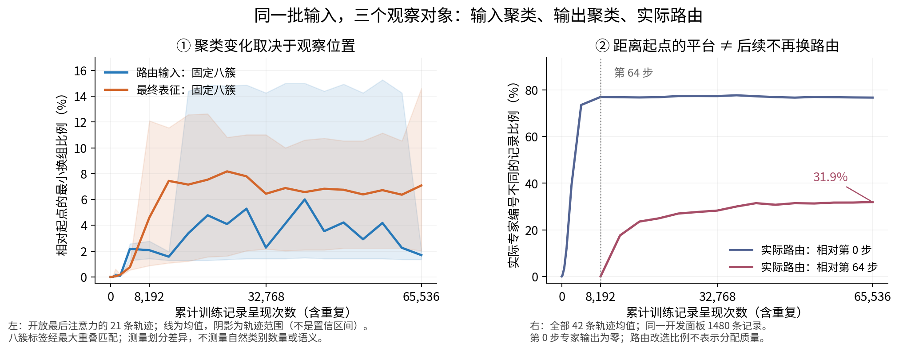

# 先分清对象，再理解聚类怎样变化

日期：2026-09-10。处理者：Codex。本文是依据实际产物重读的教学解释与 AI 建议，不覆盖原结果记录，不代研究者确认机制结论。

配套：[组会短稿](../focus_meeting_clustering_dynamics.md)；[原完整分析稿（其中若干解释需按本文收窄）](sft_matrix_full_analysis_cn.md)；[原训练动态稿](sft_matrix_training_dynamics_cn.md)。

## 1. 先回答：完整产出了吗？

**核心实验数据和数值分析已齐；全部交付尚未结束。** 本次核对实际文件及唯一键，而非仅采信 memory：

| 项目 | 核对结果 |
|---|---|
| 训练 | 42 条训练记录均报告完成 512 更新；882 个检查点在位 |
| 表示提取 | 1764 个分片；分析输入认证清单也有 1764 个唯一条目 |
| 数值分析 | 1764 个唯一测量点、6552 行主对照、2646 个唯一聚类状态、8 个投影状态 |
| 额外七类图件 | 清单引用文件全部在位，图件目录共有 162 个文件 |
| 离线层级分析 | 40 个图视图、1200 行匹配对照（包含不足状态） |
| 全矩阵原定图廊 | 尚无总图清单；本轮检查中轨迹子目录从 14 增至 17，目录存在不等于图廊完整 |
| 最终收尾 | `result_draft/receipt.json`、`completion.json` 和远端链结束标志均未出现 |

当前源码摘要与运行冻结值相同。训练修正验证回执为快速核验，`digest_recomputed=0`；本文没有把它说成重新做完全部检查点摘要复核。核心数值可用于有边界的讨论，不必等每一张附录图渲染完才学习。

## 2. 你首先需要认识四种不同的“分组”

**本次术语。** 稀疏自编码器（SAE）是用少数激活字典成分描述内部向量的模型；高斯混合模型（GMM）是另一种提供软分组目标的统计模型；答案预测损失（NLL）衡量模型对正确答案的预测误差，本实验取记录内部答案词元平均，再对来源等权，越低越好。其数值不是答题正确率。

模型处理一条文本时，会形成一串数。我们称它为**表征向量**。这次在答案开始前的固定位置，读取最后一个前馈模块之前的 1024 维向量，记作 h。

| 分组对象 | 每个点或节点是谁 | 分组如何得到 | 是否参与模型计算 |
|---|---|---|---|
| 输入表征的聚类 | 一条固定记录的 h | 分析程序按向量相似性分成八簇 | 否，事后观察工具 |
| 最终表征的聚类 | 同一记录经过专家修正后的最终向量 v | 分析程序另行分成八簇 | 否，事后观察工具 |
| 实际路由分组 | 被送到同一个专家的记录 | 模型中的路由器作选择 | 是，改变实际计算路径 |
| SAE 原子关系与分组 | 一个字典特征 | 根据共同激活或条件包含关系构图、分组 | 用来构造固定教师目标 |

这四者不能仅因为都叫“组”就视为同一个东西。输入向量完全不动，路由器的参数仍可改变，从而把同一记录送到另一个专家。专家的输出也可改变，所以最终表征可以变化。

八个数据来源、八个读出簇、八个专家，恰好都出现数字八，但三者没有天然的一一对应关系。

## 3. SAE 最基本的作用

SAE 先学习一份描述模型内部向量的“字典”。一个字典成分称为一个原子。给定一个输入向量，它只激活少数原子，再用这些原子近似重构原输入。

比如，一个假想输入同时激活“代码格式”和“循环结构”方向。这只是说明一个输入可能由多个成分共同描述；不能据此认定真实原子已经有这些语义。

本实现的字典有 30000 个候选原子，每个输入最多保留 32 个正激活。**一个原子不是一个完整输入类别，也不是一个专家。** 同一原子可以被多条记录激活，一条记录也会激活多个原子。

在本系列中，SAE 有两种用途：

1. **构造路由教师。** 把原子预先分成八组，对某个输入将各组的激活强度相加并归一化，得到一个八维目标分布 q。例如 q 对第三组给出的权重较大，表示教师希望这个输入更偏向该组。
2. **观察原子关系。** 统计哪些原子经常共同激活，或者出现某个原子时通常也出现哪些其他原子，构造关系图。

本次训练期间 SAE 不再学习，原子分组与共同起点的目标也保持固定。后续随着训练时刻变化而画出的 h 八簇图，是另一套事后聚类，不是 SAE 的 30000 个原子在增长。

## 4. 怎么进行路由正则？

路由器读取当前输入 h，输出分配到八个专家的概率 p。普通任务训练只要求最终答案预测更好。路由正则额外要求 p 与教师 q 提供的组织方式相容。

两种约束分别是：

- **A：逐输入对齐。** 对同一个输入，让 p 接近 q。例如教师认为第三组权重大，路由器也应提高对应概率。
- **B：输入之间的关系约束。** 若两个输入的教师目标相似，就鼓励它们的路由概率接近；目标不相似时，鼓励概率之间保持一定距离。它关注输入之间的关系，不强求组编号逐个对应。

因此，B 的“拉近/推开”直接作用于八维路由概率，不能自动解释成在 1024 维输入空间里把点拉开。

本实验中，**结构约束只给路由器提供梯度**；专家和共享分支由答案损失训练。冻结条件 F 的主干不变；开放条件 U 额外训练最后一层注意力，让 h 有机会变化。U 的注意力仍只接受任务梯度，结构约束最多经未来路由和任务梯度间接影响它。

教师训练时用于给方向，实际专家接收的是完整 h，并不是只接收“属于某个原子的坐标”。这次高层方案最后也输出八组软目标，没有实现从树根逐层走向叶节点的层次路由。

## 5. 方法是否真的有效？

需要把三句话分开。

**第一，微调确实学到了任务。** 固定测试面板的平均损失在起点约 2.83464，训练后各条件约 0.78577–0.92404。即使输入冻结，训练路由、专家和共享分支也能降低损失。

**第二，结构教师尚未表现出稳定增益。** 判断它的价值，要与同样训练的纯任务条件比较。下表是第 512 步测试损失的三种子平均，正数表示加入教师后更差：

| 教师与约束 | 冻结主干：相对纯任务 | 开放最后注意力：相对纯任务 |
|---|---:|---:|
| 原 SAE，A | +0.01973 | −0.00135 |
| 原 SAE，B | +0.00519 | +0.00206 |
| 高斯混合，A | +0.04036 | +0.00595 |
| 高斯混合，B | −0.00449 | +0.00390 |
| 高层 28 原子，A | +0.00530 | +0.00659 |
| 高层 28 原子，B | +0.01055 | +0.00690 |

两个均值为负的组合，三个种子的方向都不一致；高层两种开放条件则三个种子都比纯任务更差。因此，“当前这套高层教师和正则没有证明优于纯任务训练”有直接依据。不能用所有条件相对起点都改善，来声称教师有效。

**第三，尚未证明分发更合理。** 记录换了专家、概率改变、来源分得开，都不等于专家更适合处理这些记录。现有证据尚未闭合“教师关系进入实际路径 → 对应专家确实有用”这条链。这里缺证据，不能自动断言功能完全没有变化。

这些结论限于本轮内部留出答案损失和固定预算，不是官方任务正确率或所有方法配置的结论。

## 6. 聚类究竟怎样变化：现稿有三处需要改写

本次独立读取已保存的簇标签和实际专家编号，保留记录身份配对，在原运行之外写出[重算记录](/data/250010109/MoE_Router/experiments/20260910_sft_routing_representation_full_matrix/audits/clustering-explanation-20260910/temporal_recheck.json)与[可重跑脚本](/data/250010109/MoE_Router/experiments/20260910_sft_routing_representation_full_matrix/audits/clustering-explanation-20260910/recheck.py)。



左图读取开放条件的输入和最终表征，线为 21 条轨迹均值，阴影为轨迹范围；右图保留同一轨迹内专家的实际编号，平均全部 42 条轨迹。两者都是开发集 1480 条记录的描述统计，不能直接比较百分比来判定“谁发生了更大的科学变化”。

### A. “聚类几乎不动”必须带上对象和时间范围

开放条件下，输入 h 的起点到终点最小换组比例，逐方法三种子均值为 1.55%–1.85%；最终表征 v 为 4.98%–8.78%。所以只观察输入，会漏掉输出侧的组织变化。

h 仍是原计划的主要观察位置，v 是已计划的配套位置。不能因为 v 的数值更大，就事后把主要对象换成 v 或把它当成方法成功的证据。

而且中间时刻并非始终接近终点：个别开放轨迹的 h 划分相对起点有约 15% 的差异，最大为 15.27%。这说明“终点换组少”不能推出“全过程不变”。这些中间变化究竟来自真实结构调整还是聚类求解不稳定，尚未分开，不能直接命名为“边界抖动”。

### B. “第 64 步变化完成”不成立

相对起点的实际专家改选比例，在第 64 步为 77.06%，终点为 76.77%。这两个比例接近，只说明距离起点大致相同。

直接比较第 64 步和终点，**仍有 31.93% 的记录选择了不同专家**。因此后续分配继续变化。两个不同城市都离起点十公里，并不表示车没有继续移动。

原始探针只保存相对 t0 的改选率，不能支持“后续不再变化”。它的源码也没有计算文稿声称的独立重抽期望；若该数来自另一计算，必须补上对应来源。

### C. 固定八簇不能得出“没有新类”

无论数据里有多少种自然结构，算法都被要求给出八组。它能告诉我们八组划分怎样变化，不能决定自然类别是否出现。反过来，观察到换组也不能自动说它出现了新语义。

同理，来源纯度下降只说明来源和分组的一致性下降，不等于语义结构改善。人类语义需要具体文本或独立注释支持。

另外，“实测改选率接近独立期望，所以初始归属没有预测力”在逻辑上也不充分。一个反例：八组等量样本，保留一组，其余七组按固定规则循环换号，改选率和独立期望都为 7/8，但新编号由旧编号完全确定。需读取完整转移关系，不能凭一个比值判断独立。

## 7. 层级结构如何理解？

这一张图的节点是固定 SAE 字典里的原子。若较少出现的原子 C 出现时，若干较常见原子通常也出现，并满足支持量、反向包含与联合关系等要求，就提出“C 可能由这些成分组合”的候选关系。

例如，100 次看到 C，其中 95 次也看到 B，而 400 次看到 B 只有 95 次看到 C，则“C 的激活集合近似包含在 B 的激活集合内”。这是统计包含，不是因果证明，更不自动得到语义名称。

本图采用“组合原子 → 组成原子”的方向。深度是沿关系走到叶节点的最长路径长度。**更高可能表示更具体的组合，并不必然是更宽泛的父类。**

这轮离线实验改了构图门槛，比较十种配置在发现、复现、支持量合格和统一严格复核四种视图下的结果。实际最宽松配置在发现集可达深度 5，复现和严格复核仅深度 2；其余严格图最高也只有 3。因此，没有得到稳健的深度 5 结构。

这张图目前的作用是提出候选原子关系、挑选高层教师的节点、解释覆盖与稳定性代价。它不是沿训练时间生长的类别树。高层主教师的 28 个原子从训练前就固定了，离线参数扫描并未改变它，也没有在每个训练时刻重建该层级。

高层覆盖较低还限制了用途：训练目标缓存仅约 0.344% 的答案预测位置被覆盖；主面板首个答案预测位置为开发集 34/1480、测试集 36/1481，且两边各 25 条来自 HumanEval。不能把覆盖很窄的结果解释成普适的高级语义分发。

## 8. 假设是否合理、接下来怎样思考？

**研究直觉可以保留，但当前假设不够清楚。** 原稿把三种不同事情混在一起：输入冻结时不动、训练过程中发生重新分组、形成语义类别。第一件是实现检查，后两件才是科学问题，而且需要不同证据。

导师明确没有要求“越训越细”。他要看到结构在时间上的样子，并理解每个组包含什么。把预期阶梯变深写成导师假设，与原话不符。

AI 建议暂时只追一个问题：

> 在局部微调中，同一批输入的邻近关系和分组怎样随时间改变？结构教师是否带来超出纯任务训练、可以复现的重组？

对应两个待检验解释：

- **结构重组解释：**与同注意力条件的纯任务训练相比，教师条件有稳定的新增同组或分离关系，这些关系可跨聚类初始化、种子和留出样本复现，并能用具体文本描述。
- **竞争解释：**主要变化是已有粗分组的移动、聚类边界或求解波动，以及任务驱动的路由/输出调整；教师没有稳定增加结构。

这是看到现有结果之后提出的下一步假设，不冒充训练前已注册预测。若控制聚类波动后差异消失，或只在一个种子成立，就停止“教师带来稳定重组”的主张。本轮无需为了回答这一问题补训模型。

## 9. 现在交给分析 Agent 的任务

主次顺序应调整：先完成聚类变化的解释，再把路由作为关联证据。不要用路由的大百分比替代导师的聚类问题。

可直接交付以下指令：

```text
目标：解释同一批记录在局部微调中的分组变化，不追加训练，不替研究者判语义。
保留原始 fm、运行身份和正在写出的共享产物；新增分析使用独立目录及处理代码摘要。

1. 完成原定交付并修正文稿：区分数值完成和图廊/最终读面完成；修复已识别的
   报告取数问题。删除“没有新类”“前64步一切变化完成”“来源解离就是语义重组”
   等无依据表述；冻结输入不变归入实现检查。

2. 用已保存的21时刻，分别画 h 输入、v 最终表征的分组时间线；实际专家分配另列。
   现有重算见 audits/clustering-explanation-20260910/。同时读相对起点和相邻时刻；
   指明时间间隔不同，不能把32步间隔的变化率与1步间隔直接当速度比较。
   所有方法、三个训练种子、开发/测试均保留；主读面压缩，完整表做附件。

3. 校准聚类算法本身的波动：主方法仍为固定八簇。先在固定的0/32/64/256/512时刻，
   每个已有条件和种子，用相同表示重复聚类（预先固定5个聚类随机种子，保留20次
   初始化择优的原设置），区分同一表示的求解差异与跨训练时刻的结构差异。
   主比较同时用不依赖簇编号的成对同组关系及原空间近邻保持率。
   开发集拟合、测试集应用；不要用测试集选聚类设置。

4. 解释“哪些记录变了”：对稳定、反复换组、终点持续换组三类，按固定哈希各取
   5条记录，给原文本、来源、长度、旧邻居、新邻居和出现/持续的时刻。
   先看同来源且长度相近的例子，判断是否仅是格式变化；语义解释保持候选，
   不把来源名称直接当概念。若没有足够记录，报实际数量，不凑样本。

5. 教师归因作为配套：比较教师与同F/U的task，列出三个种子的配对效应。
   补教师目标→路由概率→实际路径的传递和有效监督覆盖，A按分布对齐，B按关系
   约束评估。若教师没有稳定影响，保留明确负面或不足结果，不扩大训练寻找赢家。

交付三张主图：分组时间线、具体成员/邻居变化、教师相对纯任务的差异。
每张图说清点是谁、横纵轴、支持什么、不能说什么；附一页仍无法区分的原因。
固定八簇只回答当前分辨率下的变化。本轮不扩到自然类别数量发现或更深教师重训。
```

上面的五个聚类随机种子是 AI 提出的有限分析预算，不是既有训练合同。执行前先用一个时刻计时；若预算不合适，报告成本并先交现有读面，不缩减原有 42 条训练轨迹。无需显卡重训。

## 10. 一个自我检查

试着解释这句话：**“输入向量完全没变，但记录换了专家，最终输出的分组也变了。”**

如果你能说清哪一个模块变了、三种“分组”各在测什么，就已经掌握了读这批实验最关键的基础。下一步先解释真实变化的几条记录，再决定是否值得追问更抽象的层级。
