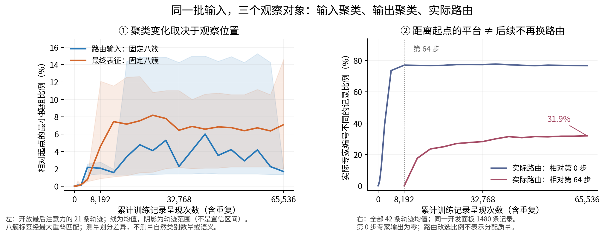

# 局部微调中，聚类到底在哪里、怎样变化？

```text
type: meeting_knowledge_update
status: AI_DRAFT_AWAITING_HUMAN_CONFIRMATION
scope: one_problem
```

来源范围：[原开发计划](docs/sft_representation_audit_plan_cn.md)、[结果重读与基础讲解](docs/sft_clustering_results_explained_cn.md)、[0909 组会原话](../0909/docs/0909_组会逐句校订稿_含原文对照.md)。本稿是供研究者修改的组会简报，不改变旧 Focus。

实际对照与训练：七种方法各有冻结主干/开放最后注意力两种条件，三个种子，共 42 条；均由共同初始化单阶段联合训练路由与专家/共享分支，每条 512 更新，微批 8、累积 16、有效批 128。每种子各条件使用相同调度，保存 21 个检查点。开放条件额外训练最后注意力；结构梯度只进入路由器，教师固定。具体学习率与权重衰减见原计划；运行身份与原记录保持不变。数值分析齐备，全图廊与最终收尾仍未全部交付。

## 1. 目的

观察同一批输入在局部微调中的分组如何随时间变化，区分输入表征的聚类、最终表征的聚类和模型实际路由，判断结构教师是否增加了稳定重组。

## 2. 假设：我认为它可能长什么样

如果结构教师带来重组，与同样训练的纯任务模型相比，应出现可复现的成员或邻居关系变化。竞争解释是：粗分组基本保持，变化主要来自任务适配、分组边界或聚类求解波动。

这是结果重读后提出的下一步解释框架，不是事前注册预测；不预设越训越细。示意可画两幅同一批点的时间序列：一幅只整体移动、邻居大致保持；另一幅有一小批点形成持续的新邻居关系。

## 3. 分析方法：实际怎样测

- 在同一开发/测试面板、21 个时刻，对路由输入与最终表征分别作固定八簇划分；点代表同一条记录，横轴为累计训练记录呈现次数，纵轴为相对起点的最小换组比例。
- 实际专家分配单独统计，同时比较起点、第 64 步和相邻时刻，避免把距离起点的平台当作停止变化。
- 对照同注意力条件的纯任务模型，读取三个种子的留出损失和结构差异；再校准聚类算法自身波动，用文本解释稳定迁移的记录。

## 4. 结论：实际、差异与原因

1. **现有数值显示变化位置不同。** 开放最后注意力时，输入起点到终点的八簇换组比例为 1.55%–1.85%，最终表征为 4.98%–8.78%（逐方法三种子均值）。个别中间时刻输入划分差异约 15%，因此不能用端点小直接断言全过程没有重组。

   

   左图分别看输入和输出，阴影是轨迹范围；右图显示虽然相对起点的路由改选比例约 77% 后趋平，第 64 步到终点仍有 31.9% 换专家。

2. **当前结构教师没有稳定任务增益。** 与纯任务模型相比，高层教师的两种开放条件在测试损失上平均增加 0.00659、0.00690，三个种子均为退步；个别其他组合的平均改善也伴随种子反向。这不支持当前配置“分发更好所以任务更好”的判断。

3. **为什么与原直觉不同仍有一段未知。** 输入聚类、输出聚类和实际路由不是同一对象；约束直接训练路由器，专家又会改变输出，所以它们不必同步。但中间分组跳动是真实重组还是聚类求解波动尚未分离，不能直接称作语义演化或边界抖动。

边界：固定八簇不决定自然类别数；来源标签不等于语义；改选专家不证明专家有用；静态 SAE 原子关系图不等于训练中的类别树。

**唯一下一决定（AI 建议）：**完成同一表示重复聚类的波动校准与固定文本案例后，判断教师是否带来超出纯任务训练的稳定成员/邻居重组。若差异不超过求解波动或不能跨种子复现，则停止该重组主张；先不补训。恢复动作见讲解文档第 9 节的分析 Agent 指令。
