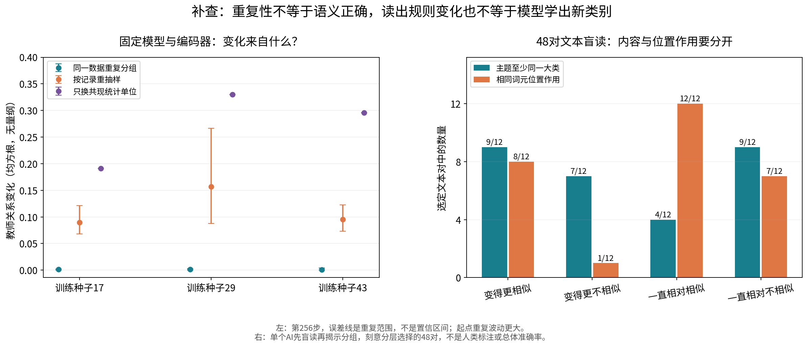

# 从导师的问题出发：我们究竟看到了什么变化？

[结果摘要](../../../Projects/from-attention-to-search/main/experiments/A15/15_13_semantic_supervision_middle_layer_formation/A15_13_E21_dynamic_structural_teacher/supplementary_0911/summary.md)｜[完整证据与补查方法](../../../Projects/from-attention-to-search/main/experiments/A15/15_13_semantic_supervision_middle_layer_formation/A15_13_E21_dynamic_structural_teacher/supplementary_0911/detailed.md)

本轮补查已完成：固定模型与编码器的重复分组、记录重抽样、共现统计单位对照，以及48对文本的先盲读后揭示结果。没有新增主模型或稀疏自编码器训练。直接测量已完成，下面的机制解释和推进建议仍是AI草拟，供研究者确认；文本判断由单个AI完成，不是独立人类语义真值。

## 先把你的思路完整接回来

你的出发点不是“想办法让一张聚类图好看”。你想的是：一个已经训好的语言模型，可能已经分得清不少内容，只是这些区别混在表征里。能否把其中有用的细小区别读出来，让不同输入找到更适合的专家，从而用更少数据达到同样水平？

**这条思路允许主模型表征变化很小。** 如果有用的区分本来就存在，我们需要学会读取、使用它，不一定先把整个表征空间重新整理一遍。这里说“本来存在”是研究假设，本轮没有把全部语义可读性当作已经证明。

本次术语：稀疏自编码器（SAE）把一个输入表征解释成少量激活成分，并尝试把这些成分重新拼回原表征；这里有30000个候选成分，每个位置保留最多32个。最近中心分组法（K-means）按离哪个中心更近来分组。高斯混合模型（GMM）用若干带有中心和离散程度的分布描述样本，给出属于各组的概率。下文主要使用中文。

请先区分四个实物：

| 对象 | 白话意思 | 在本实验中的样子 |
|---|---|---|
| 模型表征 | 模型处理到某个词元时留下的内部状态 | 1024个数 |
| 稀疏成分 | 自编码器说“这个状态里，哪些候选成分正在起作用” | 最多32个非零激活 |
| 分组教师 | 把这些成分归入8组，得到一份监督用的组权重 | 8个数；再比较两个位置的关系 |
| 路由器 | 实际负责给输入选择专家的模块 | 专家概率与加入负载偏置后的实际选择 |

**一个细成分不是一个专家。** 我们先把许多细成分合并成8组，再让这8组形成的关系指导路由。因此，“细成分读得好”和“合并成8组后仍保留了有用区别”，中间还有一关。

现有结构损失主要要求：教师认为两个位置相似时，路由概率也应相近；教师认为它们不同，就给相应的分离约束。它不是直接宣布“教师第3组必须等于实际第3号专家”。

## 1. 这些结果为什么会出现？

### 为什么表征没有按直觉明显聚起来？

我们观察的是预训练模型的局部微调，不是从随机模型开始，看语义第一次诞生。当前只开放尾部部分参数，任务目标是把答案预测好；结构约束直接更新路由器，没有直接要求同语义的表征相互靠近。所以，“指导路由”本身推不出“所有同类点都应该明显收紧”。

这是对原先推理缺了一步的解释，不是对小变化全部原因的因果鉴定。路由变化仍然可能通过任务训练间接影响后续表征。

“前期快、后期慢”也确实存在。比较同样长的32步，前段关系变化约0.016，末段约0.00013。保存间隔不同不是这里的原因。但学习率后期降低、任务逐渐拟合、开放参数有限，这几项还没有被对照实验逐一拆开。不能据曲线形状说“语义已经收敛”。

### 为什么组内变散，组间却更分开？

想象两组人。每组人站得更松，同时两组的中心离得更远。这两件事完全可以一起发生。

我们测到的正是这种情况：按起点分组，最近中心分组法下，组内散布增加5.13%，组间差异增加10.97%；高斯混合分组下分别增加4.19%、12.55%。因此“组间相对于组内更分开”成立，但“同类越来越紧”没有出现。这里的组还是几何分组，不能直接叫语义类别。

### 为什么整体只动一点，细成分却能换掉不少？

因为“保留最强的32个成分”有一道排序门槛。举个示意例子：原先两个候选激活是0.51和0.50，后来变成0.49和0.52，数值只动一点，入选的那个却换了。整体距离和入选名单不是同一个量。

实际固定字典下，末期平均保留起点约72%的32个成分，也就是平均大约换了9个。它说明读出的成分不完全稳定；不等于新产生了9种语义，也不说明变化一定有用。

### 为什么刷新后更能重构，却没有证明更会指导路由？

自编码器训练时被奖励的是“能把原表征拼回来”。但路由需要的是“哪些区别应该决定专家分配”。标点、格式、表达位置都可能有助于重构，却未必能告诉我们哪个专家更擅长这道题。

实际末期重构残差，相对同一探针方差，固定字典约33.74%，刷新字典约10.78%。这个改善是真实测量，但目标不同，不能跳到语义分派或下游收益。

结构梯度确实进入了路由器，所以不是完全没有指导信号；但教师关系变化与后续路由变化没有跨种子稳定对应。结构梯度较弱、任务梯度方向不同、负载偏置改变最终选择，都还只是候选原因。我们没有用干预证明其中哪个是主因。

## 2. “重新分组造成更大变化”到底是什么意思？

原先一次刷新同时做两件事：更新自编码器，重新给细成分分组。直接比较刷新前后，会把两种变化混起来。

我们把同一批模型表征固定住，做了两个替换：只换编码器、保留旧分组；或者只换分组、保留旧编码器。12个刷新窗口中，第二种改变的教师关系都更大，为第一种的2.45–9.90倍。把前后都覆盖的特征固定下来，方向仍然不变。它定位到了一个变化较大的计算环节，不是把因果贡献分解成百分比。

下面的手算完全是示意，帮助理解“输入一点没变，分组关系也能变”：

- 位置甲激活成分1和3，各1份；位置乙激活成分2和4，各1份。
- 旧规则把1、2归一组，把3、4归另一组。甲乙都得到“一半在第一组、一半在第二组”，看起来一样。
- 新规则把1、3归一组，把2、4归另一组。甲全在第一组，乙全在第二组，看起来完全不同。

**甲乙的表征和成分都没变，变的是怎样合并成分。** 单纯交换组的名字不会产生这个现象；真正改变成员组合才会。我们的关系指标已经排除了单纯改名。

所以新发现不是“模型原来没有语义”。它是：我们看到的大幅教师变化，可能产生于描述、合并已有成分的规则，不能直接当成模型新学出了类别。

### 本轮进一步查出了什么？

左图把三件事分开了：

1. 同一份数据、同一张共现图，多次运行分组：第256步的变化最多0.00391，较小。起点的重复波动更大，不能把后期结果概括为所有时刻都稳定。
2. 冻结模型与编码器，但在每种来源内按整条记录重抽样：变化达到0.068–0.267。这说明“拿哪些记录统计”会影响分组。重抽样不是又训练了一遍模型。
3. 固定所有稀疏激活和共同特征，只换“什么叫共现”：第256步变化达到0.191–0.330。

第三点尤其重要。旧分组产物使用最长256词元的一段文本作为统计单位：一个成分在这段开头出现，另一个在结尾出现，也算一起出现。当前刷新代码使用单个答案预测位置：必须在同一位置激活才算一起。

例如，一段数学解答里既有“设未知数”的文字，也有数字运算。按整段统计，它们容易一起出现；按单个位置统计，说明文字与数字预测可能分开。两个规则回答的其实是不同问题。

旧输入矩阵及分组引用的身份已核对；历史刷新源码身份仍未完全保存。因此我们能说：**这项口径差异确实存在于旧产物与当前刷新实现之间，而且固定输入对照证明它足以制造大变化。** 不能说它已经解释了历史刷新变化的全部比例，更不能据此宣布整套训练作废。

### 这些组有没有我们想要的语义？

我先隐藏分组结果，读48对文本，分别标记主题、所需操作、格式和位置作用，然后才揭示旧新关系。这是单个AI的内容盲读；不是人类标注，样本也是刻意分层挑选的，不能当总体准确率。

有两对很直观：

- 一道三角恒等式题与一道道德判断题，分组相似度从0.572升到0.999。两者都在开始输出答案，但内容显然不同。
- 两道“扣除支出后还剩多少钱”的预算题，相似度从0.959降到0.490。读到的位置分别是货币符号与算式等号。

也有符合内容直觉的例子：两道行星轨道周期题一直很相似。不能只挑反例讲“分组都是格式”。更准确的认识是：**同一学科、同一解题操作、同一输出位置，是需要分别核验的三种相似。** 在12对一直高度相似的入选例子里，8对被盲读为主题不同，而12对位置作用相同；这足以提醒我们不能直接把高相似度命名为同语义，但不能证明格式分工没有功能价值。

## 3. 我为什么要修正“停止需要动态分组”的说法？

“允许分组变化”“发现分组在变化”“分组变化有帮助”“必须动态分组”，是四个强度不同的判断。目前我们测到了变化，尚未证明它的功能收益，更没有证明必要性。

我上一轮的话是一个条件性的证据边界，不是已经得到的停止结论。但它确实说得太像任务去留判断。这次同图重复结果也不支持直接把动态分组判成随机、不值得做。

现在应保留的表述是：**没有证据把“必须动态分组”当作前提；也没有证据宣布动态分组没有用。继续观察结构演化这个问题本身没有被否定。**

还有一个容易混淆的“在线”：固定字典也可以每一步读取当前表征，因而给出随输入变化的指导；不一定要刷新字典才算在线。但是现有静态训练臂用的是缓存目标，本次固定字典曲线是离线回放。因此尚未完成“固定字典读当前表征”与“刷新字典读当前表征”的严格训练对照。当前结果不足以裁决两者谁更有用。

## 4. 不同聚类方式，应该怎么看？

**可以得到不同结果，因为它们先规定了不同的“相似”。** 还要分清：是在分文本位置，还是在分细成分。

| 方式 | 它实际在分什么 | 为什么可能得出不同分组 | 本轮最合适的解释方式 |
|---|---|---|---|
| 最近中心分组法 | 模型表征中的文本位置 | 主要看离中心的距离 | 固定起点成员，看组内、组间与成员迁移；另查重复拟合波动 |
| 高斯混合分组 | 文本位置，同时描述各组的离散程度 | 除中心还考虑各方向的分散尺度，可能改变边界与不确定性 | 固定起点成员做共同几何比较；额外看属于各组的概率、模糊边界和拟合重复性 |
| 稀疏自编码器加共现图分组 | 先读出细成分，再把经常共现的成分分组；最终给文本位置组权重 | 成分定义、共现单位、取样、归组规则都能改变结果 | 分别固定表征、编码器、统计单位、分组表，定位哪一步在变；再读文本和验证作用 |

最近中心与高斯混合的定义分别见[官方说明](https://scikit-learn.org/stable/modules/generated/sklearn.cluster.KMeans.html)和[官方说明](https://scikit-learn.org/stable/modules/generated/sklearn.mixture.GaussianMixture.html)。这里高斯混合的几何审计采用对角协方差，不能把它描述成可任意旋转的椭球模型。

本轮两种几何方法的具体数值不一样，但都没有组内平均收紧。不能因此说它们“完全一样”；它们回答共同问题的方向一致。

稀疏自编码器本身不是聚类算法。当前是“编码成细成分→按共现建图→谱分组→得到词元的组权重”。这和直接对表征运行最近中心法不是同一个对象。也不要把几何图中的高斯混合，混成训练时先做64维主成分投影的高斯教师。

最后，30000个候选成分提供了细粒度表达的可能，随后合并成8组也可能重新混合有用差别。因此不能仅凭中间维度大，就认定它一定比主成分方法更适合分专家。本轮没有完成这种优劣对照。

## 回到导师上一次到底在问什么

[0909会议校订稿](../../0909/docs/0909_组会逐句校订稿_含原文对照.md)中，09:05问“什么时候出现第一个类？这个类是什么意思？”；09:35明确说“我没有说它是不是越来越细”。13:09要求先画横纵轴和预期；14:39之后要求讲实际、差别和原因。这是已有转写的校订稿，不是回听确认的逐字稿。

我建议把本次认识更新这样讲，以下是AI建议稿：

**初始假设：** 我希望把预训练模型中已有的语义区别读出来，用来指导专家。我最初把“结构更清楚”画成同类收紧、异类分开，并预期在训练中看到这种变化。

**实际结果：** 同类没有平均收紧，整体关系变化逐渐变慢；但稀疏成分和分组读出的关系并非不变。固定同一份表征后，仅重新分组就会造成较大变化。

**认识差别：** 我原先把“模型内部信息变化”和“我用来描述它的分组变化”混在一起了。进一步检查发现，前后连共现的统计单位都不同，而高分组相似也可能对应答案位置，不一定对应同一学科。

**为什么产生差别：** 当前训练没有直接要求语义表征收紧；分组又取决于统计对象与合并规则。所以我不能靠一条聚类变化曲线，就回答语义何时诞生。现在定位到了读出规则这个可检验环节，但专家用途还没有建立。

对“第一个类什么时候出现”，目前诚实的回答是：**还不知道。我们从一个已经预训练的模型开始，而且每次固定分8组；这种设计不能直接发现自然类别从无到有的时刻，也不能从8个组号推出物理到电动力学的层次关系。** 已完成的工作回答了现有结构怎么被不同规则读出，尚未完成导师所问的语义类别形成史。

**AI建议的唯一下一问题：在统一的观察规则下，我们能否辨认并持续追踪一种有明确内容或操作含义的结构？** 先用“同操作、不同格式”和“不同操作、同格式”的独立判断文本对，验证读出的到底是什么；通过后再沿训练时间追踪它。如果只读出格式，就把认识写成格式/位置结构，不把它叫语义专家，也不据此扩展主模型训练。语义粒度与最终判断由研究者确认。

你可以先做一个一分钟的小练习：遮住这份文档，用上面的四成分手算例子解释，为什么“分组发生了变化”不能直接等于“模型学到了新语义”。能讲清这一点，再把“它是否值得路由器去学”作为下一个问题，而不是把两个问题一起跳过去。
