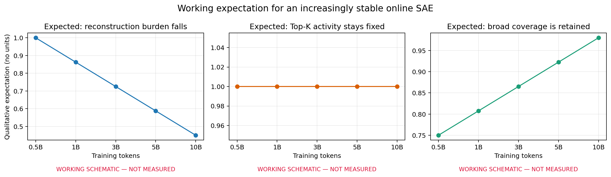
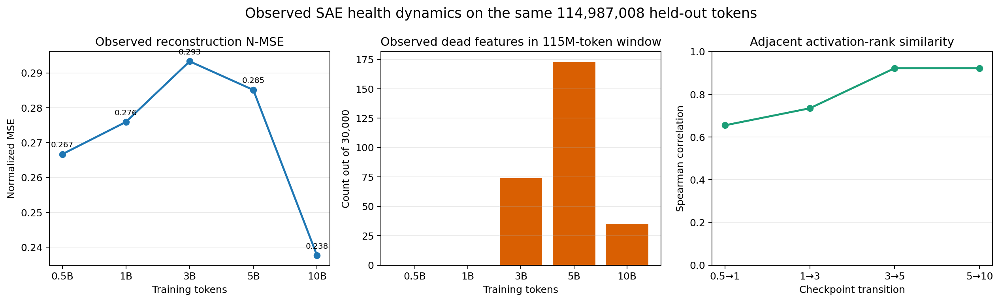
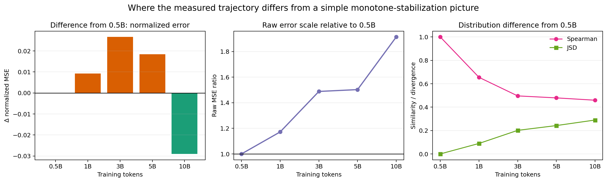

# 第一段分析报告｜SAE 重构与激活分布如何随 checkpoint 变化

状态：完整固定 held-out 审计已完成；工程诊断证据合格。本文是研究者要求的四段式读数，不是语义形成的最终结论。研究者仍拥有机制判断。

证据范围：同一批 56,146 个序列、每个 checkpoint 恰好 114,987,008 个 token；检查点为 0.5B、1B、3B、5B、10B。任务只读取已有 checkpoint，没有优化器更新，没有停止或启动训练。完整机器收据位于执行目录的 `full/audit_receipt.json`，状态为 `PASS`；平台任务 `pt-p5mlwlqn` 为 `SUCCEEDED`，终止码为 0。本文图数据见 [first_stage_metrics.csv](tables/first_stage_metrics.csv)，来源哈希见 [first_stage_source_manifest.json](tables/first_stage_source_manifest.json)。

## (a) 假设图：原来预期什么

工作预期是：随着语言模型与在线 SAE 共同训练，归一化重构误差总体下降；Top-K 机制下每个 token 激活数维持在 32；在大 held-out 窗口中，字典覆盖率保持接近 100%，相邻 checkpoint 的激活频率排序逐渐稳定。

读图：三条趋势只是定性示意，纵轴没有实验单位，不能当作预注册阈值或真实结果。尤其“误差平滑下降”是一个简单工作图景，不要求每个相邻点严格单调。

## (b) 真实图：实际测到了什么

真实结果有三点：

1. 归一化重构误差不是单调下降：`0.26668 → 0.27594 → 0.29332 → 0.28512 → 0.23766`。它在 3B 达到最高点，10B 才降到五点中的最低值；10B 相对 0.5B 下降 `0.02902`，即约 `10.9%`。
2. 平均每 token 的正激活 feature 数始终约为 `32`。这是 Top-K=32 的结构性结果，不是模型自行学出了“32 个语义原子”。
3. 30,000 个 feature 在大窗口中几乎全部被覆盖，但也非单调：dead feature 数为 `0、0、74、173、35`，对应覆盖率 `100%、100%、99.753%、99.423%、99.883%`。激活频率排序在后期相邻点更稳定：Spearman 从 `0.655、0.735` 上升到 `0.922、0.923`。

这张图支持的是 SAE 数值健康和激活分布演化；它没有外部领域、子领域或事实标签，因此不能回答语义是否形成。

## (c) 差别图：真实轨迹与简单预期哪里不同

最关键差别不是“最终误差有没有降低”，而是中间过程和尺度不同：

- 0.5B→3B 的归一化误差先增加 `0.02664`，之后才下降；因此“持续变容易重构”的图景不成立。
- 原始 MSE 从 `0.30070` 增至 `0.57545`，10B 是 0.5B 的约 `1.91` 倍；与此同时归一化 MSE 反而下降。这说明表征本身的能量尺度也在变化，不能把归一化误差下降直接说成绝对残差变小。
- 10B 与 0.5B 的 feature 频率排序相关只有 `0.459`，Jensen–Shannon divergence 为 `0.2897`；但 3B→5B 与 5B→10B 的相邻排序相关均约 `0.923`。更准确的描述是“早期到后期发生较大重排，3B 后局部排序趋稳”，而不是“同一分布从头到尾不变”。
- dead feature 在 5B 增至 173 后又在 10B 降到 35，不支持简单的单向死亡累积图景。由于观测窗口很大，这里的 dead 只表示该窗口内零激活，不等同于训练期永久死亡。

## (d) 潜在原因分析：目前最可能是什么，还不能排除什么

目前最直接的解释是“主干表征和 SAE 尺子同时移动”。SAE 位于最后一层 MLP 前的强制瓶颈中，语言模型损失会通过 SAE 更新前面的 block；同时 SAE 自身也被重构目标更新。因此每个 checkpoint 的 $h$、字典和编码器都发生变化，非单调误差可以来自主干尺度变化、字典追踪滞后或二者共同适应。

第二个原因是指标结构。Top-K 固定了每 token 最多 32 个坐标，所以平均激活数几乎恒定；大规模 held-out 又会让极低频 feature 最终至少出现一次，因此覆盖率接近 100%。这两个量证明实现符合合同，但对语义组织的区分力有限。

第三个原因是归一化。10B 的绝对残差比 0.5B 大，但相对于同步增长的表征能量更小，所以归一化误差改善。后续必须把 $h$、重构 $\hat h$ 和稀疏系数 $z$ 在同一外部语义面板上分别测量，不能只看一个全局重构比值。

最强竞争解释仍未排除：激活分布的稳定化可能只是 SAE 逐渐适应了变化中的输入，而不是主干形成了更多领域/事实语义。下一项 `analysis1` 将使用固定外部标签和同一文本，比较 0.5B→10B 的原表征、重构和稀疏读出；匹配无 SAE baseline 尚未启动，因此冻结的 Qwen3-0.6B Base 只能作为外部成熟端点参照，不能替代架构匹配基线或支持 SAE 因果收益结论。
