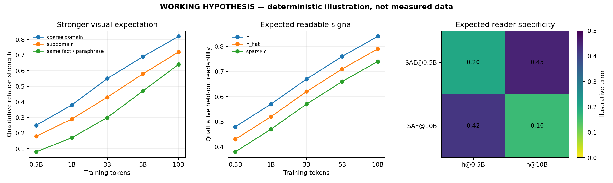
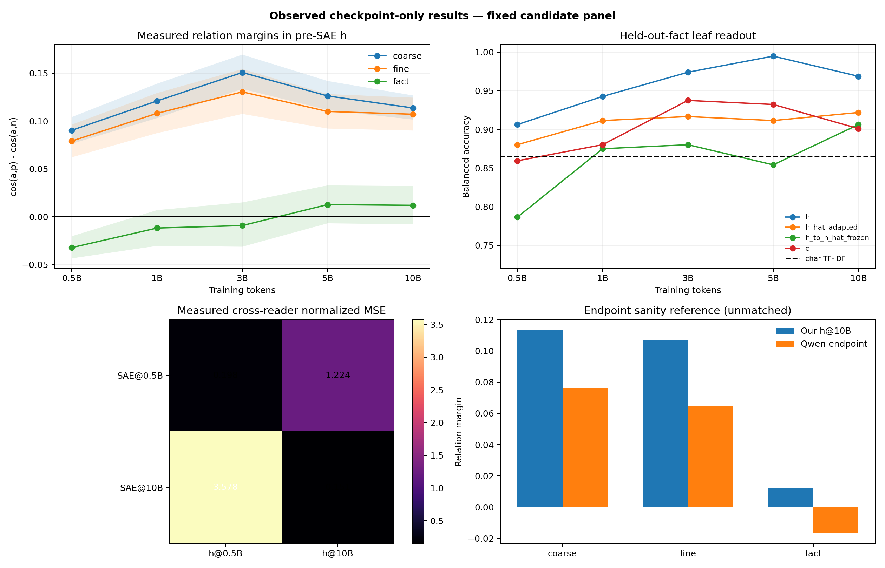
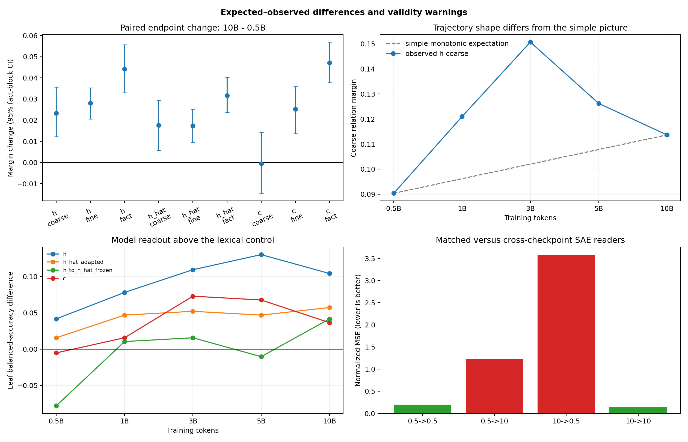

# 第二段四段式分析报告｜预训练中的语义组织与 SAE 读出

**AI 审计结论：工程执行完整通过；候选面板上的主干粗领域关系端点变化为正，但科学证据仅为 `BOUNDED_EXPLORATORY_ONLY`。** 这轮可以说“在这一条 SAE-mediated 训练轨迹上，最后一层 MLP 前的原始表征对这份模板化面板变得更可读”；不能说“抽象语义已经被证明形成”，也不能说“SAE 导致了这种变化”。最终机制判断仍由研究者确认。

证据范围：正式作业 `pt-lok5c11y` 为 `SUCCEEDED`，终止码 0；读取 0.5B、1B、3B、5B、10B 五个 checkpoint 和冻结的 Qwen3-0.6B Base 外部端点，共 864 条陈述、216 个事实。没有优化器更新，没有训练或 checkpoint 修改。完整原始表见 [关系间隔](tables/semantic_raw_relation_margins.csv)、[读出准确率](tables/semantic_raw_readout_accuracy.csv)、[跨 reader 重构](tables/semantic_raw_cross_reader_quality.csv)；来源审计见 [source manifest](tables/semantic_result_source_manifest.json)。

术语：\(h\) 是末层 `norm2` 后、SAE 前的表征；\(\hat h\) 是 SAE 重构、也是末层 MLP 实际消费的输入；\(c_j=z_j\lVert v_j\rVert\) 是按 decoder 列范数校正后的稀疏贡献坐标。关系间隔为 \(\cos(a,p)-\cos(a,n)\)，越大表示锚点更接近预先定义的正例而不是负例。

## (a) 假设图：原来预期什么

图中的曲线是确定性示意，不是实测值。较强的直觉图景是：随着累计训练 token 增加，粗领域、子领域、同事实异表达三层关系逐渐增强；\(h\) 中的关系应被 \(\hat h\) 和稀疏坐标 \(c\) 大体保留；同一时期的 SAE 应更适合读取同一时期的 \(h\)，但跨时期失配不应大到让“同一个 feature 身份”完全失去比较意义。

本计划文字中的最低主判据比图更弱：只要求 10B 的 \(h\) 粗领域关系间隔高于 0.5B，并且 10B 的间隔为正；不要求五点严格单调。细领域与同事实异表达是次级判据。另一个必要有效性条件是：成熟外部模型应至少显示面板测量的目标关系，而词面基线不能几乎完成全部任务；否则测到的可能主要是模板、关键词或格式。

这里没有正式 Anchor-aligned Protocol，`01_plan_cn.md` 自身也把若干操作定义标为候选。因此本图只能作为执行时的工作假设，不能事后升级为正式预注册判决规则。

## (b) 真实图：实际测到了什么

### 1. 原始表征 \(h\) 的关系间隔

| 关系 | 0.5B | 峰值 | 10B | 配对变化 10B−0.5B（95% fact-block CI） | 直接读数 |
| --- | ---: | ---: | ---: | ---: | --- |
| 粗领域 | 0.0903 | 0.1507 @ 3B | 0.1137 | +0.0233 [0.0122, 0.0357] | 候选最低端点判据得到支持，但非单调 |
| 子领域 | 0.0791 | 0.1305 @ 3B | 0.1071 | +0.0280 [0.0206, 0.0353] | 端点提高，但 3B 后回落 |
| 同事实异表达 | −0.0323 | 0.0126 @ 5B | 0.0119 | +0.0442 [0.0330, 0.0557] | 相对早期改善；10B 自身 CI [−0.0079, 0.0320] 仍跨零 |

配对端点区间见 [semantic_endpoint_paired_deltas.csv](tables/semantic_endpoint_paired_deltas.csv)。这是计划要求但正式运行脚本漏产出的计算，本次用同一缓存、同一三元组和同一 48 个确认事实块补算，标为 `POST_HOC_CONFORMANCE_AUDIT`，不伪装成原始运行产物。

### 2. SAE 重构与稀疏坐标

\(\hat h\) 的三类端点变化均为正：粗领域 +0.0176 [0.0057, 0.0294]、子领域 +0.0173 [0.0095, 0.0252]、事实 +0.0317 [0.0237, 0.0403]。这说明重构空间保留了部分随时间变化的关系。

但 \(c\) 给出分裂结果：子领域 +0.0252 [0.0137, 0.0360]、事实 +0.0472 [0.0377, 0.0569]，而粗领域为 −0.0005 [−0.0146, 0.0143]。因此“原表征粗领域关系增强”没有在稀疏贡献空间中同步出现，不能把 \(c\) 直接描述成稳定、逐渐形成的粗领域语义原子。

### 3. 线性读出

粗领域准确率在 0.5B 已经饱和：\(h\)、适配后的 \(\hat h\)、\(c\) 和字符 TF-IDF 在确认集都接近或达到 100%，这个指标没有剩余区分力。

12 类子领域的平衡准确率更有变化：\(h\) 从 90.63% 升至 96.88%，在 5B 达到 99.48%；适配后的 \(\hat h\) 从 88.02% 升至 92.19%；\(c\) 从 85.94% 升至 90.10%。把在 \(h\) 上训练的分类器冻结后直接用于 \(\hat h\)，准确率从 78.65% 升至 90.63%，但始终低于对应 \(h\)，说明重构保留了大部分可读信息，却改变了最佳线性读法。上述准确率没有 bootstrap 区间，不能仅凭几个百分点给出强统计结论。

### 4. reader 随训练强烈共同适应

SAE@0.5B 读取 \(h\)@0.5B 的归一化 MSE 为 0.198，读取 \(h\)@10B 则升至 1.224；SAE@10B 读取 \(h\)@10B 为 0.151，反向读取 \(h\)@0.5B 达到 3.578。5B SAE 也只在本时期较好（0.169），对 0.5B/1B/3B/10B 分别为 1.243/1.311/0.732/4.059。直接观察支持“主干状态与 SAE reader 同时移动”。

### 5. 外部端点与二维图

Qwen3-0.6B 的粗/细关系间隔为正，但同事实异表达间隔为 −0.0169，95% CI [−0.0271, −0.0073]。因此成熟外部端点没有验证本面板的事实关系测量。

共享 PCA 从 0.5B 的大量重叠演化到 3B/10B 更明显的领域分离；但联合 t-SNE 在 0.5B 已经显示四个明显团块。二维图只能作为描述性投影：它既不能证明抽象语义，也不支持“领域团块从不存在到出现”的强叙事。可核对 [0.5B PCA](figures/semantic_raw_pca_h_0p5b.png)、[3B PCA](figures/semantic_raw_pca_h_3b.png)、[10B PCA](figures/semantic_raw_pca_h_10b.png)、[0.5B t-SNE](figures/semantic_raw_tsne_h_0p5b.png) 与 [10B t-SNE](figures/semantic_raw_tsne_h_10b.png)。

## (c) 差别图：预期与真实结果哪里不同

第一，**端点改善不等于渐进形成。** \(h\) 的粗领域和子领域关系都在 3B 达峰，随后下降；10B 仍高于 0.5B，但平滑、持续增强的强图景不成立。5B 的子领域线性读出也高于 10B，因此不能把 10B 自动称为语义结构最清晰的点。

第二，**事实关系只是从负值提高到接近零。** 配对变化显著为正，但 10B 的事实间隔本身尚未稳定大于零；Qwen 外部端点甚至显著为负。更准确的说法是“模型对跨模板的同事实关系相对早期有所改善”，不是“同事实异表达已经形成稳健聚类”。

第三，**SAE 稀疏坐标没有完整复现主干变化。** \(h\) 与 \(\hat h\) 的粗领域端点变化为正，而 \(c\) 的粗领域变化接近零。这削弱“稀疏 feature 正在成为稳定粗领域语义单位”的解释。\(c\) 在细领域和事实上的改善仍是候选线索，但不能用它补上粗领域的缺口。

第四，**面板的词面捷径过强。** 不读取模型的字符 3–5 gram TF-IDF 已达到粗领域 100%、子领域 86.46%。面板生成器对每个叶节点复用了固定主题词和句式，例如几何始终讨论 polygon sides、热学始终是 Celsius/Fahrenheit、历史始终使用年份模板。因而高读出率和早期 t-SNE 分团可能主要反映词汇/模板，而非抽象语义层级。

第五，**SAE 身份随时间漂移比简单预期更强。** 跨 checkpoint reader 的误差远高于同 checkpoint reader，且方向不对称。这说明比较不同 checkpoint 的原始 feature ID 或 \(z_j\) 数值时，参数槽位不能当作固定语义身份；必须做字典对齐、固定 reader 或跨 reader 分解。

## (d) 潜在原因分析：什么解释最接近证据

### 原因 1：模型先学会了面板的词面与模板结构

这是当前最强的数据侧解释。粗领域在 0.5B 已经线性满分，t-SNE 也已分团，字符 TF-IDF 又几乎完成任务。训练继续后，关系间隔变化可能是同一词面结构在表示空间中的几何重排，而不需要诉诸新的抽象语义能力。事实三元组把“不同模板、同事实”与“相同模板、不同事实”对比；其早期负值和 Qwen 负值都显示模板相似性可能压过事实身份。

### 原因 2：主干表征与 SAE 字典共同适应

SAE 是末层 MLP 的强制瓶颈，LM loss 会经过 \(\hat h\) 和 SAE 回传到前面的 block；SAE 重构目标则只更新 SAE。于是 \(h\) 的分布、SAE encoder/decoder 和 MLP 所适应的输入同时改变。跨 reader N-MSE 的巨大失配直接支持这种共同适应，因此某个 checkpoint 的 \(c\) 变化混合了“主干变了”和“读尺变了”两部分。

### 原因 3：重构保留信息，但改变了线性坐标

重新在 \(\hat h\) 上拟合分类器时成绩较高，而冻结 \(h\) 分类器后直接迁移到 \(\hat h\) 会明显下降；10B 子领域读出分别为 92.19% 与 90.63%，0.5B 更是 88.02% 与 78.65%。这更像“多数信息仍可读，但 SAE 改变了线性几何”，而不是单纯去噪或单纯删除语义。

### 原因 4：当前比较不能识别 SAE 的因果贡献

本轮只有一条 SAE-mediated 训练轨迹，没有同初始化、同数据顺序、同 token 预算的无 SAE baseline。Qwen3-0.6B 的层数、训练数据、优化历史和架构都不匹配，只能检查面板是否在成熟模型上可读，不能估计“加 SAE”相对于“不加 SAE”的因果效应。一个训练 seed 的 fact-block bootstrap 只刻画这份面板中确认事实的抽样不确定性，不包含训练随机性。

### 原因 5：执行与计划仍有有效性缺口

运行工程上完整，但计划中的人工事实/改写审核、长度与格式基线、低词面重合子集、独立内容属性基准、UMAP、跨子领域父类留出、稀疏读出的固定容量曲线均未完成。正式脚本还漏掉了预定的配对端点 CI，本报告只能作为事后审计补算。这些缺口不否定已经测得的数值，却阻止其成为正式的语义形成证据。

### 结论边界与下一步

- **直接观察：** 在模板化候选面板上，\(h\) 的粗/细领域端点关系以及相对早期的事实关系均提高；\(\hat h\) 保留部分趋势；SAE reader 对训练时期高度特异。
- **AI 解释：** 结果同时兼容“表征对该面板变得更有组织”和“模型/SAE 对词面模板及彼此共同适应”。现有证据不能区分两者。
- **可以声称：** 单条 SAE-mediated 轨迹在固定候选面板上的可读性与几何发生了可复现变化。
- **不能声称：** 抽象语义层级已经形成；SAE feature 是稳定语义原子；SAE 导致主干更好；结果可推广到其他 seed、自然文本或匹配无 SAE 模型。
- **AI 建议的唯一下一决策：** 先决定是否把面板重做为人工审核、跨模板家族、低词面重合且能让成熟 Qwen 在事实关系上通过的确认集。完成标准是词面基线明显低于模型读出、成熟端点的事实关系为正、长度/格式基线不过关时能被明确发现；否则停止用这套面板判断语义形成，不进入 feature 干预解释。

这份结论是 AI 的证据审计稿，尚未替代研究者对 `Confirmed / Weakened / Cannot claim / Next decision` 的最终确认，也未写入正式 Anchor 或 Focus。
