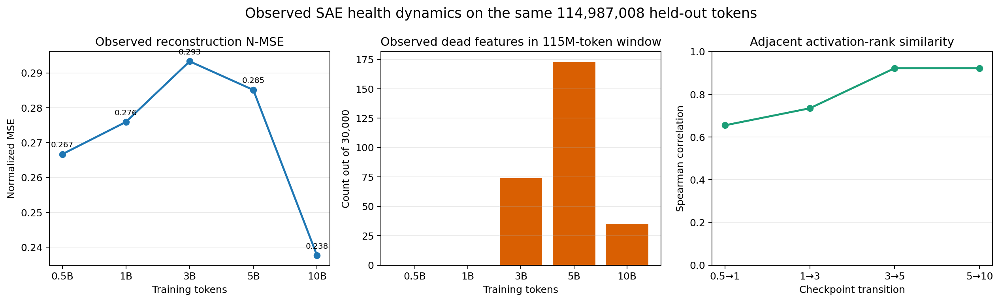
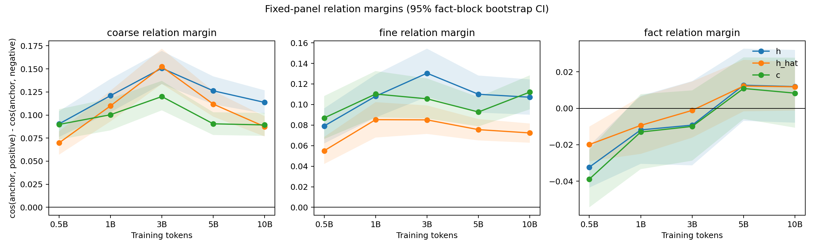
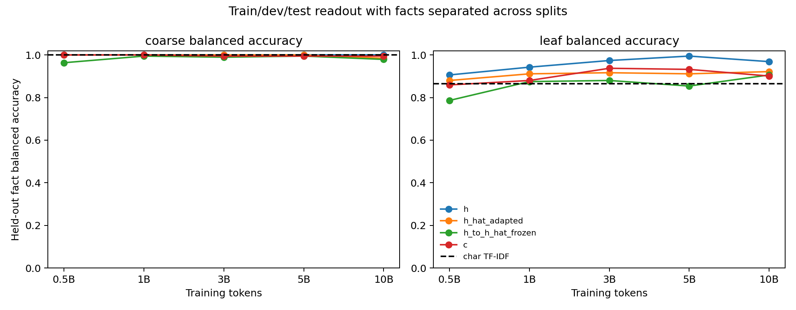
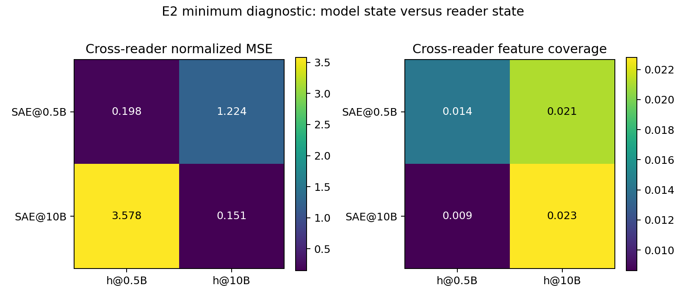
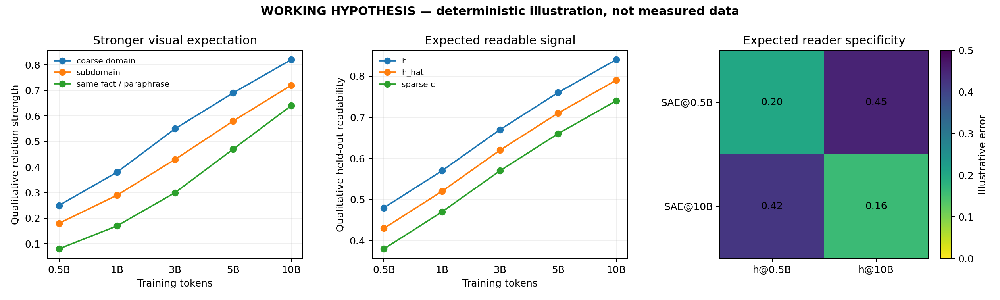
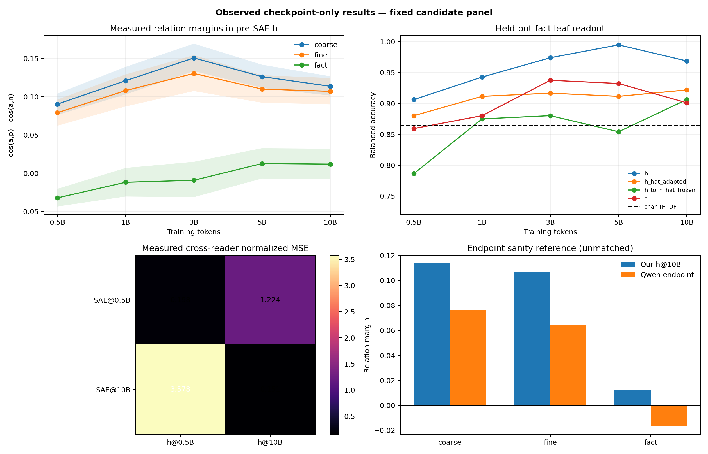
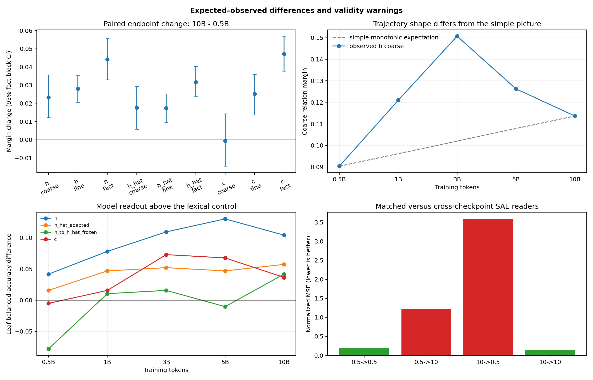

# 完整实验报告｜SAE-mediated 预训练检查点的健康度与表征演化

**报告日期：2026-09-14**  
**覆盖检查点：0.5B、1B、3B、5B、10B 累计训练 token**  
**执行状态：两项 checkpoint-only 分析均已完成并通过工程收据检查**  
**科学资格：`BOUNDED_EXPLORATORY_ONLY`**

> 本文是本轮已执行分析的完整技术报告，汇总数据构造、模型与表征位置、全部已运行指标、结果、执行偏差和证据边界。当前研究问题没有正式 Anchor-aligned `protocol.md`，语义面板也未经研究者人工审核，因此本文不是 canonical `summary.md` / `detailed.md`，不替代研究者的最终机制判断。

## 0. 结论先行

工程上，两项分析都完整结束：第一项在同一份冻结 held-out token 流上审计五个 checkpoint 的 SAE 重构与激活分布；第二项在同一份 864 句候选语义面板上比较原始表征 \(h\)、SAE 重构 \(\hat h\) 和稀疏贡献坐标 \(c\)，并加入冻结 Qwen3-0.6B Base 外部端点及字符 TF-IDF 词面基线。两个任务都只读取 checkpoint，`optimizer_updates=0`，没有启动、停止或修改训练。

直接结果是：10B 的归一化重构误差低于 0.5B，但轨迹先升后降；Top-K 每 token 正激活数固定在约 32；大窗口覆盖率始终高于 99.4%，而 feature 频率从早期到后期发生明显重排。候选语义面板上，\(h\) 的粗领域、子领域和同事实异表达关系从 0.5B 到 10B 的配对变化都为正，但前两项在 3B 达峰而非单调增强；事实关系在 10B 的单点区间仍跨零。\(\hat h\) 保留部分变化，\(c\) 的粗领域端点变化却接近零。

最接近证据的解释是：主干表征与在线 SAE reader 在共同适应，同时模板与主题词提供了很强的词面捷径。当前可以声称“这一条 SAE-mediated 训练轨迹对这份固定候选面板的几何与可读性发生了可复现变化”；不能声称抽象语义已经形成、SAE feature 是稳定语义原子，或 SAE 对主干产生了正向因果作用。

## 1. 研究问题、工作假设与对照角色

本轮问题是：随着同一条 8 层 SAE-mediated 预训练轨迹从 0.5B 推进到 10B，最后一层 MLP 输入位置的表示是否出现更强的领域、子领域及同事实异表达组织；在线 SAE 是否能稳定读出该变化。

工作假设分为三层：

1. 原始表征 \(h\) 的粗领域关系在 10B 相比 0.5B 提高，且 10B 为正；细领域和事实关系是次级证据，不要求五点严格单调。
2. 重构 \(\hat h\) 应保留 \(h\) 中已经可读的关系；稀疏坐标 \(c\) 应给出一致但不必更强的证据。
3. 同期 SAE 应比跨时期 SAE 更好地重构同期 \(h\)；若跨时期严重失配，则不能把不同 checkpoint 的相同 feature ID 当成固定语义身份。

冻结的 Qwen3-0.6B Base 只承担“成熟外部模型上该面板是否可读”的端点检查。它与当前 8 层模型的架构、初始化、数据顺序和训练 token 都不匹配，绝不是无 SAE 因果 baseline。字符 3–5 gram TF-IDF 则是不读取模型的词面捷径对照。

## 2. 模型、SAE 接入位置与梯度合同

被分析的五个 checkpoint 来自同一条 50B-token 正式训练轨迹。主干配置为词表 151,936、隐藏维 1,024、MLP 中间维 3,072、8 个 Transformer block、16 个 attention head、8 个 KV head、最大长度 2,048；主干参数 281,431,040。SAE 宽度 30,000、Top-K=32、参数 61,471,024，总参数 342,902,064。

最后一个 block 的实际计算为：

\[
r=x+\operatorname{Attention}(\operatorname{Norm}_1(x)),\qquad
h=\operatorname{Norm}_2(r),
\]

\[
z=\operatorname{TopK}_{32}(\operatorname{ReLU}(W_e(h-b)+a)),\qquad
\hat h=W_dz+b,
\]

\[
x_{\mathrm{out}}=r+\operatorname{MLP}(\hat h).
\]

因此 \(h\) 是最后一层 `norm2` 后、SAE 前的原始 MLP 输入；\(\hat h\) 是 SAE 重构，并且是最后一层 MLP **实际消费的输入**。SAE 不是并联的观测头，也不作为语言模型输出。

训练时存在两条计算图：

- LM 分支在全部有效 token 上经 \(h\rightarrow\mathrm{SAE}\rightarrow\hat h\rightarrow\mathrm{MLP}\) 计算交叉熵。LM 梯度更新 SAE、最后层 MLP，并穿过 SAE 回传到产生 \(h\) 的前序 block；这就是 SAE-mediated bottleneck 的强因果干预。
- 重构分支在 12.5% 的抽样有效 token 上再做一次 SAE 前向，输入和目标均 `detach`。其归一化重构 loss 只更新 SAE 参数，不更新主干。

总目标是单位权重的

\[
\mathcal L=\mathcal L_{LM}+\mathcal L_{SAE},
\]

其中两项都先按所有 rank 和累积 microbatch 的全局有效 token 数归一化。这里“SAE loss 只作用于 SAE”不意味着“SAE 只受 SAE loss 更新”：SAE 同时也收到 LM loss 的任务梯度。

## 3. 数据的完整构造方式

### 3.1 预训练数据视图

训练使用冻结的 `dclm_pair_v1` 二进制 token 视图，token dtype 为 `uint32`，分词器为本地 Qwen3-0.6B-Base tokenizer。数据 manifest 记录 2,419 个训练文件、共 302,089,493,820 个可见 token；正式训练代码通过 `max_tokens=30,000,000,000` 固定读取该有序视图的前 30B token，并在目标训练量 50B 内确定性循环。验证文件从训练文件清单中单独留出，含 114,988,106 个 token。manifest SHA-256 为 `8a91bdbb0eb537bd80612015b99f178ca1cbb54a2fa7cf8442ab1eae7f0a2f2d`。

`BinaryTokenDataset` 按路径排序递归读取 `.bin` 文件，将所有 shard 视为一条连续 token 流。长度为 2,048 的样本从位置 \(i\times2048\) 开始读取 2,049 个连续 token：前 2,048 个作为输入，后 2,048 个作为已对齐的 next-token 目标。相邻样本共享边界上的一个 token，不浪费预测位置。正式四卡训练每 rank microbatch=2、梯度累积 16 次，所以每次 optimizer update 的有效预测 token 固定为

\[
4\times2\times16\times2048=262{,}144.
\]

本报告不重新评价 DCLM 原始文本的来源质量；这里确认的是执行代码所消费的冻结 token 视图及其 manifest 身份。

### 3.2 第一段：固定 held-out SAE 健康审计数据

第一段直接使用上述冻结 validation token 流，不采样文本类别，也不做语义标注。validation 文件的 114,988,106 个 `uint32` token 被切成

\[
\left\lfloor\frac{114{,}988{,}106-1}{2048}\right\rfloor=56{,}146
\]

个连续序列，对应每个 checkpoint 恰好 114,987,008 个 causal token 位置。两张 GPU 取互不重叠的连续样本分区；五个 checkpoint 使用完全相同的样本、位置和次序。该设计使 checkpoint 间数值可直接配对，但它只代表这一条冻结验证流。

该审计的表征位置仍是最后一个 block 的 post-`norm2`、pre-MLP \(h\)。对于序列中每个位置 \(j\)，它对应预测 token \(j+1\) 的状态。审计同时保存 30,000 维 feature 计数，以及 20 个预先固定 feature 的最高激活上下文。

20 个 feature 的选择规则是：在完整 10B checkpoint 的训练累计 `firing_counts` 中先取计数最高的 100 个 feature，再以随机种子 17 无放回均匀抽取 20 个；这 20 个 ID 原样用于全部 checkpoint。每个 feature、每个 checkpoint 保留激活值最高的 5 个位置，每个位置解码左右各 24 token 的上下文。此选择偏向 10B 的高频 feature，只适合稳定性和文本审阅，不是无偏的全字典语义抽样。

### 3.3 第二段：864 句候选语义面板

第二段数据由确定性 Python 生成器构造，不来自外部语料采样。面板包含 4 个粗领域，每个粗领域 3 个子领域：

| 粗领域 | 子领域 |
| --- | --- |
| mathematics | arithmetic、geometry、probability |
| physics | mechanics、thermodynamics、optics |
| biology | cell_biology、genetics、ecology |
| history | ancient_history、medieval_history、modern_history |

每个子领域生成 18 个事实，每个事实生成 4 种英文表述，共

\[
4\times3\times18\times4=864\ \text{句},\qquad 216\ \text{个事实}.
\]

每个子领域按事实编号切分，而不是按句子随机切分：事实 0–9 为 train，10–13 为 dev，14–17 为 test。因而每个子领域有 40/16/16 句，整个面板为 train=480、dev=192、test=192；同一事实的四种表达不会跨 split。每行记录 `sample_id`、文本及 SHA-256、`coarse`、`leaf`、`fact_id`、`style_id`、`split`、`source_id`、`language`、统一读取后缀 `"\n"`、`ambiguous=false` 与 `human_reviewed=false`。面板 SHA-256 为 `7d11e9625eb7fcf4885e46ca7928926b621d6c6e4485d06f5bd86cc91dc69c55`。

生成器对算术、几何、概率、力学、热学、光学使用各自的数值或事实模板；生物使用“术语—功能”句式的四种模板；历史使用事件—年份模板。这里有一项关键偏差：虽然事实在 split 间分离，**具体模板家族并没有按 split 分离**，而是在同一子领域中反复使用。领域专有词、实体类型、数字格式和句式都可能成为捷径。全部样本均标记为程序构造且未经人工审核；部分历史表述或英语句法可能有事实性、自然度或等价性问题。

### 3.4 语义面板的 token 化与读取位置

每句先附加统一换行符 `\n`，再用同一 Qwen tokenizer 编码，不添加特殊 token；batch 内右侧 padding。每句只取最后一个有效 token 位置的状态，因为该位置已经看到完整陈述。自研 8 层模型缓存 \(h\)、\(\hat h\)、Top-K feature ID 与值、decoder 列范数；Qwen 外部端点用最后一层 MLP 的 forward pre-hook 只缓存对应的 \(h\)。不同模型允许 token 长度不同，但读取规则相同。

## 4. 所有已运行实验指标的构造方式

### 4.1 第一段：SAE 重构与激活分布指标

设一个 token 的原始表示为 \(h_i\in\mathbb R^d\)，重构为 \(\hat h_i\)，严格正的 Top-K 激活集合为 \(A_i\)，评估 token 总数为 \(N\)，feature 总数为 \(M=30{,}000\)。

**每 token 归一化重构 MSE** 是第一段的主重构指标：

\[
E_{norm}=\frac1N\sum_{i=1}^{N}
\frac{\operatorname{mean}_d(\hat h_i-h_i)^2}
{\max(\operatorname{mean}_d h_i^2,10^{-4})}.
\]

它先对每个 token 按自身状态能量归一化，再跨 token 平均，与训练 SAE loss 的定义一致。

**原始 MSE** 为所有 token 和隐藏维上的平方误差均值：

\[
E_{raw}=\frac{\sum_i\lVert\hat h_i-h_i\rVert_2^2}{Nd}.
\]

机器 summary 还记录 **全局平方误差/全局状态能量**：

\[
E_{global}=\frac{\sum_i\lVert\hat h_i-h_i\rVert_2^2}
{\sum_i\lVert h_i\rVert_2^2}.
\]

它与 \(E_{norm}\) 的聚合顺序不同，不能互换；主报告曲线使用 \(E_{norm}\)。

**平均每 token 激活 feature 数**：

\[
L_0=\frac1N\sum_i |A_i|,\qquad A_i=\{j:z_{ij}>0\}.
\]

因为编码器先 ReLU 再取 Top-K=32，\(L_0\) 预期接近 32；若 Top-K 槽位恰为零，则只按严格正值计数。

**feature 激活频率** 对每个 feature \(j\) 定义为

\[
f_j=\frac1N\sum_i\mathbf1[z_{ij}>0].
\]

每个 checkpoint 保存全部 30,000 个计数及全体频率、正频率的 0/25/50/75/90/99/100% 分位数。单 checkpoint 分布图画 survival curve：横轴为正的 \(f_j\)（对数尺度），纵轴为在全部 30,000 个 feature 中满足 \(f\geq f_j\) 的比例；跨 checkpoint 图把五条曲线放在相同坐标系。

**覆盖率与 dead feature 比例**：

\[
\operatorname{coverage}=\frac{|\{j:f_j>0\}|}{M},\qquad
\operatorname{dead}=1-\operatorname{coverage}.
\]

这里的 dead 仅表示“在这 114,987,008 个 held-out token 中一次也未正激活”，不等同于整个训练期永久死亡。

**跨 checkpoint 激活分布相似性** 使用两个互补量：

- Spearman 相关：对两条完整 30,000 维频率向量的秩做相关，衡量哪些 feature 相对更常见的排序是否保持。
- Jensen–Shannon divergence：先令 \(p=f/\sum_j f_j\)、\(q=g/\sum_j g_j\)，再计算以 2 为底的 Jensen–Shannon distance 的平方；0 表示相同，越大表示分布质量重排越强。

**固定 20 feature 的频率、最大激活与 Top 文本**：频率热力图使用 \(\log_{10}(\max(f_j,10^{-12}))\)；最大激活热力图取每个 feature 在已保存 Top-5 上下文中的最大激活值；文本表按激活降序展示每个 checkpoint 的 5 个最高位置。这是定性审阅和身份漂移线索，不提供 feature 语义正确率。

### 4.2 第二段：三种表示

- \(h\)：最后层 `norm2` 后、进入 SAE 前的实际表示。
- \(\hat h\)：同一 token 经同期 SAE 重构后、实际输入最后层 MLP 的表示。
- \(c\)：稀疏贡献坐标。为降低 encoder/decoder 缩放不定性，把 Top-K 值按同期 decoder 列范数修正：

\[
c_{ij}=z_{ij}\lVert v_j\rVert_2,
\]

其余 29,968 个坐标置零，形成 30,000 维 CSR 稀疏矩阵。不同 checkpoint 的 feature ID 仍不被假设为相同语义。

### 4.3 固定三元组与关系间隔

每个 test 句子都是锚点 \(a\)，因此每种关系有 192 个三元组。候选集合建立后按索引排序，再用 `SHA256(anchor_id|relation)` 的前 16 个十六进制位取模确定唯一候选；同一三元组用于全部 checkpoint 和三种表示。

- 粗领域：正例来自 train 中同 coarse、不同 leaf、相同 `style_id`；负例来自 train 中不同 coarse、相同 style。
- 子领域：正例来自 train 中同 leaf、不同 fact、相同 style；负例等于粗领域正例集合。
- 同事实异表达：正例来自 test 中同 fact、不同 style；负例等于子领域正例集合，即 train 中同 leaf、不同 fact、与锚点相同 style。

对 dense \(h,\hat h\) 和 sparse \(c\) 都先逐行 L2 单位化，再计算

\[
m(a,p,n)=\cos(a,p)-\cos(a,n).
\]

\(m>0\) 表示锚点更接近按标签定义的正例。每个事实有 4 个 test 表达，先把其 4 个 margin 平均为一个 fact-block 值，再在 48 个 test fact 上取均值。

**单 checkpoint 95% CI**：以随机种子 17 对 48 个 fact-block 有放回抽样 1,000 次，每次抽 48 个块并取均值，用 2.5% 和 97.5% 分位数给出区间。它只反映这份面板中 test fact 的抽样不确定性，不包含训练 seed、不包含模板生成过程，也不代表总体语言分布。

**10B−0.5B 配对变化 CI**：对同一事实、同一固定三元组先做端点差，再以同样的 48 个事实块和 1,000 次 bootstrap 估计区间。该计算在原计划中被要求，但正式运行脚本漏产出；本报告使用同一缓存、同一三元组规则事后补算，明确标记为 `POST_HOC_CONFORMANCE_AUDIT`。

### 4.4 线性读出与冻结读法

读出目标分别为 4 类 `coarse` 和 12 类 `leaf`。数据划分沿用事实分离的 train/dev/test。dense 表示先用 train 拟合 `StandardScaler(with_mean=true)`；稀疏 \(c\) 和 TF-IDF 使用 `with_mean=false`。随后训练 L2 Logistic Regression，在

\[
C\in\{0.01,0.1,1,10\}
\]

中按 dev balanced accuracy 选最优 \(C\)，最后只在 test 报 balanced accuracy。dense 使用 `lbfgs`，sparse 使用 `liblinear` one-vs-rest，`max_iter=1500`、随机种子 17。Balanced accuracy 是各类别 recall 的算术平均，避免类别频率差异支配分数。

每个 checkpoint 运行四种读法：

1. `h`：在 \(h_{train}\) 拟合并在 \(h_{test}\) 测试。
2. `h_hat_adapted`：在 \(\hat h_{train}\) 重新拟合并在 \(\hat h_{test}\) 测试，测“重新适配后是否可读”。
3. `c`：在稀疏贡献坐标上独立拟合和测试。
4. `h_to_h_hat_frozen`：只在 \(h_{train}\) 拟合 scaler 与分类器，冻结后直接应用到 \(\hat h_{test}\)，测“原有线性读法能否跨过 SAE 重构继续使用”。

这些准确率没有 bootstrap CI；几百分点差异只作为描述性结果。

### 4.5 词面基线

对 864 句原始文本拟合字符边界 `char_wb` TF-IDF，字符 n-gram 为 3–5、`min_df=2`、最多 50,000 维。它使用与模型读出相同的事实分离 split、标准化、\(C\) 网格、dev 选择和 test balanced accuracy。该指标衡量不读取模型时，仅靠字形、主题词和模板可以完成多少标签预测。

### 4.6 跨 checkpoint reader 诊断

对目标 checkpoint 已缓存的 \(h_t\)，不再运行语言模型，而是送入另一个 checkpoint 的 SAE \(E_s,D_s\)：

\[
\hat h_{s\leftarrow t}=D_s(E_s(h_t)).
\]

报告 864 句上的平均每样本归一化 MSE：

\[
E_{s\leftarrow t}=\frac1{864}\sum_i
\frac{\operatorname{mean}_d(\hat h_{s\leftarrow t,i}-h_{t,i})^2}
{\max(\operatorname{mean}_d h_{t,i}^2,10^{-4})}.
\]

同时报告该小面板上出现过的正激活 feature ID 数除以 30,000 的 coverage。运行了端点 2×2（reader 0.5B/10B × target 0.5B/10B）以及固定 5B reader 对五个 target 的时间轴，共 9 格。此 coverage 只基于 864 句，不能与第一段 1.15 亿 token 的字典健康覆盖率混用。

### 4.7 PCA、t-SNE 与未运行指标

共享 PCA 把五个 checkpoint 的 train \(h\) 合并后拟合一个 2 维、randomized solver、seed 17 的投影，再分别变换每个 checkpoint 的 test \(h\) 和 \(\hat h\)。因此五个自研 checkpoint 的坐标轴相同。Qwen 隐藏空间维度与坐标体系不同，使用其自身 train \(h\) 独立拟合 PCA，只能作端点内部描述。

联合 t-SNE 把五个 checkpoint 的 test \(h\) 共 960 行拼接，先用 seed 17 的 PCA 降到最多 50 维，再用 `perplexity=30`、`learning_rate=auto`、`init=pca`、`n_iter=1500`、seed 17 映射到 2 维；完成后按 checkpoint 拆图。PCA/t-SNE 都只用于描述，不进入支持/不支持判定。

以下计划指标未运行，不能用别的结果替代：UMAP 因依赖缺失标为 `NOT_RUN_dependency_unavailable`；独立内容属性基准、父类 leave-one-leaf-out、长度/格式基线、低词面重合子集、稀疏 Top-K 容量曲线、自然文本外部验证、读出准确率 bootstrap，以及匹配的无 SAE checkpoint 对照均为 `NOT_RUN`。

## 5. 结果

### 5.1 SAE 健康与激活分布

| checkpoint | 归一化 MSE | 原始 MSE | 平均正激活数 | 覆盖率 | dead feature | Spearman vs 0.5B | JSD vs 0.5B |
| --- | ---: | ---: | ---: | ---: | ---: | ---: | ---: |
| 0.5B | 0.26668 | 0.30070 | 32.00000 | 100.000% | 0 | 1.000 | 0.0000 |
| 1B | 0.27594 | 0.35241 | 32.00000 | 100.000% | 0 | 0.655 | 0.0894 |
| 3B | 0.29332 | 0.44747 | 32.00000 | 99.753% | 74 | 0.496 | 0.2014 |
| 5B | 0.28512 | 0.45178 | 32.00000 | 99.423% | 173 | 0.479 | 0.2423 |
| 10B | 0.23766 | 0.57545 | 31.99999 | 99.883% | 35 | 0.459 | 0.2897 |

归一化误差从 0.5B 到 10B 下降 0.02902（约 10.9%），但 0.5B→3B 先上升；原始 MSE 则持续扩大到约 0.5B 的 1.91 倍，说明 \(h\) 的尺度同步改变。3B→5B 与 5B→10B 的相邻 feature 频率秩相关分别为 0.9225 和 0.9225，但 0.5B→10B 只有 0.4592：较合理的读法是“早期到后期发生大重排，3B 后局部排序趋稳”。完整数值见 [first_stage_metrics.csv](tables/first_stage_metrics.csv)，来源哈希见 [first_stage_source_manifest.json](tables/first_stage_source_manifest.json)。

### 5.2 关系间隔

| 表示 | 关系 | 0.5B | 峰值 | 10B | 10B−0.5B 配对变化（95% CI） |
| --- | --- | ---: | ---: | ---: | ---: |
| \(h\) | 粗领域 | 0.0903 | 0.1507 @ 3B | 0.1137 | +0.0233 [0.0122, 0.0357] |
| \(h\) | 子领域 | 0.0791 | 0.1305 @ 3B | 0.1071 | +0.0280 [0.0206, 0.0353] |
| \(h\) | 同事实 | −0.0323 | 0.0126 @ 5B | 0.0119 | +0.0442 [0.0330, 0.0557] |
| \(\hat h\) | 粗领域 | 0.0698 | 0.1523 @ 3B | 0.0874 | +0.0176 [0.0057, 0.0294] |
| \(\hat h\) | 子领域 | 0.0550 | 0.0853 @ 1B | 0.0723 | +0.0173 [0.0095, 0.0252] |
| \(\hat h\) | 同事实 | −0.0199 | 0.0122 @ 5B | 0.0118 | +0.0317 [0.0237, 0.0403] |
| \(c\) | 粗领域 | 0.0898 | 0.1200 @ 3B | 0.0892 | −0.0005 [−0.0146, 0.0143] |
| \(c\) | 子领域 | 0.0869 | 0.1121 @ 10B | 0.1121 | +0.0252 [0.0137, 0.0360] |
| \(c\) | 同事实 | −0.0389 | 0.0109 @ 5B | 0.0083 | +0.0472 [0.0377, 0.0569] |

\(h\) 的三种端点变化均为正，但粗/细关系在 3B 后回落，不支持平滑、单调形成。事实关系的相对变化为正，但 10B 单点区间为 [−0.0079, 0.0320]，仍不能说 10B 已稳定偏向同事实正例。\(c\) 没有复现 \(h\) 的粗领域端点改善。

Qwen3-0.6B 外部端点的粗/细/事实 margin 分别为 0.0762、0.0648、−0.0169；事实区间 [−0.0271, −0.0073] 明确为负。因此该面板的“同事实异表达”构造连成熟外部模型也未通过，削弱其作为抽象事实语义测量的有效性。全部 checkpoint、表示、关系和单点 CI 见 [semantic_raw_relation_margins.csv](tables/semantic_raw_relation_margins.csv)；配对端点结果见 [semantic_endpoint_paired_deltas.csv](tables/semantic_endpoint_paired_deltas.csv)。

### 5.3 线性读出与词面基线

粗领域读出在 0.5B 已基本饱和：\(h\) 为 100%，适配 \(\hat h\) 为 100%，\(c\) 为 100%，冻结 \(h\rightarrow\hat h\) 为 96.35%；字符 TF-IDF 也是 100%。该指标几乎没有时间分辨力。

12 类 leaf 的 test balanced accuracy 更有变化：

| 表示/读法 | 0.5B | 1B | 3B | 5B | 10B |
| --- | ---: | ---: | ---: | ---: | ---: |
| \(h\) | 90.63% | 94.27% | 97.40% | 99.48% | 96.88% |
| \(\hat h\) adapted | 88.02% | 91.15% | 91.67% | 91.15% | 92.19% |
| \(c\) | 85.94% | 88.02% | 93.75% | 93.23% | 90.10% |
| frozen \(h\rightarrow\hat h\) | 78.65% | 87.50% | 88.02% | 85.42% | 90.63% |

Qwen 的 leaf 为 98.96%，字符 TF-IDF 为 86.46%。词面基线已经超过 0.5B 的 \(c\) 和冻结读法，并接近最早 \(h\)，表明当前 panel 很容易依赖领域词与模板。完整 dev 分数、选中的 \(C\) 和 test 分数见 [semantic_raw_readout_accuracy.csv](tables/semantic_raw_readout_accuracy.csv)。

### 5.4 跨时期 SAE reader

| SAE reader | 目标 \(h\) | 归一化 MSE | 864 句 feature coverage |
| --- | --- | ---: | ---: |
| 0.5B | 0.5B | 0.198 | 1.427% |
| 0.5B | 10B | 1.224 | 2.110% |
| 10B | 0.5B | 3.578 | 0.863% |
| 10B | 10B | 0.151 | 2.280% |
| 5B | 0.5B | 1.243 | 0.833% |
| 5B | 1B | 1.311 | 1.247% |
| 5B | 3B | 0.732 | 1.460% |
| 5B | 5B | 0.169 | 1.863% |
| 5B | 10B | 4.059 | 2.407% |

同期 reader 的误差显著低于远距离跨时期读取，且方向不对称。这直接支持“主干分布与 SAE 字典共同移动”，也说明原始 feature ID 不能直接跨 checkpoint 当作同一语义单位。完整表见 [semantic_raw_cross_reader_quality.csv](tables/semantic_raw_cross_reader_quality.csv)。

### 5.5 二维投影

共享 PCA 从 0.5B 的较多重叠变为 3B/10B 更明显的领域分离，但联合 t-SNE 在 0.5B 已出现四个明显领域团块。可核对 [0.5B PCA](figures/semantic_raw_pca_h_0p5b.png)、[3B PCA](figures/semantic_raw_pca_h_3b.png)、[10B PCA](figures/semantic_raw_pca_h_10b.png)、[0.5B t-SNE](figures/semantic_raw_tsne_h_0p5b.png) 与 [10B t-SNE](figures/semantic_raw_tsne_h_10b.png)。这两类图都不能证明抽象语义，更不能单凭视觉分团推断因果机制。

## 6. 假设图、真实图、差别图与潜在原因

### (a) 假设图

假设图预期领域、子领域和事实关系总体增强，同时 \(h\)、\(\hat h\) 与 \(c\) 保持可对应的趋势；它是确定性示意，不是数据。

### (b) 真实图

真实轨迹表现为“端点提高但中途达峰并回落”；事实关系只从负值提高到接近零；稀疏 \(c\) 在粗领域上没有端点改善；同期 SAE 比跨期 SAE 更适配。

### (c) 差别图

核心差别有四项：变化不是单调形成；粗领域在最早 checkpoint 已高度可读；事实测量没有通过成熟外部端点；SAE feature 身份随时期的漂移比“固定语义字典”直觉更强。

### (d) 潜在原因分析

第一，面板高度模板化，每个 leaf 反复出现固定主题词、实体类型和句式。TF-IDF 粗领域 100%、leaf 86.46%，足以解释早期线性可读与 t-SNE 分团的一大部分。

第二，SAE 位于真实 LM 前向路径中。LM loss 同时塑造主干和 SAE，重构 loss 又让 SAE 追踪一个不断变化的 \(h\) 分布，因此 checkpoint 间的 \(c\) 同时混合“主干变化”和“尺子变化”。跨 reader MSE 的强失配是这一解释的直接证据。

第三，归一化误差和绝对误差方向相反，说明 \(h\) 的能量尺度改变。只看归一化 SAE loss 会把“相对误差减小”误读成“绝对重构更精确”。

第四，重构多数时候保留标签信息，但改变线性坐标。重新适配 \(\hat h\) 的读出高于冻结 \(h\rightarrow\hat h\)，尤其早期明显，更符合“可读信息仍在，但最佳读法变了”，而不是简单去噪或完全删除。

第五，没有同初始化、同数据顺序、同 token 预算的无 SAE baseline，也只有一个训练 seed。故本轮完全不能识别“SAE 是否导致主干更好”；Qwen 只提供不匹配外部端点，fact-block bootstrap 也不包含训练随机性。

## 7. 执行审计、偏差与证据资格

第一段固定 held-out 审计作业 `pt-p5mlwlqn` 为 `SUCCEEDED`，读取 56,146 个序列和五个 checkpoint，机器 `audit_receipt.json` 为 `PASS`。第二段正式作业 `pt-lok5c11y` 为 `SUCCEEDED`，2026-09-13T16:44:01Z 开始、16:51:25Z 完成，无平台重试；`analysis_receipt.json` 和 terminal receipt 均通过，五个 checkpoint cache、Qwen cache、9 个 cross-reader cache、3 张原始表和所需图均存在。

第二段正式运行前保留了三次失败 Smoke：缺少 `.detach()` 导致 NumPy 转换失败、未使用 FlashAttention 的旧 ABI 冲突、未使用 torchvision 的旧 ABI 冲突；最终 Smoke `pt-f2dgdcod` 在显式禁用两个无关可选扩展并使用 PyTorch SDPA 后通过。失败输出和最终源码快照均保留，没有修改输入 checkpoint。

与最初计划相比的主要偏差及其影响：

| 项目 | 实际状态 | 对证据的影响 |
| --- | --- | --- |
| 面板人工事实与释义审核 | NOT_RUN | 内容正确性、自然度和等价性未获确认 |
| 模板家族跨 split 分离 | 未做到 | 词面/格式泄漏，读出可能走捷径 |
| 匹配无 SAE baseline | NOT_RUN | 不能估计 SAE 因果效应 |
| 多训练 seed | NOT_RUN | bootstrap 不代表训练随机性 |
| 内容属性原子基准 | NOT_RUN | 不能声称 feature 对应语义原子 |
| 父类 leave-one-leaf-out | NOT_RUN | 不能把 coarse 分类当作从属泛化 |
| 长度/格式与低词面重合对照 | NOT_RUN | 无法充分排除非语义线索 |
| UMAP | 依赖缺失，NOT_RUN | PCA/t-SNE 不能替代其结果，但不影响原空间 margin |
| 配对端点 CI | 正式脚本漏产，事后同规则补算 | 必须标记 post hoc，不算原运行原生产物 |
| 读出准确率 CI | NOT_RUN | 不对小百分点差异作强统计结论 |

因此工程结论是 `PASS`，科学资格仍为 `BOUNDED_EXPLORATORY_ONLY`。

## 8. 可声称、不可声称与下一决策

**可声称：**

- 五个完整 checkpoint 在固定大规模 held-out token 流上的 SAE 数值健康、覆盖和激活频率轨迹已被可复核地测量。
- 在固定候选面板上，这条单一 SAE-mediated 轨迹的 \(h\)、\(\hat h\) 和 \(c\) 的关系几何及线性可读性发生了可复现变化。
- SAE reader 对训练时期高度特异；重构通常保留大量可读信息，但会改变线性坐标。

**不可声称：**

- 抽象语义层级已经形成，或从 0.5B 到 10B 单调形成。
- SAE feature 是跨 checkpoint 稳定的一一对应语义原子。
- SAE 改善或损害了主干语义，因为没有匹配无 SAE baseline。
- 结果可以推广到其他 seed、自然文本、其他模型或其他表示位置。

**AI 建议的唯一下一决策：** 由研究者决定是否先重做确认面板，再开展匹配 baseline 比较。若继续，最低准入条件应是：人工审核事实与改写；模板家族在事实 split 间真正分离；加入长度/格式和低词面重合子集；成熟外部端点的事实关系为正；词面基线明显低于模型读出。若这些条件仍不满足，应停止用该面板判断“语义形成”，而不是继续解释 feature。

## 9. 证据与复现索引

- 第一段四段式读数：[03_checkpoint_audit_four_panel_report_cn.md](03_checkpoint_audit_four_panel_report_cn.md)
- 第二段四段式读数：[07_semantic_evolution_four_part_report_cn.md](07_semantic_evolution_four_part_report_cn.md)
- 执行记录：[05_execution_record.md](05_execution_record.md)
- 执行证书：[06_execution_certificate.md](06_execution_certificate.md)
- 第一段机器表：[first_stage_metrics.csv](tables/first_stage_metrics.csv)
- 第一段来源 manifest：[first_stage_source_manifest.json](tables/first_stage_source_manifest.json)
- 第二段关系、读出、跨 reader 与配对端点表：[relation](tables/semantic_raw_relation_margins.csv)、[readout](tables/semantic_raw_readout_accuracy.csv)、[cross-reader](tables/semantic_raw_cross_reader_quality.csv)、[paired delta](tables/semantic_endpoint_paired_deltas.csv)
- 第二段来源 manifest：[semantic_result_source_manifest.json](tables/semantic_result_source_manifest.json)
- 冻结 panel：`/data/250010109/MoE_Router/experiments/20260912_dense_sae_pretraining/analysis_assets/semantic_panel_v1.jsonl`
- panel 生成器：`/data/250010109/MoE_Router/experiments/20260912_dense_sae_pretraining/dense_sae/analysis/build_semantic_panel.py`
- 第一段分析源码：`/data/250010109/MoE_Router/experiments/20260912_dense_sae_pretraining/dense_sae/analysis/checkpoint_audit.py`
- 第二段分析源码：`/data/250010109/MoE_Router/experiments/20260912_dense_sae_pretraining/dense_sae/analysis/semantic_evolution.py`
- 第二段正式输出：`/data/250010109/MoE_Router/experiments/20260912_dense_sae_pretraining/analysis_runs/analysis1_20260913/full`
- 第二段最终源码快照：`/data/250010109/MoE_Router/experiments/20260912_dense_sae_pretraining/analysis_runs/analysis1_20260913/source_snapshot/analysis1_source_20260913T164000Z.tar.gz`，SHA-256 `cab649ea6e83d3d61a5d186e02b8271950fdab6dfdb7e8fadd26031e56981285`

原始执行目录、checkpoint、失败 Smoke 和既有证据均保持原状。本报告只增加读取入口与解释，不重算或覆盖原结果。
