# Analysis2：0.5B–5B 两臂表征与 SAE 激活确认分析

日期：2026-09-14  
证据状态：**有界描述性对比，等待研究者判断**  
执行作业：`pt-r6httloa`，单节点 2×RTX 5090 32GB spot  

## 直接结论

在这套固定面板上，四个粗领域从 **0.5B** 起就已能在三种二维图和原始高维线性读出中清楚区分，因此真实结果不符合“0.5B 混合、随后逐渐从无到有分开”的简单形成图景。线上稀疏自编码器（SAE，即把最后一层 MLP 前向量压成 30,000 维、每个读点保留 32 个正激活再重构的模块）确实出现了可在独立确认家庭上复现的领域偏好 feature；但“同一事实的两种表达比不同事实更复用同一稀疏组合”的总体选择性差值在 0.5B、1B、3B、5B 的 95% 区间均跨 0，当前不能成立为稳定事实级结论。

可支持的最强表述是：**领域信息很早即可读；SAE-mediated 训练与后期表征几何差异相关，并且 SAE 码中存在领域相关 feature。当前证据尚不能证明稳定的命题级稀疏组合复用，也不能把两臂差异单独因果归于 SAE。**

## 本次术语与方法原理

- 主成分分析（PCA）：寻找投影后方差最大的相互正交线性方向，本图只保留前两个方向。
- 统一流形逼近与投影（UMAP）：先在高维空间建立带权近邻图，再优化低维图以尽量保留局部拓扑关系。
- t 分布随机邻域嵌入（t-SNE）：把高维和低维的邻域相似度转成概率分布，并最小化两者的相对熵，重点保持局部邻居而非全局距离。
- 普通稠密基线（baseline）：不含 SAE 瓶颈的 8 层语言模型对照臂。
- SAE-mediated 模型：最后一层 MLP 的输入不是原始向量 \(h\)，而是 SAE 重构向量 \(\hat h\)；语言模型损失经该重构路径反传到前序网络。
- 训练快照（checkpoint）：按累计有效预测词元保存的完整模型状态；主分析使用 0.5B、1B、3B、5B，0B 只作初始化参考。

## 数据与比较构造

数据固定为 4 个粗领域（数学、物理、生物、历史）×每域 3 个细领域×每细领域 6 个独立命题家庭×每家庭 5 句，共 72 个家庭、360 句。每个家庭包含原句、词面接近/远离的两条同命题改写，以及词面接近/远离的两条不同命题对照。家庭 01–02 用于拟合，03 用于开发，04–06 用于封存确认，对应 120/60/180 句；所有统计区间以家庭而非句子为独立单位。

研究者决定保留全部 72 个家庭；AI 对命题等价、对照命题一致性、事实来源、独立成句信息和词面顺序进行了逐家庭合规检查，并对 44 句作最小措辞修订。冻结后 72/72 家庭均满足高词面重合度高于低词面重合度，含 25 条事实参考。正式面板哈希为 `7aaf0ec96fdae2f2eecc4a011cd03539d6dc2268d3198203fcd6e3344781bf61`，三元组哈希为 `b22730719d00fc7c8b3308d6381b1693c0b86c3c1c82cdd3b3f5318b884402cf`。完整构造和来源边界见[冻结数据审计](/data/250010109/MoE_Router/experiments/20260914_semantic_feature_reuse_analysis/data/frozen_data_audit_v1_cn.md)；绝对执行路径也列于文末。

两臂在相同文本、分词器、换行后最后有效词元、家庭划分和累计有效预测词元点上读取最后一块 `norm2` 后、MLP 前的 1024 维向量 \(h\)。SAE 臂同时读取重构 \(\hat h\) 和稀疏激活。此次只做训练快照推理与离线统计，未创建优化器，模型更新次数为 0。

## 指标如何构造、分别回答什么

| 指标 | 计算方式 | 能回答 | 不能回答 |
|---|---|---|---|
| 原空间关系差 | \(m=\cos(a,p)-\cos(a,n)\)；分别构造粗领域、细领域、同一事实的正反配对 | 在原始 1024 维余弦几何中，正关系是否比对照更近 | 信息是否藏在其他判别方向；因果使用 |
| 两臂配对差 | 同一家庭、同一词元点的 \(m_{SAE}-m_{base}\)，按家庭重采样给 95% 区间 | 两种训练方法在固定测量下是否不同 | SAE 的纯因果效应；两臂参数量并未匹配 |
| 高维线性可读性 | 在拟合家庭训练标准化线性分类器，用开发家庭选正则强度，在确认家庭报类别平衡准确率 | 领域信息是否存在于完整高维表示中 | 模型自身是否使用该信息；语义因果机制 |
| 稀疏集合重合 | 激活 feature 集合的交集大小除以并集大小 | 两句话是否启用相同 feature ID | 激活强弱；feature 是否有同一语义 |
| 幅度加权重合 | 对归一化激活权重计算 \(\sum\min/\sum\max\) | 两句话的稀疏组合及强度是否相似 | 共同高频 feature 是否具有事实选择性 |
| 命题复用选择性 | \(S^+\) 为同一事实重合，\(S^-\) 为不同事实重合，\(G=S^+-S^-\) | 共同激活是否超出通用/词面共同成分 | 若区间跨 0，就不能声称稳定复用 |
| 领域激活优势 | 在拟合家庭每领域选择 6 个相对其他领域更强的 feature；在确认家庭计算本领域均值减其他领域均值 | SAE 码中是否有可留出复现的领域相关区域 | 跨快照 feature 身份稳定性；领域 feature 的功能必要性 |
| 相对重构误差 | \(\|h-\hat h\|_2^2/\|h\|_2^2\) 的确认读点均值 | SAE 重构是否足以作为解释前提 | 绝对误差的跨期尺度变化；语义忠实性 |
| 固定面板覆盖率 | 180 个确认读点至少激活一次的 feature 数除以 30,000 | 这批读点触及字典多少部分 | 全数据覆盖率或全局 dead-feature 比例 |
| 邻域可信度 | 低维图中保留下来的高维 15 近邻程度，范围 0–1 | 二维图保留局部邻域的程度 | 领域标签正确性或语义机制 |

## (a) 假设图

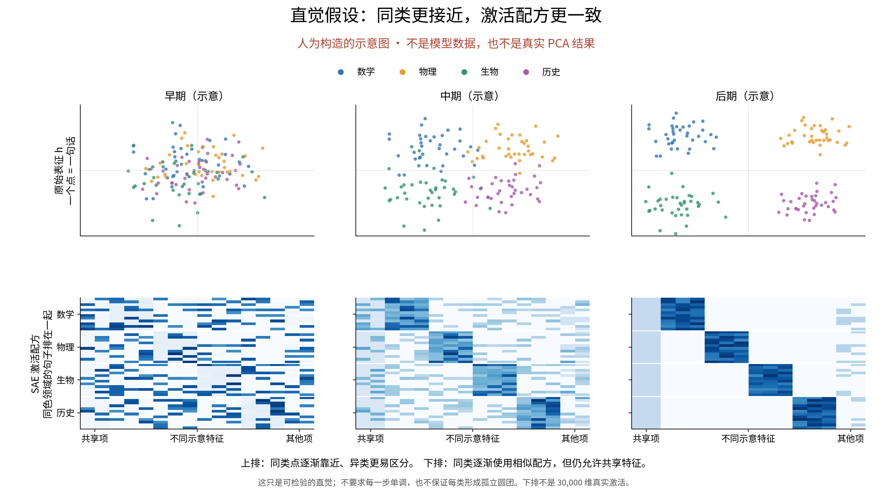

假设图预计：早期领域点混杂，中期逐步分开，后期形成清楚簇；SAE 激活图同步从散乱变为近似分块。该图是人工构造的直觉，不是模型数据，也没有预注册一个必须单调上升的数值阈值。

## (b) 真实图

### 三种降维视图

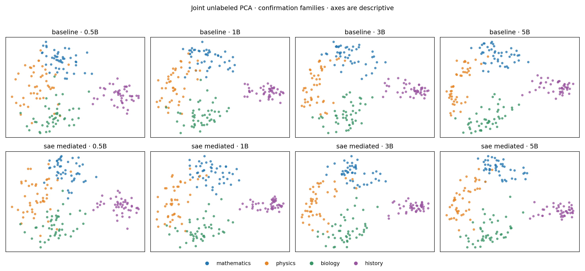

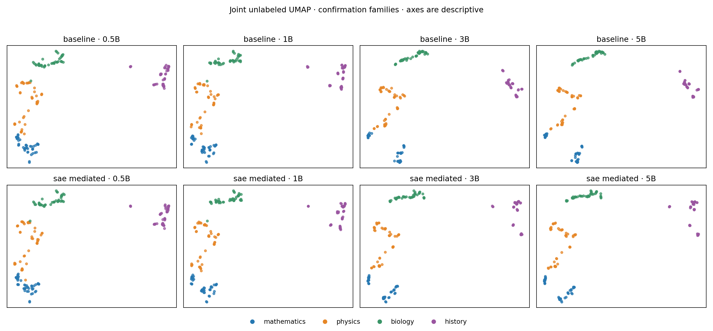

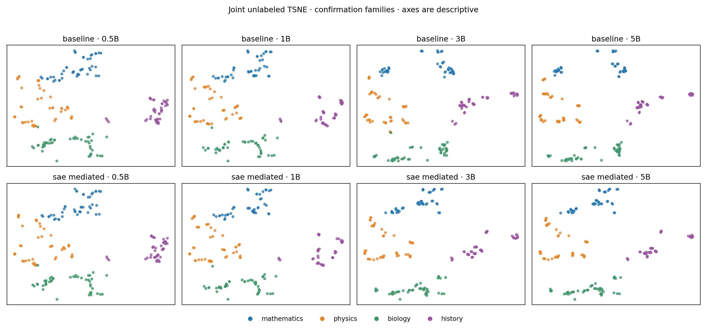

三种方法使用两臂四个训练快照的 1,440 个确认点联合、无标签拟合。15 近邻可信度分别为 PCA 0.879、UMAP 0.989、t-SNE 0.994。三图共同显示 0.5B 已有显著领域结构；UMAP 和 t-SNE 还显示每个领域内部的多个局部支簇。它们支持“PCA 前两轴不是唯一观察面”的担忧，但非线性图会强调局部邻域，不能单凭图形证明语义形成。

完整 1024 维线性读出进一步排除了“基线后期已经没有领域信息”的解释：基线粗领域确认准确率从 0.5B 的 0.939 上升到 5B 的 0.994，细领域从 0.756 上升到 0.883；SAE-mediated 的 \(h\) 对应为 0.967→0.994 和 0.778→0.939，重构 \(\hat h\) 为 0.939→0.983 和 0.722→0.922。

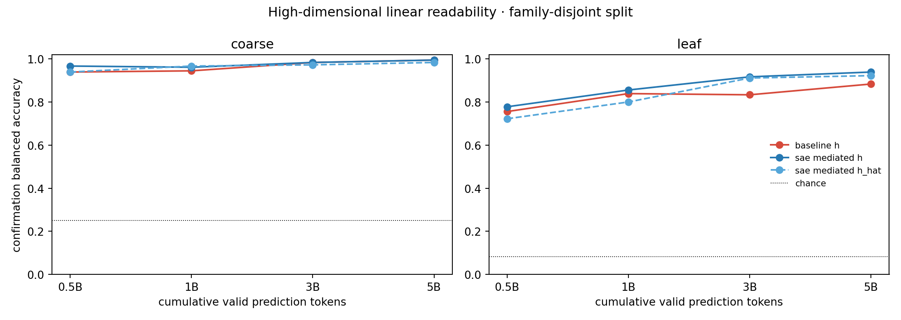

### SAE 领域激活区域

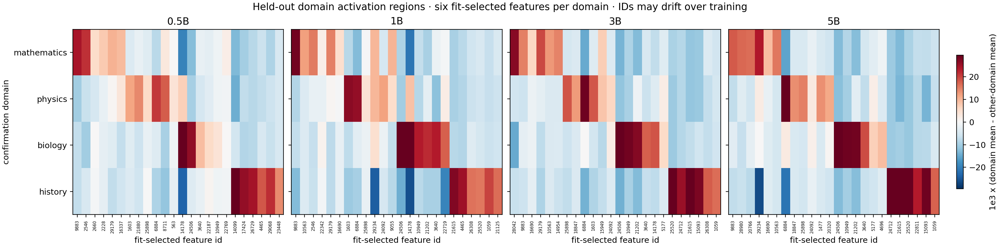

每个训练快照独立在拟合家庭选择 24 个 feature，再在确认家庭显示。四个快照均有 24/24 个所选 feature 在确认集保持正的目标领域激活优势；平均优势依次为 0.0154、0.0183、0.0196、0.0204。图中的近似分块因此是留出数据观察，不是同一数据上选完再展示。不过每个快照的列是重新选择的，图不能证明 feature ID 跨训练期保持同一语义身份。

## (c) 差别图

### 假设与真实的差别

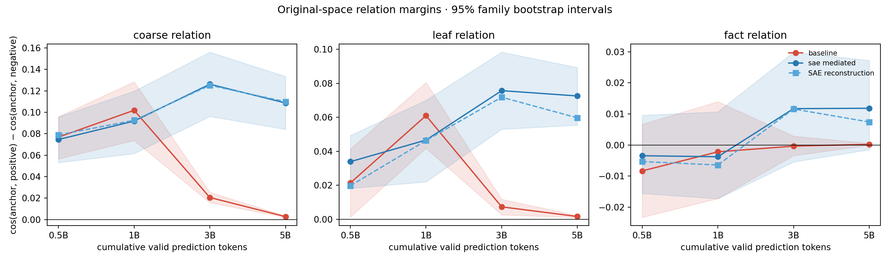

基线粗领域原空间关系差在 0.5B、1B、3B、5B 为 0.0768、0.1019、0.0206、0.0028；5B 时正负配对余弦都已接近 1（0.9950 对 0.9922）。因此关系差的后期收缩主要反映表示变得高度同向，而不是领域信息消失；高维线性读出仍在增强。真实变化不是“所有指标一致单调地形成簇”，而是**可读性、二维形状和原始余弦几何发生了分离**。

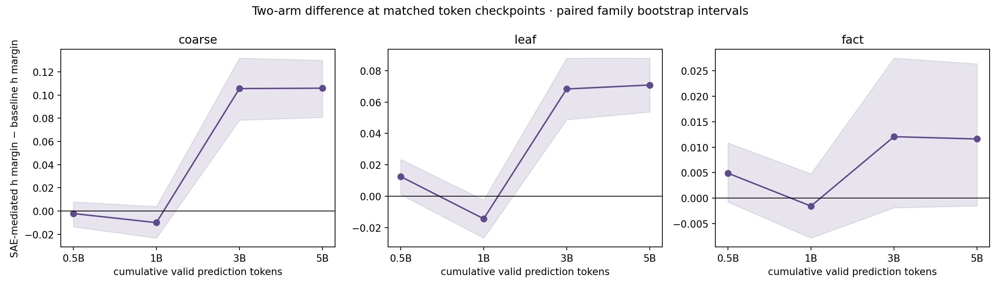

SAE-mediated 相对基线的粗领域关系差在 3B 为 +0.1056，95% 区间 [0.0784, 0.1318]，5B 为 +0.1059 [0.0807, 0.1300]；细领域对应 +0.0683 [0.0488, 0.0880] 与 +0.0709 [0.0537, 0.0880]。事实关系的四个两臂差区间全部跨 0。由此可说两种训练方法的后期领域几何明显不同，但不能说它们的事实级关系已不同。

### 命题级 SAE 复用

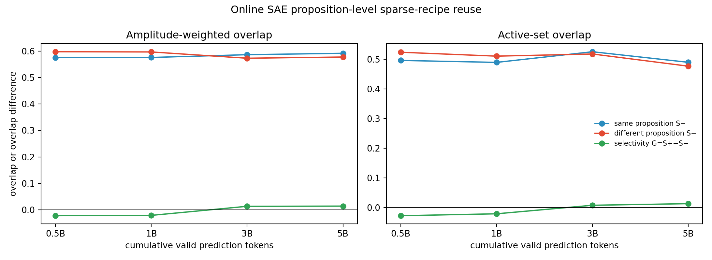

幅度加权 \(G\) 在 0.5B、1B、3B、5B 为 -0.0222、-0.0209、+0.0134、+0.0141；对应 95% 区间分别为 [-0.0582, 0.0151]、[-0.0610, 0.0213]、[-0.0230, 0.0521]、[-0.0200, 0.0504]。集合版本同样全部跨 0。符号从负转正只能称为趋势，不能判为同命题选择性复用成立。

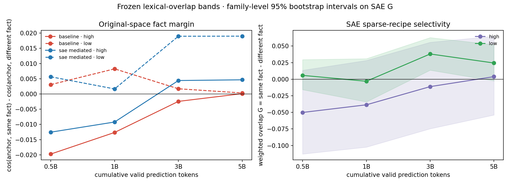

预先冻结的词面分层揭示了重要限制：低词面重合组在 3B 的幅度加权 \(G=0.0380\)，区间 [0.0136, 0.0627]，但 5B 为 0.0244，区间 [-0.0025, 0.0520]；高词面重合组在四个点均未得到正的稳定区间。该现象提示 3B 有一个值得复核的局部信号，但它没有跨快照或跨词面难度稳定复现，所以总体判定仍是不充分。

### SAE 测量质量

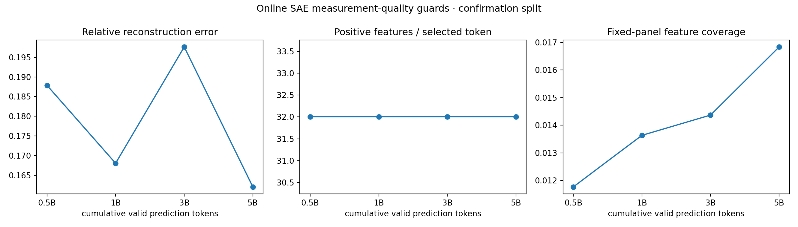

0.5B、1B、3B、5B 的相对重构误差为 0.188、0.168、0.198、0.162；每个读点恰有 32 个正激活，符合架构固定 Top-32。固定 180 个确认读点只覆盖 30,000 个 feature 的 1.18%、1.36%、1.44%、1.68%，所以该覆盖率不能叫全局 dead-feature 比例。

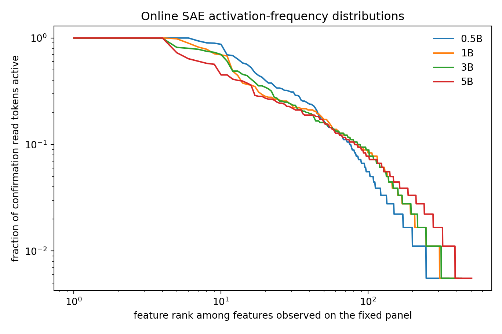

四个训练快照都存在激活频率为 1 的 feature，即至少一个 feature 在所有确认读点都开启；这解释了 \(S^+\) 和 \(S^-\) 本身都较高（约 0.58），并再次说明必须看差值 \(G\)，不能把高重合度直接当成事实语义复用。

## (d) 潜在原因分析

1. **假设图把“从无到有”画得过晚。** 0B 的两臂 \(h\) 完全一致，但随机初始化时粗领域线性读出已为 0.528，高于四类机会水平 0.25；词形、长度、分词和随机嵌入投影本身就能产生部分领域可读性。到 0.5B 时领域结构已很强，因此当前快照间隔无法定位更早的形成时刻。
2. **PCA 前两轴不是完整信息面。** 基线后期余弦关系差收缩，同时完整高维读出继续提升，支持“判别信息转移到二维主轴未充分展示的方向，或表示整体各向异性改变”这一解释。UMAP/t-SNE 与读出共同支持该解释，但只有读出是直接使用完整维度的量化检查。
3. **领域关联比命题等价更容易。** 领域词汇和主题统计在许多句子间重复，足以产生领域 feature；同一事实的远词面改写要求跨词汇保留更细的关系，因此领域分块不能推出命题级组合复用。
4. **共同高频 feature 稀释事实选择性。** 固定 Top-32 中存在全样本 feature，导致同义和异义都共享大量激活；\(G\) 的区间因此比 \(S^+\) 的绝对值更能约束结论。
5. **两臂不是隔离 SAE 的等参数实验。** 普通基线约 281M 参数，SAE-mediated 约 342M，多约 61M；只有一个训练 seed，运行时数值栈也不是严格因果消融。后期领域几何差可以记录为方法关联，不能归因为 SAE 瓶颈的纯因果效应。
6. **当前面板仍有范围限制。** 结论只覆盖 72 个经人工保留和 AI 合规修订的家庭、固定最后词元读点与四个学科领域。它不等价于开放文本上的全局 feature 覆盖，也没有外部改写数据集复现。

## 运行资格与证据边界

2×5090 spot 作业于 05:16:47 UTC 提交，05:28:57 UTC 写出 exit 0 终止回执，提交到回执约 12 分 11 秒。分析回执记录 10 个缓存、360 个样本、36 个确认家庭、初始化两臂 \(h\) 最大绝对差 0、模型更新次数 0。运行后仅在 CPU 上修正领域热图的显示尺度并补出预注册词面分层图；该步骤未重新推理，另有独立后处理回执。先前排队的 H100 Smoke 不属于本次 PASS 证据，AI 未停止该作业，也未启动或停止任何训练。

本报告没有把结果写入 Anchor、Focus 或正式实验结论；最终机制判断仍由研究者审核。最邻近的结论边界是：**领域可读性和领域相关 SAE 激活已得到固定面板支持；稳定命题级复用、跨时期 feature 身份以及 SAE 的纯因果作用仍未知。**

## 证据路径

- 冻结数据：`/data/250010109/MoE_Router/experiments/20260914_semantic_feature_reuse_analysis/data/frozen_manifest_v1.json`
- 执行范围：[05_execution_scope_confirmation_v1_cn.md](05_execution_scope_confirmation_v1_cn.md)
- 原始结果根：`/data/250010109/MoE_Router/experiments/20260914_semantic_feature_reuse_analysis/runs/confirmation_v1_20260914/full`
- 作业终止回执：`.../full/terminal_receipt.json`
- 分析回执：`.../full/analysis_receipt.json`
- CPU 后处理回执：`.../full/postprocess_receipt.json`
- 数值表：`.../full/tables/`
- 图阅读副本清单：[figure_manifest.json](../../figures/semantic_confirmation_v1/figure_manifest.json)

## AI 建议的下一决策

若研究者的核心问题仍是“语义组织是否在预训练中形成”，现有结果已把下一步缩小为两种互斥选择：要定位**领域结构何时出现**，应增加 0–0.5B 之间的早期训练快照；要检验**命题级稀疏组合复用**，应优先对 3B 低词面组的局部正信号做外部家庭复现，并要求 5B 同方向复现。若外部复现或 5B 仍跨 0，就应停止把事实级组合复用作为当前主结论。选择哪一个成为主线仍由研究者决定。
