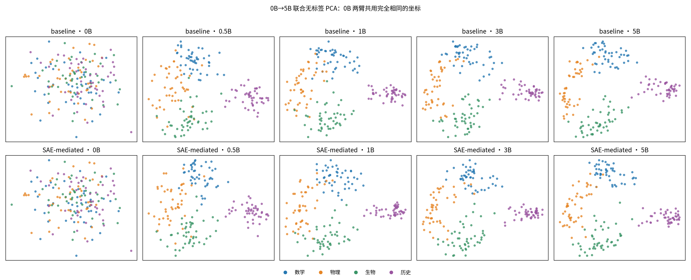
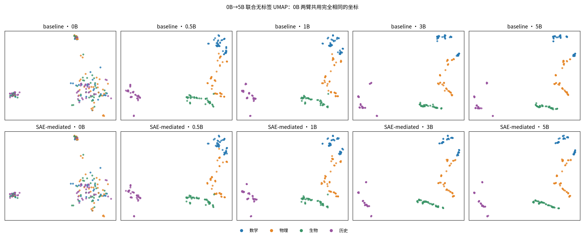
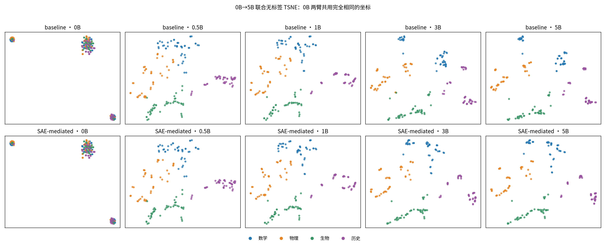
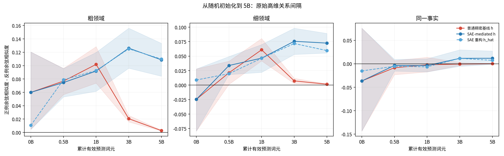
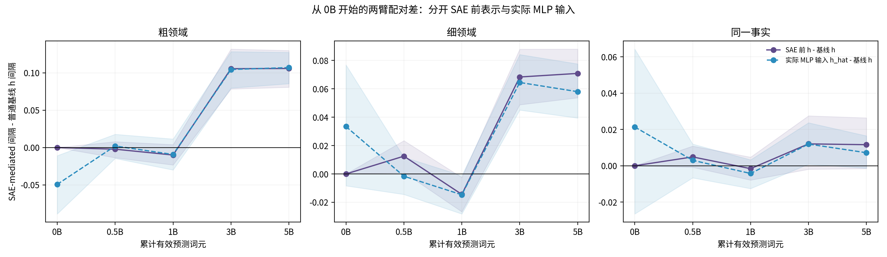
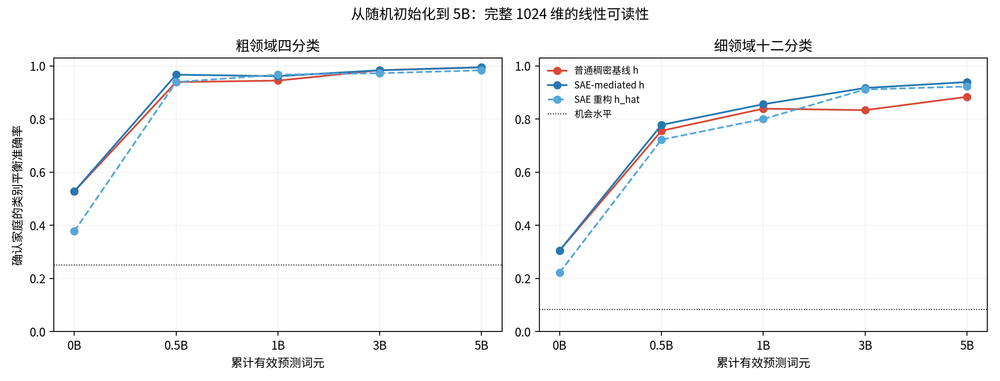
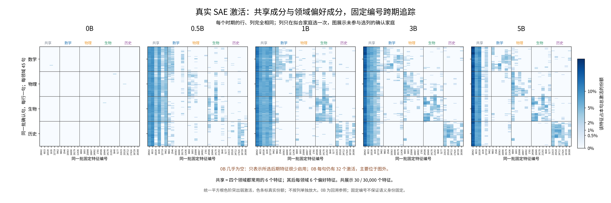
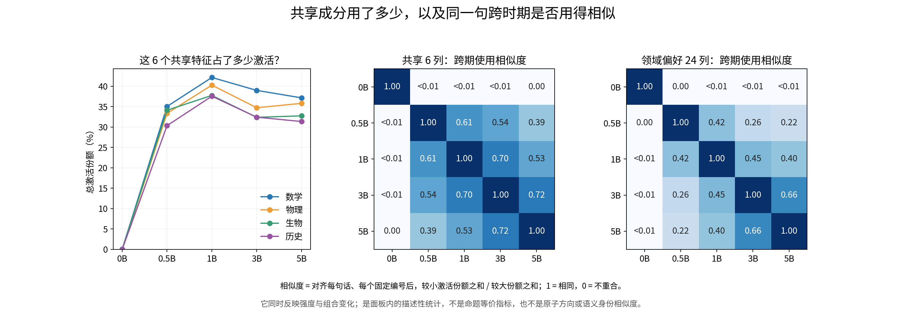

# 从 0B 到 5B：两臂表征演变与 SAE 优势边界

日期：2026-09-14  
性质：已有冻结缓存的 CPU 后处理与证据解释；不是新训练、不是新增模型推理，也不改变原实验判据。  
承接：[完整确认分析](06_semantic_confirmation_v1_report_cn.md)与[组会组织稿](../../focus_meeting_semantic_organization_cn.md)。

## 一、先判断原结论是否正确

原句：

> SAE-mediated 配置在后期具有更大的领域余弦间隔，内部稀疏激活也能呈现共享与领域偏好的分组。

**判断：作为两个有边界的观察，这句话正确；如果把它读成“SAE 让模型整体更好或形成了稳定语义 feature”，则不正确。**

建议组会改成：

> 在固定确认面板和相同训练词元点上，SAE-mediated 模型在 3B、5B 的最后层 SAE 前表示 \(h\)，以及实际送入最后 MLP 的重构表示 \(\hat h\)，都呈现比普通稠密基线更大的粗、细领域配对余弦间隔。SAE 臂中还可以回溯选出跨领域共享和领域偏好的稀疏 feature，并在未参与选列的确认句上看到相应激活分组。该结果说明两种配置组织领域信息的几何方式不同，不证明 SAE 整体更优、feature 语义稳定或因果提升能力。

其中，“领域配对余弦间隔”不是聚类中心距离，而是：

\[
m=\cos(h_a,h_p)-\cos(h_a,h_n),
\]

\(a\) 是锚句；粗领域正例 \(p\) 与它属于同一粗领域但不同细领域，反例 \(n\) 来自另一粗领域；细领域正例来自同一细领域，反例来自同粗领域的另一细领域。\(m\) 越大，只表示在这个预先规定的配对关系中，正例相对反例更接近。

两臂真正的判据是：

\[
\Delta m=m_{\text{SAE-mediated}}-m_{\text{baseline}}.
\]

当 \(\Delta m>0\) 且按同一家庭配对重采样得到的 95% 区间不跨 0，才读作 SAE-mediated 在该指标上具有更大间隔。

## 二、0B 到 5B 的真实演变图

### 1. 联合无标签降维

三个方法都在同一批 180 个确认句上联合、无标签拟合。0B 的两臂原始表示逐元素完全相同，因此图中两行的 0B 强制使用同一组坐标，而不是让随机降维把重复点画成两个不同结果。15 近邻可信度为 PCA 0.844、UMAP 0.970、t-SNE 0.973；它们只表示局部邻域保留程度，不是语义正确率。

直接观察是：0B 的颜色大体混合，0.5B 已出现非常清楚的四领域分组，之后继续改变形状。当前检查点只能把主要形成窗口限定在 0–0.5B，无法定位其中何时发生。0B 也不是“完全没有领域信息”：完整高维线性读出在 0B 的粗领域准确率为 0.528，高于四分类机会水平 0.25；这可能来自词形、长度、分词和随机嵌入结构。

### 2. 原空间关系间隔

图中红线是普通基线实际 MLP 输入 \(h\)；深蓝是 SAE-mediated 中进入 SAE 前的 \(h\)；浅蓝虚线是 SAE 重构、也是真正送入最后 MLP 的 \(\hat h\)。0B 时两臂 \(h\) 完全相同，但随机 SAE 的 \(\hat h\) 重构尚差；训练后 \(h\) 与 \(\hat h\) 的领域轨迹接近。

原始领域间隔如下；括号为按家庭重采样的 95% 区间。

| 关系 | 训练量 | 普通基线 \(h\) | SAE 前 \(h\) | 实际 MLP 输入 \(\hat h\) |
|---|---:|---:|---:|---:|
| 粗领域 | 0B | 0.0600 [0.0046, 0.1204] | 0.0600 [0.0046, 0.1204] | 0.0107 [-0.0136, 0.0369] |
| 粗领域 | 0.5B | 0.0768 [0.0566, 0.0959] | 0.0746 [0.0531, 0.0957] | 0.0789 [0.0576, 0.1009] |
| 粗领域 | 1B | 0.1019 [0.0737, 0.1284] | 0.0918 [0.0615, 0.1197] | 0.0925 [0.0634, 0.1206] |
| 粗领域 | 3B | 0.0206 [0.0157, 0.0254] | 0.1261 [0.0961, 0.1560] | 0.1251 [0.0990, 0.1520] |
| 粗领域 | 5B | 0.0028 [0.0020, 0.0035] | 0.1086 [0.0841, 0.1334] | 0.1098 [0.0885, 0.1297] |
| 细领域 | 0B | -0.0246 [-0.0793, 0.0279] | -0.0246 [-0.0793, 0.0279] | 0.0089 [-0.0170, 0.0343] |
| 细领域 | 0.5B | 0.0214 [0.0013, 0.0414] | 0.0339 [0.0182, 0.0493] | 0.0197 [0.0041, 0.0341] |
| 细领域 | 1B | 0.0610 [0.0418, 0.0805] | 0.0466 [0.0220, 0.0700] | 0.0463 [0.0222, 0.0695] |
| 细领域 | 3B | 0.0073 [0.0026, 0.0118] | 0.0757 [0.0530, 0.0983] | 0.0718 [0.0507, 0.0942] |
| 细领域 | 5B | 0.0017 [0.0011, 0.0022] | 0.0725 [0.0554, 0.0893] | 0.0597 [0.0415, 0.0786] |

### 3. 两臂配对差：原结论的直接来源

| 关系 | 训练量 | SAE 前 \(h\) 减基线 \(h\) | 实际 MLP 输入 \(\hat h\) 减基线 \(h\) |
|---|---:|---:|---:|
| 粗领域 | 3B | +0.1056 [0.0784, 0.1318] | +0.1045 [0.0796, 0.1284] |
| 粗领域 | 5B | +0.1059 [0.0807, 0.1300] | +0.1071 [0.0856, 0.1274] |
| 细领域 | 3B | +0.0683 [0.0488, 0.0880] | +0.0645 [0.0450, 0.0842] |
| 细领域 | 5B | +0.0709 [0.0537, 0.0880] | +0.0580 [0.0394, 0.0776] |

四个后期区间均完全高于 0，所以“3B、5B 的粗细领域余弦间隔更大”有直接原始数据支持，而且对实际 MLP 输入 \(\hat h\) 也成立。它不是从二维图凭肉眼得出的。

这不是全程单调优势：0.5B 的粗领域差没有可靠区别；1B 的细领域差反而为负。事实级关系也没有跨 3B、5B 稳定成立：SAE 前 \(h\) 的事实差区间在两点均跨 0；实际输入 \(\hat h\) 只在 3B 出现很小的正区间，5B 又跨 0。因此“后期领域指标更大”不能扩写成“事实语义始终更好”。

### 4. 完整高维信息是否更容易读出

| 目标 | 训练量 | 普通基线 \(h\) | SAE 前 \(h\) | 实际 MLP 输入 \(\hat h\) |
|---|---:|---:|---:|---:|
| 粗领域 | 3B | 0.9833 | 0.9833 | 0.9722 |
| 粗领域 | 5B | 0.9944 | 0.9944 | 0.9833 |
| 细领域 | 3B | 0.8333 | 0.9167 | 0.9111 |
| 细领域 | 5B | 0.8833 | 0.9389 | 0.9222 |

粗领域读出已接近饱和，SAE 没有显示更高的粗领域可读性；实际 MLP 输入还略低一点。细领域点估计在 3B、5B 更高，但这里没有为准确率差计算配对不确定区间，所以它是辅助观察，不是“SAE 更好”的主要判据。

## 三、SAE 内部稀疏激活从 0B 怎样变化

固定图只在 0.5B、1B、3B、5B 的拟合家庭上选一次列：6 个四领域都常用的共享 feature，加每领域 6 个相对其他领域更强的偏好 feature，共 30/30,000 列；然后在未参与选列的 180 个确认句上回溯显示 0B–5B。

0B 接近空白并不表示 SAE 没有激活。0B 每句仍有 32 个正激活，只是这 30 个“根据训练后状态选出的编号”在 0B 几乎没有被使用。0B 所选共享六列的领域平均总份额只有数学 0.067%，其余接近 0；到 0.5B 四领域分别约为 35.0%、33.3%、34.1%、30.3%，1B 为 42.1%、40.3%、37.7%、37.5%。因此图支持的是“训练后这批固定编号成为共享或领域偏好的常用部分”，不能单图证明语义从零形成。

同一句在共享六列上的幅度加权跨期重合为：0.5B–5B 0.393，1B–3B 0.703，3B–5B 0.719；领域偏好二十四列对应 0.219、0.453、0.659。可以描述为后期相邻训练快照的使用更相似，但不能称为 feature 语义身份已经稳定，因为同一个 feature ID 的解码器方向也会随训练改变，当前图没有对原子方向做跨期对齐。

## 四、SAE 模型“哪里更好”以及哪里不能说更好

| 问题 | 直接证据 | 当前判断 |
|---|---|---|
| 3B、5B 的领域相对几何是否更清楚 | 粗、细领域两臂配对间隔差的 95% 区间均高于 0，且 \(h\)、\(\hat h\) 一致 | **是，这是当前最明确的优势** |
| 粗领域信息是否更容易读出 | 3B/5B 粗领域读出几乎相同，\(\hat h\) 略低 | **没有显示优势，双方都已饱和** |
| 细领域信息是否更容易读出 | 3B/5B 点估计较高 | **可能，但缺少准确率差的配对区间** |
| SAE 是否形成共享与领域偏好激活 | 固定后期选列在确认句上呈现共享列和对角领域块 | **可以描述 SAE 臂内部结构** |
| 这种稀疏结构是否优于普通基线 | 普通基线没有同预算、同协议的离线 SAE | **不能比较** |
| 是否形成稳定的事实级组合 | 总体同义减异义稀疏重合区间跨 0 | **证据不足** |
| 是否提高语言模型能力或损失 | 本分析没有注册该结果作为主要对比 | **不能推出** |
| 是否由 SAE 本身因果造成 | 两臂参数量相差约 61M，只有一个 seed | **不能单独归因** |

因此，“更好”的准确含义只能是：

> **在固定面板、固定最后层读取位置和相同词元训练量下，SAE-mediated 配置在 3B、5B 保留了更大的粗、细领域配对余弦间隔。**

不能简化为：

> SAE 学到了更好的语义，或者 SAE 模型整体优于普通模型。

## 五、组会讲述顺序

1. **先放 0B–5B PCA。** 说明两臂从完全相同的 \(h\) 起点出发，0.5B 已形成明显领域分组；当前快照不足以定位更早的形成时刻。
2. **再放两臂配对差。** 强调结论来自原始 1024 维关系量和家庭配对区间，不来自二维图。报出 5B 粗领域实际 MLP 输入差 +0.1071 [0.0856, 0.1274]，这是最小决定性数字。
3. **再放固定 SAE feature 图。** 说明共享列与领域偏好列怎样出现和变化；明确 0B 空白只是后期选中编号在初始化时少用。
4. **最后给边界。** 两模型都能读出领域；当前差异是领域几何，不是稳定事实组合、能力提升或 SAE 的纯因果效应。

可直接收束为：

> 两个模型从同一表示起点出发，很快都产生了可读的领域信息；区别不在于一个有领域、另一个没有，而在于 3B、5B 时这些领域关系在原空间中被拉开的程度不同。SAE-mediated 的实际 MLP 输入保持了更大的粗细领域相对间隔，内部稀疏码也能分出共享与领域偏好使用。但事实级组合与因果收益仍未建立。

## 六、原始数据与复现入口

证据分两层。第一层是完成确认实验时冻结的逐句缓存：普通基线每个训练点保存最后层 MLP 输入 \(h\)；SAE-mediated 每个训练点同时保存 SAE 前的 \(h\)、稀疏码 \(z\) 和真正送入最后层 MLP 的重构输出 \(\hat h\)。第二层是本报告从这些缓存计算出的关系间隔、配对差、读出和 feature 使用表；下列 CSV 是图中每个数值的直接来源，而不是从图片反读出的数据。

- [冻结确认面板](/data/250010109/MoE_Router/experiments/20260914_semantic_feature_reuse_analysis/data/panel_frozen_v1.jsonl)
- [冻结关系三元组](/data/250010109/MoE_Router/experiments/20260914_semantic_feature_reuse_analysis/data/triplets_frozen_v1.jsonl)
- [0B、0.5B、1B、3B、5B 的逐句原始表示与 SAE 激活缓存目录](/data/250010109/MoE_Router/experiments/20260914_semantic_feature_reuse_analysis/runs/confirmation_v1_20260914/full/caches)
- [原确认实验指标表目录](/data/250010109/MoE_Router/experiments/20260914_semantic_feature_reuse_analysis/runs/confirmation_v1_20260914/full/tables)
- [完整关系间隔数据](/data/250010109/MoE_Router/experiments/20260914_semantic_feature_reuse_analysis/report_assets/zero_to_5b_v1/relation_margins_0b_5b.csv)
- [两臂配对差数据](/data/250010109/MoE_Router/experiments/20260914_semantic_feature_reuse_analysis/report_assets/zero_to_5b_v1/two_arm_delta_0b_5b.csv)
- [高维线性读出数据](/data/250010109/MoE_Router/experiments/20260914_semantic_feature_reuse_analysis/report_assets/zero_to_5b_v1/linear_readout_0b_5b.csv)
- [SAE 重构与覆盖数据](/data/250010109/MoE_Router/experiments/20260914_semantic_feature_reuse_analysis/report_assets/zero_to_5b_v1/sae_quality_0b_5b.csv)
- [固定分组激活份额](/data/250010109/MoE_Router/experiments/20260914_semantic_feature_reuse_analysis/report_assets/zero_to_5b_v1/sae_fixed_group_mass_0b_5b.csv)
- [固定编号跨期使用重合](/data/250010109/MoE_Router/experiments/20260914_semantic_feature_reuse_analysis/report_assets/zero_to_5b_v1/sae_fixed_cross_checkpoint_overlap_0b_5b.csv)
- [降维诊断](/data/250010109/MoE_Router/experiments/20260914_semantic_feature_reuse_analysis/report_assets/zero_to_5b_v1/embedding_diagnostics_0b_5b.csv)
- [CPU 绘图脚本](/data/250010109/MoE_Router/experiments/20260914_semantic_feature_reuse_analysis/report_assets/render_zero_to_5b_comparison.py)
- [图、数据与来源哈希清单](../../figures/zero_to_5b_v1/figure_manifest.json)

所有图使用既有缓存和表格生成，未加载训练优化器、未更新模型、未重新提交 GPU 作业。
