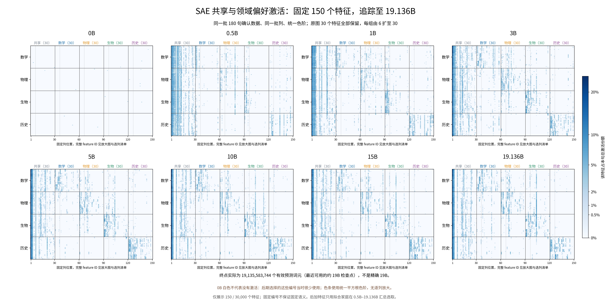
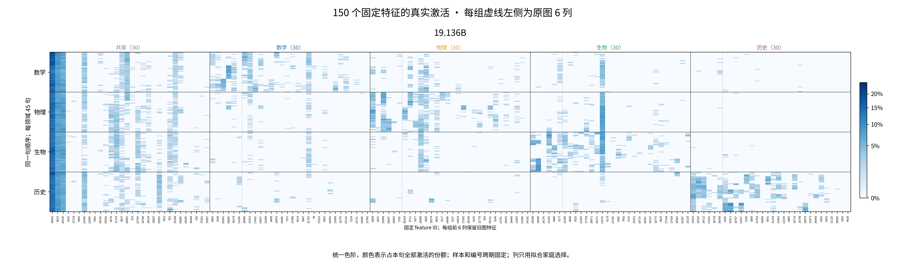
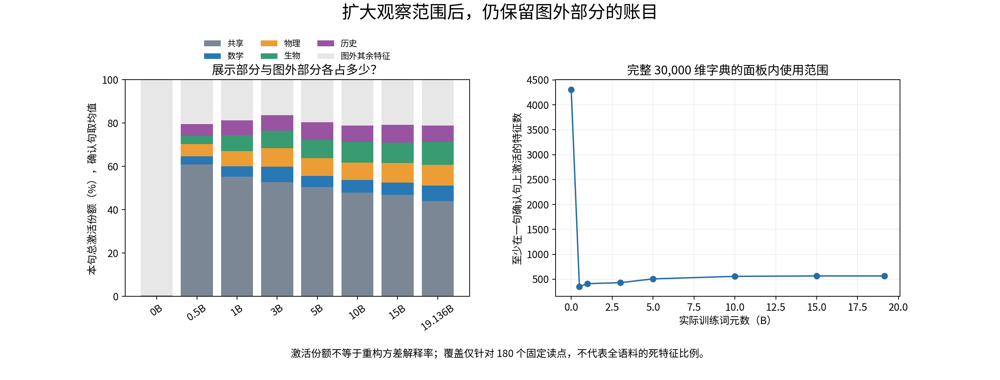

# 共享与领域偏好激活：扩展至约 19B，观察 150 个固定特征

2026-09-14。按研究者请求扩展原图；这是固定面板的描述性读取与绘图，不更新科学结论。

**范围变化**

- 时间：0B、0.5B、1B、3B、5B、10B、15B、**19.136B**。
- 终点是原训练恢复检查点 step 73000，实际累计 **19,135,583,744** 个有效预测词元；没有精确 19B 的完整检查点，不能将此标成精确 19B。
- 特征：从原来 30 个扩大到 **150 个**，共享与四个领域各 30 个。每组前 6 个保留原图编号与组内顺序，后面追加 24 个。保留的旧特征即使后期不再偏好原领域，也仍展示其变化。
- 样本：仍是同一份冻结的 360 句；只用拟合家庭选列，展示固定的 180 句确认数据。

**读图：**每行是同一句话，每列是同一特征，所有时期统一颜色尺度。最左块展示共享成分，后面四块展示领域偏好成分。细虚线区分每组原有 6 列和新增 24 列。总览横轴显示列位置，完整特征编号见逐时期放大图和选列清单。

**选列说明：**原有 30 个编号全部保留，不重新分组；追加特征只用 0.5B–19.136B 各时期拟合家庭的等权汇总选择。共享按四领域平均激活份额的最小值排序；领域偏好按本领域均值减其他领域最大均值排序。先预留旧编号，再依次选择互不重复的新增编号。确认数据不参与选列。

0B 没有参与选择。图中它接近白色，只能说明这些后期所选编号当时很少启用；0B 每个读点仍有 32 个正激活，不能据此声称初始化没有激活或没有语义结构。

左图把本句总激活份额分为五个已展示块和图外其余 29,850 个特征；右图统计完整 30,000 维字典中在确认面板至少激活一次的特征数。这样可以看见新增列之外还遗漏多少使用量。激活份额不是重构方差解释率，面板覆盖也不是全语料死特征比例。

**完成后的范围核验：**150 列在 0.5B–19.136B 各时期覆盖确认句平均总激活份额的约 **78.8%–83.6%**。终点覆盖 **78.81%**，其余特征合计 **21.19%**；完整字典中共有 **565** 个特征在这批确认读点至少开启一次。因此扩大后的图覆盖了大部分激活份额，但仍不是完整字典视图。

**执行与比较边界**

八个时期均复用 analysis2 原有读取程序，在当前本地 H100 MIG 3g.40GB 上使用同一 PyTorch 2.8/CUDA 12.8、BF16 自动混合精度和 batch=32 重新提取；最终图不混用旧 5090 缓存。读取原句后统一换行的最后有效词元，位置为最后块 `norm2` 后、SAE 前，同时保留 SAE 系数和重构。只调用只读模型加载和前向，不创建优化器、不修改模型或检查点、不提交平台作业。

提取已完成：回执 `PASS`，八份缓存齐全，实际读取约 **286.6 秒**，峰值 GPU 分配约 **1.85 GiB**；图、选列清单、输入哈希和阅读副本一致性检查通过。原始训练状态及 v1 图表均保留。

原 step 73000 是会轮换删除的恢复检查点，已在独立分析目录中通过不可变文件的硬链接保留，并记录原路径与原 manifest；没有改训练保存策略。首次加载时误引用了早期 SAE 包（缺少 analysis2 所用的 `pre_mlp_input` 导出），失败记录已保留；后续使用 analysis2 原本依赖的 baseline 包读取同一组模型权重。

旧/新环境的 0B 与 0.5B 只读对照中，平均表征余弦分别约 0.999958、0.999990；Top-32 集合交并比约 0.9633、0.9905。这是运行环境差异诊断，不是逐位等价或科学假设检验。本版全部时期统一环境，旧图与旧缓存保持原样。

固定编号不保证固定方向或固定语义；150 列仍是经过选择的子集，不能据此把整本字典说成五个独立模块，也不构成普通模型与 SAE 的新增因果对照。

**可复核文件**

- [完整图与来源清单](../../figures/shared_domain_19b_v2/figure_manifest.json)。PNG 与 PDF 均提供，八个时期另有完整编号放大图。
- [150列编号、分组与旧列标记](/data/250010109/MoE_Router/experiments/20260914_semantic_feature_reuse_analysis/report_assets/shared_domain_19b_v2/selected_features_150.csv)。
- [激活份额与完整字典面板覆盖](/data/250010109/MoE_Router/experiments/20260914_semantic_feature_reuse_analysis/report_assets/shared_domain_19b_v2/coverage_and_mass.csv)。
- [读取回执](/data/250010109/MoE_Router/experiments/20260914_semantic_feature_reuse_analysis/report_assets/shared_domain_19b_v2/extraction_receipt.json)、[只读提取代码](/data/250010109/MoE_Router/experiments/20260914_semantic_feature_reuse_analysis/report_assets/extract_shared_19b.py)、[绘图代码](/data/250010109/MoE_Router/experiments/20260914_semantic_feature_reuse_analysis/report_assets/render_shared_19b.py)。
