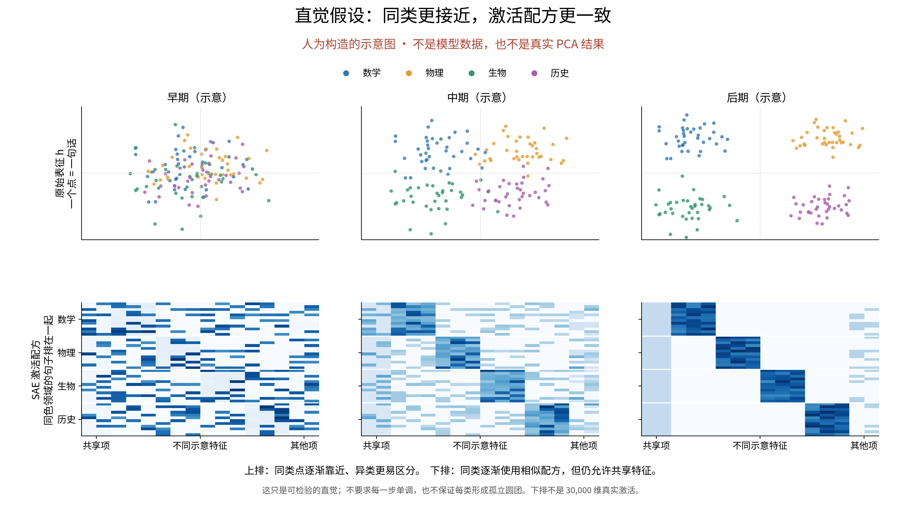
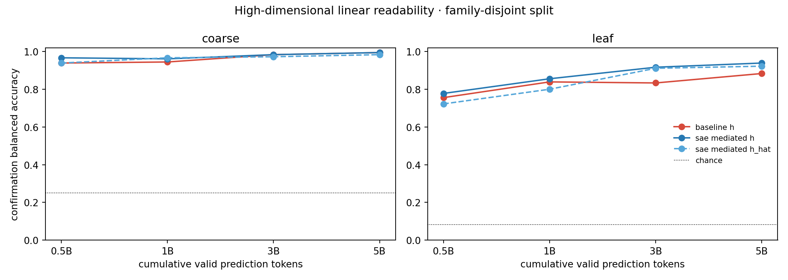
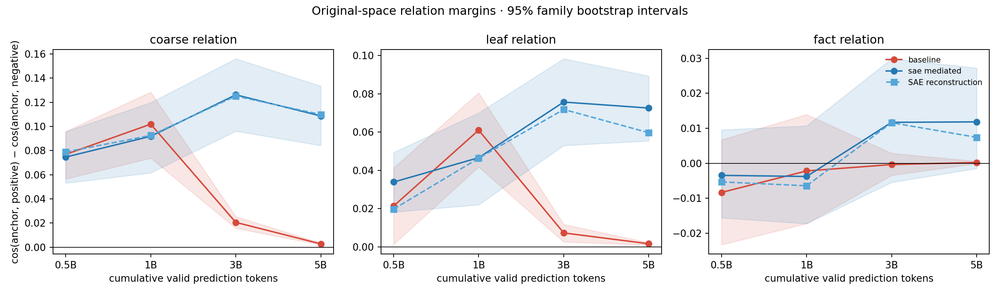
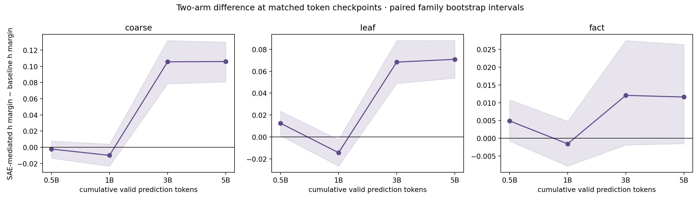
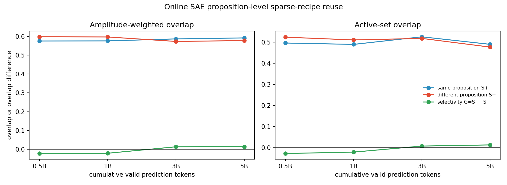
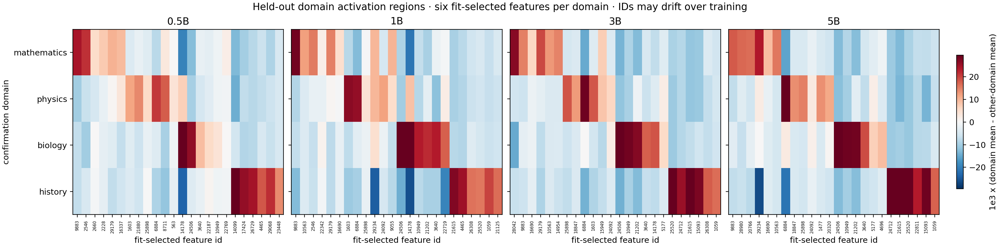

# 组会阶段汇报：领域信息很早可读，SAE 命题组合复用尚未确认

2026-09-14 · `AI_DRAFT_AWAITING_HUMAN_CONFIRMATION`

本稿是 analysis2 的组会阅读版本，供研究者理解、修改和确认；不更新 Anchor、Focus 或正式科学结论。结果来源：[analysis2 完整报告](../../../../Projects/from-attention-to-search/main/experiments/sae_representation/semantic_confirmation/20260914_v1/06_semantic_confirmation_v1_report_cn.md)。本轮比较窗口为 **0.5B、1B、3B、5B**；0B 作初始化参考，不能将本轮结论写成已经验证到 10B。

**开场：最重要的三条结论与认知更新**

1. **领域信息在 0.5B 时已经很容易读出；这轮没有观察到“从混乱到首次分开”的过程。** 普通模型在独立确认数据上的粗领域分类准确率为 **93.9%→99.4%**，SAE-mediated 为 **96.7%→99.4%**。更新的是观察窗口：0.5B 已不是“没有领域结构”的起点；后续应描述已有领域信息的变化，不能把示意图当成真实形成轨迹。这里的准确率来自额外拟合的简单分类器，不是语言模型自身答题准确率。
2. **两模型后期的领域几何不同，SAE 中也能找到领域相关特征，但这还不是“更懂具体事实”。** 5B 时 mediated 相对普通模型的粗领域关系差多 **0.1059，95% 区间 [0.0807, 0.1300]**；每个检查点在拟合数据上选出的 24 个领域特征，在确认数据上均保持正的目标领域优势。认知更新：原始余弦几何、高维信息可读性、SAE 领域关联是三个不同的观察面，不能合并成一个“语义更强”的结论；也不能把配置差异单独归因于 SAE。
3. **“同一事实换一种表达，会选择性地复用相似 SAE 组合”仍未得到稳定支持。** 同义与异义组合重合度之差 \(G\) 在四个检查点的 95% 区间均跨 0；5B 为 **0.0141，区间 [−0.0200, 0.0504]**。认知更新：能认出学科、能找到学科相关特征，并不等于形成了稳定的事实级组合。当前是证据不足，不能说该效应已被证明不存在。

**可直接向导师讲的开场白**

> 我们原来预期，预训练会让同类内容逐渐聚到一起，SAE 也会逐渐使用一致的特征组合。现在看到的是：领域信息在第一个 0.5B 检查点就已经很强；后期两模型的表征几何不同，但普通模型并没有丢掉领域信息。SAE 的确有领域相关特征，不过同一事实换种说法后是否复用专门的组合，我们还没有得到稳定证据。因此，这次的更新是把“领域可读”与“事实级组合复用”区分开了。

**目的与假设：我们到底在检验什么**

目的：观察随机初始化语言模型预训练时，固定句子之间的内容关系如何改变，以及这些关系能否从 SAE 激活组合中读出。

假设保留两层：第一层，同粗领域、不同子领域的句子，相对跨粗领域句子有更强的关系，并考察同子领域关系；第二层，同一事实的不同表达，相对同子领域的不同事实，会选择性地复用相似 SAE 组合。检验“已经存在”看某个时间点的正负差；检验“随训练增强”还需要比较时间点之间的变化，二者不等价。

**讲图：**这是人为构造的直觉，不是真实 PCA 或激活数据。上排表示我们预期领域更容易区分；下排表示我们预期同类内容更倾向复用特征。真实模型不必形成这些整齐块，也不必每一步都单调变化。

**分析方法：三步对应三个问题**

- **比较原始表征。** 固定 360 句、相同分词器和读取位置，在两模型相同训练词元点读取最后块 `norm2` 后的 1024 维向量 \(h\)。普通模型将 \(h\) 输入最后 MLP；mediated 模型先经 SAE 得到 \(\hat h\)，再输入最后 MLP。用原空间关系差和高维线性读出分别检查几何与信息可读性。
- **比较 SAE 组合。** SAE 把 \(h\) 写成 30,000 个方向中少量方向的加权组合，激活系数记为 \(z\)。分别测同事实与异事实的组合重合度，并展示用拟合数据选列、在确认数据评价的领域特征图；用重构误差检查读取质量。
- **区分训练变化与方法差异。** 在同一批确认家庭上比较 0.5B、1B、3B、5B，并比较两模型的 \(h\)。按家庭重采样给区间；这些区间反映当前面板的抽样不确定性，不代表不同训练随机种子的波动。模型权重全程冻结，语言模型更新次数为 0；读出分类器另在拟合家庭上训练。

**证据一：领域很早能读出，后来还能变得更容易读**

**怎么读：**左图是四个粗领域，右图是十二个子领域；横轴为训练词元数，纵轴为独立确认数据的类别平衡准确率。看曲线说明完整高维表示中有多少领域信息能被简单分类器取出，不要解释为模型理解正确率。

| 表征 | 粗领域 0.5B→5B | 子领域 0.5B→5B |
|---|---:|---:|
| 普通模型 \(h\) | 93.9%→99.4% | 75.6%→88.3% |
| mediated \(h\) | 96.7%→99.4% | 77.8%→93.9% |
| mediated 重构 \(\hat h\) | 93.9%→98.3% | 72.2%→92.2% |

这些是点估计，不能直接把两条准确率曲线的间距称为显著优势。重构后仍能读出领域信息，支持“SAE 保留了可读的领域信息”，不等价于每条事实的语义都被忠实保留。

**认知更新：**0B 原始表示的粗领域读出点估计已经是 52.8%，高于四类机会水平 25%。随机表示也可能保留词形和输入差异，经有监督分类器读出，因此不能把“可分类”直接等同于“预训练学到了抽象语义”。0B→0.5B 之间何时、怎样发生变化，本轮没有足够密的检查点来定位。

**证据二：几何差异是真实测量结果，领域信息消失却不是**

定义关系差 \(M\)：相关句子的余弦相似度，减去对照句子的余弦相似度。例如粗领域比较“同粗领域不同子领域”与“跨粗领域”。\(M\) 越大，表示这套余弦距离更偏向相关句子。

**怎么读：**普通模型的粗领域关系差从 1B 的 0.1019 收缩到 5B 的 0.0028，但它的高维分类准确率没有随之下降。

5B 时普通模型正、反配对的平均余弦分别为 **0.9950 与 0.9922**：两类向量都高度同向，留给原始余弦间隔的空间很小。这个直接观测足以说明“原始余弦区分变小”，不能据此说“领域信息没有了”。判别信息可能仍存在于较小的方向差异中；到底是公共方向、均值还是协方差结构变化，需要额外分析，当前尚未定位。

**怎么读：**大于 0 表示 mediated 的关系差更大；误差线是配对家庭区间。3B、5B 的粗/细领域差异均为正，事实关系的四个区间均跨 0。

**结论边界：**这说明两模型后期的领域几何不同。普通模型有 281,431,040 参数，mediated 有 342,902,064 参数，多 61,471,024；加上单训练 seed 和运行数值栈差异，当前不能将差异解释为 SAE 的纯因果作用，更不能直接推广为任务能力提高。

**证据三：SAE 能读出领域偏好，但事实级选择性还没站稳**

领域热图及选列解释放在后面的审计部分；主报告先看更严格的命题复用量：

\[
S^+=\text{同一事实两种表达的组合重合度},\qquad
S^-=\text{不同事实的组合重合度},\qquad G=S^+-S^-.
\]

“重合度”同时考虑用了哪些 feature 以及归一化后的激活强弱；相同组合取 1，互不重合取 0。

**怎么读：**先看同义 \(S^+\)，再看异义 \(S^-\)，最后看差值 \(G\) 是否可靠为正。不能只看到同义重合高，就认为模型识别了相同事实。

| 检查点 | \(S^+\) | \(S^-\) | \(G\) | \(G\) 的 95% 区间 |
|---|---:|---:|---:|---|
| 0.5B | 0.5753 | 0.5974 | −0.0222 | [−0.0582, 0.0151] |
| 1B | 0.5758 | 0.5966 | −0.0209 | [−0.0610, 0.0213] |
| 3B | 0.5863 | 0.5729 | 0.0134 | [−0.0230, 0.0521] |
| 5B | 0.5916 | 0.5775 | 0.0141 | [−0.0200, 0.0504] |

**结论：**点估计从负转正，但每个区间都跨 0，不能声称稳定的事实级选择性成立；表中也没有时间差的配对区间，不能仅凭端点数字声称显著增长。按 feature 集合计算而不考虑幅度的版本，结论相同。

四个训练检查点都存在在全部 180 个确认读点上开启的 feature，说明同义和异义确实可能共享公共成分。但“这些 feature 解释了多少约 0.58 的重合度”尚未量化，不能把它写成已证明的失败原因。

**我们目前进行到哪了，哪些内容暂放备答**

已完成：冻结数据的两模型五个状态（含 0B）缓存、四个主检查点的三种降维图、原空间关系、高维读出、SAE 组合重合、领域选列和质量检查。执行回执通过，10 份缓存齐全；这不是新训练，也不表示研究问题已闭合。

| 备答命题 | 已有观测 | 合理解释与尚未解决部分 |
|---|---|---|
| 二维图是否只是投影错觉？ | PCA、UMAP、t-SNE 均有领域结构，高维读出亦高 | 领域信息可读有多种观察支持；二维团距仍不是语义距离。三种图不算三次独立实验 |
| SAE 是否完全无法重构？ | 0.5B→5B 相对重构误差约 0.188、0.168、0.198、0.162 | 未见误差一路恶化；但相对误差小不能保证命题信息保留 |
| 是否存在值得继续核验的局部事实信号？ | 低词面组 3B 的 \(G=0.0380\)，区间 [0.0136,0.0627]；5B 区间跨 0 | 可作为候选线索，不能用单个分层阳性替换总体不充分的结论 |
| feature 是否从 0B 的分散使用变为集中使用？ | 同一面板上，0B 使用 4,310 个 feature，0.5B 使用 353 个，5B 使用 505 个 | 支持面板内使用范围变化，不等于语义组织形成，也不是全训练数据的死特征统计 |
| 所选 feature 是否始终同一含义？ | 当前热图每期重新选列，字典本身也在更新 | 现图不能回答；固定 ID、跨期方向与响应检查尚待安排 |
| 当前数据是否排除了表达模板影响？ | 家庭无跨划分；词面高低有实测检查 | 真实句式和参考主题仍可共享，不能声称完全模板隔离；详见下文 |

**对研究者提出的 SAE 激活图疑问：这张图有意义，但回答的是一个较窄的问题**

这张真实图的每一行是一个领域的平均值，**不是一句话**；每一列是选出的一个 feature。它展示“该特征在这个领域比其他领域更强多少”，不是完整的 30,000 维原始激活矩阵。蓝色表示低于其他领域均值，不表示 SAE 有负激活；近白色也不表示该特征从未激活。

**原子模长：实际解码方向是单位长度。** 一个“原子”是重构字典中的一个 1024 维方向 \(d_j\)，总共 30,000 个。实际计算为

\[
\hat h=b+\sum_j z_j d_j,\qquad
d_j=\frac{D^{raw}_{:,j}}{\max(\|D^{raw}_{:,j}\|_2,10^{-8})}.
\]

代码在每次调用 `dictionary()` 时对 decoder 的列归一化。只读核验现有 0B、0.5B、1B、3B、5B 缓存，原子模长的总体最小/最大约 **0.99999982 / 1.00000012**，各期均值为 1，差异是浮点精度量级。这里说的是**有效 decoder 原子**，不是底层未经归一化的参数列，也不是 encoder 行向量；后两者不应混称单位模长。

所以，单个重构项 \(z_jd_j\) 的模长约为 \(z_j\)。但原子不必彼此正交，“单位模长”不保证单一语义，激活系数也不是语义正确的概率。

**排序依据：先按领域分组，再按拟合数据上的领域优势降序。**

1. 先把每句话的非负激活贡献归一化成份额：\(u_j=z_j\|d_j\|/\sum_k z_k\|d_k\|\)；本模型因原子模长为 1，近似就是 \(z_j/\sum_kz_k\)。
2. 在 120 句拟合数据上先取家庭均值，再取领域均值 \(\mu^{fit}_{d,j}\)。
3. 对目标领域 \(d\)，选列分数是 \(A_{d,j}=\mu^{fit}_{d,j}-\max_{d'\ne d}\mu^{fit}_{d',j}\)。每领域按此分数降序取 6 个正分、未被前面领域选过的 feature。
4. 列组顺序为数学、物理、生物、历史，共 24 列。例如 0.5B 数学组开头是 9883、2546，而不是编号 0、1、2。feature 编号只是参数索引，数值相邻不代表语义相邻。
5. 最后在独立的 180 句确认数据上画 \(1000\times(\mu^{confirm}_{d,j}-\operatorname{mean}_{d'\ne d}\mu^{confirm}_{d',j})\)。注意**选列用其他领域最大值，显示用其他领域平均值**；正的显示优势不等价于胜过每一个其他领域。

这说明分块的**位置和排列是有意组织的**；有意义的证据是选择规则在没用于选列的确认家庭上仍有目标领域优势。本轮每期 24/24 保持正优势是描述结果，并非每个 feature 都单独通过显著性检验，也不代表字典中的所有特征都有这种性质。统一色标以各期绝对值的 95 分位数确定极值，最深颜色可能饱和，精确强度应读数值表。

**对“看 0B、找共同 feature”的判断：合理，先列入后续，不抢先执行。**

0B 的 SAE 激活缓存已经存在，但当前四幅领域热图没有包含 0B。若后来补图，应区分两个问题：每期重新选列（包括 0B），问“各期能否找到领域偏好”；固定一组 feature ID 和列序跨期展示，问“这些参数位置如何改变”。两种图不能混用来证明形成过程；0B 也不应预设一定混叠。

“共同 feature”还要区分：同一句跨检查点共同使用的 ID、同义句共同使用的 ID，以及跨领域都高频的 ID。后者可能主要是公共成分；当前优势图会减去其他领域均值，本来就容易把这些公共特征显示成接近白色。因此要列公共特征，需要另看绝对频率和激活份额，不能仅从这张图反推。按编号追踪是必要描述，但由于 decoder 方向会改变，不足以证明语义身份不变。

**数据具体如何构造：供导师追问时使用**

本轮使用人工设计、由脚本明确列出的英文短句面板，不是从自然语料随机抽取的独立 benchmark；也不是给语言模型新增的语义监督。标签只用于评估配对、分类器拟合和领域特征选列。

| 粗领域 | 每域三个子领域 |
|---|---|
| 数学 | 算术、几何、概率 |
| 物理 | 力学、热学、光学 |
| 生物 | 细胞生物学、遗传学、生态学 |
| 历史 | 古代史、中世纪史、近现代史 |

每子领域 6 个命题家庭；每个家庭不是“5 个同义句”，而是 **3 句描述原命题 + 2 句描述另一个对照命题**。共 4×3×6×5=360 句。负例尽量也是正确事实，检验的是“不同内容”，不是“真假辨别”。近、远词面指相对原句的文字重合高、低，不等于主题近、远。

以确认集 `sr_arithmetic04` 为例（下面英文是冻结输入原文）：

| 类型 | 实际输入 | 用途 |
|---|---|---|
| 原句 | Twenty minus seven equals thirteen. | 锚定 20−7=13 |
| 同义、近词面 | Twenty less seven is thirteen. | 保持命题，少量换词 |
| 同义、远词面 | Removing seven objects from a set of twenty leaves thirteen. | 保持命题，改成数量情境 |
| 异义、近词面 | Twenty minus eight equals twelve. | 句式很像，但改成另一个真等式 |
| 异义、远词面 | A collection of twenty has twelve objects left after eight are removed. | 同一对照命题，换一种表达 |

这里固定两组三元组：原句—近词面同义—近词面异义；原句—远词面同义—远词面异义。每家庭两个，共 144 个；主确认集有 36 个家庭、72 个事实三元组。粗/细领域配对另从确认集原句中固定抽取，各 36 组，不把全体句对都当独立样本。

再看确认集 `sr_modern_history04`，体现同一主题中不同事件的对照：

| 类型 | 实际输入 |
|---|---|
| 原句 | Apollo 11 launched on July 16, 1969. |
| 同义、近词面 | The Apollo 11 mission lifted off on July 16, 1969. |
| 同义、远词面 | The Saturn V carrying the Apollo 11 crew departed Earth on July 16, 1969. |
| 异义、近词面 | Apollo 11 landed on the Moon on July 20, 1969. |
| 异义、远词面 | The Apollo 11 lunar module reached the Moon's surface on July 20, 1969. |

它比较的是“发射”与“登月”，共同主题、任务名称都保留。这里的“远词面”仍含 Apollo 11 和日期，说明远近是相对量，不能理解成完全没有共有词。

**复用了哪些表达形式？** 当前脚本逐家庭写入五句话，没有一个独立、已经审计过的通用模板库。可归纳出的重复构造方式包括：等式句与 `equals/is` 换词、符号/数字与自然语言转换、定义句与功能解释、主被动或语序转换、事件—日期句与人物/载体描述、同句式替换数字或事件生成对照。

例如拟合集有 `Twelve divided by three equals four.`，确认集有 `Twenty minus seven equals thirteen.`，都保留“数量—运算—equals—结果”的表达框架；力学拟合家庭用“质量×加速度=力”，确认家庭用“质量×速度=动量”，也共享乘积解释的表达方式。其作用是构造可控正反例，但这些共享形式本身仍可能被模型利用。

**模板编号的审计边界：**代码直接令 `template_family_id = "template_" + family_id`。不同编号不跨划分是真的，然而它只是家庭身份隔离，**不证明真实句式、主题词或来源隔离**。同一事实参考也可以支持多个家庭。因此汇报应说“按命题家庭留出”，不说“72 种独立模板”或“模板和来源完全无泄漏”。

划分规则是每个子领域第 01–02 家庭拟合、03 开发、04–06 确认，分别 120/60/180 句。研究者决定保留全部家庭，AI 对等价性、上下文完整性、参考和词面顺序进行检查，并最小修改 44 句；这不应被转述为多名独立标注者逐句一致审核。25 条参考用于事实核查，句子是构造文本，不是直接抽取参考原文。

词面检查采用单词集合与字符三元组的交并比。所有家庭的近词面重合都高于相应远词面，但**同义、异义之间尚非精确词面匹配**：全数据单词重合均值，同义近/远为 0.4688/0.1669，异义近/远为 0.3704/0.0913。分层改进了控制，仍不能声称词面因素已经完全排除。

**为什么与直觉不同：讲到证据允许的位置**

| 直觉 | 真实情况 | 当前合理解释 | 不应提前断言 |
|---|---|---|---|
| 0.5B 应当很混乱 | 0.5B 已有强领域可读性 | 观察窗口可能错过更早变化；输入统计和随机表示也可提供可读信号 | 领域结构具体形成于哪个时刻 |
| 越能分类，余弦分团应越明显 | 普通模型余弦间隔变小，但分类仍提高 | 公共方向可使余弦饱和，细小方向差仍可被分类器利用 | 信息已确定“迁移”到某几个维度 |
| 领域热图分块意味着事实组合形成 | 领域选列能留出复现，但总体事实 \(G\) 跨 0 | 领域词汇关系比具体命题等价更粗；公共激活可能提高两类重合 | 公共 feature 是事实失败的唯一原因 |
| 模板编号独立即排除句式影响 | 家庭不同但表达方式仍共享 | 当前面板只提供有限的家庭留出检验 | 已验证开放文本的抽象语义形成 |

**汇报结束时怎么讲**

> 现在我们已经完成第一轮有固定数据、有普通模型对照的表征审计。领域可读和 SAE 领域相关特征是当前最清楚的结果；事实级组合复用与跨时期 feature 身份仍未知。下一步先把 0B、固定特征和公共成分这几个观察问题界定清楚，再决定是否做新的验证，不用新的漂亮图替代当前不充分的事实级证据。

**本轮唯一待确认事项：**研究者是否认可上述三条结论及其表述边界。完成条件是能够用自己的话区分“可分类”“领域几何不同”“命题选择性复用”；随后再单独确定 0B/固定 ID/共同特征审计的执行范围。本稿列出的后续工作均为 AI 建议，本次没有运行这些新增分析。

**来源与可复核位置**

- [分析结果与原始证据入口](../../../../Projects/from-attention-to-search/main/experiments/sae_representation/semantic_confirmation/20260914_v1/06_semantic_confirmation_v1_report_cn.md)、[执行范围](../../../../Projects/from-attention-to-search/main/experiments/sae_representation/semantic_confirmation/20260914_v1/05_execution_scope_confirmation_v1_cn.md)。本稿新增的是解释和源代码核查，不修改结果表。
- [SAE 字典归一化实现](/data/250010109/MoE_Router/experiments/20260912_dense_sae_pretraining/dense_sae/model/sae.py:33)。缓存中有效字典模长的只读检查涵盖五个状态，未加载模型或执行推理。
- [热图归一化与选列实现](/data/250010109/MoE_Router/experiments/20260914_semantic_feature_reuse_analysis/semantic_confirmation_v1.py:361)、[数据构造与模板编号](/data/250010109/MoE_Router/experiments/20260914_semantic_feature_reuse_analysis/data/build_candidate_panel.py:319)。
- [冻结数据审计](/data/250010109/MoE_Router/experiments/20260914_semantic_feature_reuse_analysis/data/frozen_data_audit_v1_cn.md)、[实际冻结句子](/data/250010109/MoE_Router/experiments/20260914_semantic_feature_reuse_analysis/data/panel_frozen_v1.jsonl)、[实际数值表目录](/data/250010109/MoE_Router/experiments/20260914_semantic_feature_reuse_analysis/runs/confirmation_v1_20260914/full/tables)。
- 图均直接引用本日 `figures/semantic_confirmation_v1/` 的现有阅读副本，来源见该目录 `figure_manifest.json`。未重画或调整图形来增强结论。
- 已全文阅读执行对话 memory；其最新条目仍停在 analysis1 的 2026-09-14 00:46:14Z，因此 analysis2 的结果以本轮报告和机器表为准，不从旧 memory 推断当前执行状态。
