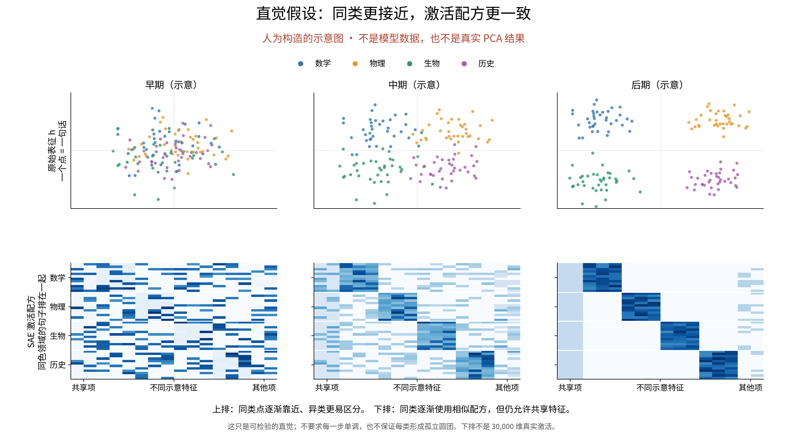
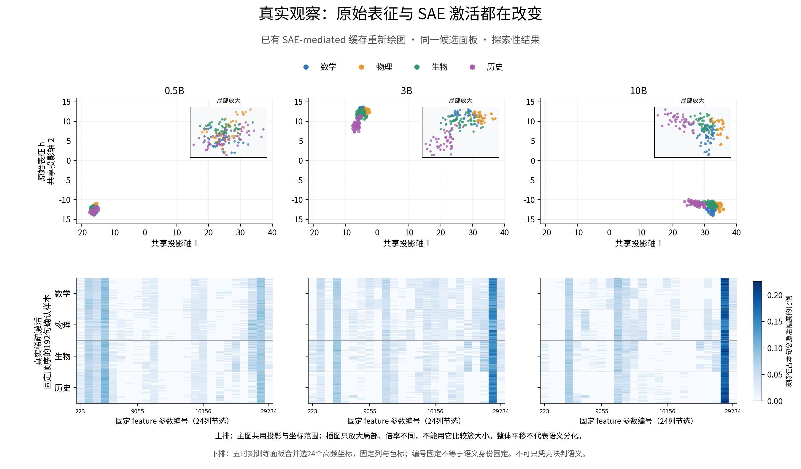
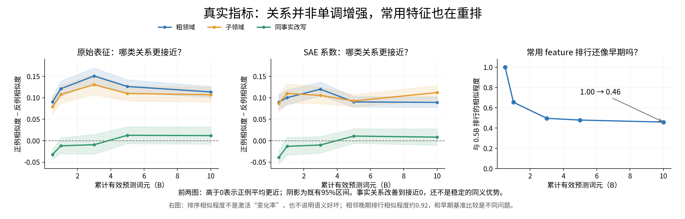

# 汇报草稿：预训练中的领域区分与 SAE 激活组织

AI 草稿，等待研究者理解和确认。2026-09-14。本稿按研究者要求用“假设—真实情况—差别—可能原因”组织；不是新 Focus、批准的实验协议或科学状态更新。已有结果来自 [analysis1 完整报告](../../../../Projects/from-attention-to-search/main/experiments/sae_representation/checkpoint_trajectory/20260914_audit/08_complete_experiment_report_cn.md)。

本次术语：原始表征 \(h\) 是最后块归一化后、进入 SAE 前的句子读取位置向量；稀疏自编码器（SAE）把它写成少量特征的加权组合；稀疏激活 \(z\) 表示用了哪些特征、各用多少；重构表征 \(\hat h\) 是当前 SAE-mediated 模型实际送入最后块 MLP 的输入。普通基线直接送入 \(h\)。主成分分析（PCA）只把高维向量投影到二维便于观察。

## 一、我们的假设是什么

**可直接讲：**“我想看，同一批不同领域的句子，随着训练，模型内部是否越来越容易把它们区分开；这种区别是否也能在 SAE 使用的特征组合里看出来。再进一步，同一个意思换一种说法，是否仍会使用相近的组合。”

这保留你的领域主线，把同事实改写作为更强检验。上轮方案建议以同命题复用为主，两者并不完全相同；本稿没有替你批准主判据。图中的分团是直觉，不要求每一步单调，也不要求各类完全没有共享部分。

**讲图：**“上排一个点是一句话，颜色是事先给定的领域；我期待同色更容易区分。下排一行是一句话、一列是一个示意特征；我期待同领域出现相似配方。图是人为画的假设，不是训练结果。”

## 二、真实情况是什么

**讲图：**“真实表征和激活都在变，但没有直接出现示意图那么整齐的分块。上排的大幅整体移动不等于语义分化；下排只展示24个固定参数编号，编号相同也不保证含义相同。”

**讲图：**“前两图比较‘正例有多近’减去‘反例有多近’，越高说明越偏向正例。原始表征的领域区分在3B附近较强，之后回落；同事实改写从负值提高到接近零。右图显示常用特征的排行改变了，但改变本身不说明语义更好。”

## 三、结果与直觉差在哪里

1. **原始表征部分符合预期，但不是一路增强。** 粗领域优势0.090→0.151（3B）→0.114；末端比早期高，中间有回落。
2. **SAE 没有同步复现粗领域的末端增强。** 稀疏系数粗领域优势0.090→0.089；不能合称“原始表征和SAE都越来越分开”。
3. **同义复用尚未确认。** 原始表征同事实优势−0.032→0.012，但末端95%区间仍跨0；直接的特征组合重合度还未测。

你附的[训练损失图](../../figures/semantic_report/04_user_training_snapshot.png)在共同词元区间几乎重合，只能说图上没有明显预测损失差距，不能据此说内部表征相同或两种方法统计等价。4B/17B是训练进度，不是语义结论；本轮不刷新或修改训练。

## 四、为什么可能偏离假设

**已有线索：**旧面板的粗领域连词面方法都能100%分类，可能主要靠领域词；线上 SAE 与模型共同改变，不能当作一把始终不变的尺子；二维投影还会突出尺度和整体均值变化。

**尚未确定：**偏差中有多少来自真实语义组织、有多少来自词面/读取方式，当前证据不能分清。不能把这些候选原因讲成已经验证的机制。

**下一决策（AI建议）：**先确认“领域区分为主、同义复用作更强检验”的报告范围，再批准固定新数据的两轨分析。完成条件是同一批正反例上得到原始表示、组合重合、SAE质量和共同词元点的基线对照；不支持假设也如实汇报。执行细节与转交文本见[数据和指标简明方案](../../../../Projects/from-attention-to-search/main/experiments/sae_representation/semantic_confirmation/20260914_v1/03_report_data_revision_cn.md)、[新版转交 prompt](../../../../Projects/from-attention-to-search/main/experiments/sae_representation/semantic_confirmation/20260914_v1/04_report_execution_prompt_cn.md)。
