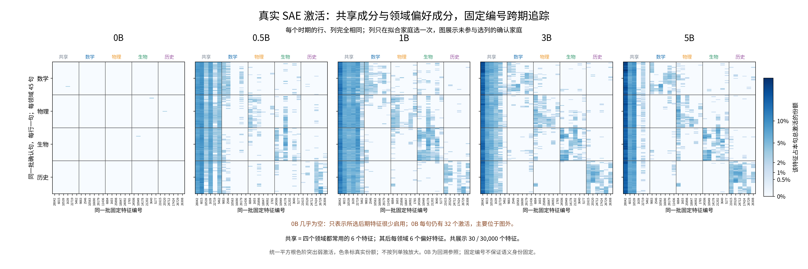
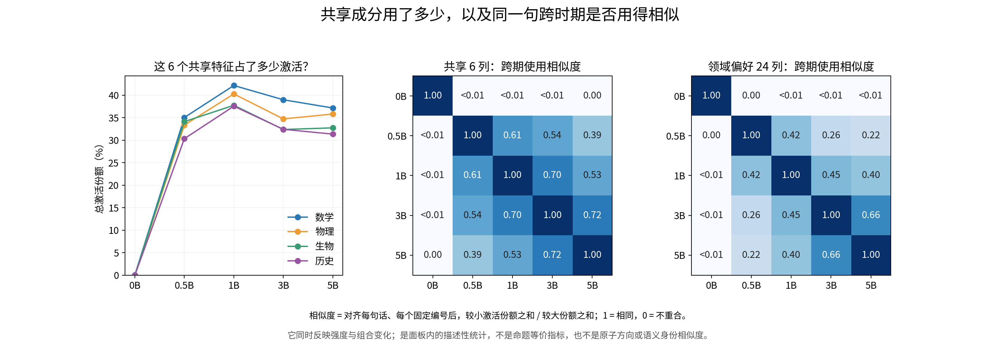
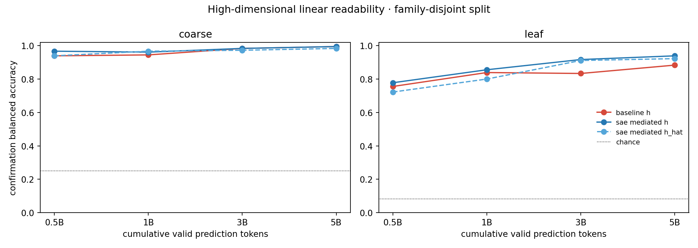
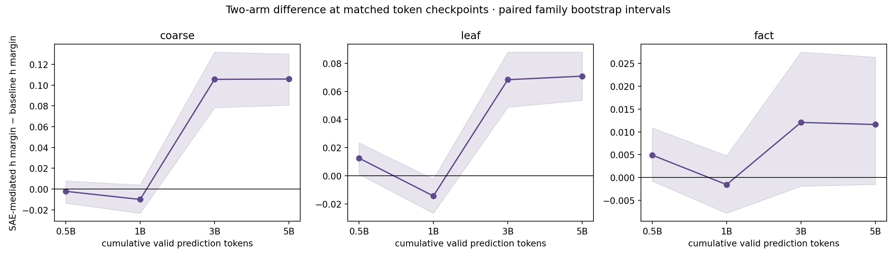

# 组会可用稿：SAE 调制改变了什么样的表征组织？

2026-09-14 · AI 草稿，待研究者理解和确认。延续[阶段汇报及数据审计](meeting_brief_semantic_confirmation_v1_cn.md)，原始两模型结果见 [analysis2 报告](../../../../Projects/from-attention-to-search/main/experiments/sae_representation/semantic_confirmation/20260914_v1/06_semantic_confirmation_v1_report_cn.md)。本文新增图来自已有缓存的 CPU 后处理，是按本次提问构造的描述性分析，不是预注册的新确认检验；没有重新推理、训练或提交任务。

**开场三条：我们当前得到的认识**

1. **领域信息不依赖 SAE 才能出现。** 普通模型与 SAE-mediated 模型在 0.5B 都已经很容易区分四个领域，5B 的粗领域线性分类准确率都约为 99.4%。因此，当前问题应从“有没有领域结构”，推进到“同样的信息以什么方式组织”。这只说明当前普通模型也具有领域可读性，不是所有模型中的必要性定理。
2. **加入 SAE 的这套配置在后期呈现更大的领域余弦间隔，但未证明整体语义组织更好。** 5B 粗领域间隔比普通模型多 0.1059，配对 95% 区间 [0.0807, 0.1300]。普通模型领域可读性依然很高，说明我们看到的差异在编码几何，而非一个模型“有领域信息”、另一个“没有”。参数量与运行条件差异限制了对 SAE 的单独归因。
3. **SAE 激活可呈现共享成分与领域偏好成分，但事实级组合复用仍未确认。** 新图固定同一批特征，展示了四领域共享的激活以及对应领域更常用的部分；共享部分的使用也会随训练改变。这个组织层次比“稳定表达具体事实”更粗，后者的同义减异义重合度在四个主检查点仍没有可靠正区间。

**目的与假设：可以这样讲**

> 我们想知道，SAE 参与语言模型训练之后，内部表示是否以更清楚的方式组织内容。这里先看领域信息是否更容易区分，再看 SAE 是否把它表现为公共成分和领域偏好成分；更严格的一步，是检验同一事实换个说法后，是否还能使用相近的组合。

“更有组织性”必须落实到具体观察。本轮已经测到的是领域可读性、领域余弦关系、稀疏激活分组和同义/异义重合度；没有测出一个涵盖全部意义的“组织性总分”。

**分析方法：只写支撑本次结论的三步**

- **相同内容、相同训练量。** 固定 360 句英文面板，在两模型共同的 0.5B、1B、3B、5B 检查点，读取最后一块归一化后、MLP 前的原始表示 \(h\)；mediated 另外读取 SAE 系数和重构表示。两模型的读取位置、文本、分词器、划分相同，模型权重不更新。
- **区分“信息是否可读”和“几何是否不同”。** 在拟合家庭上训练简单线性分类器，在独立确认家庭检验领域可读性；同时在原始高维空间计算“相关句子的余弦相似度减去对照句子的余弦相似度”，并比较两模型差值。二维图仅帮助理解分组，不用它判定两模型等价或方法优劣。
- **展示组合，同时检查组合是否有内容选择性。** 只用拟合数据选出共享和领域偏好特征，固定编号，在确认数据上跨期画激活份额；比较同一句跨时期的激活使用，并另用同义句/异义句配对判断事实级复用。命题级统计以家庭给区间；新图的跨期统计是描述值，不冒充已经通过的确认检验。

**第一张新图：同一批句子，用了哪些共享和领域成分？**

每一小图是一个训练时期；每行是一句话，四个行块分别是数学、物理、生物、历史；每列是固定的一个 feature（字典中的特征编号）。所有时期的句子和列序完全一致。

最左列块是 6 个共享特征，后面分别是 6 个数学、物理、生物、历史偏好特征。蓝色越深，表示这个特征占该句全部激活的份额越大；使用统一平方根色阶，让较弱激活也可见，色条上的百分比是真实份额。没有对每列分别放大，也没有把一列的最大值强制设为同样的蓝色。

**可直接讲图：**

> 左边这几列在四个领域都有激活，是共同使用的部分。后面的列在对应领域更集中，是领域偏好的部分。我们把同一句、同一个特征编号一直对齐，所以现在能直接看到：这些共同部分和偏好部分怎样改变，而不是每个阶段换一批特征后比较图形。

**0B 空白怎样解释：**这 30 列是根据 0.5B–5B 的拟合数据挑出来，再回头看 0B。因此 0B 接近白色只说明“后期常用的这些特征在初始化时很少用”；0B 每句仍有 32 个激活，大多落在图外的其他编号。不能把这张图讲成“随机初始化没有任何激活”或“一张图证明语义从零形成”。

**选列为什么这样做：**直接在每领域选激活最大的特征，容易反复选中各领域都强的公共特征。这里先抽出共享部分，再挑领域偏好，才能把你关心的两个部分一起看清楚。共享与领域组是观察用的划分，模型没有显式划分这五个模块。

**第二张新图：共享部分是否一直用得一样？**

左图问“这 6 个共享特征合计占一句话多少激活”；四个领域在训练后的均值约为 **30%–42%**。这不是重构能量占比：原子方向不正交，激活份额不能直接当成解释方差。

中图问“同一句在共享 6 列上，两个时期用得有多像”。右图对领域偏好 24 列问同一问题。每个格子比较两个时期，1 是这些句子在这些列上的份额完全相同，0 是没有共同非零份额。

| 比较的时期 | 共享 6 列的使用相似度 | 领域偏好 24 列的使用相似度 |
|---|---:|---:|
| 0.5B 与 5B | 0.393 | 0.219 |
| 1B 与 3B | 0.703 | 0.453 |
| 3B 与 5B | 0.719 | 0.659 |

**可直接讲图：**

> 共享成分一直占相当一部分激活，但并不是从早到晚原样不变。早期与 5B 的使用差异仍很明显；3B 与 5B 更相近。在这组所选特征中，共享部分的跨期重合高于领域偏好部分。

这个量对齐的是**同一句和同一编号**，同时受激活强弱与启用/关闭影响。它不是“同义句相似度”，也没有测原子方向。共享特征本来按跨域常用规则选出，不能把重合较高推为共享机制普遍更稳定；也没有用这几个数证明收敛或跨 seed 稳定。

**和原始表征图合起来，怎样解释“更有组织”？**

**讲图：**两模型很早都能读出粗领域。简单分类器从完整高维表示取信息，说明信息可访问；这不是语言模型自身回答问题的正确率。

**讲图：**到 3B、5B，mediated 在粗/细领域的原始余弦关系差更大。但普通模型 5B 的粗领域正负余弦都接近 1，分别为 0.9950 和 0.9922；它们只剩很小的角度差，分类器仍能利用这些差别。由此不能说普通模型没有语义，而可以说两套配置组织这些领域信息的几何方式不同。

| “组织性”具体指什么 | 当前结果 | 现在能给导师的判断 |
|---|---|---|
| 是否存在可读的领域信息 | 两模型很早都有，后期粗分类接近 | 当前不支持 SAE 独有的领域结构 |
| 同域相对跨域是否有更大余弦间隔 | mediated 后期更大 | 在这一明确几何指标上，两配置存在差异 |
| SAE 激活是否含共享和领域偏好部分 | 所选特征在确认句上可见 | 可描述 SAE 内部的这种分组，尚无普通模型的对等 SAE 图来比较 |
| 同一事实异表达是否复用专门组合 | 总体同义减异义差值区间跨 0 | 稳定事实级组织仍证据不足 |
| 是否因此提高任务能力 | 当前图片和指标没有隔离这一点 | 不推导能力提升或纯因果机制 |

**你截图里的三条文字，建议这样替换**

**原第 1 条：训练进度。** 移到“实验设置”。写成：“图中训练曲线是历史进度快照；本轮表征对照固定在两模型共同的 0.5B、1B、3B、5B。”4B/17B 不再作为结论，也不作为当前实时状态。共同区间损失看起来接近只能描述该图，没有等价检验。

**原第 2 条：领域可读性。** 改为：“两个模型在 0.5B 已有很强的领域可读性，0.5B→5B 的分类点估计总体提高，子领域改善更明显。这说明领域信息很早存在，不能据此确定更早的形成时刻。”不写每一步必然增强，不把读出准确率称为理解能力。

**原第 3 条：领域分团。** 改为：“两模型从 0.5B 起都呈现按领域分组的二维结构。粗粒度图形没有显示一个模型有领域、另一个没有领域；但原始高维关系指标显示后期两模型的几何不同，因此不能说它们的领域结构没有区别。”

截图中第二、第三组非线性图都标为 UMAP，画面也重复；正文保留一幅即可。PCA 与 UMAP 是同一批数据的两种观察方式，不作为两份独立实验，也不要把重复 UMAP 当成 t-SNE。

**由此对进一步设计模型有什么认识？**

当前最有依据的认识是：**领域信息可读性接近，不代表内部表示方式相同。SAE-mediated 的方法差异值得沿几何与稀疏编码继续解释，尚不适合直接概括成“语义更有组织”。**

公共激活的存在也改变了一个直觉：同领域句子很像、同义句激活重合高，都可能包含大量公共成分。所以未来如果用“激活相似”指导模型设计，必须保留异义对照，否则可能只鼓励所有句子用相同组合。这是指标设计上的教训，不是本轮已经批准增加某个损失。

AI 建议此时先保留架构，明确希望改进的是“领域几何”还是“具体命题的选择性”。共享特征可能承载有用的公共信息，当前没有删除它们、惩罚它们或强制领域独占的依据。更没有证据直接要求增加 router、MoE 或新的复杂目标。

**给导师的收束句：**

> 我们现在看到，SAE 参与训练的模型，其领域信息的几何表达不同；SAE 激活可以分出公共使用和领域偏好的部分。但更细的事实级组合还没被稳定读出来。下一步设计应针对一个已经量化的差异，而不是把分块图本身当成优化目标。

**复核附记：固定选列、相似度和来源**

新图对拟合家庭在 0.5B、1B、3B、5B 等权汇总；0B 不参与选列。每句先将激活贡献归一化为份额 \(u_j=z_j\|d_j\|/\sum_kz_k\|d_k\|\)，有效 decoder 原子模长约为 1。共享按四领域均值的最小值降序选 6 个正分特征；随后每领域按“本领域均值减去其他领域最大均值”选 6 个正分、未被选过的特征。所有 180 个确认句只参与展示和统计，不参与选列。它是回溯的固定视图，不是以前期特征预测未来的验证。

共享编号是 **28042、6015、10539、1639、22719、5462**。领域编号和顺序见[固定选列清单](/data/250010109/MoE_Router/experiments/20260914_semantic_feature_reuse_analysis/report_assets/shared_domain_v1/selected_features.csv)。共享指汇总后的四域使用，不要求六个特征在每个时期、每个样本都开启。

跨期使用相似度为

\[
W_{t,s}(F)=\frac{\sum_{i\in\mathrm{confirmation}}\sum_{j\in F}\min(u_{t,i,j},u_{s,i,j})}{\sum_{i\in\mathrm{confirmation}}\sum_{j\in F}\max(u_{t,i,j},u_{s,i,j})}.
\]

\(F\) 分别取固定共享 6 列、领域偏好 24 列。它是整个对齐矩阵的幅度加权重合，没有把每句的所选部分重新归一化到 1；两期共同为零的格子不贡献分子或分母。未激活部分不会制造伪相似。它不是每句话重合度的等权平均，也不与旧报告事实配对指标混用。

代码：[CPU 绘图与统计脚本](/data/250010109/MoE_Router/experiments/20260914_semantic_feature_reuse_analysis/report_assets/render_shared_domain.py)。证据：[分组激活份额表](/data/250010109/MoE_Router/experiments/20260914_semantic_feature_reuse_analysis/report_assets/shared_domain_v1/group_mass.csv)、[跨期使用重合表](/data/250010109/MoE_Router/experiments/20260914_semantic_feature_reuse_analysis/report_assets/shared_domain_v1/cross_checkpoint_overlap.csv)、[图来源与输入哈希](../../figures/shared_domain_v1/figure_manifest.json)。检查涵盖面板哈希、五缓存样本 ID 对齐、归一化份额、30 列唯一性、相似度对称性与对角为 1；训练代码及原始缓存不变。
