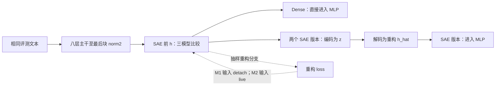

# 三模型共同 0–10B 表征分析：严格审计与待裁定卡

日期：2026-09-15。处理者：Codex。性质：研究者审阅用审计；不是已批准的执行协议。原 [plan](0915_SAE_three_model_audit_plan_cn.md) 保留为输入材料，本文件明确指出需要修改的部分。

后续状态：研究者已完成宏观裁定，最新细节与远程 **2×H100 Spot** 方案见 [完整执行计划 v1](0915_SAE_three_model_execution_plan_cn.md)。下文保留裁定前审计，不能把原“待裁定”或“可选共同方向分析”当作最新状态。

**结论：可以构造有解释力的三模型比较，但当前对照识别的是训练配置差异，不能单独识别“重构梯度进入主干”的因果效果。**建议保留精简 Phase 0、针对测量的 Phase 1、Phase 2–5，暂不做 Phase 6，不做 DCLM held-out，不设新训练启动条件。

本轮仅阅读配置、源码、历史日志、数据及既有分析证据；未加载模型、未推理、未反向传播、未训练读出器、未提交 GPU 作业。源核验见 [本轮来源快照](0915_three_model_source_snapshot.json)。本文件中的新曲线和数值测量均为 **NOT RUN**。

## 1. 已查明的模型身份：不再让研究者回答配置可以回答的问题

| 项目 | M0：Dense | M1：previous SAE | M2：当前 SAE |
|---|---|---|---|
| 执行实验目录 | `20260913_dense_baseline_pretraining` | `20260912_dense_sae_pretraining` | `20260914_sae_mediated_live_auxk` |
| 主干 | 8 层、hidden 1024、MLP 3072 | 同左 | 同左 |
| 主干参数 | 281,431,040 | 同左 | 同左 |
| SAE | 无 | 一个 30,000 维、Top-32 SAE | 同左 |
| 总参数 | 281,431,040 | 342,902,064 | 342,902,064 |
| SAE 位置 | 不适用 | 最后块 `norm2` 后、MLP 前，串联 | 同左 |
| MLP 实际接收 | 原始表示 \(h\) | 重构 \(\hat h\) | 重构 \(\hat h\) |
| LM loss | 更新主干 | 经 SAE 更新主干及 SAE | 同左 |
| 抽样重构 loss | 无 | 输入 detach，只更新 SAE | 输入不 detach，更新 SAE 及插入点上游 |
| 重构系数 | 不适用 | 1.0 | 1.0 |
| 防死亡辅助项 AuxK | 无 | 无 | K=256，系数 1/32，只直接更新 SAE |
| 训练种子 | 17 | 17 | 17 |

这里是“八层模型中串接一个 SAE”，不是八个 SAE，也不是先前讨论的四层旁路小模型。旧 analysis2 报告和缓存的 `sae_mediated` 名称对应 **M1**；不能仅凭名称放进 M2 曲线。

三组运行记录的分词器与训练数据清单一致，主干 AdamW 的学习率 \(3\times10^{-4}\)、betas=(0.9,0.95)、weight decay=0.1、预热 1000 更新等配置一致。M0 为 8 卡、microbatch 2、累积 8；M1/M2 为 4 卡、microbatch 2、累积 16。常规有效预测词元数同为每更新 262,144；为精确到达 milestone 存在缩短更新，不能笼统写每步完全固定。

已逐项核验三个运行记录中的 model/SAE/engine 源码哈希与当前相应文件一致；M1/M2 在前 38,150 更新的**已记录本地批次哈希**没有差异。这支持已有匹配关系，但不能把一份本地哈希扩写为所有 rank 的完整历史重放证明。M0 卡数不同，本地批次哈希不应直接要求相等。

当前版另有初始主干状态身份文件；既有两模型分析报告验证了 M0/M1 的 0B \(h\) 相同。本轮未重新加载三组初始权重做逐张量比较；读取最终层 \(h\) 的共同起点一致性可随未来首次缓存资格检查一并确认，不需要现在重跑整套训练资格流程。

### 1.1 共同 checkpoint 已确定

| 累计有效预测词元 | 0 | 500,000,000 | 1,000,000,000 | 3,000,000,000 | 5,000,000,000 | 10,000,000,000 |
|---|---:|---:|---:|---:|---:|---:|
| 对应更新 | 0 | 1908 | 3816 | 11446 | 19076 | 38150 |

三组共 **18 个** milestone：manifest 均为 complete，列出的文件均存在且大小匹配。大 checkpoint 的保存哈希已记录，但本轮没有重新读取数十 GB 权重计算哈希或证明可加载性。未来加载时再做所需完整性核验。

M2 独有的约 0.1/0.3/7B 不进入三模型主比较；15B 及以后也不进入。以实际有效预测词元作横轴，不拿临近 checkpoint 替代共同点。不把 0–0.5B 之间用曲线插值出来的位置当成真实形成时刻。

### 1.2 三个差值各能说明什么

| 比较 | 能回答 | 不能单独回答 |
|---|---|---|
| M1−M0 | 加入持续训练的串联 SAE 后，这套配置的表征如何不同 | 纯粹多参数、串联瓶颈、LM 经 SAE 等各自贡献 |
| M2−M1 | 开放重构输入梯度并启用 AuxK 后，配置整体如何不同 | 只有 detach 开关的净因果效果 |
| M2−M0 | 当前完整方法相对于普通 Dense 的差异 | 哪个组件造成差异 |

AuxK 的混杂不是“可能写在配置里但没用”：前 38,150 更新中，M2 有 **36,137 个更新记录了正的 AuxK 原始损失**。虽然其输入、残差目标 detach，使它不直接对主干反传，但它改变 SAE 参数，而 SAE 处在 LM 前向通路中，因此仍可间接改变后续主干训练。

## 2. 精简 Phase 0/1：保留真正影响解释资格的核验

### 2.1 本轮已完成的部分

- 模型身份、插入位置、目标归属、系数、共同 checkpoint 和关键源码身份已核实。
- 三组各有 38,150 条不重复的逻辑更新记录；所查已有损失和梯度字段未见非有限值。逐步累加 `lm_tokens` 与累计字段 `actual_lm_tokens` 一致，终点均为 10B。注意：后者已经累计，不能再求和当训练量。
- 既有 [gradient_contract.json](/data/250010109/MoE_Router/experiments/20260914_sae_mediated_live_auxk/checks/gradient_contract.json) 已验证重构 live/detach、AuxK 仅 SAE、共享输入输出 embedding 和系数缩放。它是小型工程测试，不是 18 个正式 checkpoint 的梯度数量级。
- 已复用 [formal representation 审计](../formal_representation_audit/01_measurement_reference_and_dataset_audit_cn.md)；本轮重算了冻结短句及两个 Wikipedia 数据文件的哈希，均与该审计一致。没有重复全量窗口解析和旧特征选列复算。

**Dense 异常必须保留：**其终态退出码为 1、训练回执为 FAIL，唯一失败 gate 是 TensorBoard 可观测性；其具体记录为坐标映射、token/update 轴与损失值对齐检查失败。预算到达、checkpoint replay、有限损失等 gate 为真。因此不把 Dense 写成全项通过；也不因此自动废弃完整的 10B checkpoint。已有 TensorBoard 曲线暂不作为合格的三模型训练曲线。JSONL 的计数核验只建立这份日志的坐标资格，不代表本轮已经修复 TensorBoard。

### 2.2 暂未执行、未来随首次测量完成的最小项

读取同一批文本时核验三个模型的精确 tensor、位置、padding mask、有限值和样本顺序；记录 \(h,\hat h\) 的尺度、方差，SAE 有效非零数、覆盖与重构误差。分 loss 梯度数量级只做一次 Phase 5，不在 Phase 0 再重复全套。

**资格按测量分开：**数据错位、标签泄漏或读错 tensor 会使对应比较无资格；SAE 重构差会限制“保真”和稀疏解释，但只要 \(h\) 自身有限、读取正确，仍可研究 \(h\)，不能整条 Phase 2 一刀切关闭。0B SAE 尚未学好尤其应保留为真实初始参照。

“评测面板没激活的原子”不等于“训练中死亡的原子”。前者依赖样本量和读点；后者依赖训练活动窗口。M2 的 dead-feature buffer 可按其定义单列，M1 无相同历史计数时写 N/A，不能用一小批句子补造同口径死亡率。

训练中按单词元输入能量归一化的重构损失、面板的相对误差、围绕均值的未解释方差比例（FVU）不是同一个量。后者为

\[\mathrm{FVU}=\frac{\sum_i\|h_i-\hat h_i\|^2}{\sum_i\|h_i-\bar h\|^2}.\]

FVU 用同一评测集合的均值定义描述性方差基准；分母接近零时标记不可解释，不能让小分母制造“灾难性退化”。\(h\) 位于 RMSNorm 后，范数受到归一化与可学习尺度影响；不能仅凭范数不变排除上游变化。

## 3. 数据适用性：构造层级是测量工具，不是已经成立的语义定律

### 3.1 三种本地数据的实际格式与优劣

M2D2 是一个名称，现有资料里有两个不同的本地加工版本，不能混用。

| 项目 | 已冻结构造短句 | 近期 M2D2 学术八类 | 历史 M2D2 Wikipedia 3×3 |
|---|---|---|---|
| 格式 | JSONL，含 text、coarse、leaf、family_id、meaning_id、role、split、词面等级、来源 | JSONL，含 category、input_ids、panel_split、source_split、row_index、sample_id、源全文/前缀哈希 | PyTorch `.pt` 字典；每 split 含 input_ids、coarse、fine、row_id |
| 单位 | 一句；5 句组成一个家庭 | 自然学术源行前 257 tokens；模型输入可用前 256 | 同细域记录用 EOS 拼接，再切 256 tokens |
| 标签 | 4 粗域、12 细域、同命题/异命题、高/低词面 | 8 细类，可明确映射为 4 父类 | 3 粗类、9 细类；fine 是父类内 0–2 索引 |
| 规模 | 360 句、72 家庭 | 1,200 行 | 16,128 窗 |
| 划分 | 120/60/180 句＝24/12/36 家庭 | fit 800 / dev 400；无独立 confirmation | train 9216 / development 2304 / confirmation 4608 |
| 优点 | 可固定事实关系和词面条件；便于解释失败案例；已有匹配方法/部分缓存 | 自然文本、处理量小、较少多记录拼接混淆；已有去重和来源追踪字段 | 更大、粗细均衡、可复用历史领域几何方法 |
| 限制 | 模板/词汇捷径、少量家庭、人工语义关系；不代表自然长文 | 开发集已用、无同命题标签、无独立文档 ID；不同于短句领域表 | 91.7% 确认窗含多个 EOS；无源文档 ID/偏移；窗口完全去重不保证文档独立 |
| 合适问题 | 领域关系，以及限定词面条件下的命题区分 | 自然学术领域可读性与配置差异 | 历史百科窗口的领域复核 |

具体来源：

- [冻结短句](/data/250010109/MoE_Router/experiments/20260914_semantic_feature_reuse_analysis/data/panel_frozen_v1.jsonl)及[原数据审核](/data/250010109/MoE_Router/experiments/20260914_semantic_feature_reuse_analysis/data/frozen_data_audit_v1_cn.md)。
- [学术八类 JSONL](/data/250010109/MoE_Router/experiments/20260914_sae_mediated_live_auxk/data/natural_panel_v1/natural_domain_panel.jsonl)；字段 `panel_split` 为 `fit/dev`，不可直接套旧 `split=confirmation` 读取器。
- [Wikipedia 几何版](/data/250010109/datasets/m2d2_wikipedia_3x3/processed/a15_14_e01_m2d2_geometry_seq256.pt)及[构造源码](/data/250010109/MoE_Router/experiments/20260901_a15_14_e01_m2d2_direction_norm_covariance_atlas/prepare_data.py)。路由版与几何版 token/label/row_id 载荷相同，文件哈希不同；这不是两份独立数据。

Wikipedia 的全局细类必须使用 `(coarse, fine)` 或 `3*coarse+fine`，否则会把不同父类中的三个局部编号合并成错误类别。

**AI 建议：短句面板保留为可控关系主面板；自然文本优先选学术八类作为开发性外部复核，Wikipedia 保留为可选历史复核，不同时强制两套。**对全部 18 个模型快照，学术面板单遍共 5,529,600 输入 tokens；Wikipedia 为 74,317,824，约 13.44 倍。这只是输入量比，不是含反向传播、读出训练和 I/O 的运行时间承诺。

若研究者更重视“复现过去的百科层级图”，可选 Wikipedia；若重视“以较少计算检查短句结论能否延伸到自然文本”，学术八类更直接。两者都不能直接验证同一事实跨表达复用。

### 3.2 构造面板适合到哪一步

可以测：同粗域不同细域 vs 跨粗域；同细域不同家庭 vs 同父不同细域；同家庭内同命题 vs 不同命题，后者按高/低词面分别报告。这个结构适合比较“领域可读性”和“命题区分是否超出部分词面因素”。

不宜直接预设所有样本严格满足
\(S_{fact}>S_{leaf}>S_{parent}>S_{cross}\)。
同一细类内事实距离未必小于跨类的相关事实；类别包含关系本身不推出余弦距离的严格顺序。

原方法已有三个分开控制的间隔：粗域正例来自同父不同子类；细域正例来自同子类不同家庭；命题正反例则在同一家庭内匹配词面条件。原 plan 把它们合并为一个四层排序，会同时改变负例难度，不能叫“原指标原样复现”。**建议保留原三套关系作为主测量，四层全排序仅在研究者明确选择强层级假设后作为额外描述。**

本轮查读了各粗域代表家庭及原审计：算术的反例只改变除数；生物的反例可能从染色体转到线粒体供能，难度显然不完全相同。固定高/低词面层级不能消除所有词汇、长度和模板捷径。原 72 家庭保留决定与 44 句 AI 最小修订分开记录；不是本轮逐句重新人工确认了全部语义。`template_family_id` 随命题家庭命名，也不足以证明更高层的写作模板跨划分隔离。

不需要为这轮审计重建全部数据。建议保留冻结版，未来加一个只用词袋/字符信息的简单读出参照、同样的家庭划分和词面分层，用于检验“只是词汇线索”这一竞争解释。该参照是后续 CPU 测量建议，本轮未执行。

现有短句 confirmation 和 Wikipedia confirmation 均已有历史分析；保留原 split 名便于追溯，但这次延伸到第三模型/10B不能宣称新的一次未触碰确认。学术八类本来就是开发面板。当前整体应写“固定数据上的描述性/探索性比较”，不为升级论断临时拆出一个伪独立测试集。

## 4. Phase 对比矩阵：每项测什么、对比谁、说明什么

全表默认遍历共同的 0/0.5/1/3/5/10B；不意味着本轮已执行。

| Phase | M0 | M1 | M2 | 对比与输出 | 边界 |
|---|---|---|---|---|---|
| 0 精简身份/资格 | 图、来源、tokens | 加 SAE 目标归属 | 加 live/AuxK 归属 | 本轮来源表已完成；未来首次加载小检查 | 不重跑全套训练工程验收 |
| 1 测量健康 | \(h\) 有限值/尺度/方差 | 加 \(z,\hat h\)、有效 L0、覆盖、FVU | 同 M1；死亡窗口单列 | 三模型 \(h\)；两 SAE 重构/活动曲线 | 无 DCLM held-out；不以 SAE 失败关闭合格 \(h\) |
| 2 主干/实际输入表征 | \(h\) | \(h\)，并与 Phase 4 的 \(\hat h\) 联读 | 同 M1 | 三组 raw-\(h\) 曲线、三对差值；实际 MLP 输入另图 | 领域可读、几何、命题关系分别解释 |
| 3 稀疏读出 | N/A | \(z\) | \(z\) | 两 SAE 的领域读出、关系选择性、系数热图 | 不给 Dense 虚构 \(z\)，不新训离线 SAE |
| 4 重构保留 | N/A；其 \(h\) 是实际输入参照 | \(h\to\hat h\) | 同 M1 | 两 SAE 重构损失/关系差/固定读出迁移；三模型实际 MLP 输入比较 | 低 MSE 不等于语义保留 |
| 5 梯度数量级 | LM 分量，重构/AuxK N/A | LM、重构；主干重构为 0 | LM、重构、AuxK | 同样文本/损失归一化下，层×token 的范数比与方向余弦 | 当前状态局部梯度，不是历史训练因果重放 |
| 6 | 暂不做 | 暂不做 | 暂不做 | 不做特征 ID 对齐或跨模型编码器交叉读取 | 不声称特征语义身份跨期稳定 |

### 4.1 最重要的读取位置区别

定义 \(h\) 为最后块 attention residual 经 `norm2` 后的张量，\(z=E(h)\)，\(\hat h=D(z)\)。M0 直接把 \(h\) 输入最后 MLP，M1/M2 把 \(\hat h\) 输入 MLP。

示意图不表示未来新模型；AuxK 另在 SAE 内部计算，输入和残差目标 detach。

必须有两种读法：**raw-\(h\) 三模型对比**回答插入点之前表征怎样变；**实际 MLP 输入对比**为 M0 的 \(h\) vs M1/M2 的 \(\hat h\)。不能用 raw-\(h\) 单图回答模型真正使用了什么。首轮最后块为主；全层梯度可做，不能顺手扩成全层全部表示与图谱。

读取建议也应明确：短句沿用固定换行后最后有效词元，以便复用旧缓存；学术自然文本以位置 0–255 的平均表示为主，位置 255 为单位置辅助。Wikipedia 的历史主对象是位置 64–255 平均，若选它，需明确保留历史窗口还是改用 0–255，不能悄悄称同口径复现。各数据面板内部三模型必须完全一致，跨面板不直接比较绝对分数大小。自然文本的平均稀疏码可能有远多于 32 个非零项；Top-32、活动数和死亡/覆盖仍按单词元原始激活统计，不能把平均码的非零数误当原 SAE 稀疏度。

### 4.2 Phase 2 的曲线和公式

建议最小量化图组：

1. 粗领域、细领域、命题关系的余弦间隔；同图三模型，附 M1−M0、M2−M1、M2−M0 差值图。命题关系分高/低词面层级。
2. 线性读出器（linear probe：只训练一个线性分类器读领域标签）的粗类平衡准确率、细类全局读出，以及给定正确父类后的子类读出。保留全局细类一栏才能与旧报告对应；父条件结果须注明使用了正确父标签。
3. 类间差异相对类内波动的 Fisher 比值；粗类与父类内细类分开。它是几何分离指标，不是分类准确率。
4. 高维样本余弦关系矩阵及模型差值；固定样本/类别顺序与色阶。自然面板先用类别块平均显示，不强制生成 4,608×4,608 全矩阵。
5. 共同规则的 PCA/UMAP/t-SNE 描述图和上述计算图；未来真实结果图片存本日期 `figures/`，附数值来源。不要现在用示意曲线冒充测量。

原读出可复用 fit-only 标准化、逻辑回归、开发集在 C={0.001,0.01,0.1,1} 选择正则强度、冻结后评测。必须补存逐样本预测以计算三模型配对差的区间；旧报告只有某些准确率点估计，不能补称已有显著优势。标签置乱/词面参照只能在拟合与开发约定内选择，不从确认图反选参数。

学术面板只有 fit/dev，不能直接套三划分代码，也不能一边用 400 条 dev 挑正则、一边将其得分称独立评测。可在原 fit 的每类 100 行内按固定哈希划出 75 行拟合、25 行选参数，保留原 400 条 dev 统一报告；这只是控制本次调参泄漏，原 dev 的历史使用不会因此消失，结果仍属开发性复核。最终划分清单在后续 plan 冻结。

Fisher 建议明确使用类平衡的 trace 比值，避免协方差逆矩阵在小样本、高维下不稳定：

\[J=\frac{K^{-1}\sum_{c=1}^K\|\mu_c-\bar\mu\|^2}{K^{-1}\sum_{c=1}^K n_c^{-1}\sum_{i:y_i=c}\|h_i-\mu_c\|^2},\qquad \bar\mu=K^{-1}\sum_c\mu_c.\]

父类内细类 \(J\) 分父类计算后等权平均。主版本在未逐坐标标准化的原 \(h\) 上算，单位化版本作为方向敏感性，不能与 probe 的逐维 StandardScaler 悄悄混用。本次定位到的旧 confirmation 脚本未实现这个 Fisher 比值；这是需要明确补充的小型统计项，不能写成“旧曲线已经全部有了”。

旧原始余弦图与中心化/逐行单位化后的降维图预处理不同；应在图注分别写清。联合降维使用评测样本可用于描述，但不是独立泛化检验；独立拟合的二维坐标也不能直接比较绝对位置。\(z\) 在两个 SAE 间不共享坐标，不能把两者直接拼在一起拟合后解释列对应。

### 4.3 统计与“变化量”

每个指标 \(q\) 保存 \(q_m(t)\)、相对于各自 0B 的变化 \(q_m(t)-q_m(0)\)、以及三个配对差 \(q_a(t)-q_b(t)\)。可进一步展示两模型增量之差；这仍是描述性差值，不自动消除混杂。所有共同 checkpoint 都报告，不能只挑 3B 或 10B 中最有利的一点。

短句以家庭聚合，不把 180 句当 180 个独立命题；沿用固定三元组时注明不同锚点可共享正反例。配对 bootstrap 同步重采样模型的家庭索引；区间解释为固定面板抽样不确定性，不是训练种子不确定性。Fisher 区间需对重采样数据重新计算整体比值，不是给每句伪造一个 Fisher 值。自然数据只能报告行/窗口重采样的条件区间，不能声称文档级泛化置信区间。

若需正式“统计显著”结论，须在执行计划中固定少量主要指标并处理多 checkpoint/多比较；本轮建议全程轨迹为描述，10B 配对效果作终点摘要，不以“任一时点显著”作成功条件。不设任何训练启动阈值。

0B 随机网络也可能读出词汇/长度形成的领域线索，0.5B 已有很高粗域读出是旧结果边界。因此问题应是“形成过程和组织方式如何改变”，不能预设从完全没有领域信息开始；现有共同快照无法精确定位 0–0.5B 内形成时刻。

### 4.4 Phase 3：稀疏码展示与统计

M1/M2 各自计算正系数集合重合（Jaccard）、原方法的幅度加权重合，以及相同粗/细/事实关系的正减负差。系数余弦是另一个可选量，不可替换旧幅度加权重合后仍沿用同一指标名。两个模型比较的是这些**内部关系统计量**，不是 feature ID 的直接交集。

\(z\) 的 30,000 维与 \(h\) 的 1,024 维线性读出不同；即使 \(z\) 更易被线性分类，也只能说明编码改变了线性可访问性，不能说确定性映射凭空增加了语义信息。训练/开发预算、正则选择规则保持相同，并注明维数差异。

共享/领域偏好图可复用 formal audit 的每句贡献幅度份额规则、fit 选列和确认展示规则。首轮建议每个 checkpoint 独立 fit 选列，比较共享/领域选择性及 held-out 热图；列是当期代表，不把横向相同列序当成同一语义原子。原固定 30/150 列图继续作为历史资料，不把使用 >10B 信息挑选的列拿来作本轮 0–10B 形成证据。

移除高频共同坐标只能作为对“全体样本都用一批特征”解释的敏感性分析：筛选仅用 fit、阈值事先定、原始结果必留、空激活行计数公开。它不等于去掉 \(h\) 的第一奇异方向，更不意味着共同特征没有用。Phase 6 不做的同时，也不保留需要特征身份对应的跨模型 Jaccard 或“同一语义 feature 稳定”结论。

### 4.5 Phase 4：测保留，不制造一个含混保留率

分别在 \(h\) 与 \(\hat h\) 上计算同一关系和各自读出；再把只在 \(h\) fit 集拟合的标准化器与分类器完全固定，直接用于 \(\hat h\)。后者才问“原可用线性读出能否直接保留”。

报告准确率/间隔的**配对差**，不用 `score(h_hat)/score(h)` 作为统一保留率：不同指标机会水平不同、间隔可能为零或负，比例会失真。几何间隔更大而固定读出迁移下降时，应报告两者分歧，不能选一个较好看的数字。

### 4.6 Phase 5：三模型分 loss 梯度，不能只测 M2

令同一层同一参数集合的 LM 梯度为 \(g_L\)，未加权重构梯度为 \(g_R\)。同时记录两个原始范数、参数数目/每参数 RMS，以及

\[r=\frac{\|\lambda_Rg_R\|_2}{\|g_L\|_2},\qquad c=\frac{\langle g_L,\lambda_Rg_R\rangle}{\|g_L\|_2\|\lambda_Rg_R\|_2}.\]

分母零时记 N/A；M1 的主干重构梯度为零，余弦未定义，不能显示成“余弦 0，因此独立”。M0 重构项不存在，记 N/A，不能给它接一个新 SAE 来凑三列。

推荐层组：embedding、各块 attention/MLP、最后 norm2、最后 MLP、最终 norm，SAE encoder/decoder 单列。M2 重构梯度应到达最后 norm2 及其上游，最后 MLP 与最终 norm 不应被该分量直接更新。`embed.weight` 同时做输入 embedding 和 LM 输出权重；重构对它的梯度可来自输入路径，不能当成穿过最后 MLP 到达输出头的证据。

AuxK 独立计算其加权范数，核验直接主干梯度为零，保留 checkpoint 自带活动状态；冻结参数与 buffer，不更新死亡计数。人为强制 dead mask 只能作为标明身份的工程对照，不能代替 checkpoint 的真实 AuxK 数量级。

未来数量级测量建议用选定自然面板的固定、各类平衡 fit 子集，在全部共同点复用同样 token 和抽样 mask；具体批次数放入后续执行协议。LM 使用有效 next-token 数归一化，重构使用抽样位置数归一化，沿用训练采样比例 1/8；用未裁剪、已消除混合精度缩放的梯度。自然面板 257 tokens 可组成前 256 输入与后 256 目标，不需要另加 DCLM held-out。梯度是该自然文本条件下的局部作用，不能冒充 DCLM 平均训练作用。

固定评测 batch 的离线梯度不要求找回历史那个 batch 才能计算；只有要声称“当时实际更新的贡献”时，才需要历史 batch、优化器状态与精确运行条件。原 plan 把不能精确重放直接写 NOT AVAILABLE 过严。

\(c<0\) 表示局部一阶方向冲突，不直接证明实际 LM 代价；\(c\approx0\) 表示近正交，不是统计独立。梯度范数比也不等于 AdamW 最终更新贡献，更不能从一个 checkpoint 的小梯度推断此前一直没有作用。

## 5. 第一奇异方向及共同成分：只作为竞争解释的分支

最相关的竞争解释是：SAE 改变共同方向或方差尺度，使原始余弦更分开，但标签信息并未增加。线性读出、Fisher 和关系间隔联合看，能区分其中一部分。

如研究者希望直接检查，可在 fit 表征矩阵上取得最大奇异值对应的单位方向 \(v_1\)，对评测向量计算 \(h_\perp=h-(h^Tv_1)v_1\)，重算原有量；若先中心化，则先用 fit 均值中心化、再做同一投影。两种预处理问题不同，不能混称“去掉第一大奇异值”。该分析删除的是最大方差/能量方向，不保证删除的就是无用噪声，也可能删掉领域信号。

这是可在同一缓存做的 CPU 敏感性分析，解决明确竞争解释；**不是本轮必做项，更不是对训练模型加新正则项的批准。**不因此增加第二套训练。

## 6. 复用、修改、停止复用

- **复用：**冻结短句、关系三元组、fit/dev/confirmation 家庭划分、既有 M0/M1 对应缓存、原线性读出规则、幅度加权重合、formal audit 的选列解释和数据身份回执。
- **修改：**旧双臂读取器改为显式三运行路径；确保 M2 loader 支持 AuxK buffer；补共同 10B 与 M2；补 Fisher、逐样本读出预测和配对区间；新增自然文本 pooling。复用缓存前比对模型、checkpoint、数据、tokenizer、读取 tensor/position、预处理与源码身份。
- **停止直接复用：**旧 864 句 Analysis1 数值不能混进 360 句 Analysis2；其他 28 层模型/其他位置的 M2D2 缓存不能填入本轮；19B 选列不能偷渡到 10B 主比较；历史合计梯度不能当作分 loss 梯度。

本轮未写新模型代码，不需要先迁移旧训练系统。后续读取和分析代码在隔离的执行目录写，活跃训练目录只读。现有 0–5B 缓存可省推理，但是否完全复用由身份检查决定，不能为省计算忽略口径差异。

## 7. 请研究者完成的宏观裁定

以下是科学范围选择，不是让研究者重新核实已查明的配置。AI 推荐项可以一起确认或逐项修改；本轮不要求批准实验执行。

| 裁定点 | AI 推荐的具体选择 | 若选择另一方向，代价/结论变化 |
|---|---|---|
| 1. “语义组织”的主对象 | 领域几何与线性可读性为主，命题复用为独立的更强问题；不强制四层相似度排序 | 若以严格语义层级/命题等价为主，需要重新审查负例难度与语义标注，不能由领域分类替代 |
| 2. 对现成三组的归因边界 | 接受 M2−M1 是 live 重构 + AuxK 的组合差异，梯度测量只提供局部作用证据 | 要隔离 detach 的纯因果作用，现有三组不足；本轮只记录缺口，不启动新训练 |
| 3. 自然数据选哪一版 | 360 句主面板 + 学术八类开发复核；Wikipedia 暂列可选 | 换 Wikipedia 更贴近历史百科研究，输入量约为学术版 13.44 倍，仍无命题标签；两套都做则扩大范围 |
| 4. 读出对象与“形成”的尺度 | 最后块 raw-\(h\) 三模型为主，实际 MLP 输入同步报告；0–10B 全共同点，10B 为摘要终点 | 全层完整图谱和更早时刻定位是不同工作量；0–0.5B 中无共同快照不能精确补出形成时间 |
| 5. 本轮证据强度与 LM 边界 | 固定数据的探索性轨迹；不做 DCLM held-out，所以不作通用 LM 代价、能力或独立确认结论 | 若要独立泛化/通用 LM 代价，需要另冻结相应评测；不能拿局部梯度冲突或训练 loss 代替 |
| 6. 是否需要共同方向敏感性 | 先保留 raw 曲线；可用已有缓存补中心化/去第一方向诊断，以区分几何重排与可读性增加 | 不做也可开展主体比较，但“余弦优势来自共同方向变化”的解释仍保留；无新增 GPU 推理需求 |

**推荐的一条下一步：先裁定这六点，再据此冻结“三模型 × 六共同点 × 短句主面板/选定自然面板”的详细只读分析执行计划。**该计划再规定样本/批次数、读出预算、缓存与图表验收、所用算力范围；不将 checkpoint 分析批准扩成继续预训练批准。

已查 `PROJECTS.md`：现有 M2D2 几何与 SAE-router 条目可提供前置证据，未找到能直接把本次从零三模型比较视为已登记独立问题的条目。现有组会 Focus 是 AI 草稿，不能接管其研究判断。本轮不创建或重置 Anchor/Focus，不填稳定 `problem_key` 或更新科学状态。若后续需要正式独立归属，研究者另确认；不会靠 memory 创建批准。

## 8. 后续 memory 与新对话

按研究者指定顺序：先审阅本审计；再定详细执行 plan，并把已裁定事项及其来源追加到本对话工作 memory；然后新开执行前审计对话。当前没有把这份建议写成已批准执行计划，也没有修改 `0914-formal representation audit` 的 memory。

已准备 [下一对话的审计 prompt](0915_next_audit_prompt_cn.md)，用于带着研究者的实际裁定续接。目前工具列表没有可调用的创建/读取对话接口，不能宣称已创建新对话；已通过该对话独立 memory 和其链接的原始文件复用关键内容。
