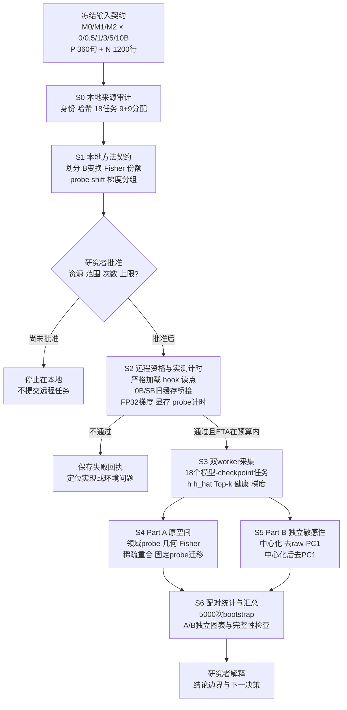

# 三模型表征审计：分析链路、时间成本、复用边界与资源复核

日期：2026-09-15。处理者：Codex。性质：对现有执行计划与隔离实现的二次工程审计说明，不替代 Protocol、结果记录或研究者判断。

## 结论先行

1. **链路本身完整，但实现尚未达到可提交状态。** 当前 S0 来源审计与 S1 数学契约检查通过；S2 只有部分资格 runner，S3--S6 的完整采集、分析、恢复和汇总 driver 尚未接通。现在若提交，只会跑到不完整的资格层，不能产出计划中的正式分析。
2. **提交前还需约 2--4 小时本地实现与回归。** 修完后，完整远程计算合理预估为 **2.5--5.5 小时墙钟，中值约 4 小时**；建议仍保留 **6 小时累计运行上限，即 12 GPU·小时**。排队和 Spot 抢占空窗另算。
3. **后续最值得复用的是带完整身份的原始 $h$、实际 MLP 输入 $\hat h$、SAE Top-k 稀疏码及逐样本预测。** 变换参数、probe 和梯度摘要只能在其拟合对象或固定样本范围内复用；跨模型/跨 checkpoint 的 SAE feature ID 不能当作同一语义原子。
4. **本分析要回答的是“信息是否线性可读、实际 MLP 输入是否保留或重排它、差异是否依赖共同方向、当前损失项的局部梯度路径是什么”。** 它不能单独证明模型会在任务中使用这些信息，也不能把 M2−M1 解释成纯 detach 或纯 AuxK 因果效应。
5. **硬件建议：继续用两卡 H100 Spot。** 当前有限队列窗口没有显示两卡 5090 更好抢；已启动样本的等待时间反而偏向 H100，但 H100 样本仅 7 个，不能下稳定供给结论。更关键的是 H100 方案有 2×80GB 显存、44 CPU、480GiB 主存，明显更适合 FP32 分目标梯度、30k SAE 缓存和约 3024 次 CPU probe；5090 方案只有 2×32GB、28 CPU、120GiB，切换会引入新的内存和速度风险。

## 1. 必要术语与对象

- **原始表征（raw-$h$）**：最后一个 Transformer block 的 `norm2` 输出，即进入 SAE 或 MLP 前的 1024 维向量。
- **实际 MLP 输入（$\hat h$）**：最后一层 MLP 真正接收的向量。M0 中 $\hat h=h$；M1/M2 中是 SAE 重构。
- **线性探针（linear probe）**：冻结模型表征，只训练受限线性分类器，衡量标签能否被线性读取；它不证明模型自身使用了这些信息。
- **共同方向分析（Part B）**：在拟合集估计均值或第一奇异方向，再对同一缓存变换后重算指标；它是敏感性分析，不是新模型或训练操作。
- **稀疏贡献份额**：将 SAE 的 Top-k 系数乘对应 decoder 列范数后归一化，描述当前样本的重构贡献分布。
- **局部梯度画像**：在固定 32 条自然学术样本上分别计算 LM、重构和 AuxK 对参数组的瞬时梯度；它不是历史训练动力学或 AdamW 实际更新份额。
- **M0/M1/M2**：M0 为 Dense；M1 为最后层串联 SAE、重构路径 detach、无 AuxK；M2 为相同位置的 live 重构路径并加入 SAE-only AuxK。M2−M1 是组合配置差，不是单因素因果差。

## 2. 当前分析链路流程图

这条链路包含三种不能混写的门：S0/S1 的工程可行性、S2 的真实运行资格、S6 后的科学解释。工程 PASS 不是科学支持；计划存在也不是执行批准。

## 3. 实现细节二次审计

### 3.1 已核验证据

- S0 已核实三模型各 6 个共同 checkpoint、P/N 数据身份、18 个任务与 9+9 worker 分配；为了避免本地读取约 65GiB，未重算 18 个 `state.pt` 的内容哈希，而是重核 manifest 内容哈希与文件大小。
- S1 的 9 个 CPU 契约测试通过，覆盖固定划分、中心化等价、B2/B3 投影正交、Fisher 平移不变、贡献份额、5000 次配对抽样索引、N 的单次 shift 和共享 embedding 去重。
- 当前 runner 能按模型来源严格加载，hook 最后层 `norm2`、`gate` 与 `up`，检查 M0 的 $h=\hat h$ 以及 M1/M2 的 $\hat h$ 等于主重构；10B 任务还会做一批梯度资格检查。
- dry-run 解析为 `h100-2-spot`、单节点、2×H100、Spot、镜像 `shphd-lite-0911`，且 `job_submitted=false`。

### 3.2 提交前必须补齐的缺口

| 优先级 | 缺口 | 为什么会影响结果或 ETA | 最小修复 |
|---|---|---|---|
| 阻断 | S3--S6 完整 driver 不存在 | 目前只有 S0/S1 与部分 S2，不能产生 18 点缓存、3024 次 probe、A/B 图表和完整回执 | 接通采集、分析、断点恢复、完整性校验与统一入口 |
| 阻断 | GPU 计时前后没有 `torch.cuda.synchronize()` | CUDA 异步执行使当前 `perf_counter` 低估前向/反向时间，不能据此校准 6 小时预算 | 同步后分别记录加载、前向、额外 SAE encode、反向和 state hash 时间 |
| 阻断 | 旧 P 缓存桥接要求 0B/5B，但 S2 task 只生成 0B/10B | 不能合法复用 M0/M1 的 11 个旧缓存候选 | S2 增加每模型 5B 的四句桥接；失败则重提对应 P 缓存 |
| 阻断 | S2 卡要求代表性 dense/sparse probe 计时，runner 尚未实现 | 3024 次拟合是 CPU 尾部的主要不确定性 | 用冻结 10B-M2 样例实测稠密/稀疏候选 C 与 B2/B3 重拟合 |
| 重要 | `fit_probe` 只支持给定一个 C，没有 4-C tune 选择和收敛资格逻辑 | 不能执行计划中的 `[0.001,0.01,0.1,1]` 选择规则 | 实现 fit/tune/report、同分取小 C、不收敛标记及逐样本预测保存 |
| 重要 | 梯度输出缺 RMS、范数比和完整 loss-pair cosine | 不足以形成计划注册的梯度表 | 在 raw/weighted norm 外补参数数目归一 RMS、比值、N/A 规则和四批汇总 |
| 重要 | S2 汇总会 glob 旧 `M*.json`，没有 run-id/source-hash 完成标记 | 重跑时旧文件可能被误计为本轮通过 | 每次运行用唯一目录；完成标记绑定 task/source/code hash |
| 重要 | 没有显存峰值；state 全量哈希与模型搬运混入资格时长 | 无法判断 32GB 5090 是否可行，也会污染纯计算 ETA | 记录 peak allocated/reserved；将 provenance/immutability 时间独立计量 |
| 边界 | `hook_forward` 在主前向后再次执行 `sae.encode` | 当前 SAE 任务的“前向耗时”包含额外提码，不等于单次模型前向 | 分开标注模型前向与提取 Top-k 的时间，不删除必要提取 |

因此，原计划中的“远程 2--5 小时”仍是工作量先验，不是实测 ETA。只有上述前三类问题完成并通过 S2，才可把估计升级为运行承诺。

## 4. 要做哪些分析，以及各自时间

### 4.1 提交前的本地工作

| 本地工作 | 预计墙钟 | 判断依据 |
|---|---:|---|
| 修正 S2 计时、5B 桥接、显存与 probe 计时 | 0.5--1 小时 | 改动局部，但需补回归 |
| 实现 S3 采集、原子完成标记与恢复 | 0.5--1 小时 | 18 个固定任务，数据结构已冻结 |
| 实现 S4/S5 probe、关系/Fisher/稀疏统计、A/B 分流 | 0.75--1.5 小时 | 公式已有核心函数，缺完整编排和输出契约 |
| 实现 S6 完整性检查、回执与本地回归 | 0.25--0.5 小时 | 主要是覆盖检查与入口闭环 |
| **合计** | **2--4 小时** | 不涉及模型推理或正式结果 |

### 4.2 批准后的远程工作

| 阶段 | 实际分析内容 | 合理墙钟范围 | 主要不确定性 |
|---|---|---:|---|
| S2 资格+计时 | 3 模型严格加载；0B/10B 前向；0B/5B 缓存桥接；10B 一批 FP32 梯度；稠密/稀疏 probe 小样 | 20--45 分钟 | 冷读、state hash、依赖层、FP32 梯度 |
| S3 采集+梯度 | 18 点 P/N 前向；raw-$h$、$\hat h$、Top-k；每点 4×8 行分目标梯度 | 40--100 分钟 | 约 65GiB checkpoint I/O、30k SAE encode、两 worker 尾部不均衡 |
| S4 Part A | 领域 probe、实际输入与固定迁移、余弦关系、Fisher、稀疏重合、词面参照 | 50--120 分钟 | 约 2304 次相关拟合与稀疏 solver 收敛 |
| S5 Part B | 每对象 fit-only 均值/SVD；B1 自检；B2/B3 重拟合、关系与 Fisher | 35--90 分钟 | float64 SVD、720 次固定-C 重拟合、简并/零向量处理 |
| S6 统计+图表+回执 | 5000 次分层配对 bootstrap、A/B 图、预测/表格/来源完整性 | 25--55 分钟 | Fisher 充分统计实现、缺失点与绘图依赖 |
| **完整远程合计** | 上述串联并保留少量尾部裕量 | **2.5--5.5 小时；中值约 4 小时** | S2 后必须按实测更新 |

时间不能简单相加后除以两张卡：S3 可以由两个独立 worker 并行，S4--S6 主要受 CPU、主存与 solver 控制。若按中值 4 小时计算，成本约 **8 H100·小时**；候选上限仍为 **12 H100·小时**。端到端从现在起还需本地 2--4 小时，因此不含排队/抢占的总工作时间约 **4.5--9.5 小时**，适合按半天到一天规划。

## 5. 我们到底要分析出什么

本任务不是给三个模型排一个模糊的“表征好坏总分”，而是拆开四个问题：

1. **领域信息是否更容易被读取？** 在相同累计 token 的 M0/M1/M2 上，比较粗域、全局细域、给定父类后的细域平衡准确率，P 与 N 分开报告。
2. **模型真正接收的表征是否保留这些信息？** 同时比较 raw-$h$ 与实际 MLP 输入 $\hat h$，再把在 $h$ 上训练好的 probe 固定迁移到 $\hat h$，区分“信息丢失”与“坐标重排”。
3. **差异是稳定组织还是共同方向造成的几何现象？** 原空间 Part A 与中心化/去第一方向 Part B 分开；probe、余弦关系和 Fisher 不互相替代。
4. **SAE 结构与训练目标当前对应什么？** 用贡献份额读出/重合描述稀疏接口，用固定样本梯度检查 LM、重构、AuxK 当前能到达哪些参数组。前者不证明 feature ID 语义同一，后者不证明长期优化因果。

最小充分输出应当是：完整 18 点主曲线与三对差值、$h\rightarrow\hat h$ 固定迁移差、A/B 敏感性对照、P/N 一致性、SAE 健康与稀疏读出、四批梯度表，以及逐样本预测和配对区间。A09 的 PCA/UMAP/t-SNE 只作描述图，不参与成败裁定。

## 6. 哪些表征和成果可以复用

| 可复用对象 | 后续可做什么 | 复用条件与禁止外推 |
|---|---|---|
| raw-$h$ 稠密缓存 | 新 probe、Fisher、余弦、Part B 变换、描述性降维 | 必须绑定模型/checkpoint/面板/位置/tokenizer/source hash；不能当模型已使用该信息的证明 |
| 实际 MLP 输入 $\hat h$ | 实际输入可读性、几何、与 $h$ 的固定 probe 迁移 | M0=$h$，M1/M2=主重构；不能与另一个 hook 位置混用 |
| SAE Top-k indices/values + decoder 列范数 | 贡献份额、稀疏 probe、活动统计、加权重合、当期选列 | feature ID 只在同一 SAE checkpoint 内有身份；不能跨 M1/M2 或跨期叫“同一语义原子” |
| N 的逐 token Top-k 缓存 | 重算行均值贡献份额、token 活动与不同聚合 | 可从稀疏原始记录派生，不保存 token×30000 稠密矩阵 |
| sample ID、标签、mask、位置与来源哈希 | 三模型配对、bootstrap、恢复与审计 | 必须保持原 P 家庭与 N 行级抽样单位，不得改 split 后沿用旧区间 |
| Part B 的 $\mu$、第一方向、奇异值与能量比例 | 对同一对象重放 B1/B2/B3 | 只属于同一模型×checkpoint×面板×表示；不能跨对象转移 |
| fitted scaler/classifier/C | 同一对象内固定 $h\rightarrow\hat h$ 测试、复算预测 | 不能跨模型/点/面板复用，也不能在 report 上重调或重拟合 |
| 逐样本预测/概率 | 配对差、bootstrap、类别/家庭切片与审计 | 新分析不得改变预注册主指标后再挑有利切片 |
| 梯度分组摘要 | 检查固定 checkpoint 和固定 32 行上的局部路径 | 不能还原训练历史、优化器状态或一般化到全部数据 |

旧有的 11 个 P 缓存只是候选：M0 为 0--5B 五点，M1 为 0--10B 六点；必须通过 0B/5B 四句桥接后才能复用。M2、N 和梯度没有旧缓存可复用。19B 选择过的 feature 列不得进入本轮。

存储策略上，应保存 raw-$h$/$\hat h$ 和稀疏 Top-k；B1/B2/B3 表征可从原缓存与变换参数重算，不必再复制三套大矩阵。这样既保留后续分析自由，也避免把派生视图误当原始证据。

## 7. 可能得到的结论，以及它推进什么判断

| 可能结果 | 可以支持的有界解释 | 推进的研究判断 | 不能声称 |
|---|---|---|---|
| M1/M2 的 probe 曲线高于 M0，且 P/N、B2/B3 都稳定 | 领域标签在该读点更线性可访问 | SAE 方案是否值得继续作为“可读接口”研究；下一步是否做功能性干预 | 模型因此更懂领域或实际使用该信息 |
| 原空间余弦优势在去第一方向后消失，但 probe 基本不变 | 几何差异依赖高能共同方向，而线性可读性仍在 | 后续表征审计必须保留 Part B；避免用单一余弦讲机制 | 原优势“虚假”或该方向无用 |
| $h$ probe 高，$\hat h$ 独立 probe 和固定迁移都下降 | SAE mediation 在最后 MLP 前损失了部分线性可访问信息 | 优先检查重构瓶颈/训练目标，而非直接推进功能性机制主张 | 已证明任务性能下降由此造成 |
| $\hat h$ 独立 probe 恢复，但固定 $h$ probe 迁移失败 | 信息仍可读，但坐标被重排 | 下一步研究“重参数化/接口变化”而非简单“保留率” | 信息丢失 |
| SAE 稀疏码可读，而稠密 $h$ 没有同步提高 | 稀疏接口对离线线性读出更便利 | 是否围绕 sparse readout/可解释接口设计后续实验 | 模型内部形成了跨期稳定语义原子 |
| P 有优势而 N 无优势 | 结果可能依赖模板、词面或构造面板 | 降低结论强度；优先扩大自然数据或检查词面参照 | 通用领域组织改善 |
| M2 重构梯度能到上游、M1 为零 | 当前实现的 live/detach 梯度路径符合设计 | 证实 wiring；为后续训练机制实验提供必要前提 | 该梯度长期导致了观察到的表征差 |
| 三模型无优势、反向或区间很宽 | 在本次单种子、固定面板和读点上不支持注册优势，或证据不足 | 停止把当前 SAE 配置当作已成立的表征机制证据；决定是否转向更小 falsifier | SAE 一般无效 |

对当前研究线最直接的推进是：把“训练 loss/重构看起来正常”与“领域信息在真实计算路径中如何可访问”分开；再决定下一步应研究信息保留、坐标重排、稀疏接口，还是必须进入因果干预。它不会自动批准新训练，也不会替研究者选定下一问题。

## 8. 两卡 H100 与两卡 5090：排队和适配分开判断

### 8.1 当前只读队列快照

查询时间 2026-09-15T16:24:19Z；读取 `share-space` 最近 5×500 个任务，窗口为 2026-09-14T07:32:15Z 至 2026-09-15T16:21:28Z。只统计 exact workerspec 且 `quota_type=SPOT`：

| 规格 | 样本 | 有启动时间 | 启动等待 P50 / P90 | 30 分钟内 / 90 分钟内启动 |
|---|---:|---:|---:|---:|
| 2×H100 `n6ls.iu.i40.2` | 8 | 7 | 45.1 / 68.7 分钟 | 2/7 / 7/7 |
| 2×5090 `n12lp.nn.i10a.2` | 91 | 73 | 63.9 / 102.3 分钟 | 25/73 / 57/73 |

**已核验证据：**这个窗口不支持“两卡 5090 更好抢”。条件在已经留下启动时间的任务上，H100 样本等待更短。

**限制：**H100 只有 7 个可计时样本；两池需求不同；无启动时间的任务不能区分排队、配置或用户代码原因；FAILED/SUSPENDED 也不等于资源不足。因此未来排队时间仍是**未知**，不能把这张表当容量保证。

### 8.2 本任务的硬件适配

| 规格 | 节点资源 | 对本任务的影响 |
|---|---|---|
| 2×H100 | 每卡 80GB；44 CPU；480GiB 主存 | 更安全地容纳 FP32 分目标梯度与峰值；CPU probe/SVD/缓存有足够主存；当前执行 envelope 已冻结 |
| 2×5090 | 每卡 32GB；28 CPU；120GiB 主存 | 需要先证明 M2 10B FP32 梯度和双 worker 峰值可容纳；CPU/主存明显更紧，可能需要 offload、降并发或分阶段，改变 ETA |

**AI 建议：维持 `h100-2-spot`。** 原因不是笼统地认为 H100 总是更容易排队，而是当前窗口没有显示 5090 的排队优势，同时 H100 在本任务上有明确的容量和 CPU 后处理优势。若未来 H100 排队显著超过可接受日历时间，可重新做同口径快照并提出 5090 资格 pilot；在研究者明确批准前，不自动 fallback 或改资源。

## 9. 当前停止点与下一授权

当前保持：`LOCAL_AUDIT=PASS`、`REMOTE=S2_PENDING`、`job_submitted=false`。

下一步不是立即远程提交，而是先完成本报告第 3.2 节的本地阻断项并重新跑本地审计、测试和 dry-run。完成后应向研究者提交一张更新后的执行卡，至少包含：S2 实际命令、两卡 H100 exact profile、一次首次提交、最多一次 Spot 恢复、累计不超过 6 小时/12 H100·小时，以及 S2 失败或实测 ETA 超预算时停止。只有获得明确批准后才提交。

## 证据位置

- 计划：`0915_SAE_three_model_execution_plan_cn.md`
- 本地审计：`/data/250010109/MoE_Router/experiments/20260915_three_model_representation_audit/audit/LOCAL_AUDIT_REPORT_CN.md`
- 队列快照：`/data/250010109/MoE_Router/experiments/20260915_three_model_representation_audit/audit/hardware_queue_snapshot.json`
- 资格卡：`/data/250010109/MoE_Router/experiments/20260915_three_model_representation_audit/qualification/S2_EXECUTION_CARD_CN.md`
- 当前代码：`three_model_audit/analysis_core.py`、`scripts/remote_qualification_task.py`、`scripts/run_remote_qualification.sh`
