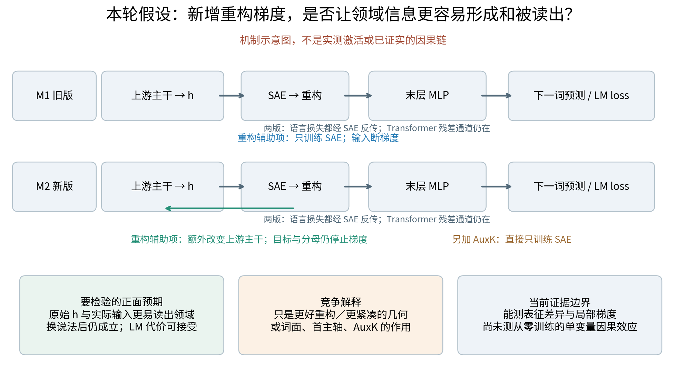
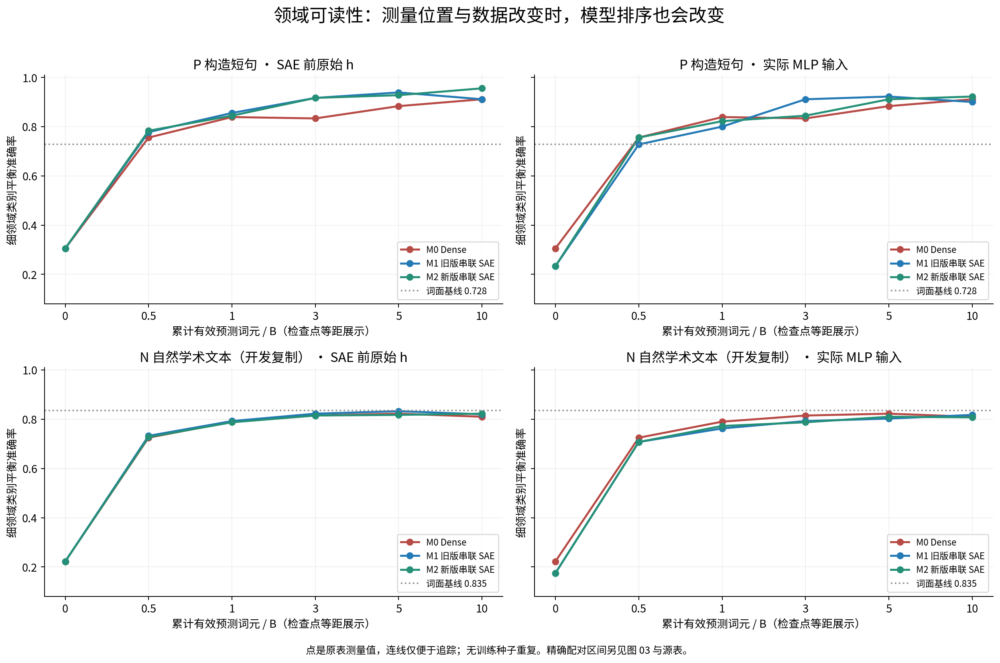
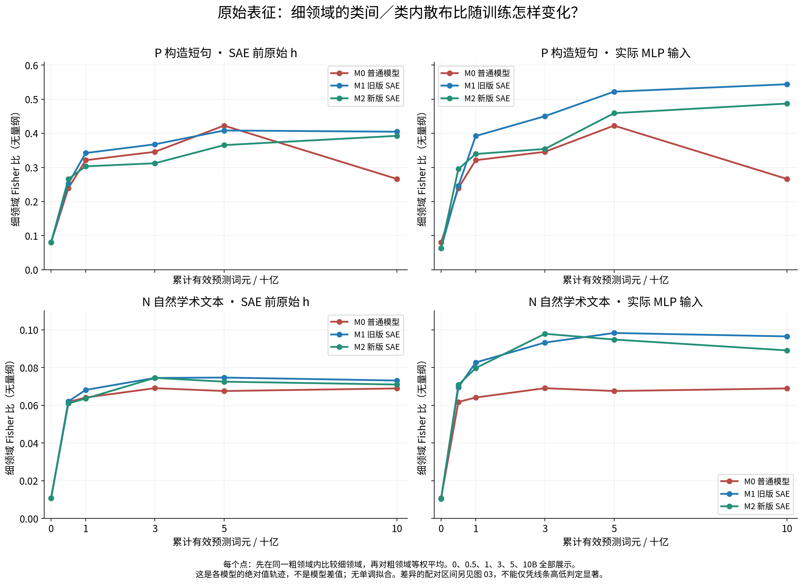
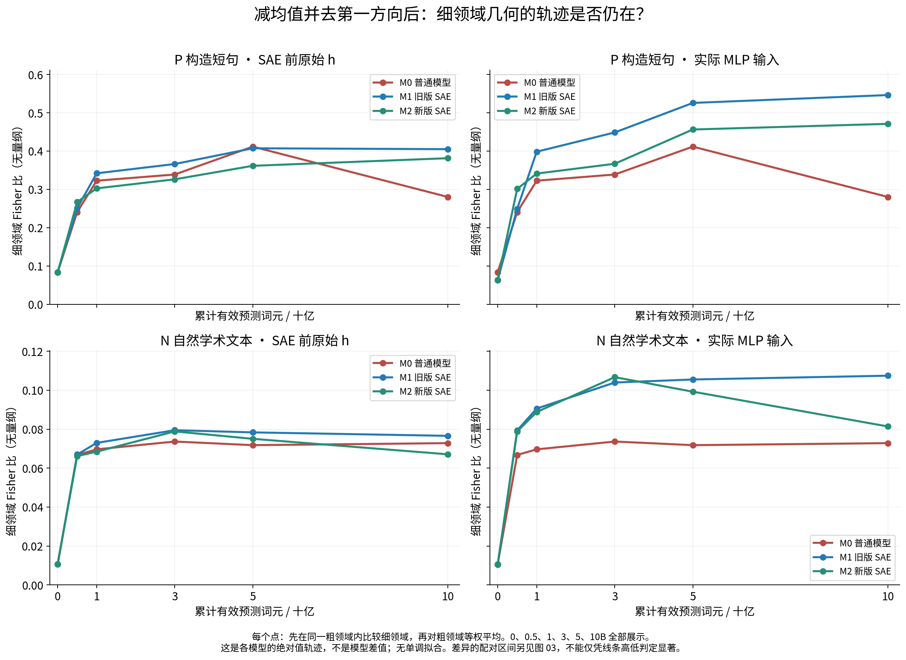
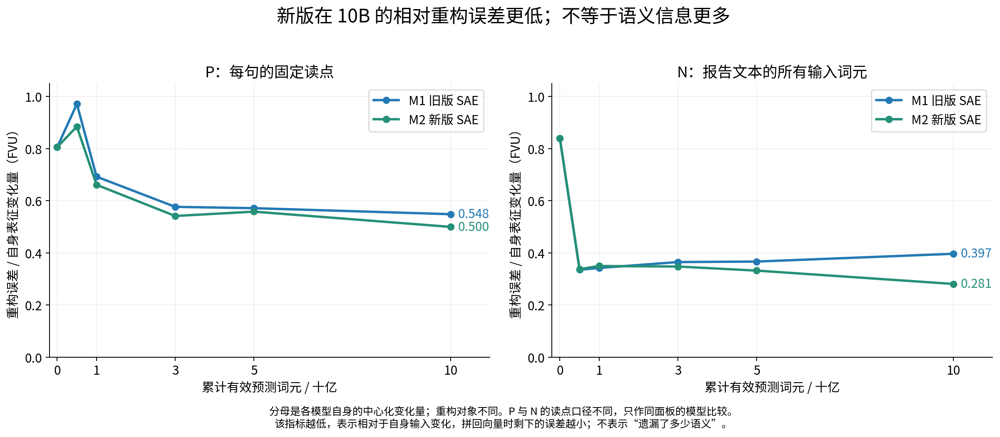
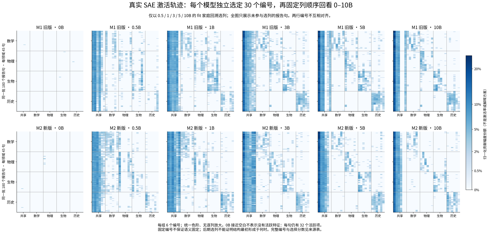
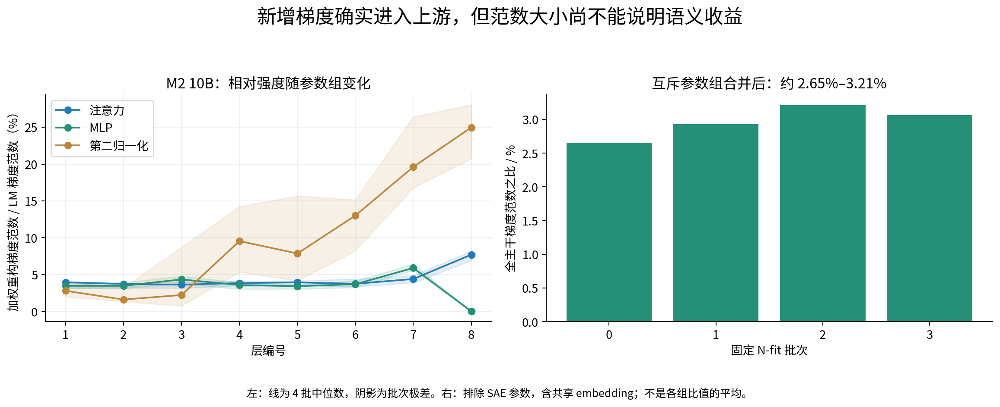
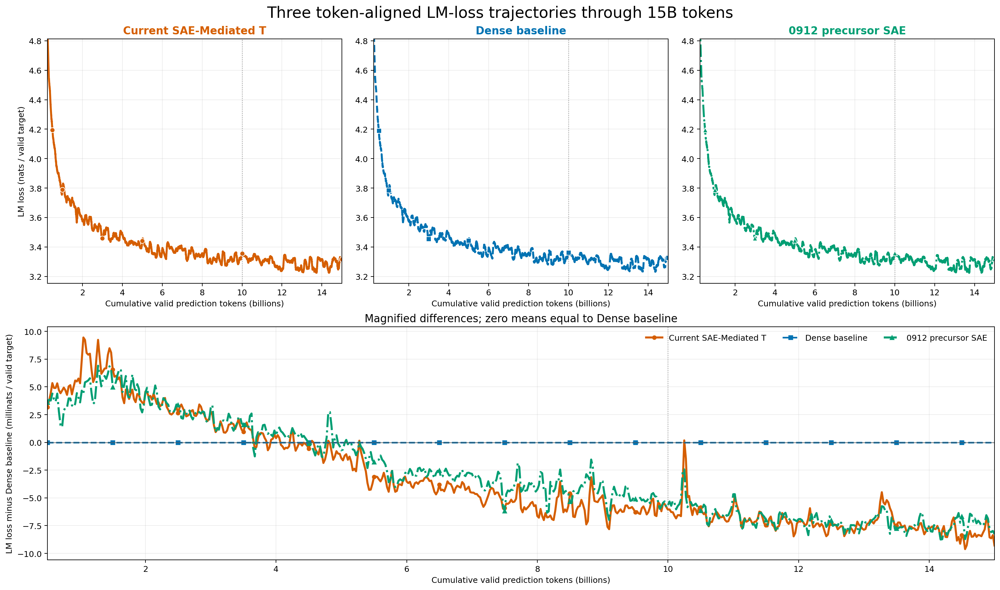

# 0916 组会：SAE 的重构梯度接通以后，领域表征真的更容易形成了吗？

状态：合格观察的组会解释稿，科学解释待研究者确认。2026-09-16 按研究者要求完善讲述；后续计划已[固定版本](sae_representation_followup/02_plan_freeze_20260916_cn.md)，本轮只完善报告与读取既有数据，不启动后继实验。

正式证据：[结果 Summary](../../Projects/from-attention-to-search/main/experiments/A15/15_17_three_model_sae_representation_trajectory/A15_17_E01_three_model_sae_representation_audit/summary_cn.md)、[完整 Detailed](../../Projects/from-attention-to-search/main/experiments/A15/15_17_three_model_sae_representation_trajectory/A15_17_E01_three_model_sae_representation_audit/detailed.md)。当前任务：[Focus](../0915/focus_three_model_sae_representation_audit.md)。数据、算法和后继细节：[解释与计划](sae_representation_followup/01_result_explanation_and_next_plan_cn.md)。

本次术语：普通模型 M0；旧版串联稀疏自编码器模型 M1；新版串联稀疏自编码器模型 M2。稀疏自编码器（SAE）用少数非零系数重构输入；原始 h 是 SAE 前向量，实际前馈网络（MLP）输入在 M1/M2 中是重构向量。类间／类内散布比（Fisher 比）测量指定类别的几何分离；相对重构误差（FVU）是平方重构误差除以自身表征的中心化变化量。P 指构造短句，N 指自然学术开发文本。

## 目的

判断语言模型从零预训练时形成的领域相关结构，是否会因 SAE 的额外重构梯度进入主干而更容易被读出，同时区分“主干表征改变”和“SAE 自己更会重构”。

## 假设

1. 固定内容、训练进度和读出规则后，领域信息随训练在原始表征及 SAE 激活中变得可辨认；如果新版正则化有额外帮助，新版应在对应测量对象上形成稳定优势，而不只是重构误差下降。
2. 如果优势不是单一共同方向造成的，它应在只用拟合集确定的去第一奇异方向分析后仍然保留。领域差异是主问题；同一命题换说法后是否复用特征是单独的次要问题。

图是待检验的机制示意，未把“更语义化”画成必然发生的结果。截图中的“线性读出和 Fisher 单调上升”是更强的附加预期；当前数据有回落，不支持逐点单调。保留上面两条核心假设，将“总体形成”与“每一步都上升”分开。它对应导师 0914 会议 03:30–04:12 的“辅助约束也要更新主干”，以及学长 08:41–09:23 要求同时报告原始表征、激活与重构的两层证据。

## 分析方法

- **模型与公平比较：**比较 Dense M0、旧版串联 SAE M1、新版串联 SAE M2 的 0 / 0.5 / 1 / 3 / 5 / 10B 快照。三者都是 8 层、隐藏维度 1,024；M1/M2 在最后一层 MLP 前接一个 30,000 维、Top-32 SAE。两版语言损失都经过 SAE；M1 额外重构分支只更新 SAE，M2 额外更新上游且另有 SAE-only AuxK。检查点采样、内容、读点、读出容量与统计流程匹配，但 M2−M1 是配置比较，不能纯归因于梯度开关。
- **数据与测量：**P 为数学、物理、生物、历史的 360 条构造短句，按命题家庭拆为 120 / 60 / 180 条拟合／调参／报告；N 为学术 M2D2 的 1,200 条自然文本，600 / 200 / 400 条拆分，作开发复制。先比较原始 \(h\) 和实际 MLP 输入的领域线性读出、细领域 Fisher 比及余弦关系，再看 SAE 贡献重合、重构和局部梯度。所有模型差值使用相同报告样本和 5,000 次配对重采样。
- **竞争解释检查：**Part A 原始结果与 Part B 中心化、直接去第一方向、中心化后去第一方向分开；所有变换仅在拟合集求得。真实激活轨迹在各模型自己的拟合样本上选固定编号，报告样本只展示、不选列；不把同号特征解释成跨模型同一语义。整个审计更新模型参数和活动缓存的次数均为零。

**训练背景只作资格交代。**本轮表征分析覆盖三个模型共同的0–10B快照。截图中的[训练损失图](figures/sae_representation_update/10_training_loss_15B_context.png)已找到源码与[元数据](figures/sae_representation_update/10_training_loss_15B_context.json)：它展示到15B，普通模型在10B后拼接续训日志，曲线为200更新尾部算术平均，差值图单位为千分之一自然对数单位/预测词元。这是训练日志的描述性背景，不是独立留出性能；不能用“曲线接近”证明无代价，也不能把表征结论延长到15B。该图沿用源图颜色：橙色新版、蓝色普通、绿色旧版，与下方表征图配色不同。

**实现检查放在背景，不作为主科学结论。**两版语言损失都通过SAE更新主干；M1的额外重构损失对主干为零，M2确有非零上游作用。10B四个固定批次合并互斥参数组后的重构/语言梯度范数比为2.65%–3.21%，[梯度图](figures/sae_representation_update/06_reconstruction_gradient_strength.png)说明接线与强度，不说明语义收益。

## 结论

按学长建议，依次回答四个不同对象的问题：**主干产生的表征 → SAE字典及其使用 → 参数与更新机制 → 语言模型性能。**这样可以把“读得到”“拼得回”“更新到了”“任务做得好”分开。以下是证据支持的汇报措辞草案，不把未测项补写成结论。

1. **表征空间本身：预训练后领域更容易读出，但新版没有稳定、普遍的额外优势。**

   本项先看完整原始向量h，不需要借助SAE系数来定义指标。“不依赖SAE读出”不等于“训练没有受SAE影响”。重构后的实际MLP输入另行标明：它是SAE处理过的表征，不能拿它的优势直接证明上游h更语义化。

   从0B到早期训练点，三模型的领域读出都明显提高。因此，语言预训练本身就在形成领域相关结构，SAE不是这种结构出现的必要条件。P上3B的实际MLP输入，旧版比普通模型高7.78个百分点，配对95%区间为[3.33,12.22]；同处新版比旧版低6.67点，区间为[−11.11,−2.22]。但10B的SAE前原始h，新版又比旧版高4.44点，[1.67,7.22]。N原始h的全部配对区间未分离。

   

   **怎么读：**先看每条曲线是否随训练总体提高，再看同一个小图里的模型差异。左列是上游产生的h，右列是MLP真正收到的输入。不要拿左上一个有利点去替代其他位置和面板。0B仍可保留词面线索，不能称完全没有语义相关信息。

   **对老师说：**“三种模型都能逐渐读出领域。加SAE会改变这个过程，但新版并没有在所有位置都更好；上游表征和重构后的实际输入，还会给出不同排序。”

   **完整表征的几何读法（h与重构后输入分列）：**

   Fisher比可理解为“不同小类相隔多远，除以每个小类内部有多散”。本图在同一个粗领域内部比较细领域，例如只在物理内部比较力学、光学、热力学，再对粗领域平均；避免仅仅数学和历史分开就叫细结构好。

   

   **怎么读：**横轴是真实累计训练词元，纵轴是每个模型自己的Fisher绝对值，不再只是模型差值。左列是原始h，右列是实际输入。P实际输入在10B为普通0.266、旧版0.544、新版0.487；旧版在1/3/5/10B高于普通模型，原有配对区间均不跨零。N实际输入也有配置差异，但后期存在平台或回落。尤其要注意：P中旧版与普通模型的差值到10B变大，部分来自普通模型从5B的0.423回落到0.266；旧版同期仅从0.522升到0.544。不能把差值扩大叙述成“旧版在后期突然形成更强的结构”。

   

   **去方向后怎样说：**P实际输入10B的三个值变为0.280、0.546、0.471。旧版相对普通模型的差异仍在，说明一根主导轴不足以解释它；不能说剩下的全是语义。精确配对区间仍以[原有差值图](figures/sae_representation_update/03_paired_geometry_and_readability.png)及源表为准，曲线高低本身不是显著性检验。

   **为什么不能写“单调形成”：**普通模型P实际输入从5B的0.423下降到10B的0.266；新版N原始h在3/5/10B为0.0745/0.0725/0.0710，也持续回落。准确说法是“相对初始化总体增强，后期出现平台、回落或模型分化”。这里只描述已测点，不把连接线当连续过程。

   **对老师说：**“同一大领域里面的小类别，训练后总体比初始化时更有组织；旧版重构后的输入在部分细类几何上更分明，去掉最大方向后仍能看到。但几何更分明不等于信息更多：也可能是类内变化被压缩了，所以要和领域读出一起看。”

   **本项还没测什么：**已有完整向量的线性读出、Fisher和余弦关系，以及二维投影图；没有以无标签聚类结果作为独立主检验，也没有证明模型因果使用这些领域差异。Fisher比值已有，类间与类内散布各自随训练如何变化尚未单独汇报。后者可用现有缓存补算，区分“类别中心更远”与“类内被压紧”，无需重跑模型。

2. **SAE字典及其使用：两版都有领域偏好，新版更容易重构自身输入；尚不能说它的字典更语义化。**

   学长说的“SAE基”，这里更准确地叫过完备字典：用30,000个方向描述1,024维输入，它们不是互相垂直的数学基。还要区分字典方向D与每句使用这些方向的系数z；热图显示的是使用模式，不直接显示字典方向如何旋转。

   SAE拿到向量h，用32个活跃字典项拼出重构向量。我们计算两者的平方误差，再除以该模型输入在样本间的中心化变化量，得到FVU；越低表示相对误差越小。

   

   | 10B，同一评价面板 | 旧版M1 | 新版M2 | 准确读法 |
   |---|---:|---:|---|
   | P 构造短句 | 0.5485 | 0.4998 | 以各自输入变化量为100单位，剩余重构平方误差约为54.85与49.98单位 |
   | N 自然学术文本 | 0.3966 | 0.2811 | 同一口径约为39.66与28.11单位；N按全部输入词元计算，不能直接与P的单读点横比 |

   **怎么读：**先在同一面板比较两条线，10B新版更低；不要把0.4998说成“丢失了49.98%的语义”。这是向量误差的比例，不是语义正确率。也不要求重构误差每步下降，P的早期曲线就先上升再下降。

   **一个关键补充：两模型重构的对象也变了。**10B的P原始h平均长度，旧版约48.97、新版约12.59；对应每读点平方重构误差约349.45与25.00，而中心化变化量也从637.15变为50.03。因此不能仅用绝对误差下降说SAE能力大幅提升。FVU已消除统一缩放的直接影响，但两个主干的内容结构仍可能有不同重构难度。

   **解释，而非已证实机制：**旧版重构项只要求字典适应主干给出的向量，主干仍受语言损失训练；新版的重构项还允许主干一起调整输入，让双方更容易配合。这可能提高重构适配，也可能使输入更简单；目前不能区分字典变好、输入更好重构、AuxK帮助等贡献。

   **对老师说：**“新版确实更容易把自己的表征拼回来。但这里是字典和表征一起适应，不是两个字典重构同一个固定对象的比赛。重构更准确，没有同时带来普遍更好的领域读出。”

   

   **怎么读：**同一行跨时期看同一批编号，共享项在多个领域使用，领域偏好项在相应领域更明显。展示180个未参与选列的报告句，列只用拟合数据回溯选择；两模型列编号不同，不做跨模型对应。颜色是贡献幅度份额，不是激活频率；0B白色只是后来选中的这30项少用。

   图支持“可以读到领域相关的使用模式”。它未覆盖全部30000项，也未证明编号的语义固定。命题加权重合间隔的12个模型/训练点区间均包含零，因此“同一事实换说法后仍特异地用同一组特征”尚未得到稳定支持，保留为次要问题。

   **对老师说：**“SAE能把一些领域差异显示成激活配方，而且两版都可以。我们还不能仅靠热图说新版的特征更有语义，特别是同义命题的复用，目前证据还不足。”

   **本项还没测什么：**尚未直接报告字典方向本身的变化、全字典的稳定语义命名及功能干预。现有编号热图与命题复用检验不能替代这些测量。跨模型feature ID映射仍暂缓；先补同一模型中固定编号的数值方向变化，也只能说明字典变动，不能自动说明语义变动。

3. **参数与更新机制：新增重构梯度确实进入上游，但参数究竟怎样变、这种更新是否有益，还没有直接答案。**

   “参数变化”要拆成两个问题。**参数数量**已经核实：普通模型281,431,040，两个SAE版本各342,902,064，均多61,471,024个；M2没有比M1再多一套参数。**训练后参数值怎样改变**尚未作层级对比。

   已测的是当前状态下损失对参数的局部梯度，即“这批数据现在想往哪里推”。M1额外重构项对主干为零；M2对上游非零。10B四批的全主干重构/语言梯度范数比为2.65%–3.21%。此比值合并互斥参数组计算，与原表跨批次、跨组比值中位数4.06%的口径不同。

   

   **怎么读：**图核实作用路径与相对强度。不能把3%的梯度范数读成3%的权重变化或3%的语义贡献；AdamW历史统计、裁剪、衰减和多步积累都会改变实际更新。共享embedding必须按同一物理参数去重，它可由输入端收到上游梯度，不能据此说重构项穿过了输出端。

   **本项还没测什么：**相对同一初始化的层级权重位移、M2与M1共同主干的权重差，以及同状态下有/无重构梯度造成的实际一步参数增量与报告样本效果。历史M2还多了AuxK，因此即使权重差很大，也不能归因于单一梯度开关。

   **对老师说：**“我们已经确认这条梯度确实接通了，但接通不等于有效。下一步要看它实际改了多少参数，以及这份额外更新是否改善独立样本的领域读出。”

4. **模型性能：已有训练损失轨迹，尚不能据此宣称语言能力更强或没有代价。**

   

   **怎么读：**上排是训练语言损失，下面放大相对普通模型的差值；数值较低表示在当时训练样本上的下一词预测损失较低。来源、平滑和15B范围见“分析方法”的训练背景说明。它不是三个冻结模型在同一留出文本上的评测，也没有训练种子重复。

   **本项还没测什么：**在同一固定文本上直接比较冻结模型的下一词预测损失；一般语言能力与下游任务；同等算力下的收益。当前有参数规模差异，历史硬件也不同，不能由词元对齐推导等算力优势。优先复用N-report做局部学术文本预测检查；这是开发数据上的限定结论，不能改称独立通用测试集。本轮不自动引入研究者先前排除的新DCLM留出集。

   **对老师说：**“目前训练损失没有显示出简单的巨大差距，但我们还没完成相同固定文本上的性能比较，所以暂时不说新版更强或完全无代价。”

**四点合起来的认识：**模型本身已经能形成可读的领域相关结构；SAE能显示其中一部分使用模式。新版相对重构误差更低，但表征读出没有普遍更好；新增梯度的局部路径已经确认，它如何通过实际参数更新带来语义收益仍待检验。

**为什么这样讲更好：**每一段都先确定对象再解释指标。Fisher回答空间怎样组织，激活/重构回答字典如何描述输入，梯度与权重回答训练怎样改变系统，语言损失回答任务代价。这四段共同检查一个机制，但它们本身不是已经成立的因果链。特别是“字典拼得准”不能代替“表征更语义”，“梯度非零”不能代替“模型性能有益”。

**最后90秒可以这样讲：**

> 我按四层汇报。第一，原始表征在预训练后越来越容易读出领域，但新版没有在各数据和位置上稳定胜出；旧版重构后输入的一些几何优势，去掉第一方向后仍存在。第二，两版SAE都有领域偏好，新版能更准确地重构自己的输入，但输入也在随训练改变，因此不能直接说字典更语义。第三，我们确认了新版重构梯度确实到达上游，尚未测清这条梯度造成的实际权重变化和收益。第四，目前有训练损失曲线，还没有相同固定文本上的完整性能结论。
>
> 所以这轮最明确的认识是：重构改善和语义读出改善没有同步。下一步保留已固定的同状态小步对比，直接检查额外梯度造成的更新是否有读出收益，同时补齐权重变化与局部语言代价。

**一个下一决策：**沿用[已固定G0/G1计划](sae_representation_followup/02_plan_freeze_20260916_cn.md)，在完成补测实现审查后决定是否批准该最小执行卡。其完成条件仍为同状态配对、主指标与局部LM代价齐全，并明确支持／不支持／不足；新增只读诊断与性能检查单列范围、成本，不覆盖原卡。[下一任务prompt与补测顺序](sae_representation_followup/03_next_gradient_and_missing_measurements_prompt_cn.md)已备好，本轮没有补跑GPU或更新模型。

图及数值来源：[详细解释](sae_representation_followup/01_result_explanation_and_next_plan_cn.md)、[图来源清单](figures/sae_representation_update/figure_manifest_clarity.json)及文首正式证据。跨检查点为描述性轨迹，不是独立种子重复；逐点区间不作全族显著性结论。
