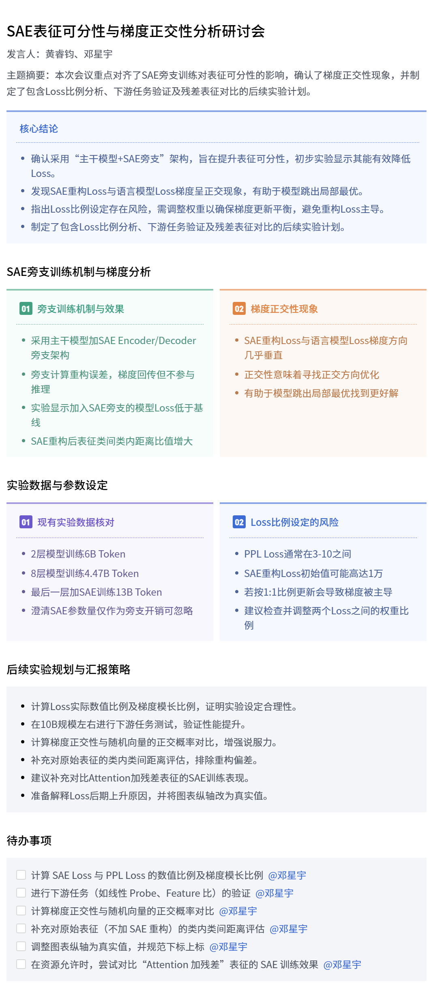

# SAE表征可分性与梯度正交性分析研讨会

---
### 一、SAE 旁支训练机制与梯度分析
针对 S 老师提出的“不使用残差表征”的需求，会议深入探讨了 SAE 作为旁支（Branch）的训练逻辑及其对主干模型的影响：
#### 1. 旁支训练机制与效果
- **旁支架构设计**：确认采用“主干模型 + SAE Encoder/Decoder 旁支”的架构。旁支仅用于计算重构误差，其梯度回传至主干模型，但不直接参与推理，旨在通过重构误差的正则化作用提升表征质量。
- **Loss 曲线表现**：当前实验数据显示，在训练后期，加入 SAE 旁支的模型 Loss 低于 Baseline，且所有层都加 SAE 重构 Loss 的版本（绿色曲线）效果最佳，表明该方法能有效降低 Loss。
- **表征可分性提升**：初步分析表明，SAE 重构后的表征在“类间距离/类内距离”的比值上有所增大，说明表征空间变得更加可分，符合预期目标。
#### 2. 梯度正交性现象
- **梯度方向分析**：通过分析梯度发现，SAE 重构 Loss 产生的梯度方向与语言模型 Loss 的梯度方向几乎垂直（正交）。
- **优化逻辑解释**：这种正交性意味着 SAE 的梯度并非直接优化 PPL Loss，而是在高维空间中寻找了一个正交方向，从而可能帮助模型跳出局部最优，找到更好的解。
### 二、实验数据与参数设定
会议对现有实验的细节进行了核对，并指出了潜在的参数设定问题：
#### 1. 现有实验数据核对
- **训练规模确认**：当前实验涉及 2 层模型训练了 6B Token，8 层模型训练了 4.47B Token，最后一层加 SAE 的训练了 13B Token。
- **参数量担忧澄清**：针对 SAE 参数量（约 60M）相对于主干模型（约 240M）较大的担忧，黄睿钧 指出 SAE 仅作为旁支，不直接接入模型计算，且随着模型规模增大，其相对开销可忽略不计。
#### 2. Loss 比例设定的风险
- **数值量级差异**：黄睿钧 指出 PPL Loss 通常在 3-10 之间，而 SAE 重构 Loss 初始值可能高达 1 万，若直接按 1:1 的比例更新，会导致梯度更新方向被重构 Loss 主导。
- **超参调整建议**：建议 邓星宇 检查并调整两个 Loss 之间的权重比例（Trade-off），确保梯度更新的平衡性。
### 三、后续实验规划与汇报策略
为确保汇报结论的严谨性，会议制定了详细的补充实验计划：
#### 1. 核心验证指标
- **Loss 与梯度比例**：需计算两个 Loss 的实际数值比例以及梯度模长的比例，以证明实验设定的合理性。
- **下游任务验证**：建议在 10B 规模左右进行下游任务测试，以验证 Loss 降低是否确实转化为性能提升。
- **随机性对比**：计算当前梯度正交性与随机向量的正交概率进行对比，以增强结论的说服力。
#### 2. 表征分析维度
- **原始表征评估**：目前的评估基于重构后的表征，需补充对原始表征（不加 SAE 重构）的类内类间距离评估，以排除重构过程带来的偏差。
- **残差表征对比**：虽然当前实验基于 Attention 不加残差的表征，但建议在资源允许时，补充对比“Attention 加残差”的表征在 SAE 训练上的表现，探索不同表征信息量的影响。
#### 3. 汇报策略
- **应对 Loss 上升**：若汇报时出现 Loss 后期上升的情况，需准备解释原因（如梯度正交性导致的震荡），而非单纯否定结果。
- **图表规范**：要求将图表纵轴改为真实值，并规范下标上标，避免歧义。
---
### 四、待办事项
- 计算 SAE Loss 与 PPL Loss 的数值比例及梯度模长比例。 **@邓星宇**
- 进行下游任务（如线性 Probe、Feature 比）的验证。 **@邓星宇**
- 计算梯度正交性与随机向量的正交概率对比。 **@邓星宇**
- 补充对原始表征（不加 SAE 重构）的类内类间距离评估。 **@邓星宇**
- 调整图表纵轴为真实值，并规范下标上标。 **@邓星宇**
- 在资源允许时，尝试对比“Attention 加残差”表征的 SAE 训练效果。 **@邓星宇**

| 模型 | \(\rho\) | 余弦 \(c\) | 夹角 | \(|c|/\)随机阈值 | 符号翻转检验中位 \(p\) 值 |
|---|---:|---:|---:|---:|---:|
| 各向同性随机向量 | — | 约 \(0\) | \(89.9933^\circ\sim90.0067^\circ\) | \(\le1\) | — |
| S7：最后一层旁支 | 0.03538 | +0.01348 | \(89.227^\circ\) | 115.4 | \(7.4\times10^{-17}\) |
| S37：两层旁支 | 0.03056 | +0.00595 | \(89.659^\circ\) | 51.0 | \(8.1\times10^{-10}\) |
| SALL：八层旁支 | 0.01240 | +0.01208 | \(89.308^\circ\) | 103.4 | \(5.6\times10^{-8}\) |