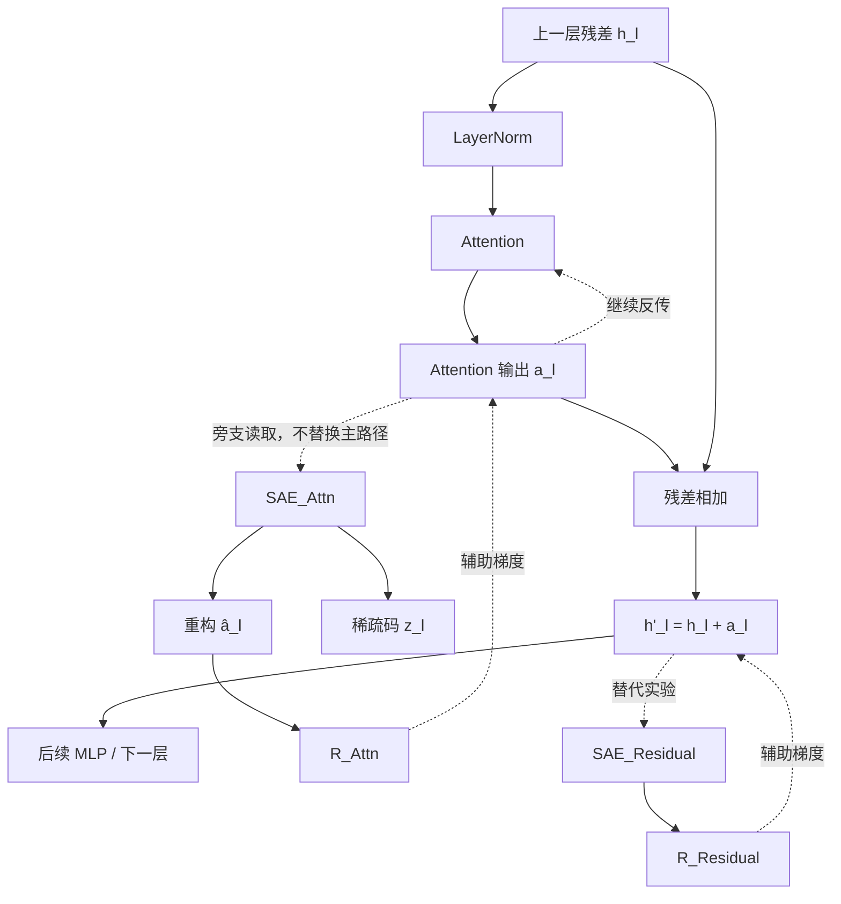

# 面向“可写、可读、可调用、可修改”语义表征的 SAE 正则化研究报告

## 执行摘要

**结论先行：这个研究问题是成立的，而且具有比“SAE 让表征更可分”更强的研究价值；但现阶段证据只足以支持“SAE 可以帮助把已有表示重新分解成稀疏、较可解释的成分”，还不足以证明“把 SAE 作为训练正则反传到主干后，模型会主动形成可复用共享语义＋条件性细节的内部写入机制”。** MP-SAE 已证明，层级概念不一定服从普通 SAE 所假设的“所有概念都能一次线性读出”，通过残差驱动的逐步分解可以恢复普通 SAE 遗漏的层级、非线性和跨模态共享结构；Matryoshka-SAE 则证明，普通稀疏目标会把抽象概念拆碎或吸收到更具体特征里，而“嵌套字典＋多尺度重构”能同时保留一般概念和具体概念。两者恰好分别对应你们问题中的**“共享部分不能丢”**和**“条件性新增部分要单独显现”**。citeturn20view0turn20view1

对于你们当前的八层模型，我建议第一阶段**不要立即发明复杂的 MP-SAE×Matryoshka-SAE 混合结构**。先把导师提出的核心因果假设做干净：在**第八层和第四层的注意力输出、加残差之前**各接一个独立 SAE 旁支；主前向路径仍使用原 Attention 输出，不把重构送回主路径；SAE 正则梯度反传主干。第八层单 SAE、第四＋第八层双 SAE、与双层辅助梯度强度匹配的“第八层强正则”必须构成最小对照。导师在会议中明确要求“最后一层＋中间一层”，并进一步明确目标是约束“每一层新增的信息”，因此取点为**尚未加 Residual 的 Attention 输出**。fileciteturn0file0

你们现在的结果——**SAE 重构后类间/类内方差比提高，但原始线性 Probe 基本不升**——应当谨慎解释为：**SAE 很可能首先在做几何整理、压噪或投影，而不是已经证明主干产生了更强的语义表示。**真正的关键证据必须出现在 SAE 重构之前的原始 Attention 输出、后续 Residual Stream，以及功能测试上。如果旁支去掉后，固定留出集语言模型交叉熵仍显著下降，就基本排除了“推理时多了 SAE 参数所以容量变大”这个解释；但仍需排除“只是额外辅助损失带来的普通正则效应”，因此还需要等参数/等梯度强度的密集自编码器或单层强正则对照。

更有研究潜力的第二阶段可以把命题正式化为一种**“可写层级稀疏表征”**：

\[
\Delta h_\ell
\approx
D_{\mathrm{shared}}z_{\mathrm{shared}}
+
D_{\mathrm{cond}}z_{\mathrm{cond}},
\]

其中共享分量描述跨任务、跨领域可以反复利用的语义基础，条件分量只解释在共享成分之后仍未被说明的上下文/领域/实例差异。Matryoshka 的嵌套重构可负责“共享概念不能被具体概念吞掉”，MP-SAE 的 residual-guided inference 可负责“在已解释共享成分之后，再读取条件残差”。这比简单追求聚类更 fundamentally 对应导师所说的未来系统：**一个小模型持续学习新知识时，不重新破坏已有共享语义，而主要把新增知识写到局部、可读取、可交换的结构中，最终可以和可插拔专家机制连接起来。** DEMix、AdapterFusion 与 Crosscoder 已分别证明参数模块可以添加/组合、以及模型间确实能够观察到 shared/model-specific features，但目前没有这些工作直接证明“SAE 正则化 Attention 写入即可产生这种持续学习机制”；这正是你们可以填补的证据缺口。citeturn16search1turn16search0turn14search0

## 研究命题与可行性分析

你们真正值得研究的命题，不宜再写成：

> “SAE 能否让不同 domain 的表示更加分开？”

这个命题太弱，而且甚至可能奖励错误的东西——有共享语义的领域本来就**不应该**被彻底分开。

更准确的命题应当是：

> **能否通过对 Transformer 的增量写入施加稀疏、层级化的结构约束，使模型把跨上下文可复用的语义因素保持为稳定共享成分，同时把依赖具体上下文、领域或任务的新增信息表示成稀疏、局部、可单独读取与修改的条件成分？**

可以把它压缩成四个要求：

\[
\boxed{
\text{Reusable}
+
\text{Readable}
+
\text{Callable}
+
\text{Editable}
}
\]

即**可复用、可读取、可调用、可修改**。

经典稀疏编码的基本出发点，就是用少量活跃基向量解释输入：

\[
x\approx Dz,\qquad \|z\|_0\ll \dim(z).
\]

Olshausen 与 Field 早在 1996 年就发现，对自然图像施加稀疏编码会自发学习出局部、方向选择和频带选择的基函数，说明“重构＋稀疏”确实有能力从复杂观测中恢复重复使用的统计成分。citeturn17search0 Cunningham 等把同一思想应用到语言模型激活，发现 SAE 特征比单神经元更单义、可解释，并能够更细粒度地定位间接宾语识别任务中的因果成分。citeturn17academia13

但是这里必须区分两个完全不同的问题：

\[
\text{“从固定表示中读出结构”}
\quad\neq\quad
\text{“训练模型主动形成这种结构”}.
\]

目前绝大多数 SAE 工作研究的是左边。你们要研究的是右边。MP-SAE、Matryoshka-SAE、Universal SAE、Attention-output SAE 等大多固定被解释模型，只训练解释器；相比之下，Low-Rank Adapting Models for SAEs 已经给出一个重要先例：可以反过来调整语言模型，使其更适配一个已有 SAE，作者在 Gemma-2-2B 和 Llama-3.2-1B 上报告，SAE 插入后的交叉熵损失缺口可以缩小 30%–55%，说明“改变主干以适应稀疏分解”并不是不合理的方向。citeturn20view4

### 这个想法成立需要哪些假设

| 假设 | 具体含义 | 如何证伪 |
|---|---|---|
| 稀疏可分解假设 | 模型写入由少量重复使用的因素组合，而不是完全分布式、不可分解结构 | SAE 重构可以好，但稀疏特征始终没有语义一致性或因果效果 |
| 共享因素假设 | 不同领域存在真正共同的语义因素，而不仅是词频、标点和模板 | 去掉 lexical/syntactic confound 后共享特征消失 |
| 条件残差假设 | 具体领域差异可以在共享部分之后由较局部残差解释 | 条件信息仍必须重写大量共享特征 |
| 正则可塑形假设 | SAE 辅助梯度能改变 backbone，而不仅仅让 SAE 自己适应 backbone | 原始表示、下游和持续学习指标均不变，仅重构变好 |
| 稀疏性≈可解释性的近似假设 | 更稀疏的表示平均更容易形成可识别因素 | 更稀疏后出现 feature composition、splitting、absorption |
| 局部写入假设 | Attention 输出是一个有意义的“增量写入”对象 | 只有 Residual/MLP 输出上正则有效，Attention 正则无效 |

最后两个假设尤其需要谨慎。Matryoshka-SAE 明确指出，**稀疏并不天然等于语义正确**：稀疏目标为了少用几个 latent，可能把一般概念拆分、吸收或者组成联合特征。citeturn22view0 MP-SAE 更进一步指出，并不是所有有意义特征都满足一次线性读出假设；层级、非线性甚至多维结构可能超出标准 SAE 的建模能力。citeturn24view0

### 你们目前结果应该如何解释

你们当前观察到：

\[
\frac{\text{类间方差}}{\text{类内方差}}
\uparrow
\]

主要发生在 SAE 重构表示上，而线性 Probe 基本不提升。

**目前最保守、也是最严谨的解释是：SAE 重构产生了更规整的几何结构，但尚未证明新增了模型可以利用的语义信息。**

考虑

\[
h=(s,n),
\]

其中 \(s\) 是已有类别信号，\(n\) 是类别无关噪声。如果 SAE 得到

\[
\hat h=(s,0.2n),
\]

那么类内方差明显下降，Fisher 类指标会上升；但类别信息 \(s\) 一点没有增加，所以线性 Probe 不必上升。

因此你们之后必须同时报告：

\[
J_{\rm Fisher}(a_\ell),\quad
J_{\rm Fisher}(h_\ell),\quad
J_{\rm Fisher}(\hat a_\ell),\quad
J_{\rm Fisher}(z_\ell),
\]

而不能只报告 \(\hat a_\ell\)。

其中建议使用：

\[
J=
\frac{\operatorname{tr}(S_B)}
{\operatorname{tr}(S_W)+\epsilon}.
\]

真正有力的结果应是：

> **SAE 重构变好只是必要的中间证据；原始主干表示、跨域迁移以及功能性干预也同步变好，才支持“模型自身被塑形”。**

## 现有研究与证据版图

首先有两个非常重要的判断。**MP-SAE 是 NeurIPS 2025 Main Conference 正式论文；Matryoshka-SAE 是 ICML 2025 正式论文。**因此它们各自在“SAE 应如何恢复层级表征”这一问题上的证据成熟度较高；但二者都没有直接验证你们现在提出的“预训练时把 SAE 正则反传到主干，改善持续学习写入结构”这一更强命题。citeturn20view0turn20view1

### 核心工作的横向比较

| 工作 | 方法类别 | SAE/约束是否反传主干 | 主要评测 | 是否证明可迁移/可插拔 | 与你们最相关的结论 |
|---|---|---:|---|---|---|
| Olshausen & Field 1996 | 稀疏编码/字典学习 | 不适用 | 自然图像基函数 | 否 | 稀疏重构可从数据统计中恢复重复因素 citeturn17search0 |
| Cunningham et al. 2023 | 标准 SAE | 否 | LM 特征解释、IOI 因果分析 | 有限 | SAE 能比神经元得到更单义的因果特征 citeturn17academia13 |
| Attention Output SAE 2024 | Attention 输出 SAE | 否 | GPT-2 等，Attention feature/circuit | 否 | Attention 输出确实可被 SAE 分解为长程、短程、归纳等因素 citeturn17academia14 |
| Matryoshka-SAE 2025 | 层级 SAE | 否 | Gemma-2-2B、TinyStories、SAE Bench | 编辑证据，有 | 保护抽象父特征，减少 absorption/splitting citeturn22view0 |
| MP-SAE 2025 | 序列残差式 SAE | 否 | 合成层级、视觉、多模态 | 有共享结构证据 | 条件残差式读取适合层级和非线性因素 citeturn24view0 |
| Universal SAE 2025 | 多模型共享 SAE | 否 | 多视觉模型 | 跨模型对齐：是 | 一个共享字典可以捕获跨模型共因子 citeturn20view3 |
| Jacobian SAE 2025 | 计算稀疏化 SAE | 否 | LLM activation + Jacobian | 否 | 只稀疏 activation 不足以保证计算本身局部 citeturn20view2 |
| Low-Rank Adapting Models for SAEs 2025 | 围绕 SAE 调整主干 | **是** | Gemma/Llama | 多 SAE：有 | 直接调整主模型以适配 SAE 是可行的 citeturn20view4 |
| Scaling Sparse Feature Circuits 2025 | SAE 因果电路 | 否 | Gemma-1 2B ICL | 功能调用：有 | 稀疏特征可形成因果 task vector citeturn15search1 |
| Domain Separation Networks 2016 | shared/private 表征 | 是 | 域适应 | 域迁移：是 | 显式 shared/private 分解本身已有成功先例 citeturn16search2 |
| AdapterFusion 2021 | 可插拔 Adapter | 是 | 16 个 NLU 任务 | **是** | 可先学局部知识模块，再非破坏组合 citeturn16search0 |
| DEMix 2022 | 域专家模块 | 是 | ≤1.3B LM，多域 LM | **是** | Expert 可以新增、移除、混合而少忘旧域 citeturn16search1 |
| Sparse Crosscoder 2024 | 多空间共享稀疏字典 | 否 | 层间/模型 diffing | 观察性：是 | 能显式得到 shared / model-specific / newly-computed feature citeturn14search0 |

下面给出最值得仔细读的工作的**摘要意译**与研究意义。为避免把论文摘要机械直译成大段版权文本，以下均为忠实的中文意译。

**MP-SAE — *From Flat to Hierarchical: Extracting Sparse Representations with Matching Pursuit*.**  
摘要意译：传统 SAE 假设可解释特征可以作为近似正交、线性可访问方向存在，但真实神经表示还表现出层级、非线性及多维结构。作者把经典匹配追踪算法展开成残差驱动的序列 SAE，每一步根据当前未解释残差选取特征。合成与真实数据表明，层级概念可以形成“条件正交”结构，标准 SAE 难以忠实恢复，而 MP-SAE 能找到更有意义的层级及跨模态共享结构，同时支持推理时自适应稀疏度。citeturn20view0turn24view0

它最核心的方法不是“更强的 Top-K”，而是：

\[
r^{(0)}=x,
\]

第 \(t\) 步选择

\[
j_t=\arg\max_jD_j^\top r^{(t)},
\]

解释一部分：

\[
\hat x^{(t+1)}
=
\hat x^{(t)}
+
(D_{j_t}^{\top}r^{(t)})D_{j_t},
\]

然后：

\[
r^{(t+1)}
=
r^{(t)}
-
(D_{j_t}^{\top}r^{(t)})D_{j_t}.
\]

因此后面的 feature 描述的是：

> **“在前面的因素已经解释之后，还剩什么？”**

这和你们的“共享部分之后剩下条件性差异”具有很强的结构对应关系。论文在合成层级结构以及 CLIP、DINOv2 等真实表示上验证 MP-SAE，并指出 fixed-\(k\) 方法在测试稀疏度变化时可能退化，而 MP 的逐步重构具有单调改善和自适应停止的性质。citeturn24view0

局限是：MP-SAE 主要回答**如何读一个固定表示**，没有证明把 MP objective 反向作用到 backbone 后，模型会自然形成更好持续学习结构；而且 Matching Pursuit 的序列推理比一次 Top-K 更贵。

**Matryoshka-SAE — *Learning Multi-Level Features with Matryoshka Sparse Autoencoders*.**  
摘要意译：随着 SAE 字典变大，稀疏目标会诱导抽象概念被拆成大量更具体的 latent，甚至让具体 latent 吞掉父概念的一部分。作者同时训练多个嵌套大小的字典，使较小前缀必须独立完成重构，从而迫使早期 latent 学一般概念，后面的 latent 补充细节。Gemma-2-2B、TinyStories 和合成实验显示，它降低 feature absorption、改善 sparse probing 与定向概念消除，但重构误差有轻微代价。citeturn20view1turn22view0

其核心目标为：

\[
\mathcal L_{\rm Mat}
=
\sum_{m\in\mathcal M}
\left\|
x-D_{1:m}z_{1:m}
\right\|_2^2
+
\alpha\mathcal L_{\rm aux}.
\]

在 Gemma-2-2B 实验中，作者使用 \(65\,536\) 个 latent，嵌套规模为 \(2048,6144,14336,30720,65536\)，在第 12 层 residual stream 上使用 The Pile 的 5 亿 tokens 训练，并测试平均 \(L_0=20,40,80,160,320\)。当 \(L_0=40\) 时，Matryoshka 解释约 70% 表征方差，而 BatchTopK 约 72%；即重构略差，但下游交叉熵在较大 \(L_0\) 下仍可比较，同时 feature absorption 明显降低。citeturn22view0

对你们而言最重要的是：

> **“共享父概念＋具体子概念”不能只靠普通 sparsity 自动出现，必须设计避免具体特征吞掉共享特征的结构性约束。**

**Sparse Autoencoders Find Highly Interpretable Features in Language Models.**  
摘要意译：神经元经常是多义的，一个可能同时响应多个不相关语义。作者从 superposition 假设出发，用过完备 SAE 分解语言模型激活，得到比神经元和其他基线更单义、可解释的方向，并能更精细地定位 IOI 行为的因果成分。citeturn17academia13

它奠定了现代语言模型 SAE 的基本故事，但其“feature = 一个线性方向”恰恰是 MP-SAE 后来要放松的假设。

**Interpreting Attention Layer Outputs with Sparse Autoencoders.**  
摘要意译：作者不再只研究 MLP 或 residual stream，而是直接在 Attention layer output 上训练 SAE；在多个 Transformer 家族、最大约 2B 模型上观察到稀疏且可解释的分解，包括长程上下文、短程上下文和 induction 等 feature，还使用 IOI circuit 验证这些特征对应有因果意义的中间变量。citeturn17academia14

这篇工作对导师提出的取点非常重要：**“Attention output 可以成为有语义意义的 SAE 分解对象”已有独立实验证据。**但要注意，2025 年进一步的工作发现 Attention output 常集中在较低维子空间；约 60% 的方向即可解释 99% 方差，这会导致随机初始化的大型 SAE 出现大量 dead feature，作者的子空间约束初始化把一个百万 latent Attention-output SAE 的 dead feature 比例从约 87% 降到 1% 以下。citeturn17academia12

所以导师的选点**可信，但不是无条件简单好训**。

**Universal Sparse Autoencoders.**  
摘要意译：作者不是为每个网络训练完全独立的 SAE，而是让一个过完备 SAE 同时读取多个预训练模型、并重构不同模型的内部激活，使共享字典学习跨模型的共同变化因素。在视觉模型上发现从颜色、纹理到部件和对象的跨模型通用概念。citeturn20view3

它支持你们研究里的“真正共享字典不是不可能”的前提。但这篇论文研究的是不同固定模型之间的概念对齐，不代表八层模型不同层应该立即共享同一字典。因此**第一轮仍建议每层独立 SAE**。

**Sparse Crosscoders for Cross-Layer Features and Model Diffing.**  
这是与“共享＋新增差异”最接近的观察性证据之一。Crosscoder 同时读取/重构多个 activation space。Anthropic 在 base/fine-tuned 模型之间观察到三类 latent：base-specific、fine-tuned-specific 和 shared feature；还构造 pre/post-MLP Crosscoder，观察到 pre-only、shared、post-only，即后者可以被解释为“newly computed”特征。citeturn14search0turn14search1

但作者非常明确地把 2024 工作称为**preliminary research update**，而不是完整论文；后续工作还指出 L1 objective 可能把本来共享的概念错误判成 model-exclusive，因此它提供的是极有启发性的结构证据，不应当作为“共享/新增已经彻底解决”的定论。citeturn14search3turn14academia26

这恰好提醒你们：

> **共享/条件性不能通过 feature ID 或 decoder norm 一项指标直接定义，必须结合激活、语义、跨域泛化和因果验证。**

**Jacobian Sparse Autoencoders.**  
摘要意译：普通 SAE 只要求 activation 稀疏，不能保证 Transformer 实际执行的“计算关系”也是稀疏的。JSAE 同时稀疏输入、输出和连接二者的雅可比矩阵，在保持与标准 SAE 近似下游性能的同时获得明显计算稀疏性。citeturn20view2

它给你们一个非常重要的警告：**Readable representation 并不自动等于 Local computation。**

如果最终目标是“局部修改一个 conditional feature，只影响一个局部功能”，后续很可能要增加 Jacobian/causal locality 指标，而不能停留在 activation heatmap。

**Scaling Sparse Feature Circuits for Studying In-Context Learning.**  
作者在 Gemma-1 2B 上识别了编码“当前该执行哪个任务”的 SAE feature，并证明对应 latent vector 可以因果地诱导任务行为；task vector 也可以近似成少量 SAE latent 的稀疏和。citeturn15search1

这是“可读”进一步走向**可调用**的重要证据：一个 SAE feature 如果只是在图上可解释还不够；能够激活/抑制并对应功能变化，才更接近你们最终目标。

**Domain Separation Networks.**  
摘要意译：传统域适应往往只追求 domain-invariant representation，从而忽略每个领域独有的信息。作者显式把表示拆成 shared 与 domain-private 两部分，同时使用任务、重构及解耦目标，使模型既保留跨域共性，又保留各域特性，并在多个无监督视觉域适应任务上超过当时基线。citeturn16search2

这篇论文说明：

\[
h=h_{\rm shared}+h_{\rm private}
\]

这个研究哲学并不新；**你们真正可能新的地方是把 shared/private 思想搬到 Transformer 的“写入增量”上，并用稀疏层级结构连接解释性、持续学习和模块化更新。**

**DEMix Layers.**  
摘要意译：DEMix 为不同领域训练独立前馈专家，使语言模型模块化；专家在初始训练后仍可混合、新增或删除。作者在最大约 1.3B 的自回归 Transformer 上观察到更低困惑度、更快域适应，而且可以增加新 domain expert 而不必遗忘旧 expert。citeturn16search1

**AdapterFusion.**  
摘要意译：作者先分别把各任务知识写入小型 adapter，再训练独立的 fusion 模块组合这些已经学到的知识，从而避免不断全模型微调造成的灾难性遗忘；在 16 个 NLU 任务上优于常规 full fine-tuning 和 multi-task baselines。citeturn16search0

这两篇回答的是导师故事的“后半段”：**知识最终如何变成可添加、交换和组合的小模块。**

目前最大的研究空白恰恰位于二者之间：

\[
\boxed{
\text{语义可读的 sparse feature}
\;\longrightarrow\;
\text{局部可写的参数/专家模块}
}
\]

现有文献还没有把这条链完整闭合。

## SAE 原理与“模型写入”的数学解释

现代 SAE 本质上仍然延续经典的稀疏字典学习。给定隐藏表示：

\[
x\in\mathbb R^d,
\]

学习一个比原空间更大的字典：

\[
D\in\mathbb R^{d\times m},
\qquad m\gg d,
\]

编码得到：

\[
z=\sigma(W_{\rm enc}x+b_{\rm enc}),
\]

然后：

\[
\hat x=Dz+b_{\rm dec}.
\]

训练目标通常可以抽象为：

\[
\mathcal L_{\rm SAE}
=
\underbrace{
\frac{\|x-\hat x\|_2^2}
{\operatorname{Var}(x)+\epsilon}
}_{\text{信息保留}}
+
\beta
\underbrace{\Omega(z)}_{\text{稀疏约束}}.
\]

这里“过完备”——即 \(m>d\)——并不意味着模型真的多获得了语义容量；它只是给解释器很多候选方向，而 sparsity 要求每个样本只使用其中少量方向。经典稀疏编码能够得到有结构的基函数，现代 SAE 则希望这种字典原子对应神经网络中的“概念因素”。citeturn17search0turn17academia13

### 为什么稀疏＋重构可能产生更可读因素

假设真实 representation 是：

\[
x=
s_{\rm language}
+s_{\rm syntax}
+s_{\rm topic}
+s_{\rm entity}
+s_{\rm context}
+\epsilon .
\]

只优化 PCA 一类二阶重构并不要求这些因素独立出现；而稀疏编码要求单个输入只能激活少量原子，因此如果“数学公式”“女性名字”“Python 代码”“疑问句”等统计因素会在很多样本中重复出现，给这些因素分配可复用字典原子可能比每次使用大量混合方向更经济。

但这一论证只有在数据生成结构符合稀疏组合假设时成立。Matryoshka 和 MP-SAE 证明，真实层级结构会破坏过于简单的 flat sparse coding 假设。citeturn22view0turn24view0

### Attention 输出为什么比 Residual 更符合你们的“写入”问题

对 Pre-Norm Transformer，可写成：

\[
a_\ell
=
W_O\,\operatorname{Attn}
\bigl(
\operatorname{LN}(h_\ell)
\bigr),
\]

随后：

\[
h'_\ell=h_\ell+a_\ell.
\]

这里：

- \(h_\ell\)：进入这一子层前已经存在的 Residual 状态；
- \(a_\ell\)：Attention 本次向 Residual Stream 写入的增量；
- \(h'_\ell\)：旧状态与新写入相加之后的累计状态。

所以如果研究问题是：

> **“这一层新写进去了什么？”**

那么 \(a_\ell\) 比 \(h'_\ell\) 更接近目标。

这正是导师在会议最后给出的理由：“要编码每一层新增的信息，因此 SAE 应放在尚未加上 Residual 的 Attention 输出处。”fileciteturn0file0 而 Attention-output SAE 的已有工作又证明，这个位置确实存在可以通过 SAE 提取、并具有因果意义的 feature。citeturn17academia14

但必须加一个限定：

> **Attention output 不是“该层全部新增语义”。**

Transformer 的 MLP 子层随后也会再向 Residual Stream 写一次。因此你们当前实验严格研究的是：

\[
\text{attention-mediated write}
\]

而不是全部 layer write。

这是论文写作时必须准确表述的地方。

### Attention SAE 与 Residual SAE 的数据流和梯度流



两种正则的差别非常本质：

\[
R_{\rm attn}(a_\ell)
\]

直接约束本次写入，而

\[
R_{\rm residual}(h_\ell+a_\ell)
\]

约束的是已经积累了前面层信息的状态。

因此，对你们的主命题，Attention output 是**更干净的因果实验对象**；Residual stream 应作为重要 ablation，而不是主设计。

### 常见实现陷阱

首先是**字典过大**。字典越大并不保证概念越完整，Matryoshka 已观察到 feature splitting/absorption 随规模加剧。citeturn22view0

其次是**过稀疏**。如果真实一个 token 需要几十个潜在因素解释，却人为要求 \(K=4\)，SAE 就会把多个因素合并；反过来 \(K\) 太大，又会得到冗余或难解释 feature。

再次是 Attention output 的**低秩子空间问题**。大字典随机初始化可能导致大量 latent 永远碰不到真实 activation manifold。citeturn17academia12

最后是你们已经讨论过的**Feature ID 不等于 Feature identity**。不同 SAE 独立训练后存在置换对称性，feature 17 并没有天然理由对应另一个 SAE 的 feature 17。甚至 ICML 2025 的 Archetypal SAE 工作指出，即使模型和训练数据很相似，普通 SAE 得到的字典也可能明显不稳定。citeturn15search12 因此只有在**同一个 SAE 连续训练、未重新初始化/重排**时，feature ID 才能被合理地当作“参数轨迹 ID”，但仍不能自动当作恒定的“语义身份”。这也与前一次会议中学长对你们实验提出的问题完全一致。fileciteturn0file1

## 面向八层模型的架构与正则化方案

### 层位选择

我的首选是：

\[
\boxed{\ell=4,\quad \ell=8}
\]

若代码从零编号，则对应：

\[
\boxed{3,\quad 7}.
\]

第八层负责最终高层写入，第4层代表中部表征阶段；最重要的是它满足导师要求的**“最后一层＋真正的中间层，而不是最后两个相邻层”**。fileciteturn0file0

现阶段不要为了“找最佳层”同时跑 2/3/4/5/6/7。这样既增加搜索自由度，也会让结果容易过拟合。第一轮固定 4+8；等正效应确认后再做：

\[
\{2,8\},\{4,8\},\{6,8\}
\]

的深度消融。

两个 SAE **第一阶段应独立参数化**：

\[
D_4\neq D_8.
\]

因为两层激活尺度、有效秩和语义成熟度可能完全不同。Universal SAE 表明跨模型共享字典是可能的，但这不能作为你们直接共享跨层 dictionary 的理由。citeturn20view3

### 主路径设计

我强烈建议正式实验使用：

\[
h'_\ell=h_\ell+a_\ell,
\]

而不是：

\[
h'_\ell=h_\ell+\hat a_\ell.
\]

SAE 只作为旁支：

\[
a_\ell
\longrightarrow
SAE_\ell
\longrightarrow
R_\ell.
\]

总目标：

\[
\mathcal L=
\mathcal L_{\rm LM}
+
\lambda_4R_4(a_4)
+
\lambda_8R_8(a_8).
\]

这样做以后，SAE 参数虽然增加了训练时计算，但**不增加推理时主路径容量**。这对回答你们“Loss 下降是不是单纯因为参数增加”非常关键。

如果 eval 时把所有 SAE 旁支直接删除，模型仍然得到更低的原生 LM loss，那么：

> **“因为前向网络多了 SAE 参数，容量变大”这一解释基本被排除。**

剩余替代解释是“任何辅助正则都会帮助优化”，所以还需要强度匹配控制。

### SAE 结构与初始超参数

由于你没有在当前材料中给出隐藏维度 \(d_{\rm model}\)，绝对字典大小无法严谨固定，因此建议按 expansion ratio 参数化：

| 超参 | MVE 推荐 | 后续 sweep | 理由 |
|---|---:|---:|---|
| 字典规模 \(m/d\) | **8×** | 4× / 8× / 16× | 先避免极大字典导致 dead/splitting |
| 激活方式 | BatchTopK 或现有稳定版本 | JumpReLU / MP | 先控制实验变量 |
| 平均 \(L_0\) | 以当前稳定设置为中心 | 16 / 32 / 64 或等比例 | \(L_0\) 不宜凭论文直接照抄 |
| 字典 | L4/L8 独立 | 后续测试共享 | 避免跨层 distribution mismatch |
| 层级结构 | 第一轮无 | 正效应后 Matryoshka | 不在第一轮混入第二个变量 |
| MP encoder | 第一轮无 | 第二阶段 | 计算复杂且改变 inference mechanism |

Matryoshka 在 Gemma-2-2B 使用了 65,536 latent 和 \(L_0\in\{20,40,80,160,320\}\)，但这是 2B 级模型第12层 residual stream 的设置，**不应直接复制到你们的小八层模型上**。citeturn22view0

建议将 reconstruction 归一化：

\[
R_{\rm rec}
=
\frac{\|a-\hat a\|_2^2}
{\operatorname{Var}(a)+\epsilon},
\]

否则第4层和第8层 activation scale 不同会让同一个 \(\lambda\) 代表完全不同的梯度强度。

比直接指定原始 \(\lambda\) 更稳妥的是监控：

\[
\rho_\ell
=
\frac{\|\nabla_{\theta_{\le \ell}}
\lambda_\ell R_\ell\|_2}
{\|\nabla_{\theta_{\le \ell}}
\mathcal L_{\rm LM}\|_2}.
\]

第一轮可以把辅助梯度比率设在约：

\[
1\%,\quad5\%,\quad10\%
\]

三个量级附近做 pilot，而不是假设 \(\lambda=0.1\) 在所有实现里意义相同。

### 梯度策略

必须明确区分三个实验。

**纯 SAE 审计：**

\[
a_\ell^{\rm stopgrad}\rightarrow SAE.
\]

主干不接受 SAE 梯度。它回答：

> 当前表示能不能被 SAE 解释？

**你们的核心方案：**

\[
a_\ell\rightarrow SAE,
\qquad
\nabla_\theta R_{\rm SAE}\neq0.
\]

主路径仍然走原始 \(a_\ell\)。它回答：

> SAE 的结构压力能不能把模型本身塑造成更稀疏可读的状态？

这才是导师 9 月 14 日要求的方案——之前只让 SAE loss 更新 SAE 本身是不够的；会议中已明确要求该梯度继续影响前面的主干参数。fileciteturn0file1

**SAE 插入主路径：**

\[
a_\ell\rightarrow SAE\rightarrow\hat a_\ell\rightarrow\text{main path}.
\]

这可以保留为 ablation，但不应成为主结果，因为它混合了“正则塑形”和“改变前向架构”。

### 为什么下一步暂时不要直接上 Matryoshka/MP-SAE

建议按照证据链推进：

\[
\text{Standard SAE regularization}
\rightarrow
\text{确认 backbone 真的改变}
\rightarrow
\text{确认变化具有语义/功能意义}
\rightarrow
\text{再测试 hierarchy}.
\]

否则，如果“MP+Matryoshka+双层+SAE 正则”最终有效，你无法回答到底是哪一项有效。

第二阶段才进入真正的新方法：

\[
a_\ell
\approx
D_s z_s+D_cz_c.
\]

一种值得尝试但目前**属于研究方案，而非已有论文结论**的实现是：

先进行 shared/coarse reconstruction：

\[
\hat a_s=D_sz_s,
\]

然后：

\[
r=a-\hat a_s,
\]

再从 residual 中推断：

\[
z_c=\operatorname{MP}(r,D_c),
\]

最终：

\[
\hat a=\hat a_s+D_cz_c.
\]

这可以理解为：

> **Matryoshka 保住 general concept；MP-style residual decomposition 再解释 conditional refinement。**

但我会把这放在论文的 Method V2，而不是现在立即实现。

### 对照实验矩阵

| ID | 主干 | SAE位置 | SAE梯度到主干 | 主路径使用重构 | 作用 |
|---|---|---|---:|---:|---|
| B0 | 原始模型 | 无 | — | 否 | 主基线 |
| B1 | 原始模型 | L8 | 否 | 否 | SAE 仅作为测量工具 |
| E1 | 原始模型 | L8 Attention | **是** | 否 | 当前核心单层实验 |
| E2 | 原始模型 | L4+L8 Attention | **是** | 否 | 导师要求的核心双层实验 |
| C1 | 原始模型 | L8 Attention | **是** | 否 | 把 λ 调强，使总辅助梯度≈E2 |
| C2 | 原始模型 | L4+L8 dense AE | 是 | 否 | 排除“任意重构正则都有效” |
| C3 | 原始模型 | L4+L8 Residual | 是 | 否 | 验证 Attention-write 假设 |
| A1 | 原始模型 | L8 Attention | 是 | **是** | 复现原先“插入主路径”方案 |

其中 **E2 vs C1 是最关键的结构消融**：

> 双层更好，到底因为“中层也被约束”，还是单纯因为总 regularization 强度翻倍？

如果没有 C1，这个问题回答不了。

## 评测、数据与实验优先级

你们现在最需要改变的是：**不要再把“SAE重构表示漂亮”作为主判据。**

完整审计应分成四个层级。

### 表征几何

对每个 checkpoint、每个被审计层同时保存：

\[
a_\ell,\quad
h'_\ell,\quad
\hat a_\ell,\quad
z_\ell.
\]

报告：

| 指标 | 回答的问题 |
|---|---|
| 类间/类内方差比 | domain/semantic geometry 是否更规整 |
| Fisher generalized ratio | 多维判别结构是否增强 |
| Linear Probe | 标签是否更线性可读 |
| Sparse Probe | 少量 SAE feature 是否即可完成读取 |
| PCA effective rank | 改善是否仅来自降维/压噪 |
| CKA / representation similarity | regularization 对主干改变多大 |

**最重要的是 raw \(a_\ell\) 和 raw \(h'_\ell\)。**

如果结果是：

\[
J(\hat a)\uparrow,
\qquad
J(a)\approx\text{constant},
\qquad
Probe(a)\approx\text{constant},
\]

那么论文应当得出：

> SAE 更好地**重表达**了表示，而非证明模型学到了更语义化表示。

这是你们当前结果最可能仍处在的位置。

### SAE 本身

至少报告：

\[
\mathrm{FVU}
=
\frac{\mathbb E\|a-\hat a\|^2}
{\operatorname{Var}(a)},
\]

以及：

- 平均 \(L_0\)；
- dead feature 比例；
- feature activation frequency；
- decoder coherence；
- feature splitting / absorption；
- sparse probing；
- reconstruction 替换后的 CE gap。

Matryoshka 的结果已经证明“重构更好”与“feature 更有用”并不完全等价——它可以略牺牲重构，却在 probing、concept erasure 和 absorption 上更好。citeturn22view0

### “共享＋条件性”专门指标

这是你们要真正建立的新评价体系。

对 latent \(z_j\)，首先定义 domain activation distribution：

\[
p_j(d)
=
P(D=d\mid z_j>0).
\]

可以计算 domain entropy：

\[
H_j(D)
=
-\sum_dp_j(d)\log p_j(d).
\]

但**不能简单地把高 entropy feature = shared semantic feature**，因为标点、换行、通用词同样高 entropy。

所以 shared feature 至少必须满足：

\[
\text{跨域覆盖}
+
\text{语义一致}
+
\text{跨域迁移有效}.
\]

例如，一个数学/物理共享的“equation reasoning” feature，应当在两个领域都响应类似语义，并且用数学数据发现的 feature/probe 能迁移到物理数据。

条件 feature 则看：

\[
I(z_j;D\mid S)
\]

或可操作化为：

> 固定共同的 parent semantic 后，它是否对某个 domain/subtype 具有额外预测力？

最终应该构造：

**Sharedness score**

\[
S_j=
\text{cross-domain activation}
\times
\text{semantic consistency}
\times
\text{cross-domain transfer}.
\]

**Conditionality score**

\[
C_j=
\text{parent-conditioned selectivity}
\times
\text{causal specificity}.
\]

比单纯画 feature-domain heatmap 更能支撑论文主张。

### 功能和持续学习

要证明“可修改”，最终一定要做：

\[
\text{feature intervention}
\rightarrow
\text{behavior change}.
\]

例如：

\[
z_j\leftarrow0
\]

之后，目标 domain/concept 性能下降多少？

非目标 domain：

\[
\Delta_{\rm collateral}
\]

下降多少？

于是可定义：

\[
\mathrm{Specificity}
=
\frac{|\Delta_{\rm target}|}
{|\Delta_{\rm non-target}|+\epsilon}.
\]

如果这个比例高，才说明 conditional feature 真正具有局部可修改性。Scaling Sparse Feature Circuits 已经证明 SAE latent 能对任务产生因果诱导，因此这种测试不是不现实的。citeturn15search1

持续学习阶段则做：

\[
M_0
\xrightarrow{\text{domain A update}}
M_A
\xrightarrow{\text{domain B update}}
M_{AB}.
\]

测：

\[
\mathrm{Forgetting}_A
=
L_A(M_{AB})-L_A(M_A),
\]

以及：

\[
\mathrm{Gain}_B
=
L_B(M_0)-L_B(M_{AB}).
\]

如果 SAE-regularized model 的：

\[
\mathrm{Gain}_B
\approx\text{baseline}
\]

但：

\[
\mathrm{Forgetting}_A
<
\text{baseline},
\]

那么才真正开始接近导师说的：

> “写一学就会，而且新学习不破坏旧结构。”

### 数据规划

**DCLM-Baseline：预训练和原生 LM 评估。**  
官方数据集为约 4T token、约 3B 文档的开放预训练语料。你们保持已有训练分布不变，同时必须预先划定一个**从未参与训练的固定 DCLM held-out shard**，所有模型在完全相同 tokens 上比较原始交叉熵。citeturn18search2

它回答：

\[
\text{SAE regularization 是否损害/改善一般语言建模？}
\]

**M2D2：多领域结构审计和持续学习。**  
M2D2 包含约 8.5B tokens、145 个领域，并利用 Wikipedia 与 ArXiv ontology 组织成 22 个组以及更细粒度 domain，非常适合测“共享 coarse domain＋conditional fine domain”。论文还明确观察到领域适应存在 specialization/generalization trade-off。citeturn19search0

建议构造：

\[
4\text{ 个上位领域}\times2\text{ 个细领域}
=
8\text{ domains}.
\]

每个上位领域内部两个 domain 用于验证“shared parent / conditional child”，上位领域之间用于测试更强的区分。

HF 数据卡明确给出 `cs.CL` 作为可加载 config，但其公开 README 的 Domains 列表目前仍标记为 TODO，因此**其余七个具体 config 名本报告不凭记忆杜撰**；实验启动前应从实际 HuggingFace config list 导出并写入 config 文件锁定。citeturn18search3

**合成层级数据：机制验证。**  
这一项我认为不可省。直接模仿 Matryoshka/MP-SAE 的 parent-child 生成机制，生成已知 ground truth：

\[
\text{science}
\rightarrow
\{\text{physics},\text{biology}\}
\rightarrow
\{\text{subconcepts}\}.
\]

这样你们知道真正的：

\[
z_{\rm shared},z_{\rm child}.
\]

现实数据只能告诉你“这个 feature 看起来像共享”；合成数据可以告诉你“它有没有恢复真实共享/条件因素”。MP-SAE 和 Matryoshka 都正是通过这种 controlled synthetic setting 建立核心机制证据。citeturn22view0turn24view0

**TinyStories：低成本机制 pilot，可选。**  
Matryoshka 在四层、hidden size 768 的 TinyStories Transformer 上系统比较过 Attention output、MLP output 与 Residual stream 的 SAE feature 演化，因此它非常适合作为便宜的算法验证环境，而不是你们最终主任务。citeturn22view0

### 统计设计

MVE 至少：

\[
3\text{ seeds}
\]

正式主结论建议：

\[
5\text{ seeds}.
\]

每组使用：

- 相同模型初始化配对；
- 相同 data order；
- 相同训练 token 数；
- 相同 optimizer/scheduler；
- 相同 evaluation examples。

报告：

\[
\text{mean}\pm95\%\mathrm{CI}.
\]

语言模型 token-level loss 建议使用 paired bootstrap；probe 使用固定 train/dev/test split 后对样本 bootstrap；模型级效果则报告 paired seed difference，而不是只报某一个最佳 seed。

尤其不要把“p<0.05”本身定义为成功。

我建议你们预先规定：

> **只有原始 backbone representation 至少一项语义指标稳定提高，并且 held-out LM performance 不劣化，同时至少一项 causal/transfer/locality 指标改善，才称为“representation restructuring”。**

如果只有：

\[
\hat a
\]

改善，则称：

> **better sparse reconstruction / better post-hoc factorization**

而不能写：

> **the backbone learns more disentangled semantics.**

### 最小可行实验

当前无特定时间或计算预算约束，因此这里给出**相对于一次完整 baseline training 的预算**，不虚构 GPU 小时。

第一批只跑：

\[
B0,\ E1,\ E2,\ C1
\]

四种配置，每种 3 seeds。

先跑计划总训练 token 的 10%–20% 做 pilot。

如果按 20% 计算：

\[
4\times3\times0.2
=
2.4
\]

个 baseline full-training-equivalent 的 trajectory；SAE 分支会额外增加训练计算，因此实际 FLOPs 高于 2.4 倍，具体取决于 \(d_{\rm model}\)、dictionary expansion 和实现，当前**未指定**。

SAE 一个 encoder+decoder 的训练参数量大约为：

\[
2dm.
\]

如果：

\[
m=8d,
\]

则约为：

\[
16d^2
\]

个训练期 SAE 权重；双层约：

\[
32d^2.
\]

但只要它们不进入主 forward path，**这些参数不会成为部署模型的推理容量。**

第一轮的判断流程应是：

```text
梯度正确吗？
      ↓
训练稳定吗？
      ↓
原始 held-out LM loss 是否改善？
      ↓
原始 Attention/Residual 表征是否改变？
      ↓
M2D2 probe / Fisher / sparse probe 是否改善？
      ↓
改善是否不仅存在于 SAE reconstruction？
      ↓
做 continual/domain update
      ↓
是否减少 forgetting / 提高 update locality？
      ↓
YES → Matryoshka / MP-SAE 第二阶段
NO  → 检查位置、强度、SAE objective，而不是继续堆结构
```

## 风险、替代方案与行动清单

当前最大的研究风险，不是“实验可能没有提升”，而是**实验有提升但被错误解释**。

| 风险 | 容易得到的错误结论 | 必须做的验证 | 替代方案 |
|---|---|---|---|
| SAE 只在去噪 | Fisher ratio ↑ = 语义增强 | raw representation + probe | PCA/denoising AE 对照 |
| 参数量增加 | LM loss ↓ = 容量提升 | eval 时完全移除 SAE | train-only dummy branch |
| 正则更强 | 双层 > 单层 = 层位有效 | E2 vs 梯度匹配 C1 | total gradient matching |
| Feature ID 漂移 | 同 ID = 同语义 | 连续 SAE / dictionary alignment | Crosscoder/匹配 |
| Feature splitting | 更多 feature = 更完整 | absorption/splitting metric | Matryoshka |
| 线性假设错误 | 一次 SAE 读不出 = 不存在 | residual sequential inference | MP-SAE |
| Attention 低秩 | dead feature = 没有概念 | rank/dead-feature audit | subspace initialization |
| 可读但不可用 | feature 可解释 = 模型使用它 | ablation/steering | sparse feature circuits |
| activation 局部但计算不局部 | sparse = 可安全修改 | Jacobian / collateral effect | JSAE-style metric |
| Attention 不是全部写入 | Attention SAE = 整层语义 | MLP output ablation | Attention+MLP 分别约束 |
| shared 其实是标点/词频 | 跨域激活 = 通用语义 | lexical/syntax control | semantic matched pairs |
| 域分离过强 | domain separation ↑ = 好 | transfer/generalization | shared/private objective |

其中“Feature ID 不可靠”不是理论小问题。Standard SAE 字典本身具有置换不变性，并且已有 ICML 工作直接报告 SAE dictionary instability；所以你们后续的论文最好把**parameter-slot tracking**与**semantic-feature tracking**两个概念明确区分。citeturn15search12

### 我对你们当前研究状态的最终判断

你们现有结果**不是错，也不是没有价值，但现在应当降一级表述**。

目前比较可靠的是：

> **SAE reconstruction 能够使部分 domain geometry 更规整。**

目前还不可靠的是：

> “SAE 已经使 backbone 学出了更清晰、更有语义、更模块化的 representation。”

因为线性 Probe 尚未明显提高，而且主要几何收益存在于 reconstruction 后。这恰恰说明导师要求把 SAE 改成真正影响 backbone 的 regularizer 是正确的下一步：他要回答的已经不是“SAE 能不能读出来”，而是：

\[
\boxed{
\text{能不能反过来训练模型，使模型本身更容易被结构化地读取和更新？}
}
\]

这一研究线可以形成一个非常清晰的故事：

**第一层：结构化写入。**

Transformer 不再任由每层产生任意纠缠的更新：

\[
\Delta h_\ell,
\]

而是给写入施加 sparse compositional pressure。

**第二层：层级语义。**

模型不是把每个细节都编码成完全独立的 feature，而是：

\[
\text{general semantic primitive}
+
\text{conditional refinement}.
\]

Matryoshka 解决 general feature 被吞掉的问题，MP-style decomposition 解决条件 residual 的读取问题。citeturn22view0turn24view0

**第三层：功能局部化。**

这些 feature 不只是“能解释”，还可以：

\[
\text{read}
\rightarrow
\text{invoke}
\rightarrow
\text{edit}.
\]

已有 sparse feature circuit 结果说明从 interpretability 走到 causal functionality 是可能的。citeturn15search1

**第四层：持续学习。**

新领域到来时：

\[
\text{shared structure 保持稳定},
\]

而：

\[
\text{conditional structure 局部变化}.
\]

于是灾难性遗忘下降。

**第五层：专家化。**

当一组 conditional features 长期共同出现，可以将其物化为：

\[
\text{domain/task expert}.
\]

DEMix 已证明专家可以在语言模型中新增、删除和混合；AdapterFusion 已证明独立知识模块可以非破坏地组合。citeturn16search1turn16search0

最终才连接到导师真正想做的系统：

\[
\boxed{
\text{Structured Write}
\rightarrow
\text{Local Learning}
\rightarrow
\text{Expert Formation}
\rightarrow
\text{Expert Sharing}
}
\]

这比“SAE 可以提高 Fisher ratio”要 fundamental 得多。

### To-do

**现在立即做的优先级最高：**

1. 固定当前 L8 Attention-output SAE 旁支实现，确认 **SAE loss 梯度确实进入 backbone，而 SAE reconstruction 没有进入主 forward path**；保存梯度范数。
2. 同代码增加 **L4 Attention-output SAE**，得到 L4+L8 双层版本；两层使用独立字典。
3. 同时跑 B0、E1、E2、C1，每组至少 3 seeds；C1 的单层 SAE 辅助梯度总强度匹配 E2。
4. 每个 checkpoint 同时导出 \(a_4,h'_4,\hat a_4,z_4,a_8,h'_8,\hat a_8,z_8\)，不再只看 reconstruction。
5. 固定 DCLM held-out，SAE 完全关闭后比较原始 CE/perplexity，回答 Loss 降低是否仍然存在。
6. 在 M2D2 上运行 Fisher ratio、linear probe、sparse probe 和 cross-domain transfer。
7. 只有 raw backbone 指标稳定改善后，再做 residual-stream location ablation 和 dense-AE regularizer control。
8. 随后做两域/多域 continual-learning：测新领域 learning gain、旧领域 forgetting 和更新局部性。
9. 若上述证据成立，再进入 Matryoshka regularizer；最后才测试 MP-style residual conditional encoder。
10. 论文核心命题从“SAE creates separable representations”升级为：  
   **“Can sparse hierarchical regularization make Transformer writes reusable, readable and locally editable?”**

## 优先阅读文献

以下顺序按与你们当前问题的直接相关度排列。

1. **Costa et al., *From Flat to Hierarchical: Extracting Sparse Representations with Matching Pursuit*, NeurIPS 2025** — MP-SAE 原文。  
   [NeurIPS 官方页面](https://proceedings.neurips.cc/paper_files/paper/2025/hash/311bd32bcd952f93cf820bacd6955f0a-Abstract-Conference.html) citeturn20view0

2. **Bussmann et al., *Learning Multi-Level Features with Matryoshka Sparse Autoencoders*, ICML 2025** — General/specific feature 共存最直接的工作。  
   [ICML/PMLR 官方页面](https://proceedings.mlr.press/v267/bussmann25a.html) citeturn20view1

3. **Kissane et al., *Interpreting Attention Layer Outputs with Sparse Autoencoders*** — 你们为什么可以在 Attention output 上训练 SAE 的直接证据。  
   [arXiv](https://arxiv.org/abs/2406.17759) citeturn17academia14

4. **Chen et al., *Low-Rank Adapting Models for Sparse Autoencoders*, ICML 2025** — 与“不要只适配 SAE，而是反过来调整主模型”最接近。  
   [ICML/PMLR 官方页面](https://proceedings.mlr.press/v267/chen25r.html) citeturn20view4

5. **Lindsey et al., *Sparse Crosscoders for Cross-Layer Features and Model Diffing*** — Shared / model-specific / newly-computed feature 的直接参考，但属于 preliminary research update。  
   [Transformer Circuits](https://transformer-circuits.pub/2024/crosscoders/index.html) citeturn14search0turn14search3

6. **Farnik et al., *Jacobian Sparse Autoencoders: Sparsify Computations, Not Just Activations*, ICML 2025** — 从“表示可解释”走向“计算局部”的重要工作。  
   [ICML/PMLR 官方页面](https://proceedings.mlr.press/v267/farnik25a.html) citeturn20view2

7. **Kharlapenko et al., *Scaling Sparse Feature Circuits For Studying In-Context Learning*, ICML 2025** — 证明 SAE feature 可进入因果 task circuit。  
   [ICML/PMLR 官方页面](https://proceedings.mlr.press/v267/kharlapenko25a.html) citeturn15search1

8. **Thasarathan et al., *Universal Sparse Autoencoders: Interpretable Cross-Model Concept Alignment*, ICML 2025** — Shared dictionary / universal concept 的直接证据。  
   [ICML/PMLR 官方页面](https://proceedings.mlr.press/v267/thasarathan25a.html) citeturn20view3

9. **Cunningham et al., *Sparse Autoencoders Find Highly Interpretable Features in Language Models*** — 现代 LLM SAE 基础工作。  
   [arXiv](https://arxiv.org/abs/2309.08600) citeturn17academia13

10. **Olshausen & Field, *Emergence of simple-cell receptive field properties by learning a sparse code for natural images*, Nature 1996** — 稀疏编码思想源头。  
    [Nature](https://www.nature.com/articles/381607a0) citeturn17search0

11. **Bousmalis et al., *Domain Separation Networks*, NeurIPS 2016** — “共享表征＋域私有表征”的经典直接前驱。  
    [NeurIPS 官方页面](https://proceedings.neurips.cc/paper/2016/hash/45fbc6d3e05ebd93369ce542e8f2322d-Abstract.html) citeturn16search2

12. **Gururangan et al., *DEMix Layers: Disentangling Domains for Modular Language Modeling*, NAACL 2022** — 域专家新增、删除、混合以及持续适配。  
    [ACL Anthology](https://aclanthology.org/2022.naacl-main.407/) citeturn16search1

13. **Pfeiffer et al., *AdapterFusion: Non-Destructive Task Composition for Transfer Learning*, EACL 2021** — 非破坏式知识模块组合。  
    [ACL Anthology](https://aclanthology.org/2021.eacl-main.39/) citeturn16search0

14. **Reid et al., *M2D2: A Massively Multi-Domain Language Modeling Dataset*, EMNLP 2022** — 你们后续多领域和持续学习实验最合适的核心数据之一。  
    [ACL Anthology](https://aclanthology.org/2022.emnlp-main.63/) citeturn19search0

15. **DCLM-Baseline 数据集** — 保持你们已有预训练数据分布并建立固定 held-out loss 评测。  
    [Hugging Face 数据集页面](https://huggingface.co/datasets/mlfoundations/dclm-baseline-1.0) citeturn18search2